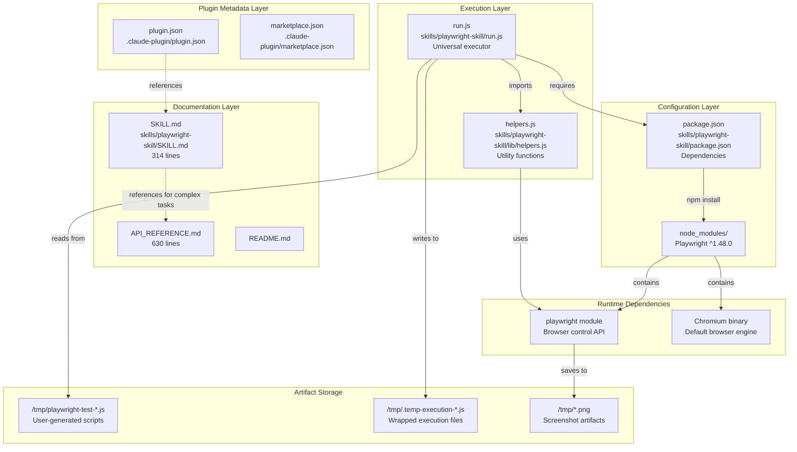
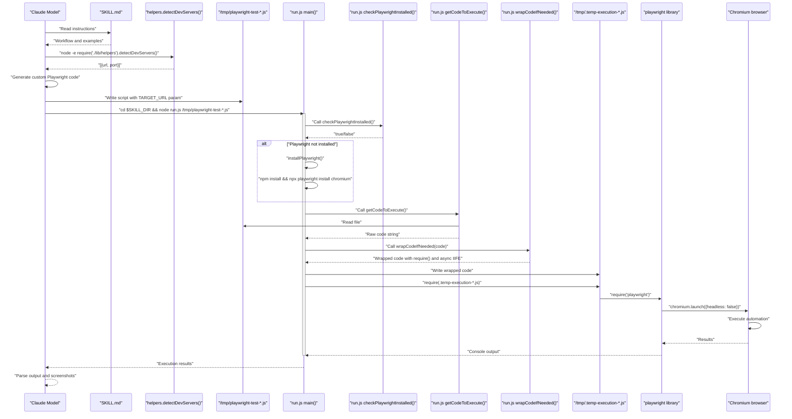
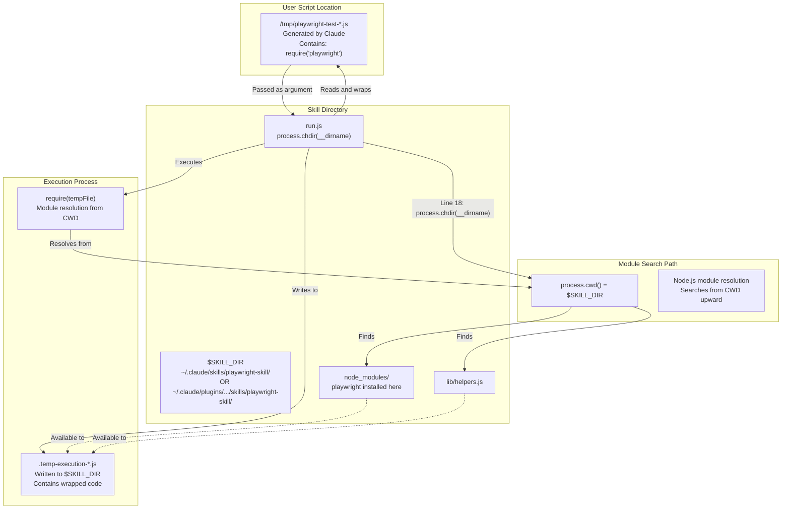
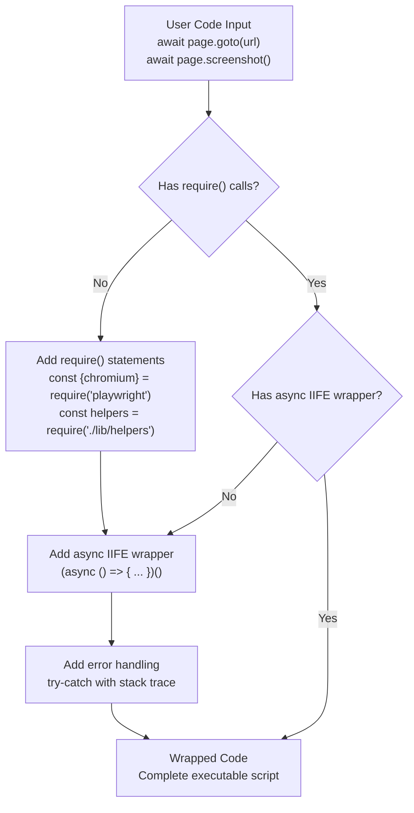
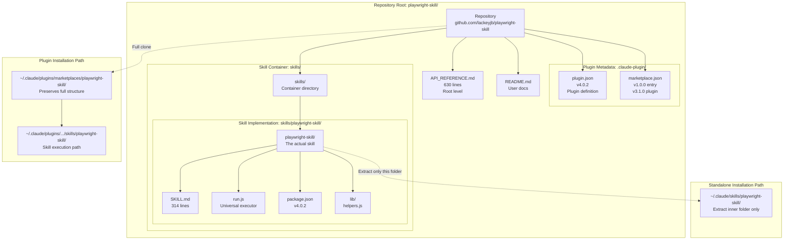
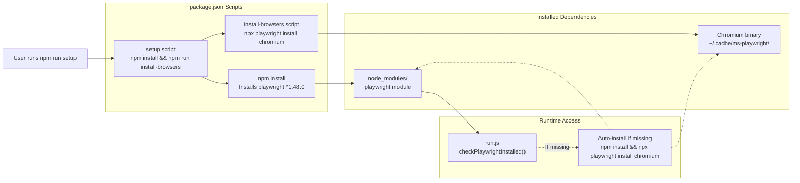
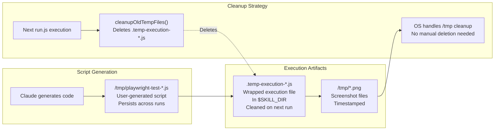
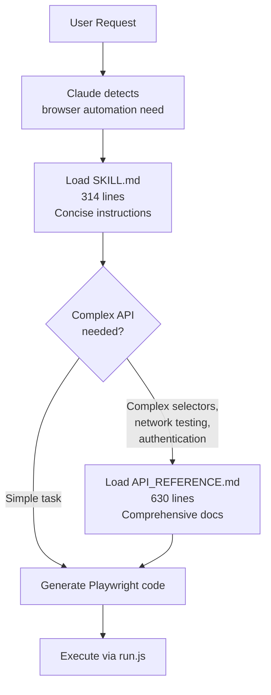

<!-- source: DeepWiki mcp.deepwiki.com · repo lackeyjb/playwright-skill · page 4 Architecture · fetched 2026-10-27 -->

# Architecture

<details>
<summary>Relevant source files</summary>

The following files were used as context for generating this wiki page:

- [README.md](README.md)
- [skills/playwright-skill/run.js](skills/playwright-skill/run.js)

</details>


## Purpose and Scope

This document provides a technical overview of the playwright-skill architecture, explaining how components interact to enable Claude to autonomously write and execute browser automation code. It covers the overall system design, component relationships, execution flow, and module resolution strategy.

For detailed information about specific components, see:
- System components reference: [System Components](#4.1)
- run.js implementation details: [run.js: The Universal Executor](#4.2)
- Helper functions API: [Helper Functions Library](#4.3)
- SKILL.md structure: [SKILL.md: Instructions for Claude](#4.4)
- Artifact storage patterns: [Artifact Management](#4.5)
- Path resolution mechanics: [Path Resolution and $SKILL_DIR](#4.6)

For installation and distribution patterns, see [Distribution Model](#3.2).

---

## High-Level Component Architecture

The playwright-skill system consists of several layers that work together to enable autonomous browser automation through Claude Code.

### Component Overview Diagram



**Sources:** [README.md:166-184](), [skills/playwright-skill/run.js:1-209]()

### Core Components

| Component | Location | Purpose | Key Functions |
|-----------|----------|---------|---------------|
| `run.js` | `skills/playwright-skill/run.js` | Universal executor that handles module resolution and code execution | `checkPlaywrightInstalled()`, `installPlaywright()`, `getCodeToExecute()`, `wrapCodeIfNeeded()`, `cleanupOldTempFiles()` |
| `lib/helpers.js` | `skills/playwright-skill/lib/helpers.js` | Reusable automation patterns | `detectDevServers()`, `safeClick()`, `safeType()`, `takeScreenshot()`, `authenticate()`, `handleCookieBanner()`, `extractTableData()` |
| `SKILL.md` | `skills/playwright-skill/SKILL.md` | Instructions Claude reads for task execution | N/A (documentation) |
| `API_REFERENCE.md` | `API_REFERENCE.md` | Comprehensive Playwright API documentation | N/A (documentation) |
| `package.json` | `skills/playwright-skill/package.json` | Dependency manifest and setup scripts | N/A (configuration) |
| `plugin.json` | `.claude-plugin/plugin.json` | Plugin metadata for Claude Code | N/A (metadata) |
| `marketplace.json` | `.claude-plugin/marketplace.json` | Marketplace listing configuration | N/A (metadata) |

**Sources:** [README.md:166-184](), [skills/playwright-skill/run.js:1-11]()

---

## Execution Flow Architecture

The system follows a specific execution pipeline from Claude invocation to browser automation completion.

### End-to-End Execution Sequence



**Sources:** [skills/playwright-skill/run.js:162-208](), [skills/playwright-skill/run.js:23-30](), [skills/playwright-skill/run.js:35-47](), [skills/playwright-skill/run.js:52-81](), [skills/playwright-skill/run.js:109-157]()

### Key Execution Steps

1. **Skill Discovery**: Claude identifies browser automation need and loads `SKILL.md`
2. **Dev Server Detection**: Claude executes `detectDevServers()` via `node -e` command
3. **Code Generation**: Claude writes custom Playwright code with URL parameterization
4. **Artifact Creation**: Script written to `/tmp/playwright-test-*.js` to keep projects clean
5. **Execution Invocation**: Claude runs `cd $SKILL_DIR && node run.js /tmp/playwright-test-*.js`
6. **Module Resolution**: `run.js` changes directory to `__dirname` [skills/playwright-skill/run.js:18]()
7. **Dependency Check**: `checkPlaywrightInstalled()` verifies Playwright availability [skills/playwright-skill/run.js:23-30]()
8. **Code Loading**: `getCodeToExecute()` reads script from file path argument [skills/playwright-skill/run.js:52-81]()
9. **Code Wrapping**: `wrapCodeIfNeeded()` adds `require()` statements and async IIFE [skills/playwright-skill/run.js:109-157]()
10. **Temporary File Creation**: Wrapped code written to `.temp-execution-*.js` [skills/playwright-skill/run.js:181-185]()
11. **Execution**: `require(tempFile)` loads and executes the wrapped code [skills/playwright-skill/run.js:189]()
12. **Browser Automation**: Playwright controls browser with `headless: false` and `slowMo: 100`
13. **Cleanup**: Old temp files cleaned on next run [skills/playwright-skill/run.js:86-104]()

**Sources:** [skills/playwright-skill/run.js:162-208]()

---

## Module Resolution Strategy

The playwright-skill system uses a specific module resolution strategy to ensure `require('playwright')` and `require('./lib/helpers')` work correctly regardless of where scripts are written.

### Module Resolution Diagram



**Sources:** [skills/playwright-skill/run.js:14-18](), [skills/playwright-skill/run.js:181-189]()

### Why Module Resolution Matters

The challenge: Scripts are generated in `/tmp/` (to keep projects clean), but they need to `require('playwright')` which is installed in the skill directory's `node_modules/`.

The solution: `run.js` implements a three-step resolution strategy:

1. **Change Working Directory**: [skills/playwright-skill/run.js:18]() executes `process.chdir(__dirname)` to ensure the current working directory is the skill directory
2. **Create Temp File Locally**: [skills/playwright-skill/run.js:181]() writes `.temp-execution-*.js` to the skill directory (not `/tmp/`)
3. **Require with Local Resolution**: [skills/playwright-skill/run.js:189]() uses `require(tempFile)` which resolves modules from the current working directory

This allows scripts written to `/tmp/` to be wrapped and executed with proper access to both:
- `require('playwright')` → finds `node_modules/playwright`
- `require('./lib/helpers')` → finds `lib/helpers.js`

**Sources:** [skills/playwright-skill/run.js:14-18](), [skills/playwright-skill/run.js:181-189](), [README.md:200-202]()

---

## Code Wrapping Architecture

The `run.js` executor automatically wraps user code to add required infrastructure.

### Code Transformation Flow



**Sources:** [skills/playwright-skill/run.js:109-157]()

### Wrapping Patterns

The `wrapCodeIfNeeded()` function [skills/playwright-skill/run.js:109-157]() handles three scenarios:

#### Pattern 1: Bare Playwright Commands
```javascript
// Input code
await page.goto('https://example.com');
await page.screenshot({ path: 'screenshot.png' });

// Wrapped output
const { chromium, firefox, webkit, devices } = require('playwright');
const helpers = require('./lib/helpers');

(async () => {
  try {
    await page.goto('https://example.com');
    await page.screenshot({ path: 'screenshot.png' });
  } catch (error) {
    console.error('❌ Automation error:', error.message);
    if (error.stack) {
      console.error(error.stack);
    }
    process.exit(1);
  }
})();
```

**Sources:** [skills/playwright-skill/run.js:120-136]()

#### Pattern 2: Has require() but No Async Wrapper
```javascript
// Input code
const { chromium } = require('playwright');
const browser = await chromium.launch();

// Wrapped output - adds only async IIFE and error handling
(async () => {
  try {
    const { chromium } = require('playwright');
    const browser = await chromium.launch();
  } catch (error) {
    console.error('❌ Automation error:', error.message);
    if (error.stack) {
      console.error(error.stack);
    }
    process.exit(1);
  }
})();
```

**Sources:** [skills/playwright-skill/run.js:139-153]()

#### Pattern 3: Complete Script
```javascript
// Input code - already has require() and async wrapper
const { chromium } = require('playwright');
(async () => {
  const browser = await chromium.launch();
})();

// Output - returned as-is, no wrapping needed
```

**Sources:** [skills/playwright-skill/run.js:111-117]()

---

## Nested Directory Structure

The repository uses a nested structure to separate plugin concerns from skill implementation.

### Directory Structure Diagram



**Sources:** [README.md:22-34](), [README.md:166-184]()

### Rationale for Nested Structure

| Level | Path | Purpose |
|-------|------|---------|
| Repository Root | `playwright-skill/` | Git repository and distribution package |
| Plugin Metadata | `.claude-plugin/` | Plugin system metadata (JSON manifests) |
| Skills Container | `skills/` | Allows plugins to contain multiple skills |
| Skill Implementation | `skills/playwright-skill/` | Actual skill code and documentation |

The nested structure serves two purposes:

1. **Plugin Distribution**: The full structure (including `.claude-plugin/`) is needed for Claude Code's plugin system
2. **Standalone Distribution**: The inner `skills/playwright-skill/` folder can be extracted for direct installation

When installed as a plugin, Claude discovers the skill at:
```
~/.claude/plugins/marketplaces/playwright-skill/skills/playwright-skill/
```

When installed standalone, Claude discovers the skill at:
```
~/.claude/skills/playwright-skill/
```

Both paths contain the same skill implementation, but the plugin path preserves the full repository structure.

**Sources:** [README.md:22-95]()

---

## Dependency Management Architecture

The system manages dependencies through a coordinated setup process.

### Dependency Installation Flow



**Sources:** [skills/playwright-skill/run.js:35-47](), [README.md:190-194]()

### Dependency Check Logic

The `checkPlaywrightInstalled()` function [skills/playwright-skill/run.js:23-30]() verifies Playwright availability:

```javascript
function checkPlaywrightInstalled() {
  try {
    require.resolve('playwright');
    return true;
  } catch (e) {
    return false;
  }
}
```

If Playwright is not found, `installPlaywright()` [skills/playwright-skill/run.js:35-47]() automatically installs it:

```javascript
function installPlaywright() {
  console.log('📦 Playwright not found. Installing...');
  try {
    execSync('npm install', { stdio: 'inherit', cwd: __dirname });
    execSync('npx playwright install chromium', { stdio: 'inherit', cwd: __dirname });
    console.log('✅ Playwright installed successfully');
    return true;
  } catch (e) {
    console.error('❌ Failed to install Playwright:', e.message);
    console.error('Please run manually: cd', __dirname, '&& npm run setup');
    return false;
  }
}
```

This ensures the skill works even if the user skips the `npm run setup` step during installation.

**Sources:** [skills/playwright-skill/run.js:23-47](), [skills/playwright-skill/run.js:168-174]()

---

## Artifact Storage Strategy

All generated files and screenshots are stored in `/tmp/` to maintain clean project directories.

### Artifact Flow Diagram



**Sources:** [skills/playwright-skill/run.js:86-104](), [skills/playwright-skill/run.js:181-192]()

### Storage Locations

| Artifact Type | Location | Lifecycle | Purpose |
|---------------|----------|-----------|---------|
| User Scripts | `/tmp/playwright-test-*.js` | Persists (Claude manages) | Script written by Claude |
| Execution Files | `$SKILL_DIR/.temp-execution-*.js` | Cleaned on next run | Wrapped code with requires |
| Screenshots | `/tmp/*.png` | OS cleanup | Visual artifacts |

The cleanup function [skills/playwright-skill/run.js:86-104]() runs at the start of each execution:

```javascript
function cleanupOldTempFiles() {
  try {
    const files = fs.readdirSync(__dirname);
    const tempFiles = files.filter(f => f.startsWith('.temp-execution-') && f.endsWith('.js'));

    if (tempFiles.length > 0) {
      tempFiles.forEach(file => {
        const filePath = path.join(__dirname, file);
        try {
          fs.unlinkSync(filePath);
        } catch (e) {
          // Ignore errors - file might be in use or already deleted
        }
      });
    }
  } catch (e) {
    // Ignore directory read errors
  }
}
```

This strategy:
- Avoids race conditions with async operations (cleanup happens on *next* run, not during execution)
- Keeps the skill directory clean
- Allows temp files to exist long enough for long-running async operations
- Delegates `/tmp/` cleanup to the operating system

**Sources:** [skills/playwright-skill/run.js:86-104](), [skills/playwright-skill/run.js:165-166](), [skills/playwright-skill/run.js:191-192]()

---

## Progressive Disclosure Pattern

The documentation architecture implements progressive disclosure to minimize Claude's context window usage.

### Documentation Loading Strategy



**Sources:** [README.md:14](), [README.md:187-188]()

### Documentation Hierarchy

| Document | Size | Purpose | When Loaded |
|----------|------|---------|-------------|
| `SKILL.md` | 314 lines | Concise workflow, examples, best practices | Always (first) |
| `API_REFERENCE.md` | 630 lines | Complete Playwright API, advanced patterns | On demand for complex tasks |
| `README.md` | User documentation | Installation, quick start, troubleshooting | Not loaded by Claude |

This pattern ensures:
1. Claude always reads the concise `SKILL.md` first
2. Comprehensive documentation is available when needed
3. Context window is not wasted on unused information
4. Simple tasks complete faster with less context

**Sources:** [README.md:14](), [README.md:166-184](), [README.md:187-188]()

---

