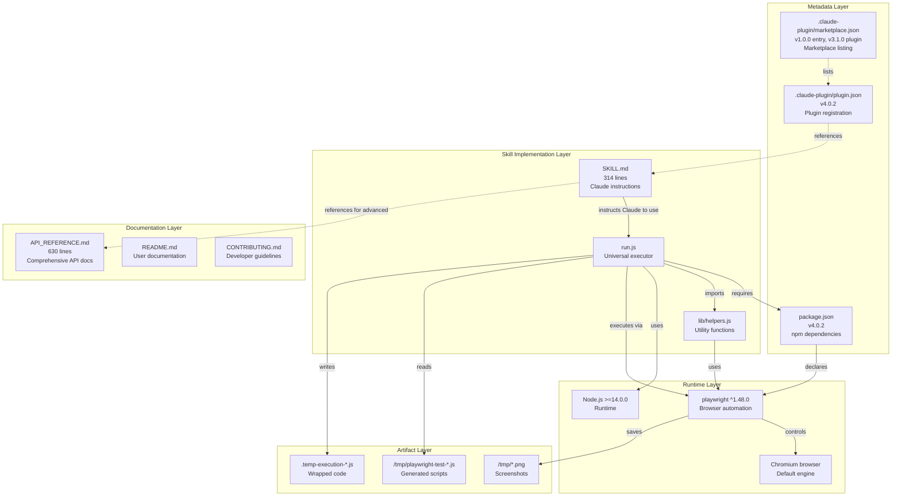
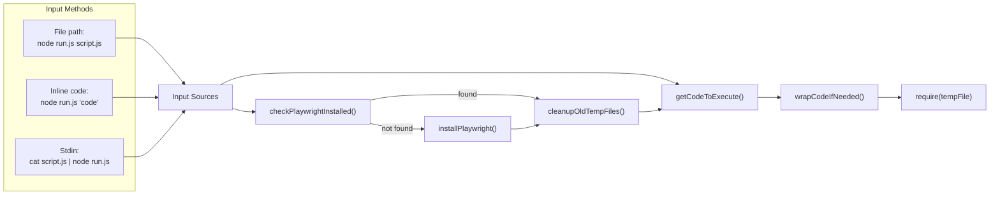
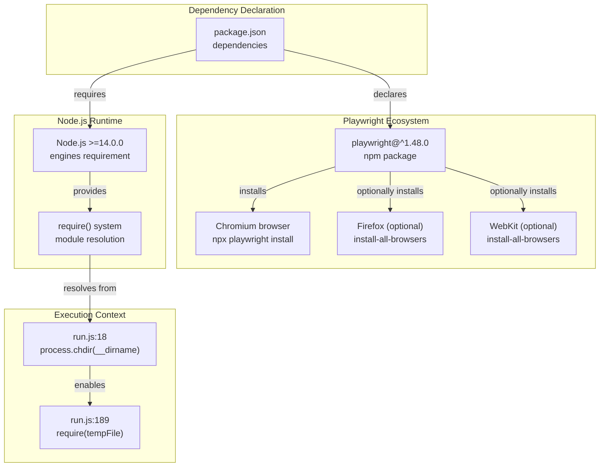
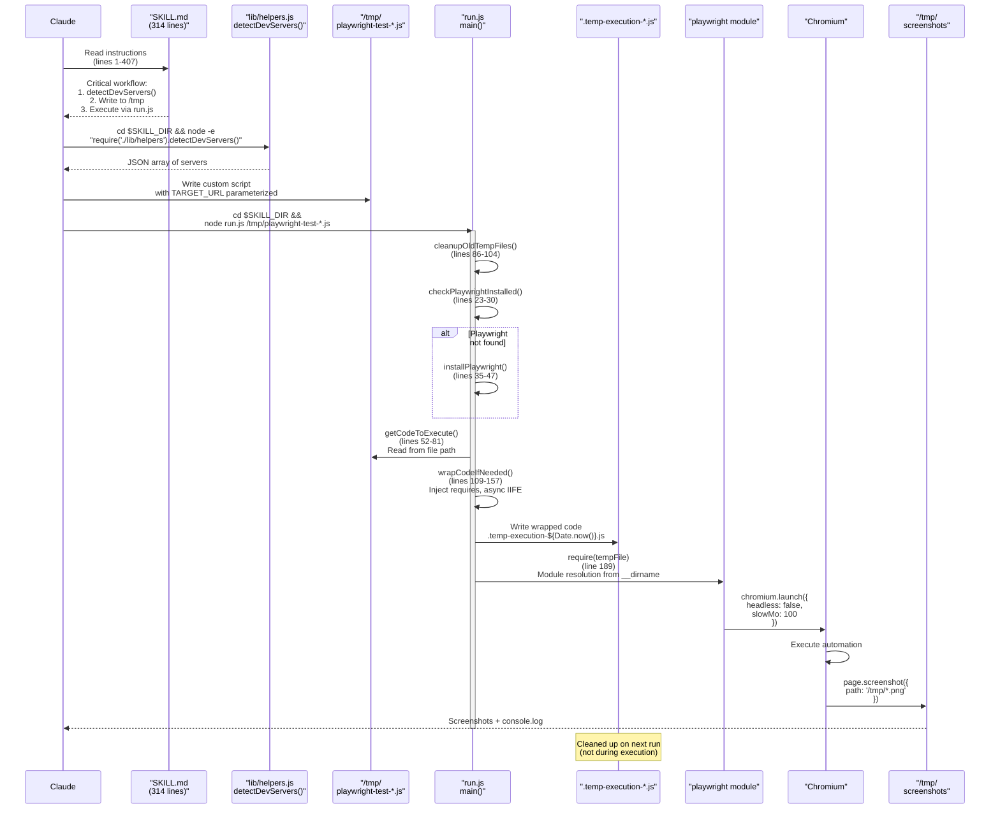

<!-- source: DeepWiki mcp.deepwiki.com · repo lackeyjb/playwright-skill · page 4.1 System Components · fetched 2026-10-27 -->

# System Components

<details>
<summary>Relevant source files</summary>

The following files were used as context for generating this wiki page:

- [README.md](README.md)
- [skills/playwright-skill/SKILL.md](skills/playwright-skill/SKILL.md)
- [skills/playwright-skill/package.json](skills/playwright-skill/package.json)
- [skills/playwright-skill/run.js](skills/playwright-skill/run.js)

</details>


This page provides a comprehensive overview of all major components in the playwright-skill system, including plugin metadata, skill implementation files, executors, helper libraries, and documentation. It explains the role of each component and how they interact to provide browser automation capabilities to Claude Code.

For detailed information about specific components, see:
- [run.js: The Universal Executor](#4.2) for deep dive into the execution engine
- [Helper Functions Library](#4.3) for utility function documentation
- [SKILL.md: Instructions for Claude](#4.4) for Claude's instruction set
- [Artifact Management](#4.5) for temporary file handling

## Component Architecture Overview

The playwright-skill system is organized into five distinct layers, each containing specific files and components that serve different purposes in the automation workflow.



**Sources:** [README.md:166-184](), [skills/playwright-skill/package.json:1-26](), [skills/playwright-skill/SKILL.md:1-407]()

## Metadata Components

The metadata layer defines how the skill is registered, distributed, and configured within the Claude Code ecosystem.

### plugin.json

Located at [.claude-plugin/plugin.json](), this file registers the skill with Claude Code's plugin system at version 4.0.2. It defines the plugin metadata that allows Claude to discover and load the skill.

**Key Attributes:**
- Plugin versioning independent from marketplace entry
- References the nested `skills/` directory structure
- Enables plugin-based installation at `~/.claude/plugins/marketplaces/playwright-skill/skills/playwright-skill`

### marketplace.json

Located at [.claude-plugin/marketplace.json](), this file contains dual versioning: marketplace entry at v1.0.0 and plugin metadata at v3.1.0. It defines how the skill appears in Claude's marketplace listings.

**Key Attributes:**
- Marketplace entry version (v1.0.0)
- Plugin version reference (v3.1.0)
- Distribution metadata for marketplace discovery

### package.json

Located at [skills/playwright-skill/package.json:1-26](), this npm manifest defines dependencies and setup scripts.

| Field | Value | Purpose |
|-------|-------|---------|
| `name` | `"playwright-skill"` | Package identifier |
| `version` | `"4.0.2"` | Package version |
| `main` | `"run.js"` | Entry point for execution |
| `dependencies.playwright` | `"^1.48.0"` | Browser automation library |
| `scripts.setup` | `"npm install && npx playwright install chromium"` | One-time installation |
| `scripts.install-all-browsers` | `"npx playwright install chromium firefox webkit"` | Install all browsers |
| `engines.node` | `">=14.0.0"` | Minimum Node.js version |

**Sources:** [skills/playwright-skill/package.json:1-26](), [README.md:166-184]()

## Skill Implementation Components

The implementation layer contains the core functional components that execute browser automation.

### run.js - Universal Executor

Located at [skills/playwright-skill/run.js:1-209](), this is the primary execution engine that handles all code execution with proper module resolution.



**Core Functions:**

| Function | Lines | Purpose |
|----------|-------|---------|
| `checkPlaywrightInstalled()` | [23-30]() | Checks if `playwright` module is resolvable |
| `installPlaywright()` | [35-47]() | Runs `npm install` and `npx playwright install chromium` |
| `getCodeToExecute()` | [52-81]() | Reads from file path, inline args, or stdin |
| `cleanupOldTempFiles()` | [86-104]() | Removes `.temp-execution-*.js` from previous runs |
| `wrapCodeIfNeeded(code)` | [109-157]() | Injects `require()` and async IIFE wrapper if needed |
| `main()` | [162-202]() | Orchestrates execution pipeline |

**Module Resolution Strategy:**
- [Line 18](): `process.chdir(__dirname)` - Changes to skill directory
- [Line 189](): `require(tempFile)` - Executes from skill directory context
- This ensures `require('playwright')` and `require('./lib/helpers')` resolve correctly regardless of installation location

**Sources:** [skills/playwright-skill/run.js:1-209]()

### lib/helpers.js - Utility Library

Located at [skills/playwright-skill/lib/helpers.js](), this module provides reusable automation patterns referenced in [skills/playwright-skill/SKILL.md:299-324]().

**Primary Functions:**

| Function | Reference in SKILL.md | Purpose |
|----------|----------------------|---------|
| `detectDevServers()` | [Lines 24-30, 60-61]() | Scans ports 3000, 5173, 8080, 4200, 5000 |
| `safeClick(page, selector, options)` | [Line 309]() | Click with retry logic |
| `safeType(page, selector, text)` | [Line 312]() | Type with input clearing |
| `takeScreenshot(page, name)` | [Line 315]() | Timestamped screenshot to `/tmp` |
| `handleCookieBanner(page)` | [Line 318]() | Auto-dismiss cookie prompts |
| `extractTableData(page, selector)` | [Line 321]() | Extract table rows as objects |

**Detection Pattern:**
The `detectDevServers()` function is invoked via Node.js inline execution as shown in [skills/playwright-skill/SKILL.md:24-26]():
```bash
cd $SKILL_DIR && node -e "require('./lib/helpers').detectDevServers().then(servers => console.log(JSON.stringify(servers)))"
```

**Sources:** [skills/playwright-skill/SKILL.md:299-324](), [skills/playwright-skill/SKILL.md:24-30]()

### SKILL.md - Claude Instructions

Located at [skills/playwright-skill/SKILL.md:1-407](), this 314-line file provides instructions that Claude reads when browser automation is needed.

**Critical Workflow Definition:**
[Lines 21-30]() define the mandatory execution sequence:
1. Run `detectDevServers()` for localhost testing
2. Write scripts to `/tmp/playwright-test-*.js`
3. Use `headless: false` by default
4. Parameterize URLs via `TARGET_URL` constant
5. Execute via `cd $SKILL_DIR && node run.js /tmp/playwright-test-*.js`

**Example Pattern Structure:**
[Lines 94-118]() demonstrate responsive testing:
- Desktop viewport: 1920x1080
- Mobile viewport: 375x667
- Screenshots to `/tmp/desktop.png` and `/tmp/mobile.png`
- `TARGET_URL` parameterization: [Line 100]()

**Path Resolution:**
[Lines 9-15]() document dynamic `$SKILL_DIR` resolution based on installation method:
- Plugin: `~/.claude/plugins/marketplaces/playwright-skill/skills/playwright-skill`
- Global: `~/.claude/skills/playwright-skill`
- Project: `<project>/.claude/skills/playwright-skill`

**Sources:** [skills/playwright-skill/SKILL.md:1-407]()

## Documentation Components

### API_REFERENCE.md

Referenced in [skills/playwright-skill/SKILL.md:328-338]() as the comprehensive 630-line API documentation loaded only when advanced features are needed (progressive disclosure pattern).

**Coverage Areas:**
- Selectors & Locators best practices
- Network interception & API mocking
- Authentication & session management
- Visual regression testing
- Mobile device emulation
- Performance testing
- Debugging techniques
- CI/CD integration

### README.md

Located at [README.md:1-232](), this user-facing documentation explains:
- Installation paths for plugin vs standalone: [Lines 22-95]()
- Nested structure rationale: [Lines 24-34]()
- Setup command: `npm run setup` [Lines 48-51]()
- Project structure diagram: [Lines 166-184]()

### CONTRIBUTING.md

Developer guidelines referenced in [README.md:218]() for contribution workflows, branching, and code style.

**Sources:** [README.md:1-232](), [skills/playwright-skill/SKILL.md:328-338]()

## Runtime Dependency Components

The runtime layer consists of external dependencies managed through `package.json`.



**Installation Commands:**
- `npm run setup` [Line 8](): Installs `playwright` and Chromium
- `npm run install-all-browsers` [Line 9](): Installs Chromium, Firefox, and WebKit

**Version Constraints:**
- Playwright: `^1.48.0` [Line 20]() - Caret allows minor/patch updates
- Node.js: `>=14.0.0` [Line 23]() - Minimum version requirement

**Sources:** [skills/playwright-skill/package.json:7-24](), [skills/playwright-skill/run.js:18](), [skills/playwright-skill/run.js:189]()

## Artifact Components

Runtime artifacts are generated during execution and stored in specific locations to maintain clean project structures.

### Generated Script Files

**User Scripts:**
- Pattern: `/tmp/playwright-test-*.js` as specified in [skills/playwright-skill/SKILL.md:31]()
- Purpose: Custom automation code written by Claude
- Lifecycle: Persists until OS cleanup (not deleted by skill)
- Example: `/tmp/playwright-test-login.js` [Line 123]()

**Wrapped Execution Files:**
- Pattern: `.temp-execution-${Date.now()}.js` [skills/playwright-skill/run.js:181]()
- Location: Skill directory (`__dirname`)
- Purpose: Code wrapped with `require()` statements and error handling
- Lifecycle: Cleaned up by `cleanupOldTempFiles()` on next run [Lines 86-104]()

### Screenshot Artifacts

Screenshots are saved to `/tmp/` as specified in patterns throughout [skills/playwright-skill/SKILL.md]():
- Full page: `/tmp/screenshot.png` [Line 79]()
- Responsive: `/tmp/desktop.png`, `/tmp/mobile.png` [Lines 110, 114]()
- Timestamped: `/tmp/test-result-${timestamp}.png` via `helpers.takeScreenshot()`

**Storage Strategy:**
- All artifacts in `/tmp` directory
- Never in repository or project directory
- OS handles cleanup
- Prevents build artifact pollution

**Sources:** [skills/playwright-skill/SKILL.md:31](), [skills/playwright-skill/SKILL.md:79-115](), [skills/playwright-skill/run.js:181](), [skills/playwright-skill/run.js:86-104]()

## Component Interaction Flow

This diagram maps the complete execution flow from Claude's decision to invoke the skill through to artifact generation, showing how components interact.



**Key Interaction Points:**

1. **SKILL.md → Claude**: Instructions define workflow [Lines 21-30]()
2. **Claude → helpers.js**: Server detection via inline Node execution [Lines 24-26]()
3. **Claude → /tmp**: Script generation with URL parameterization [Line 31]()
4. **run.js → package.json**: Dependency checking [Lines 23-30]()
5. **run.js → wrapper**: Code wrapping and temp file creation [Lines 109-181]()
6. **run.js → playwright**: Module execution from skill directory [Line 189]()
7. **playwright → /tmp**: Artifact generation [Line 79]()

**Sources:** [skills/playwright-skill/SKILL.md:21-31](), [skills/playwright-skill/run.js:23-189](), [skills/playwright-skill/package.json:1-26]()

## Installation Location Components

The skill supports three installation contexts, each with different path resolution requirements documented in [skills/playwright-skill/SKILL.md:9-15]().

| Installation Type | Path | $SKILL_DIR Resolution | Command Prefix |
|-------------------|------|----------------------|----------------|
| Plugin System | `~/.claude/plugins/marketplaces/playwright-skill/skills/playwright-skill` | Discovered by Claude | `cd $SKILL_DIR &&` |
| Manual Global | `~/.claude/skills/playwright-skill` | User's global skills directory | `cd $SKILL_DIR &&` |
| Project-Specific | `<project>/.claude/skills/playwright-skill` | Project's skills directory | `cd $SKILL_DIR &&` |

**Nested Structure Requirement:**
The repository structure [README.md:24-31]() shows:
```
playwright-skill/              # Plugin root
├── .claude-plugin/           # Plugin metadata
└── skills/
    └── playwright-skill/     # The actual skill (extract this for standalone)
```

For standalone installation, only `skills/playwright-skill/` contents should be copied to avoid nested structure: [README.md:33-34](), [README.md:95]().

**Sources:** [skills/playwright-skill/SKILL.md:9-15](), [README.md:24-95]()

## Version Alignment

Different components maintain independent version numbers that must be understood in context.

| Component | Version | Defined In | Purpose |
|-----------|---------|------------|---------|
| package.json | 4.0.2 | [package.json:3]() | npm package version |
| plugin.json | 4.0.2 | [.claude-plugin/plugin.json]() | Plugin registration version |
| marketplace.json (entry) | 1.0.0 | [.claude-plugin/marketplace.json]() | Marketplace entry version |
| marketplace.json (plugin) | 3.1.0 | [.claude-plugin/marketplace.json]() | Plugin metadata version |
| SKILL.md | 4.0.0 | [SKILL.md:4]() | Skill instructions version |

**Versioning Strategy:**
- `package.json` and `plugin.json` remain synchronized at 4.0.2
- Marketplace entry version (1.0.0) is independent
- Plugin metadata version (3.1.0) tracks plugin format changes
- SKILL.md version (4.0.0) tracks instruction set changes

**Sources:** [skills/playwright-skill/package.json:3](), [skills/playwright-skill/SKILL.md:4](), [README.md:166-184]()

---

