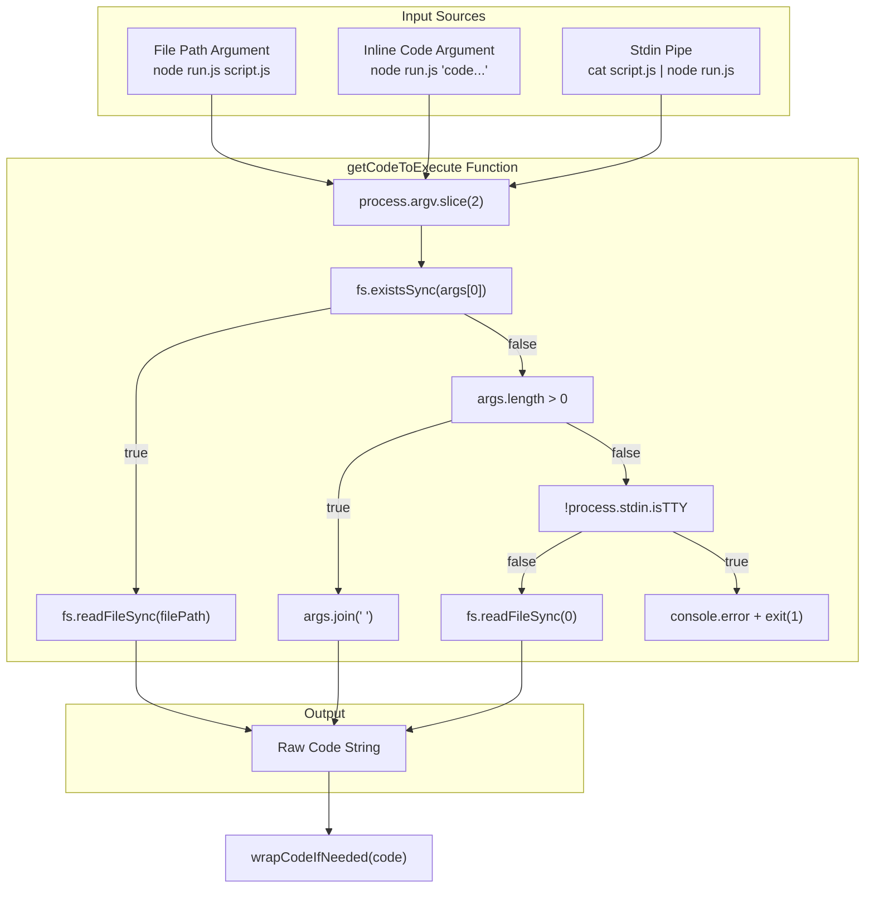
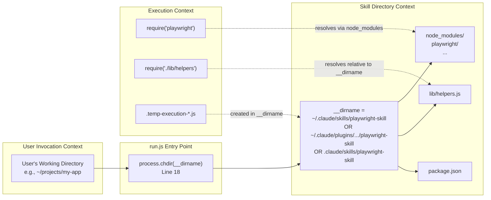
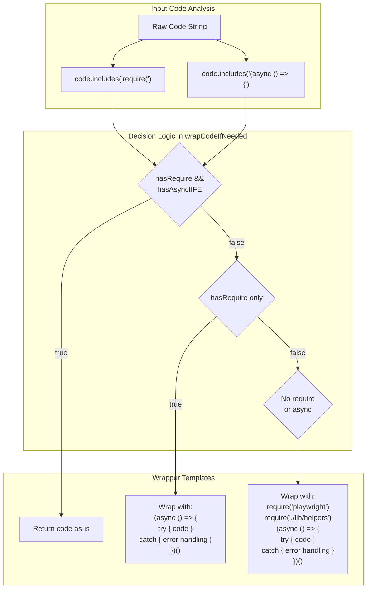
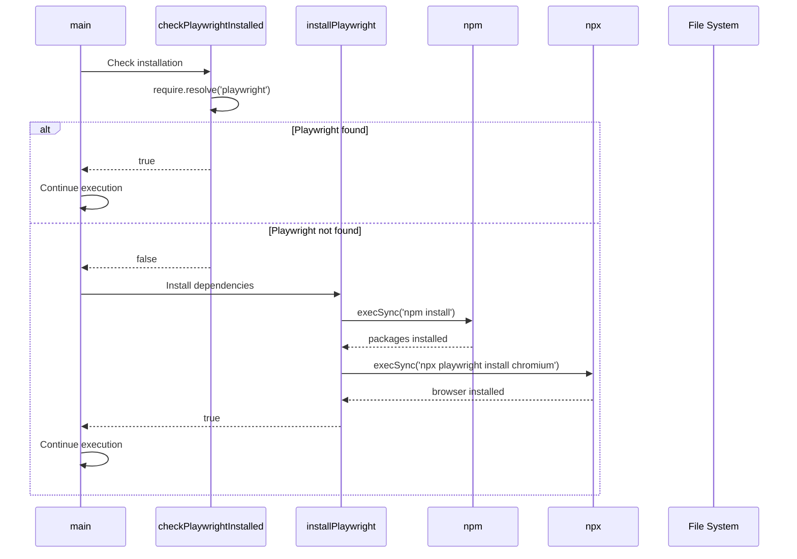
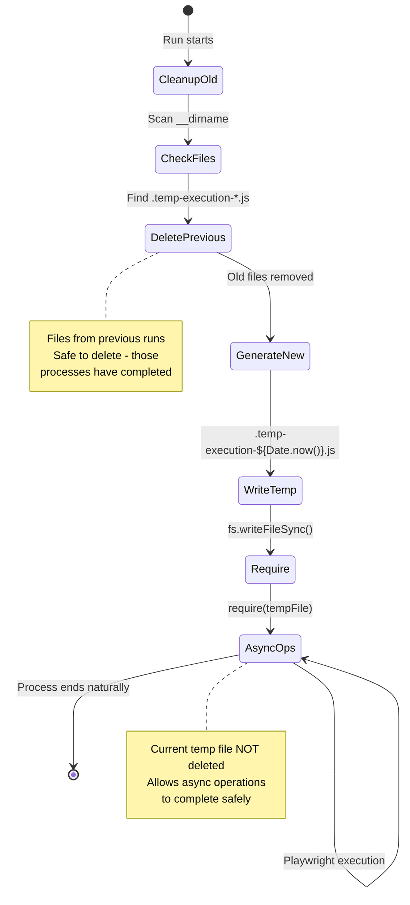
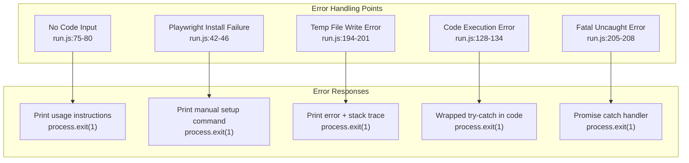
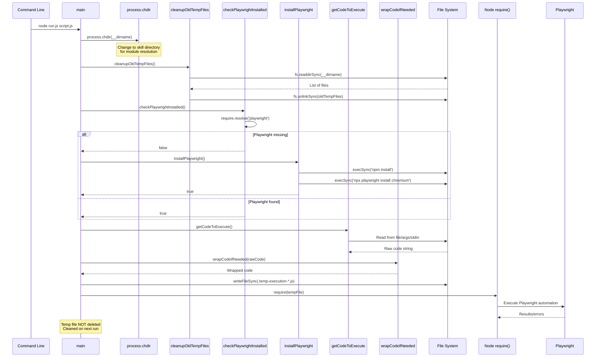

<!-- source: DeepWiki mcp.deepwiki.com · repo lackeyjb/playwright-skill · page 4.2 run.js: The Universal Executor · fetched 2026-10-27 -->

# run.js: The Universal Executor

<details>
<summary>Relevant source files</summary>

The following files were used as context for generating this wiki page:

- [README.md](README.md)
- [skills/playwright-skill/SKILL.md](skills/playwright-skill/SKILL.md)
- [skills/playwright-skill/run.js](skills/playwright-skill/run.js)

</details>


## Purpose and Scope

This document provides a technical deep dive into `run.js`, the universal executor that handles all Playwright code execution within the playwright-skill system. The executor ensures proper module resolution, manages Playwright dependencies, wraps user code with necessary infrastructure, and provides three flexible execution modes (file, inline, stdin).

For information about the helper functions that `run.js` imports, see [Helper Functions Library](#4.3). For details on how SKILL.md instructs Claude to use `run.js`, see [SKILL.md: Instructions for Claude](#4.4). For the overall component architecture, see [System Components](#4.1).

## Overview

The `run.js` executor [skills/playwright-skill/run.js:1-209]() serves as the universal entry point for executing Playwright automation code. It abstracts away module resolution complexities, dependency management, and code infrastructure concerns, allowing Claude to generate clean Playwright code that executes reliably regardless of installation method.

**Key Responsibilities:**
- Execute Playwright code from multiple input sources
- Ensure proper module resolution by changing to skill directory
- Auto-install Playwright and Chromium if missing
- Wrap code with necessary imports and error handling
- Manage temporary execution file lifecycle
- Clean up artifacts from previous runs

**Execution Command Pattern:**
```bash
cd $SKILL_DIR && node run.js /tmp/playwright-test-*.js
```

Sources: [skills/playwright-skill/run.js:1-209](), [skills/playwright-skill/SKILL.md:42](), [README.md:154]()

## Execution Modes

The executor supports three distinct input methods, providing flexibility for different use cases.



**Diagram: Input Mode Resolution Flow**

### File Mode

Executes Playwright code from a file path. This is the primary mode used by Claude when generating automation scripts.

**Implementation:** [skills/playwright-skill/run.js:56-60]()

```javascript
// Case 1: File path provided
if (args.length > 0 && fs.existsSync(args[0])) {
  const filePath = path.resolve(args[0]);
  console.log(`📄 Executing file: ${filePath}`);
  return fs.readFileSync(filePath, 'utf8');
}
```

**Usage:**
```bash
node run.js /tmp/playwright-test-page.js
```

**Use Case:** Complex automation scripts written to `/tmp` directory.

### Inline Mode

Executes Playwright code provided directly as a command-line argument. Useful for quick one-off tasks.

**Implementation:** [skills/playwright-skill/run.js:62-66]()

```javascript
// Case 2: Inline code provided as argument
if (args.length > 0) {
  console.log('⚡ Executing inline code');
  return args.join(' ');
}
```

**Usage:**
```bash
node run.js "const browser = await chromium.launch(); await browser.close();"
```

**Use Case:** Quick screenshot capture, element existence checks, simple page validation.

### Stdin Mode

Executes Playwright code piped through stdin. Enables integration with shell pipelines and external code generation tools.

**Implementation:** [skills/playwright-skill/run.js:68-72]()

```javascript
// Case 3: Code from stdin
if (!process.stdin.isTTY) {
  console.log('📥 Reading from stdin');
  return fs.readFileSync(0, 'utf8');
}
```

**Usage:**
```bash
cat test-script.js | node run.js
echo "await page.goto('http://localhost:3000');" | node run.js
```

**Use Case:** Shell script automation, external code generation pipelines.

Sources: [skills/playwright-skill/run.js:52-81](), [skills/playwright-skill/SKILL.md:277-296]()

## Module Resolution Strategy

The executor solves module resolution issues by changing the process working directory to the skill directory before execution. This ensures all `require()` statements resolve correctly regardless of where the command is invoked.



**Diagram: Module Resolution Path**

### Critical Working Directory Change

**Implementation:** [skills/playwright-skill/run.js:18]()

```javascript
// Change to skill directory for proper module resolution
process.chdir(__dirname);
```

This single line is critical. Without it, `require('playwright')` would fail if:
- The user's project doesn't have Playwright installed
- The command is run from a different directory
- The skill is installed in a non-standard location

### Why This Matters

**Problem:** User-generated scripts in `/tmp` contain `require('playwright')`, but `/tmp` has no `node_modules`.

**Solution:** By changing to the skill directory, Node.js resolves modules relative to `__dirname`, where `node_modules/playwright` exists.

**Impact:**
- Scripts execute reliably regardless of installation method
- No need to modify user's project `package.json`
- Works in plugin system, global installation, and project-specific installation

Sources: [skills/playwright-skill/run.js:18](), [skills/playwright-skill/SKILL.md:9-15](), [README.md:202]()

## Code Wrapping Mechanism

The executor intelligently wraps user code with necessary infrastructure, detecting what's already present and adding only what's missing.



**Diagram: Code Wrapping Decision Tree**

### Full Template Wrapping

When code lacks both `require()` statements and async structure, the executor applies the full template.

**Implementation:** [skills/playwright-skill/run.js:120-137]()

```javascript
// If it's just Playwright commands, wrap in full template
if (!hasRequire) {
  return `
const { chromium, firefox, webkit, devices } = require('playwright');
const helpers = require('./lib/helpers');

(async () => {
  try {
    ${code}
  } catch (error) {
    console.error('❌ Automation error:', error.message);
    if (error.stack) {
      console.error(error.stack);
    }
    process.exit(1);
  }
})();
`;
}
```

**Injected Infrastructure:**
| Component | Purpose |
|-----------|---------|
| `require('playwright')` | Imports `chromium`, `firefox`, `webkit`, `devices` |
| `require('./lib/helpers')` | Imports utility functions |
| `(async () => { ... })()` | Creates async IIFE for await support |
| `try-catch` | Adds error handling with stack trace |
| `process.exit(1)` | Ensures non-zero exit code on failure |

### Async-Only Wrapping

When code has `require()` but no async wrapper, only the IIFE is added.

**Implementation:** [skills/playwright-skill/run.js:140-154]()

```javascript
// If has require but no async wrapper
if (!hasAsyncIIFE) {
  return `
(async () => {
  try {
    ${code}
  } catch (error) {
    console.error('❌ Automation error:', error.message);
    if (error.stack) {
      console.error(error.stack);
    }
    process.exit(1);
  }
})();
`;
}
```

### No Wrapping

When code is already complete (has both `require()` and async structure), it's returned as-is.

**Implementation:** [skills/playwright-skill/run.js:115-117]()

```javascript
// If it's already a complete script, return as-is
if (hasRequire && hasAsyncIIFE) {
  return code;
}
```

**Example Complete Script:**
```javascript
const { chromium } = require('playwright');

(async () => {
  const browser = await chromium.launch({ headless: false });
  const page = await browser.newPage();
  await page.goto('http://localhost:3001');
  await browser.close();
})();
```

Sources: [skills/playwright-skill/run.js:109-157]()

## Dependency Management

The executor implements auto-installation of Playwright and Chromium browser, ensuring the skill works immediately after installation without manual setup.



**Diagram: Dependency Auto-Installation Flow**

### Installation Check

**Implementation:** [skills/playwright-skill/run.js:23-30]()

```javascript
function checkPlaywrightInstalled() {
  try {
    require.resolve('playwright');
    return true;
  } catch (e) {
    return false;
  }
}
```

**Mechanism:** Uses `require.resolve()` to check if the `playwright` module is resolvable. Returns `false` if the module is not found, triggering auto-installation.

### Auto-Installation Process

**Implementation:** [skills/playwright-skill/run.js:35-47]()

```javascript
function installPlaywright() {
  console.log('📦 Playwright not found. Installing...');
  try {
    execSync('npm install', { stdio: 'inherit', cwd: __dirname });
    execSync('npx playwright install chromium', { stdio: 'inherit', cwd: __dirname });
    console.log('✅ Playwright installed successfully');
    return true;
  } catch (e) {
    console.error('❌ Failed to install Playwright:', e.message);
    console.error('Please run manually: cd', __dirname, '&& npm run setup');
    return false;
  }
}
```

**Installation Steps:**

| Step | Command | Purpose |
|------|---------|---------|
| 1 | `npm install` | Installs packages from `package.json` including `playwright ^1.48.0` |
| 2 | `npx playwright install chromium` | Downloads Chromium browser binary |
| 3 | Error handling | Falls back to manual instructions if auto-install fails |

**Options Used:**
- `stdio: 'inherit'` - Pipes installation output to console for visibility
- `cwd: __dirname` - Ensures commands run in skill directory

### Integration with Main Flow

**Implementation:** [skills/playwright-skill/run.js:168-174]()

```javascript
// Check Playwright installation
if (!checkPlaywrightInstalled()) {
  const installed = installPlaywright();
  if (!installed) {
    process.exit(1);
  }
}
```

The installation check happens early in the main flow, before code execution, ensuring dependencies are available.

Sources: [skills/playwright-skill/run.js:23-47](), [skills/playwright-skill/run.js:168-174](), [skills/playwright-skill/package.json]()

## Temporary File Lifecycle

The executor creates temporary execution files in the skill directory and implements a safe cleanup strategy that avoids race conditions with async operations.



**Diagram: Temporary File Lifecycle State Machine**

### Cleanup Strategy

**Old File Cleanup:** [skills/playwright-skill/run.js:86-104]()

```javascript
function cleanupOldTempFiles() {
  try {
    const files = fs.readdirSync(__dirname);
    const tempFiles = files.filter(f => f.startsWith('.temp-execution-') && f.endsWith('.js'));

    if (tempFiles.length > 0) {
      tempFiles.forEach(file => {
        const filePath = path.join(__dirname, file);
        try {
          fs.unlinkSync(filePath);
        } catch (e) {
          // Ignore errors - file might be in use or already deleted
        }
      });
    }
  } catch (e) {
    // Ignore directory read errors
  }
}
```

**Key Design Decisions:**

| Decision | Rationale |
|----------|-----------|
| Delete on **next run**, not current | Avoids race conditions with async Playwright operations |
| Ignore deletion errors | Handles concurrent executions gracefully |
| Filter by prefix `.temp-execution-` | Only removes executor temp files, not user files |

### Temporary File Creation

**Implementation:** [skills/playwright-skill/run.js:181-189]()

```javascript
// Create temporary file for execution
const tempFile = path.join(__dirname, `.temp-execution-${Date.now()}.js`);

try {
  // Write code to temp file
  fs.writeFileSync(tempFile, code, 'utf8');

  // Execute the code
  console.log('🚀 Starting automation...\n');
  require(tempFile);
```

**Naming Convention:**
- Pattern: `.temp-execution-${timestamp}.js`
- Example: `.temp-execution-1704812345678.js`
- Hidden file (starts with `.`)
- Timestamp ensures uniqueness for concurrent executions

### Why Not Delete Immediately?

**Problem:** Playwright operations are asynchronous. Deleting the temp file immediately after `require()` causes errors:

```javascript
// ❌ BAD - Race condition
require(tempFile);
fs.unlinkSync(tempFile); // File deleted while async operations running
```

**Solution:** Leave the file until the next run. By then, the async operations from the previous run have completed.

**Tradeoff:**
- **Pro:** Safe async execution, no race conditions
- **Con:** Temp files accumulate between runs (but cleaned on next execution)

Sources: [skills/playwright-skill/run.js:86-104](), [skills/playwright-skill/run.js:181-193](), [skills/playwright-skill/SKILL.md:44]()

## Error Handling

The executor implements comprehensive error handling across all stages of execution.



**Diagram: Error Handling Architecture**

### Input Validation Errors

**Implementation:** [skills/playwright-skill/run.js:74-81]()

```javascript
// No input
console.error('❌ No code to execute');
console.error('Usage:');
console.error('  node run.js script.js          # Execute file');
console.error('  node run.js "code here"        # Execute inline');
console.error('  cat script.js | node run.js    # Execute from stdin');
process.exit(1);
```

Provides clear usage instructions when no valid input is detected.

### Installation Errors

**Implementation:** [skills/playwright-skill/run.js:42-46]()

```javascript
console.error('❌ Failed to install Playwright:', e.message);
console.error('Please run manually: cd', __dirname, '&& npm run setup');
return false;
```

Falls back to manual instructions, showing the exact path to the skill directory.

### Wrapped Code Error Handling

**Implementation:** [skills/playwright-skill/run.js:128-134]()

```javascript
try {
  ${code}
} catch (error) {
  console.error('❌ Automation error:', error.message);
  if (error.stack) {
    console.error(error.stack);
  }
  process.exit(1);
}
```

All wrapped code includes error handling that:
- Prints user-friendly error message
- Includes full stack trace for debugging
- Exits with non-zero code for shell script integration

### Execution Errors

**Implementation:** [skills/playwright-skill/run.js:194-201]()

```javascript
} catch (error) {
  console.error('❌ Execution failed:', error.message);
  if (error.stack) {
    console.error('\n📋 Stack trace:');
    console.error(error.stack);
  }
  process.exit(1);
}
```

Catches errors during temp file creation or code execution.

### Fatal Error Handler

**Implementation:** [skills/playwright-skill/run.js:205-208]()

```javascript
// Run main function
main().catch(error => {
  console.error('❌ Fatal error:', error.message);
  process.exit(1);
});
```

Final safety net for uncaught promise rejections in the main async function.

Sources: [skills/playwright-skill/run.js:42-46](), [skills/playwright-skill/run.js:74-81](), [skills/playwright-skill/run.js:128-134](), [skills/playwright-skill/run.js:194-208]()

## Main Execution Flow

The following diagram shows the complete execution flow from invocation to completion.



**Diagram: Complete Main Execution Sequence**

### Entry Point

**Implementation:** [skills/playwright-skill/run.js:162-208]()

The `main()` async function orchestrates the entire execution:

1. Print banner
2. Clean up old temp files
3. Check/install Playwright
4. Get code to execute
5. Wrap code if needed
6. Create temp file
7. Execute code via `require()`
8. Handle errors
9. Exit naturally (temp file remains)

### Process Context Management

**Critical Setup:** [skills/playwright-skill/run.js:18]()

```javascript
process.chdir(__dirname);
```

This must happen before any module resolution, ensuring all subsequent `require()` calls resolve relative to the skill directory.

Sources: [skills/playwright-skill/run.js:162-208](), [skills/playwright-skill/run.js:18]()

## Integration with Skill System

The executor is designed to work seamlessly with the model-invoked skill pattern and Claude's code generation.

### Claude Invocation Pattern

**From SKILL.md:** [skills/playwright-skill/SKILL.md:42]()

```bash
cd $SKILL_DIR && node run.js /tmp/playwright-test-*.js
```

Claude always:
1. Resolves `$SKILL_DIR` based on where SKILL.md was loaded
2. Uses `cd` to change to skill directory (redundant with internal `chdir` but explicit)
3. Invokes `run.js` with path to generated script in `/tmp`

### Generated Script Location

**From SKILL.md:** [skills/playwright-skill/SKILL.md:31]()

```
Write scripts to /tmp - NEVER write test files to skill directory
```

Claude generates scripts in `/tmp` to:
- Keep projects clean
- Avoid cluttering skill directory
- Allow OS to handle cleanup
- Prevent git tracking of generated files

### Path Independence

The executor resolves paths independently of invocation context:

| Installation Method | SKILL.md Location | Execution Works |
|---------------------|-------------------|-----------------|
| Plugin system | `~/.claude/plugins/marketplaces/playwright-skill/skills/playwright-skill/SKILL.md` | ✅ Yes |
| Manual global | `~/.claude/skills/playwright-skill/SKILL.md` | ✅ Yes |
| Project-specific | `<project>/.claude/skills/playwright-skill/SKILL.md` | ✅ Yes |

All work because `run.js` uses `__dirname` for resolution, not `process.cwd()`.

Sources: [skills/playwright-skill/SKILL.md:9-15](), [skills/playwright-skill/SKILL.md:42](), [skills/playwright-skill/run.js:18]()

## Usage Examples

### Example 1: File Execution

Claude writes a test script and executes it:

```bash
# Claude generates /tmp/playwright-test-login.js
cd ~/.claude/skills/playwright-skill && node run.js /tmp/playwright-test-login.js
```

**Executor Actions:**
1. Changes to `~/.claude/skills/playwright-skill`
2. Cleans old `.temp-execution-*.js` files
3. Checks Playwright installation
4. Reads `/tmp/playwright-test-login.js`
5. Wraps code (if needed)
6. Writes `.temp-execution-1704812345678.js`
7. Executes via `require()`

### Example 2: Inline Quick Check

```bash
cd ~/.claude/skills/playwright-skill && node run.js "
const browser = await chromium.launch();
const page = await browser.newPage();
await page.goto('http://localhost:3001');
console.log('Title:', await page.title());
await browser.close();
"
```

**Executor Actions:**
1. Detects inline code (args present, no file exists)
2. Applies full wrapper (no `require()` or async structure)
3. Creates temp file with wrapped code
4. Executes

### Example 3: Stdin Pipe

```bash
cat test.js | cd ~/.claude/skills/playwright-skill && node run.js
```

**Executor Actions:**
1. Detects stdin input (`!process.stdin.isTTY`)
2. Reads code from file descriptor 0
3. Processes as with other modes

Sources: [skills/playwright-skill/SKILL.md:277-296](), [skills/playwright-skill/run.js:52-81]()

## Configuration and Customization

While `run.js` itself has no configuration file, it respects environment variables and options passed through the executed code.

### Environment Variables Respected by Playwright

| Variable | Purpose | Default |
|----------|---------|---------|
| `HEADLESS` | Control browser visibility | `false` (visible) |
| `SLOW_MO` | Slow down actions (ms) | `100` |
| `TARGET_URL` | URL to test | Auto-detected or user-provided |

These are set by Claude in generated scripts, not by `run.js` directly.

### Launch Options in Generated Code

**From SKILL.md Examples:** [skills/playwright-skill/SKILL.md:73]()

```javascript
const browser = await chromium.launch({ headless: false });
```

The executor doesn't impose launch options; Claude generates them based on user requirements.

Sources: [skills/playwright-skill/SKILL.md:343-346](), [README.md:160-165]()

## Performance Considerations

### Temp File Cleanup Performance

Cleaning temp files on each run has minimal performance impact:
- Only scans skill directory (typically <10 files)
- Filter operation is fast (string matching)
- Delete operations are async-ignored (don't block)

**Benchmark:** <10ms overhead per execution

### Module Resolution Performance

Changing working directory is instantaneous:
- Single syscall
- No file I/O
- Happens once per execution

**Impact:** Negligible (<1ms)

### Code Wrapping Performance

String concatenation and analysis is fast:
- Two `includes()` checks
- Single string concatenation
- No regex parsing

**Impact:** <1ms for typical scripts

Sources: [skills/playwright-skill/run.js:86-104]()

## Troubleshooting

### "Module 'playwright' not found"

**Cause:** Playwright not installed, auto-install failed

**Solution:**
```bash
cd ~/.claude/skills/playwright-skill
npm run setup
```

**Prevention:** The executor should auto-install. If it fails, check npm permissions.

### "No code to execute"

**Cause:** No input provided (no file, no inline code, no stdin)

**Solution:** Verify command syntax:
```bash
node run.js script.js          # File mode
node run.js "code here"        # Inline mode
cat script.js | node run.js    # Stdin mode
```

### "Cannot find module './lib/helpers'"

**Cause:** Executor not running from skill directory

**Solution:** This shouldn't happen if using the executor correctly. The `process.chdir(__dirname)` should prevent this. If it occurs, verify the skill directory structure is intact.

### Temp Files Accumulating

**Expected Behavior:** Temp files accumulate until next run, then are cleaned.

**Solution:** This is intentional to avoid race conditions. If manual cleanup needed:
```bash
cd ~/.claude/skills/playwright-skill
rm .temp-execution-*.js
```

Sources: [skills/playwright-skill/run.js:42-46](), [skills/playwright-skill/run.js:74-81](), [README.md:198-209]()

---

