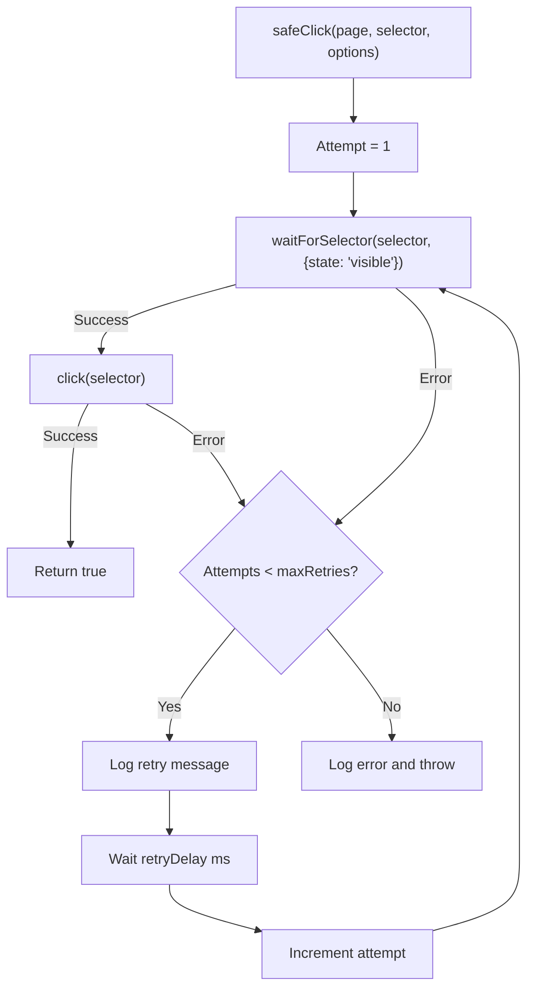
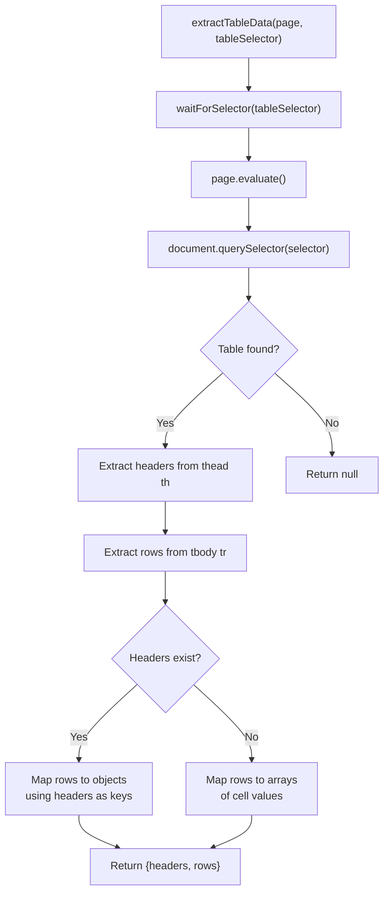
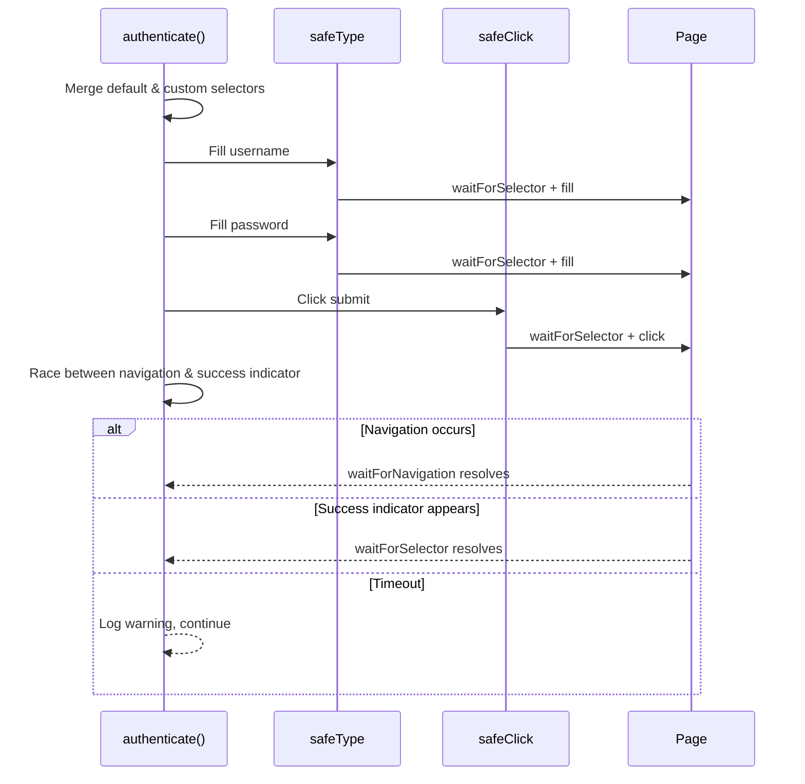
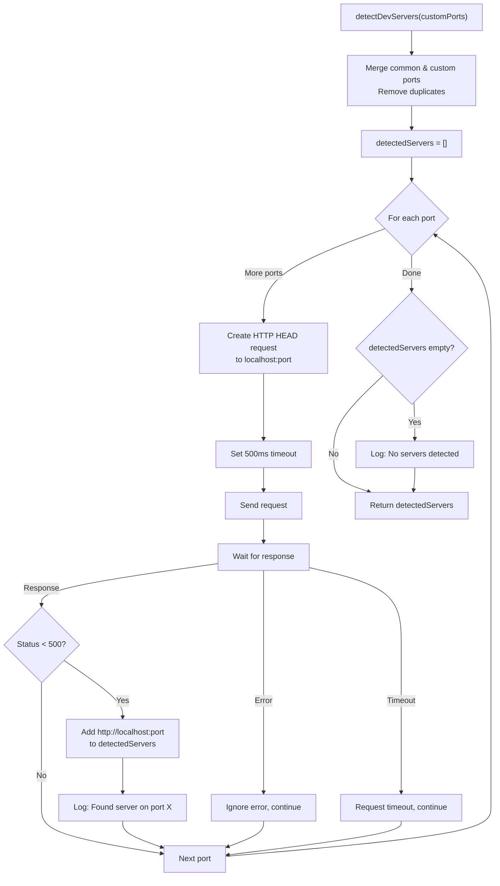

<!-- source: DeepWiki mcp.deepwiki.com · repo lackeyjb/playwright-skill · page 4.3 Helper Functions Library · fetched 2026-10-27 -->

# Helper Functions Library

<details>
<summary>Relevant source files</summary>

The following files were used as context for generating this wiki page:

- [API_REFERENCE.md](API_REFERENCE.md)
- [skills/playwright-skill/SKILL.md](skills/playwright-skill/SKILL.md)
- [skills/playwright-skill/lib/helpers.js](skills/playwright-skill/lib/helpers.js)

</details>


This document provides comprehensive documentation for the utility functions available in `lib/helpers.js`. These functions provide reusable patterns for common browser automation tasks, including server detection, safe interactions, data extraction, and error handling. For information about how these helpers are invoked through the skill system, see [run.js: The Universal Executor](#4.2). For practical usage examples in complete automation scripts, see [Common Automation Patterns](#5.2).

## Overview

The helper functions library is a collection of 14 utility functions that encapsulate common Playwright automation patterns with built-in error handling, retry logic, and best practices. The library is located at [lib/helpers.js:1-399]() and exports functions that can be imported into any Playwright script executed through the skill.

**Import Pattern:**
```javascript
const helpers = require('./lib/helpers');
// or
const { detectDevServers, safeClick, takeScreenshot } = require('./lib/helpers');
```

All helper functions follow these design principles:
- **Defensive programming**: Built-in error handling and timeouts
- **Retry logic**: Automatic retries for transient failures
- **Sensible defaults**: Pre-configured options that work in most scenarios
- **Extensibility**: Options parameters for customization

**Sources:** [lib/helpers.js:1-399](), [skills/playwright-skill/SKILL.md:297-324]()

## Library Architecture

The following diagram shows the complete structure of the helper functions library and how functions relate to each other:

```mermaid
graph TB
    subgraph "lib/helpers.js Module"
        LAUNCH["launchBrowser()<br/>[11-26]"]
        CREATE_CTX["createContext()<br/>[315-328]"]
        CREATE_PAGE["createPage()<br/>[33-50]"]
        WAIT_READY["waitForPageReady()<br/>[57-77]"]
        SAFE_CLICK["safeClick()<br/>[85-109]"]
        SAFE_TYPE["safeType()<br/>[118-133]"]
        EXTRACT_TEXTS["extractTexts()<br/>[140-145]"]
        TAKE_SCREENSHOT["takeScreenshot()<br/>[153-165]"]
        AUTHENTICATE["authenticate()<br/>[173-193]"]
        SCROLL["scrollPage()<br/>[201-217]"]
        EXTRACT_TABLE["extractTableData()<br/>[224-249]"]
        HANDLE_COOKIE["handleCookieBanner()<br/>[256-285]"]
        RETRY["retryWithBackoff()<br/>[293-308]"]
        DETECT["detectDevServers()<br/>[335-381]"]
    end
    
    subgraph "Playwright Core API"
        PW_CHROMIUM["chromium"]
        PW_FIREFOX["firefox"]
        PW_WEBKIT["webkit"]
        PW_BROWSER["Browser"]
        PW_CONTEXT["BrowserContext"]
        PW_PAGE["Page"]
    end
    
    subgraph "Node.js Core"
        HTTP["http module<br/>server detection"]
    end
    
    LAUNCH -->|requires| PW_CHROMIUM
    LAUNCH -->|requires| PW_FIREFOX
    LAUNCH -->|requires| PW_WEBKIT
    LAUNCH -->|returns| PW_BROWSER
    
    CREATE_CTX -->|uses| PW_BROWSER
    CREATE_CTX -->|returns| PW_CONTEXT
    
    CREATE_PAGE -->|uses| PW_CONTEXT
    CREATE_PAGE -->|returns| PW_PAGE
    
    WAIT_READY -->|uses| PW_PAGE
    SAFE_CLICK -->|uses| PW_PAGE
    SAFE_TYPE -->|uses| PW_PAGE
    EXTRACT_TEXTS -->|uses| PW_PAGE
    TAKE_SCREENSHOT -->|uses| PW_PAGE
    SCROLL -->|uses| PW_PAGE
    EXTRACT_TABLE -->|uses| PW_PAGE
    HANDLE_COOKIE -->|uses| PW_PAGE
    
    AUTHENTICATE -->|calls| SAFE_TYPE
    AUTHENTICATE -->|calls| SAFE_CLICK
    
    DETECT -->|uses| HTTP
    
    RETRY -->|wraps| SAFE_CLICK
    RETRY -->|wraps| SAFE_TYPE
```



**Sources:** [lib/helpers.js:1-399]()

## Function Categories

The helper functions are organized into five functional categories:

| Category | Functions | Purpose |
|----------|-----------|---------|
| **Browser Management** | `launchBrowser`, `createContext`, `createPage` | Initialize and configure browser instances |
| **Interaction Helpers** | `safeClick`, `safeType`, `scrollPage` | Safe user interactions with retry logic |
| **Data Extraction** | `extractTexts`, `extractTableData` | Extract structured data from pages |
| **Automation Utilities** | `waitForPageReady`, `takeScreenshot`, `authenticate`, `handleCookieBanner` | Common automation patterns |
| **Infrastructure** | `detectDevServers`, `retryWithBackoff` | Service discovery and error handling |

**Sources:** [lib/helpers.js:383-398]()

## Browser Management Functions

### launchBrowser(browserType, options)

Launches a browser instance with standardized configuration and environment variable support.

**Parameters:**
- `browserType` (string, default: `'chromium'`): Browser engine - `'chromium'`, `'firefox'`, or `'webkit'`
- `options` (Object): Additional launch options merged with defaults

**Default Configuration:**
- `headless`: `false` unless `HEADLESS` env var is `'false'`
- `slowMo`: `0` or value from `SLOW_MO` env var
- `args`: `['--no-sandbox', '--disable-setuid-sandbox']` for container compatibility

**Returns:** Promise resolving to Playwright `Browser` instance

**Implementation:**
[lib/helpers.js:11-26]()

**Example:**
```javascript
// Use default chromium with defaults
const browser = await launchBrowser();

// Firefox with custom options
const browser = await launchBrowser('firefox', { headless: true, slowMo: 50 });
```

**Sources:** [lib/helpers.js:11-26]()

---

### createContext(browser, options)

Creates a browser context with sensible defaults for viewport, locale, and device emulation.

**Parameters:**
- `browser` (Browser): Playwright browser instance
- `options` (Object): Context configuration options

**Default Options:**
- `viewport`: `{ width: 1280, height: 720 }`
- `userAgent`: Automatically set for mobile if `options.mobile` is true
- `permissions`: Empty array (customizable)
- `locale`: `'en-US'`
- `timezoneId`: `'America/New_York'`

**Returns:** Promise resolving to `BrowserContext`

**Implementation:**
[lib/helpers.js:315-328]()

**Mobile Emulation:**
The function automatically configures a mobile user agent when `options.mobile` is set:
```javascript
const mobileContext = await createContext(browser, {
  mobile: true,
  permissions: ['geolocation'],
  geolocation: { latitude: 37.7749, longitude: -122.4194 }
});
```

**Sources:** [lib/helpers.js:315-328]()

---

### createPage(context, options)

Creates a new page within a context with viewport and user agent configuration.

**Parameters:**
- `context` (BrowserContext): Browser context
- `options` (Object): Page options
  - `viewport`: Optional viewport size override
  - `userAgent`: Optional user agent override
  - `timeout`: Default timeout in ms (default: 30000)

**Returns:** Promise resolving to `Page` instance

**Implementation:**
[lib/helpers.js:33-50]()

**Sources:** [lib/helpers.js:33-50]()

## Interaction Helpers

### safeClick(page, selector, options)

Performs a click with automatic retry logic and visibility verification. This is the recommended way to click elements as it handles transient failures.

**Parameters:**
- `page` (Page): Playwright page instance
- `selector` (string): Element selector
- `options` (Object):
  - `retries`: Maximum retry attempts (default: 3)
  - `retryDelay`: Delay between retries in ms (default: 1000)
  - `timeout`: Wait timeout in ms (default: 5000)
  - `force`: Force click without actionability checks (default: false)

**Retry Logic Flow:**



**Implementation:**
[lib/helpers.js:85-109]()

**Example:**
```javascript
// Basic usage with 3 retries
await helpers.safeClick(page, 'button[data-testid="submit"]');

// Custom retry configuration
await helpers.safeClick(page, '.dynamic-button', {
  retries: 5,
  retryDelay: 2000,
  timeout: 10000
});
```

**Sources:** [lib/helpers.js:85-109]()

---

### safeType(page, selector, text, options)

Types text into an input field with automatic clear and optional slow typing.

**Parameters:**
- `page` (Page): Playwright page instance
- `selector` (string): Input element selector
- `text` (string): Text to type
- `options` (Object):
  - `timeout`: Wait timeout in ms (default: 10000)
  - `clear`: Clear field before typing (default: true)
  - `slow`: Use slow typing with delay (default: false)
  - `delay`: Delay between keystrokes in ms (default: 100)

**Implementation:**
[lib/helpers.js:118-133]()

**Behavior:**
1. Waits for selector to be visible
2. Clears the field unless `options.clear` is false
3. Uses `page.type()` with delay if `options.slow` is true
4. Uses fast `page.fill()` otherwise

**Example:**
```javascript
// Fast fill (default)
await helpers.safeType(page, '#username', 'testuser');

// Slow typing for human-like interaction
await helpers.safeType(page, '#email', 'user@example.com', {
  slow: true,
  delay: 50
});

// Don't clear existing value
await helpers.safeType(page, '#message', ' - appended text', {
  clear: false
});
```

**Sources:** [lib/helpers.js:118-133]()

---

### scrollPage(page, direction, distance)

Scrolls the page in various directions with smooth animation.

**Parameters:**
- `page` (Page): Playwright page instance
- `direction` (string): `'down'`, `'up'`, `'top'`, or `'bottom'`
- `distance` (number): Pixels to scroll for up/down (default: 500)

**Implementation:**
[lib/helpers.js:201-217]()

**Scroll Directions:**
- `'down'`: Scrolls down by `distance` pixels
- `'up'`: Scrolls up by `distance` pixels
- `'top'`: Scrolls to top of page (distance ignored)
- `'bottom'`: Scrolls to bottom of page (distance ignored)

**Post-Scroll Wait:** Automatically waits 500ms after scrolling for animations to complete.

**Sources:** [lib/helpers.js:201-217]()

## Data Extraction Helpers

### extractTexts(page, selector)

Extracts text content from all matching elements, filtered to remove empty strings.

**Parameters:**
- `page` (Page): Playwright page instance
- `selector` (string): CSS selector matching multiple elements

**Returns:** Promise resolving to array of trimmed, non-empty text strings

**Implementation:**
[lib/helpers.js:140-145]()

**Example:**
```javascript
// Extract all navigation links
const navItems = await helpers.extractTexts(page, 'nav a');
// Returns: ['Home', 'Products', 'About', 'Contact']

// Extract table cells
const prices = await helpers.extractTexts(page, 'table td.price');
```

**Sources:** [lib/helpers.js:140-145]()

---

### extractTableData(page, tableSelector)

Extracts structured data from HTML tables, returning headers and rows.

**Parameters:**
- `page` (Page): Playwright page instance
- `tableSelector` (string): CSS selector for the table element

**Returns:** Promise resolving to object with:
- `headers` (Array<string>): Column headers from `<thead>`
- `rows` (Array<Object|Array>): Row data as objects (if headers exist) or arrays

**Table Extraction Logic:**



**Implementation:**
[lib/helpers.js:224-249]()

**Example:**
```javascript
const tableData = await helpers.extractTableData(page, 'table.results');

// With headers:
// {
//   headers: ['Name', 'Age', 'City'],
//   rows: [
//     { Name: 'John', Age: '30', City: 'NYC' },
//     { Name: 'Jane', Age: '25', City: 'LA' }
//   ]
// }

// Without headers:
// {
//   headers: [],
//   rows: [
//     ['John', '30', 'NYC'],
//     ['Jane', '25', 'LA']
//   ]
// }
```

**Sources:** [lib/helpers.js:224-249]()

## Automation Utilities

### waitForPageReady(page, options)

Smart wait function that combines multiple wait strategies for page readiness.

**Parameters:**
- `page` (Page): Playwright page instance
- `options` (Object):
  - `waitUntil`: Load state - `'networkidle'`, `'domcontentloaded'`, or `'load'` (default: `'networkidle'`)
  - `timeout`: Maximum wait time in ms (default: 30000)
  - `waitForSelector`: Optional selector to wait for after load

**Wait Strategy:**
1. Waits for specified load state
2. If timeout occurs, continues with warning (non-blocking)
3. Optionally waits for a specific selector to appear

**Implementation:**
[lib/helpers.js:57-77]()

**Example:**
```javascript
// Wait for network idle
await helpers.waitForPageReady(page);

// Wait for DOM content loaded and specific element
await helpers.waitForPageReady(page, {
  waitUntil: 'domcontentloaded',
  waitForSelector: '.content-loaded',
  timeout: 10000
});
```

**Sources:** [lib/helpers.js:57-77]()

---

### takeScreenshot(page, name, options)

Captures a timestamped screenshot with automatic filename generation.

**Parameters:**
- `page` (Page): Playwright page instance
- `name` (string): Base name for the screenshot
- `options` (Object):
  - `fullPage`: Capture full scrollable page (default: true)
  - Additional Playwright screenshot options

**Filename Format:** `{name}-{timestamp}.png` where timestamp is ISO format with safe characters

**Returns:** Promise resolving to the generated filename

**Implementation:**
[lib/helpers.js:153-165]()

**Example:**
```javascript
// Full page screenshot
const filename = await helpers.takeScreenshot(page, 'dashboard');
// Saves: dashboard-2024-01-15T10-30-45-123Z.png

// Element-only screenshot
await helpers.takeScreenshot(page, 'chart', {
  fullPage: false,
  clip: { x: 0, y: 0, width: 800, height: 600 }
});
```

**Sources:** [lib/helpers.js:153-165]()

---

### authenticate(page, credentials, selectors)

Handles form-based authentication with smart selector detection and navigation waiting.

**Parameters:**
- `page` (Page): Playwright page instance
- `credentials` (Object):
  - `username` (string): Username or email
  - `password` (string): Password
- `selectors` (Object): Custom selectors (optional, uses intelligent defaults)
  - `username`: Username input selector
  - `password`: Password input selector
  - `submit`: Submit button selector
  - `successIndicator`: Element to verify successful login

**Default Selector Strategy:**
The function tries multiple common patterns for each field:
- **Username field:** `input[name="username"]`, `input[name="email"]`, `#username`, `#email`
- **Password field:** `input[name="password"]`, `#password`
- **Submit button:** `button[type="submit"]`, `input[type="submit"]`, `button:has-text("Login")`, `button:has-text("Sign in")`
- **Success indicator:** `.dashboard`, `.user-menu`, `.logout`

**Authentication Flow:**



**Implementation:**
[lib/helpers.js:173-193]()

**Example:**
```javascript
// Basic authentication with defaults
await helpers.authenticate(page, {
  username: 'testuser',
  password: 'password123'
});

// Custom selectors
await helpers.authenticate(
  page,
  { username: 'admin@example.com', password: 'secret' },
  {
    username: '#email-input',
    password: '#pwd',
    submit: 'button.login-btn',
    successIndicator: '.admin-panel'
  }
);
```

**Sources:** [lib/helpers.js:173-193]()

---

### handleCookieBanner(page, timeout)

Automatically detects and dismisses common cookie consent banners.

**Parameters:**
- `page` (Page): Playwright page instance
- `timeout` (number): Maximum time to search for banners in ms (default: 3000)

**Returns:** Promise resolving to `true` if banner was dismissed, `false` otherwise

**Common Selectors Checked:**
The function tries common button text patterns and test attributes:
1. `button:has-text("Accept")`
2. `button:has-text("Accept all")`
3. `button:has-text("OK")`
4. `button:has-text("Got it")`
5. `button:has-text("I agree")`
6. `.cookie-accept`
7. `#cookie-accept`
8. `[data-testid="cookie-accept"]`

**Strategy:** Divides timeout evenly among all selectors, tries each in sequence until one succeeds.

**Implementation:**
[lib/helpers.js:256-285]()

**Example:**
```javascript
// Try to dismiss banner with default 3s timeout
const dismissed = await helpers.handleCookieBanner(page);
if (dismissed) {
  console.log('Cookie banner dismissed');
}

// Custom timeout for slow-loading banners
await helpers.handleCookieBanner(page, 5000);
```

**Sources:** [lib/helpers.js:256-285]()

## Infrastructure Functions

### detectDevServers(customPorts)

Scans common development server ports on localhost to detect running services. This is a critical function called at the beginning of most automation workflows to avoid hardcoded URLs.

**Parameters:**
- `customPorts` (Array<number>): Additional ports to check beyond common defaults

**Common Ports Scanned:**
```javascript
[3000, 3001, 3002, 5173, 8080, 8000, 4200, 5000, 9000, 1234]
```

These correspond to:
- 3000-3002: React (Create React App, Next.js)
- 5173: Vite
- 8080: Vue CLI, generic dev servers
- 8000: Django, Python SimpleHTTPServer
- 4200: Angular CLI
- 5000: Flask
- 9000: Generic
- 1234: Parcel

**Detection Algorithm:**



**Implementation:**
[lib/helpers.js:335-381]()

**Returns:** Promise resolving to array of detected server URLs, e.g.:
```javascript
['http://localhost:3001', 'http://localhost:5173']
```

**Usage in SKILL.md Workflow:**
This function is always called first in the automation workflow as shown in [skills/playwright-skill/SKILL.md:23-29]():

```bash
cd $SKILL_DIR && node -e "require('./lib/helpers').detectDevServers().then(servers => console.log(JSON.stringify(servers)))"
```

**Example:**
```javascript
// Scan common ports
const servers = await helpers.detectDevServers();
// Returns: ['http://localhost:3000', 'http://localhost:8080']

// Include custom ports
const servers = await helpers.detectDevServers([4000, 7000]);
// Scans common ports + 4000 + 7000
```

**Sources:** [lib/helpers.js:335-381](), [skills/playwright-skill/SKILL.md:23-29]()

---

### retryWithBackoff(fn, maxRetries, initialDelay)

Generic retry function with exponential backoff for any async operation.

**Parameters:**
- `fn` (Function): Async function to retry
- `maxRetries` (number): Maximum retry attempts (default: 3)
- `initialDelay` (number): Initial delay in ms (default: 1000)

**Backoff Formula:** `delay = initialDelay * 2^attemptNumber`

**Delay Progression:**
- Attempt 1 fails: Wait 1000ms (1s)
- Attempt 2 fails: Wait 2000ms (2s)
- Attempt 3 fails: Wait 4000ms (4s)

**Implementation:**
[lib/helpers.js:293-308]()

**Example:**
```javascript
// Retry an unreliable API call
const data = await helpers.retryWithBackoff(
  async () => {
    const response = await page.request.get('https://api.example.com/data');
    if (!response.ok()) throw new Error('API request failed');
    return response.json();
  },
  5,    // max 5 retries
  500   // start with 500ms delay
);

// Retry a flaky interaction
await helpers.retryWithBackoff(async () => {
  await page.click('.sometimes-hidden-button');
}, 3, 1000);
```

**Sources:** [lib/helpers.js:293-308]()

## Error Handling Patterns

The helper functions implement consistent error handling strategies across the library:

### Built-in Retry Functions

Functions with automatic retry:
- `safeClick`: 3 retries with 1s linear delay
- `retryWithBackoff`: Configurable retries with exponential backoff

### Graceful Degradation

Functions that continue on failure:
- `waitForPageReady`: Logs warning but doesn't throw on timeout [lib/helpers.js:68]()
- `handleCookieBanner`: Returns false instead of throwing [lib/helpers.js:284]()
- `authenticate`: Logs message on navigation timeout [lib/helpers.js:191]()

### Error Logging

All retry functions log attempts:
```javascript
console.log(`Retry ${i + 1}/${maxRetries} for clicking ${selector}`);
console.log(`Attempt ${i + 1} failed, retrying in ${delay}ms...`);
```

**Sources:** [lib/helpers.js:85-109](), [lib/helpers.js:293-308](), [lib/helpers.js:57-77]()

## Integration with run.js

The helper functions are designed to work seamlessly with the universal executor. The import pattern from [run.js](#4.2):

```javascript
// Helpers are available in the execution context
const helpers = require('./lib/helpers');

// Or with destructuring
const { detectDevServers, safeClick } = require('./lib/helpers');
```

**Module Resolution:** When scripts are executed through `run.js`, the relative path `./lib/helpers` correctly resolves because execution happens from `$SKILL_DIR`. See [Path Resolution and $SKILL_DIR](#4.6) for details.

**Common Usage Pattern in Generated Scripts:**

```javascript
// /tmp/playwright-test-example.js
const { chromium } = require('playwright');
const helpers = require('./lib/helpers');  // Available via run.js

(async () => {
  const browser = await chromium.launch({ headless: false });
  const page = await browser.newPage();
  
  await helpers.handleCookieBanner(page);
  await helpers.safeClick(page, 'button.submit');
  await helpers.takeScreenshot(page, 'result');
  
  await browser.close();
})();
```

**Sources:** [lib/helpers.js:1-399](), [skills/playwright-skill/SKILL.md:297-324]()

## Helper Function Reference Table

Complete reference of all exported functions:

| Function | Purpose | Key Parameters | Return Type | Retry Logic |
|----------|---------|----------------|-------------|-------------|
| `launchBrowser` | Launch browser with config | `browserType`, `options` | `Promise<Browser>` | No |
| `createContext` | Create browser context | `browser`, `options` | `Promise<BrowserContext>` | No |
| `createPage` | Create page with defaults | `context`, `options` | `Promise<Page>` | No |
| `waitForPageReady` | Wait for page load states | `page`, `options` | `Promise<void>` | Timeout warning only |
| `safeClick` | Click with retry | `page`, `selector`, `options` | `Promise<boolean>` | Yes (3 retries, 1s delay) |
| `safeType` | Type text with clear | `page`, `selector`, `text`, `options` | `Promise<void>` | No |
| `extractTexts` | Extract text from elements | `page`, `selector` | `Promise<Array<string>>` | No |
| `takeScreenshot` | Timestamped screenshot | `page`, `name`, `options` | `Promise<string>` | No |
| `authenticate` | Form-based login | `page`, `credentials`, `selectors` | `Promise<void>` | Via safeType/safeClick |
| `scrollPage` | Scroll in direction | `page`, `direction`, `distance` | `Promise<void>` | No |
| `extractTableData` | Extract table to JSON | `page`, `tableSelector` | `Promise<Object>` | No |
| `handleCookieBanner` | Dismiss cookie banner | `page`, `timeout` | `Promise<boolean>` | Tries multiple selectors |
| `retryWithBackoff` | Generic retry wrapper | `fn`, `maxRetries`, `initialDelay` | `Promise<any>` | Yes (exponential backoff) |
| `detectDevServers` | Find running dev servers | `customPorts` | `Promise<Array<string>>` | No (500ms per port timeout) |

**Sources:** [lib/helpers.js:383-398]()

## Usage Examples from SKILL.md

The skill instructions document shows how helpers are recommended to users:

**Server Detection Pattern:**
```bash
cd $SKILL_DIR && node -e "require('./lib/helpers').detectDevServers().then(servers => console.log(JSON.stringify(servers)))"
```

**Helper Integration Example:**
```javascript
const helpers = require('./lib/helpers');

// Detect running dev servers (CRITICAL - use this first!)
const servers = await helpers.detectDevServers();
console.log('Found servers:', servers);

// Safe click with retry
await helpers.safeClick(page, 'button.submit', { retries: 3 });

// Safe type with clear
await helpers.safeType(page, '#username', 'testuser');

// Take timestamped screenshot
await helpers.takeScreenshot(page, 'test-result');

// Handle cookie banners
await helpers.handleCookieBanner(page);

// Extract table data
const data = await helpers.extractTableData(page, 'table.results');
```

**Sources:** [skills/playwright-skill/SKILL.md:297-324]()

## Best Practices

When using the helper functions library:

1. **Always use `detectDevServers()` first** for localhost automation to avoid hardcoded URLs
2. **Prefer `safeClick()` over `page.click()`** for better reliability with retry logic
3. **Use `safeType()` with `clear: true`** to avoid appending to existing values
4. **Call `handleCookieBanner()` early** to dismiss popups before main automation
5. **Use `takeScreenshot()` for debugging** with descriptive names that auto-timestamp
6. **Leverage `extractTableData()`** for structured data extraction instead of manual parsing
7. **Wrap unreliable operations** with `retryWithBackoff()` for custom retry logic
8. **Use `authenticate()` for login flows** instead of reimplementing the pattern

**Sources:** [lib/helpers.js:1-399](), [skills/playwright-skill/SKILL.md:340-350]()

---

