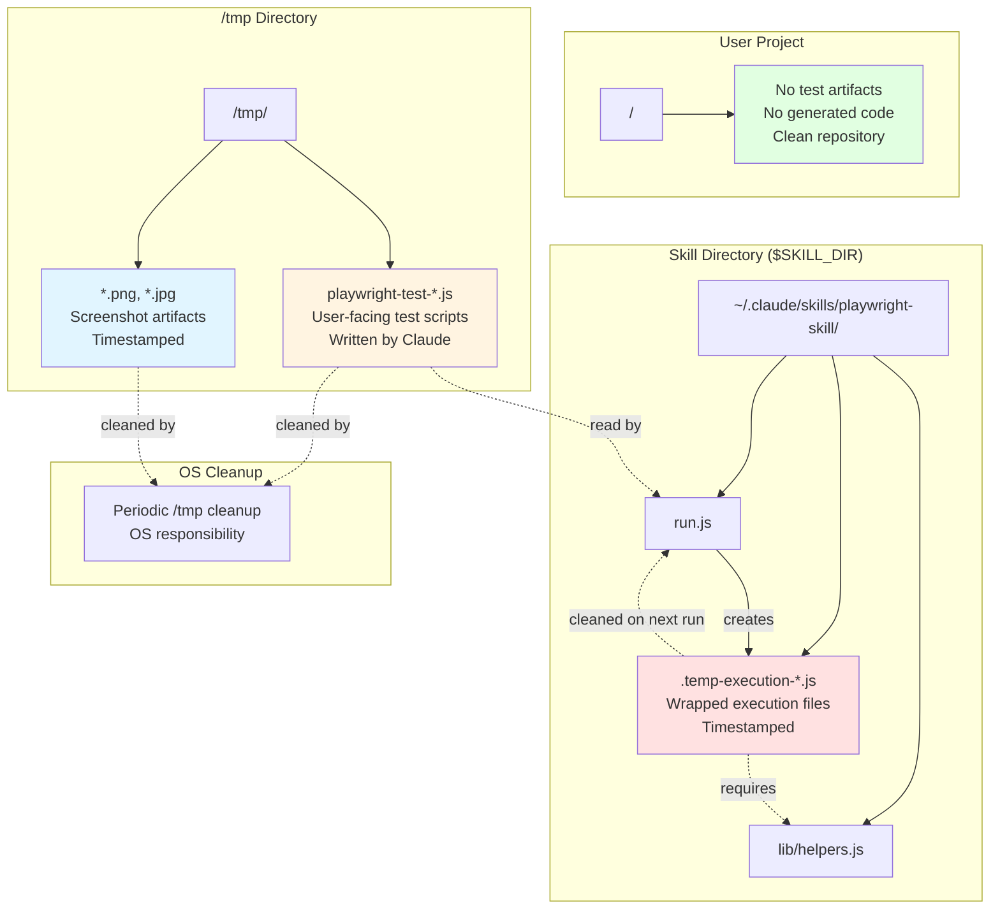
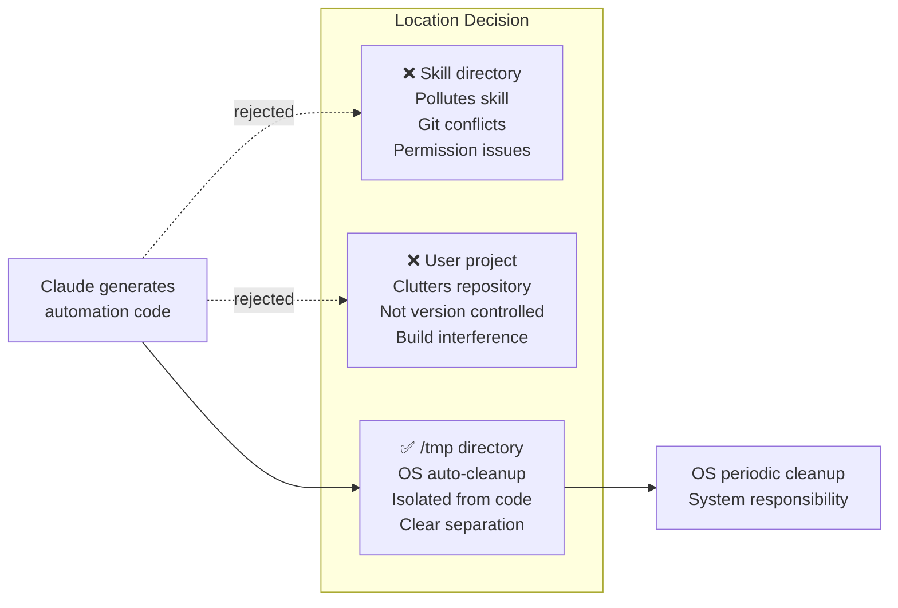
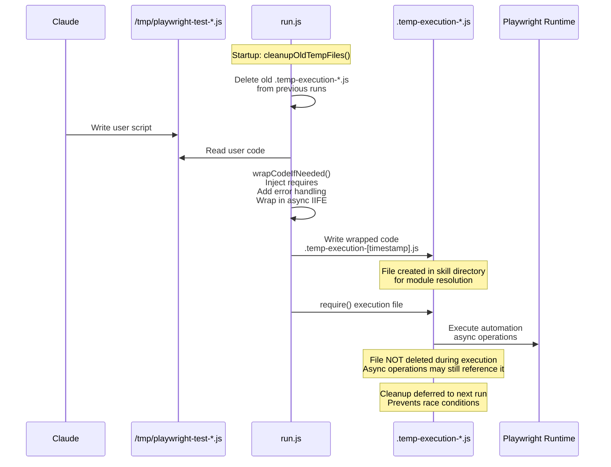
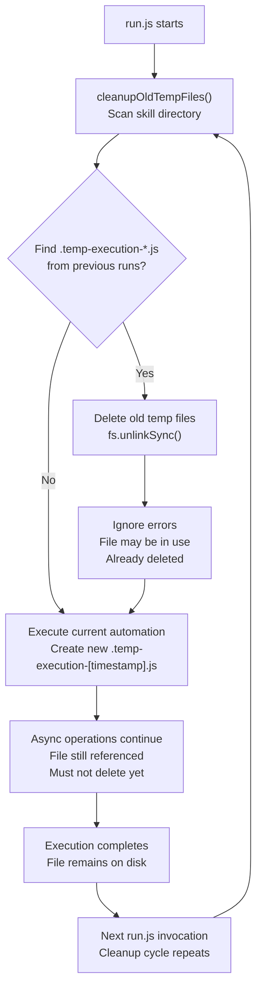
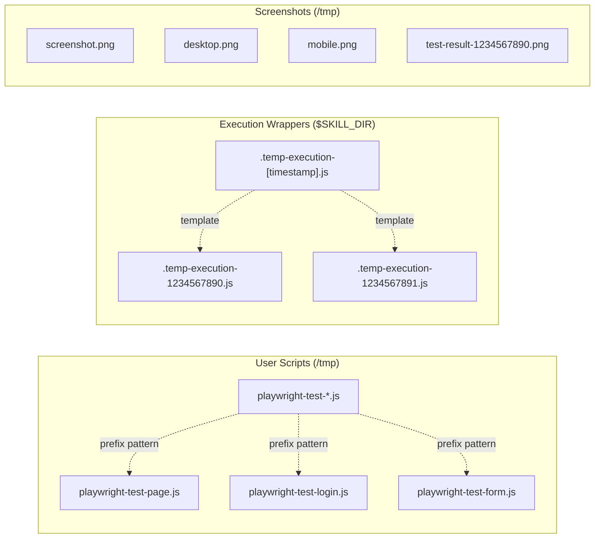
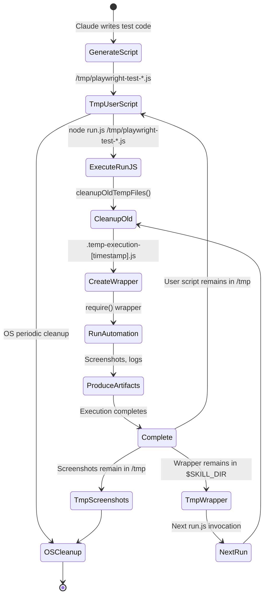

<!-- source: DeepWiki mcp.deepwiki.com · repo lackeyjb/playwright-skill · page 4.5 Artifact Management · fetched 2026-10-27 -->

# Artifact Management

<details>
<summary>Relevant source files</summary>

The following files were used as context for generating this wiki page:

- [.gitignore](.gitignore)
- [README.md](README.md)
- [skills/playwright-skill/SKILL.md](skills/playwright-skill/SKILL.md)
- [skills/playwright-skill/run.js](skills/playwright-skill/run.js)

</details>


This document explains how playwright-skill manages generated code, temporary execution files, screenshots, and other artifacts produced during browser automation. The system implements a deliberate strategy to keep user projects clean while preventing race conditions with asynchronous operations.

For information about how scripts are executed, see [run.js: The Universal Executor](#4.2). For path resolution details, see [Path Resolution and $SKILL_DIR](#4.6).

## Artifact Strategy Overview

The playwright-skill system produces three categories of artifacts during execution:

1. **User-generated scripts** - Custom Playwright code written by Claude to `/tmp`
2. **Execution wrappers** - Temporary files created by `run.js` in the skill directory
3. **Output artifacts** - Screenshots, logs, and test results saved to `/tmp`

The core principle is **ephemeral artifacts**: all generated code and execution artifacts are temporary, isolated from user projects, and automatically cleaned up. Nothing persists in the repository or project directories.

Sources: [README.md:164](), [SKILL.md:31](), [Diagram 5: Data and Artifact Flow]()

## Artifact Directory Structure



**Key Locations:**

| Artifact Type | Location | Cleanup Method | Purpose |
|--------------|----------|----------------|---------|
| User scripts | `/tmp/playwright-test-*.js` | OS automatic | User-facing test code |
| Execution wrappers | `$SKILL_DIR/.temp-execution-*.js` | Next run | Runtime code injection |
| Screenshots | `/tmp/*.png` | OS automatic | Visual artifacts |
| Console logs | stdout | N/A | Real-time feedback |

Sources: [SKILL.md:31](), [run.js:181](), [.gitignore:23-28]()

## User Script Artifacts

User scripts are the Playwright automation code that Claude generates based on user requests. These are always written to `/tmp` with a predictable naming pattern.

### File Naming Convention

Pattern: `/tmp/playwright-test-<description>.js`

Examples from SKILL.md:
- `/tmp/playwright-test-page.js` - Basic page test
- `/tmp/playwright-test-responsive.js` - Viewport testing
- `/tmp/playwright-test-login.js` - Login flow testing
- `/tmp/playwright-test-form.js` - Form interaction testing

### Location Rationale

The `/tmp` directory is chosen deliberately:



The critical workflow documented in [SKILL.md:21-31]() mandates:

> "**Write scripts to /tmp** - NEVER write test files to skill directory; always use `/tmp/playwright-test-*.js`"

This ensures:
1. User projects remain clean (no test artifacts checked into git)
2. Skill directory remains stable (no constantly changing files)
3. Automatic cleanup without manual intervention
4. Cross-platform temporary file handling

Sources: [SKILL.md:31](), [SKILL.md:404](), [.gitignore:23-28]()

## Execution Wrapper Artifacts

When `run.js` executes user code, it creates temporary wrapper files in the skill directory. These files exist to enable proper module resolution while keeping user scripts clean.

### Wrapper File Lifecycle



### Code Wrapping Logic

The `wrapCodeIfNeeded()` function in [run.js:109-157]() transforms user code:

**Input (user script):**
```javascript
await page.goto('http://localhost:3000');
await page.screenshot({ path: '/tmp/screenshot.png' });
```

**Output (execution wrapper):**
```javascript
const { chromium, firefox, webkit, devices } = require('playwright');
const helpers = require('./lib/helpers');

(async () => {
  try {
    await page.goto('http://localhost:3000');
    await page.screenshot({ path: '/tmp/screenshot.png' });
  } catch (error) {
    console.error('❌ Automation error:', error.message);
    if (error.stack) {
      console.error(error.stack);
    }
    process.exit(1);
  }
})();
```

This wrapper provides:
1. Required imports (`playwright`, `helpers`)
2. Async IIFE wrapper for top-level await
3. Error handling and logging
4. Proper exit codes

Sources: [run.js:109-157](), [run.js:181-189]()

### Why Wrappers Live in Skill Directory

The execution wrapper must be in `$SKILL_DIR` because:

1. **Module resolution**: `require('./lib/helpers')` resolves relative to the execution file location
2. **Playwright dependency**: `require('playwright')` resolves from `node_modules/` in skill directory
3. **Dynamic path**: The skill directory path is resolved at runtime [run.js:18]()

```javascript
// Change to skill directory for proper module resolution
process.chdir(__dirname);
```

If wrappers were created in `/tmp`, module resolution would fail because:
- `/tmp` has no `node_modules/`
- `/tmp` has no `lib/helpers.js`
- Relative requires would break

Sources: [run.js:18](), [run.js:189]()

## Cleanup Mechanism

The cleanup strategy prevents race conditions while ensuring eventual cleanup.

### Cleanup Logic



The cleanup function [run.js:86-104]() implements this pattern:

```javascript
function cleanupOldTempFiles() {
  try {
    const files = fs.readdirSync(__dirname);
    const tempFiles = files.filter(f => f.startsWith('.temp-execution-') && f.endsWith('.js'));

    if (tempFiles.length > 0) {
      tempFiles.forEach(file => {
        const filePath = path.join(__dirname, file);
        try {
          fs.unlinkSync(filePath);
        } catch (e) {
          // Ignore errors - file might be in use or already deleted
        }
      });
    }
  } catch (e) {
    // Ignore directory read errors
  }
}
```

### Why Not Immediate Cleanup

The comment in [run.js:191-192]() explains:

```javascript
// Note: Temp file will be cleaned up on next run
// This allows long-running async operations to complete safely
```

**Race condition prevented:**
1. Script starts async operation (browser launch, page navigation)
2. If file deleted immediately, Node.js might lose reference
3. Async callbacks may fail to execute
4. Deferred cleanup ensures file exists for entire operation lifecycle

**Result:** Temp files persist until the next `run.js` invocation, then are safely cleaned up after previous operations have definitely completed.

Sources: [run.js:86-104](), [run.js:165-166](), [run.js:191-192]()

## Screenshot and Output Artifacts

Browser automation produces visual and textual artifacts that are saved separately from code.

### Screenshot Storage

Screenshots are always saved to `/tmp` with descriptive names:

| Pattern | Example | Usage |
|---------|---------|-------|
| Descriptive | `/tmp/screenshot.png` | General capture |
| Timestamped | `/tmp/test-result-[timestamp].png` | Multiple runs |
| Viewport-specific | `/tmp/desktop.png`, `/tmp/mobile.png` | Responsive testing |
| Element-specific | `/tmp/element-capture.png` | Component testing |

Examples from SKILL.md:
- [SKILL.md:79]() - Basic screenshot: `/tmp/screenshot.png`
- [SKILL.md:110]() - Desktop viewport: `/tmp/desktop.png`
- [SKILL.md:114]() - Mobile viewport: `/tmp/mobile.png`
- [SKILL.md:268]() - Named by viewport: `/tmp/${viewport.name.toLowerCase()}.png`

### Screenshot Configuration

Screenshots are configured via Playwright's screenshot API:

```javascript
await page.screenshot({
  path: '/tmp/screenshot.png',
  fullPage: true  // Capture entire page, not just viewport
});
```

The `helpers.takeScreenshot()` function provides timestamped variants:

```javascript
const helpers = require('./lib/helpers');
await helpers.takeScreenshot(page, 'test-result');
// Creates: /tmp/test-result-[timestamp].png
```

Sources: [SKILL.md:79](), [SKILL.md:110](), [SKILL.md:314]()

### Console Output

Console logs are not saved to files but stream to stdout in real-time:

```javascript
console.log('✅ Login successful, redirected to dashboard');
console.log('📸 Screenshot saved to /tmp/screenshot.png');
console.log(`✅ Working links: ${results.working}`);
```

This provides:
1. Real-time progress feedback
2. No file cleanup required
3. Easy redirection to files if needed (`node run.js script.js > output.log`)

Sources: [SKILL.md:140](), [SKILL.md:228](), [SKILL.md:202]()

## File Naming Conventions

Consistent naming patterns enable predictable cleanup and organization.

### Naming Pattern Reference



### Pattern Details

**User Scripts:**
- **Prefix:** `playwright-test-`
- **Suffix:** `.js`
- **Location:** `/tmp/`
- **Purpose:** Identifies user-generated automation scripts
- **Example:** `playwright-test-responsive.js`

**Execution Wrappers:**
- **Prefix:** `.temp-execution-`
- **Timestamp:** `Date.now()` (milliseconds since epoch)
- **Suffix:** `.js`
- **Location:** `$SKILL_DIR`
- **Hidden:** Leading dot hides from directory listings
- **Example:** `.temp-execution-1704067200000.js`
- **Creation:** [run.js:181]()

**Screenshots:**
- **Extension:** `.png` (default), `.jpg` (optional)
- **Location:** `/tmp/`
- **Pattern:** Descriptive or timestamped
- **Ignored by git:** [.gitignore:26-28]()

Sources: [run.js:181](), [run.js:89](), [.gitignore:26-28]()

## Persistence Strategy

The artifact management system implements a "clean project" philosophy.

### What Is NOT Persisted

The `.gitignore` file explicitly excludes all artifacts from version control:

```gitignore
# Test results
test-results/
playwright-report/
screenshots/
*.png
*.jpg
*.jpeg
```

```gitignore
# Temporary files
.temp-*
*.tmp
```

**Excluded artifacts:**
1. Test result directories
2. Playwright HTML reports
3. Screenshot folders
4. Image files (all formats)
5. Any temporary files
6. Execution wrappers

Sources: [.gitignore:10-12](), [.gitignore:23-28]()

### Persistence Lifecycle



**Lifecycle stages:**

1. **Creation**: Scripts and wrappers created during execution
2. **Usage**: Files actively used during automation
3. **Completion**: Execution finishes, files remain on disk
4. **Retention**: Files persist until cleanup trigger
5. **Cleanup**: 
   - User scripts: OS responsibility (automatic `/tmp` cleanup)
   - Wrappers: Next `run.js` invocation
   - Screenshots: OS responsibility

**Result:** No manual cleanup required, no repository pollution, predictable artifact locations.

Sources: [run.js:86-104](), [run.js:165-166](), [SKILL.md:404]()

## Integration with CI/CD

The artifact strategy supports continuous integration workflows through environment-aware execution.

### Headless Mode Artifacts

When running in headless mode (typical for CI/CD), artifacts behave identically:

```javascript
const browser = await chromium.launch({
  headless: true,  // No visible browser in CI
  slowMo: 0        // No artificial delay
});
```

Screenshots still capture full pages:
```javascript
await page.screenshot({
  path: '/tmp/ci-test-result.png',
  fullPage: true
});
```

**CI/CD considerations:**
1. `/tmp` cleanup may be more aggressive (per-build cleanup)
2. Artifacts should be copied to CI artifact storage before `/tmp` cleanup
3. Screenshot artifacts can be attached to test reports
4. Console output already streams to CI logs

For detailed CI/CD integration, see [CI/CD Integration](#7.4).

Sources: [SKILL.md:343-345](), [README.md:162]()

## Summary

The playwright-skill artifact management system provides:

| Feature | Implementation | Benefit |
|---------|---------------|---------|
| Clean projects | All artifacts in `/tmp` | No repository pollution |
| Safe async | Deferred cleanup | No race conditions |
| Predictable locations | Consistent naming patterns | Easy to find artifacts |
| Automatic cleanup | OS handles `/tmp`, run.js handles wrappers | No manual intervention |
| Module resolution | Wrappers in skill directory | Proper require() paths |
| Hidden files | `.temp-execution-*` prefix | Clean directory listings |

The dual-location strategy (user scripts in `/tmp`, wrappers in `$SKILL_DIR`) enables proper module resolution while maintaining clean separation between user-facing code and internal execution infrastructure.

Sources: [run.js:1-209](), [SKILL.md:1-407](), [README.md:164]()

---

