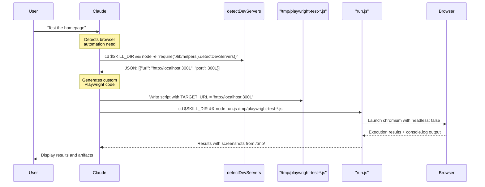
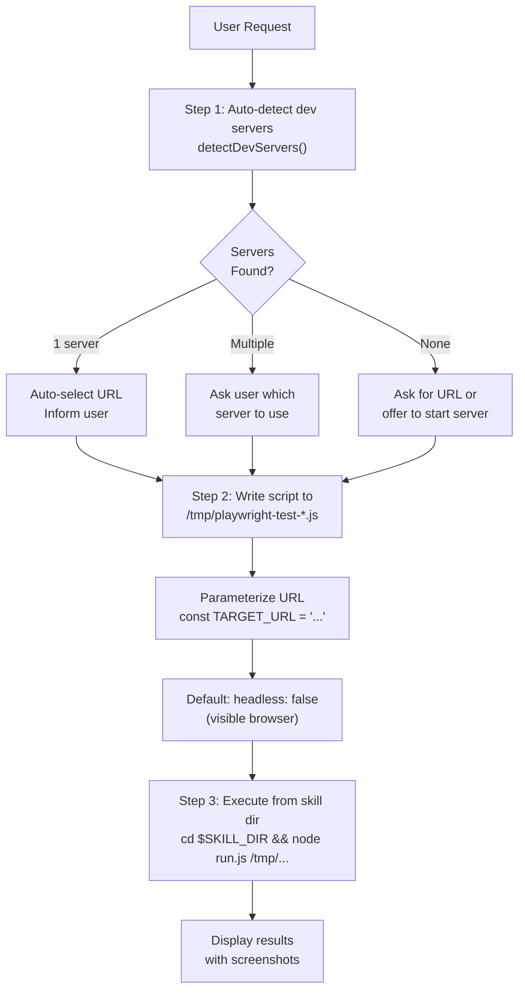
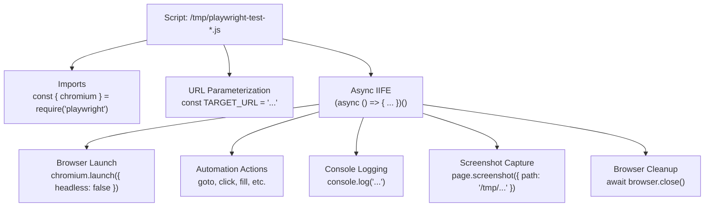
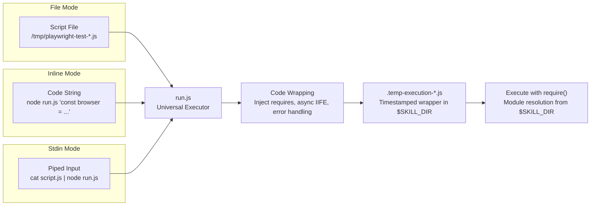
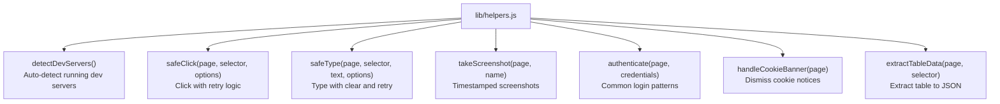
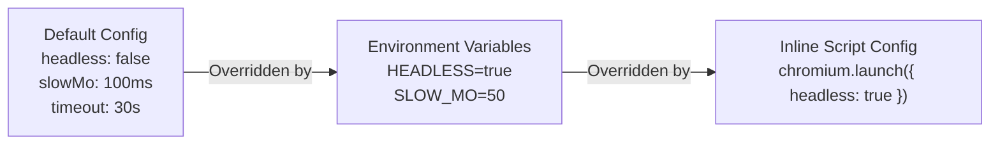
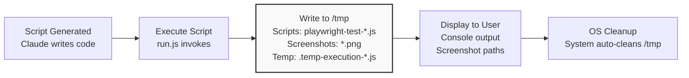

<!-- source: DeepWiki mcp.deepwiki.com · repo lackeyjb/playwright-skill · page 5 Usage Guide · fetched 2026-10-27 -->

# Usage Guide

<details>
<summary>Relevant source files</summary>

The following files were used as context for generating this wiki page:

- [README.md](README.md)
- [skills/playwright-skill/SKILL.md](skills/playwright-skill/SKILL.md)

</details>


This page provides a practical guide for using `playwright-skill` to perform browser automation tasks. It covers the core workflow, script patterns, helper functions, configuration options, and execution modes.

For detailed information about writing automation scripts from scratch, see [Writing Automation Scripts](#5.1). For comprehensive examples of common scenarios, see [Common Automation Patterns](#5.2). For testing workflows and best practices, see [Testing Workflows](#5.3). For debugging assistance, see [Debugging and Troubleshooting](#5.4).

## How the Skill Works

The `playwright-skill` uses a **model-invoked pattern** where Claude autonomously detects browser automation needs and invokes the skill without explicit user commands. Users describe their automation needs in natural language, and Claude handles skill invocation, code generation, and execution.



**Key Points:**
- Users never invoke the skill with slash commands
- Claude automatically loads `SKILL.md` when browser automation is needed
- Claude generates custom code for each request (not template-based)
- All scripts are written to `/tmp/` to keep projects clean
- Execution always runs from the skill directory for proper module resolution

Sources: [skills/playwright-skill/SKILL.md:1-42](), [README.md:150-157]()

## Critical Workflow

The skill enforces a specific workflow to ensure reliable execution and clean code organization:



**Step 1: Auto-detect Development Servers**

Before writing any test code, Claude runs the `detectDevServers()` helper to find running local development servers:

```bash
cd $SKILL_DIR && node -e "require('./lib/helpers').detectDevServers().then(servers => console.log(JSON.stringify(servers)))"
```

This scans common development ports and returns a JSON array of detected servers with their URLs and ports.

**Step 2: Write Scripts to /tmp**

All generated test scripts are written to `/tmp/playwright-test-*.js` with a descriptive filename. Scripts are never written to the skill directory or the user's project to maintain cleanliness.

**Step 3: Execute from Skill Directory**

Scripts are always executed using the `run.js` universal executor, which must be invoked from the skill directory for proper module resolution:

```bash
cd $SKILL_DIR && node run.js /tmp/playwright-test-*.js
```

Sources: [skills/playwright-skill/SKILL.md:21-46](), [skills/playwright-skill/SKILL.md:57-90]()

## Script Structure and Code Patterns

### Basic Script Structure

Every generated Playwright script follows a consistent structure:



**Code Components:**

| Component | Purpose | Example |
|-----------|---------|---------|
| `TARGET_URL` constant | Parameterized URL from auto-detection | `const TARGET_URL = 'http://localhost:3001';` |
| `chromium.launch()` | Browser initialization with `headless: false` | `await chromium.launch({ headless: false, slowMo: 100 })` |
| `page.goto()` | Navigate to target URL | `await page.goto(TARGET_URL);` |
| `console.log()` | Progress tracking and results | `console.log('✅ Test passed');` |
| `page.screenshot()` | Capture visual artifacts | `await page.screenshot({ path: '/tmp/screenshot.png' });` |
| Error handling | try-catch-finally for robustness | `try { ... } finally { await browser.close(); }` |

Sources: [skills/playwright-skill/SKILL.md:65-84](), [skills/playwright-skill/SKILL.md:209-235]()

### URL Parameterization

Every script must parameterize the target URL using a `TARGET_URL` constant at the top of the file. This value comes from auto-detection or user input:

```javascript
// Auto-detected from detectDevServers()
const TARGET_URL = 'http://localhost:3001';

// User-provided for external sites
const TARGET_URL = 'https://example.com';

// Used in navigation
await page.goto(TARGET_URL);
await page.goto(`${TARGET_URL}/login`);
```

Sources: [skills/playwright-skill/SKILL.md:69-70](), [skills/playwright-skill/SKILL.md:343]()

## Execution Modes

The `run.js` universal executor supports three execution modes:



**File Mode (Primary)**

Used for all standard test scripts:

```bash
cd $SKILL_DIR && node run.js /tmp/playwright-test-homepage.js
```

**Inline Mode (Quick Tasks)**

Used for simple one-off commands without file creation:

```bash
cd $SKILL_DIR && node run.js "
const browser = await chromium.launch({ headless: false });
const page = await browser.newPage();
await page.goto('http://localhost:3001');
await page.screenshot({ path: '/tmp/quick-screenshot.png', fullPage: true });
console.log('Screenshot saved');
await browser.close();
"
```

**When to Use Each Mode:**

| Mode | Use Case | Example |
|------|----------|---------|
| File | Complex tests, reusable scripts, multi-step flows | Login testing, responsive design validation |
| Inline | Quick checks, single actions | Take screenshot, get page title, check element exists |
| Stdin | Piped workflows, CI/CD integration | `cat test.js \| node run.js` |

Sources: [skills/playwright-skill/SKILL.md:277-295]()

## Helper Functions

The `lib/helpers.js` module provides optional utility functions for common automation patterns:



**Helper Functions Reference:**

| Function | Purpose | Usage |
|----------|---------|-------|
| `detectDevServers()` | Scan common ports for dev servers | `const servers = await helpers.detectDevServers();` |
| `safeClick(page, selector, options)` | Click with retry and error handling | `await helpers.safeClick(page, 'button.submit', { retries: 3 });` |
| `safeType(page, selector, text, options)` | Clear input and type with retry | `await helpers.safeType(page, '#username', 'testuser');` |
| `takeScreenshot(page, name)` | Save timestamped screenshot to /tmp | `await helpers.takeScreenshot(page, 'test-result');` |
| `handleCookieBanner(page)` | Detect and dismiss cookie notices | `await helpers.handleCookieBanner(page);` |
| `extractTableData(page, selector)` | Parse HTML table to JSON array | `const data = await helpers.extractTableData(page, 'table.results');` |

**Using Helpers in Scripts:**

```javascript
// /tmp/playwright-test-with-helpers.js
const { chromium } = require('playwright');
const helpers = require('./lib/helpers');

const TARGET_URL = 'http://localhost:3001';

(async () => {
  const browser = await chromium.launch({ headless: false });
  const page = await browser.newPage();
  
  await page.goto(TARGET_URL);
  await helpers.handleCookieBanner(page);
  await helpers.safeClick(page, 'button.cta', { retries: 3 });
  await helpers.takeScreenshot(page, 'after-click');
  
  await browser.close();
})();
```

Sources: [skills/playwright-skill/SKILL.md:297-324]()

## Configuration Options

### Browser Launch Configuration

Default configuration prioritizes visibility and debuggability:

| Option | Default | Purpose |
|--------|---------|---------|
| `headless` | `false` | Browser visible by default for debugging |
| `slowMo` | `100` | Slow down actions by 100ms for visibility |
| `timeout` | `30000` | Default timeout for actions (30 seconds) |
| `viewport` | `{ width: 1280, height: 720 }` | Default viewport size |

**Configuration Precedence:**



**Examples:**

Visible browser with slow motion (default):
```javascript
const browser = await chromium.launch({ 
  headless: false, 
  slowMo: 100 
});
```

Headless mode (when explicitly requested):
```javascript
const browser = await chromium.launch({ 
  headless: true 
});
```

Custom viewport:
```javascript
const page = await browser.newPage();
await page.setViewportSize({ width: 1920, height: 1080 });
```

Sources: [README.md:159-165](), [skills/playwright-skill/SKILL.md:344-346]()

### Environment Variables

Configuration can be controlled via environment variables:

| Variable | Purpose | Example |
|----------|---------|---------|
| `HEADLESS` | Override headless mode | `HEADLESS=true` |
| `SLOW_MO` | Override slow motion timing | `SLOW_MO=50` |
| `TARGET_URL` | Set URL without auto-detection | `TARGET_URL=https://example.com` |

Sources: [README.md:159-165]()

## Output and Artifacts

### Console Output

Scripts log progress and results to stdout:

```javascript
console.log('Page loaded:', await page.title());
console.log('✅ Login successful, redirected to dashboard');
console.log('❌ Error:', error.message);
console.log(`✅ Working links: ${results.working}`);
```

### Screenshot Artifacts

All screenshots are saved to `/tmp/` with descriptive names:

```javascript
// Full page screenshot
await page.screenshot({ 
  path: '/tmp/screenshot.png', 
  fullPage: true 
});

// Element screenshot
await page.locator('.hero').screenshot({ 
  path: '/tmp/hero-section.png' 
});

// Viewport-specific screenshots
await page.screenshot({ 
  path: `/tmp/${viewport.name.toLowerCase()}.png`, 
  fullPage: true 
});
```

**Artifact Lifecycle:**



**File Locations:**

| Artifact Type | Location | Example | Cleanup |
|---------------|----------|---------|---------|
| User scripts | `/tmp/playwright-test-*.js` | `/tmp/playwright-test-homepage.js` | Manual or OS |
| Execution wrappers | `/tmp/.temp-execution-*.js` | `/tmp/.temp-execution-1234567890.js` | Next run |
| Screenshots | `/tmp/*.png` | `/tmp/screenshot.png` | Manual or OS |

Sources: [skills/playwright-skill/SKILL.md:38-45](), [skills/playwright-skill/SKILL.md:79-80](), [skills/playwright-skill/SKILL.md:228]()

## Common Task Examples

### Page Loading Test

Test if a page loads successfully and capture a screenshot:

```javascript
// /tmp/playwright-test-page.js
const { chromium } = require('playwright');

const TARGET_URL = 'http://localhost:3001';

(async () => {
  const browser = await chromium.launch({ headless: false });
  const page = await browser.newPage();

  await page.goto(TARGET_URL);
  console.log('Page loaded:', await page.title());

  await page.screenshot({ path: '/tmp/screenshot.png', fullPage: true });
  console.log('📸 Screenshot saved to /tmp/screenshot.png');

  await browser.close();
})();
```

Sources: [skills/playwright-skill/SKILL.md:65-84]()

### Responsive Design Testing

Test a page across multiple viewports:

```javascript
// /tmp/playwright-test-responsive.js
const { chromium } = require('playwright');

const TARGET_URL = 'http://localhost:3001';

(async () => {
  const browser = await chromium.launch({ headless: false, slowMo: 100 });
  const page = await browser.newPage();

  const viewports = [
    { name: 'Desktop', width: 1920, height: 1080 },
    { name: 'Tablet', width: 768, height: 1024 },
    { name: 'Mobile', width: 375, height: 667 }
  ];

  for (const viewport of viewports) {
    console.log(`Testing ${viewport.name} (${viewport.width}x${viewport.height})`);
    
    await page.setViewportSize({
      width: viewport.width,
      height: viewport.height
    });
    
    await page.goto(TARGET_URL);
    await page.waitForTimeout(1000);
    
    await page.screenshot({
      path: `/tmp/${viewport.name.toLowerCase()}.png`,
      fullPage: true
    });
  }

  console.log('✅ All viewports tested');
  await browser.close();
})();
```

Sources: [skills/playwright-skill/SKILL.md:238-275]()

### Form Submission Test

Test form filling and submission:

```javascript
// /tmp/playwright-test-form.js
const { chromium } = require('playwright');

const TARGET_URL = 'http://localhost:3001';

(async () => {
  const browser = await chromium.launch({ headless: false, slowMo: 50 });
  const page = await browser.newPage();

  await page.goto(`${TARGET_URL}/contact`);

  await page.fill('input[name="name"]', 'John Doe');
  await page.fill('input[name="email"]', 'john@example.com');
  await page.fill('textarea[name="message"]', 'Test message');
  await page.click('button[type="submit"]');

  // Verify submission
  await page.waitForSelector('.success-message');
  console.log('✅ Form submitted successfully');

  await browser.close();
})();
```

Sources: [skills/playwright-skill/SKILL.md:146-171]()

### Login Flow Test

Test authentication flow with redirect verification:

```javascript
// /tmp/playwright-test-login.js
const { chromium } = require('playwright');

const TARGET_URL = 'http://localhost:3001';

(async () => {
  const browser = await chromium.launch({ headless: false });
  const page = await browser.newPage();

  await page.goto(`${TARGET_URL}/login`);

  await page.fill('input[name="email"]', 'test@example.com');
  await page.fill('input[name="password"]', 'password123');
  await page.click('button[type="submit"]');

  // Wait for redirect
  await page.waitForURL('**/dashboard');
  console.log('✅ Login successful, redirected to dashboard');

  await browser.close();
})();
```

Sources: [skills/playwright-skill/SKILL.md:120-144]()

## Tips and Best Practices

**Critical Workflow Steps:**
- Always run `detectDevServers()` first for localhost testing
- Write all scripts to `/tmp/playwright-test-*.js`, never to the skill or project directory
- Parameterize URLs using a `TARGET_URL` constant at the top of every script
- Use `headless: false` by default unless headless mode is explicitly requested

**Performance and Visibility:**
- Use `slowMo: 100` to make actions visible and easier to follow
- Default to visible browser for debugging and observability
- Only use `headless: true` when specifically requested

**Waiting Strategies:**
- Use `page.waitForURL()` instead of fixed timeouts for navigation
- Use `page.waitForSelector()` for element presence
- Use `page.waitForLoadState('networkidle')` for complete page loads
- Avoid `page.waitForTimeout()` except for intentional delays

**Error Handling:**
- Always use try-catch-finally blocks
- Ensure `browser.close()` in finally block
- Log errors with `console.error()` for visibility

**Console Output:**
- Use `console.log()` liberally to track progress
- Use emoji indicators: ✅ for success, ❌ for errors, 📸 for screenshots
- Log key milestones and results

Sources: [skills/playwright-skill/SKILL.md:340-366]()

---

