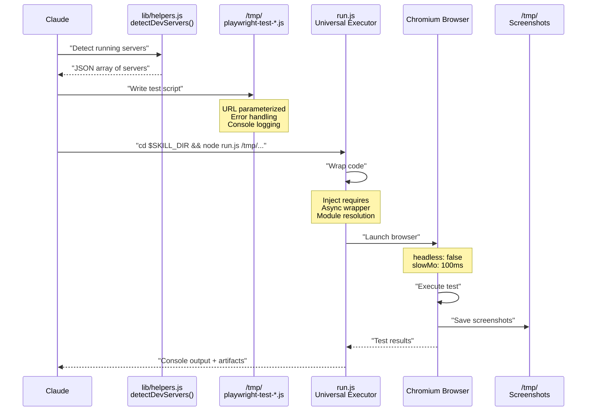
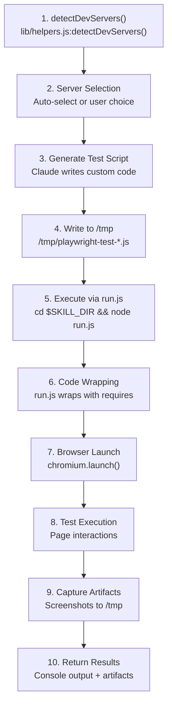
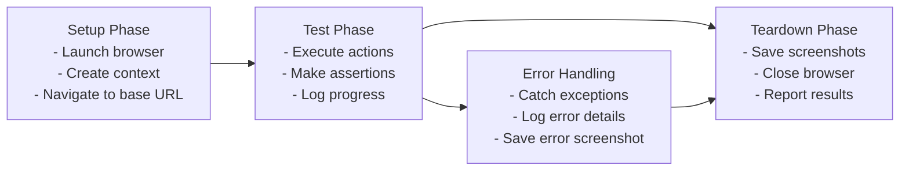
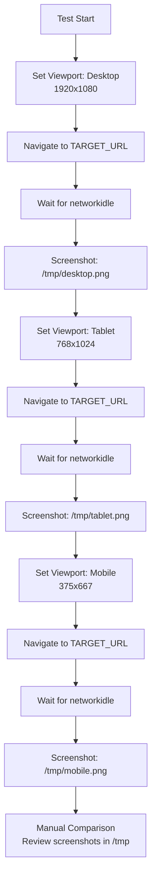
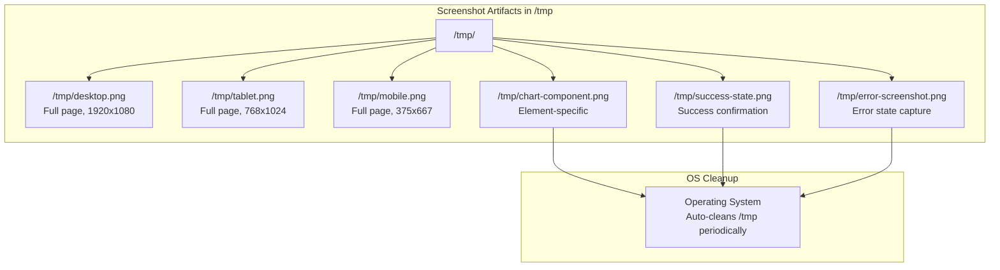
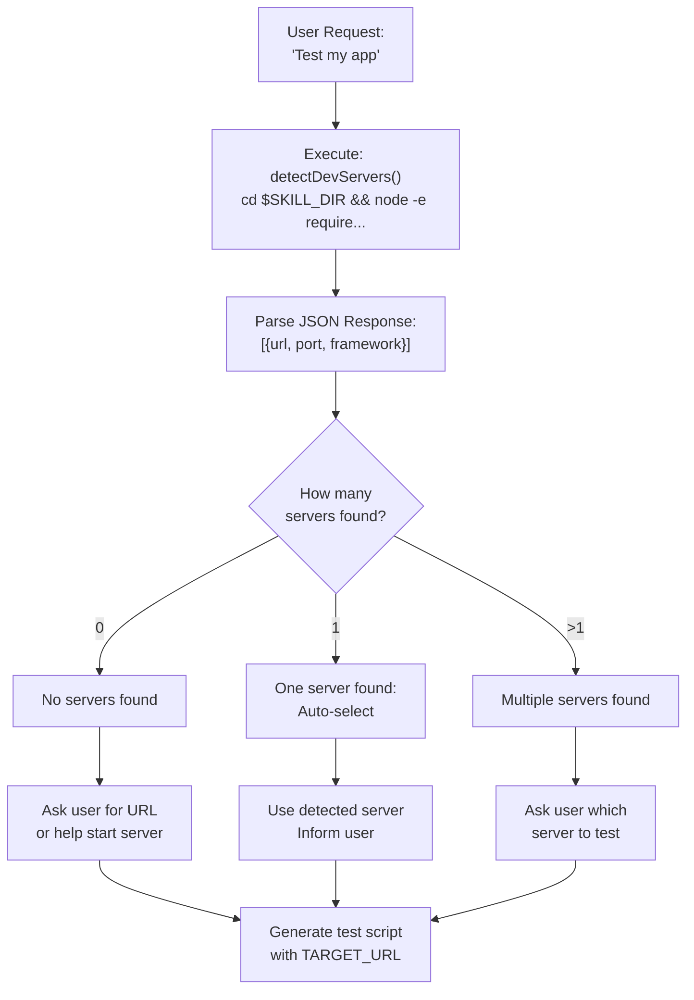
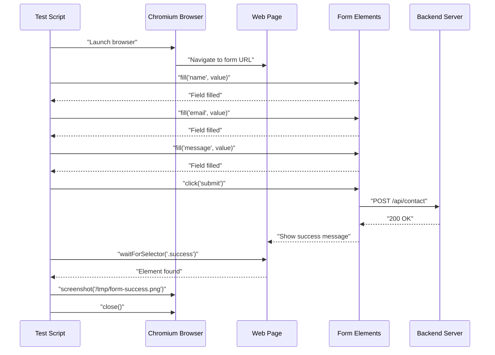
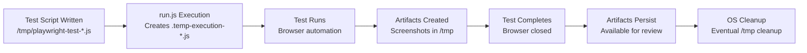
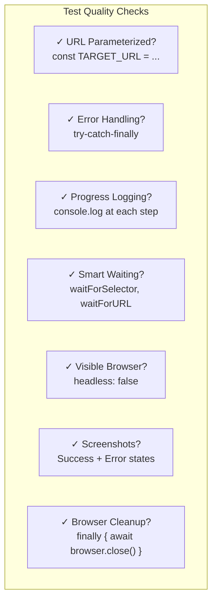

<!-- source: DeepWiki mcp.deepwiki.com · repo lackeyjb/playwright-skill · page 5.3 Testing Workflows · fetched 2026-10-27 -->

# Testing Workflows

<details>
<summary>Relevant source files</summary>

The following files were used as context for generating this wiki page:

- [API_REFERENCE.md](API_REFERENCE.md)
- [README.md](README.md)
- [skills/playwright-skill/SKILL.md](skills/playwright-skill/SKILL.md)

</details>


This document explains how to organize and execute end-to-end (E2E) testing workflows using playwright-skill, including visual regression testing, screenshot comparison strategies, test organization patterns, and testing best practices. For information about writing individual automation scripts, see [Writing Automation Scripts](#5.1). For debugging test failures, see [Debugging and Troubleshooting](#5.4). For advanced visual testing techniques, see [Visual Testing and Screenshots](#7.1).

## Overview of Testing with playwright-skill

The playwright-skill enables Claude to execute browser tests by generating custom Playwright code and executing it through the universal executor `run.js`. Tests are written to `/tmp` to maintain clean project directories, and results include console output, screenshots, and execution status.

**Testing Execution Flow:**



Sources: [skills/playwright-skill/SKILL.md:21-89](), [skills/playwright-skill/SKILL.md:40-45]()

## Test File Organization

Tests generated by playwright-skill follow a consistent file organization pattern to maintain clarity and enable cleanup.

### Test File Naming Convention

| Pattern | Purpose | Example |
|---------|---------|---------|
| `/tmp/playwright-test-*.js` | General test scripts | `/tmp/playwright-test-homepage.js` |
| `/tmp/playwright-test-login-*.js` | Authentication tests | `/tmp/playwright-test-login-flow.js` |
| `/tmp/playwright-test-form-*.js` | Form interaction tests | `/tmp/playwright-test-form-submission.js` |
| `/tmp/playwright-test-responsive-*.js` | Responsive design tests | `/tmp/playwright-test-responsive.js` |
| `/tmp/.temp-execution-*.js` | Wrapped execution scripts (internal) | `/tmp/.temp-execution-1234567890.js` |

**Key Principle:** All test scripts are written to `/tmp` directory, never to the skill directory or user's project. This ensures clean projects and automatic cleanup by the operating system.

Sources: [skills/playwright-skill/SKILL.md:31](), [skills/playwright-skill/SKILL.md:64-84]()

### Test Structure Pattern

Every test script follows a consistent structure:

```javascript
// URL Parameterization (always at top)
const TARGET_URL = 'http://localhost:3001'; // Auto-detected or user-provided

// Browser Launch Configuration
const browser = await chromium.launch({
  headless: false,  // Visible by default
  slowMo: 100      // Slow motion for visibility
});

// Test Execution
try {
  // Arrange
  const page = await browser.newPage();
  
  // Act
  await page.goto(TARGET_URL);
  // ... test actions ...
  
  // Assert & Capture
  console.log('✅ Test passed');
  await page.screenshot({ path: '/tmp/result.png' });
} catch (error) {
  console.error('❌ Test failed:', error.message);
} finally {
  await browser.close();
}
```

Sources: [skills/playwright-skill/SKILL.md:64-84](), [skills/playwright-skill/SKILL.md:210-235]()

## E2E Testing Workflows

### Basic E2E Test Execution Flow



Sources: [skills/playwright-skill/SKILL.md:21-45](), [skills/playwright-skill/SKILL.md:369-397]()

### Multi-Step Test Workflow Example

Tests often involve multiple sequential steps. The skill generates code that chains these actions:

**Login Flow Test Pattern:**

```javascript
// /tmp/playwright-test-login.js
const TARGET_URL = 'http://localhost:3001';

(async () => {
  const browser = await chromium.launch({ headless: false });
  const page = await browser.newPage();
  
  // Step 1: Navigate to login
  await page.goto(`${TARGET_URL}/login`);
  console.log('📍 Navigated to login page');
  
  // Step 2: Fill credentials
  await page.fill('input[name="email"]', 'test@example.com');
  await page.fill('input[name="password"]', 'password123');
  console.log('📝 Filled login form');
  
  // Step 3: Submit
  await page.click('button[type="submit"]');
  console.log('🔘 Clicked submit button');
  
  // Step 4: Wait for redirect
  await page.waitForURL('**/dashboard');
  console.log('✅ Redirected to dashboard');
  
  // Step 5: Verify dashboard loaded
  await page.waitForSelector('.dashboard-content');
  console.log('✅ Dashboard content visible');
  
  // Step 6: Capture proof
  await page.screenshot({ path: '/tmp/dashboard.png' });
  console.log('📸 Screenshot saved');
  
  await browser.close();
})();
```

Sources: [skills/playwright-skill/SKILL.md:120-143]()

### Test Lifecycle and Hooks

While playwright-skill primarily generates standalone scripts, tests can include setup and teardown logic:



Sources: [skills/playwright-skill/SKILL.md:210-235](), [API_REFERENCE.md:109-131]()

## Visual Regression Testing

Visual regression testing captures screenshots and compares them across test runs to detect unintended visual changes.

### Screenshot Capture Strategy

**Screenshot Types and Use Cases:**

| Type | Code Pattern | Use Case |
|------|-------------|----------|
| Full Page | `page.screenshot({ fullPage: true })` | Homepage testing, layout verification |
| Viewport | `page.screenshot({ fullPage: false })` | Above-the-fold content |
| Element | `page.locator('.chart').screenshot()` | Component-specific testing |
| Multiple Viewports | Loop through viewport sizes | Responsive design validation |

### Responsive Design Testing Workflow

Tests that validate visual appearance across multiple viewports:

```javascript
// /tmp/playwright-test-responsive.js
const TARGET_URL = 'http://localhost:3001';

const viewports = [
  { name: 'Desktop', width: 1920, height: 1080 },
  { name: 'Tablet', width: 768, height: 1024 },
  { name: 'Mobile', width: 375, height: 667 }
];

(async () => {
  const browser = await chromium.launch({ headless: false });
  const page = await browser.newPage();
  
  for (const viewport of viewports) {
    console.log(`Testing ${viewport.name} (${viewport.width}x${viewport.height})`);
    
    await page.setViewportSize({
      width: viewport.width,
      height: viewport.height
    });
    
    await page.goto(TARGET_URL);
    await page.waitForLoadState('networkidle');
    
    await page.screenshot({
      path: `/tmp/${viewport.name.toLowerCase()}.png`,
      fullPage: true
    });
    
    console.log(`✅ ${viewport.name} screenshot captured`);
  }
  
  await browser.close();
})();
```

Sources: [skills/playwright-skill/SKILL.md:237-275](), [skills/playwright-skill/SKILL.md:94-118]()

### Visual Testing Execution Flow



Sources: [skills/playwright-skill/SKILL.md:237-275]()

## Screenshot Management and Comparison

### Screenshot Storage Pattern

All screenshots are stored in `/tmp` with descriptive filenames:



Sources: [skills/playwright-skill/SKILL.md:64-84](), [README.md:163-164]()

### Helper Function for Screenshots

The `lib/helpers.js` module provides a utility function for consistent screenshot capture:

**Function: `takeScreenshot(page, name, options)`**

| Parameter | Type | Description |
|-----------|------|-------------|
| `page` | Page | Playwright page object |
| `name` | string | Base name for screenshot file |
| `options` | object | Optional: `{ fullPage: boolean }` |

**Usage Pattern:**

```javascript
const helpers = require('./lib/helpers');

// Timestamped screenshot
await helpers.takeScreenshot(page, 'test-result');
// Creates: /tmp/test-result-1234567890.png
```

Sources: [skills/playwright-skill/SKILL.md:314-316](), [skills/playwright-skill/SKILL.md:299-322]()

## Test Organization Best Practices

### Test Naming Conventions

Tests should have descriptive names that indicate their purpose:

| Test Type | Naming Pattern | Example |
|-----------|---------------|---------|
| Page Load | `test-page-<page-name>` | `playwright-test-page-homepage.js` |
| Form | `test-form-<form-type>` | `playwright-test-form-contact.js` |
| Login | `test-login-<flow>` | `playwright-test-login-success.js` |
| Responsive | `test-responsive-<page>` | `playwright-test-responsive-dashboard.js` |
| Links | `test-links-<scope>` | `playwright-test-links-broken.js` |

### URL Parameterization Pattern

**Critical Practice:** Always parameterize URLs to avoid hardcoding:

```javascript
// ✅ CORRECT: Parameterized URL
const TARGET_URL = 'http://localhost:3001'; // From detectDevServers() or user input
await page.goto(TARGET_URL);
await page.goto(`${TARGET_URL}/dashboard`);

// ❌ INCORRECT: Hardcoded URL
await page.goto('http://localhost:3000'); // Don't hardcode port numbers
```

This pattern enables:
- Testing against different environments
- Auto-detected dev servers
- User-provided URLs for external testing
- Easy modification without code changes

Sources: [skills/playwright-skill/SKILL.md:35](), [skills/playwright-skill/SKILL.md:66-70]()

### Error Handling and Logging Pattern

Every test should include comprehensive error handling and progress logging:

```javascript
(async () => {
  const browser = await chromium.launch({ headless: false });
  const page = await browser.newPage();
  
  try {
    // Test actions with logging
    await page.goto(TARGET_URL);
    console.log('✅ Page loaded');
    
    await page.click('button.submit');
    console.log('✅ Button clicked');
    
    await page.waitForSelector('.success');
    console.log('✅ Success message displayed');
    
    // Capture success state
    await page.screenshot({ path: '/tmp/success.png' });
    console.log('📸 Screenshot saved');
    
  } catch (error) {
    // Capture error state
    console.error('❌ Test failed:', error.message);
    await page.screenshot({ path: '/tmp/error.png' });
    console.log('📸 Error screenshot saved');
    throw error; // Re-throw for run.js to catch
    
  } finally {
    await browser.close();
  }
})();
```

Sources: [skills/playwright-skill/SKILL.md:210-235](), [skills/playwright-skill/SKILL.md:347]()

## Test Execution Patterns

### Visible Browser Testing (Default)

By default, tests run with visible browser for observability:

```javascript
const browser = await chromium.launch({
  headless: false,  // Browser window visible
  slowMo: 100       // Slow down actions by 100ms
});
```

**Benefits:**
- Visual confirmation of test execution
- Easier debugging
- Immediate feedback on UI interactions
- Observability of timing issues

Sources: [skills/playwright-skill/SKILL.md:33](), [skills/playwright-skill/SKILL.md:343-344](), [README.md:161]()

### Headless Mode (On Request)

Headless mode is only used when explicitly requested:

```javascript
const browser = await chromium.launch({
  headless: true  // Only when user requests headless execution
});
```

**Use Cases for Headless:**
- CI/CD pipeline execution
- Faster test execution when visual inspection not needed
- Automated scheduled tests
- Background test runs

Sources: [skills/playwright-skill/SKILL.md:345](), [README.md:205]()

### Test Execution Command Pattern

All tests execute through the universal executor with proper path resolution:

```bash
# Standard execution pattern
cd $SKILL_DIR && node run.js /tmp/playwright-test-*.js

# Example with actual paths
cd ~/.claude/skills/playwright-skill && node run.js /tmp/playwright-test-login.js
```

**Why `cd $SKILL_DIR`?**
- Ensures proper module resolution
- Accesses Playwright installation in skill's `node_modules`
- Enables `run.js` to find `lib/helpers.js`

Sources: [skills/playwright-skill/SKILL.md:9-15](), [skills/playwright-skill/SKILL.md:42](), [skills/playwright-skill/SKILL.md:88-89]()

## Test Workflow Integration Patterns

### Dev Server Detection Workflow

Before executing tests, the skill always detects running development servers:



Sources: [skills/playwright-skill/SKILL.md:23-29](), [skills/playwright-skill/SKILL.md:369-397]()

### Link Checking Workflow

Testing for broken links follows a specific pattern:

```javascript
// /tmp/playwright-test-links.js
const TARGET_URL = 'http://localhost:3001';

(async () => {
  const browser = await chromium.launch({ headless: false });
  const page = await browser.newPage();
  
  await page.goto(TARGET_URL);
  
  // Get all external links
  const links = await page.locator('a[href^="http"]').all();
  const results = { working: 0, broken: [] };
  
  console.log(`Checking ${links.length} links...`);
  
  for (const link of links) {
    const href = await link.getAttribute('href');
    try {
      const response = await page.request.head(href);
      if (response.ok()) {
        results.working++;
      } else {
        results.broken.push({ url: href, status: response.status() });
      }
    } catch (e) {
      results.broken.push({ url: href, error: e.message });
    }
  }
  
  console.log(`✅ Working links: ${results.working}`);
  if (results.broken.length > 0) {
    console.log(`❌ Broken links:`, results.broken);
  }
  
  await browser.close();
})();
```

Sources: [skills/playwright-skill/SKILL.md:173-206]()

### Form Testing Workflow

Form submission tests follow a consistent pattern:



Sources: [skills/playwright-skill/SKILL.md:146-171]()

## Test Artifact Management

### Artifact Lifecycle



Sources: [skills/playwright-skill/SKILL.md:41](), [README.md:163-164]()

### Artifact Location Reference

| Artifact Type | Location | Retention |
|--------------|----------|-----------|
| Test scripts | `/tmp/playwright-test-*.js` | Until next OS cleanup |
| Execution wrappers | `/tmp/.temp-execution-*.js` | Until next run |
| Screenshots | `/tmp/*.png` | Until next OS cleanup |
| Console output | stdout (captured by Claude) | Session only |

Sources: [skills/playwright-skill/SKILL.md:31](), [skills/playwright-skill/SKILL.md:41-44]()

## Best Practices Summary

### Critical Testing Workflow Practices

1. **Always detect dev servers first** - Never hardcode localhost URLs
2. **Write tests to /tmp** - Keep projects clean
3. **Parameterize URLs** - Use `TARGET_URL` constant
4. **Default to visible browser** - Only use headless when requested
5. **Add comprehensive logging** - Track test progress with console.log
6. **Include error handling** - Use try-catch-finally pattern
7. **Capture screenshots** - Save both success and error states
8. **Wait strategically** - Use `waitForSelector`, `waitForURL`, not fixed timeouts

### Test Quality Checklist



Sources: [skills/playwright-skill/SKILL.md:339-350](), [API_REFERENCE.md:553-558]()

### Anti-Patterns to Avoid

| Anti-Pattern | Why It's Wrong | Correct Pattern |
|-------------|----------------|-----------------|
| Hardcoded `localhost:3000` | Port may differ | Use `detectDevServers()` |
| Tests in project directory | Clutters project | Write to `/tmp` |
| `headless: true` default | Harder to debug | `headless: false` default |
| Fixed `setTimeout()` | Flaky tests | Use `waitForSelector()` |
| No error handling | Silent failures | try-catch-finally |
| No console logging | No progress visibility | Log each step |
| Direct `node script.js` | Module resolution fails | Execute via `run.js` |

Sources: [skills/playwright-skill/SKILL.md:340-350](), [skills/playwright-skill/SKILL.md:358-365]()

## Integration with Helper Functions

The `lib/helpers.js` module provides utilities that enhance testing workflows:

### Testing-Relevant Helper Functions

| Function | Purpose in Testing | Usage in Test |
|----------|-------------------|---------------|
| `detectDevServers()` | Find test targets | Pre-test setup |
| `safeClick(page, selector, options)` | Robust clicking with retry | Button/link interaction |
| `safeType(page, selector, text, options)` | Reliable text input | Form filling |
| `takeScreenshot(page, name, options)` | Timestamped screenshots | Test evidence capture |
| `handleCookieBanner(page)` | Auto-dismiss cookies | Test setup |
| `extractTableData(page, selector)` | Parse table data | Data validation |

**Example Integration in Test:**

```javascript
const helpers = require('./lib/helpers');
const { chromium } = require('playwright');

const TARGET_URL = 'http://localhost:3001';

(async () => {
  const browser = await chromium.launch({ headless: false });
  const page = await browser.newPage();
  
  await page.goto(TARGET_URL);
  
  // Use helper for cookie banner
  await helpers.handleCookieBanner(page);
  
  // Use helper for safe clicking
  await helpers.safeClick(page, 'button.submit', { retries: 3 });
  
  // Use helper for screenshot
  await helpers.takeScreenshot(page, 'test-result');
  
  await browser.close();
})();
```

Sources: [skills/playwright-skill/SKILL.md:299-322]()

---

