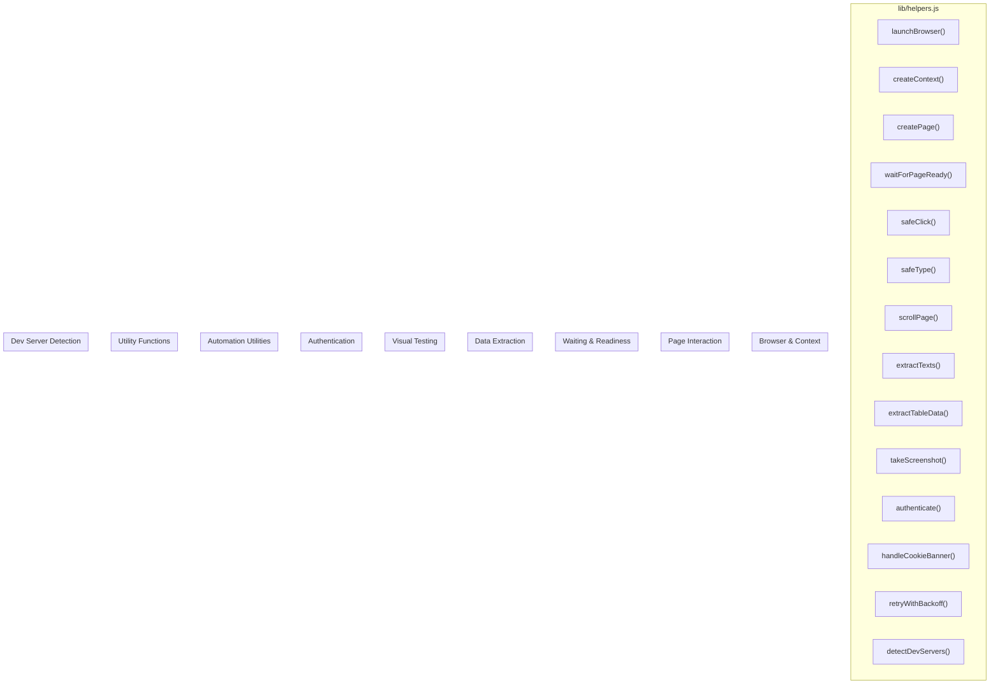
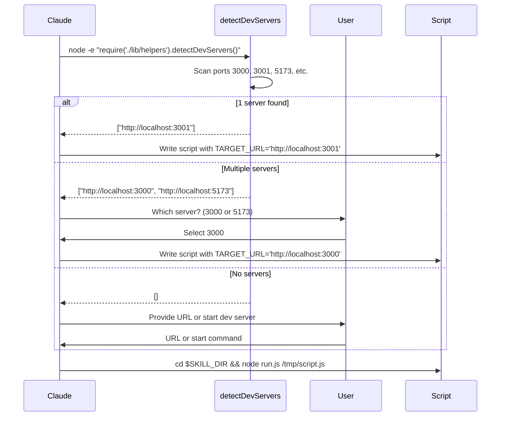
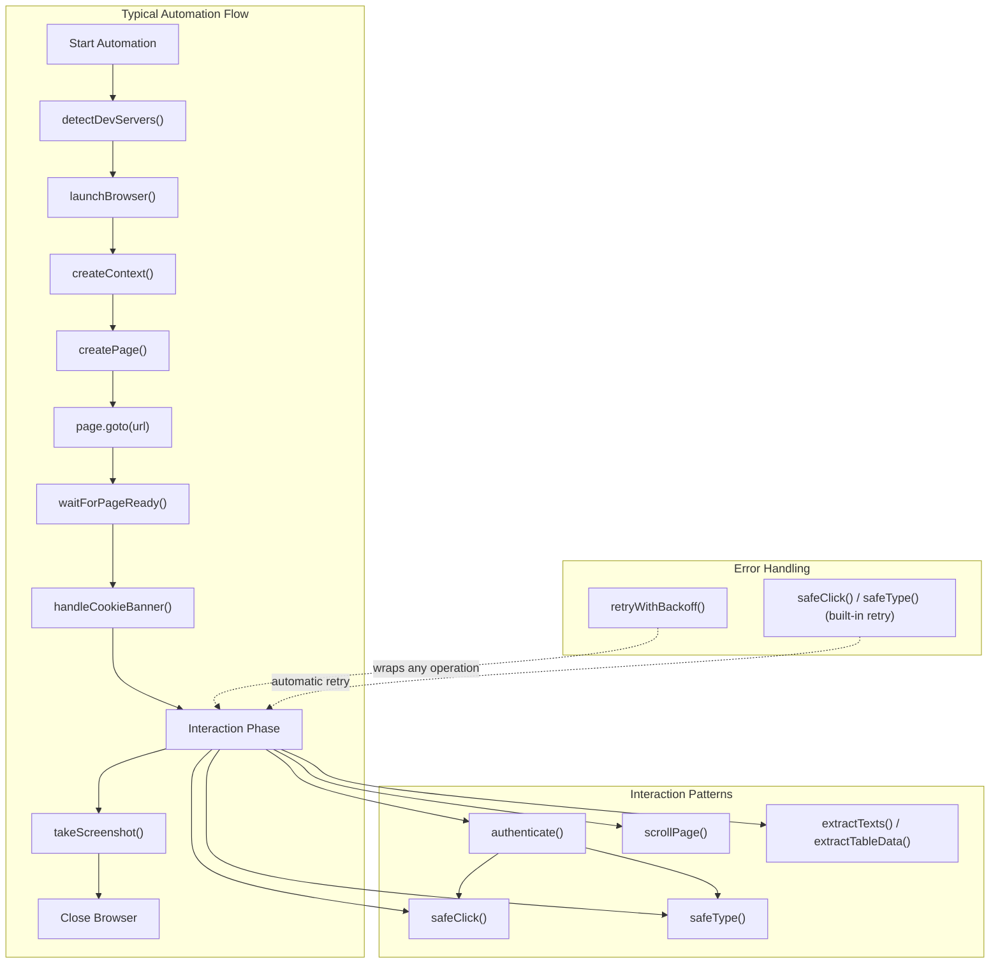
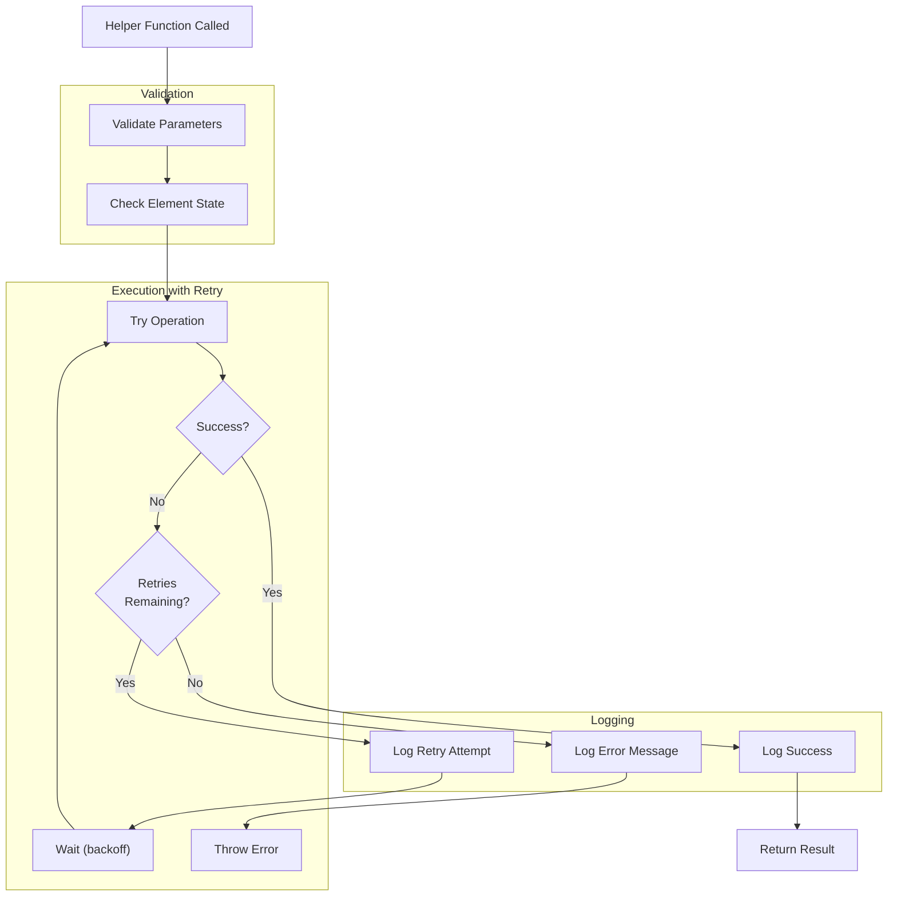

<!-- source: DeepWiki mcp.deepwiki.com · repo lackeyjb/playwright-skill · page 6.2 Helper Functions API · fetched 2026-10-27 -->

# Helper Functions API

<details>
<summary>Relevant source files</summary>

The following files were used as context for generating this wiki page:

- [API_REFERENCE.md](API_REFERENCE.md)
- [skills/playwright-skill/SKILL.md](skills/playwright-skill/SKILL.md)
- [skills/playwright-skill/lib/helpers.js](skills/playwright-skill/lib/helpers.js)

</details>


This document provides comprehensive API documentation for all utility functions in `lib/helpers.js`. These functions provide reusable patterns for browser automation, form interaction, data extraction, authentication, and dev server detection.

For Playwright's core API (browser launch, page navigation, locators), see [Playwright Core API](#6.1). For selector strategies and best practices, see [Selectors and Locators](#6.3).

## Helper Function Organization

The helper library provides 14 utility functions organized into logical categories:



**Sources:** [skills/playwright-skill/lib/helpers.js:1-399]()

## Browser & Context Management

### launchBrowser

Launches a browser instance with standardized configuration, including environment variable support for headless mode and slow motion.

**Function Signature:**
```javascript
async function launchBrowser(browserType = 'chromium', options = {})
```

**Parameters:**

| Parameter | Type | Default | Description |
|-----------|------|---------|-------------|
| `browserType` | `string` | `'chromium'` | Browser engine: `'chromium'`, `'firefox'`, or `'webkit'` |
| `options` | `Object` | `{}` | Additional Playwright launch options (merged with defaults) |

**Default Options:**

| Option | Value | Source |
|--------|-------|--------|
| `headless` | `process.env.HEADLESS !== 'false'` | Environment variable override |
| `slowMo` | `parseInt(process.env.SLOW_MO)` or `0` | Environment variable override |
| `args` | `['--no-sandbox', '--disable-setuid-sandbox']` | Security flags for containerized environments |

**Return Value:** `Promise<Browser>` - Playwright browser instance

**Usage Example:**
```javascript
const helpers = require('./lib/helpers');

// Chromium with default settings
const browser = await helpers.launchBrowser();

// Firefox with custom viewport
const firefox = await helpers.launchBrowser('firefox', {
  headless: true,
  slowMo: 50
});

// WebKit with args
const webkit = await helpers.launchBrowser('webkit', {
  args: ['--disable-dev-shm-usage']
});
```

**Error Handling:**
- Throws `Error` if `browserType` is not one of: `'chromium'`, `'firefox'`, `'webkit'`

**Sources:** [skills/playwright-skill/lib/helpers.js:11-26]()

---

### createContext

Creates a browser context with common settings including viewport, user agent, permissions, geolocation, and locale configuration.

**Function Signature:**
```javascript
async function createContext(browser, options = {})
```

**Parameters:**

| Parameter | Type | Default | Description |
|-----------|------|---------|-------------|
| `browser` | `Browser` | Required | Playwright browser instance |
| `options` | `Object` | `{}` | Context configuration options |

**Default Options:**

| Option | Type | Default | Description |
|--------|------|---------|-------------|
| `viewport` | `Object` | `{ width: 1280, height: 720 }` | Browser viewport dimensions |
| `userAgent` | `string` | `undefined` (desktop) | Custom user agent string |
| `permissions` | `Array<string>` | `[]` | Browser permissions to grant |
| `geolocation` | `Object` | `undefined` | Geolocation coordinates |
| `locale` | `string` | `'en-US'` | Browser locale |
| `timezoneId` | `string` | `'America/New_York'` | Timezone identifier |
| `mobile` | `boolean` | `false` | If true, sets iPhone user agent |

**Return Value:** `Promise<BrowserContext>`

**Usage Example:**
```javascript
const browser = await helpers.launchBrowser();

// Desktop context
const desktopContext = await helpers.createContext(browser);

// Mobile context with geolocation
const mobileContext = await helpers.createContext(browser, {
  mobile: true,
  permissions: ['geolocation'],
  geolocation: { latitude: 37.7749, longitude: -122.4194 }
});

// Custom locale and timezone
const euContext = await helpers.createContext(browser, {
  locale: 'de-DE',
  timezoneId: 'Europe/Berlin'
});
```

**Mobile User Agent:**
When `options.mobile` is true, automatically sets:
```
Mozilla/5.0 (iPhone; CPU iPhone OS 14_7_1 like Mac OS X) AppleWebKit/605.1.15 (KHTML, like Gecko) Version/14.1.2 Mobile/15E148 Safari/604.1
```

**Sources:** [skills/playwright-skill/lib/helpers.js:315-328]()

---

### createPage

Creates a new page in the browser context with optional viewport and user agent configuration.

**Function Signature:**
```javascript
async function createPage(context, options = {})
```

**Parameters:**

| Parameter | Type | Default | Description |
|-----------|------|---------|-------------|
| `context` | `BrowserContext` | Required | Playwright browser context |
| `options` | `Object` | `{}` | Page configuration options |

**Options:**

| Option | Type | Default | Description |
|--------|------|---------|-------------|
| `viewport` | `Object` | `undefined` | Viewport size `{ width, height }` |
| `userAgent` | `string` | `undefined` | Custom user agent |
| `timeout` | `number` | `30000` | Default timeout in milliseconds |

**Return Value:** `Promise<Page>`

**Usage Example:**
```javascript
const context = await browser.newContext();

// Standard page
const page = await helpers.createPage(context);

// Page with custom viewport
const mobilePage = await helpers.createPage(context, {
  viewport: { width: 375, height: 667 },
  timeout: 60000
});

// Page with custom user agent
const customPage = await helpers.createPage(context, {
  userAgent: 'CustomBot/1.0'
});
```

**Sources:** [skills/playwright-skill/lib/helpers.js:33-50]()

## Page Interaction

### safeClick

Performs a click operation with automatic retry logic and visibility waiting. Handles transient failures and timing issues common in dynamic web applications.

**Function Signature:**
```javascript
async function safeClick(page, selector, options = {})
```

**Parameters:**

| Parameter | Type | Default | Description |
|-----------|------|---------|-------------|
| `page` | `Page` | Required | Playwright page instance |
| `selector` | `string` | Required | Element selector to click |
| `options` | `Object` | `{}` | Click and retry options |

**Options:**

| Option | Type | Default | Description |
|--------|------|---------|-------------|
| `retries` | `number` | `3` | Maximum retry attempts |
| `retryDelay` | `number` | `1000` | Delay between retries (ms) |
| `timeout` | `number` | `5000` | Timeout for each attempt (ms) |
| `force` | `boolean` | `false` | Force click even if not visible |

**Return Value:** `Promise<boolean>` - Returns `true` on success

**Retry Behavior:**
1. Waits for element to be visible
2. Attempts click
3. If fails, waits `retryDelay` milliseconds
4. Retries up to `retries` times
5. Throws error if all attempts fail

**Usage Example:**
```javascript
// Basic usage
await helpers.safeClick(page, 'button.submit');

// With custom retries
await helpers.safeClick(page, '.dynamic-button', {
  retries: 5,
  retryDelay: 2000
});

// Force click (for covered elements)
await helpers.safeClick(page, '#hidden-button', {
  force: true
});

// Quick timeout
await helpers.safeClick(page, '.fast-element', {
  timeout: 2000,
  retries: 1
});
```

**Error Messages:**
- Console logs retry attempts: `"Retry 1/3 for clicking button.submit"`
- Final error: `"Failed to click button.submit after 3 attempts"`

**Sources:** [skills/playwright-skill/lib/helpers.js:85-109](), [skills/playwright-skill/SKILL.md:309]()

---

### safeType

Types text into an input field with automatic clearing and optional slow typing for visual debugging.

**Function Signature:**
```javascript
async function safeType(page, selector, text, options = {})
```

**Parameters:**

| Parameter | Type | Default | Description |
|-----------|------|---------|-------------|
| `page` | `Page` | Required | Playwright page instance |
| `selector` | `string` | Required | Input field selector |
| `text` | `string` | Required | Text to type |
| `options` | `Object` | `{}` | Typing options |

**Options:**

| Option | Type | Default | Description |
|--------|------|---------|-------------|
| `clear` | `boolean` | `true` | Clear field before typing |
| `slow` | `boolean` | `false` | Use slow typing with delay |
| `delay` | `number` | `100` | Delay between keystrokes (ms) when `slow: true` |
| `timeout` | `number` | `10000` | Timeout for element to appear (ms) |

**Return Value:** `Promise<void>`

**Behavior:**
- Waits for element to be visible
- Clears field by default (use `clear: false` to append)
- Uses `page.fill()` for fast typing (default)
- Uses `page.type()` with delay for slow typing (when `slow: true`)

**Usage Example:**
```javascript
// Standard typing (fast)
await helpers.safeType(page, '#username', 'testuser');

// Slow typing for visual debugging
await helpers.safeType(page, '#email', 'test@example.com', {
  slow: true,
  delay: 150
});

// Append without clearing
await helpers.safeType(page, '#message', ' additional text', {
  clear: false
});

// Quick timeout
await helpers.safeType(page, '#quick-input', 'text', {
  timeout: 5000
});
```

**Sources:** [skills/playwright-skill/lib/helpers.js:118-133](), [skills/playwright-skill/SKILL.md:312]()

---

### scrollPage

Scrolls the page in specified direction or to specific position.

**Function Signature:**
```javascript
async function scrollPage(page, direction = 'down', distance = 500)
```

**Parameters:**

| Parameter | Type | Default | Description |
|-----------|------|---------|-------------|
| `page` | `Page` | Required | Playwright page instance |
| `direction` | `string` | `'down'` | Scroll direction: `'down'`, `'up'`, `'top'`, `'bottom'` |
| `distance` | `number` | `500` | Pixels to scroll (for `'up'`/`'down'`) |

**Return Value:** `Promise<void>`

**Directions:**

| Direction | Behavior |
|-----------|----------|
| `'down'` | Scrolls down by `distance` pixels |
| `'up'` | Scrolls up by `distance` pixels |
| `'top'` | Scrolls to top of page |
| `'bottom'` | Scrolls to bottom of page |

**Usage Example:**
```javascript
// Scroll down 500px
await helpers.scrollPage(page, 'down');

// Scroll down 1000px
await helpers.scrollPage(page, 'down', 1000);

// Scroll to bottom
await helpers.scrollPage(page, 'bottom');

// Scroll to top
await helpers.scrollPage(page, 'top');

// Scroll up 300px
await helpers.scrollPage(page, 'up', 300);
```

**Notes:**
- Includes 500ms wait after scrolling for animation to complete
- Useful for triggering lazy-loaded content
- Use `'bottom'` for infinite scroll patterns

**Sources:** [skills/playwright-skill/lib/helpers.js:201-217]()

## Waiting Strategies

### waitForPageReady

Smart waiting strategy that combines load state waiting with optional selector waiting. Provides graceful timeout handling for slow-loading pages.

**Function Signature:**
```javascript
async function waitForPageReady(page, options = {})
```

**Parameters:**

| Parameter | Type | Default | Description |
|-----------|------|---------|-------------|
| `page` | `Page` | Required | Playwright page instance |
| `options` | `Object` | `{}` | Wait configuration |

**Options:**

| Option | Type | Default | Description |
|--------|------|---------|-------------|
| `waitUntil` | `string` | `'networkidle'` | Load state: `'load'`, `'domcontentloaded'`, `'networkidle'` |
| `timeout` | `number` | `30000` | Timeout in milliseconds |
| `waitForSelector` | `string` | `undefined` | Optional selector to wait for after load |

**Return Value:** `Promise<void>`

**Load States:**

| State | Description |
|-------|-------------|
| `'load'` | Waits for `load` event (basic page load) |
| `'domcontentloaded'` | Waits for DOMContentLoaded event |
| `'networkidle'` | Waits for no network connections for 500ms |

**Usage Example:**
```javascript
// Wait for network idle
await helpers.waitForPageReady(page);

// Wait for DOM only
await helpers.waitForPageReady(page, {
  waitUntil: 'domcontentloaded'
});

// Wait for specific element
await helpers.waitForPageReady(page, {
  waitForSelector: '.content-loaded',
  timeout: 60000
});

// Fast timeout
await helpers.waitForPageReady(page, {
  waitUntil: 'load',
  timeout: 10000
});
```

**Error Handling:**
- Catches timeout errors and logs warning: `"Page load timeout, continuing..."`
- Continues execution even if load timeout occurs
- Still waits for selector if specified

**Sources:** [skills/playwright-skill/lib/helpers.js:57-77]()

## Data Extraction

### extractTexts

Extracts text content from all elements matching a selector, automatically filtering empty strings.

**Function Signature:**
```javascript
async function extractTexts(page, selector)
```

**Parameters:**

| Parameter | Type | Default | Description |
|-----------|------|---------|-------------|
| `page` | `Page` | Required | Playwright page instance |
| `selector` | `string` | Required | CSS selector for elements |

**Return Value:** `Promise<Array<string>>` - Array of trimmed, non-empty text content

**Behavior:**
- Waits for selector (10 second timeout)
- Extracts `textContent` from all matching elements
- Trims whitespace from each text
- Filters out empty strings

**Usage Example:**
```javascript
// Extract all list items
const items = await helpers.extractTexts(page, 'ul.menu li');
console.log(items); // ['Home', 'About', 'Contact']

// Extract all headings
const headings = await helpers.extractTexts(page, 'h1, h2, h3');

// Extract all prices
const prices = await helpers.extractTexts(page, '.price');

// Extract error messages
const errors = await helpers.extractTexts(page, '.error-message');
```

**Sources:** [skills/playwright-skill/lib/helpers.js:140-145]()

---

### extractTableData

Extracts structured data from HTML tables, automatically detecting headers and converting to objects or arrays.

**Function Signature:**
```javascript
async function extractTableData(page, tableSelector)
```

**Parameters:**

| Parameter | Type | Default | Description |
|-----------|------|---------|-------------|
| `page` | `Page` | Required | Playwright page instance |
| `tableSelector` | `string` | Required | Table element selector |

**Return Value:** `Promise<Object>` - Object with `headers` and `rows` properties

**Return Structure:**

```javascript
{
  headers: Array<string>,  // Column headers from <thead>
  rows: Array<Object|Array>  // Row data (objects if headers exist, arrays if not)
}
```

**Behavior:**
- Waits for table to appear
- Extracts headers from `thead th` elements
- If headers exist: Returns rows as objects with header keys
- If no headers: Returns rows as arrays of cell values

**Usage Example:**
```javascript
// Table with headers
const data = await helpers.extractTableData(page, 'table.users');
console.log(data);
// {
//   headers: ['Name', 'Email', 'Status'],
//   rows: [
//     { Name: 'John Doe', Email: 'john@example.com', Status: 'Active' },
//     { Name: 'Jane Smith', Email: 'jane@example.com', Status: 'Inactive' }
//   ]
// }

// Table without headers
const simpleData = await helpers.extractTableData(page, 'table.data');
console.log(simpleData);
// {
//   headers: [],
//   rows: [
//     ['Cell 1', 'Cell 2'],
//     ['Cell 3', 'Cell 4']
//   ]
// }

// Access specific data
const userData = await helpers.extractTableData(page, '.users');
const activeUsers = userData.rows.filter(row => row.Status === 'Active');
```

**Sources:** [skills/playwright-skill/lib/helpers.js:224-249](), [skills/playwright-skill/SKILL.md:321]()

## Visual Testing

### takeScreenshot

Captures a screenshot with automatic timestamping and filename generation.

**Function Signature:**
```javascript
async function takeScreenshot(page, name, options = {})
```

**Parameters:**

| Parameter | Type | Default | Description |
|-----------|------|---------|-------------|
| `page` | `Page` | Required | Playwright page instance |
| `name` | `string` | Required | Base name for screenshot file |
| `options` | `Object` | `{}` | Playwright screenshot options |

**Options:**

| Option | Type | Default | Description |
|--------|------|---------|-------------|
| `fullPage` | `boolean` | `true` | Capture full scrollable page |
| `path` | `string` | Auto-generated | Override default path |
| Additional options from [Playwright Screenshot API](https://playwright.dev/docs/api/class-page#page-screenshot) |

**Return Value:** `Promise<string>` - Filename of saved screenshot

**Filename Format:**
```
{name}-{timestamp}.png
```
Where timestamp is ISO format with `:` and `.` replaced by `-`

**Usage Example:**
```javascript
// Full page screenshot
const filename = await helpers.takeScreenshot(page, 'homepage');
console.log(filename); // 'homepage-2024-01-15T10-30-45-123Z.png'

// Viewport only
await helpers.takeScreenshot(page, 'header', {
  fullPage: false
});

// Element screenshot
await helpers.takeScreenshot(page, 'chart', {
  clip: { x: 100, y: 100, width: 500, height: 300 }
});

// Custom path
await helpers.takeScreenshot(page, 'result', {
  path: '/tmp/custom-screenshot.png',
  fullPage: false
});
```

**Console Output:**
Logs: `"Screenshot saved: {filename}"`

**Sources:** [skills/playwright-skill/lib/helpers.js:153-165](), [skills/playwright-skill/SKILL.md:315]()

## Authentication

### authenticate

Performs form-based authentication with flexible selector configuration and automatic success detection.

**Function Signature:**
```javascript
async function authenticate(page, credentials, selectors = {})
```

**Parameters:**

| Parameter | Type | Default | Description |
|-----------|------|---------|-------------|
| `page` | `Page` | Required | Playwright page instance |
| `credentials` | `Object` | Required | Login credentials `{ username, password }` |
| `selectors` | `Object` | `{}` | Custom selectors (merged with defaults) |

**Credentials Object:**

| Property | Type | Required | Description |
|----------|------|----------|-------------|
| `username` | `string` | Yes | Username or email |
| `password` | `string` | Yes | Password |

**Default Selectors:**

| Selector Key | Default Value | Description |
|--------------|---------------|-------------|
| `username` | `'input[name="username"], input[name="email"], #username, #email'` | Username/email field |
| `password` | `'input[name="password"], #password'` | Password field |
| `submit` | `'button[type="submit"], input[type="submit"], button:has-text("Login"), button:has-text("Sign in")'` | Submit button |
| `successIndicator` | `'.dashboard, .user-menu, .logout'` | Element indicating successful login |

**Return Value:** `Promise<void>`

**Behavior:**
1. Types username using `safeType()`
2. Types password using `safeType()`
3. Clicks submit button using `safeClick()`
4. Waits for either navigation or success indicator (race condition)
5. Continues if neither occurs within timeout

**Usage Example:**
```javascript
// Standard login
await helpers.authenticate(page, {
  username: 'test@example.com',
  password: 'password123'
});

// Custom selectors
await helpers.authenticate(
  page,
  { username: 'john', password: 'secret' },
  {
    username: '#login-email',
    password: '#login-password',
    submit: 'button.login-btn',
    successIndicator: '.user-profile'
  }
);

// Full login flow
await page.goto('https://example.com/login');
await helpers.authenticate(page, {
  username: process.env.TEST_USER,
  password: process.env.TEST_PASSWORD
});
await page.waitForURL('**/dashboard');
```

**Error Handling:**
- Logs `"Login might have completed without navigation"` if neither navigation nor success indicator detected
- Does not throw error on timeout (continues execution)

**Sources:** [skills/playwright-skill/lib/helpers.js:173-193](), [skills/playwright-skill/SKILL.md:318]()

## Automation Utilities

### handleCookieBanner

Automatically detects and dismisses common cookie consent banners using multiple selector strategies.

**Function Signature:**
```javascript
async function handleCookieBanner(page, timeout = 3000)
```

**Parameters:**

| Parameter | Type | Default | Description |
|-----------|------|---------|-------------|
| `page` | `Page` | Required | Playwright page instance |
| `timeout` | `number` | `3000` | Total timeout for finding banner (ms) |

**Return Value:** `Promise<boolean>` - `true` if banner dismissed, `false` if no banner found

**Common Selectors Checked:**

```javascript
[
  'button:has-text("Accept")',
  'button:has-text("Accept all")',
  'button:has-text("OK")',
  'button:has-text("Got it")',
  'button:has-text("I agree")',
  '.cookie-accept',
  '#cookie-accept',
  '[data-testid="cookie-accept"]'
]
```

**Behavior:**
- Tries each selector sequentially
- Timeout divided equally among selectors
- Clicks first matching visible element
- Returns immediately on success
- Continues to next selector on failure

**Usage Example:**
```javascript
// Standard usage
await page.goto('https://example.com');
const dismissed = await helpers.handleCookieBanner(page);
if (dismissed) {
  console.log('Cookie banner dismissed');
}

// Longer timeout for slow sites
await helpers.handleCookieBanner(page, 10000);

// Try to dismiss before taking screenshot
await page.goto('https://example.com');
await helpers.handleCookieBanner(page);
await page.screenshot({ path: 'clean.png' });
```

**Console Output:**
Logs `"Cookie banner dismissed"` on success

**Sources:** [skills/playwright-skill/lib/helpers.js:256-285](), [skills/playwright-skill/SKILL.md:318]()

## Retry Logic

### retryWithBackoff

Generic retry mechanism with exponential backoff for any async operation.

**Function Signature:**
```javascript
async function retryWithBackoff(fn, maxRetries = 3, initialDelay = 1000)
```

**Parameters:**

| Parameter | Type | Default | Description |
|-----------|------|---------|-------------|
| `fn` | `Function` | Required | Async function to retry |
| `maxRetries` | `number` | `3` | Maximum retry attempts |
| `initialDelay` | `number` | `1000` | Initial delay in milliseconds |

**Return Value:** `Promise<any>` - Result of successful function execution

**Backoff Formula:**
```
delay = initialDelay * 2^attemptNumber
```

Example delays with `initialDelay: 1000`:
- Attempt 1: 1000ms
- Attempt 2: 2000ms
- Attempt 3: 4000ms

**Behavior:**
1. Executes function
2. On error, waits with exponential backoff
3. Logs retry attempt and delay
4. Throws last error if all attempts fail

**Usage Example:**
```javascript
// Retry API request
const data = await helpers.retryWithBackoff(async () => {
  const response = await page.request.get('https://api.example.com/data');
  if (!response.ok()) throw new Error('API error');
  return response.json();
});

// Retry element interaction
await helpers.retryWithBackoff(async () => {
  await page.click('.sometimes-disappears', { timeout: 2000 });
}, 5, 500);

// Retry with custom parameters
const result = await helpers.retryWithBackoff(
  async () => {
    // Complex operation
    const value = await page.textContent('.dynamic-content');
    if (!value.includes('expected')) {
      throw new Error('Content not ready');
    }
    return value;
  },
  10,    // 10 retries
  2000   // Start with 2 second delay
);
```

**Console Output:**
Logs: `"Attempt {n} failed, retrying in {delay}ms..."`

**Error Handling:**
- Throws the last error encountered if all retries fail
- No error if function succeeds on any attempt

**Sources:** [skills/playwright-skill/lib/helpers.js:293-308]()

## Dev Server Detection

### detectDevServers

Scans common development server ports to detect running local servers, eliminating hardcoded URLs in test scripts.

**Function Signature:**
```javascript
async function detectDevServers(customPorts = [])
```

**Parameters:**

| Parameter | Type | Default | Description |
|-----------|------|---------|-------------|
| `customPorts` | `Array<number>` | `[]` | Additional ports to scan |

**Default Ports Scanned:**

| Port | Common Framework |
|------|------------------|
| 3000 | React (CRA), Next.js |
| 3001 | React (alt), Express |
| 3002 | React (alt) |
| 5173 | Vite |
| 8080 | Vue CLI, Spring Boot |
| 8000 | Django, Python SimpleHTTPServer |
| 4200 | Angular CLI |
| 5000 | Flask, Create React App (alt) |
| 9000 | Various frameworks |
| 1234 | Parcel |

**Return Value:** `Promise<Array<string>>` - Array of detected server URLs

**Behavior:**
1. Combines default ports with custom ports (removes duplicates)
2. Sends HEAD request to `http://localhost:{port}/` for each port
3. 500ms timeout per port
4. Includes servers with status code < 500
5. Logs progress and results

**Usage Example:**
```javascript
// Detect servers on common ports
const servers = await helpers.detectDevServers();
console.log(servers); // ['http://localhost:3000', 'http://localhost:5173']

// Include custom ports
const allServers = await helpers.detectDevServers([4000, 9090]);

// Use in automation script
const servers = await helpers.detectDevServers();
if (servers.length === 1) {
  const TARGET_URL = servers[0];
  await page.goto(TARGET_URL);
} else if (servers.length > 1) {
  console.log('Multiple servers found:', servers);
  // Ask user or use first one
} else {
  console.log('No servers found');
}
```

**Console Output:**
```
🔍 Checking for running dev servers...
  ✅ Found server on port 3000
  ✅ Found server on port 5173
  ❌ No dev servers detected (if none found)
```

**Integration with SKILL.md Workflow:**



**Sources:** [skills/playwright-skill/lib/helpers.js:335-381](), [skills/playwright-skill/SKILL.md:23-29](), [skills/playwright-skill/SKILL.md:304-306](), [skills/playwright-skill/SKILL.md:341]()

## Helper Function Usage Patterns

The following diagram shows common usage patterns and relationships between helper functions:



**Sources:** [skills/playwright-skill/lib/helpers.js:1-399](), [skills/playwright-skill/SKILL.md:21-45]()

## Function Parameter Reference

Complete parameter matrix for all helper functions:

| Function | Parameters | Return Type |
|----------|-----------|-------------|
| `launchBrowser` | `(browserType='chromium', options={})` | `Promise<Browser>` |
| `createContext` | `(browser, options={})` | `Promise<BrowserContext>` |
| `createPage` | `(context, options={})` | `Promise<Page>` |
| `waitForPageReady` | `(page, options={})` | `Promise<void>` |
| `safeClick` | `(page, selector, options={})` | `Promise<boolean>` |
| `safeType` | `(page, selector, text, options={})` | `Promise<void>` |
| `extractTexts` | `(page, selector)` | `Promise<Array<string>>` |
| `takeScreenshot` | `(page, name, options={})` | `Promise<string>` |
| `authenticate` | `(page, credentials, selectors={})` | `Promise<void>` |
| `scrollPage` | `(page, direction='down', distance=500)` | `Promise<void>` |
| `extractTableData` | `(page, tableSelector)` | `Promise<Object>` |
| `handleCookieBanner` | `(page, timeout=3000)` | `Promise<boolean>` |
| `retryWithBackoff` | `(fn, maxRetries=3, initialDelay=1000)` | `Promise<any>` |
| `detectDevServers` | `(customPorts=[])` | `Promise<Array<string>>` |

**Sources:** [skills/playwright-skill/lib/helpers.js:1-399]()

## Error Handling Patterns

All helper functions implement consistent error handling:



**Common Error Patterns:**

| Function | Error Type | Handling Strategy |
|----------|-----------|-------------------|
| `safeClick` | Element not found/visible | Automatic retry with backoff |
| `safeType` | Element not found/visible | Wait then throw |
| `authenticate` | Navigation timeout | Log warning, continue |
| `handleCookieBanner` | No banner found | Return false, no error |
| `detectDevServers` | Connection failures | Silently continue to next port |
| `extractTableData` | Table not found | Throw error |
| `waitForPageReady` | Load timeout | Log warning, continue |
| `retryWithBackoff` | All attempts failed | Throw last error |

**Sources:** [skills/playwright-skill/lib/helpers.js:85-109](), [skills/playwright-skill/lib/helpers.js:173-193](), [skills/playwright-skill/lib/helpers.js:256-285](), [skills/playwright-skill/lib/helpers.js:293-308]()

## Environment Variable Support

Certain helper functions respect environment variables for configuration:

| Function | Environment Variable | Default | Description |
|----------|---------------------|---------|-------------|
| `launchBrowser` | `HEADLESS` | `true` | Set to `'false'` for visible browser |
| `launchBrowser` | `SLOW_MO` | `0` | Milliseconds to slow down operations |

**Usage Example:**
```bash
# Run with visible browser and slow motion
export HEADLESS=false
export SLOW_MO=100
node run.js /tmp/test-script.js

# Or inline
HEADLESS=false SLOW_MO=50 node run.js /tmp/test-script.js
```

**Sources:** [skills/playwright-skill/lib/helpers.js:13-15]()

## Importing and Using Helpers

All helper functions are exported from the module:

```javascript
// Import all helpers
const helpers = require('./lib/helpers');

// Use helpers
await helpers.detectDevServers();
await helpers.safeClick(page, 'button');

// Destructure specific helpers
const { safeClick, safeType, detectDevServers } = require('./lib/helpers');

await safeClick(page, '.submit');
await safeType(page, '#email', 'test@example.com');
```

**Module Exports:**
```javascript
module.exports = {
  launchBrowser,
  createPage,
  waitForPageReady,
  safeClick,
  safeType,
  extractTexts,
  takeScreenshot,
  authenticate,
  scrollPage,
  extractTableData,
  handleCookieBanner,
  retryWithBackoff,
  createContext,
  detectDevServers
};
```

**Sources:** [skills/playwright-skill/lib/helpers.js:383-398](), [skills/playwright-skill/SKILL.md:299-323]()

---

