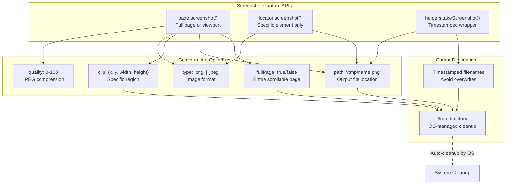
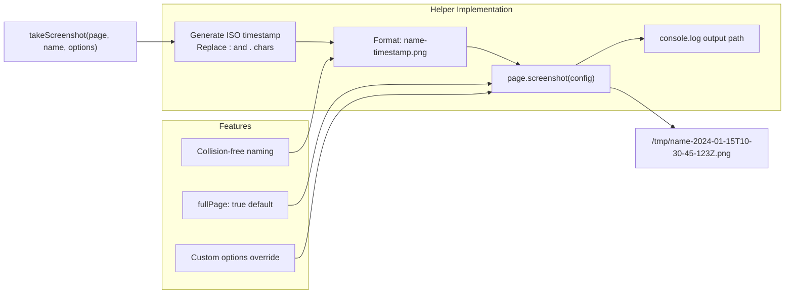
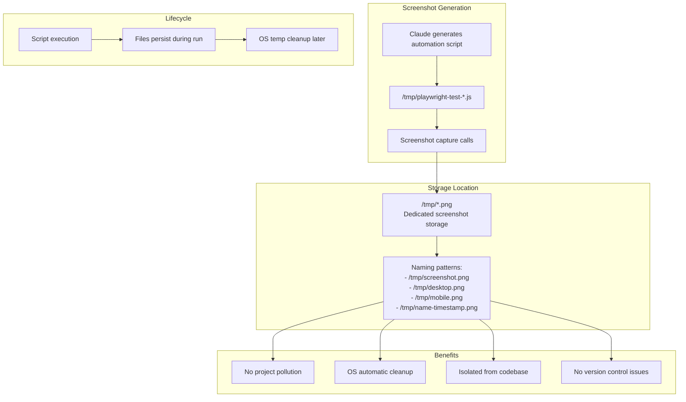
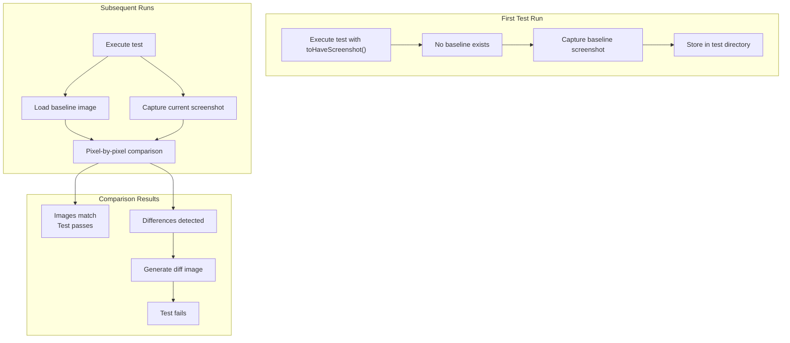
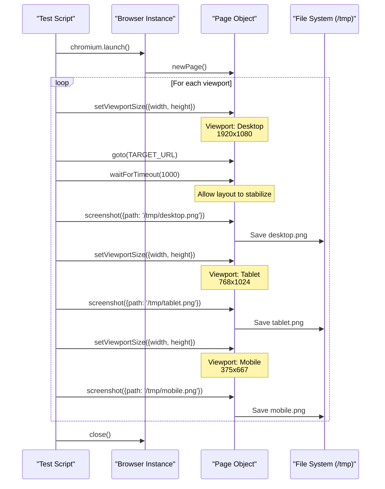
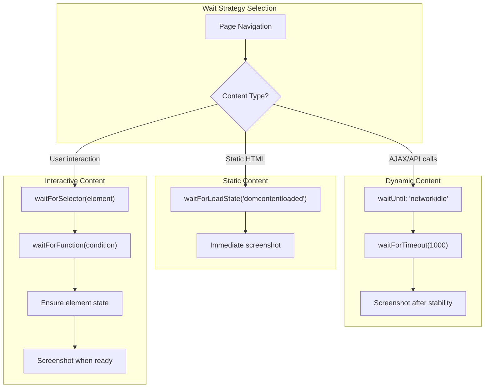
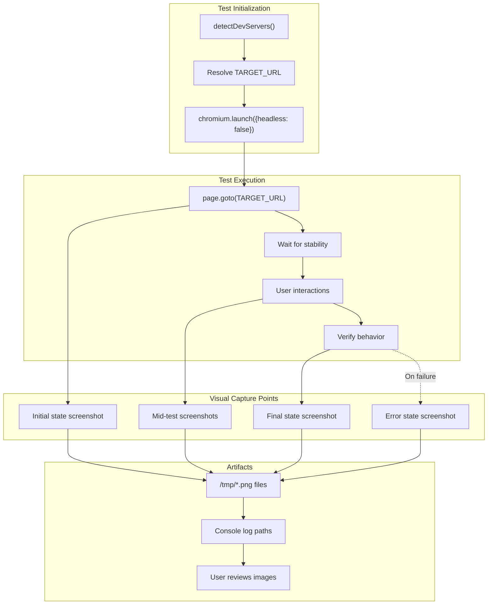

<!-- source: DeepWiki mcp.deepwiki.com · repo lackeyjb/playwright-skill · page 7.1 Visual Testing and Screenshots · fetched 2026-10-27 -->

# Visual Testing and Screenshots

<details>
<summary>Relevant source files</summary>

The following files were used as context for generating this wiki page:

- [API_REFERENCE.md](API_REFERENCE.md)
- [skills/playwright-skill/SKILL.md](skills/playwright-skill/SKILL.md)
- [skills/playwright-skill/lib/helpers.js](skills/playwright-skill/lib/helpers.js)

</details>


This document provides comprehensive guidance on visual testing and screenshot capture using the playwright-skill. It covers screenshot capture mechanisms, configuration options, storage strategies, visual comparison techniques, and handling dynamic content. For general testing workflows and test organization, see [Testing Workflows](#5.3). For mobile-specific visual testing and device emulation, see [Mobile and Responsive Testing](#7.2).

## Screenshot Capture Fundamentals

The playwright-skill provides multiple mechanisms for capturing screenshots during browser automation. Screenshots are automatically stored in the `/tmp` directory to maintain clean project structures and enable automatic OS-level cleanup.

### Screenshot Methods



**Sources:** [skills/playwright-skill/SKILL.md:78-80](), [skills/playwright-skill/lib/helpers.js:148-165](), [API_REFERENCE.md:414-429]()

### Basic Screenshot Patterns

The skill implements three primary screenshot capture patterns, each optimized for different use cases:

| Method | Use Case | File Naming | Code Location |
|--------|----------|-------------|---------------|
| `page.screenshot()` | Full page capture, manual control | User-specified path | [skills/playwright-skill/SKILL.md:79]() |
| `locator.screenshot()` | Specific element capture | User-specified path | [API_REFERENCE.md:422-425]() |
| `helpers.takeScreenshot()` | Timestamped, auto-named | Auto-generated with timestamp | [skills/playwright-skill/lib/helpers.js:153]() |

## Screenshot Types and Configuration

### Full Page Screenshots

Full page screenshots capture the entire scrollable content of a page, including areas not visible in the current viewport. The `fullPage: true` option triggers automatic scrolling to capture all content.

```javascript
// Example from SKILL.md
await page.screenshot({ 
  path: '/tmp/screenshot.png', 
  fullPage: true 
});
```

**Implementation Details:**
- Playwright automatically scrolls the page to capture all content
- Scroll behavior respects sticky headers and fixed elements
- Captures hidden overflow content
- Default behavior when no viewport constraints specified

**Sources:** [skills/playwright-skill/SKILL.md:79](), [skills/playwright-skill/SKILL.md:110](), [skills/playwright-skill/SKILL.md:226-227]()

### Viewport Screenshots

Viewport screenshots capture only the visible portion of the page at the current scroll position, useful for testing above-the-fold content or specific scroll states.

```javascript
// Viewport-only capture (fullPage: false is default for viewport)
await page.screenshot({ 
  path: '/tmp/viewport.png',
  fullPage: false
});
```

**Sources:** [API_REFERENCE.md:416-420]()

### Element Screenshots

Element-specific screenshots capture only a particular DOM element, useful for component-level visual testing and isolating specific UI regions.

```javascript
// Capture specific element only
await page.locator('.chart').screenshot({
  path: '/tmp/chart.png'
});
```

**Sources:** [API_REFERENCE.md:422-425]()

### Screenshot Helper Function

The `takeScreenshot` helper in `lib/helpers.js` provides automatic timestamp generation to prevent file overwrites and simplify screenshot management.



**Sources:** [skills/playwright-skill/lib/helpers.js:148-165]()

**Function Signature:**
- **Line 153:** `async function takeScreenshot(page, name, options = {})`
- **Line 154:** Timestamp generation: `new Date().toISOString().replace(/[:.]/g, '-')`
- **Line 155:** Filename format: `${name}-${timestamp}.png`
- **Line 159:** Default `fullPage: true` unless overridden
- **Line 163:** Console logging of saved path

## Storage and File Management

### /tmp Directory Strategy

All screenshots are stored in the `/tmp` directory to maintain clean project structures and enable automatic cleanup. This strategy is critical to the skill's architecture.



**Sources:** [skills/playwright-skill/SKILL.md:31-32](), [skills/playwright-skill/SKILL.md:79](), [skills/playwright-skill/SKILL.md:404]()

### File Naming Strategies

The skill uses three primary file naming strategies:

| Strategy | Pattern | Use Case | Example |
|----------|---------|----------|---------|
| Descriptive | `/tmp/descriptive-name.png` | Single screenshot per test | `/tmp/screenshot.png` |
| Viewport-based | `/tmp/viewport-name.png` | Multi-viewport testing | `/tmp/desktop.png`, `/tmp/mobile.png` |
| Timestamped | `/tmp/name-YYYY-MM-DDTHH-MM-SS-mmmZ.png` | Repeated captures | `/tmp/test-2024-01-15T10-30-45-123Z.png` |

**Sources:** [skills/playwright-skill/SKILL.md:110-114](), [skills/playwright-skill/SKILL.md:266-269](), [skills/playwright-skill/lib/helpers.js:154-155]()

## Visual Comparison and Regression Testing

### Pixel Comparison

Playwright provides built-in visual regression testing through screenshot comparison using the `toHaveScreenshot()` assertion.

```javascript
// Visual comparison - from API_REFERENCE.md
await expect(page).toHaveScreenshot('homepage.png');
```

**Comparison Behavior:**
1. First run: Captures baseline screenshot
2. Subsequent runs: Compares against baseline
3. Differences: Generates diff image highlighting changes
4. Threshold: Configurable pixel difference tolerance

**Sources:** [API_REFERENCE.md:428]()

### Baseline Management

Visual regression testing requires baseline image management:



**Sources:** [API_REFERENCE.md:428]()

### Handling Dynamic Content

Dynamic content (timestamps, animations, random data) requires special handling to prevent false failures in visual regression testing.

#### Masking Dynamic Regions

Mask unpredictable content before comparison:

```javascript
// Mask dynamic elements during screenshot
await expect(page).toHaveScreenshot('page.png', {
  mask: [page.locator('.timestamp'), page.locator('.random-id')]
});
```

#### Wait for Stability

Ensure animations complete before capturing:

```javascript
// Wait for animations to settle - from SKILL.md
await page.goto(TARGET_URL);
await page.waitForTimeout(1000);  // Allow animations to complete
await page.screenshot({ path: `/tmp/stable.png` });
```

**Sources:** [skills/playwright-skill/SKILL.md:264]()

#### Network Idle Strategy

Wait for all network activity to complete before capturing visual state:

```javascript
// From SKILL.md - wait for network idle
await page.goto('http://localhost:3000', {
  waitUntil: 'networkidle',
  timeout: 10000
});
```

**Sources:** [skills/playwright-skill/SKILL.md:218-221]()

## Multi-Viewport Visual Testing

### Responsive Design Verification

The skill provides patterns for testing visual appearance across multiple viewport sizes to verify responsive design implementation.



**Sources:** [skills/playwright-skill/SKILL.md:237-275]()

### Viewport Configuration Patterns

Standard viewport configurations from `SKILL.md`:

| Device Type | Width | Height | File Name | Code Reference |
|-------------|-------|--------|-----------|----------------|
| Desktop | 1920 | 1080 | `/tmp/desktop.png` | [skills/playwright-skill/SKILL.md:107-110]() |
| Tablet | 768 | 1024 | `/tmp/tablet.png` | [skills/playwright-skill/SKILL.md:251]() |
| Mobile | 375 | 667 | `/tmp/mobile.png` | [skills/playwright-skill/SKILL.md:252]() |

### Implementation Pattern

The standard pattern for multi-viewport testing, as implemented in `SKILL.md`:

```javascript
// Pattern from SKILL.md lines 245-274
const viewports = [
  { name: 'Desktop', width: 1920, height: 1080 },
  { name: 'Tablet', width: 768, height: 1024 },
  { name: 'Mobile', width: 375, height: 667 }
];

for (const viewport of viewports) {
  console.log(`Testing ${viewport.name} (${viewport.width}x${viewport.height})`);
  
  await page.setViewportSize({
    width: viewport.width,
    height: viewport.height
  });
  
  await page.goto(TARGET_URL);
  await page.waitForTimeout(1000);  // Allow layout stabilization
  
  await page.screenshot({
    path: `/tmp/${viewport.name.toLowerCase()}.png`,
    fullPage: true
  });
}
```

**Sources:** [skills/playwright-skill/SKILL.md:249-270]()

## Screenshot Timing and Wait Strategies

### Critical Wait Patterns

Proper timing is essential for reliable visual testing. The skill implements multiple wait strategies to ensure page stability before capturing screenshots.



**Sources:** [skills/playwright-skill/SKILL.md:218-221](), [skills/playwright-skill/SKILL.md:264](), [API_REFERENCE.md:273-283]()

### Network Idle Pattern

For pages with dynamic content loading, wait for network activity to complete:

**Implementation from `SKILL.md`:**
- **Line 219:** `waitUntil: 'networkidle'` - Wait for no network activity for at least 500ms
- **Line 220:** `timeout: 10000` - Maximum 10 second wait
- **Line 226-227:** Screenshot capture after network stability

**Sources:** [skills/playwright-skill/SKILL.md:218-227]()

### Animation Stabilization

For pages with CSS animations or transitions, allow time for animations to complete:

**Pattern:**
- Navigate to page
- Wait fixed duration for animations: `await page.waitForTimeout(1000)`
- Capture screenshot with stable layout

**Sources:** [skills/playwright-skill/SKILL.md:263-264]()

## Error Handling in Visual Testing

### Screenshot Capture Error Handling

Robust error handling ensures screenshots are captured even when page loading fails partially.

```javascript
// Error handling pattern from SKILL.md lines 217-233
try {
  await page.goto('http://localhost:3000', {
    waitUntil: 'networkidle',
    timeout: 10000
  });

  await page.screenshot({
    path: '/tmp/screenshot.png',
    fullPage: true
  });

  console.log('📸 Screenshot saved to /tmp/screenshot.png');
} catch (error) {
  console.error('❌ Error:', error.message);
} finally {
  await browser.close();
}
```

**Error Handling Strategy:**
1. **try block:** Attempt page load and screenshot
2. **catch block:** Log error but continue execution
3. **finally block:** Ensure browser cleanup regardless of outcome

**Sources:** [skills/playwright-skill/SKILL.md:217-233]()

## Integration with Test Workflows

### Screenshot in Test Lifecycle

Screenshots integrate into the test execution lifecycle at multiple stages:



**Sources:** [skills/playground-skill/SKILL.md:39-44](), [skills/playwright-skill/SKILL.md:217-233]()

### Console Output Pattern

Screenshots are accompanied by console output for easy location:

- **Pattern:** `console.log('📸 Screenshot saved to /tmp/screenshot.png')`
- **Purpose:** Provides immediate feedback and file path
- **User experience:** Claude displays this output with the screenshot path

**Sources:** [skills/playwright-skill/SKILL.md:80](), [skills/playwright-skill/SKILL.md:228](), [skills/playwright-skill/lib/helpers.js:163]()

## Best Practices

### Screenshot Capture Best Practices

1. **Use full page captures by default** - Set `fullPage: true` unless specific viewport testing needed
2. **Store in /tmp** - Always use `/tmp/` directory for screenshot storage
3. **Descriptive naming** - Use clear, descriptive names that indicate what is being captured
4. **Wait for stability** - Use `networkidle` or fixed delays for pages with dynamic content
5. **Error handling** - Wrap screenshot capture in try-catch blocks
6. **Console logging** - Log screenshot paths for user reference

**Sources:** [skills/playwright-skill/SKILL.md:340-350]()

### Visual Testing Best Practices

1. **Mask dynamic content** - Use mask option for timestamps, random IDs, or user-specific data
2. **Multiple viewports** - Test responsive designs across desktop, tablet, and mobile viewports
3. **Baseline management** - Store baseline images in version control for team consistency
4. **Threshold tuning** - Adjust pixel difference thresholds for acceptable variation
5. **Incremental updates** - Update baselines incrementally as UI evolves
6. **CI integration** - Run visual tests in CI with consistent environment

**Sources:** [API_REFERENCE.md:427-429](), [skills/playwright-skill/SKILL.md:237-275]()

### Performance Considerations

| Practice | Benefit | Trade-off |
|----------|---------|-----------|
| `fullPage: false` | Faster capture | Incomplete coverage |
| `type: 'jpeg'` with quality | Smaller files | Lossy compression |
| Parallel viewport tests | Faster execution | Higher resource usage |
| Selective screenshots | Faster tests | Less debugging info |

### Debugging Visual Tests

When visual tests fail unexpectedly:

1. **Run with visible browser** - Set `headless: false` to observe behavior
2. **Add slowMo** - Use `slowMo: 100` to slow down actions
3. **Capture intermediate states** - Take screenshots before and after each action
4. **Check wait conditions** - Verify proper wait strategies for dynamic content
5. **Review diff images** - Examine generated diff images for failure cause

**Sources:** [skills/playwright-skill/SKILL.md:345-346](), [skills/playwright-skill/SKILL.md:362]()

---

