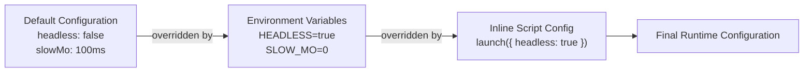
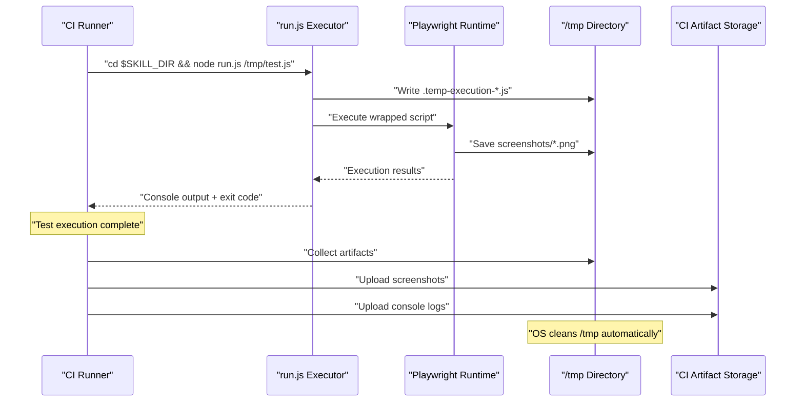
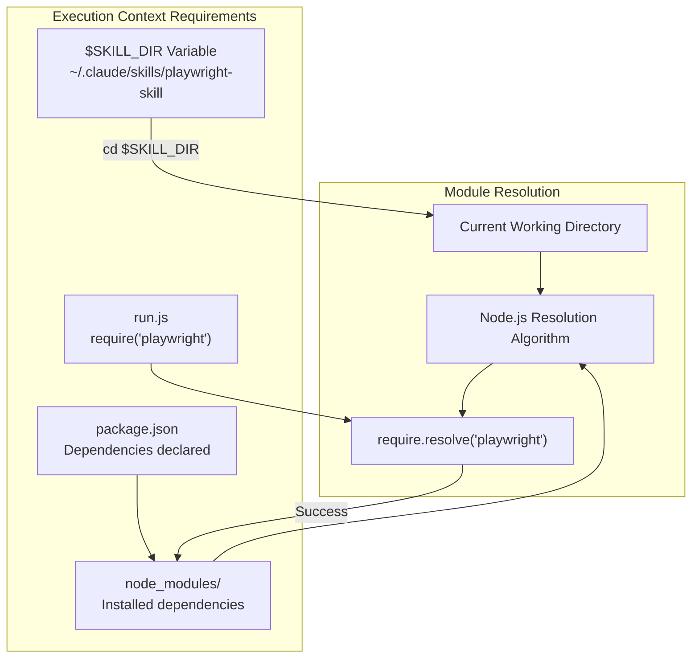
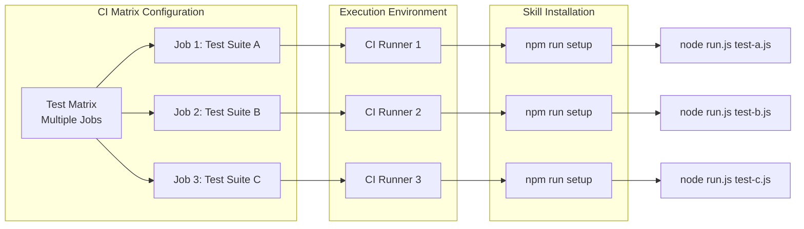

<!-- source: DeepWiki mcp.deepwiki.com · repo lackeyjb/playwright-skill · page 7.4 CI/CD Integration · fetched 2026-10-27 -->

# CI/CD Integration

<details>
<summary>Relevant source files</summary>

The following files were used as context for generating this wiki page:

- [API_REFERENCE.md](API_REFERENCE.md)
- [README.md](README.md)
- [skills/playwright-skill/package.json](skills/playwright-skill/package.json)

</details>


## Purpose and Scope

This document covers running playwright-skill in Continuous Integration and Continuous Deployment (CI/CD) environments. It explains installation procedures for CI systems, headless mode configuration, artifact collection strategies, and provides example configurations for common CI platforms.

For local development and debugging with visible browsers, see [Debugging and Troubleshooting](#5.4). For testing workflows and test organization patterns, see [Testing Workflows](#5.3). For configuration options outside of CI contexts, see [Configuration and Setup](#2.3).

---

## CI Environment Requirements

### System Prerequisites

CI environments running playwright-skill require:

| Requirement | Version | Purpose |
|-------------|---------|---------|
| Node.js | >=14.0.0 | Runtime execution environment |
| npm | Latest stable | Dependency management |
| Playwright | ^1.48.0 | Browser automation library |
| Chromium | Latest via Playwright | Browser engine for automation |

The `npm run setup` command [skills/playwright-skill/package.json:8]() handles Playwright and Chromium installation automatically.

**Sources:** [skills/playwright-skill/package.json:1-26](), [README.md:192-194]()

---

## Installation in CI

### Plugin Installation Path

When using the plugin distribution model, the skill is installed at:
```
~/.claude/plugins/marketplaces/playwright-skill/skills/playwright-skill
```

All commands must use `cd $SKILL_DIR` prefix to ensure proper module resolution regardless of the current working directory.

### CI Installation Steps

```bash
# Clone repository to temporary location
git clone https://github.com/lackeyjb/playwright-skill.git /tmp/playwright-skill-temp

# Copy skill to CI workspace
mkdir -p ~/.claude/skills
cp -r /tmp/playwright-skill-temp/skills/playwright-skill ~/.claude/skills/

# Navigate to skill directory and install dependencies
cd ~/.claude/skills/playwright-skill
npm run setup

# Verify installation
npm list playwright
```

The `npm run setup` command executes:
1. `npm install` - installs playwright dependency
2. `npx playwright install chromium` - downloads Chromium browser

**Sources:** [README.md:59-93](), [skills/playwright-skill/package.json:8]()

---

## Headless Mode Configuration

### Default vs CI Behavior

By default, playwright-skill launches browsers in **headed mode** (`headless: false`) for visibility during development. CI environments require headless mode for performance and compatibility.

### Environment Variable Override

Set `HEADLESS=true` to force headless execution:

```bash
export HEADLESS=true
cd $SKILL_DIR && node run.js /tmp/playwright-test-*.js
```

### Configuration Precedence



**Diagram: Configuration Precedence in CI/CD Context**

Environment variables provide the recommended approach for CI configuration, allowing scripts to remain unchanged while adapting to the execution environment.

**Sources:** [README.md:159-164](), [API_REFERENCE.md:86-89]()

---

## Artifact Management in CI

### Temporary File Strategy

The playwright-skill system writes all artifacts to `/tmp` to maintain clean project directories:

| Artifact Type | Path Pattern | Purpose |
|---------------|-------------|---------|
| Generated scripts | `/tmp/playwright-test-*.js` | User-written automation code |
| Wrapped scripts | `/tmp/.temp-execution-*.js` | Executor-wrapped code with imports |
| Screenshots | `/tmp/*.png` | Visual verification artifacts |

### CI Artifact Collection Flow



**Diagram: Artifact Collection Pipeline in CI**

### Artifact Collection Commands

```bash
# After test execution, collect artifacts
mkdir -p artifacts/screenshots
cp /tmp/*.png artifacts/screenshots/ 2>/dev/null || true

# Preserve console output
tee test-output.log
```

**Sources:** [README.md:163-164](), [API_REFERENCE.md:416-425]()

---

## GitHub Actions Configuration

### Complete Workflow Example

```yaml
name: "Playwright Skill Tests"
on:
  push:
    branches: [main, master]
  pull_request:
    branches: [main, master]

jobs:
  test:
    runs-on: ubuntu-latest
    
    steps:
      - name: "Checkout repository"
        uses: actions/checkout@v3
      
      - name: "Setup Node.js"
        uses: actions/setup-node@v3
        with:
          node-version: '18'
          cache: 'npm'
      
      - name: "Install playwright-skill"
        run: |
          mkdir -p ~/.claude/skills
          cp -r skills/playwright-skill ~/.claude/skills/
          cd ~/.claude/skills/playwright-skill
          npm run setup
      
      - name: "Run automation tests"
        env:
          HEADLESS: true
          SLOW_MO: 0
        run: |
          cd ~/.claude/skills/playwright-skill
          node run.js /path/to/test-script.js
      
      - name: "Collect screenshots"
        if: always()
        run: |
          mkdir -p artifacts/screenshots
          cp /tmp/*.png artifacts/screenshots/ 2>/dev/null || true
      
      - name: "Upload artifacts"
        if: always()
        uses: actions/upload-artifact@v3
        with:
          name: playwright-screenshots
          path: artifacts/screenshots
          retention-days: 7
```

### Key Configuration Points

| Configuration | Value | Reason |
|---------------|-------|--------|
| `HEADLESS` | `true` | CI systems lack display servers |
| `SLOW_MO` | `0` | Maximize execution speed in CI |
| `if: always()` | Always run artifact collection | Capture failures for debugging |
| `retention-days` | `7` | Balance storage costs with debugging needs |

**Sources:** [API_REFERENCE.md:532-550]()

---

## GitLab CI Configuration

```yaml
playwright-tests:
  image: node:18
  
  before_script:
    - apt-get update
    - apt-get install -y wget gnupg
    - mkdir -p ~/.claude/skills
    - cp -r skills/playwright-skill ~/.claude/skills/
    - cd ~/.claude/skills/playwright-skill
    - npm run setup
  
  script:
    - export HEADLESS=true
    - export SLOW_MO=0
    - cd ~/.claude/skills/playwright-skill
    - node run.js /tmp/test-script.js
  
  artifacts:
    when: always
    paths:
      - /tmp/*.png
    expire_in: 1 week
```

**Sources:** [API_REFERENCE.md:532-550]()

---

## Environment Variables Reference

### Core CI Variables

| Variable | Type | Default | CI Recommended | Purpose |
|----------|------|---------|----------------|---------|
| `HEADLESS` | boolean | `false` | `true` | Browser visibility mode |
| `SLOW_MO` | number | `100` | `0` | Delay between operations (ms) |
| `TARGET_URL` | string | auto-detect | explicit URL | Override dev server detection |
| `SKILL_DIR` | path | dynamic | resolved path | Skill installation directory |

### Usage Examples

```bash
# Minimal CI configuration
export HEADLESS=true
cd $SKILL_DIR && node run.js /tmp/test.js

# Optimized CI configuration
export HEADLESS=true
export SLOW_MO=0
export TARGET_URL="https://staging.example.com"
cd $SKILL_DIR && node run.js /tmp/test.js

# Debug mode in CI (rare)
export HEADLESS=false  # Requires Xvfb or similar
export SLOW_MO=500
cd $SKILL_DIR && node run.js /tmp/test.js
```

**Sources:** [README.md:159-164]()

---

## Module Resolution in CI

### The $SKILL_DIR Pattern

All CI commands must prefix with `cd $SKILL_DIR` to ensure proper module resolution:

```bash
# CORRECT - Changes to skill directory first
cd $SKILL_DIR && node run.js /tmp/test.js

# INCORRECT - Fails with "Cannot find module 'playwright'"
node ~/.claude/skills/playwright-skill/run.js /tmp/test.js
```

### Why Directory Context Matters



**Diagram: Module Resolution Dependency on Working Directory**

The `run.js` executor uses `require('playwright')` [skills/playwright-skill/run.js], which searches for modules relative to the current working directory. Without `cd $SKILL_DIR`, Node.js cannot locate the installed Playwright dependency.

**Sources:** [README.md:46-51](), [README.md:200-202]()

---

## Parallel Execution

### CI Parallelization Strategy



**Diagram: Parallel Test Execution in CI Matrix**

### GitHub Actions Matrix Example

```yaml
jobs:
  test:
    runs-on: ubuntu-latest
    strategy:
      matrix:
        suite: [smoke, integration, e2e]
    
    steps:
      - uses: actions/checkout@v3
      
      - name: "Setup playwright-skill"
        run: |
          mkdir -p ~/.claude/skills
          cp -r skills/playwright-skill ~/.claude/skills/
          cd ~/.claude/skills/playwright-skill
          npm run setup
      
      - name: "Run ${{ matrix.suite }} tests"
        env:
          HEADLESS: true
        run: |
          cd ~/.claude/skills/playwright-skill
          node run.js /tmp/${{ matrix.suite }}-tests.js
```

Each matrix job runs in isolated environments, requiring independent skill installation and setup.

**Sources:** [API_REFERENCE.md:482-495]()

---

## Docker Integration

### Dockerfile for CI

```dockerfile
FROM node:18-slim

# Install system dependencies for Playwright
RUN apt-get update && apt-get install -y \
    wget \
    gnupg \
    ca-certificates \
    fonts-liberation \
    libnss3 \
    libnspr4 \
    libatk-bridge2.0-0 \
    libatk1.0-0 \
    libcups2 \
    libxcomposite1 \
    libxdamage1 \
    libxrandr2 \
    libgbm1 \
    libasound2 \
    && rm -rf /var/lib/apt/lists/*

# Create skill directory
RUN mkdir -p /root/.claude/skills

# Copy skill files
COPY skills/playwright-skill /root/.claude/skills/playwright-skill

# Install dependencies
WORKDIR /root/.claude/skills/playwright-skill
RUN npm run setup

# Set environment for headless mode
ENV HEADLESS=true
ENV SLOW_MO=0

# Entry point for test execution
ENTRYPOINT ["node", "run.js"]
```

### Docker Compose for Testing

```yaml
version: '3.8'

services:
  playwright-tests:
    build: .
    volumes:
      - ./test-scripts:/tmp/test-scripts
      - ./artifacts:/tmp/artifacts
    environment:
      - HEADLESS=true
      - TARGET_URL=http://app:3000
    command: /tmp/test-scripts/smoke-tests.js
  
  app:
    image: my-app:latest
    ports:
      - "3000:3000"
```

**Sources:** [API_REFERENCE.md:529-550]()

---

## Best Practices for CI/CD

### Configuration Best Practices

| Practice | Implementation | Rationale |
|----------|---------------|-----------|
| **Headless Mode** | `HEADLESS=true` | CI systems lack display servers |
| **Disable Slow Motion** | `SLOW_MO=0` | Maximize execution speed |
| **Artifact Collection** | Always collect `/tmp/*.png` | Debug failures effectively |
| **Timeout Configuration** | Set explicit timeouts | Prevent hanging CI jobs |
| **Module Resolution** | Always use `cd $SKILL_DIR` | Ensure dependency access |
| **Parallel Execution** | Use CI matrix jobs | Reduce total execution time |

### Error Handling Pattern

```bash
#!/bin/bash
set -e  # Exit on error

# Setup
cd ~/.claude/skills/playwright-skill || exit 1
npm run setup || exit 1

# Execute with error capture
export HEADLESS=true
if ! node run.js /tmp/test.js 2>&1 | tee test-output.log; then
    echo "Test execution failed"
    
    # Collect artifacts even on failure
    mkdir -p artifacts
    cp /tmp/*.png artifacts/ 2>/dev/null || true
    cp test-output.log artifacts/
    
    exit 1
fi

echo "Tests passed successfully"
```

### Caching Strategies

```yaml
# GitHub Actions cache example
- name: "Cache Playwright browsers"
  uses: actions/cache@v3
  with:
    path: ~/.cache/ms-playwright
    key: playwright-${{ runner.os }}-${{ hashFiles('**/package-lock.json') }}

- name: "Cache npm dependencies"
  uses: actions/cache@v3
  with:
    path: ~/.claude/skills/playwright-skill/node_modules
    key: npm-${{ runner.os }}-${{ hashFiles('**/package-lock.json') }}
```

Caching reduces installation time from ~60 seconds to ~5 seconds in subsequent runs.

**Sources:** [API_REFERENCE.md:552-559]()

---

## Troubleshooting CI Failures

### Common CI Issues

| Issue | Symptom | Solution |
|-------|---------|----------|
| **Module Resolution** | `Cannot find module 'playwright'` | Ensure `cd $SKILL_DIR` prefix |
| **Browser Launch** | `browserType.launch: Executable doesn't exist` | Run `npm run setup` |
| **Timeout Errors** | Tests hang indefinitely | Set explicit timeout values |
| **Permission Denied** | Cannot write to `/tmp` | Check runner permissions |
| **Display Error** | `Failed to launch because X11` | Ensure `HEADLESS=true` |

### Debug Mode in CI

For rare cases requiring visual debugging in CI:

```yaml
- name: "Setup Xvfb for headed mode"
  run: |
    sudo apt-get install -y xvfb
    Xvfb :99 -screen 0 1280x1024x24 &
    export DISPLAY=:99

- name: "Run tests in headed mode"
  env:
    HEADLESS: false
    DISPLAY: ":99"
  run: |
    cd ~/.claude/skills/playwright-skill
    node run.js /tmp/test.js
```

This approach allows visual inspection while maintaining CI compatibility.

**Sources:** [README.md:196-208](), [API_REFERENCE.md:598-605]()

---

## Performance Optimization

### Execution Time Comparison

| Configuration | Typical Duration | Use Case |
|---------------|------------------|----------|
| Headed + SlowMo 100ms | 45s | Local development |
| Headless + SlowMo 100ms | 30s | CI debugging |
| Headless + SlowMo 0ms | 15s | **CI production** |

### Optimization Checklist

```bash
# Optimized CI configuration
export HEADLESS=true          # No display overhead
export SLOW_MO=0              # No artificial delays
export CI=true                # Playwright detects CI environment

# Use retries for flaky tests
cd $SKILL_DIR && (node run.js /tmp/test.js || node run.js /tmp/test.js)

# Parallel execution via matrix
# See Parallel Execution section above
```

**Sources:** [API_REFERENCE.md:474-480](), [README.md:159-164]()

---

## Summary

CI/CD integration for playwright-skill requires:

1. **Installation**: Copy skill to `~/.claude/skills/`, run `npm run setup`
2. **Configuration**: Set `HEADLESS=true` and `SLOW_MO=0` via environment variables
3. **Execution**: Always use `cd $SKILL_DIR && node run.js` pattern
4. **Artifacts**: Collect screenshots from `/tmp/*.png` with `if: always()` conditions
5. **Optimization**: Use caching, parallel execution, and explicit timeouts

The system's `/tmp` artifact strategy and `$SKILL_DIR` module resolution pattern ensure clean, reliable execution across diverse CI environments.

**Sources:** [README.md:1-232](), [API_REFERENCE.md:529-631](), [skills/playwright-skill/package.json:1-26]()

---

