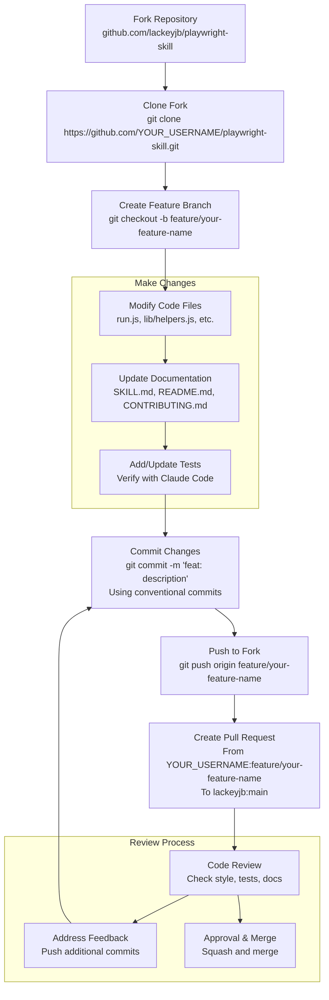
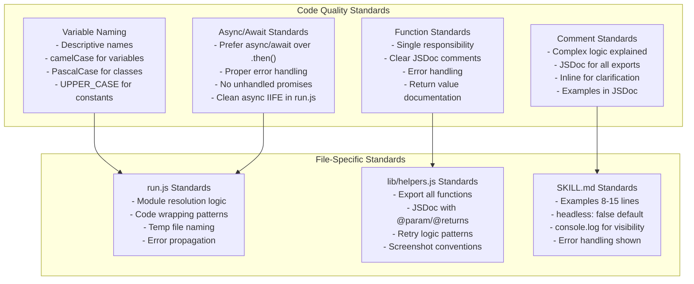
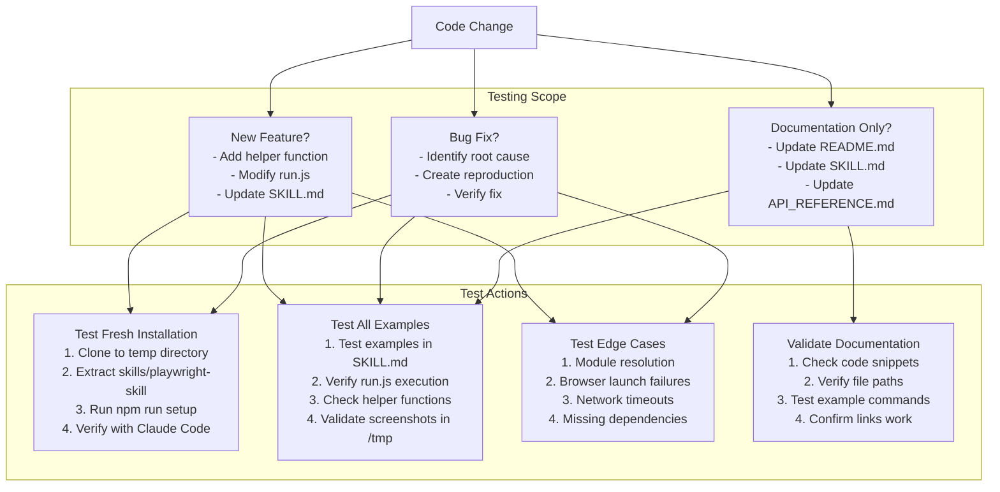
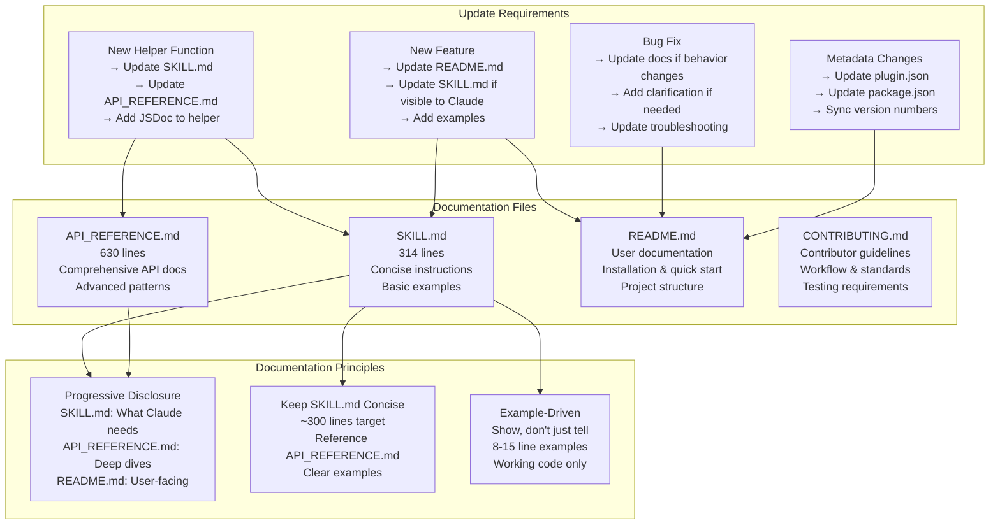

<!-- source: DeepWiki mcp.deepwiki.com · repo lackeyjb/playwright-skill · page 8.1 Contributing Guidelines · fetched 2026-10-27 -->

# Contributing Guidelines

<details>
<summary>Relevant source files</summary>

The following files were used as context for generating this wiki page:

- [CONTRIBUTING.md](CONTRIBUTING.md)
- [README.md](README.md)
- [skills/playwright-skill/package.json](skills/playwright-skill/package.json)

</details>


This document provides comprehensive guidelines for contributing to the playwright-skill repository. It covers the complete contribution workflow from forking the repository to having your pull request merged, including code standards, testing requirements, commit message conventions, and documentation practices.

For information about the overall project structure and architecture, see [Project Structure](#8.2). For details on local development and testing workflows, see [Development Workflow](#8.3). For guidance on adding new functionality, see [Extending the Skill](#8.4).

## Contribution Workflow

The playwright-skill repository follows the standard GitHub fork-and-pull-request workflow. All contributions must be submitted through pull requests from a forked repository.



**Sources:** [CONTRIBUTING.md:1-63](), [README.md:216-218]()

### Fork and Clone

Start by forking the repository on GitHub and cloning your fork:

```bash
# Fork via GitHub UI, then clone your fork
git clone https://github.com/YOUR_USERNAME/playwright-skill.git
cd playwright-skill

# Add upstream remote for syncing
git remote add upstream https://github.com/lackeyjb/playwright-skill.git
```

### Branch Naming Conventions

Create a feature branch with a descriptive name following these patterns:

| Branch Type | Pattern | Example |
|------------|---------|---------|
| New Feature | `feature/description` | `feature/add-mobile-emulation` |
| Bug Fix | `fix/description` | `fix/module-resolution-error` |
| Documentation | `docs/description` | `docs/update-api-reference` |
| Refactoring | `refactor/description` | `refactor/simplify-run-js` |
| Testing | `test/description` | `test/add-helper-tests` |
| Maintenance | `chore/description` | `chore/update-dependencies` |

**Sources:** [CONTRIBUTING.md:31-34]()

### Setup Development Environment

After cloning, set up the development environment:

```bash
# Navigate to the skill directory
cd skills/playwright-skill

# Install dependencies and Playwright browsers
npm run setup

# Verify installation
node run.js --version
```

**Sources:** [skills/playwright-skill/package.json:7-9](), [README.md:49-50]()

## Code Style and Standards

The codebase follows specific coding standards to maintain consistency and readability. All code must adhere to these standards before being accepted.

### JavaScript Style Guidelines



**Sources:** [CONTRIBUTING.md:64-80](), [CONTRIBUTING.md:98-120]()

### File-Specific Standards

#### run.js Standards

The [skills/playwright-skill/run.js]() file is the universal executor and must maintain specific patterns:

- **Module Resolution:** All code must be executed with proper context from `$SKILL_DIR`
- **Code Wrapping:** Inject necessary requires, create async IIFE wrapper, add error handling
- **Temp File Naming:** Use timestamped names with `.temp-execution-*.js` pattern
- **Error Propagation:** Exit with code 1 on errors, print stack traces

**Sources:** [skills/playwright-skill/run.js]()

#### lib/helpers.js Standards

All helper functions in [skills/playwright-skill/lib/helpers.js]() must follow these standards:

```javascript
/**
 * Function description with clear purpose
 * @param {Type} paramName - Parameter description
 * @param {Type} [optionalParam] - Optional parameter description
 * @returns {Type} Return value description
 * @example
 * const result = await functionName(page, 'selector');
 */
async function functionName(page, selector, options = {}) {
  try {
    // Implementation with error handling
    return result;
  } catch (error) {
    console.error(`Error in functionName: ${error.message}`);
    throw error;
  }
}
```

Each helper must:
- Include complete JSDoc comments with `@param`, `@returns`, `@example`
- Export the function: `module.exports = { functionName, ... }`
- Implement proper error handling with descriptive messages
- Follow retry patterns for flaky operations
- Use consistent naming conventions

**Sources:** [CONTRIBUTING.md:112-120](), [skills/playwright-skill/lib/helpers.js]()

#### SKILL.md Standards

Examples in [skills/playwright-skill/SKILL.md]() must follow strict guidelines:

```javascript
// ✓ GOOD: Concise, visible, with logging
const { chromium } = require('playwright');
const browser = await chromium.launch({ headless: false, slowMo: 100 });
const page = await browser.newPage();
await page.goto('http://localhost:3000');
console.log('Page title:', await page.title());
await page.screenshot({ path: '/tmp/screenshot.png' });
await browser.close();
console.log('Test complete');

// ✗ BAD: Headless, no logging, too verbose
const browser = await chromium.launch({ headless: true });
// ... many lines of code without console output ...
```

Requirements:
- Keep examples between 8-15 lines
- Always show `headless: false` by default
- Include `console.log` statements for visibility
- Add error handling where appropriate
- Reference [README.md]() or [API_REFERENCE.md]() for complex topics

**Sources:** [CONTRIBUTING.md:73-80](), [skills/playwright-skill/SKILL.md]()

### Code Pattern Mapping

```mermaid
graph LR
    subgraph "Common Patterns in Codebase"
        DevDetect["detectDevServers()<br/>lib/helpers.js<br/>Scans ports<br/>Returns JSON array"]
        
        SafeClick["safeClick(page, selector)<br/>lib/helpers.js<br/>Retry logic<br/>Error handling"]
        
        TakeScreen["takeScreenshot(page, path)<br/>lib/helpers.js<br/>Saves to /tmp<br/>Timestamped naming"]
        
        RunWrapper["run.js wrapping<br/>Inject requires<br/>Async IIFE<br/>.temp-execution-*.js"]
    end
    
    subgraph "Usage in SKILL.md"
        DevExample["Example: Dev Server Detection<br/>node -e \"require('./lib/helpers')...\"<br/>Auto-detect localhost"]
        
        HelperExample["Example: Helper Usage<br/>const helpers = require('./lib/helpers')<br/>await helpers.safeClick(...)"]
        
        RunExample["Example: Execution<br/>cd $SKILL_DIR && node run.js<br/>Always from skill directory"]
    end
    
    DevDetect --> DevExample
    SafeClick --> HelperExample
    TakeScreen --> HelperExample
    RunWrapper --> RunExample
```

**Sources:** [skills/playwright-skill/lib/helpers.js](), [skills/playwright-skill/SKILL.md](), [skills/playwright-skill/run.js]()

## Testing Requirements

All contributions must be tested before submission. The testing requirements vary based on the type of change.



**Sources:** [CONTRIBUTING.md:121-128]()

### Fresh Installation Testing

Every contribution must be tested with a fresh installation to ensure proper module resolution and dependency handling:

```bash
# 1. Create temporary test directory
mkdir -p /tmp/test-playwright-skill
cd /tmp/test-playwright-skill

# 2. Copy the modified skill folder
cp -r /path/to/your/fork/skills/playwright-skill .

# 3. Run setup
cd playwright-skill
npm run setup

# 4. Test with Claude Code
# Open Claude Code, ensure it discovers the skill
# Ask Claude to run a simple browser automation task
# Verify execution completes successfully
```

**Sources:** [CONTRIBUTING.md:123-124](), [README.md:59-76]()

### Example Validation

All code examples in documentation must be tested:

| File | Testing Method | Verification |
|------|---------------|--------------|
| [skills/playwright-skill/SKILL.md]() | Execute each example via `run.js` | Check console output, screenshots in `/tmp` |
| [README.md]() | Follow installation steps | Verify skill loads with `/help` command |
| [API_REFERENCE.md]() | Test complex examples | Validate against Playwright ^1.48.0 API |
| [CONTRIBUTING.md]() | Verify git commands work | Ensure workflow is reproducible |

**Sources:** [CONTRIBUTING.md:125-126]()

### Testing Helper Functions

When adding or modifying functions in [skills/playwright-skill/lib/helpers.js](), test each function independently:

```bash
# Navigate to skill directory
cd skills/playwright-skill

# Test detectDevServers
node -e "require('./lib/helpers').detectDevServers().then(console.log)"

# Test individual helpers with a test script
cat > /tmp/test-helper.js << 'EOF'
const { chromium } = require('playwright');
const { safeClick, takeScreenshot } = require('./lib/helpers');

(async () => {
  const browser = await chromium.launch({ headless: false });
  const page = await browser.newPage();
  await page.goto('http://example.com');
  await safeClick(page, 'a[href*="more"]');
  await takeScreenshot(page, '/tmp/test-screenshot.png');
  await browser.close();
})();
EOF

node run.js /tmp/test-helper.js
```

**Sources:** [CONTRIBUTING.md:112-120](), [skills/playwright-skill/lib/helpers.js]()

## Commit Message Format

All commits must follow the [Conventional Commits](https://www.conventionalcommits.org/) specification. This ensures clear commit history and enables automated changelog generation.

### Commit Types

| Type | Purpose | Triggers Version Bump |
|------|---------|---------------------|
| `feat:` | New feature or functionality | Minor (1.x.0) |
| `fix:` | Bug fix | Patch (1.0.x) |
| `docs:` | Documentation only changes | None |
| `refactor:` | Code refactoring without behavior change | None |
| `test:` | Adding or updating tests | None |
| `chore:` | Maintenance tasks, dependency updates | None |
| `perf:` | Performance improvements | Patch (1.0.x) |
| `style:` | Code style changes (formatting, etc.) | None |

**Sources:** [CONTRIBUTING.md:81-96]()

### Commit Message Structure

```
<type>: <short description>

[optional body]

[optional footer]
```

Examples:

```
feat: add mobile device emulation helper

Adds deviceEmulate function to lib/helpers.js that configures
browser context with preset device configurations for common
mobile devices (iPhone, Pixel, iPad).

Closes #42
```

```
fix: resolve module resolution issue in run.js

The temp file was being created in /tmp instead of in the skill
directory, causing require('./lib/helpers') to fail. Now temp
files are created in the skill directory with proper cleanup.

Fixes #38
```

```
docs: update installation instructions

Clarifies the nested structure requirement and adds examples
for both plugin and standalone installation methods.
```

**Sources:** [CONTRIBUTING.md:81-96]()

### Commit Message Best Practices

- **Use imperative mood:** "add feature" not "added feature"
- **Limit first line to 72 characters:** Keep it concise
- **Reference issues:** Use "Closes #123" or "Fixes #123" in footer
- **Explain why, not what:** The diff shows what changed, explain why
- **One logical change per commit:** Makes review and revert easier

**Sources:** [CONTRIBUTING.md:81-96]()

## Documentation Requirements

All code changes must be accompanied by appropriate documentation updates. The documentation strategy follows the progressive disclosure pattern.



**Sources:** [CONTRIBUTING.md:73-80](), [CONTRIBUTING.md:98-110]()

### When to Update SKILL.md

[skills/playwright-skill/SKILL.md]() must be updated when:

- Adding a new helper function to [lib/helpers.js]()
- Changing execution workflow or commands
- Adding new automation patterns that Claude should know
- Modifying default configurations (headless, slowMo, etc.)
- Changing the directory structure or file locations

Keep examples concise (8-15 lines) and always demonstrate:
- `headless: false` as the default
- `console.log` statements for visibility
- Error handling patterns
- Use of helper functions where applicable

**Sources:** [CONTRIBUTING.md:73-80]()

### When to Update README.md

[README.md]() must be updated when:

- Changing installation instructions or requirements
- Adding new configuration options or environment variables
- Modifying the project structure or file organization
- Adding new features visible to end users
- Updating version numbers or dependencies
- Adding troubleshooting steps for common issues

**Sources:** [README.md:1-232]()

### When to Update API_REFERENCE.md

[API_REFERENCE.md]() must be updated when:

- Adding comprehensive documentation for new features
- Documenting complex use cases and patterns
- Adding advanced examples with full context
- Documenting API changes in Playwright dependency
- Adding detailed troubleshooting for specific scenarios

**Sources:** [README.md:188]()

### Version Number Synchronization

When releasing a new version, ensure all version numbers are synchronized:

| File | Version Field | Example |
|------|--------------|---------|
| [skills/playwright-skill/package.json:3]() | `"version"` | `"4.0.2"` |
| [.claude-plugin/plugin.json]() | `"version"` | `"4.0.2"` |
| [.claude-plugin/marketplace.json]() | Entry `"version"` | `"1.0.0"` |
| [.claude-plugin/marketplace.json]() | Plugin `"version"` | `"3.1.0"` |

Note: marketplace.json has dual versioning (entry vs plugin version) - see [Metadata and Versioning](#9.5) for details.

**Sources:** [skills/playwright-skill/package.json:3]()

## Pull Request Process

Once changes are committed and pushed to your fork, create a pull request following this process:

### Pull Request Template

When creating a pull request, include:

```markdown
## Description
Brief description of what this PR does and why.

## Type of Change
- [ ] Bug fix (non-breaking change which fixes an issue)
- [ ] New feature (non-breaking change which adds functionality)
- [ ] Breaking change (fix or feature that would cause existing functionality to not work as expected)
- [ ] Documentation update

## Testing
- [ ] Tested with fresh installation
- [ ] All examples in SKILL.md validated
- [ ] Helper functions tested independently
- [ ] Edge cases verified
- [ ] Module resolution confirmed working

## Documentation
- [ ] README.md updated (if applicable)
- [ ] SKILL.md updated (if applicable)
- [ ] API_REFERENCE.md updated (if applicable)
- [ ] JSDoc comments added/updated
- [ ] CONTRIBUTING.md updated (if applicable)

## Related Issues
Closes #issue_number (if applicable)

## Additional Context
Any additional information that reviewers should know.
```

**Sources:** [CONTRIBUTING.md:57-63]()

### Review Process

Pull requests will be reviewed for:

1. **Code Quality**
   - Follows style guidelines in [CONTRIBUTING.md:64-72]()
   - Clear variable names and function responsibilities
   - Proper error handling throughout
   - JSDoc comments for all exported functions

2. **Testing**
   - Fresh installation verified
   - Examples tested and working
   - Edge cases considered
   - Module resolution validated

3. **Documentation**
   - All relevant files updated
   - Examples are clear and concise
   - No broken links or incorrect file paths
   - Version numbers synchronized if applicable

4. **Commit History**
   - Conventional commit format followed
   - Logical, atomic commits
   - Clear commit messages
   - No unnecessary merge commits

**Sources:** [CONTRIBUTING.md:24-63]()

### Addressing Feedback

If changes are requested during review:

```bash
# Make requested changes
git add .
git commit -m "fix: address review feedback"

# Push to your branch (updates the PR automatically)
git push origin feature/your-feature-name

# If you need to amend the last commit
git add .
git commit --amend
git push --force-with-lease origin feature/your-feature-name
```

Do not create a new PR for requested changes - push additional commits to the existing branch.

**Sources:** [CONTRIBUTING.md:52-56]()

## Common Contribution Scenarios

### Adding a New Helper Function

Complete workflow for adding a function to [skills/playwright-skill/lib/helpers.js]():

1. **Implement the function** with JSDoc:
```javascript
/**
 * Handle cookie consent banners
 * @param {Page} page - Playwright page object
 * @returns {Promise<boolean>} True if banner found and handled
 */
async function handleCookieBanner(page) {
  const selectors = [
    'button:has-text("Accept")',
    'button:has-text("Accept all")',
    '[id*="cookie"] button',
  ];
  
  for (const selector of selectors) {
    try {
      await page.click(selector, { timeout: 2000 });
      console.log('Cookie banner dismissed');
      return true;
    } catch (e) {
      // Try next selector
    }
  }
  return false;
}
```

2. **Export the function** in [lib/helpers.js]():
```javascript
module.exports = {
  detectDevServers,
  safeClick,
  handleCookieBanner, // Add new export
  // ... other exports
};
```

3. **Update [SKILL.md]()** with concise example (8-15 lines)

4. **Update [API_REFERENCE.md]()** with comprehensive documentation

5. **Test the function** with a test script via `run.js`

6. **Commit with proper format**:
```bash
git commit -m "feat: add handleCookieBanner helper function"
```

**Sources:** [CONTRIBUTING.md:112-120]()

### Fixing a Bug

Complete workflow for fixing a bug:

1. **Create issue** (if one doesn't exist) with reproduction steps
2. **Create branch**: `git checkout -b fix/description`
3. **Write a test case** that reproduces the bug
4. **Implement the fix** in the appropriate file
5. **Verify the fix** with test case and fresh installation
6. **Update documentation** if behavior changes
7. **Commit**: `git commit -m "fix: description of what was fixed"`
8. **Create PR** with "Fixes #issue_number" in description

**Sources:** [CONTRIBUTING.md:7-15](), [CONTRIBUTING.md:91-96]()

### Updating Documentation

For documentation-only changes:

1. **Create branch**: `git checkout -b docs/description`
2. **Make changes** to relevant documentation files
3. **Verify all code examples** still work
4. **Check all links** and file path references
5. **Commit**: `git commit -m "docs: description of changes"`
6. **Create PR** with clear description of what was clarified/added

**Sources:** [CONTRIBUTING.md:86]()

## Getting Help

If you need assistance while contributing:

- **Open an issue** for discussion before starting major work
- **Check existing issues** to avoid duplicates
- **Reference related pages** in this wiki:
  - [Development Workflow](#8.3) for local testing
  - [Project Structure](#8.2) for understanding file organization
  - [Extending the Skill](#8.4) for adding new functionality

**Sources:** [CONTRIBUTING.md:129-131](), [README.md:227]()

---

**Sources:** [CONTRIBUTING.md:1-136](), [README.md:216-232](), [skills/playwright-skill/package.json:1-26]()

---

