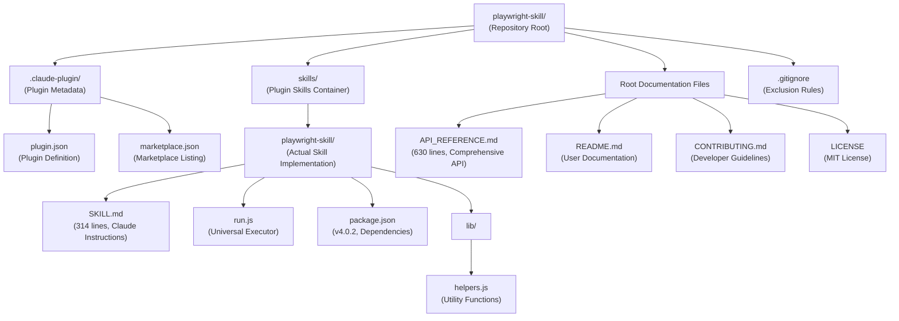
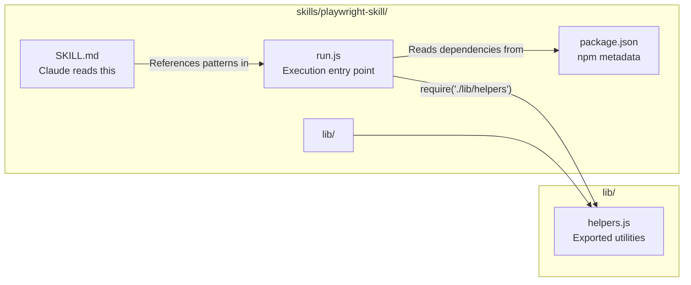
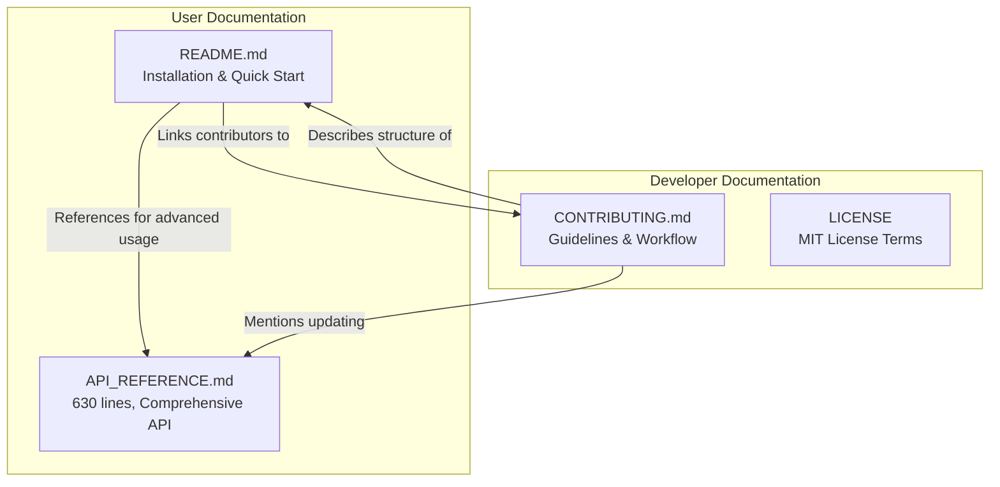
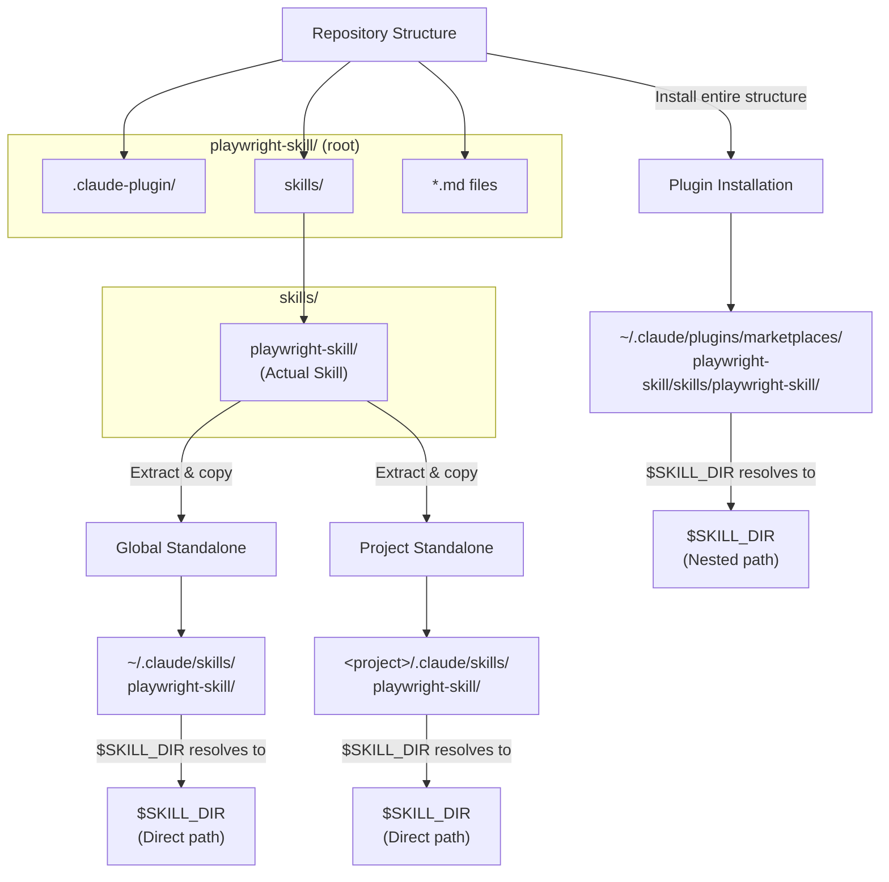

<!-- source: DeepWiki mcp.deepwiki.com · repo lackeyjb/playwright-skill · page 8.2 Project Structure · fetched 2026-10-27 -->

# Project Structure

Relevant source files

The following files were used as context for generating this wiki page:

- [.gitignore](.gitignore)
- [CONTRIBUTING.md](CONTRIBUTING.md)
- [README.md](README.md)
- [skills/playwright-skill/package.json](skills/playwright-skill/package.json)

This page documents the repository organization, file purposes, and the rationale for the nested directory structure. It explains how the dual distribution model (plugin vs standalone skill) affects the layout and where each component resides.

For information about installation paths and `$SKILL_DIR` resolution, see [Path Resolution and $SKILL_DIR](#4.6). For metadata versions and manifests, see [Metadata and Versioning](#9.5).

---

## Repository Organization

The repository uses a nested structure designed to support the Claude Code plugin format while also allowing standalone skill extraction.

### Directory Tree Structure

**Sources**: [README.md:166-184](), [.claude-plugin/plugin.json](), [skills/playwright-skill/package.json:1-26]()

---

## Plugin Metadata Layer

The `.claude-plugin/` directory contains files that define the plugin for distribution through Claude Code's marketplace system.

### Plugin Manifest Files

| File | Purpose | Version | Key Contents |
|------|---------|---------|--------------|
| `plugin.json` | Plugin definition and skill registration | v4.0.2 | Plugin ID, version, skills array pointing to `skills/playwright-skill/` |
| `marketplace.json` | Marketplace listing configuration | v1.0.0 (entry) v3.1.0 (plugin) | Entry metadata, plugin reference with version |

The dual versioning in `marketplace.json` separates the marketplace entry metadata (v1.0.0) from the actual plugin version (v3.1.0), while `plugin.json` and `package.json` share version v4.0.2 for consistency in the skill implementation.

**Sources**: [README.md:23-34](), [README.md:170-172]()

---

## Skill Implementation Layer

The `skills/playwright-skill/` directory contains the actual skill implementation that Claude discovers and executes.

### Core Implementation Files

**Sources**: [README.md:173-179]()

### SKILL.md (314 lines)

The primary instruction file that Claude reads when the skill is invoked. Contains:
- Concise workflow description (detect dev servers, write to `/tmp`, execute via `run.js`)
- Code examples (8-15 lines each)
- Default configurations (`headless: false`, `slowMo: 100`)
- References to `API_REFERENCE.md` for advanced topics

**File**: [skills/playwright-skill/SKILL.md]()

### run.js

The universal executor that handles:
- Three execution modes: file path, inline code, stdin
- Module resolution from `$SKILL_DIR` context
- Automatic dependency installation check
- Code wrapping (requires injection, async IIFE, error handling)
- Temporary file lifecycle management

**File**: [skills/playwright-skill/run.js]()

**Sources**: [README.md:175-176](), Diagram 3 from system architecture

### package.json

npm manifest defining:
- Package name: `playwright-skill`
- Version: `4.0.2`
- Main entry: `run.js`
- Dependencies: `playwright: ^1.48.0`
- Setup scripts: `npm run setup` (installs Playwright + Chromium)
- Node engine: `>=14.0.0`

**File**: [skills/playwright-skill/package.json:1-26]()

### lib/helpers.js

Exported utility functions for common automation patterns:

| Function | Purpose |
|----------|---------|
| `detectDevServers()` | Scans ports 3000, 5173, 8080, 4200, 5000 for active servers |
| `safeClick(page, selector)` | Click with wait + visibility check |
| `safeType(page, selector, text)` | Type with wait + clear + fill |
| `takeScreenshot(page, name)` | Save screenshot to `/tmp/` |
| `authenticate(page, credentials)` | Handle login flows |
| `handleCookieBanner(page)` | Dismiss cookie consent dialogs |
| `extractTableData(page, selector)` | Parse table data to JSON |

**File**: [skills/playwright-skill/lib/helpers.js]()

**Sources**: [README.md:177-179](), [CONTRIBUTING.md:112-120]()

---

## Documentation Layer

Root-level documentation files that provide user and developer guidance.

### Documentation File Mapping

**Sources**: [README.md:1-232](), [CONTRIBUTING.md:1-136]()

### API_REFERENCE.md (630 lines)

Comprehensive Playwright documentation loaded by Claude on demand for complex scenarios:
- Core API patterns (browser, context, page)
- Selector strategies (data-testid, role-based, semantic)
- Network interception and API testing
- Visual regression testing
- Mobile device emulation
- Authentication patterns
- Performance testing

**File**: [API_REFERENCE.md]()

### README.md

User-facing documentation covering:
- Feature overview and use cases
- Three installation methods (plugin, global, project-specific)
- Nested structure explanation and extraction requirement
- Quick start examples
- Configuration defaults
- Troubleshooting guide

**File**: [README.md:1-232]()

### CONTRIBUTING.md

Developer guidelines including:
- Bug reporting and enhancement suggestions
- Pull request workflow
- Code style conventions
- SKILL.md writing guidelines (concise examples, `headless: false` default)
- Commit message format (conventional commits)
- Testing requirements

**File**: [CONTRIBUTING.md:1-136]()

**Sources**: [README.md:180-183](), [CONTRIBUTING.md:98-110]()

---

## Ignored Artifacts

The `.gitignore` file excludes generated and temporary files from version control.

### Exclusion Categories

| Category | Patterns | Rationale |
|----------|----------|-----------|
| **Dependencies** | `node_modules/`, `package-lock.json` | Install locally via `npm run setup` |
| **Temporary Files** | `.temp-*`, `*.tmp` | Generated by `run.js`, cleaned on next run |
| **Artifacts** | `test-results/`, `playwright-report/`, `screenshots/`, `*.png` | Created during execution, saved to `/tmp` instead |
| **Logs** | `*.log`, `npm-debug.log*` | Runtime output only |
| **OS Files** | `.DS_Store`, `Thumbs.db` | Platform-specific |
| **IDE** | `.vscode/`, `.idea/` | Editor configurations |
| **Environment** | `.env`, `.env.local` | Credentials and local settings |
| **Internal Docs** | `MANUAL_TEST.md`, `TEST_PLAN.md` | Development artifacts |

**File**: [.gitignore:1-37]()

**Key Design Decision**: Artifacts like screenshots and test scripts are written to `/tmp/` rather than the repository directory, ensuring the project remains clean. The `.gitignore` rules enforce this by excluding common artifact paths that might be accidentally created.

**Sources**: [.gitignore:1-37](), Diagram 5 from system architecture

---

## Nested Structure Rationale

The repository uses a nested structure to support dual distribution: as a Claude Code Plugin (preserving the full structure) and as a standalone skill (extracting the inner folder).

### Installation Path Mapping

**Sources**: [README.md:20-96](), Diagram 2 from system architecture

### Why This Structure?

1. **Plugin Format Requirement**: Claude Code plugins expect a `skills/` directory to organize multiple skills within a single plugin. The `.claude-plugin/` metadata references `skills/playwright-skill/` as the skill location.

2. **Standalone Extraction**: For manual installation, users must extract only the `skills/playwright-skill/` folder to avoid the nested structure. Claude expects skills directly in `.claude/skills/`, not in a `skills/` subdirectory.

3. **Module Resolution**: All commands in `SKILL.md` are prefixed with `cd $SKILL_DIR &&` to ensure `run.js` can resolve `require('./lib/helpers')` correctly, regardless of installation method.

4. **Dual Distribution**: The repository can be distributed as-is for plugin installation or with the inner folder extracted for standalone installation, supporting both centralized and manual deployment.

**Sources**: [README.md:22-34](), [README.md:94-95]()

---

## File Size and Complexity Metrics

### Documentation Hierarchy

| File | Lines | Audience | Loading Strategy |
|------|-------|----------|------------------|
| `SKILL.md` | 314 | Claude (primary) | Loaded on skill invocation |
| `API_REFERENCE.md` | 630 | Claude (advanced) | Loaded on demand for complex tasks |
| `README.md` | 232 | Users | Read during installation |
| `CONTRIBUTING.md` | 136 | Developers | Read when contributing |

This progressive disclosure design ensures Claude starts with concise instructions (314 lines) and only loads comprehensive documentation (630 lines) when necessary, optimizing for common use cases while supporting complex scenarios.

**Sources**: [README.md:175](), [README.md:180](), Diagram 1 from system architecture

---

## Runtime File Generation

During execution, `run.js` generates temporary files that are not part of the repository structure:

| File Pattern | Location | Purpose | Lifecycle |
|--------------|----------|---------|-----------|
| `playwright-test-*.js` | `/tmp/` | User-written scripts generated by Claude | Persists for debugging |
| `.temp-execution-*.js` | `$SKILL_DIR/` | Wrapped execution scripts with requires | Cleaned on next run |
| `*.png` | `/tmp/` | Screenshots captured during automation | OS cleans up |

The `$SKILL_DIR/` location for `.temp-execution-*.js` files is critical for module resolution—executing from `/tmp/` would fail to resolve `require('./lib/helpers')`.

**Sources**: [.gitignore:10-12](), [.gitignore:22-28](), Diagram 5 from system architecture

---

