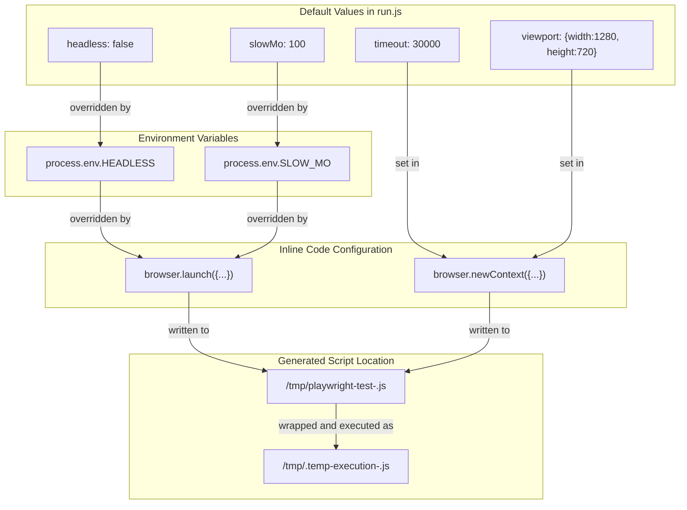
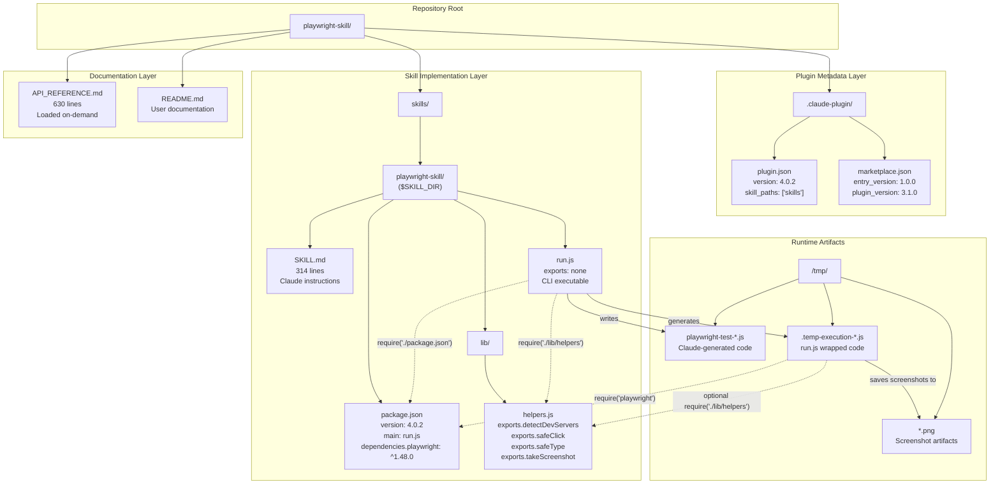
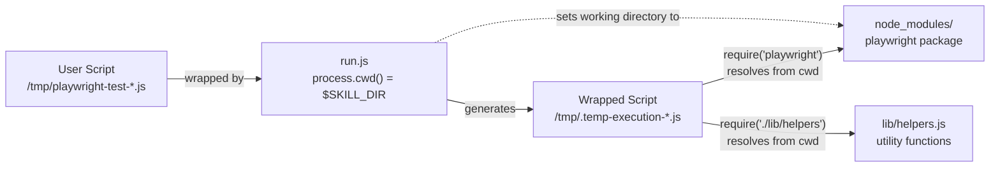

<!-- source: DeepWiki mcp.deepwiki.com · repo lackeyjb/playwright-skill · page 9 Reference · fetched 2026-10-27 -->

# Reference

<details>
<summary>Relevant source files</summary>

The following files were used as context for generating this wiki page:

- [README.md](README.md)
- [skills/playwright-skill/package.json](skills/playwright-skill/package.json)

</details>


This page provides quick reference materials for the playwright-skill system, including configuration defaults, version information, file locations, and key commands. These materials are designed for rapid lookup during development and troubleshooting.

For detailed information about specific topics, see:
- Configuration options and browser launch settings: [Configuration Options](#9.1)
- Environment variable usage: [Environment Variables](#9.2)
- Auto-detected development server ports: [Common Ports and Dev Servers](#9.3)
- Troubleshooting guidance: [Error Messages and Solutions](#9.4)
- Version synchronization across manifests: [Metadata and Versioning](#9.5)

## Version Information

The playwright-skill system uses multiple version identifiers across its distribution manifests:

| File | Current Version | Purpose |
|------|----------------|---------|
| `skills/playwright-skill/package.json` | 4.0.2 | npm package version, dependency management |
| `.claude-plugin/plugin.json` | 4.0.2 | Claude Code plugin registry version |
| `.claude-plugin/marketplace.json` (entry) | 1.0.0 | Marketplace entry version (stable) |
| `.claude-plugin/marketplace.json` (plugin) | 3.1.0 | Plugin metadata version |

**Sources:** [skills/playwright-skill/package.json:1-26](), [README.md:1-232]()

## Default Configuration Values

The system operates with sensible defaults that prioritize visibility and debuggability:

| Setting | Default Value | Configuration Method | Override Priority |
|---------|--------------|---------------------|-------------------|
| Browser visibility | `headless: false` | Launch options in generated code | 1. Inline code > 2. Environment > 3. Default |
| Slow motion | `slowMo: 100` (ms) | Launch options in generated code | 1. Inline code > 2. `SLOW_MO` env > 3. Default |
| Timeout | `30000` (ms) | Context options | 1. Inline code > 2. Default |
| Viewport width | `1280` (px) | Context options | 1. Inline code > 2. Default |
| Viewport height | `720` (px) | Context options | 1. Inline code > 2. Default |
| Screenshot location | `/tmp/` | Generated code | Fixed location |
| Browser engine | Chromium | Launch command | User-specified or default |

**Sources:** [README.md:159-165]()

## Installation Paths

The skill can be installed in three contexts, each with a different resolved path:

| Installation Type | Directory Path | `$SKILL_DIR` Resolution |
|------------------|----------------|------------------------|
| Plugin (recommended) | `~/.claude/plugins/marketplaces/playwright-skill/skills/playwright-skill/` | Automatically resolved by Claude |
| Global standalone | `~/.claude/skills/playwright-skill/` | Automatically resolved by Claude |
| Project-specific | `<project>/.claude/skills/playwright-skill/` | Automatically resolved by Claude |

All commands in `SKILL.md` must be prefixed with `cd $SKILL_DIR &&` to ensure proper module resolution regardless of installation method.

**Sources:** [README.md:18-116]()

## Core Files and Their Roles

| File Path | Lines | Primary Function | Invoked By |
|-----------|-------|-----------------|------------|
| `SKILL.md` | 314 | Instructions for Claude, workflow definitions | Claude (always loaded) |
| `API_REFERENCE.md` | 630 | Comprehensive Playwright API documentation | Claude (on-demand) |
| `run.js` | ~200 | Universal executor, module resolution, code wrapping | Claude-generated commands |
| `lib/helpers.js` | ~500 | Utility functions (`detectDevServers`, `safeClick`, etc.) | User scripts (optional) |
| `package.json` | 26 | Dependencies, setup scripts | npm/npx commands |
| `.claude-plugin/plugin.json` | ~50 | Plugin metadata, marketplace registration | Claude plugin system |

**Sources:** [README.md:166-184]()

## Key Commands Reference

Commands used during installation, setup, and execution:

```bash
# Installation
npm run setup                          # Install playwright + chromium
npm run install-all-browsers          # Install all browser engines

# Execution (via run.js)
cd $SKILL_DIR && node run.js <file>           # File mode
cd $SKILL_DIR && node run.js '<code>'         # Inline mode
cat script.js | cd $SKILL_DIR && node run.js  # Stdin mode

# Dev server detection
node -e "require('./lib/helpers').detectDevServers()"

# Browser installation
npx playwright install chromium        # Default browser
npx playwright install firefox webkit  # Additional browsers
```

**Sources:** [README.md:7-209](), [skills/playwright-skill/package.json:7-9]()

## Configuration Hierarchy Diagram

This diagram shows how configuration values flow from defaults through environment variables to inline code, mapping to specific code entities:



**Sources:** [README.md:159-165]()

## File Structure with Module Resolution

This diagram maps the physical file structure to how modules are resolved during execution:



**Sources:** [README.md:166-184](), [skills/playwright-skill/package.json:1-26]()

## Auto-Detection Ports

Common development server ports scanned by `detectDevServers()` function:

| Port | Framework/Tool | Detection Priority |
|------|----------------|-------------------|
| 3000 | React (Create React App), Next.js | High |
| 5173 | Vite | High |
| 8080 | Vue CLI, generic dev servers | High |
| 4200 | Angular CLI | High |
| 5000 | Flask, generic dev servers | Medium |
| 8000 | Django, generic dev servers | Medium |
| 3001-3010 | Alternative React ports | Low |

The `detectDevServers()` function returns a JSON array of detected servers with their URLs, which Claude uses for automatic URL parameterization.

**Sources:** Diagram 5 in high-level architecture, README.md context

## Dependencies and Requirements

| Dependency | Version Constraint | Installation Method | Required For |
|------------|-------------------|---------------------|-------------|
| Node.js | >=14.0.0 | System package manager | All functionality |
| playwright (npm) | ^1.48.0 | `npm run setup` | Browser automation |
| Chromium browser | Latest stable | `npx playwright install chromium` | Default browser engine |
| Firefox browser | Latest stable | `npx playwright install firefox` | Optional browser engine |
| WebKit browser | Latest stable | `npx playwright install webkit` | Optional browser engine |

**Sources:** [README.md:190-195](), [skills/playwright-skill/package.json:19-24]()

## Execution Mode Commands

The `run.js` executor supports three invocation modes:

```bash
# File Mode - Read code from file path
cd $SKILL_DIR && node run.js /tmp/playwright-test-12345.js

# Inline Mode - Execute code string directly
cd $SKILL_DIR && node run.js 'const { chromium } = require("playwright"); ...'

# Stdin Mode - Pipe code via stdin
cat automation.js | cd $SKILL_DIR && node run.js
```

All modes require the `cd $SKILL_DIR &&` prefix for proper module resolution from the skill's `node_modules/` directory.

**Sources:** Diagram 6 in high-level architecture

## Helper Functions Export Map

Functions exported from `lib/helpers.js` for use in automation scripts:

| Export Name | Parameters | Return Type | Purpose |
|------------|-----------|-------------|---------|
| `detectDevServers` | `()` | `Promise<Array<{url: string, port: number}>>` | Scan localhost for active dev servers |
| `safeClick` | `(page, selector, options?)` | `Promise<void>` | Click with retry and error handling |
| `safeType` | `(page, selector, text, options?)` | `Promise<void>` | Type text with retry and error handling |
| `takeScreenshot` | `(page, name?)` | `Promise<string>` | Capture screenshot to `/tmp/` |
| `authenticate` | `(page, username, password)` | `Promise<void>` | Handle basic login flows |
| `handleCookieBanner` | `(page)` | `Promise<boolean>` | Dismiss common cookie consent banners |
| `extractTableData` | `(page, tableSelector)` | `Promise<Array<Object>>` | Parse HTML table to JSON |

Usage in generated scripts:
```javascript
const { safeClick, takeScreenshot } = require('./lib/helpers');
```

**Sources:** Diagram 4 in high-level architecture, [README.md:179]()

## Temporary File Naming Conventions

| File Pattern | Location | Created By | Lifecycle |
|-------------|----------|------------|-----------|
| `playwright-test-<timestamp>.js` | `/tmp/` | Claude-generated code | Persists until next run |
| `.temp-execution-<timestamp>.js` | `/tmp/` | `run.js` wrapper | Persists until next run |
| `<descriptive-name>-<timestamp>.png` | `/tmp/` | Screenshot functions | Persists until OS cleanup |

Temporary files are NOT deleted during execution to avoid race conditions with async operations. Cleanup occurs on the next execution run or via OS automatic `/tmp/` cleanup.

**Sources:** Diagram 5 in high-level architecture

## npm Scripts Reference

Scripts defined in [skills/playwright-skill/package.json:7-9]():

```json
{
  "setup": "npm install && npx playwright install chromium",
  "install-all-browsers": "npx playwright install chromium firefox webkit"
}
```

| Script | Command | Purpose | When to Use |
|--------|---------|---------|-------------|
| `setup` | `npm run setup` | Install dependencies and Chromium | Initial installation, updates |
| `install-all-browsers` | `npm run install-all-browsers` | Install all browser engines | Cross-browser testing needs |

**Sources:** [skills/playwright-skill/package.json:7-9]()

## Module Resolution Path

The critical path resolution for `require()` statements in generated code:



The `cd $SKILL_DIR &&` prefix ensures `process.cwd()` is set to the skill directory, allowing proper resolution of:
- `require('playwright')` → `$SKILL_DIR/node_modules/playwright`
- `require('./lib/helpers')` → `$SKILL_DIR/lib/helpers.js`
- `require('./package.json')` → `$SKILL_DIR/package.json`

**Sources:** Diagram 2 and Diagram 4 in high-level architecture

## License

The playwright-skill is distributed under the MIT License. See the `LICENSE` file in the repository root for full terms.

**Key permissions:**
- Commercial use permitted
- Modification permitted
- Distribution permitted
- Private use permitted

**Conditions:**
- License and copyright notice must be included

**Limitations:**
- No warranty provided
- No liability assumed

**Sources:** [README.md:229-231]()

---

