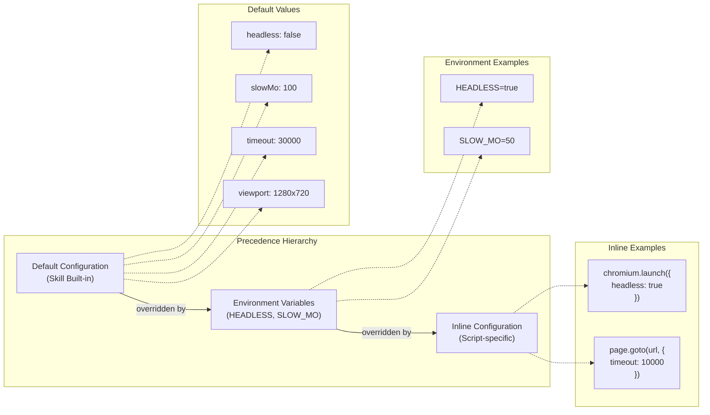
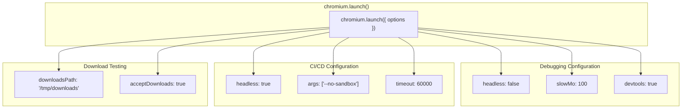
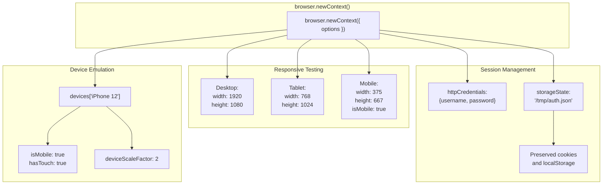
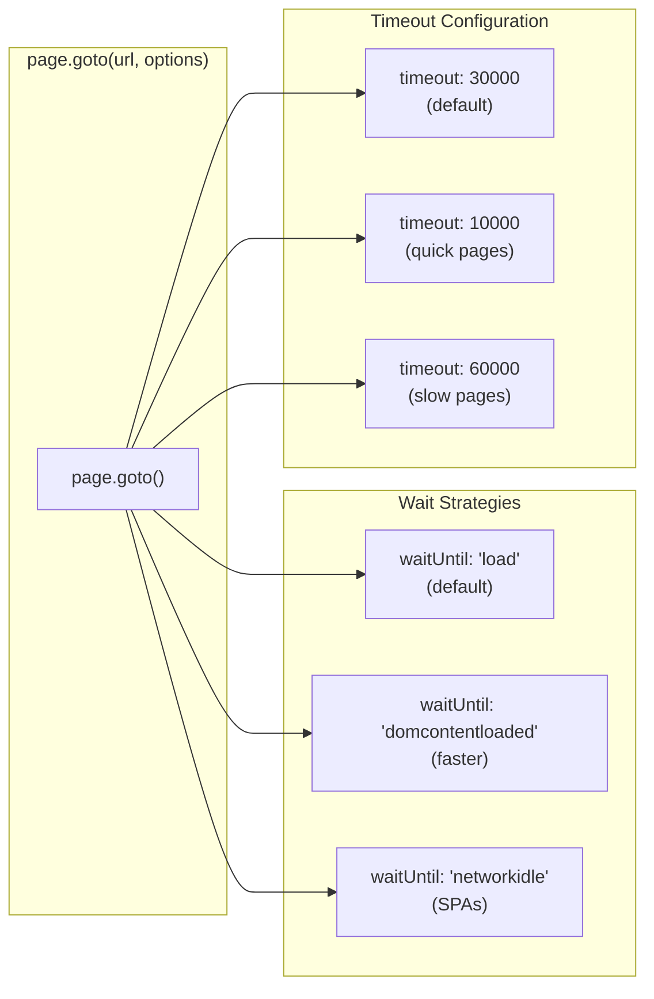
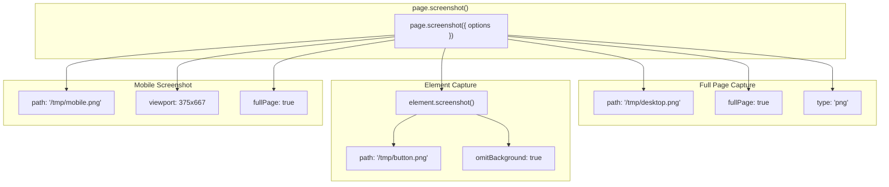
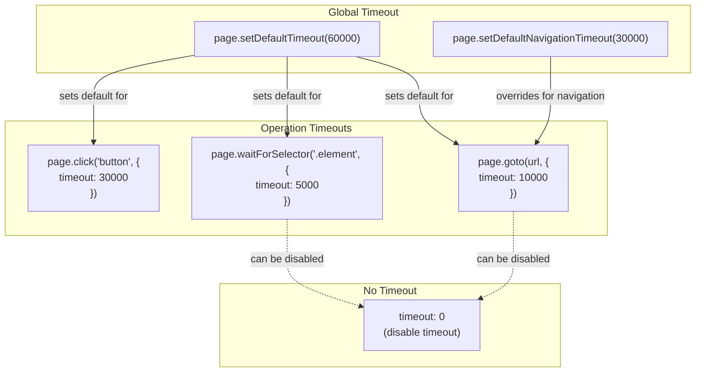
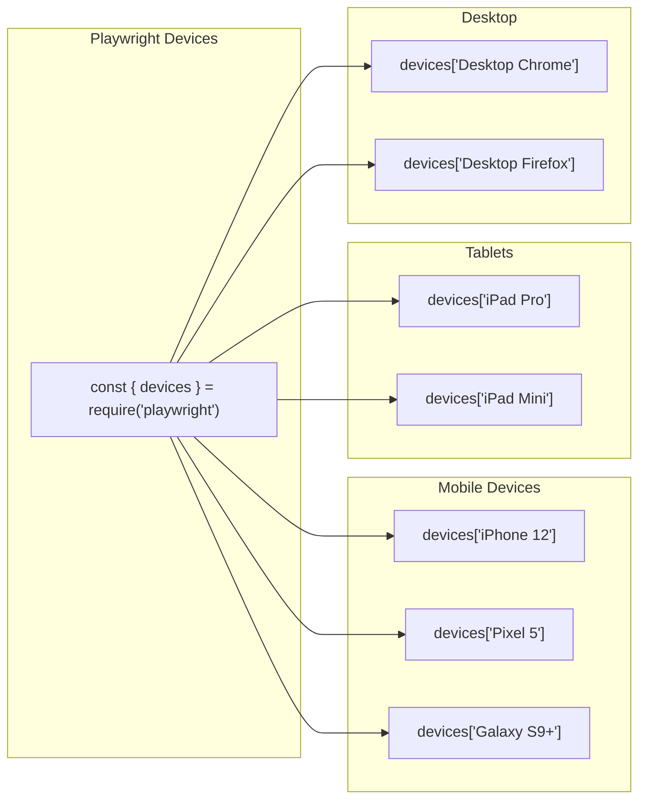
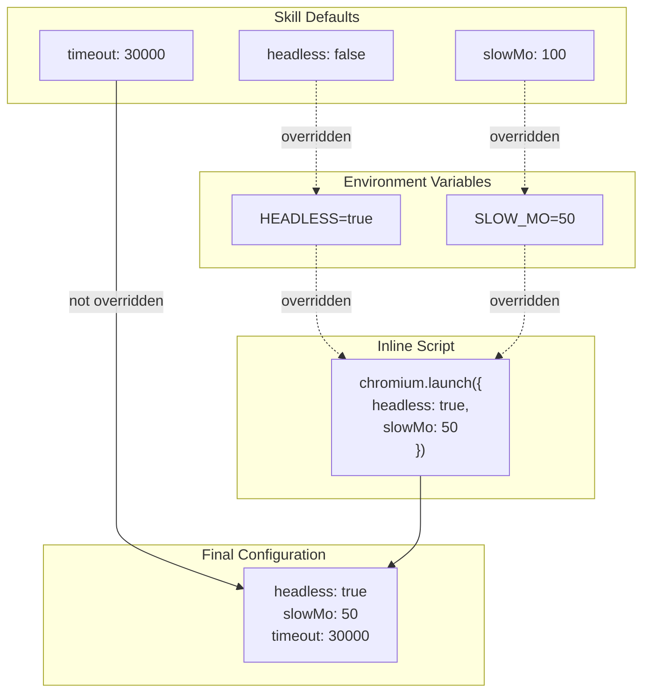
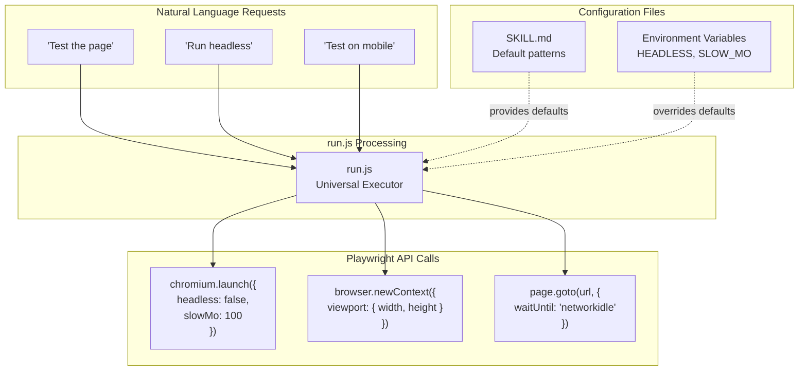

<!-- source: DeepWiki mcp.deepwiki.com · repo lackeyjb/playwright-skill · page 9.1 Configuration Options · fetched 2026-10-27 -->

# Configuration Options

<details>
<summary>Relevant source files</summary>

The following files were used as context for generating this wiki page:

- [README.md](README.md)
- [skills/playwright-skill/SKILL.md](skills/playwright-skill/SKILL.md)
- [skills/playwright-skill/package.json](skills/playwright-skill/package.json)

</details>


This page provides a comprehensive reference of all configuration options available in playwright-skill for controlling browser behavior, execution settings, and automation parameters. Configuration options can be specified at different levels: browser launch, context creation, page navigation, and individual actions.

For environment variable configuration (HEADLESS, SLOW_MO), see [Environment Variables](#9.2). For practical usage examples of these configurations in automation scripts, see [Writing Automation Scripts](#5.1). For how `run.js` applies configurations, see [run.js: The Universal Executor](#4.2).

---

## Configuration Precedence

Configuration options follow a three-tier precedence hierarchy where later configurations override earlier ones:



**Sources:** [README.md:159-164](), [SKILL.md:33](), [SKILL.md:343-345]()

---

## Browser Launch Options

Options passed to `chromium.launch()`, `firefox.launch()`, or `webkit.launch()` when starting a browser instance.

### Core Launch Options

| Option | Type | Default | Description |
|--------|------|---------|-------------|
| `headless` | boolean | `false` | Run browser in headless mode (no visible window). Skill defaults to visible for debugging. |
| `slowMo` | number | `100` | Slows down operations by specified milliseconds. Makes automation visible and easier to follow. |
| `timeout` | number | `30000` | Maximum time (ms) to wait for browser to start. |
| `args` | string[] | `[]` | Additional arguments to pass to browser process. |
| `executablePath` | string | auto | Path to browser executable. Usually auto-detected by Playwright. |
| `downloadsPath` | string | undefined | Path for downloaded files. If not set, downloads are deleted. |
| `devtools` | boolean | `false` | Open browser with DevTools panel (Chromium only). |

**Sources:** [SKILL.md:73](), [SKILL.md:103](), [SKILL.md:129](), [SKILL.md:155]()

### Launch Option Examples



**Example: Visible Browser with Slow Motion** (default pattern):
```javascript
const browser = await chromium.launch({ 
  headless: false,  // Make browser visible
  slowMo: 100       // Slow down by 100ms per action
});
```

**Example: Headless Mode for CI/CD**:
```javascript
const browser = await chromium.launch({ 
  headless: true,
  args: ['--no-sandbox', '--disable-setuid-sandbox']
});
```

**Sources:** [SKILL.md:73](), [SKILL.md:103](), [README.md:161-162]()

---

## Browser Context Options

Options passed to `browser.newContext()` when creating an isolated browser session. Contexts allow multiple independent sessions within the same browser instance.

### Viewport Configuration

| Option | Type | Default | Description |
|--------|------|---------|-------------|
| `viewport.width` | number | `1280` | Viewport width in pixels. |
| `viewport.height` | number | `720` | Viewport height in pixels. |
| `deviceScaleFactor` | number | `1` | Device pixel ratio (1 = standard, 2 = retina). |
| `isMobile` | boolean | `false` | Whether to emulate mobile device. |
| `hasTouch` | boolean | `false` | Whether to support touch events. |

**Sources:** [SKILL.md:107](), [SKILL.md:114](), [SKILL.md:250-253]()

### Locale and Timezone

| Option | Type | Default | Description |
|--------|------|---------|-------------|
| `locale` | string | system | Language and region (e.g., `'en-US'`, `'de-DE'`). |
| `timezoneId` | string | system | Timezone identifier (e.g., `'America/New_York'`). |
| `geolocation` | object | undefined | `{ latitude: number, longitude: number }` |
| `permissions` | string[] | `[]` | Granted permissions (e.g., `['geolocation']`). |

### Authentication and Storage

| Option | Type | Default | Description |
|--------|------|---------|-------------|
| `httpCredentials` | object | undefined | `{ username: string, password: string }` for HTTP auth. |
| `storageState` | string/object | undefined | Path to storage state file or state object for session persistence. |
| `acceptDownloads` | boolean | `false` | Whether to automatically download files. |
| `recordVideo` | object | undefined | `{ dir: string, size?: { width, height } }` for video recording. |

**Sources:** [SKILL.md:107-114](), [SKILL.md:258-261]()

### Context Configuration Diagram



**Example: Desktop Viewport**:
```javascript
const context = await browser.newContext({
  viewport: { width: 1920, height: 1080 },
  deviceScaleFactor: 1
});
```

**Example: Mobile Emulation**:
```javascript
const context = await browser.newContext({
  viewport: { width: 375, height: 667 },
  isMobile: true,
  hasTouch: true,
  deviceScaleFactor: 2
});
```

**Sources:** [SKILL.md:107](), [SKILL.md:114](), [SKILL.md:258-261]()

---

## Page Navigation Options

Options passed to `page.goto()` and other navigation methods.

### Navigation Options Table

| Option | Type | Default | Description |
|--------|------|---------|-------------|
| `timeout` | number | `30000` | Maximum navigation time (ms). 0 disables timeout. |
| `waitUntil` | string | `'load'` | When to consider navigation complete. |
| `referer` | string | undefined | Referer header value. |

### waitUntil Values

| Value | Description | Use Case |
|-------|-------------|----------|
| `'load'` | Wait for `load` event (default) | Standard page loads |
| `'domcontentloaded'` | Wait for `DOMContentLoaded` event | Fast loading, minimal resources |
| `'networkidle'` | Wait for network to be idle | SPAs with dynamic content |
| `'commit'` | Wait for navigation to commit | Quick navigation confirmation |

**Sources:** [SKILL.md:218-221]()

### Navigation Configuration Mapping



**Example: Quick Navigation**:
```javascript
await page.goto('http://localhost:3001', {
  waitUntil: 'domcontentloaded',
  timeout: 10000
});
```

**Example: SPA with Network Idle**:
```javascript
await page.goto('http://localhost:3001', {
  waitUntil: 'networkidle',
  timeout: 30000
});
```

**Sources:** [SKILL.md:218-221]()

---

## Screenshot Options

Options passed to `page.screenshot()` and `element.screenshot()`.

### Screenshot Options Table

| Option | Type | Default | Description |
|--------|------|---------|-------------|
| `path` | string | required | File path to save screenshot (e.g., `'/tmp/screenshot.png'`). |
| `fullPage` | boolean | `false` | Capture entire scrollable page. |
| `clip` | object | undefined | `{ x, y, width, height }` to capture specific region. |
| `type` | string | `'png'` | Image format: `'png'` or `'jpeg'`. |
| `quality` | number | undefined | JPEG quality (0-100). Only for `type: 'jpeg'`. |
| `omitBackground` | boolean | `false` | Transparent background (PNG only). |
| `animations` | string | `'allow'` | Animation behavior: `'allow'`, `'disabled'`. |
| `caret` | string | `'hide'` | Text caret visibility: `'hide'`, `'initial'`. |

**Sources:** [SKILL.md:79](), [SKILL.md:110](), [SKILL.md:114](), [SKILL.md:224-226](), [SKILL.md:266-269]()

### Screenshot Configuration Flow



**Example: Full Page Screenshot**:
```javascript
await page.screenshot({ 
  path: '/tmp/screenshot.png', 
  fullPage: true 
});
```

**Example: Element Screenshot**:
```javascript
const button = page.locator('button.submit');
await button.screenshot({ 
  path: '/tmp/button.png',
  omitBackground: true 
});
```

**Example: JPEG with Quality**:
```javascript
await page.screenshot({ 
  path: '/tmp/screenshot.jpg', 
  type: 'jpeg',
  quality: 80,
  fullPage: true 
});
```

**Sources:** [SKILL.md:79](), [SKILL.md:110](), [SKILL.md:224-226](), [SKILL.md:266-269]()

---

## Timeout Configurations

Timeouts control how long Playwright waits for various operations to complete.

### Timeout Hierarchy

| Level | Scope | Default | Description |
|-------|-------|---------|-------------|
| Browser Launch | `chromium.launch({ timeout })` | `30000` | Time to wait for browser to start. |
| Navigation | `page.goto({ timeout })` | `30000` | Time to wait for page load. |
| Action | `page.click({ timeout })` | `30000` | Time to wait for action to complete. |
| Expectation | `expect(locator).toBeVisible({ timeout })` | `5000` | Time to wait for assertion. |
| Wait Method | `page.waitForSelector({ timeout })` | `30000` | Time to wait for selector to appear. |

**Sources:** [SKILL.md:365]()

### Timeout Configuration Levels



**Example: Set Global Timeout**:
```javascript
const page = await context.newPage();
page.setDefaultTimeout(60000);  // 60 seconds for all operations
page.setDefaultNavigationTimeout(30000);  // 30 seconds for navigation
```

**Example: Operation-Specific Timeout**:
```javascript
// Wait up to 10 seconds for element
await page.waitForSelector('.slow-loading-element', { 
  timeout: 10000 
});

// Navigate with custom timeout
await page.goto('http://example.com', { 
  timeout: 5000 
});
```

**Example: Disable Timeout**:
```javascript
// Wait indefinitely (use with caution)
await page.waitForSelector('.element', { 
  timeout: 0 
});
```

**Sources:** [SKILL.md:365](), [SKILL.md:218-221]()

---

## Device Emulation

Playwright includes device descriptors for common devices.

### Device Emulation Example



**Example: iPhone 12 Emulation**:
```javascript
const { chromium, devices } = require('playwright');

const browser = await chromium.launch({ headless: false });
const context = await browser.newContext({
  ...devices['iPhone 12']
});
const page = await context.newPage();
```

**Example: Custom Device**:
```javascript
const context = await browser.newContext({
  userAgent: 'Custom User Agent String',
  viewport: { width: 375, height: 812 },
  deviceScaleFactor: 3,
  isMobile: true,
  hasTouch: true
});
```

**Sources:** [SKILL.md:250-253]()

---

## Advanced Configuration Patterns

### Configuration Precedence in Practice



**Example: Multiple Configuration Levels**:
```javascript
// Defaults from skill: headless: false, slowMo: 100
// Environment: HEADLESS=true, SLOW_MO=50
// Inline overrides everything:

const browser = await chromium.launch({ 
  headless: false,  // Override environment, back to visible
  slowMo: 200,      // Override both default and environment
  timeout: 60000    // Override default
});
// Result: headless=false, slowMo=200, timeout=60000
```

**Sources:** [SKILL.md:343-345](), [README.md:159-164]()

### Per-Test Configuration

```javascript
// Configuration object at top of script for easy modification
const CONFIG = {
  browser: {
    headless: false,
    slowMo: 100
  },
  navigation: {
    waitUntil: 'networkidle',
    timeout: 30000
  },
  screenshot: {
    fullPage: true,
    type: 'png'
  }
};

// Use throughout script
const browser = await chromium.launch(CONFIG.browser);
await page.goto(url, CONFIG.navigation);
await page.screenshot({ 
  path: '/tmp/test.png', 
  ...CONFIG.screenshot 
});
```

**Sources:** [SKILL.md:69-70](), [SKILL.md:100]()

---

## Configuration Best Practices

### Default Configuration Strategy

| Setting | Value | Rationale |
|---------|-------|-----------|
| `headless` | `false` | Makes debugging visible and easier to follow |
| `slowMo` | `100` | Slows automation enough to see what's happening |
| `timeout` | `30000` | Reasonable wait time for most operations |
| `viewport` | `1280x720` | Standard desktop size, compatible with most layouts |

**When to use headless mode:**
- CI/CD pipelines where display is not available
- Performance testing requiring maximum speed
- Large-scale parallel test execution
- User explicitly requests "headless" or "background" mode

**When to keep visible mode:**
- Local development and debugging
- Demonstrating automation to stakeholders
- Troubleshooting test failures
- Learning Playwright behavior

**Sources:** [SKILL.md:33](), [SKILL.md:343-345](), [README.md:161-162]()

### Configuration Code Entity Mapping



**Sources:** [SKILL.md:9-15](), [SKILL.md:42](), [skills/playwright-skill/package.json:1-26]()

---

## Summary

Configuration options in playwright-skill provide fine-grained control over browser automation behavior:

- **Launch Options** control browser startup and process behavior
- **Context Options** manage viewport, device emulation, and session state
- **Navigation Options** configure page loading and wait strategies
- **Screenshot Options** customize visual capture settings
- **Timeout Options** define operation wait limits at multiple levels

The skill uses sensible defaults optimized for visibility and debugging (`headless: false`, `slowMo: 100`), which can be overridden via environment variables or inline script configuration following a clear precedence hierarchy.

**Sources:** [README.md:159-164](), [SKILL.md:33](), [SKILL.md:343-345](), [skills/playwright-skill/package.json:19-21]()

---

