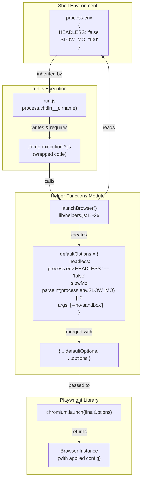
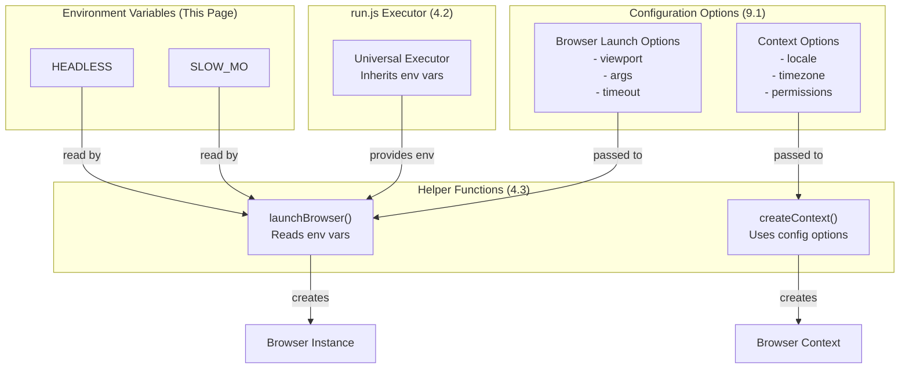

<!-- source: DeepWiki mcp.deepwiki.com · repo lackeyjb/playwright-skill · page 9.2 Environment Variables · fetched 2026-10-27 -->

# Environment Variables

<details>
<summary>Relevant source files</summary>

The following files were used as context for generating this wiki page:

- [skills/playwright-skill/SKILL.md](skills/playwright-skill/SKILL.md)
- [skills/playwright-skill/lib/helpers.js](skills/playwright-skill/lib/helpers.js)
- [skills/playwright-skill/run.js](skills/playwright-skill/run.js)

</details>


This page documents all environment variables recognized by playwright-skill that control runtime behavior. Environment variables provide a way to configure browser launch options and execution parameters without modifying code.

For broader configuration options including inline script settings, see [Configuration Options](#9.1). For initial setup instructions, see [Configuration and Setup](#2.3).

## Overview

The playwright-skill system supports environment variables that control two primary aspects:
- Browser launch behavior (headless mode, execution speed)
- Default timeouts and display settings

These variables are read by the `launchBrowser()` function in [lib/helpers.js:11-26]() and apply to all automation scripts executed through the skill. Environment variables can be overridden by inline configuration within individual scripts.

Sources: [lib/helpers.js:11-26](), [skills/playwright-skill/SKILL.md:33-34,344-346]()

## Configuration Precedence


**Configuration Precedence Hierarchy**

The system resolves configuration in three layers, with each layer overriding the previous:

1. **Default Values**: Hardcoded defaults in `launchBrowser()` function
2. **Environment Variables**: Shell environment settings (this page)
3. **Inline Configuration**: Script-specific launch options

Sources: [lib/helpers.js:11-26]()

## Environment Variables Reference

### HEADLESS

Controls whether the browser runs in headless mode (no visible window) or with a visible UI.

| Property | Value |
|----------|-------|
| **Variable Name** | `HEADLESS` |
| **Type** | String (parsed as boolean) |
| **Default** | `"false"` (visible browser) |
| **Valid Values** | `"true"`, `"false"` |
| **Code Location** | [lib/helpers.js:13]() |

**Behavior:**
- When unset or `"false"`: Browser launches with visible window (default behavior)
- When set to `"true"`: Browser launches in headless mode without window

**Parsing Logic:**
```javascript
headless: process.env.HEADLESS !== 'false'
```

The logic inverts the typical boolean check. The browser is visible (headless=false) unless explicitly set to "true".

**Usage Examples:**

```bash
# Run with visible browser (default)
cd $SKILL_DIR && node run.js script.js

# Run in headless mode
HEADLESS=true cd $SKILL_DIR && node run.js script.js

# Explicitly set visible mode
HEADLESS=false cd $SKILL_DIR && node run.js script.js
```

Sources: [lib/helpers.js:13](), [skills/playwright-skill/SKILL.md:33,344-345]()

### SLOW_MO

Controls the delay in milliseconds between Playwright actions, making automation visible and easier to follow.

| Property | Value |
|----------|-------|
| **Variable Name** | `SLOW_MO` |
| **Type** | String (parsed as integer) |
| **Default** | `0` (no delay) |
| **Valid Values** | Any positive integer (milliseconds) |
| **Code Location** | [lib/helpers.js:14]() |

**Behavior:**
- When unset: No artificial delay between actions (full speed)
- When set: Each Playwright action delayed by specified milliseconds

**Parsing Logic:**
```javascript
slowMo: process.env.SLOW_MO ? parseInt(process.env.SLOW_MO) : 0
```

If the variable is set, it's parsed as an integer. If unset or empty, defaults to 0.

**Usage Examples:**

```bash
# No slow motion (default, full speed)
cd $SKILL_DIR && node run.js script.js

# 100ms delay between actions (recommended for visibility)
SLOW_MO=100 cd $SKILL_DIR && node run.js script.js

# 500ms delay for presentation/demo
SLOW_MO=500 cd $SKILL_DIR && node run.js script.js

# 50ms delay for CI/CD (slight slowdown for stability)
SLOW_MO=50 cd $SKILL_DIR && node run.js script.js
```

Sources: [lib/helpers.js:14](), [skills/playwright-skill/SKILL.md:346]()

## Environment Variable Flow



**Environment Variable Resolution Flow**

1. Shell environment variables are set before invoking `run.js`
2. `run.js` inherits the parent shell's environment via `process.env`
3. Temporary execution file is created and required
4. Script calls `launchBrowser()` or uses `helpers` module
5. `launchBrowser()` reads `process.env.HEADLESS` and `process.env.SLOW_MO`
6. Default options object is created with parsed values
7. Default options merged with any inline options passed by script
8. Final configuration passed to `chromium.launch()`

Sources: [lib/helpers.js:11-26](), [run.js:188-189]()

## Common Use Cases

### Development and Debugging

Visible browser with slow motion for observing behavior:

```bash
HEADLESS=false SLOW_MO=100 cd $SKILL_DIR && node run.js /tmp/test.js
```

### CI/CD Pipelines

Headless mode with minimal delay for speed and stability:

```bash
HEADLESS=true SLOW_MO=50 cd $SKILL_DIR && node run.js /tmp/test.js
```

### Demos and Presentations

Very slow execution for clear visibility:

```bash
HEADLESS=false SLOW_MO=500 cd $SKILL_DIR && node run.js /tmp/demo.js
```

### Production Testing

Full speed headless execution:

```bash
HEADLESS=true cd $SKILL_DIR && node run.js /tmp/prod-test.js
```

Sources: [skills/playwright-skill/SKILL.md:344-346]()

## Inline Override Pattern

Environment variables can be overridden by passing options directly to `launchBrowser()`:

```javascript
const { launchBrowser } = require('./lib/helpers');

// Environment: HEADLESS=true, SLOW_MO=100
// This script overrides both settings
const browser = await launchBrowser('chromium', {
  headless: false,    // Override HEADLESS
  slowMo: 200        // Override SLOW_MO
});
```

Alternatively, when using Playwright directly:

```javascript
const { chromium } = require('playwright');

// Bypass helpers, specify all options directly
const browser = await chromium.launch({
  headless: true,
  slowMo: 50,
  args: ['--no-sandbox']
});
```

The environment variables in `lib/helpers.js` only apply when using the `launchBrowser()` helper function. Direct Playwright API calls do not read these variables.

Sources: [lib/helpers.js:11-26]()

## Relationship to Other Configuration



**Configuration System Architecture**

- **Environment Variables** (this page): Shell-level settings for browser launch behavior
- **Configuration Options** ([#9.1](#9.1)): Comprehensive list of all Playwright launch and context options
- **Helper Functions** ([#4.3](#4.3)): Functions like `launchBrowser()` that read environment variables
- **Universal Executor** ([#4.2](#4.2)): `run.js` inherits shell environment and passes to child processes

Sources: [lib/helpers.js:11-50](), [run.js:1-209]()

## Default Values Summary

| Variable | Default | Set In | Rationale |
|----------|---------|--------|-----------|
| `HEADLESS` | `"false"` (visible) | [lib/helpers.js:13]() | Visible browser aids debugging and allows user observation |
| `SLOW_MO` | `0` (full speed) | [lib/helpers.js:14]() | No artificial delays by default; add when needed for visibility |

These defaults prioritize debuggability and user experience over execution speed. For production/CI environments, set `HEADLESS=true` to improve performance.

Sources: [lib/helpers.js:13-14](), [skills/playwright-skill/SKILL.md:33,344-346]()

## Verifying Environment Variables

To verify environment variable values are being read correctly:

```bash
# Check what values are set
echo "HEADLESS=$HEADLESS"
echo "SLOW_MO=$SLOW_MO"

# Run with debug output
node -e "
console.log('HEADLESS:', process.env.HEADLESS);
console.log('SLOW_MO:', process.env.SLOW_MO);
console.log('Parsed headless:', process.env.HEADLESS !== 'false');
console.log('Parsed slowMo:', parseInt(process.env.SLOW_MO) || 0);
"
```

## Limitations

1. **Type Constraints**: Environment variables are always strings. They must be parsed appropriately:
   - `HEADLESS` uses string comparison (`!== 'false'`)
   - `SLOW_MO` uses `parseInt()` for number conversion

2. **Scope**: Environment variables only affect code that uses the `launchBrowser()` helper function. Direct Playwright API calls bypass this mechanism.

3. **No Runtime Modification**: Environment variables are read once at function invocation. Changing them mid-execution has no effect.

4. **No Validation**: Invalid values (e.g., `SLOW_MO=abc`) may cause parsing errors. `parseInt()` returns `NaN`, which defaults to `0`.

Sources: [lib/helpers.js:13-14]()

---

