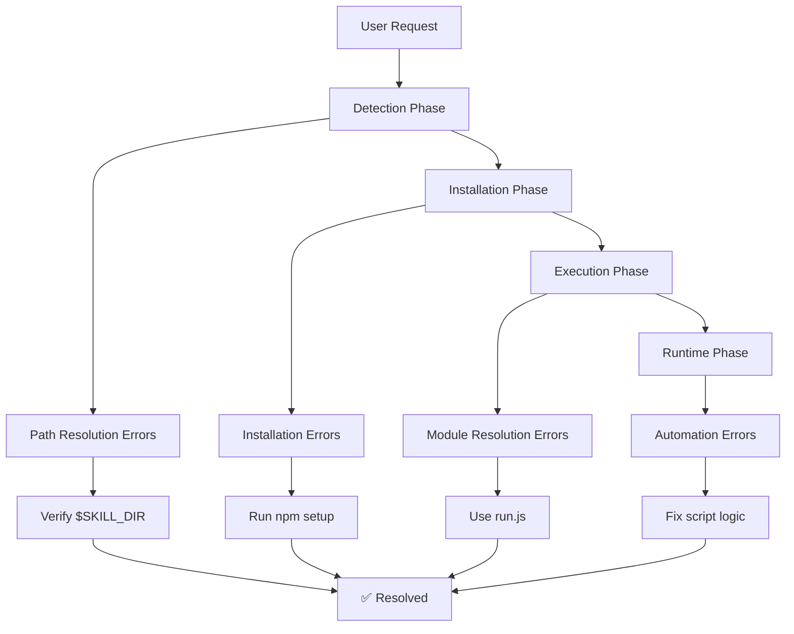
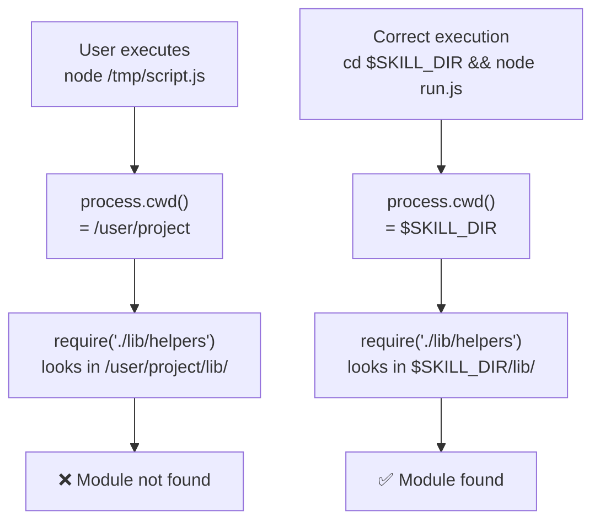
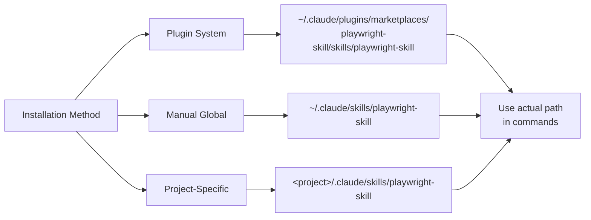
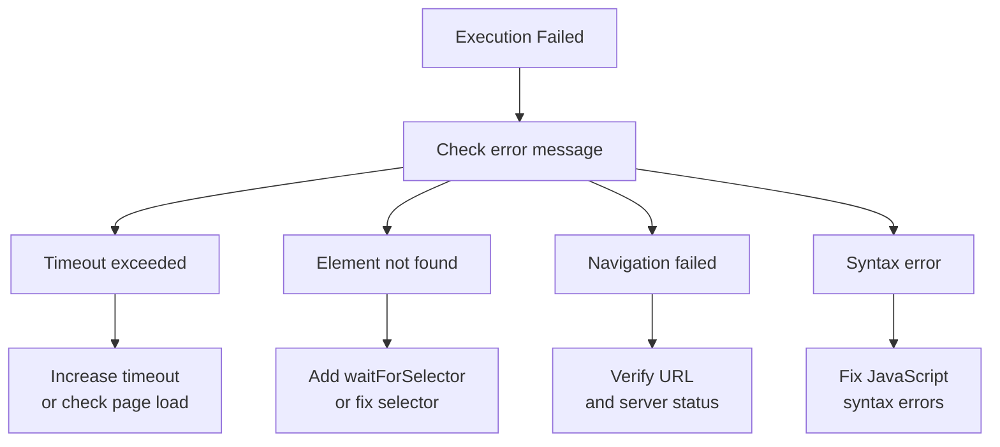
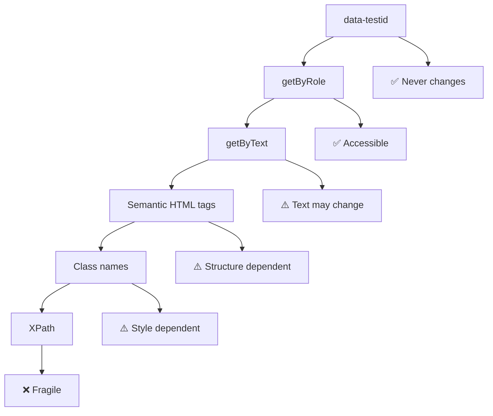
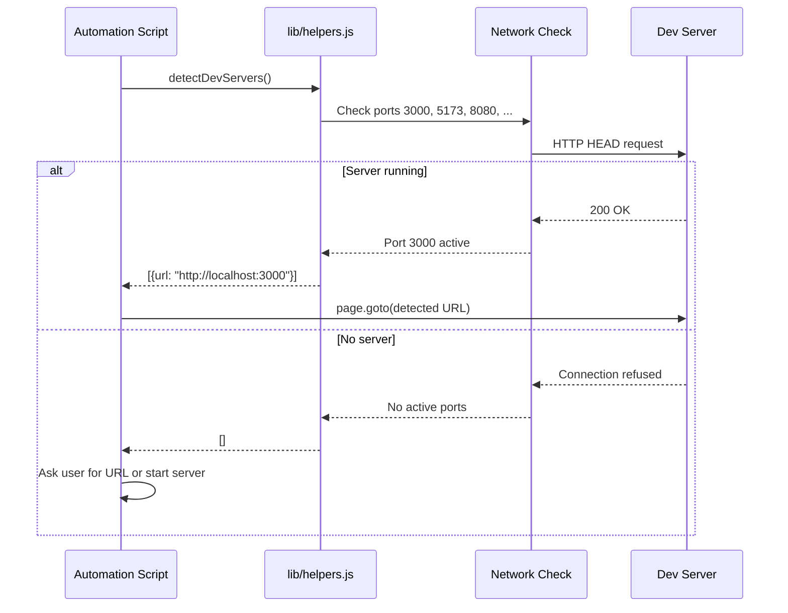

<!-- source: DeepWiki mcp.deepwiki.com · repo lackeyjb/playwright-skill · page 9.4 Error Messages and Solutions · fetched 2026-10-27 -->

# Error Messages and Solutions

<details>
<summary>Relevant source files</summary>

The following files were used as context for generating this wiki page:

- [README.md](README.md)
- [skills/playwright-skill/SKILL.md](skills/playwright-skill/SKILL.md)
- [skills/playwright-skill/run.js](skills/playwright-skill/run.js)

</details>


This page documents common error messages encountered when using the playwright-skill, their root causes, and step-by-step solutions. Each error includes the exact message as it appears in console output, the underlying cause, and specific commands to resolve it.

For general debugging techniques and best practices, see [Debugging and Troubleshooting](#5.4). For configuration issues, see [Configuration and Setup](#2.3). For path resolution concepts, see [Path Resolution and $SKILL_DIR](#4.6).

## Error Classification

The playwright-skill can encounter errors at four distinct stages of execution:



**Sources:** [run.js:1-209](), [SKILL.md:351-365](), [README.md:196-208]()

## Installation and Setup Errors

### Error: "Playwright not found"

**Message:**
```
📦 Playwright not found. Installing...
```

**Cause:** The Playwright package is not installed in the skill's `node_modules` directory. This occurs on first use or after manual directory cleanup.

**Automatic Resolution:** The `run.js` executor automatically detects missing Playwright and attempts installation at [run.js:35-46]().

**Manual Resolution:**
```bash
# Navigate to the skill directory
cd $SKILL_DIR

# Run setup script
npm run setup
```

**Alternative if setup fails:**
```bash
cd $SKILL_DIR
npm install
npx playwright install chromium
```

**Sources:** [run.js:23-46](), [SKILL.md:353-356](), [README.md:198-199]()

---

### Error: "Failed to install Playwright"

**Message:**
```
❌ Failed to install Playwright: <error details>
Please run manually: cd <path> && npm run setup
```

**Cause:** The automatic installation failed due to network issues, permissions problems, or npm configuration errors.

**Solution:**

| Problem | Resolution |
|---------|------------|
| Network timeout | Check internet connection and retry |
| Permission denied | Run with appropriate permissions or fix npm permissions |
| npm not found | Install Node.js >= 14.0.0 |
| Disk space | Free up disk space |

**Manual installation steps:**
```bash
# 1. Navigate to skill directory
cd ~/.claude/skills/playwright-skill  # or your installation path

# 2. Clean install
rm -rf node_modules package-lock.json
npm install

# 3. Install browsers
npx playwright install chromium

# 4. Verify installation
node -e "console.log(require('playwright').chromium)"
```

**Sources:** [run.js:35-46](), [README.md:198-199]()

---

### Error: "Browser executable not found"

**Message:**
```
browserType.launch: Executable doesn't exist at <path>
```

**Cause:** Playwright is installed but browser binaries (Chromium, Firefox, or WebKit) are not downloaded.

**Solution:**
```bash
cd $SKILL_DIR

# Install specific browser
npx playwright install chromium

# Or install all browsers
npm run install-all-browsers
```

**For CI/CD environments:**
```bash
# Install system dependencies first
npx playwright install-deps chromium
npx playwright install chromium
```

**Sources:** [README.md:207-208](), [SKILL.md:353-356]()

---

## Path Resolution Errors

### Error: "Cannot find module './lib/helpers'"

**Message:**
```
Error: Cannot find module './lib/helpers'
Require stack:
- /tmp/playwright-test-*.js
```

**Cause:** The automation script is being executed from the wrong directory, causing relative module paths to fail. This is the primary problem that `run.js` was designed to solve.

**Root Cause Analysis:**



**Solution:**

Always execute via `run.js` from the skill directory:

```bash
# ❌ WRONG - Direct execution
node /tmp/playwright-test-script.js

# ✅ CORRECT - Via run.js
cd $SKILL_DIR && node run.js /tmp/playwright-test-script.js
```

**Why this works:** The `run.js` executor changes the working directory to the skill location at [run.js:18]() before requiring any modules, ensuring proper module resolution.

**Sources:** [run.js:18](), [SKILL.md:9-16](), [SKILL.md:357-359](), [README.md:200-202]()

---

### Error: "Cannot resolve $SKILL_DIR"

**Message:**
```
bash: cd: $SKILL_DIR: No such file or directory
```

**Cause:** The `$SKILL_DIR` variable is not resolved to an actual path. This is a documentation placeholder that must be replaced with the real installation path.

**Solution:**

Determine your installation path and use it explicitly:



**Find your installation:**
```bash
# Search common locations
ls -la ~/.claude/skills/playwright-skill/SKILL.md 2>/dev/null && echo "Found: Global"
ls -la ~/.claude/plugins/marketplaces/*/skills/playwright-skill/SKILL.md 2>/dev/null && echo "Found: Plugin"
ls -la .claude/skills/playwright-skill/SKILL.md 2>/dev/null && echo "Found: Project"
```

**Set as variable for convenience:**
```bash
# In your shell session
SKILL_DIR=~/.claude/skills/playwright-skill

# Then use it
cd $SKILL_DIR && node run.js /tmp/test.js
```

**Sources:** [SKILL.md:9-16](), [README.md:24-33]()

---

## Execution Errors

### Error: "No code to execute"

**Message:**
```
❌ No code to execute
Usage:
  node run.js script.js          # Execute file
  node run.js "code here"        # Execute inline
  cat script.js | node run.js    # Execute from stdin
```

**Cause:** The `run.js` executor was invoked without providing code through any of the three supported input methods.

**Solution:**

Choose the appropriate execution mode:

```bash
# File mode (most common)
cd $SKILL_DIR && node run.js /tmp/playwright-test-page.js

# Inline mode (quick tasks)
cd $SKILL_DIR && node run.js "
const browser = await chromium.launch({ headless: false });
const page = await browser.newPage();
await page.goto('http://localhost:3000');
await browser.close();
"

# Stdin mode (piped input)
cat /tmp/script.js | cd $SKILL_DIR && node run.js
```

**Sources:** [run.js:52-81]()

---

### Error: "Execution failed"

**Message:**
```
❌ Execution failed: <error message>

📋 Stack trace:
<stack trace details>
```

**Cause:** The automation script encountered a runtime error during execution. This is a wrapper for underlying errors that occur within the Playwright code.

**Debugging Strategy:**



**Common sub-errors and solutions:**

1. **Timeout errors** - See "Timeout Errors" section below
2. **Element not found** - See "Selector and Locator Errors" section below  
3. **Navigation failed** - See "Network and Navigation Errors" section below

**Sources:** [run.js:194-200]()

---

## Runtime Automation Errors

### Error: "Timeout exceeded waiting for element"

**Message:**
```
TimeoutError: Waiting for selector ".my-element" failed: timeout 30000ms exceeded
```

**Cause:** The element was not found within the default timeout period (30 seconds). Common reasons:
- Element doesn't exist on the page
- Element is dynamically loaded and takes longer to appear
- Incorrect selector
- Page failed to load properly

**Solutions:**

```javascript
// ❌ BEFORE - Using default timeout
await page.click('.submit-button');

// ✅ SOLUTION 1 - Increase timeout for slow-loading elements
await page.click('.submit-button', { timeout: 60000 }); // 60 seconds

// ✅ SOLUTION 2 - Wait explicitly before action
await page.waitForSelector('.submit-button', { 
  state: 'visible',
  timeout: 10000 
});
await page.click('.submit-button');

// ✅ SOLUTION 3 - Wait for network idle (AJAX-loaded content)
await page.goto('http://localhost:3000', { 
  waitUntil: 'networkidle' 
});
await page.click('.submit-button');
```

**Wait strategy table:**

| Wait Strategy | Use When | Example |
|---------------|----------|---------|
| `waitForSelector` | Element appears after delay | Dynamic content, AJAX |
| `waitForLoadState('networkidle')` | Page loads data via network | API calls, lazy loading |
| `waitForURL` | Redirect expected | Login, form submission |
| `waitForTimeout` | Fixed delay needed (avoid if possible) | Animations |

**Sources:** [SKILL.md:364-365](), [README.md:203-205]()

---

### Error: "Element not found" or "locator resolved to 0 elements"

**Message:**
```
Error: locator.click: Error: strict mode violation: locator('button') resolved to 0 elements
```

**Cause:** The selector doesn't match any elements on the page, or the element hasn't loaded yet.

**Diagnostic steps:**

```javascript
// Debug selector - check what was found
const elements = await page.locator('.my-selector').count();
console.log(`Found ${elements} elements matching selector`);

// Take screenshot to see page state
await page.screenshot({ path: '/tmp/debug-screenshot.png' });

// Print page HTML for inspection
const html = await page.content();
console.log(html.substring(0, 500)); // First 500 chars
```

**Solutions:**

```javascript
// ✅ SOLUTION 1 - Use data-testid (most reliable)
await page.click('[data-testid="submit-button"]');

// ✅ SOLUTION 2 - Use role-based selectors
await page.getByRole('button', { name: 'Submit' }).click();

// ✅ SOLUTION 3 - Wait for element first
await page.waitForSelector('.submit-button');
await page.click('.submit-button');

// ✅ SOLUTION 4 - Use text content
await page.getByText('Submit').click();
```

**Selector strategy hierarchy (most to least reliable):**



**Sources:** [SKILL.md:364-365](), [README.md:203-205]()

---

### Error: "Browser doesn't open" or "headless mode unintended"

**Message:**
No explicit error message - browser runs in headless mode when visible mode was expected.

**Cause:** The `headless` option is set to `true` (or defaults to it) when you wanted to see the browser window.

**Solution:**

Always explicitly set `headless: false` for visible browser:

```javascript
// ✅ CORRECT - Visible browser
const browser = await chromium.launch({ 
  headless: false,
  slowMo: 100  // Also slow down for visibility
});

// ❌ INCORRECT - Will run headless
const browser = await chromium.launch();
```

**Environment variable override:**
```bash
# Force headless mode (overrides script)
HEADLESS=true cd $SKILL_DIR && node run.js script.js

# Force visible mode
HEADLESS=false cd $SKILL_DIR && node run.js script.js
```

**For WSL/Remote systems without display:**

```javascript
// Install Xvfb first: sudo apt-get install xvfb
// Then use xvfb-run:
// xvfb-run cd $SKILL_DIR && node run.js script.js

// Or accept headless with screenshots
const browser = await chromium.launch({ headless: true });
// Take screenshots to verify behavior
await page.screenshot({ path: '/tmp/output.png' });
```

**Sources:** [SKILL.md:33](), [SKILL.md:343-345](), [README.md:161](), [README.md:203-205]()

---

## Network and Navigation Errors

### Error: "net::ERR_CONNECTION_REFUSED"

**Message:**
```
page.goto: net::ERR_CONNECTION_REFUSED at http://localhost:3000
```

**Cause:** The target URL is not reachable because:
- Dev server is not running
- Wrong port number
- Firewall blocking connection

**Solutions:**

```javascript
// ✅ SOLUTION 1 - Auto-detect running servers first
// Always run this before writing test code:
const helpers = require('./lib/helpers');
const servers = await helpers.detectDevServers();
console.log('Found servers:', servers);
// Use detected URL in TARGET_URL constant

// ✅ SOLUTION 2 - Check server manually
// In separate terminal, verify server is running:
// curl http://localhost:3000
// netstat -an | grep 3000

// ✅ SOLUTION 3 - Add retry logic with detection
async function navigateWithRetry(page, baseUrl) {
  const ports = [3000, 3001, 5173, 8080];
  for (const port of ports) {
    try {
      const url = `http://localhost:${port}`;
      await page.goto(url, { timeout: 5000 });
      console.log(`✅ Connected to ${url}`);
      return url;
    } catch (e) {
      console.log(`❌ Port ${port} not responding`);
    }
  }
  throw new Error('No dev server found');
}
```

**Prevention workflow:**



**Sources:** [SKILL.md:23-29](), [SKILL.md:341-343]()

---

### Error: "Navigation timeout of 30000ms exceeded"

**Message:**
```
page.goto: Navigation timeout of 30000ms exceeded
```

**Cause:** Page took longer than the timeout to load completely.

**Solutions:**

```javascript
// ✅ SOLUTION 1 - Increase timeout
await page.goto('http://localhost:3000', { 
  timeout: 60000  // 60 seconds
});

// ✅ SOLUTION 2 - Use different wait strategy
await page.goto('http://localhost:3000', { 
  waitUntil: 'domcontentloaded'  // Don't wait for all resources
});

// ✅ SOLUTION 3 - Don't wait at all, handle manually
await page.goto('http://localhost:3000', { 
  waitUntil: 'commit'  // Return as soon as navigation commits
});
// Then wait for specific element
await page.waitForSelector('#main-content');
```

**Wait strategies:**

| Strategy | Description | Use When |
|----------|-------------|----------|
| `load` (default) | Wait for load event | Standard pages |
| `domcontentloaded` | Wait for DOM ready | Fast testing |
| `networkidle` | Wait for network idle | AJAX-heavy pages |
| `commit` | Navigation committed | Manual waiting preferred |

**Sources:** [README.md:163]()

---

## Permission and Environment Errors

### Error: "EACCES: permission denied"

**Message:**
```
Error: EACCES: permission denied, mkdir '/tmp/screenshots'
```

**Cause:** Insufficient permissions to write to the target directory (usually `/tmp` or skill directory).

**Solutions:**

```bash
# Check permissions
ls -la /tmp/

# Fix /tmp permissions (if needed)
chmod 1777 /tmp/

# Or use alternative directory
mkdir -p ~/playwright-output
chmod 755 ~/playwright-output
```

```javascript
// Update screenshot path in script
await page.screenshot({ 
  path: `${process.env.HOME}/playwright-output/screenshot.png` 
});
```

**Sources:** [SKILL.md:31](), [SKILL.md:79]()

---

### Error: "Display server not available"

**Message:**
```
browserType.launch: Failed to launch browser: Running without DISPLAY
```

**Cause:** Running in headless environment (SSH, CI/CD, Docker) without X11 display, but `headless: false` is set.

**Solutions:**

```bash
# ✅ SOLUTION 1 - Use Xvfb (virtual framebuffer)
sudo apt-get install xvfb
xvfb-run cd $SKILL_DIR && node run.js script.js

# ✅ SOLUTION 2 - Set headless mode via environment
HEADLESS=true cd $SKILL_DIR && node run.js script.js
```

```javascript
// ✅ SOLUTION 3 - Detect environment in script
const isCI = process.env.CI === 'true';
const browser = await chromium.launch({ 
  headless: isCI  // Headless in CI, visible locally
});
```

**Sources:** [SKILL.md:343-345]()

---

## Dev Server Detection Errors

### Error: "detectDevServers() returns empty array"

**Symptom:** Dev server detection finds no servers even though one is running.

**Cause:** The dev server is running on a port that's not in the standard scan list, or the server isn't responding to HTTP requests properly.

**Solutions:**

```javascript
// ✅ Check actual port
// In terminal where server is running, look for:
// "Server running on http://localhost:XXXX"

// ✅ Add custom port check
const helpers = require('./lib/helpers');
const servers = await helpers.detectDevServers();

if (servers.length === 0) {
  // Try custom port
  const customPort = 4000;
  try {
    const response = await fetch(`http://localhost:${customPort}`);
    if (response.ok) {
      console.log(`Found server on custom port ${customPort}`);
      servers.push({ url: `http://localhost:${customPort}` });
    }
  } catch (e) {
    console.log('No server on custom port either');
  }
}

// ✅ Manual URL fallback
const TARGET_URL = servers.length > 0 
  ? servers[0].url 
  : 'http://localhost:3000';  // Fallback
```

**Common dev server ports scanned:**

| Framework | Default Port | Notes |
|-----------|--------------|-------|
| React (Create React App) | 3000 | Most common |
| Vite | 5173 | Modern bundler |
| Vue CLI | 8080 | Vue projects |
| Angular | 4200 | Angular CLI |
| Next.js | 3000 | Can configure |
| Express (manual) | 3000, 8080, 5000 | User choice |

**Sources:** [SKILL.md:23-29](), [SKILL.md:304-306]()

---

## Code Wrapping and Structure Errors

### Error: "Top-level await not supported"

**Message:**
```
SyntaxError: await is only valid in async functions
```

**Cause:** Using `await` outside an async context. The `run.js` executor automatically wraps code, but this may fail if the code structure is complex.

**Automatic fix:** The `run.js` wrapper detects unwrapped code and adds async IIFE at [run.js:109-157]().

**Manual fix if automatic wrapping fails:**

```javascript
// ❌ WRONG - Top-level await
const browser = await chromium.launch({ headless: false });
await browser.close();

// ✅ CORRECT - Wrapped in async IIFE
(async () => {
  const browser = await chromium.launch({ headless: false });
  await browser.close();
})();
```

**Complete template:**

```javascript
const { chromium } = require('playwright');

(async () => {
  try {
    const browser = await chromium.launch({ headless: false });
    const page = await browser.newPage();
    
    // Your automation code here
    
    await browser.close();
  } catch (error) {
    console.error('❌ Error:', error.message);
    process.exit(1);
  }
})();
```

**Sources:** [run.js:109-157]()

---

## Error Recovery Patterns

### Retry Logic for Flaky Operations

```javascript
const helpers = require('./lib/helpers');

// Use helper's built-in retry
await helpers.safeClick(page, '.submit-button', { 
  retries: 3,
  delay: 1000
});

// Or implement custom retry
async function withRetry(operation, maxRetries = 3) {
  for (let i = 0; i < maxRetries; i++) {
    try {
      return await operation();
    } catch (error) {
      if (i === maxRetries - 1) throw error;
      console.log(`Attempt ${i + 1} failed, retrying...`);
      await page.waitForTimeout(1000);
    }
  }
}

// Usage
await withRetry(() => page.click('.dynamic-button'));
```

### Error Context Capture

```javascript
async function executeWithContext(page, operation) {
  try {
    await operation();
  } catch (error) {
    // Capture context for debugging
    const url = page.url();
    const title = await page.title();
    await page.screenshot({ 
      path: `/tmp/error-screenshot-${Date.now()}.png` 
    });
    
    console.error(`❌ Error at ${url} (${title})`);
    console.error(`Error: ${error.message}`);
    console.error(`Screenshot saved for debugging`);
    throw error;
  }
}
```

**Sources:** [run.js:125-136]()

---

## Diagnostic Commands Reference

```bash
# Check Playwright installation
cd $SKILL_DIR && node -e "console.log(require('playwright'))"

# Check browser installation
cd $SKILL_DIR && npx playwright --version

# Detect dev servers
cd $SKILL_DIR && node -e "require('./lib/helpers').detectDevServers().then(s => console.log(JSON.stringify(s)))"

# Verify skill directory
ls -la $SKILL_DIR/run.js $SKILL_DIR/lib/helpers.js

# Check Node.js version
node --version  # Should be >= 14.0.0

# Test simple execution
cd $SKILL_DIR && node run.js "console.log('Test successful')"

# View run.js help
cd $SKILL_DIR && node run.js
```

**Sources:** [run.js:1-209](), [SKILL.md:48-51](), [SKILL.md:353-365]()

---

## Quick Reference Matrix

| Error Pattern | Primary Cause | Quick Fix | Section |
|---------------|---------------|-----------|---------|
| "Playwright not found" | Missing installation | `npm run setup` | Installation |
| "Cannot find module" | Wrong working directory | Use `cd $SKILL_DIR && node run.js` | Path Resolution |
| "Timeout exceeded" | Slow page load or wrong selector | Increase timeout, check selector | Runtime |
| "Element not found" | Wrong selector or timing | Use `waitForSelector`, fix selector | Runtime |
| "Connection refused" | Server not running | Run `detectDevServers()` first | Network |
| "Permission denied" | File permissions | Fix `/tmp` permissions | Environment |
| "No display" | Headless environment | Use Xvfb or set `headless: true` | Environment |
| "await not valid" | Missing async wrapper | Let `run.js` wrap, or add manually | Structure |

**Sources:** All sections above

---

