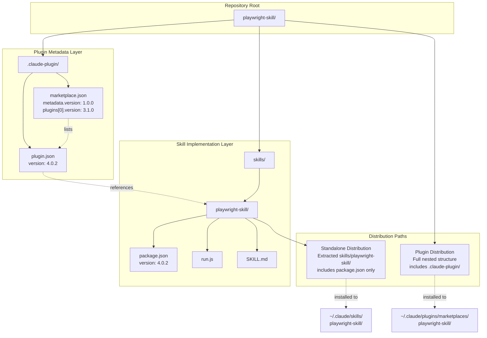
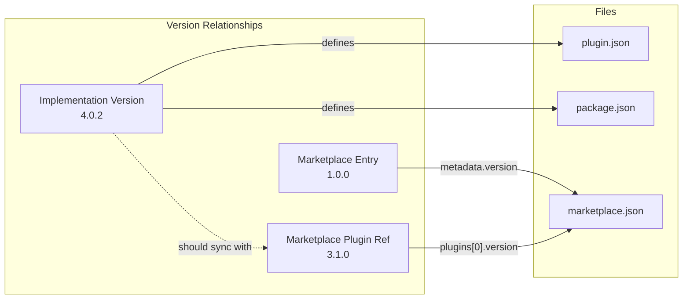
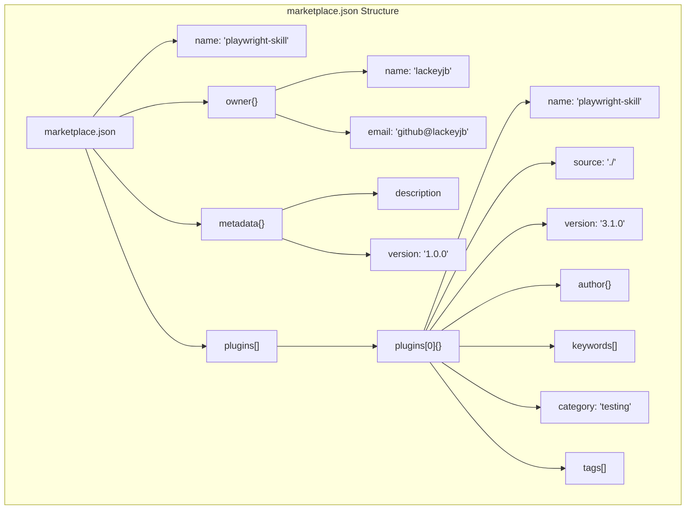
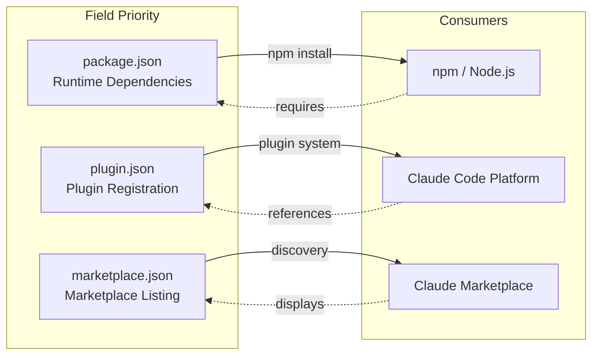
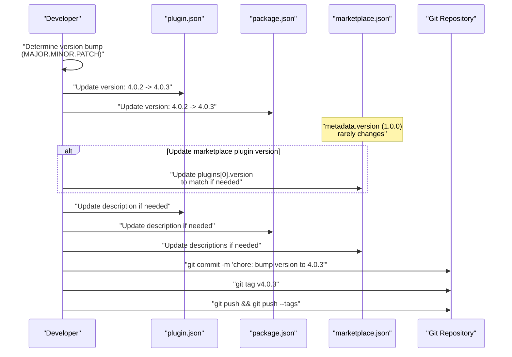
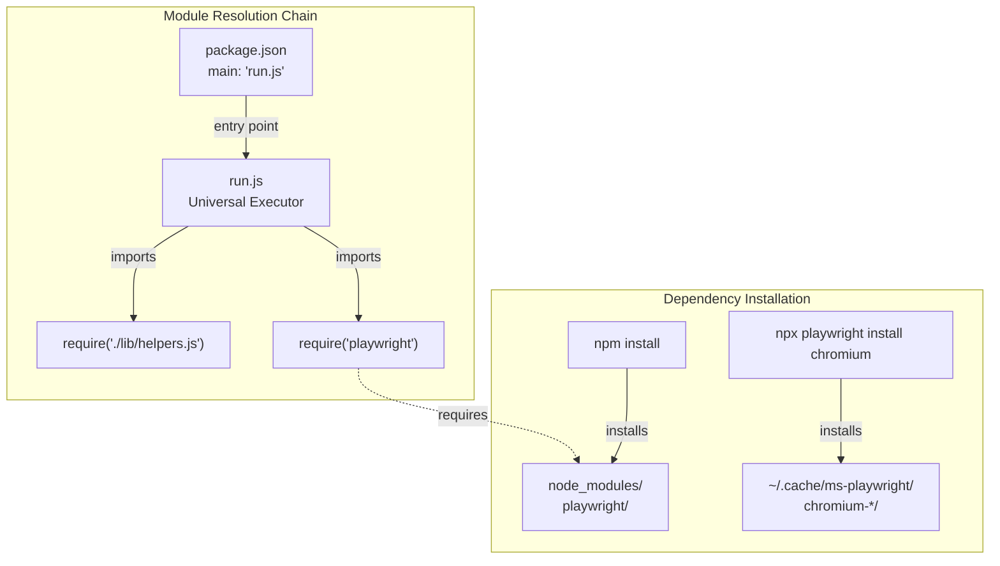

<!-- source: DeepWiki mcp.deepwiki.com · repo lackeyjb/playwright-skill · page 9.5 Metadata and Versioning · fetched 2026-10-27 -->

# Metadata and Versioning

<details>
<summary>Relevant source files</summary>

The following files were used as context for generating this wiki page:

- [.claude-plugin/marketplace.json](.claude-plugin/marketplace.json)
- [.claude-plugin/plugin.json](.claude-plugin/plugin.json)
- [skills/playwright-skill/package.json](skills/playwright-skill/package.json)

</details>


## Purpose and Scope

This document explains the metadata files and versioning strategy used by playwright-skill. The repository maintains three distinct metadata manifests that serve different purposes in the distribution and installation process: `plugin.json` for Claude Code plugin definition, `marketplace.json` for marketplace listing, and `package.json` for npm dependency management. This page documents the version numbers across these files, their purposes, schemas, and synchronization requirements.

For installation paths and how these metadata files are used during installation, see [Installation](#2.1). For the overall distribution model, see [Distribution Model](#3.2).

---

## Overview of Metadata Files

The playwright-skill repository maintains three primary metadata files, each serving a distinct role in the distribution and execution pipeline:

| File Path | Current Version | Purpose | Consumer |
|-----------|----------------|---------|----------|
| `.claude-plugin/plugin.json` | 4.0.2 | Plugin definition for Claude Code | Claude Code Platform |
| `.claude-plugin/marketplace.json` | 1.0.0 (entry)<br/>3.1.0 (plugin) | Marketplace listing configuration | Claude Marketplace |
| `skills/playwright-skill/package.json` | 4.0.2 | npm package manifest | npm / Node.js |

### Metadata File Distribution



**Sources:** [.claude-plugin/plugin.json](), [.claude-plugin/marketplace.json](), [skills/playwright-skill/package.json]()

---

## Version Number Semantics

### Primary Version: 4.0.2

The primary version number `4.0.2` appears in both `plugin.json` and `package.json` and represents the actual skill implementation version. This follows semantic versioning (MAJOR.MINOR.PATCH):

- **MAJOR** (4): Breaking changes to the skill API or execution model
- **MINOR** (0): New features or helper functions added
- **PATCH** (2): Bug fixes and minor improvements

**Synchronized Files:**
- [.claude-plugin/plugin.json:3]() - `"version": "4.0.2"`
- [skills/playwright-skill/package.json:3]() - `"version": "4.0.2"`

### Marketplace Entry Version: 1.0.0

The marketplace entry version `1.0.0` in `marketplace.json` at [.claude-plugin/marketplace.json:9]() represents the **listing configuration version**, not the skill version. This tracks changes to the marketplace entry structure itself, such as:

- Owner information changes
- Metadata schema updates
- Listing configuration modifications

This version rarely changes because the marketplace listing structure is stable.

### Marketplace Plugin Version: 3.1.0

The plugin version `3.1.0` at [.claude-plugin/marketplace.json:16]() represents a **historical compatibility marker** for the marketplace listing. This version may differ from the actual plugin version due to marketplace-specific versioning requirements or historical reasons during marketplace submission.

### Version Comparison Table



**Sources:** [.claude-plugin/plugin.json:3](), [.claude-plugin/marketplace.json:9,16](), [skills/playwright-skill/package.json:3]()

---

## Metadata File Schemas

### plugin.json Schema

The `plugin.json` file defines the plugin for Claude Code's plugin system:

| Field | Type | Value | Purpose |
|-------|------|-------|---------|
| `name` | string | "playwright-skill" | Unique plugin identifier |
| `version` | string | "4.0.2" | Semantic version |
| `description` | string | Full description | Plugin purpose and features |
| `author.name` | string | "lackeyjb" | Plugin author |
| `license` | string | "MIT" | License type |
| `repository` | string | GitHub URL | Source repository |
| `keywords` | array | 9 keywords | Searchable tags |

**Key Metadata Fields:**

[.claude-plugin/plugin.json:1-21]()

The `keywords` array at [.claude-plugin/plugin.json:10-20]() includes `"model-invoked"`, which signals to Claude Code that this skill should be automatically invoked by the AI model rather than requiring explicit user commands.

### marketplace.json Schema

The `marketplace.json` file configures marketplace listing:



**Two-Level Versioning:**

1. **Top-level metadata version** [.claude-plugin/marketplace.json:9](): `"version": "1.0.0"` - Tracks the listing configuration schema
2. **Plugin-level version** [.claude-plugin/marketplace.json:16](): `"version": "3.1.0"` - References the plugin implementation

The `plugins[0].source` field at [.claude-plugin/marketplace.json:14]() points to `"./"` (repository root), indicating the plugin files are located relative to the marketplace.json file.

**Sources:** [.claude-plugin/marketplace.json:1-38]()

### package.json Schema

The `package.json` file defines npm package metadata and dependencies:

| Field | Type | Value | Purpose |
|-------|------|-------|---------|
| `name` | string | "playwright-skill" | npm package name |
| `version` | string | "4.0.2" | npm package version |
| `description` | string | Detailed description | Package purpose |
| `author` | string | "lackeyjb" | Package author |
| `main` | string | "run.js" | Entry point module |
| `scripts.setup` | string | Installation command | Setup automation |
| `dependencies.playwright` | string | "^1.48.0" | Playwright version |
| `engines.node` | string | ">=14.0.0" | Minimum Node version |
| `license` | string | "MIT" | License type |

**Critical Dependencies:**

The `dependencies` object at [skills/playwright-skill/package.json:19-21]() declares:
```json
"playwright": "^1.48.0"
```

The caret (`^`) allows automatic updates to minor and patch versions (e.g., 1.48.x, 1.49.0) but prevents breaking changes (e.g., 2.0.0).

**Setup Script:**

[skills/playwright-skill/package.json:8]() defines the setup automation:
```json
"setup": "npm install && npx playwright install chromium"
```

This installs dependencies and the Chromium browser in a single command.

**Sources:** [skills/playwright-skill/package.json:1-26]()

---

## Field Mapping Across Manifests

The following table shows how common fields are represented across the three metadata files:

| Concept | plugin.json | marketplace.json | package.json |
|---------|-------------|------------------|--------------|
| **Name** | `name` | `name` (root)<br/>`plugins[0].name` | `name` |
| **Version** | `version` | `metadata.version`<br/>`plugins[0].version` | `version` |
| **Description** | `description` | `metadata.description`<br/>`plugins[0].description` | `description` |
| **Author** | `author.name` | `owner.name`<br/>`plugins[0].author.name` | `author` |
| **License** | `license` | `plugins[0].license` | `license` |
| **Repository** | `repository` | `plugins[0].repository` | N/A |
| **Keywords** | `keywords` | `plugins[0].keywords`<br/>`plugins[0].tags` | `keywords` |

### Duplicate Field Resolution



**Sources:** [.claude-plugin/plugin.json](), [.claude-plugin/marketplace.json](), [skills/playwright-skill/package.json]()

---

## Synchronization Requirements

### Critical Synchronization Points

The following fields **must** be synchronized across files when updating:

1. **Primary Version Number:**
   - [.claude-plugin/plugin.json:3]() `version`
   - [skills/playwright-skill/package.json:3]() `version`
   - Should be updated together for each release

2. **Package Name:**
   - [.claude-plugin/plugin.json:2]() `name`
   - [.claude-plugin/marketplace.json:2,13]() `name` (both levels)
   - [skills/playwright-skill/package.json:2]() `name`
   - Must remain "playwright-skill" for consistency

3. **Author Information:**
   - [.claude-plugin/plugin.json:5-7]() `author.name`
   - [.claude-plugin/marketplace.json:3-6]() `owner`
   - [skills/playwright-skill/package.json:5]() `author`

4. **License:**
   - [.claude-plugin/plugin.json:8]() `license`
   - [.claude-plugin/marketplace.json:22]() `plugins[0].license`
   - [skills/playwright-skill/package.json:25]() `license`
   - All specify "MIT"

### Version Update Workflow

When releasing a new version:



**Sources:** All three metadata files

---

## Metadata Dependencies and References

### Plugin.json References

The `plugin.json` file does not contain explicit file path references but implicitly defines the plugin structure. The Claude Code platform expects the skill to be located in the `skills/` directory relative to the plugin root.

### Marketplace.json Source Field

[.claude-plugin/marketplace.json:14]() specifies:
```json
"source": "./"
```

This indicates that the plugin is distributed from the repository root, which includes:
- `.claude-plugin/` directory with metadata
- `skills/playwright-skill/` directory with implementation

### Package.json Main Field

[skills/playwright-skill/package.json:6]() specifies:
```json
"main": "run.js"
```

This designates `run.js` as the entry point when the skill is required as a Node.js module. The module resolution works from the `skills/playwright-skill/` directory, which is why all commands require the `cd $SKILL_DIR &&` prefix.



**Sources:** [skills/playwright-skill/package.json:6,19-21](), [skills/playwright-skill/run.js]()

---

## Keywords and Discoverability

### Keyword Strategy

Both `plugin.json` and `marketplace.json` include extensive keyword arrays for discoverability:

**Common Keywords Across Files:**
- `"claude-skill"` - Identifies as Claude skill
- `"claude-code"` - Claude Code platform integration
- `"playwright"` - Technology identifier
- `"browser-automation"` - Primary use case
- `"testing"` - Common use case
- `"e2e"` - End-to-end testing
- `"web-testing"` - Domain identifier
- `"automation"` - General category
- `"model-invoked"` - Execution pattern

**Unique to marketplace.json:**

[.claude-plugin/marketplace.json:34-35]() adds:
- `category: "testing"` - Marketplace categorization
- `tags: ["browser", "automation", "playwright", "testing", "e2e"]` - Additional searchable tags

This dual-tagging system (keywords + tags + category) ensures maximum discoverability in the Claude Marketplace.

**Sources:** [.claude-plugin/plugin.json:10-20](), [.claude-plugin/marketplace.json:23-35]()

---

## Version History Tracking

While the current metadata files show specific version numbers, the repository uses Git tags for version history tracking. The version numbers in metadata files represent the **current release state**, not a historical log.

### Git Tag Correlation

Each version release should create a corresponding Git tag:

| Metadata Version | Git Tag | Commit Message Pattern |
|------------------|---------|------------------------|
| 4.0.2 | v4.0.2 | `chore: bump version to 4.0.2` |
| 4.0.1 | v4.0.1 | `chore: bump version to 4.0.1` |
| 4.0.0 | v4.0.0 | `feat!: major version 4.0.0` |

The Git tag serves as the canonical version reference, with metadata files synchronized to match.

---

## Validation Checklist

Before committing changes that affect metadata:

- [ ] `plugin.json` version matches `package.json` version
- [ ] All three files have consistent `name` field
- [ ] Author/owner information is consistent
- [ ] License is "MIT" in all files
- [ ] Repository URL is correct and accessible
- [ ] Keywords include `"model-invoked"`
- [ ] `package.json` main field points to `"run.js"`
- [ ] `marketplace.json` source field is `"./"`
- [ ] Descriptions accurately reflect current functionality
- [ ] Git tag matches version number

**Sources:** All metadata files

---

## Summary

The playwright-skill repository maintains a three-file metadata system where:

1. **plugin.json** (v4.0.2) defines the Claude Code plugin
2. **marketplace.json** (entry v1.0.0, plugin v3.1.0) configures marketplace listing
3. **package.json** (v4.0.2) manages npm dependencies

The primary implementation version (4.0.2) must be synchronized between `plugin.json` and `package.json`. The marketplace metadata version (1.0.0) tracks the listing schema, not the skill version. All three files work together to enable distribution through Claude's plugin system while maintaining npm package compatibility for standalone installations.

---

