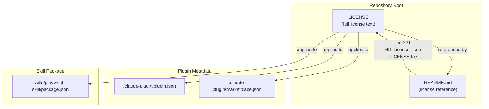
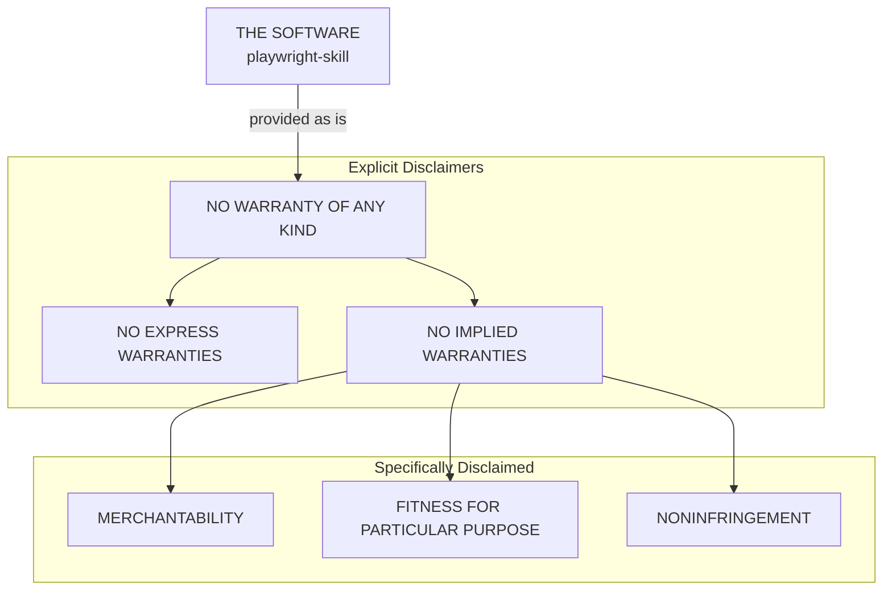
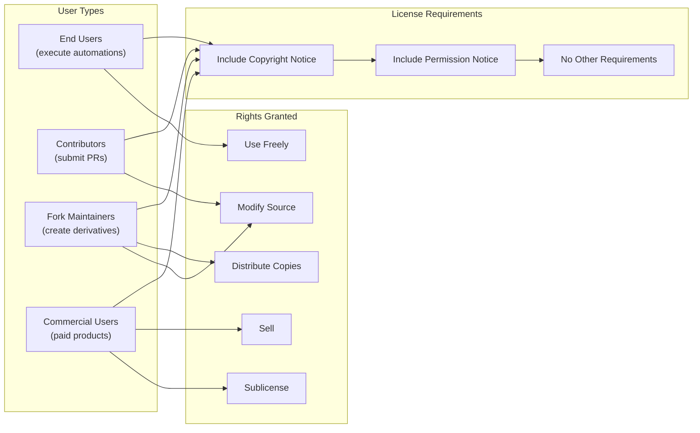

<!-- source: DeepWiki mcp.deepwiki.com · repo lackeyjb/playwright-skill · page 9.6 License · fetched 2026-10-27 -->

# License

<details>
<summary>Relevant source files</summary>

The following files were used as context for generating this wiki page:

- [LICENSE](LICENSE)
- [README.md](README.md)

</details>


**Purpose and Scope**: This page documents the licensing terms and legal framework for the playwright-skill repository. The project is distributed under the MIT License, which defines the permissions, conditions, and limitations for using, modifying, and distributing the software. This information is essential for understanding your rights as a user or contributor.

For information about contributing code back to the project, see [Contributing Guidelines](#8.1). For version information about the software packages, see [Metadata and Versioning](#9.5).

## License Overview

The playwright-skill repository is licensed under the **MIT License**, one of the most permissive open-source licenses. This license grants broad rights to use, modify, and distribute the software while requiring minimal obligations from users.

| Property | Value |
|----------|-------|
| **License Type** | MIT License |
| **Copyright Holder** | lackeyjb |
| **Copyright Year** | 2025 |
| **License File** | [LICENSE:1-22]() |
| **SPDX Identifier** | MIT |

**Sources**: [LICENSE:1-22](), [README.md:229-231]()

## License Location in Codebase



**License Location Diagram**: Shows where license information appears in the repository structure and how files reference each other.

**Sources**: [LICENSE:1-22](), [README.md:231]()

## Rights Granted

The MIT License grants the following permissions to any person obtaining a copy of the software:

| Permission | Description | Code Application |
|------------|-------------|------------------|
| **Use** | Run the software for any purpose | Execute `run.js`, use helper functions, invoke skill |
| **Copy** | Create copies of the software | Clone repository, copy to `.claude/skills/` |
| **Modify** | Make changes to the source code | Edit `SKILL.md`, add helpers to `lib/helpers.js` |
| **Merge** | Combine with other software | Integrate with custom CI/CD, extend functionality |
| **Publish** | Distribute copies to others | Share as plugin, publish fork |
| **Distribute** | Provide copies to third parties | Team installation, enterprise deployment |
| **Sublicense** | Grant rights to downstream recipients | Include in larger projects with different licenses |
| **Sell** | Charge money for copies | Commercial use permitted |

**Sources**: [LICENSE:6-9]()

## License Conditions

The license imposes only two conditions:

### Copyright Notice Requirement

The copyright notice and permission notice must be included in all copies or substantial portions of the software:

```
Copyright (c) 2025 lackeyjb
```

This requirement applies to:
- Complete copies of the repository
- Extracted `skills/playwright-skill/` folder for standalone installation
- Modified or derivative versions
- Distributions as part of larger systems

The notice must appear in: [LICENSE:11-12]()

### Permission Notice Requirement

The full permission notice from [LICENSE:6-21]() must be included alongside the copyright notice in all substantial copies or portions of the software.

**Sources**: [LICENSE:11-12](), [LICENSE:6-21]()

## Warranty Disclaimer

The MIT License explicitly disclaims all warranties. The software is provided "as is" without warranty of any kind:



**Warranty Disclaimer Structure**: Shows the hierarchical structure of warranty disclaimers in the MIT License.

**Sources**: [LICENSE:15-17]()

## Liability Limitations

The license limits liability for the authors and copyright holders:

| Liability Type | Coverage | Limitation |
|----------------|----------|------------|
| **Claims** | Any legal claim | Authors not liable |
| **Damages** | Any type of damage | Authors not liable |
| **Other Liability** | Contract, tort, or otherwise | Authors not liable |
| **Source** | Arising from software use | Authors not liable |
| **Connection** | Related to software | Authors not liable |

This means:
- No liability for bugs in `run.js` module resolution
- No liability for failed browser automations
- No liability for data loss from automation errors
- No liability for Playwright dependency issues
- No liability for issues with helper functions in `lib/helpers.js`

**Sources**: [LICENSE:18-21]()

## Application to Different Use Cases



**Use Case Application Diagram**: Shows how the license applies to different types of users and what requirements and rights each has.

**Sources**: [LICENSE:1-22]()

### End User Rights

When installing and using playwright-skill:

| Action | Permitted | Requirements |
|--------|-----------|--------------|
| Install as plugin via `/plugin install` | ✓ Yes | None beyond normal use |
| Install manually to `~/.claude/skills/` | ✓ Yes | None beyond normal use |
| Execute `run.js` for automations | ✓ Yes | None beyond normal use |
| Use helper functions from `lib/helpers.js` | ✓ Yes | None beyond normal use |
| Generate screenshots to `/tmp` | ✓ Yes | None beyond normal use |
| Use in commercial projects | ✓ Yes | Include LICENSE in distribution |

**Sources**: [LICENSE:6-9](), [README.md:18-116]()

### Contributor Rights

When contributing to the repository:

| Action | Permitted | Requirements |
|--------|-----------|--------------|
| Fork repository | ✓ Yes | Retain LICENSE file |
| Submit pull requests | ✓ Yes | Accept that contributions become MIT licensed |
| Modify `SKILL.md` instructions | ✓ Yes | Follow [CONTRIBUTING.md]() guidelines |
| Add helper functions | ✓ Yes | Follow [CONTRIBUTING.md]() guidelines |
| Update documentation | ✓ Yes | Follow [CONTRIBUTING.md]() guidelines |

**Sources**: [LICENSE:6-9](), [README.md:217-218]()

### Fork and Derivative Rights

When creating a fork or derivative work:

| Action | Permitted | Requirements |
|--------|-----------|--------------|
| Create modified version | ✓ Yes | Include original LICENSE |
| Change functionality | ✓ Yes | Include original LICENSE |
| Rename the skill | ✓ Yes | Include original LICENSE and attribution |
| Publish to different marketplace | ✓ Yes | Include original LICENSE |
| Integrate into larger system | ✓ Yes | Include original LICENSE |
| Relicense under different terms | ✗ No* | Must remain MIT or more permissive |

*While you can sublicense your modifications, the original code must retain the MIT License terms.

**Sources**: [LICENSE:6-9]()

### Commercial Use Rights

The MIT License explicitly permits commercial use:

| Scenario | Permitted | Requirements |
|----------|-----------|--------------|
| Use in commercial testing services | ✓ Yes | Include LICENSE in distribution |
| Integrate into paid products | ✓ Yes | Include LICENSE in distribution |
| Charge for custom implementations | ✓ Yes | Include LICENSE in distribution |
| Bundle with proprietary software | ✓ Yes | Include LICENSE in distribution |
| Use for client projects | ✓ Yes | No distribution = no requirement |
| Sell modified versions | ✓ Yes | Include LICENSE in distribution |

**Sources**: [LICENSE:6-9]()

## License Text

The complete license text from [LICENSE:1-22]():

```
MIT License

Copyright (c) 2025 lackeyjb

Permission is hereby granted, free of charge, to any person obtaining a copy
of this software and associated documentation files (the "Software"), to deal
in the Software without restriction, including without limitation the rights
to use, copy, modify, merge, publish, distribute, sublicense, and/or sell
copies of the Software, and to permit persons to whom the Software is
furnished to do so, subject to the following conditions:

The above copyright notice and this permission notice shall be included in all
copies or substantial portions of the Software.

THE SOFTWARE IS PROVIDED "AS IS", WITHOUT WARRANTY OF ANY KIND, EXPRESS OR
IMPLIED, INCLUDING BUT NOT LIMITED TO THE WARRANTIES OF MERCHANTABILITY,
FITNESS FOR A PARTICULAR PURPOSE AND NONINFRINGEMENT. IN NO EVENT SHALL THE
AUTHORS OR COPYRIGHT HOLDERS BE LIABLE FOR ANY CLAIM, DAMAGES OR OTHER
LIABILITY, WHETHER IN AN ACTION OF CONTRACT, TORT OR OTHERWISE, ARISING FROM,
OUT OF OR IN CONNECTION WITH THE SOFTWARE OR THE USE OR OTHER DEALINGS IN THE
SOFTWARE.
```

**Sources**: [LICENSE:1-22]()

## Dependency Licenses

The playwright-skill package depends on external software with its own licensing:

| Dependency | Version | License | Compatibility |
|------------|---------|---------|---------------|
| Playwright | ^1.48.0 | Apache-2.0 | ✓ Compatible with MIT |
| Node.js | >=14.0.0 | MIT/BSD/Apache-2.0 mix | ✓ Compatible with MIT |
| Chromium | (via Playwright) | BSD-3-Clause | ✓ Compatible with MIT |

These dependencies are not included in the playwright-skill distribution but are installed via `npm run setup`. Each retains its own license terms.

**Sources**: [README.md:190-194](), [LICENSE:1-22]()

## Summary

The MIT License provides maximum freedom to users and contributors with minimal requirements:

**What You Can Do**:
- Use for any purpose (personal, commercial, educational)
- Modify the source code
- Distribute copies
- Create derivative works
- Sublicense to others
- Sell copies

**What You Must Do**:
- Include the copyright notice
- Include the permission notice (full license text)

**What Is Disclaimed**:
- All warranties (express and implied)
- All liability for damages
- All claims arising from use

This permissive licensing approach makes playwright-skill suitable for integration into any project type, from open-source tools to commercial products, while protecting the original authors from legal liability.

**Sources**: [LICENSE:1-22](), [README.md:229-231]()