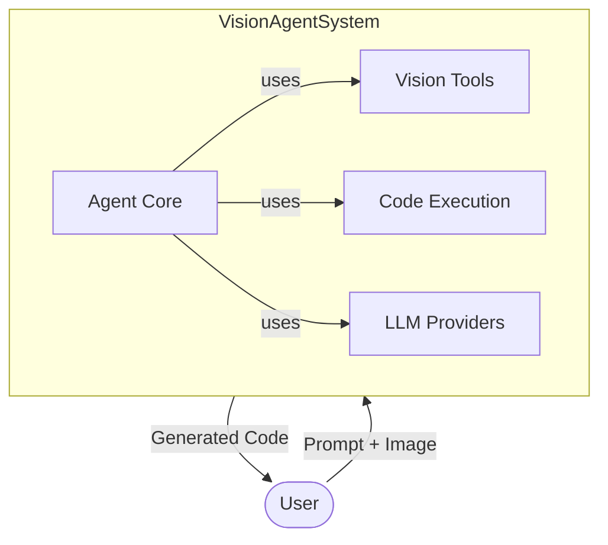
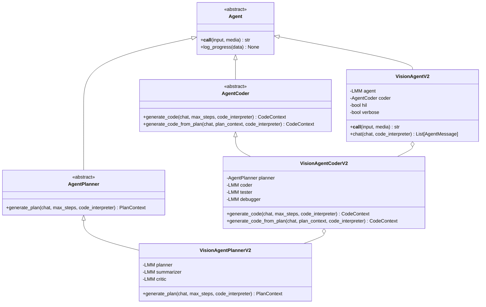
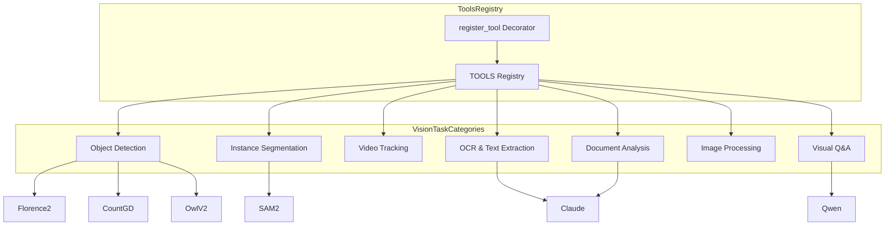
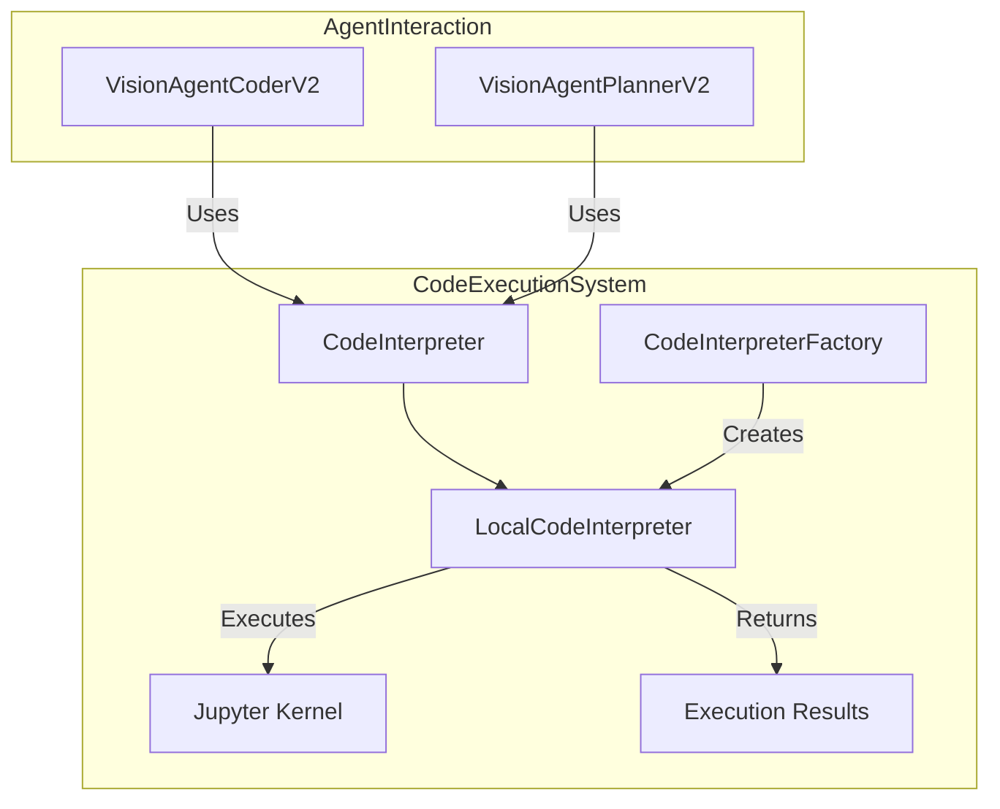
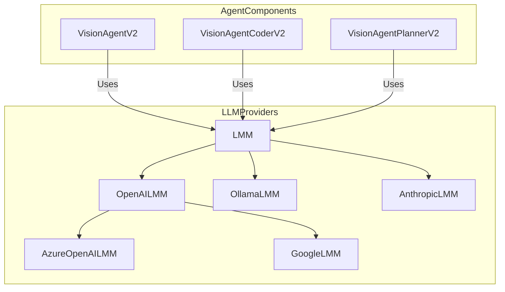
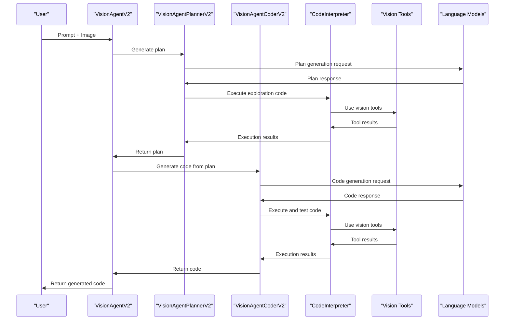

<!-- source: DeepWiki mcp.deepwiki.com · repo landing-ai/vision-agent · page 1 Overview · fetched 2026-10-27 -->

# Overview

<details>
<summary>Relevant source files</summary>

The following files were used as context for generating this wiki page:

- [README.md](README.md)
- [docs/index.md](docs/index.md)
- [vision_agent/agent/__init__.py](vision_agent/agent/__init__.py)

</details>


VisionAgent is a Visual AI Pilot from LandingAI that enables rapid development of computer vision applications. It takes a prompt and image as input, selects appropriate vision models, and generates executable code for the specified task. This document provides a high-level introduction to the VisionAgent system, its architecture, and core components.

For detailed installation instructions, see [Installation and Dependencies](#1.2). For in-depth information about specific system components, refer to the dedicated sections linked throughout this document.

Sources: [README.md:14-15]()

## System Purpose

VisionAgent is designed to bridge the gap between natural language instructions and computer vision code implementation. The system:

- Converts natural language prompts and images into executable Python code
- Automatically selects the most appropriate vision models for specific tasks
- Executes generated code to verify functionality
- Provides a range of vision capabilities through a unified interface
- Enables both code generation and direct tool usage workflows

Sources: [README.md:14-21](), [README.md:17-20]()

## High-Level Architecture

### System Components Diagram



VisionAgent consists of four primary subsystems:

1. **Agent Core**: Orchestrates the conversion of user inputs to executable code
2. **Vision Tools**: Collection of computer vision capabilities (object detection, segmentation, OCR, etc.)
3. **Code Execution**: Safely executes and tests generated code
4. **LLM Integration**: Interfaces with language models for planning, code generation, and testing

Sources: [README.md:14-21](), [vision_agent/agent/__init__.py:1-4]()

### Agent Core Architecture



The Agent Core is organized into three main components:

- **VisionAgentV2**: Main system entry point and orchestrator
- **VisionAgentCoderV2**: Handles code generation based on plans
- **VisionAgentPlannerV2**: Creates structured plans from user prompts and images

For more details on these components, see [Agent System](#2), [VisionAgentV2](#2.1), [VisionAgentCoderV2](#2.2), and [VisionAgentPlannerV2](#2.3).

Sources: [vision_agent/agent/__init__.py:1-4]()

### Vision Tools Architecture



The Vision Tools subsystem provides a comprehensive set of computer vision capabilities:

- Tools are registered in a central registry using the `register_tool` decorator
- Tools are organized by vision task categories (detection, segmentation, OCR, etc.)
- Multiple AI models power different vision capabilities
- Direct access to specific tools is provided for developers through the `vision_agent.tools` namespace

For more details on the vision tools, see [Vision Tools](#3) and [Tools Registry](#3.1).

Sources: [README.md:119-125]()

### Code Execution Architecture



The Code Execution subsystem:

- Provides a `CodeInterpreter` interface for executing generated code
- Implements execution through a Jupyter kernel via `LocalCodeInterpreter`
- Returns structured execution results (outputs, logs, errors)
- Is used by agent components to run exploratory code during planning and to test generated code

For more details on code execution, see [Code Execution System](#4).

Sources: Architecture diagrams from provided information

### LLM Integration Architecture



The LLM Integration subsystem:
- Provides a unified `LMM` interface for interacting with language models
- Supports multiple providers including Anthropic, OpenAI, Google, Azure, and Ollama
- Is used by agent components for planning, code generation, testing, and debugging
- Can be configured to use specific models through environment variables and configuration settings

For more details on LLM integration, see [LLM Integration](#2.4).

Sources: [README.md:176-211]()

## Operation Workflow



The typical workflow when using VisionAgent follows these steps:

1. **Input**: User provides a prompt and an image
2. **Planning**: VisionAgentPlannerV2 generates a structured plan using language models
3. **Exploration**: The planner executes exploratory code to analyze the image
4. **Code Generation**: VisionAgentCoderV2 generates code based on the plan
5. **Testing**: The generated code is executed and tested
6. **Output**: The final, working code is returned to the user

Sources: [README.md:106-112]()

## Usage Patterns

VisionAgent supports two primary usage patterns:

### 1. Prompting VisionAgent (Code Generation)

```python
from vision_agent.agent import VisionAgentCoderV2
from vision_agent.models import AgentMessage

agent = VisionAgentCoderV2(verbose=True)

code_context = agent.generate_code(
    [
        AgentMessage(
            role="user",
            content="Describe the image",
            media=["friends.jpg"]
        )
    ]
)

with open("generated_code.py", "w") as f:
    f.write(code_context.code + "\n" + code_context.test)
```

### 2. Direct Tool Usage

```python
import vision_agent.tools as T
import matplotlib.pyplot as plt

image = T.load_image("people.png")
dets = T.countgd_object_detection("person", image)
viz = T.overlay_bounding_boxes(image, dets)
T.save_image(viz, "people_detected.png")
```

Sources: [README.md:80-105](), [README.md:127-151]()

## Prerequisites and Requirements

VisionAgent requires:
- Python 3.9 or higher
- API keys for:
  - LandingAI (Vision Agent API key)
  - Anthropic (for Claude models)
  - Google (for Gemini models)

For detailed installation instructions, see [Installation and Dependencies](#1.2).

Sources: [README.md:26-52](), [README.md:54-57]()

---

