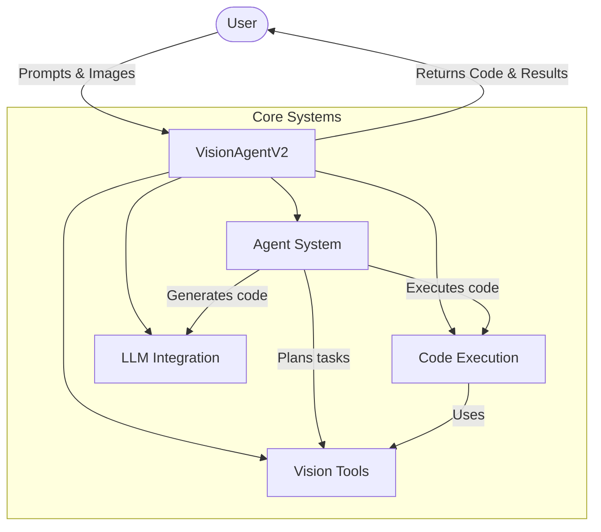
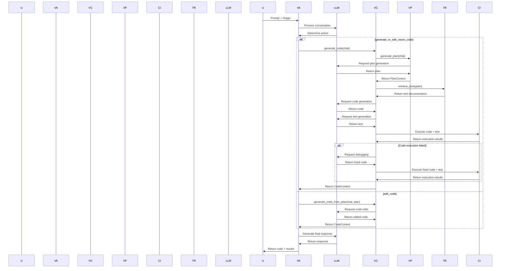
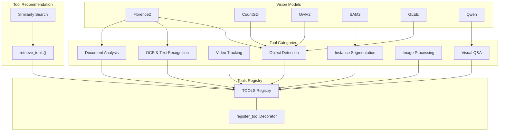
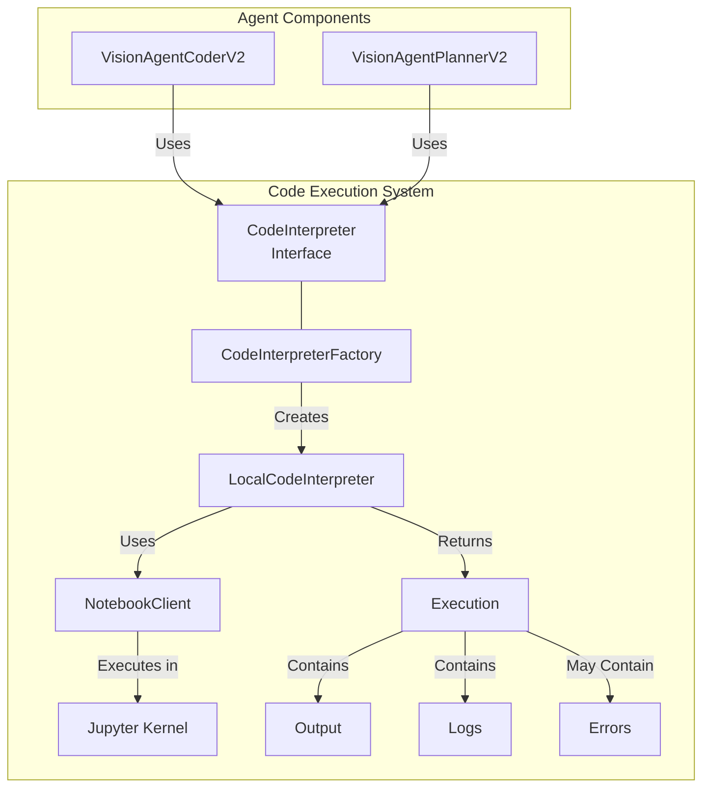
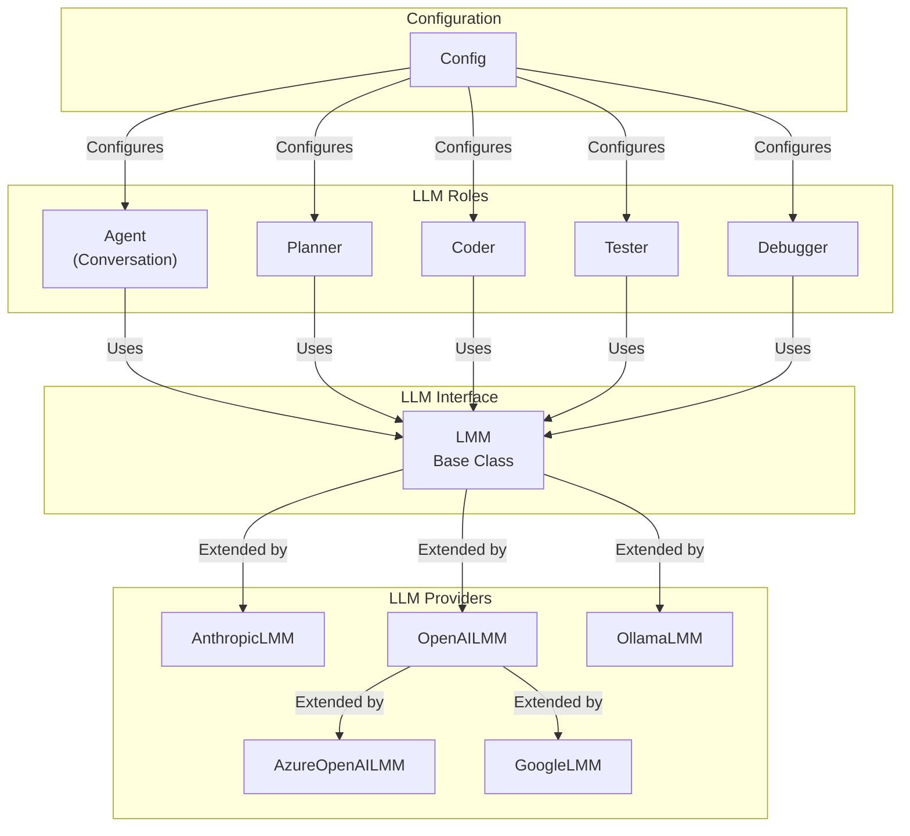
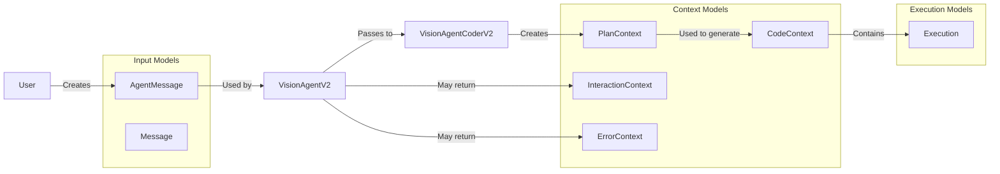
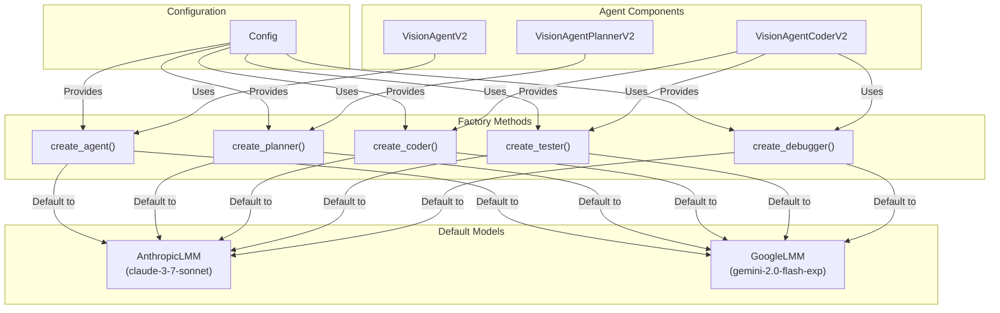

<!-- source: DeepWiki mcp.deepwiki.com · repo landing-ai/vision-agent · page 1.1 System Architecture · fetched 2026-10-27 -->

# System Architecture

<details>
<summary>Relevant source files</summary>

The following files were used as context for generating this wiki page:

- [README.md](README.md)
- [docs/index.md](docs/index.md)
- [vision_agent/agent/__init__.py](vision_agent/agent/__init__.py)
- [vision_agent/agent/vision_agent_coder_v2.py](vision_agent/agent/vision_agent_coder_v2.py)
- [vision_agent/agent/vision_agent_prompts_v2.py](vision_agent/agent/vision_agent_prompts_v2.py)
- [vision_agent/agent/vision_agent_v2.py](vision_agent/agent/vision_agent_v2.py)

</details>


This document describes the overall system architecture of the vision-agent repository, detailing how different components interact to process user inputs, generate plans, create code, and execute vision tasks. For installation instructions, see [Installation and Dependencies](#1.2). For detailed information about specific components, refer to their dedicated wiki pages in the [Agent System](#2) and [Vision Tools](#3) sections.

## Core Architecture Overview

The Vision Agent system transforms user prompts and images into functional code that utilizes various computer vision capabilities. The system consists of several interconnected subsystems working together to plan, generate, test, and debug vision-related code.



Sources: [README.md:14-16](), [vision_agent/agent/vision_agent_v2.py:159-164]()

## Agent System Components

The agent system is composed of three main components that work together to process user inputs and generate code:

```mermaid
classDiagram
    class "Agent" {
        <<abstract>>
        +__call__(input, media) str
        +log_progress(data) None
    }
    
    class "AgentCoder" {
        <<abstract>>
        +generate_code(chat, max_steps, code_interpreter) CodeContext
        +generate_code_from_plan(chat, plan_context, code_interpreter) CodeContext
    }
    
    class "AgentPlanner" {
        <<abstract>>
        +generate_plan(chat, max_steps, code_interpreter) PlanContext
    }
    
    class "VisionAgentV2" {
        -LMM agent
        -AgentCoder coder
        -bool verbose
        +__call__(input, media) str
        +chat(chat, code_interpreter) List[AgentMessage]
    }
    
    class "VisionAgentCoderV2" {
        -AgentPlanner planner
        -LMM coder
        -LMM tester
        -LMM debugger
        -Sim tool_recommender
        +generate_code(chat, max_steps, code_interpreter) CodeContext
        +generate_code_from_plan(chat, plan_context, code_interpreter) CodeContext
    }
    
    class "VisionAgentPlannerV2" {
        -LMM planner
        -LMM summarizer
        -LMM critic
        +generate_plan(chat, max_steps, code_interpreter) PlanContext
    }
    
    Agent <|-- VisionAgentV2
    Agent <|-- AgentCoder
    Agent <|-- AgentPlanner
    AgentCoder <|-- VisionAgentCoderV2
    AgentPlanner <|-- VisionAgentPlannerV2
    
    VisionAgentV2 o-- VisionAgentCoderV2
    VisionAgentCoderV2 o-- VisionAgentPlannerV2
```

Sources: [vision_agent/agent/__init__.py:1-4](), [vision_agent/agent/vision_agent_v2.py:159-205](), [vision_agent/agent/vision_agent_coder_v2.py:291-347]()

### VisionAgentV2

The `VisionAgentV2` class serves as the primary entry point for the system. It manages user interactions, orchestrates the overall process, and delegates code generation to `VisionAgentCoderV2`. This component:

1. Receives user input (prompts and images)
2. Processes the conversation
3. Determines which action to take (generate code, edit code)
4. Returns results to the user

```python
def __init__(self, agent=None, coder=None, hil=False, verbose=False, 
             code_sandbox_runtime=None, update_callback=lambda x: None)
```

Key methods:
- `__call__(input, media)`: Main interface that accepts user inputs
- `chat(chat, code_interpreter)`: Processes conversation and returns responses
- `extract_conversation(chat)`: Extracts relevant messages from conversation history
- `run_conversation(agent, chat)`: Generates agent responses to user queries

Sources: [vision_agent/agent/vision_agent_v2.py:159-227](), [vision_agent/agent/vision_agent_v2.py:228-292]()

### VisionAgentCoderV2

The `VisionAgentCoderV2` class is responsible for code generation. It works with `VisionAgentPlannerV2` to plan tasks and then generates, tests, and debugs code. This component:

1. Requests plans from `VisionAgentPlannerV2`
2. Recommends tools based on the plan
3. Generates code using the recommended tools
4. Tests and debugs the generated code
5. Returns the final code and execution results

```python
def __init__(self, planner=None, coder=None, tester=None, debugger=None,
             tool_recommender=None, hil=False, verbose=False,
             code_sandbox_runtime=None, update_callback=lambda _: None)
```

Key methods:
- `generate_code(chat, max_steps, code_interpreter)`: Generates code from user inputs
- `generate_code_from_plan(chat, plan_context, code_interpreter)`: Generates code from a previously created plan

Sources: [vision_agent/agent/vision_agent_coder_v2.py:291-376](), [vision_agent/agent/vision_agent_coder_v2.py:377-506]()

### VisionAgentPlannerV2

The `VisionAgentPlannerV2` class (detailed further in [VisionAgentPlannerV2](#2.3)) creates plans for code generation based on user inputs. It:

1. Analyzes user queries and available media
2. Creates a structured plan for solving the task
3. Returns a `PlanContext` with task instructions

Sources: [vision_agent/agent/__init__.py:3]()

## Request Processing Flow

The following sequence diagram illustrates how user requests flow through the system:



Sources: [vision_agent/agent/vision_agent_v2.py:229-292](), [vision_agent/agent/vision_agent_coder_v2.py:377-422](), [vision_agent/agent/vision_agent_v2.py:100-156]()

## Vision Tools System

The Vision Tools system provides the computer vision capabilities that the generated code can utilize:



The tool selection process is guided by the `retrieve_tools` function, which uses similarity search to match user requirements with the most appropriate tools. For more details on available tools, see [Vision Tools](#3).

Sources: [README.md:118-147](), [vision_agent/agent/vision_agent_coder_v2.py:51-61]()

## Code Execution System

The Code Execution system safely runs the generated code in an isolated environment:



The `CodeInterpreter` interface provides a common API for executing code, while the `LocalCodeInterpreter` implementation uses Jupyter's notebook client to run the code in a controlled environment. For more details on code execution, see [Code Execution System](#4).

Sources: [vision_agent/agent/vision_agent_coder_v2.py:253-258](), [vision_agent/agent/vision_agent_v2.py:254-258]()

## LLM Integration

Vision Agent integrates with multiple Language Model providers to power its functionality:



The system uses different LLM providers for different roles within the system, which can be configured through the `Config` class. For more details on LLM integration, see [LLM Integration](#2.4).

Sources: [README.md:176-210](), [vision_agent/agent/vision_agent_coder_v2.py:334-336](), [vision_agent/agent/vision_agent_v2.py:189-190]()

## Data Models and Message Flow

Vision Agent uses several data models to structure information as it flows through the system:



Key data models:
- `AgentMessage`: Represents messages in the conversation
- `PlanContext`: Contains planning information
- `CodeContext`: Contains generated code and test results
- `InteractionContext`: Used for user interactions
- `ErrorContext`: Contains error information
- `Execution`: Contains execution results and logs

Sources: [vision_agent/agent/vision_agent_coder_v2.py:45-48](), [vision_agent/agent/vision_agent_v2.py:11-18]()

## Configuration System

The configuration system allows customizing which LLM providers are used for different roles:



The default configuration uses Anthropic Claude 3.7 Sonnet and Gemini 2.0 Flash Experimental models, but this can be customized.

Sources: [README.md:176-210](), [vision_agent/agent/vision_agent_v2.py:27](), [vision_agent/agent/vision_agent_coder_v2.py:41]()

## Summary

The Vision Agent architecture is designed with several key principles:

1. **Modularity**: Clear separation between planning, code generation, and execution
2. **Extensibility**: Easy to add new vision tools and LLM providers
3. **Safety**: Isolated code execution environment
4. **Customization**: Configurable LLM providers for different roles

This architecture enables Vision Agent to effectively translate natural language prompts and images into executable code that leverages state-of-the-art vision models.

Sources: [README.md:14-19]()

---

