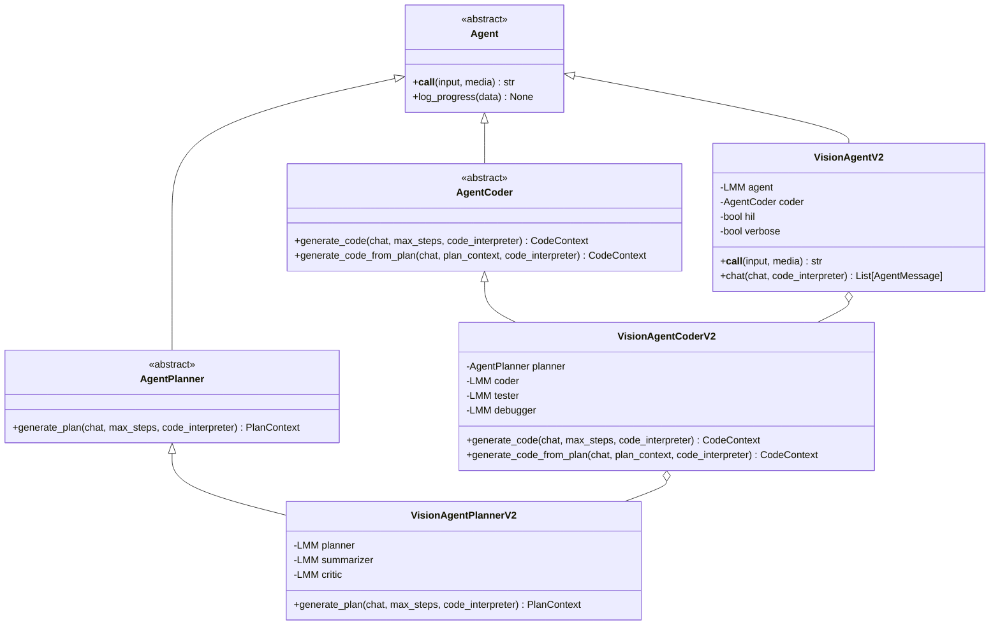
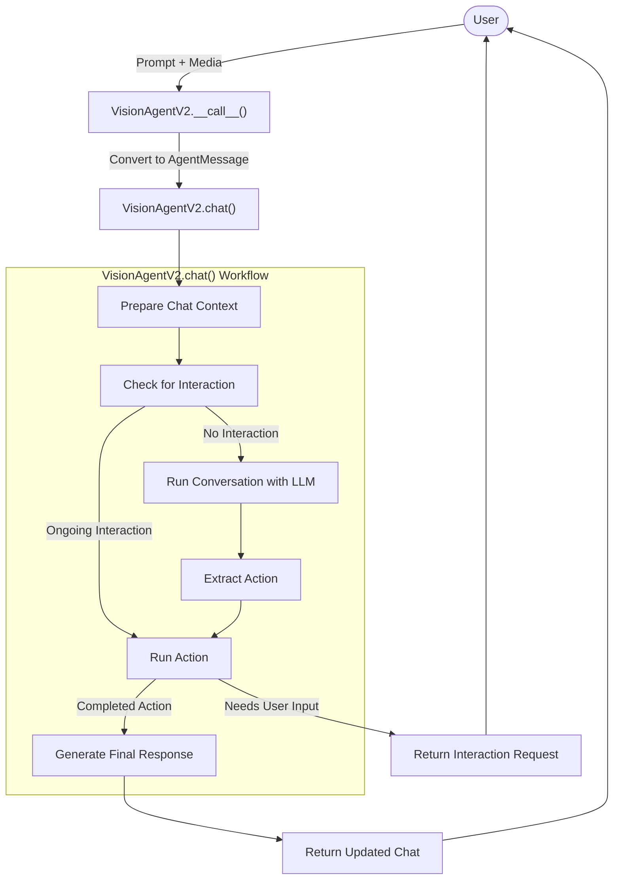
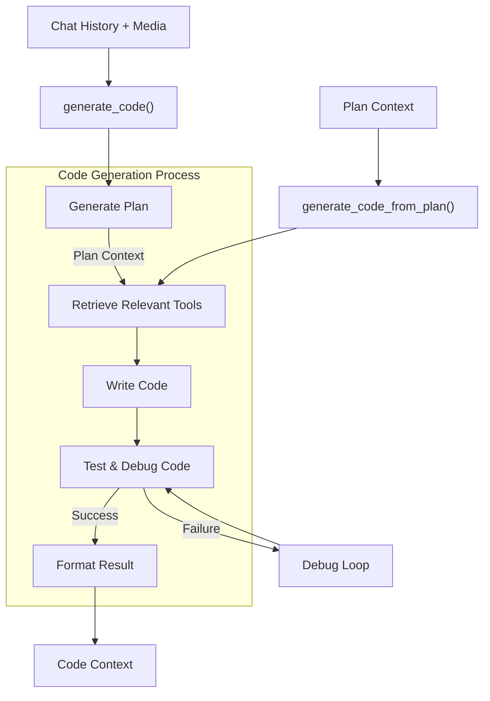
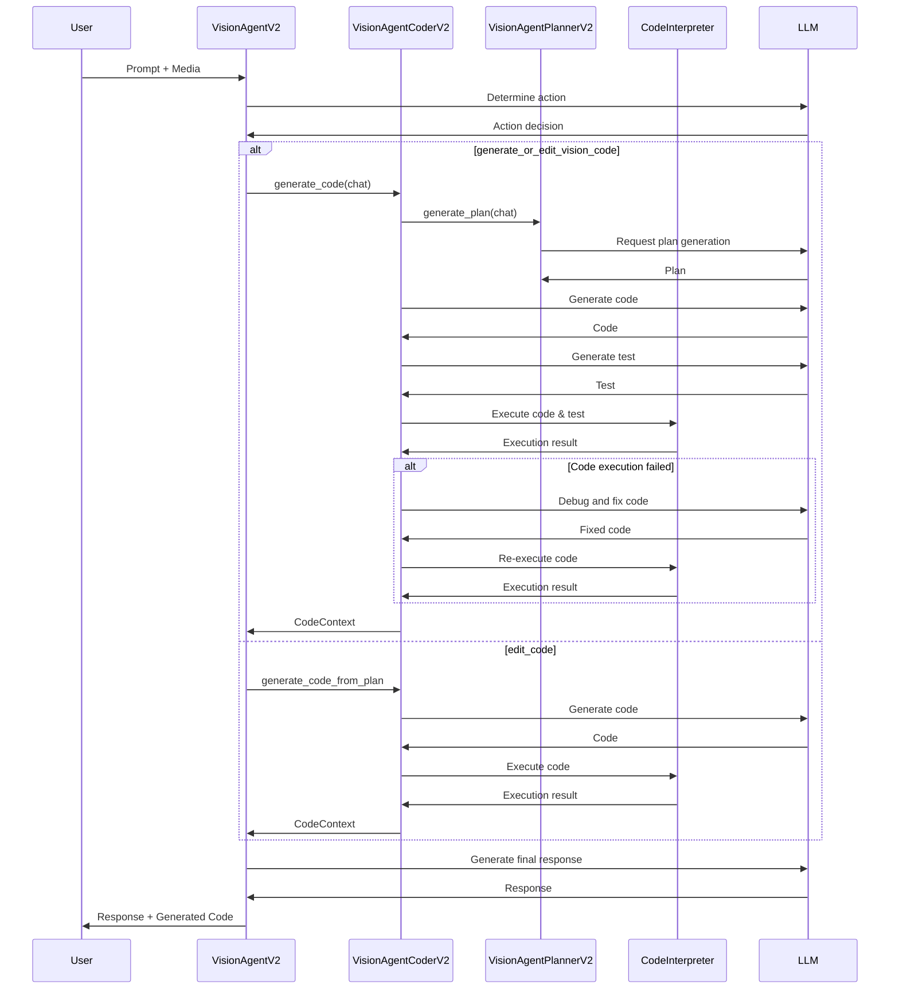
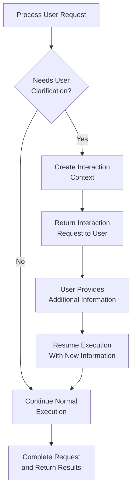
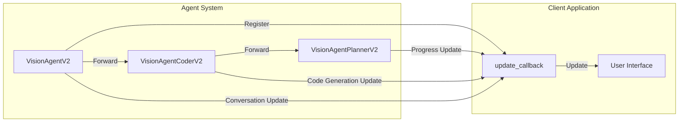
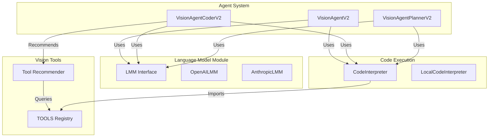

<!-- source: DeepWiki mcp.deepwiki.com · repo landing-ai/vision-agent · page 2 Agent System · fetched 2026-10-27 -->

# Agent System

Relevant source files

The following files were used as context for generating this wiki page:

- [examples/chat/app.py](examples/chat/app.py)
- [vision_agent/agent/__init__.py](vision_agent/agent/__init__.py)
- [vision_agent/agent/agent.py](vision_agent/agent/agent.py)
- [vision_agent/agent/vision_agent_coder_v2.py](vision_agent/agent/vision_agent_coder_v2.py)
- [vision_agent/agent/vision_agent_prompts_v2.py](vision_agent/agent/vision_agent_prompts_v2.py)
- [vision_agent/agent/vision_agent_v2.py](vision_agent/agent/vision_agent_v2.py)

The Agent System is the core orchestration layer of the vision-agent framework. It manages the interaction between users, language models, code generation, and vision tools to create solutions for computer vision tasks. This document explains the architecture and components of the agent system, how they interact, and the workflow from user input to generated code execution.

For information on the available vision tools, see [Vision Tools](#3). For details on code execution, see [Code Execution System](#4).

## Architecture Overview

The Agent System is built around abstract base classes that define the core interfaces, with concrete implementations that provide the actual functionality. 

**Sources:**
- [vision_agent/agent/agent.py:16-61]()
- [vision_agent/agent/__init__.py:1-4]()
- [vision_agent/agent/vision_agent_v2.py:159-296]()
- [vision_agent/agent/vision_agent_coder_v2.py:291-509]()

## Core Components

### Agent Base Classes

The agent system is built on three key abstract base classes:

1. **Agent**: The root interface for all agents, defining the core method `__call__` for processing input.

2. **AgentCoder**: Extends Agent with code generation capabilities, defining methods for generating code from chat history or from a plan.

3. **AgentPlanner**: Extends Agent with planning capabilities, defining methods for generating execution plans.

Each of these abstract classes defines the interface contract that concrete implementations must adhere to.

**Sources:**
- [vision_agent/agent/agent.py:16-61]()

### VisionAgentV2

The `VisionAgentV2` class is the main entry point for user interaction with the system. It orchestrates the code generation process by:

1. Processing user input (text + images/videos)
2. Delegating to specialized components for planning and code generation
3. Managing the conversation flow
4. Executing generated code and returning results

Key functionalities:
- Manages the conversation state
- Processes user messages and media
- Delegates to the coder agent for code generation
- Supports human-in-the-loop interaction when clarification is needed
- Uses callbacks to provide real-time updates during code generation

**Sources:**
- [vision_agent/agent/vision_agent_v2.py:159-296]()
- [vision_agent/agent/vision_agent_prompts_v2.py:1-86]()

### VisionAgentCoderV2

The `VisionAgentCoderV2` class is responsible for generating, testing, and debugging vision code. It:

1. Uses a planner to generate a plan for solving the vision task
2. Generates code based on the plan
3. Tests the generated code using a code interpreter
4. Debugs and fixes code when there are issues

Key functionalities:
- Plan generation delegation to VisionAgentPlannerV2
- Tool recommendation and retrieval
- Code generation with language models
- Test generation and execution
- Automated debugging and fixing

**Sources:**
- [vision_agent/agent/vision_agent_coder_v2.py:291-509]()
- [vision_agent/agent/vision_agent_coder_v2.py:45-289]()

## Interaction and Execution Flow

The agent system processes requests through a series of well-defined steps:

This sequence shows how the different components interact to process a user request, generate code, test it, and return the result.

**Sources:**
- [vision_agent/agent/vision_agent_v2.py:229-291]()
- [vision_agent/agent/vision_agent_coder_v2.py:377-422]()
- [vision_agent/agent/vision_agent_coder_v2.py:424-506]()

## Human-in-the-Loop Interaction

The agent system supports human-in-the-loop (HIL) interactions, where the agent can pause execution to request additional input from the user.

This interaction model allows the agent to:
1. Identify when it needs additional information
2. Formulate specific questions for the user
3. Pause execution while waiting for a response
4. Resume execution with the new information

The HIL mode is enabled through the `hil` parameter in the agent constructors and is especially useful for complex vision tasks where the agent might need clarification about the user's intent.

**Sources:**
- [vision_agent/agent/vision_agent_v2.py:165-187]()
- [vision_agent/agent/vision_agent_v2.py:92-97]()
- [vision_agent/agent/vision_agent_coder_v2.py:294-324]()
- [examples/chat/app.py:48-61]()

## Code Structure and Key Methods

The Agent System's functionality is distributed across several key methods:

| Class | Method | Purpose |
|-------|--------|---------|
| VisionAgentV2 | __call__() | Entry point for processing string input and media |
| VisionAgentV2 | chat() | Main processing method for conversational interaction |
| VisionAgentCoderV2 | generate_code() | Generate code from chat history, including planning |
| VisionAgentCoderV2 | generate_code_from_plan() | Generate code from a predefined plan |
| - | write_code() | Function to generate initial code using LLM |
| - | write_test() | Function to generate test code using LLM |
| - | test_code() | Function to test and debug code until it works |
| - | debug_code() | Function to fix issues found during testing |

These methods form the backbone of the agent system's functionality and represent the key processing steps in the workflow.

**Sources:**
- [vision_agent/agent/vision_agent_v2.py:206-227]()
- [vision_agent/agent/vision_agent_v2.py:229-291]()
- [vision_agent/agent/vision_agent_coder_v2.py:377-422]()
- [vision_agent/agent/vision_agent_coder_v2.py:424-506]()
- [vision_agent/agent/vision_agent_coder_v2.py:64-86]()
- [vision_agent/agent/vision_agent_coder_v2.py:89-113]()
- [vision_agent/agent/vision_agent_coder_v2.py:195-258]()
- [vision_agent/agent/vision_agent_coder_v2.py:116-192]()

## Communication and Callback Mechanism

The agent system uses a callback mechanism to provide real-time updates during code generation and execution. This is especially useful for web applications or UIs that need to show progress to the user.

The update_callback function is:
1. Initialized in the VisionAgentV2 constructor
2. Passed to the constituent components
3. Called at various stages with progress updates
4. Used to update UIs or log progress

In the example chat application, this callback mechanism is used to send WebSocket updates to connected clients, providing a real-time view of the agent's progress.

**Sources:**
- [vision_agent/agent/vision_agent_v2.py:165-187]()
- [vision_agent/agent/vision_agent_v2.py:294-295]()
- [vision_agent/agent/vision_agent_coder_v2.py:294-324]()
- [vision_agent/agent/vision_agent_coder_v2.py:493-505]()
- [examples/chat/app.py:33-45]()

## Integration with Other Components

The Agent System integrates with several other components of the vision-agent framework:

Key integration points:
1. **Language Models**: Used for planning, code generation, testing, and debugging
2. **Code Interpreter**: Used to safely execute and test generated code
3. **Tool Recommender**: Used to find relevant vision tools for a given task
4. **Tools Registry**: Provides access to the vision tools used in generated code

These integrations allow the Agent System to leverage specialized components while maintaining a clean separation of concerns.

**Sources:**
- [vision_agent/agent/vision_agent_v2.py:165-187]()
- [vision_agent/agent/vision_agent_coder_v2.py:294-324]()
- [vision_agent/agent/vision_agent_coder_v2.py:51-61]()
- [vision_agent/agent/vision_agent_v2.py:254-258]()

---

