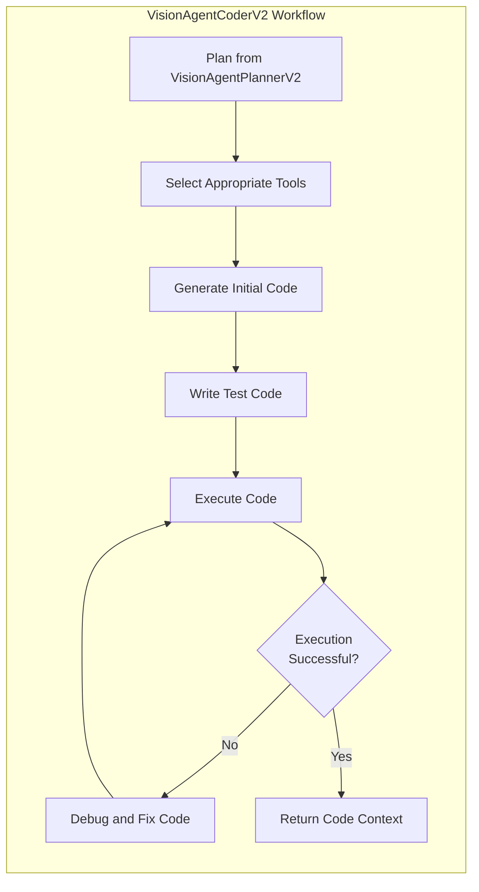
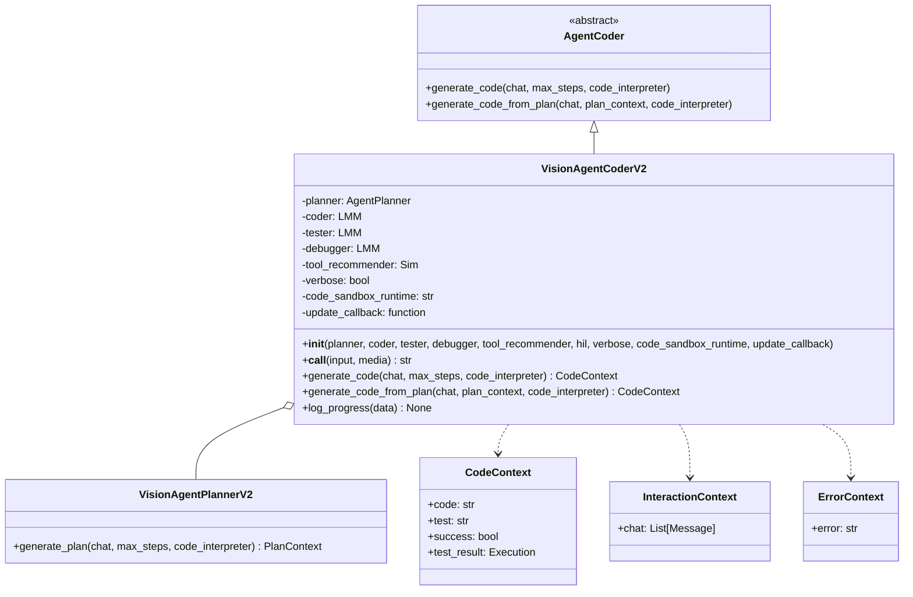
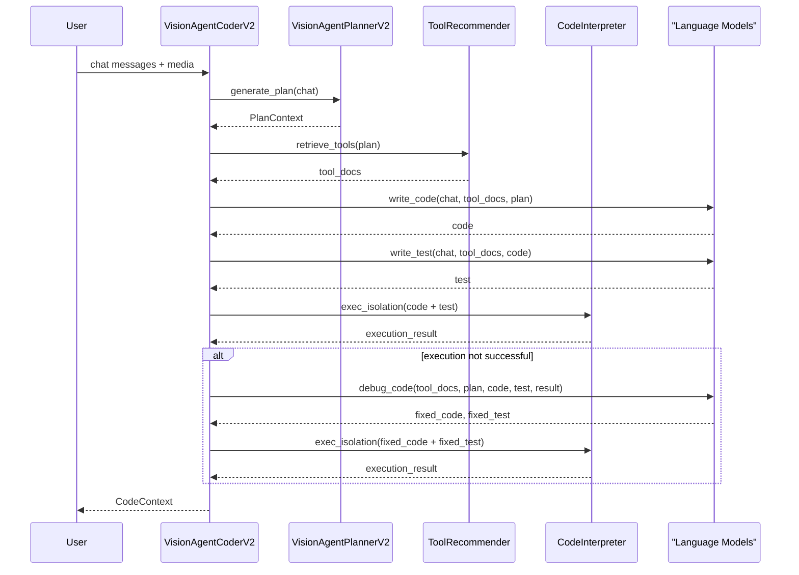
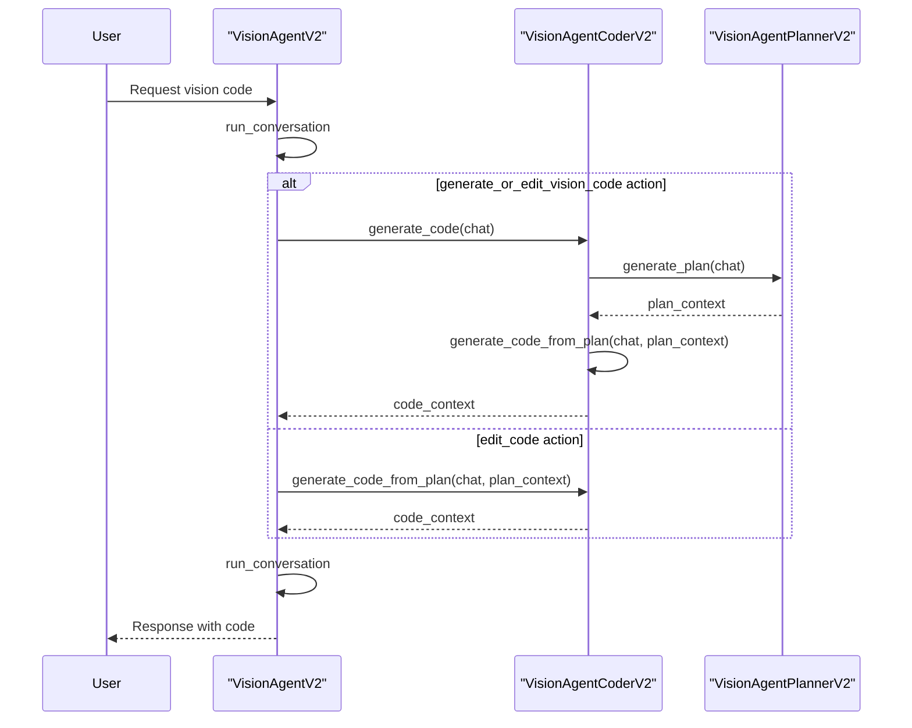

<!-- source: DeepWiki mcp.deepwiki.com · repo landing-ai/vision-agent · page 2.2 VisionAgentCoderV2 · fetched 2026-10-27 -->

# VisionAgentCoderV2

<details>
<summary>Relevant source files</summary>

The following files were used as context for generating this wiki page:

- [vision_agent/agent/vision_agent_coder_prompts_v2.py](vision_agent/agent/vision_agent_coder_prompts_v2.py)
- [vision_agent/agent/vision_agent_coder_v2.py](vision_agent/agent/vision_agent_coder_v2.py)
- [vision_agent/agent/vision_agent_planner_prompts_v2.py](vision_agent/agent/vision_agent_planner_prompts_v2.py)
- [vision_agent/agent/vision_agent_prompts_v2.py](vision_agent/agent/vision_agent_prompts_v2.py)
- [vision_agent/agent/vision_agent_v2.py](vision_agent/agent/vision_agent_v2.py)

</details>


VisionAgentCoderV2 is a specialized agent component responsible for generating, testing, and debugging computer vision code based on user requests and plans. It serves as the code generation engine within the Vision Agent system, working closely with the VisionAgentPlannerV2 to transform high-level plans into executable Python code that leverages various vision tools.

For information about the overall agent architecture, see [System Architecture](#1.1). For details about the main agent interface, see [VisionAgentV2](#2.1). For information about the planning component, see [VisionAgentPlannerV2](#2.3).

## Overview

VisionAgentCoderV2 implements the abstract `AgentCoder` interface and provides a complete workflow for generating functional computer vision code. It follows a multi-stage process:

1. Receiving a task plan from VisionAgentPlannerV2
2. Selecting appropriate vision tools based on the plan
3. Generating initial code using LLMs
4. Writing test code to verify the implementation
5. Executing and testing the code
6. Debugging and fixing any issues
7. Delivering the final, working code

The agent uses multiple language models for different stages (code generation, testing, debugging) and incorporates a feedback loop to iteratively improve the code until it successfully executes.



Sources: [vision_agent/agent/vision_agent_coder_v2.py:291-507]()

## Class Architecture

VisionAgentCoderV2 inherits from the abstract `AgentCoder` class and collaborates with several other components to perform its function.



Sources: [vision_agent/agent/vision_agent_coder_v2.py:291-350]()

## Initialization and Components

VisionAgentCoderV2 is constructed with several key components that enable its code generation capabilities:

```python
def __init__(
    self,
    planner: Optional[AgentPlanner] = None,
    coder: Optional[LMM] = None,
    tester: Optional[LMM] = None,
    debugger: Optional[LMM] = None,
    tool_recommender: Optional[Union[str, Sim]] = None,
    hil: bool = False,
    verbose: bool = False,
    code_sandbox_runtime: Optional[str] = None,
    update_callback: Callable[[Dict[str, Any]], None] = lambda _: None,
) -> None:
```

### Key Components:

1. **Planner**: An `AgentPlanner` instance (typically `VisionAgentPlannerV2`) responsible for generating plans from user requests.

2. **Language Models**: Three separate LMMs are used for different aspects of code generation:
   - `coder`: Generates the initial code implementation
   - `tester`: Creates test code to verify functionality
   - `debugger`: Analyzes and fixes errors in the code

3. **Tool Recommender**: A similarity search system that recommends appropriate vision tools based on the tasks in the plan.

4. **Code Interpreter**: Executes the generated code in a safe environment, providing execution results for testing and debugging.

5. **Update Callback**: A function for sending back progress updates and intermediate results during the code generation process.

Sources: [vision_agent/agent/vision_agent_coder_v2.py:294-350]()

## Code Generation Process

The core functionality of VisionAgentCoderV2 is implemented through two main methods:

### generate_code

This method takes a conversation history, generates a plan using the planner, and then creates code based on the generated plan:



Sources: [vision_agent/agent/vision_agent_coder_v2.py:377-422]()

### generate_code_from_plan

This method is similar to `generate_code` but takes a pre-existing plan, allowing the code generation process to skip the planning phase:

```python
def generate_code_from_plan(
    self,
    chat: List[AgentMessage],
    plan_context: PlanContext,
    code_interpreter: Optional[CodeInterpreter] = None,
) -> CodeContext:
```

This is particularly useful when the user provides feedback on an initial solution and wants to modify the code without regenerating the plan.

Sources: [vision_agent/agent/vision_agent_coder_v2.py:424-506]()

## Tool Selection and Code Generation

### Tool Recommendation

VisionAgentCoderV2 uses a similarity search system to recommend appropriate vision tools based on the tasks in the plan:

```python
def retrieve_tools(
    plan: List[str],
    tool_recommender: Sim,
) -> str:
    tool_docs = []
    for inst in plan:
        tools = tool_recommender.top_k(inst, k=1, thresh=0.3)
        tool_docs.extend([e["doc"] for e in tools])

    tool_docs_str = "\n\n".join(set(tool_docs))
    return tool_docs_str
```

The recommended tools are provided as documentation to the language models for use in code generation.

Sources: [vision_agent/agent/vision_agent_coder_v2.py:51-61]()

### Code Writing

The `write_code` function uses a specialized language model to generate code based on the plan and tool documentation:

```python
def write_code(
    coder: LMM,
    chat: List[AgentMessage],
    tool_docs: str,
    plan: str,
) -> str:
```

It formats a prompt using the `CODE` template and sends it to the coder LMM, which generates Python code implementing the plan using the recommended tools.

Sources: [vision_agent/agent/vision_agent_coder_v2.py:64-86]()

## Testing and Debugging

A key strength of VisionAgentCoderV2 is its ability to test and debug the generated code.

### Test Generation

The `write_test` function creates test code to verify the functionality of the generated solution:

```python
def write_test(
    tester: LMM,
    chat: List[AgentMessage],
    tool_util_docs: str,
    code: str,
    media_list: Optional[Sequence[Union[str, Path]]] = None,
) -> str:
```

This test code is designed to validate that the solution works with the provided media files and produces the expected output.

Sources: [vision_agent/agent/vision_agent_coder_v2.py:89-113]()

### Code Execution and Debugging

The `test_code` function executes the generated code and tests, and if there are issues, uses the `debug_code` function to fix them:

```python
def test_code(
    tester: LMM,
    debugger: LMM,
    chat: List[AgentMessage],
    plan: str,
    code: str,
    tool_docs: str,
    code_interpreter: CodeInterpreter,
    media_list: List[Union[str, Path]],
    verbose: bool,
) -> CodeContext:
```

The debugging process is iterative, with up to three rounds of fixing and retesting to produce working code.

Sources: [vision_agent/agent/vision_agent_coder_v2.py:195-258]()

## Output Format

The final output of VisionAgentCoderV2 is a `CodeContext` object that contains:

```python
return CodeContext(
    code=f"{DefaultImports.to_code_string()}\n{code}",
    test=f"{DefaultImports.to_code_string()}\n{test}",
    success=result.success,
    test_result=result,
)
```

This is formatted into a user-friendly format using the `format_code_context` function:

```python
def format_code_context(
    code_context: CodeContext,
) -> str:
    return f"<final_code>{code_context.code}</final_code>\n<final_test>{code_context.test}</final_test>"
```

Sources: [vision_agent/agent/vision_agent_coder_v2.py:45-48](), [vision_agent/agent/vision_agent_coder_v2.py:253-258]()

## Integration with VisionAgentV2

VisionAgentCoderV2 is primarily used by VisionAgentV2, which provides a user-friendly interface for generating vision code:



Sources: [vision_agent/agent/vision_agent_v2.py:159-296]()

## Prompts and Templates

VisionAgentCoderV2 uses specific prompt templates for different stages of the code generation process:

1. **CODE**: Used by the coder LMM to generate the initial code implementation
2. **TEST**: Used by the tester LMM to create test code
3. **FIX_BUG**: Used by the debugger LMM to fix errors in the code

These prompts define the role, task, and expected output format for each stage, and are imported from `vision_agent.agent.vision_agent_coder_prompts_v2`.

Sources: [vision_agent/agent/vision_agent_coder_prompts_v2.py:1-119]()

## API Reference

### Main Methods

| Method | Purpose | Parameters | Return Type |
|--------|---------|------------|-------------|
| `__init__` | Initialize the VisionAgentCoderV2 | planner, coder, tester, debugger, tool_recommender, hil, verbose, code_sandbox_runtime, update_callback | None |
| `__call__` | Generate code from a conversation | input (str or List[Message]), media (Optional[str or Path]) | str |
| `generate_code` | Generate code from a conversation | chat (List[AgentMessage]), max_steps (Optional[int]), code_interpreter (Optional[CodeInterpreter]) | Union[CodeContext, InteractionContext, ErrorContext] |
| `generate_code_from_plan` | Generate code from a plan | chat (List[AgentMessage]), plan_context (PlanContext), code_interpreter (Optional[CodeInterpreter]) | CodeContext |
| `log_progress` | Log progress information | data (Dict[str, Any]) | None |

Sources: [vision_agent/agent/vision_agent_coder_v2.py:294-508]()

### Support Functions

| Function | Purpose | Parameters | Return Type |
|----------|---------|------------|-------------|
| `format_code_context` | Format code context for display | code_context (CodeContext) | str |
| `retrieve_tools` | Get tool documentation for a plan | plan (List[str]), tool_recommender (Sim) | str |
| `write_code` | Generate initial code | coder (LMM), chat (List[AgentMessage]), tool_docs (str), plan (str) | str |
| `write_test` | Generate test code | tester (LMM), chat (List[AgentMessage]), tool_util_docs (str), code (str), media_list (Optional[Sequence[Union[str, Path]]]) | str |
| `debug_code` | Debug and fix code | debugger (LMM), tool_docs (str), plan (str), code (str), test (str), result (Execution), debug_info (str), verbose (bool) | tuple[str, str, str] |
| `test_code` | Test generated code | tester (LMM), debugger (LMM), chat (List[AgentMessage]), plan (str), code (str), tool_docs (str), code_interpreter (CodeInterpreter), media_list (List[Union[str, Path]]), verbose (bool) | CodeContext |
| `write_and_test_code` | Write and test code | coder (LMM), tester (LMM), debugger (LMM), chat (List[AgentMessage]), plan (str), tool_docs (str), code_interpreter (CodeInterpreter), media_list (List[Union[str, Path]]), verbose (bool) | CodeContext |

Sources: [vision_agent/agent/vision_agent_coder_v2.py:45-289]()

---

