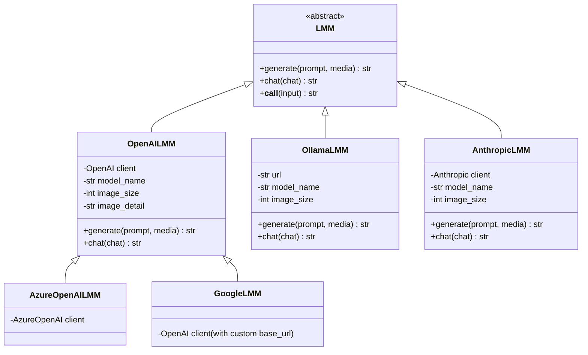
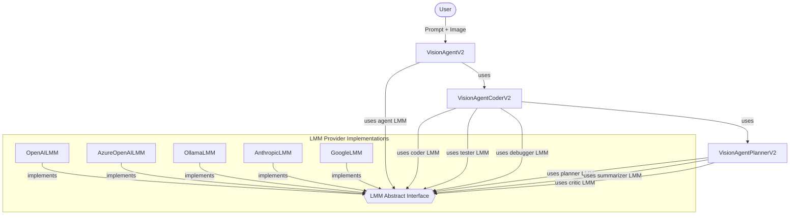
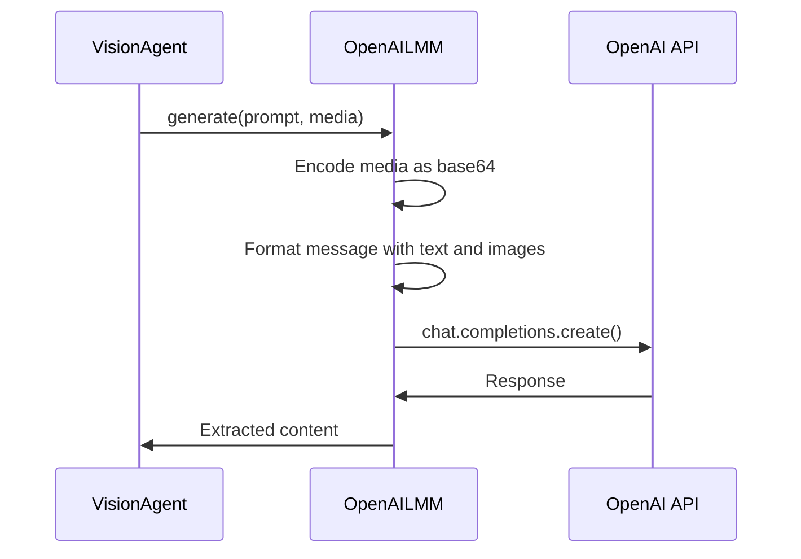
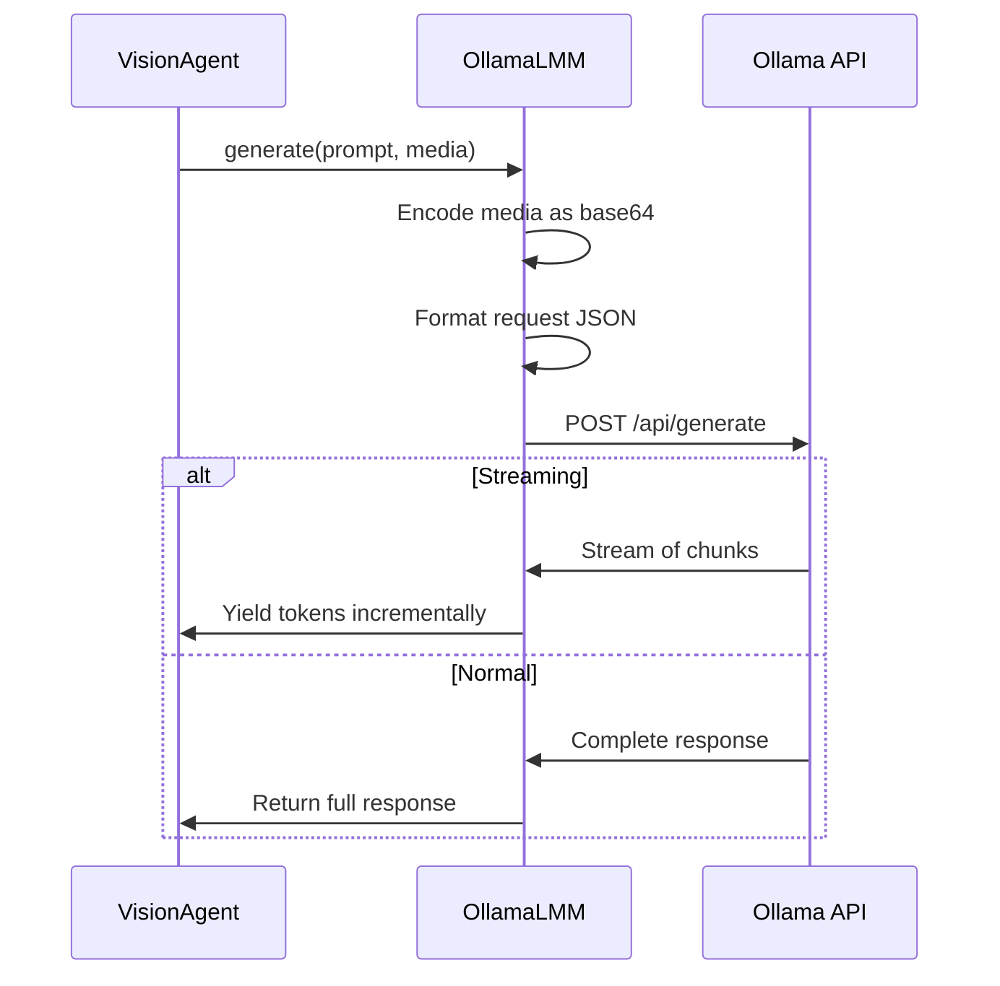
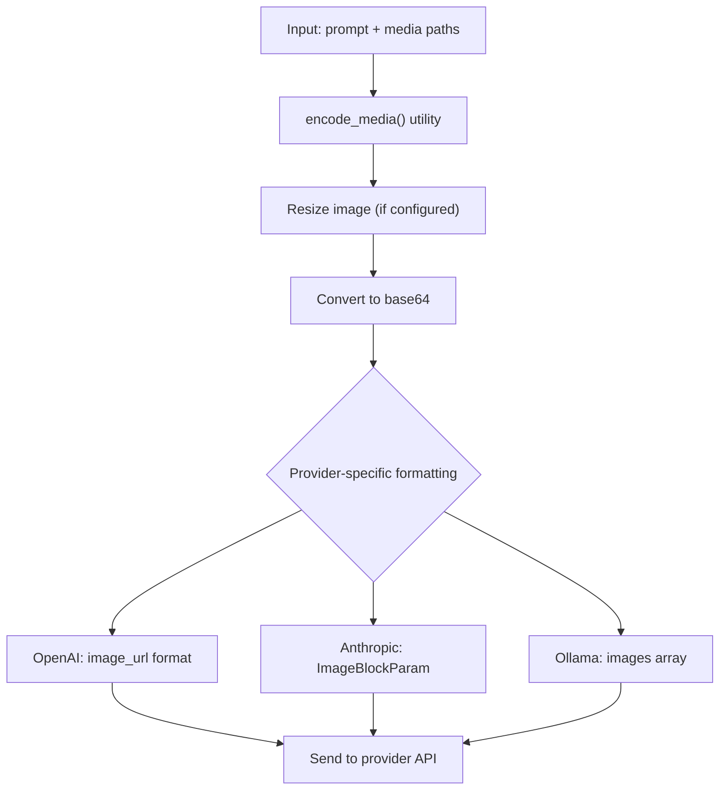

<!-- source: DeepWiki mcp.deepwiki.com · repo landing-ai/vision-agent · page 2.4 LLM Integration · fetched 2026-10-27 -->

# LLM Integration

<details>
<summary>Relevant source files</summary>

The following files were used as context for generating this wiki page:

- [docs/api/lmm.md](docs/api/lmm.md)
- [docs/api/tools.md](docs/api/tools.md)
- [vision_agent/lmm/__init__.py](vision_agent/lmm/__init__.py)
- [vision_agent/lmm/lmm.py](vision_agent/lmm/lmm.py)

</details>


This document explains how the vision-agent system integrates with different Large Language Model (LLM) providers through a unified abstraction layer. The LMM (Language Model Manager) classes provide a consistent interface for accessing various LLM providers while handling the specifics of each provider's API, image encoding, and response formatting.

For information about how these LLM components are used within the agent system, see [Agent System](#2).

## Architecture Overview

The LLM integration follows an object-oriented design with a base abstract class (`LMM`) that defines the interface and multiple concrete implementations for different providers. This architecture allows the vision-agent to work with different LLM backends while maintaining a consistent API.

### LMM Class Hierarchy



Sources: [vision_agent/lmm/lmm.py:16-40](), [vision_agent/lmm/lmm.py:43-195](), [vision_agent/lmm/lmm.py:198-236](), [vision_agent/lmm/lmm.py:239-386](), [vision_agent/lmm/lmm.py:389-516](), [vision_agent/lmm/lmm.py:519-543]()

### LMM Integration with Vision Agent Components



Sources: [vision_agent/lmm/lmm.py:16-40](), [vision_agent/lmm/__init__.py:1-2]()

## Core Interface

The LMM abstract base class defines the interface that all LLM provider implementations must follow. It provides three key methods that form the core API:

### LMM Abstract Methods

| Method | Signature | Description |
|--------|-----------|-------------|
| `generate` | `generate(prompt, media=None, **kwargs)` | Generates a response from a prompt with optional media attachments |
| `chat` | `chat(chat, **kwargs)` | Generates a response from a conversation history |
| `__call__` | `__call__(input, **kwargs)` | Unified interface that routes to either generate or chat based on input type |

Each method can return either a string response or an iterator for streaming responses.

Sources: [vision_agent/lmm/lmm.py:16-40]()

## Provider Implementations

The vision-agent system includes implementations for multiple LLM providers with varying capabilities.

### Provider Comparison

| Provider | Class | Models | Image Support | Streaming | JSON Mode |
|----------|-------|--------|---------------|-----------|-----------|
| OpenAI | `OpenAILMM` | GPT-4o, etc. | Yes | Yes | Yes |
| Azure OpenAI | `AzureOpenAILMM` | Azure-hosted models | Yes | Yes | Yes |
| Ollama | `OllamaLMM` | Locally-hosted models | Yes | Yes | Yes |
| Anthropic | `AnthropicLMM` | Claude models | Yes | Yes | No |
| Google | `GoogleLMM` | Gemini models | Yes | Yes | Yes |

Sources: [vision_agent/lmm/lmm.py:43-543](), [vision_agent/lmm/__init__.py:1-2]()

### OpenAILMM

The `OpenAILMM` class provides integration with OpenAI's models including GPT-4o. It handles image encoding, request formatting, and response parsing specific to OpenAI's API.

Key features:
- Supports image inputs with customizable size and detail level
- Handles response streaming
- Supports JSON mode for structured output
- Model-specific parameter handling (e.g., o1/o3 models)



Sources: [vision_agent/lmm/lmm.py:43-195]()

### AzureOpenAILMM

The `AzureOpenAILMM` class extends `OpenAILMM` to work with Azure-hosted OpenAI models, handling Azure-specific authentication and endpoints.

Key differences from `OpenAILMM`:
- Uses Azure endpoint and API key
- Requires Azure model deployment name
- Uses Azure-specific API version

Sources: [vision_agent/lmm/lmm.py:198-236]()

### OllamaLMM

The `OllamaLMM` class provides integration with locally-hosted models through the Ollama API. This allows using open-source models without relying on external API services.

Key features:
- Connects to a local Ollama server (default: http://localhost:11434/api)
- Supports a variety of locally-hosted models
- Handles image encoding and formatting for multimodal models
- Customizable context window size



Sources: [vision_agent/lmm/lmm.py:239-386]()

### AnthropicLMM

The `AnthropicLMM` class integrates with Anthropic's Claude models. It handles the specific message format and API requirements of Anthropic's services.

Key features:
- Supports Claude 3 models (Sonnet, Opus, Haiku)
- Formats images according to Anthropic's API requirements
- Handles streaming with Anthropic's specific event types
- Custom token limits configurable via max_tokens

Sources: [vision_agent/lmm/lmm.py:389-516]()

### GoogleLMM

The `GoogleLMM` class extends `OpenAILMM` to work with Google's Gemini models through Google's implementation of the OpenAI-compatible API.

Key features:
- Uses a custom base URL for Google's API
- Supports Gemini models (Gemini 2.0 Flash, etc.)
- Reuses OpenAI's API format and handling

Sources: [vision_agent/lmm/lmm.py:519-543]()

## Image Handling

All LMM implementations support multimodal inputs by handling images alongside text. The implementations use a common image encoding utility from `vision_agent.utils.image_utils` but adapt the encoded images to each provider's specific API requirements.

### Image Processing Workflow



Key aspects of image handling:
- Images are resized based on the `image_size` parameter (default: 768px)
- For OpenAI/Azure, images use the `image_detail` parameter (low/high)
- Anthropic uses a specific block-based format
- Ollama requires images in an array format

Sources: [vision_agent/lmm/lmm.py:100-124](), [vision_agent/lmm/lmm.py:157-179](), [vision_agent/lmm/lmm.py:298-302](), [vision_agent/lmm/lmm.py:426-441]()

## Response Streaming

All LMM implementations support streaming responses, which is crucial for providing incremental feedback during long-running generations. Each implementation handles streaming according to its provider's specific API:

- OpenAI/Azure: Yields from `chunk.choices[0].delta.content`
- Ollama: Parses JSON chunks and yields from `chunk_data["response"]` or `chunk_data["message"]["content"]`
- Anthropic: Filters different event types and yields from `chunk.delta.text`

The streaming mode is activated by passing `stream=True` in the kwargs to any LMM method.

Sources: [vision_agent/lmm/lmm.py:132-141](), [vision_agent/lmm/lmm.py:186-193](), [vision_agent/lmm/lmm.py:314-327](), [vision_agent/lmm/lmm.py:362-375](), [vision_agent/lmm/lmm.py:451-463](), [vision_agent/lmm/lmm.py:502-514]()

## Usage Example

A typical usage pattern for LMM classes involves creating an instance with the desired provider and model, then calling it with either a prompt or chat history:

1. Create an LMM instance:
   ```python
   from vision_agent.lmm import OpenAILMM
   
   # Create an OpenAI LMM instance
   lmm = OpenAILMM(model_name="gpt-4o-2024-05-13")
   ```

2. Generate from a prompt with an image:
   ```python
   # Generate a response from a prompt with an image
   response = lmm.generate("Describe what you see in this image", media=["image.jpg"])
   ```

3. Chat with a conversation history:
   ```python
   # Chat with a conversation history
   chat_history = [
       {"role": "user", "content": "Hello!", "media": ["image.jpg"]},
       {"role": "assistant", "content": "I see a cat in the image."},
       {"role": "user", "content": "What color is the cat?"}
   ]
   response = lmm.chat(chat_history)
   ```

Sources: [vision_agent/lmm/lmm.py:16-40](), [vision_agent/lmm/lmm.py:43-63](), [vision_agent/lmm/lmm.py:143-195]()

---

