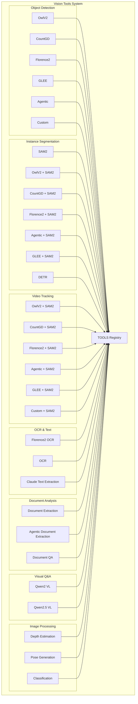
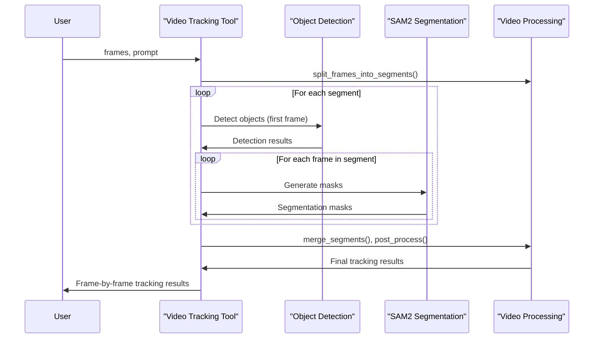
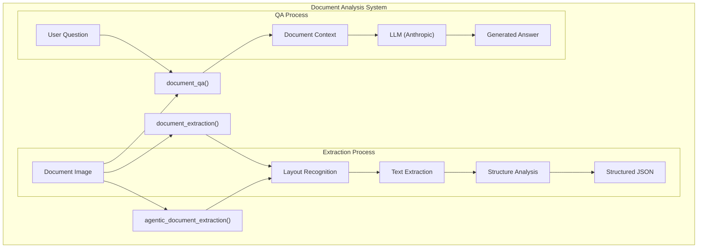
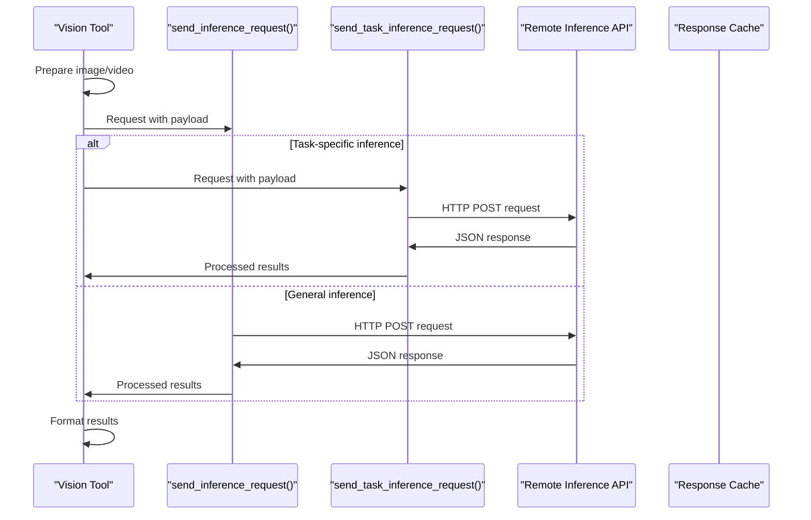
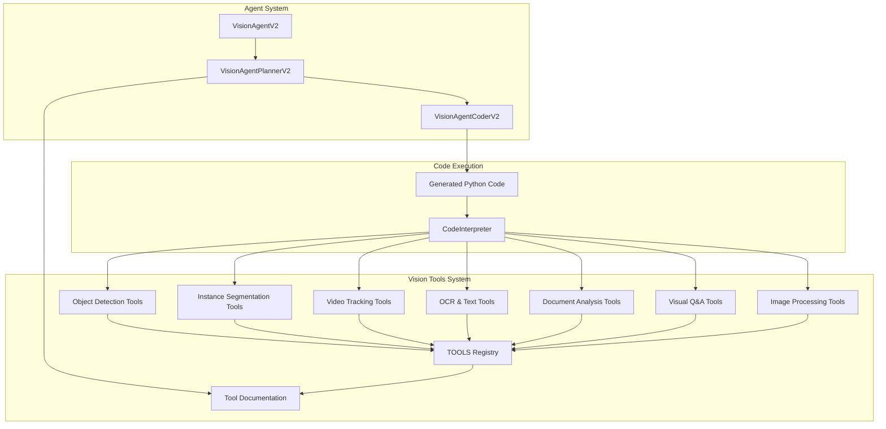

<!-- source: DeepWiki mcp.deepwiki.com · repo landing-ai/vision-agent · page 3 Vision Tools · fetched 2026-10-27 -->

# Vision Tools

<details>
<summary>Relevant source files</summary>

The following files were used as context for generating this wiki page:

- [vision_agent/tools/__init__.py](vision_agent/tools/__init__.py)
- [vision_agent/tools/tools.py](vision_agent/tools/tools.py)

</details>


The Vision Tools system is a comprehensive collection of computer vision capabilities that form the foundation of the vision-agent's ability to perceive and understand visual content. These tools provide a wide range of vision-related functions, from object detection and segmentation to text extraction and visual question-answering. This document explains the structure of the vision tools system, the categories of available tools, and how they integrate with the rest of the vision-agent architecture.

For information about how agents use these tools, see [Agent System](#2). For technical details about the code execution system, see [Code Execution System](#4).

## Tools Registry System

Vision tools in the vision-agent codebase are managed through a central registry system. This registry allows tools to be registered, discovered, and used by the agent components. 

```mermaid
classDiagram
    class "TOOLS Registry" {
        +List[Callable] tools
        +register_tool(tool) Callable
    }

    class "register_tool()" {
        <<decorator>>
        +__call__(tool) Callable
    }

    class "Tool Function" {
        +name: str
        +parameters: Dict
        +returns: Any
        +docstring: str
    }

    class "Agent" {
        +use_tools()
    }

    "TOOLS Registry" --> "Tool Function" : contains
    "register_tool()" --> "TOOLS Registry" : adds to
    "Tool Function" <-- "Agent" : uses
```
*Diagram: Vision Tools Registry System*

Sources: [vision_agent/tools/__init__.py:73-90](), [vision_agent/tools/tools.py:93-123]()

### Tool Registration

Tools are registered using the `register_tool` decorator, which adds them to the global `TOOLS` list. This registry mechanism allows new vision capabilities to be easily added to the system without modifying core components.

```python
@register_tool
def my_vision_tool(image: np.ndarray) -> Dict[str, Any]:
    """Tool documentation describing purpose and usage"""
    # Tool implementation
    ...
```

The registration system allows for:
- Dynamic discovery of available tools
- Automatic documentation generation
- Tool introspection by the agent

Sources: [vision_agent/tools/__init__.py:73-90]()

### Tool Structure

Each vision tool follows a common structure:

1. **Function signature** - Clearly defined inputs and outputs
2. **Comprehensive docstring** - Explains purpose, parameters, returns, and provides usage examples
3. **Input validation** - Checks for valid inputs
4. **Processing logic** - Implements the vision capability
5. **Result formatting** - Standardizes output format
6. **Visualization support** - Provides data for UI visualization

For visualization purposes, tools use the `_display_tool_trace` function to send data through IPython's display function so the front-end can show results of tool execution.

Sources: [vision_agent/tools/tools.py:93-124]()

## Vision Tool Categories

The vision tools are organized into several functional categories based on their capabilities:


*Diagram: Vision Tools Categories*

Sources: [vision_agent/tools/tools.py:14-2652]()

### Object Detection Tools

Object detection tools identify and locate objects in images by drawing bounding boxes around them. These tools take an image and a prompt describing the objects to find.

| Tool | Function | Description |
|------|----------|-------------|
| OwlV2 | `owlv2_object_detection` | Text-to-object detection using OwlV2 model |
| CountGD | `countgd_object_detection` | Specialized for counting many instances of objects |
| Florence2 | `florence2_object_detection` | General-purpose object detection |
| Agentic | `agentic_object_detection` | Detailed object detection for specific descriptions |
| GLEE | `glee_object_detection` | Object detection for detailed descriptive prompts |
| Custom | `custom_object_detection` | Custom fine-tuned object detection models |

Example input/output for object detection:

```python
# Input
image = load_image("street_scene.jpg")
results = owlv2_object_detection("car, person", image)

# Output
[
    {'score': 0.98, 'label': 'car', 'bbox': [0.2, 0.21, 0.45, 0.5]},
    {'score': 0.95, 'label': 'person', 'bbox': [0.6, 0.3, 0.7, 0.8]}
]
```

Sources: [vision_agent/tools/tools.py:372-493](), [vision_agent/tools/tools.py:603-669](), [vision_agent/tools/tools.py:910-1012](), [vision_agent/tools/tools.py:1438-1529](), [vision_agent/tools/tools.py:1654-1742](), [vision_agent/tools/tools.py:1302-1373]()

### Instance Segmentation Tools

Instance segmentation tools build on object detection by adding precise pixel-level masks that outline objects. These tools combine object detection and SAM2 (Segment Anything Model 2) to create detailed segmentation masks.

| Tool | Function | Description |
|------|----------|-------------|
| SAM2 | `sam2` | Segment objects given bounding boxes |
| OwlV2 + SAM2 | `owlv2_sam2_instance_segmentation` | Text-to-instance segmentation using OwlV2 and SAM2 |
| CountGD + SAM2 | `countgd_sam2_instance_segmentation` | Instance segmentation for many similar objects |
| Florence2 + SAM2 | `florence2_sam2_instance_segmentation` | General-purpose instance segmentation |
| Agentic + SAM2 | `agentic_sam2_instance_segmentation` | Detailed instance segmentation |
| GLEE + SAM2 | `glee_sam2_instance_segmentation` | Instance segmentation for detailed prompts |
| DETR | `detr_segmentation` | Zero-shot segmentation without prompts |

Example input/output for instance segmentation:

```python
# Input
image = load_image("flowers.jpg")
results = countgd_sam2_instance_segmentation("flower", image)

# Output
[
    {
        'score': 0.49,
        'label': 'flower',
        'bbox': [0.1, 0.11, 0.35, 0.4],
        'mask': array([[0, 0, 0, ..., 0, 0, 0],
                       [0, 0, 0, ..., 0, 0, 0],
                       ...,
                       [0, 0, 0, ..., 0, 0, 0],
                       [0, 0, 0, ..., 0, 0, 0]], dtype=uint8)
    },
    # More instances...
]
```

Sources: [vision_agent/tools/tools.py:126-231](), [vision_agent/tools/tools.py:475-532](), [vision_agent/tools/tools.py:1015-1072](), [vision_agent/tools/tools.py:672-745](), [vision_agent/tools/tools.py:1532-1586](), [vision_agent/tools/tools.py:1745-1798](), [vision_agent/tools/tools.py:2541-2606]()

### Video Tracking Tools

Video tracking tools extend instance segmentation capabilities to videos, tracking objects across multiple frames. These tools are essential for analyzing movement, counting objects without duplication, and understanding temporal dynamics.


*Diagram: Video Tracking Process Flow*

Sources: [vision_agent/tools/tools.py:234-369]()

Each video tracking tool follows a similar pattern but uses different object detection models as their foundation:

| Tool | Function | Description |
|------|----------|-------------|
| OwlV2 + SAM2 | `owlv2_sam2_video_tracking` | Text-based object tracking |
| CountGD + SAM2 | `countgd_sam2_video_tracking` | Tracking for many similar objects |
| Florence2 + SAM2 | `florence2_sam2_video_tracking` | General-purpose object tracking |
| Agentic + SAM2 | `agentic_sam2_video_tracking` | Detailed object tracking |
| GLEE + SAM2 | `glee_sam2_video_tracking` | Detailed object tracking |
| Custom + SAM2 | `custom_od_sam2_video_tracking` | Custom model-based tracking |

Example input/output for video tracking:

```python
# Input
frames = extract_frames_from_video("wildlife.mp4")
results = florence2_sam2_video_tracking("bear, deer", frames)

# Output (list of frames, each with list of detected objects)
[
    [  # Frame 1
        {
            'label': '0: bear',
            'bbox': [0.1, 0.11, 0.35, 0.4],
            'mask': array([[...]])
        }
    ],
    [  # Frame 2
        {
            'label': '0: bear',  # Same bear as in frame 1
            'bbox': [0.12, 0.11, 0.37, 0.4],
            'mask': array([[...]])
        }
    ],
    # More frames...
]
```

Sources: [vision_agent/tools/tools.py:535-597](), [vision_agent/tools/tools.py:1075-1137](), [vision_agent/tools/tools.py:748-851](), [vision_agent/tools/tools.py:1589-1649](), [vision_agent/tools/tools.py:1801-1862](), [vision_agent/tools/tools.py:1376-1432]()

### OCR & Text Extraction

OCR (Optical Character Recognition) tools identify and extract text from images. These tools are essential for understanding text-based content in images and documents.

| Tool | Function | Description |
|------|----------|-------------|
| Florence2 OCR | `florence2_ocr` | Detects text regions with bounding boxes |
| OCR | `ocr` | General-purpose OCR tool |
| Claude Text Extraction | `claude35_text_extraction` | Uses Claude 3.5 for text extraction |

Example input/output for OCR:

```python
# Input
image = load_image("document.jpg")
results = florence2_ocr(image)

# Output
[
    {'label': 'hello world', 'bbox': [0.1, 0.11, 0.35, 0.4], 'score': 0.99},
    {'label': 'vision agent', 'bbox': [0.2, 0.5, 0.6, 0.55], 'score': 0.97}
]
```

Sources: [vision_agent/tools/tools.py:854-904](), [vision_agent/tools/tools.py:2034-2092](), [vision_agent/tools/tools.py:2095-2116]()

### Document Analysis

Document analysis tools extract structured information from document images, including text, layout, and semantic understanding.


*Diagram: Document Analysis Process*

Sources: [vision_agent/tools/tools.py:2119-2329]()

| Tool | Function | Description |
|------|----------|-------------|
| Document Extraction | `document_extraction` | Extracts structured info from documents (deprecated) |
| Agentic Document Extraction | `agentic_document_extraction` | Improved document information extraction |
| Document QA | `document_qa` | Answers questions about document content |

Example input/output for document analysis:

```python
# Input
image = load_image("financial_report.jpg")
result = agentic_document_extraction(image)

# Output
{
    "markdown": "# Financial Report 2023\n\n## Q2 Results\n\nRevenue: $10.5M",
    "chunks": [
        {
            "text": "# Financial Report 2023",
            "grounding": [{"box": [0.06, 0.02, 0.17, 0.03], "page": 0}],
            "chunk_type": "page_header",
            "chunk_id": "622e0374-c50e-4960-a013-650138b42528"
        },
        # More chunks...
    ]
}
```

Sources: [vision_agent/tools/tools.py:2119-2191](), [vision_agent/tools/tools.py:2194-2261](), [vision_agent/tools/tools.py:2264-2329]()

### Visual Question-Answering Tools

Visual Question-Answering (VQA) tools interpret images or videos and answer natural language questions about them. These tools leverage multimodal large language models to understand both visual content and text queries.

| Tool | Function | Description |
|------|----------|-------------|
| Qwen2 VL Images | `qwen2_vl_images_vqa` | VQA for images using Qwen2 VL |
| Qwen2 VL Video | `qwen2_vl_video_vqa` | VQA for videos using Qwen2 VL |
| Qwen2.5 VL Images | `qwen25_vl_images_vqa` | VQA for images using Qwen2.5 VL |
| Qwen2.5 VL Video | `qwen25_vl_video_vqa` | VQA for videos using Qwen2.5 VL |
| Activity Recognition | `activity_recognition` | Detects activities in videos |

Example input/output for VQA:

```python
# Input
image = load_image("chart.jpg")
result = qwen25_vl_images_vqa("What is the highest value in this chart?", [image])

# Output
"The highest value in the chart is 87% in the third quarter."
```

Sources: [vision_agent/tools/tools.py:1868-1908](), [vision_agent/tools/tools.py:1911-1948](), [vision_agent/tools/tools.py:1951-1991](), [vision_agent/tools/tools.py:1994-2031](), [vision_agent/tools/tools.py:2384-2465]()

### Image Processing Tools

Image processing tools analyze images to extract specific information or generate new visual representations.

| Tool | Function | Description |
|------|----------|-------------|
| Depth Estimation | `depth_anything_v2` | Generates depth maps from images |
| Pose Generation | `generate_pose_image` | Creates pose skeleton images |
| Image Classification | `vit_image_classification` | Classifies image content |
| NSFW Classification | `vit_nsfw_classification` | Detects inappropriate content |

Example input/output for image processing:

```python
# Input
image = load_image("outdoor_scene.jpg")
result = depth_anything_v2(image)

# Output
# Depth map as numpy array
array([[0, 0, 0, ..., 0, 0, 0],
       [0, 20, 24, ..., 0, 100, 103],
       ...,
       [10, 11, 15, ..., 202, 202, 205],
       [10, 10, 10, ..., 200, 200, 200]], dtype=uint8)
```

Sources: [vision_agent/tools/tools.py:2609-2651](), [vision_agent/tools/tools.py:2654-2691](), [vision_agent/tools/tools.py:2468-2501](), [vision_agent/tools/tools.py:2504-2538]()

## Remote Inference System

Most vision tools rely on remote inference services to execute computationally intensive vision models. This architecture allows the vision-agent to access state-of-the-art models without requiring local hardware acceleration.


*Diagram: Remote Inference Request Flow*

Sources: [vision_agent/tools/tools.py:645-650](), [vision_agent/tools/tools.py:393-398]()

The remote inference system:
1. Prepares data (images, videos) for transport
2. Sends appropriate API requests to remote endpoints
3. Processes and standardizes results
4. Handles errors and retries
5. Provides visualization data

Most tools rely on the utility functions `send_inference_request` and `send_task_inference_request` to communicate with remote inference servers.

## Tool Integration with Agent System

The vision tools are designed to be used by the agent system, particularly the code generation components. The tools are automatically discovered and documented, allowing the agent to intelligently choose the right tool for a given task.


*Diagram: Tool Integration with Agent System*

Sources: [vision_agent/tools/__init__.py:1-91]()

The integration process involves:

1. Tools are registered in the central registry
2. Tool documentation is generated automatically from docstrings
3. The agent planner uses tool documentation to select appropriate tools
4. The agent coder generates code that imports and calls the tools
5. The code interpreter executes the generated code, using the tools to process visual inputs

### Tool Documentation

The system provides several utility functions to access tool documentation:

| Function | Description |
|----------|-------------|
| `get_tools()` | Returns a list of all available tools |
| `get_tools_descriptions()` | Returns tool descriptions for consumption by LLMs |
| `get_tools_df()` | Returns a DataFrame with tool information |
| `get_tools_docstring()` | Returns detailed docstrings for all tools |

This documentation system ensures that both human developers and AI agents can discover and understand the available vision capabilities.

Sources: [vision_agent/tools/__init__.py:1-91]()

## Summary

The Vision Tools system provides a rich set of computer vision capabilities that serve as the foundation for the vision-agent's ability to understand and interact with visual content. The modular design allows for easy extension with new tools, while the comprehensive documentation enables effective use by both human developers and AI agents.

Key strengths of the system include:
- Diverse vision capabilities covering most common computer vision tasks
- Consistent interfaces and documentation patterns
- Integration with state-of-the-art vision models
- Flexible registration system for extending functionality
- Seamless integration with the agent system

For developers looking to extend the system, the `register_tool` decorator provides a straightforward way to add new vision capabilities.

---

