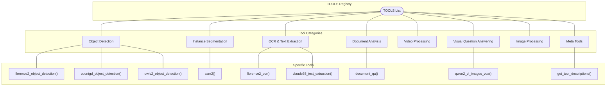
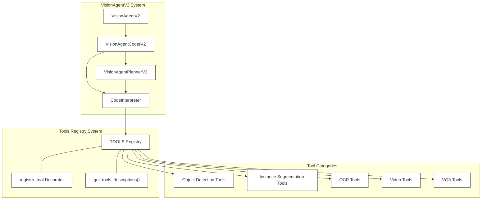

<!-- source: DeepWiki mcp.deepwiki.com · repo landing-ai/vision-agent · page 3.1 Tools Registry · fetched 2026-10-27 -->

# Tools Registry

<details>
<summary>Relevant source files</summary>

The following files were used as context for generating this wiki page:

- [vision_agent/tools/__init__.py](vision_agent/tools/__init__.py)
- [vision_agent/tools/meta_tools.py](vision_agent/tools/meta_tools.py)

</details>


The Tools Registry is a core component of the Vision Agent system that manages the registration, discovery, and access to vision-related tools. It provides a centralized mechanism for organizing all available vision capabilities and makes them accessible to the agent for executing vision tasks. For information about specific vision tools, see [Object Detection Tools](#3.2), [Video Processing Tools](#3.3), and [Document Analysis Tools](#3.4).

## Purpose and Functionality

The Tools Registry serves several critical functions:

1. **Tool Cataloging**: Maintains a comprehensive catalog of all available vision tools
2. **Registration Mechanism**: Provides a simple decorator-based system for registering new tools
3. **Discovery Interface**: Offers methods to discover and describe available tools
4. **Organization**: Groups tools by functionality categories
5. **Documentation**: Preserves tool documentation and usage information

## Registry Architecture

The Tools Registry is implemented as a global `TOOLS` list that stores all registered tool functions. This central registry allows the Vision Agent to access all available vision capabilities through a unified interface.

```mermaid
classDiagram
    class "TOOLS Registry" {
        List~Callable~ TOOLS
        register_tool() decorator
        get_tools() function
        get_tools_descriptions() function
        get_tools_df() function
    }
    
    class "Tool Functions" {
        object_detection() function
        instance_segmentation() function
        ocr() function
        document_extraction() function
        video_tracking() function
        ...
    }
    
    class "Meta Tools" {
        get_tool_descriptions() function
        view_media_artifact() function
    }
    
    "TOOLS Registry" --* "Tool Functions" : contains
    "TOOLS Registry" --* "Meta Tools" : contains
```

**Registry Components Diagram**

Sources: [vision_agent/tools/__init__.py:9-65](vision_agent/tools/__init__.py:9-65), [vision_agent/tools/meta_tools.py:175-179](vision_agent/tools/meta_tools.py:175-179)

## Tool Registration Mechanism

The Tools Registry provides a decorator-based mechanism for registering vision tools. The `register_tool` decorator simplifies adding new tools to the system by automatically handling the registration process.

```mermaid
sequenceDiagram
    participant "Developer" as dev
    participant "@register_tool" as decorator
    participant "TOOLS Registry" as registry
    participant "Global Namespace" as globals
    
    dev->>decorator: Apply to tool function
    decorator->>registry: Add tool to TOOLS list
    decorator->>globals: Add tool to global namespace
    decorator->>registry: Store function source code
    decorator->>dev: Return decorated function
    
    Note over registry: Tool now available to agent
```

**Tool Registration Workflow**

Sources: [vision_agent/tools/__init__.py:73-90](vision_agent/tools/__init__.py:73-90)

### Registration Decorator Implementation

The `register_tool` decorator adds the decorated function to the global `TOOLS` list and makes it available in the global namespace. It also optionally adds required imports to support the tool.

```python
def register_tool(imports: Optional[List] = None) -> Callable:
    def decorator(tool: Callable) -> Callable:
        import inspect

        global TOOLS, TOOLS_DF, TOOL_DESCRIPTIONS, TOOL_DOCSTRING, TOOLS_INFO
        from vision_agent.tools.tools import TOOLS

        if tool not in TOOLS:  # type: ignore
            TOOLS.append(tool)  # type: ignore

            globals()[tool.__name__] = tool
            if imports is not None:
                for import_ in imports:
                    __new_tools__.append(import_)
            __new_tools__.append(inspect.getsource(tool))
        return tool

    return decorator
```

Sources: [vision_agent/tools/__init__.py:73-90](vision_agent/tools/__init__.py:73-90)

## Tool Organization

The Tools Registry organizes vision tools into functional categories, making it easier for the agent to identify and select the appropriate tools for specific tasks.



**Tool Category Organization**

Sources: [vision_agent/tools/__init__.py:9-65](vision_agent/tools/__init__.py:9-65)

## Tool Discovery and Description

The Tools Registry provides several functions to discover and describe available tools:

1. `get_tools()`: Returns a list of all registered tools
2. `get_tools_descriptions()`: Returns descriptions of all available tools
3. `get_tools_df()`: Returns a DataFrame with tool information
4. `get_tools_docstring()`: Returns docstrings of all tools
5. `get_utilties_docstring()`: Returns docstrings of utility functions

The `get_tool_descriptions()` meta-tool is particularly useful for the agent to understand what capabilities are available:

```python
def get_tool_descriptions() -> str:
    """Returns a description of all the tools that `generate_vision_code` has access to.
    Helpful for answering questions about what types of vision tasks you can do with
    `generate_vision_code`."""
    return _get_tool_descriptions()
```

Sources: [vision_agent/tools/meta_tools.py:175-179](vision_agent/tools/meta_tools.py:175-179), [vision_agent/tools/__init__.py:35-39](vision_agent/tools/__init__.py:35-39)

## Integration with the Agent System

The Tools Registry is a critical component that connects the Vision Agent's planning and code generation capabilities with concrete vision processing functionality. When the agent needs to execute a vision task, it uses the Tools Registry to identify and access the appropriate tools.



**Tools Registry Integration with Agent System**

Sources: [vision_agent/tools/__init__.py:73-90](vision_agent/tools/__init__.py:73-90), [vision_agent/tools/meta_tools.py:175-179](vision_agent/tools/meta_tools.py:175-179)

## Extending the Tools Registry

Developers can extend the Vision Agent's capabilities by creating and registering custom tools. The `register_tool` decorator makes this process straightforward:

1. Define a function that implements the vision capability
2. Apply the `@register_tool` decorator
3. Specify any required imports

For example, to register a custom object detection tool:

```python
from vision_agent.tools import register_tool

@register_tool(imports=["import custom_vision_library"])
def custom_object_detection(image, prompt):
    """Detects objects in an image based on the given prompt.
    
    Parameters:
        image: The input image
        prompt: Text description of objects to detect
        
    Returns:
        List of detected objects with bounding boxes
    """
    # Implementation using custom_vision_library
    ...
    return results
```

Once registered, the custom tool becomes available to the Vision Agent for use in vision tasks.

Sources: [vision_agent/tools/__init__.py:67-90](vision_agent/tools/__init__.py:67-90)

## Meta Tools

The Tools Registry also includes meta-tools that provide functionality for tool discovery and artifact management:

1. `get_tool_descriptions()`: Returns descriptions of all available tools
2. `view_media_artifact()`: Allows the agent to view media artifacts

```python
def view_media_artifact(artifacts: Artifacts, name: str) -> str:
    """Allows only the agent to view the media artifact with the given name. DO NOT use
    this to show media to the user, the user can already see all media saved in the
    artifacts.

    Parameters:
        artifacts (Artifacts): The artifacts object to show the image from.
        name (str): The name of the image artifact to show.
    """
    if name not in artifacts:
        output_str = f"[Artifact {name} does not exist]"
    else:
        output_str = f"[Image {name} displayed]"
    print(output_str)
    return output_str
```

Sources: [vision_agent/tools/meta_tools.py:158-172](vision_agent/tools/meta_tools.py:158-172), [vision_agent/tools/meta_tools.py:175-179](vision_agent/tools/meta_tools.py:175-179)

## Summary

The Tools Registry is a central component of the Vision Agent system that provides a unified interface for registering, discovering, and accessing vision-related tools. It organizes tools by functionality, preserves tool documentation, and enables the agent to select and use the appropriate tools for specific vision tasks. The registry's flexible architecture allows for easy extension with custom tools, making the Vision Agent system highly adaptable to new vision capabilities.

---

