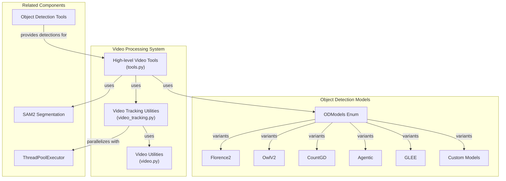
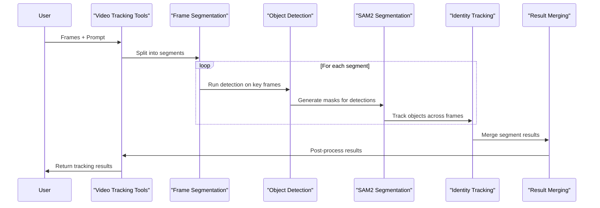
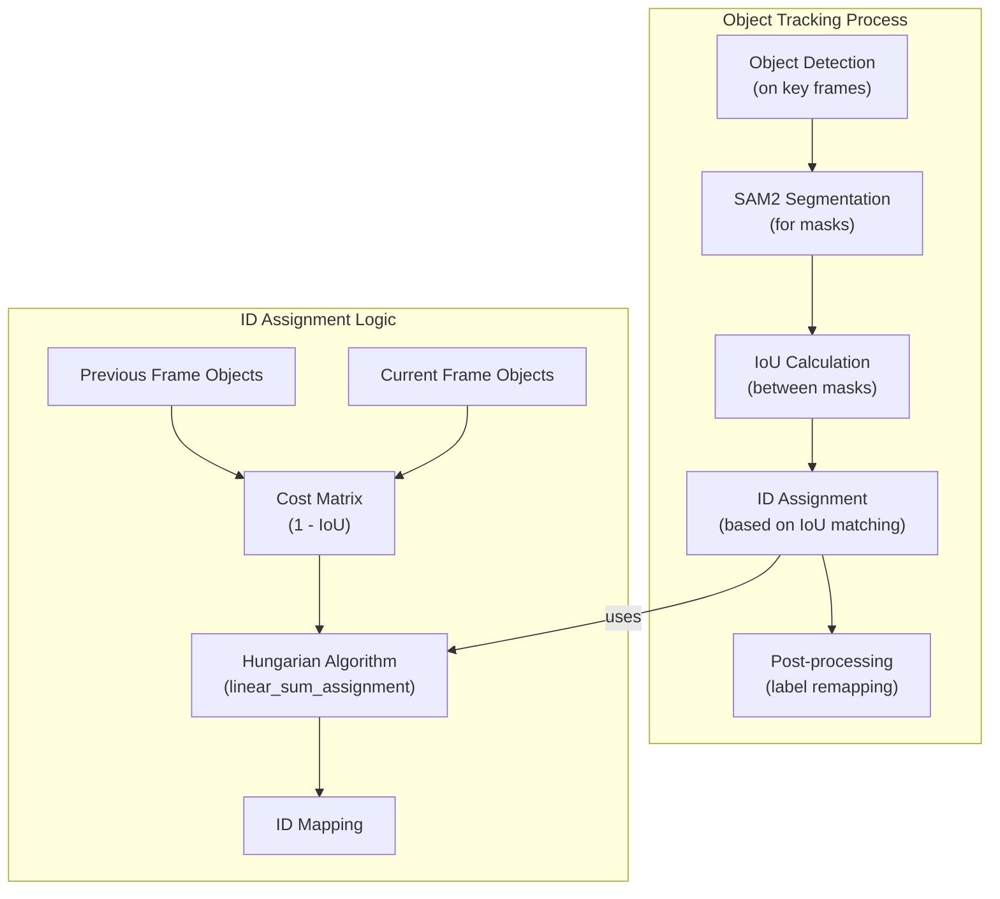
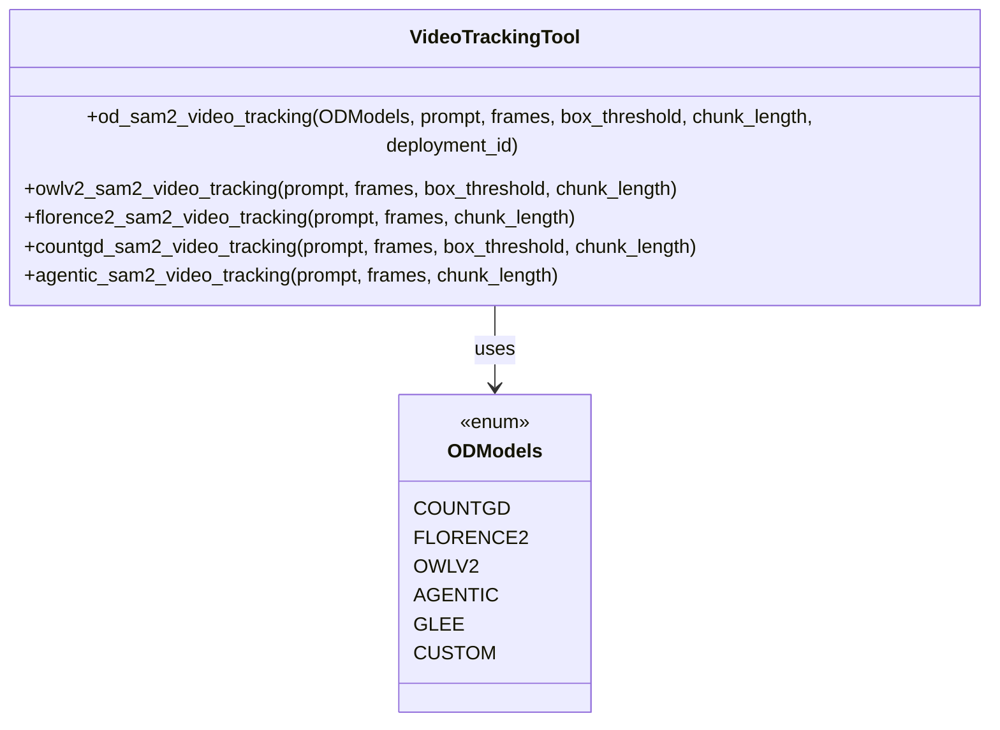

<!-- source: DeepWiki mcp.deepwiki.com · repo landing-ai/vision-agent · page 3.3 Video Processing Tools · fetched 2026-10-27 -->

# Video Processing Tools

<details>
<summary>Relevant source files</summary>

The following files were used as context for generating this wiki page:

- [tests/integ/test_tools.py](tests/integ/test_tools.py)
- [tests/unit/tools/test_video.py](tests/unit/tools/test_video.py)
- [vision_agent/tools/tools.py](vision_agent/tools/tools.py)
- [vision_agent/utils/exceptions.py](vision_agent/utils/exceptions.py)
- [vision_agent/utils/video.py](vision_agent/utils/video.py)
- [vision_agent/utils/video_tracking.py](vision_agent/utils/video_tracking.py)

</details>


## Purpose and Scope

This document details the video processing tools available in the Vision Agent system, focusing on the capabilities for video analysis, object tracking, and segmentation across video frames. These tools extend the object detection and segmentation capabilities (described in [Object Detection Tools](#3.2)) to handle temporal data, enabling consistent object tracking and counting throughout video sequences.

## Video Processing Architecture

The video processing system consists of three main layers:

1. **Core Video Utilities** - Low-level functions for video manipulation
2. **Video Tracking Utilities** - Algorithms for tracking objects across frames
3. **High-level Video Tools** - User-facing tools combining detection, segmentation, and tracking



Sources: [vision_agent/utils/video.py:1-148](), [vision_agent/utils/video_tracking.py:1-347](), [vision_agent/tools/tools.py:534-596](), [vision_agent/tools/tools.py:748-850]()

## Video Tracking Data Flow

The data flow for video tracking shows how frames are processed from input to output:



Sources: [vision_agent/utils/video_tracking.py:22-52](), [vision_agent/utils/video_tracking.py:54-122](), [vision_agent/utils/video_tracking.py:251-279](), [vision_agent/utils/video_tracking.py:282-347]()

## Core Utilities

### Video Manipulation Functions

These low-level functions handle basic video operations:

| Function | Purpose | Key Parameters |
|----------|---------|----------------|
| `video_writer` | Creates video files from frames | `frames`, `fps`, `file` |
| `frames_to_bytes` | Converts frames to video byte stream | `frames`, `fps`, `file_ext` |
| `rescale` | Resizes frames to fit constraints | `frame`, `max_size` |
| `extract_frames_from_video` | Extracts frames at specified FPS | `video_uri`, `fps` |

Sources: [vision_agent/utils/video.py:24-52](), [vision_agent/utils/video.py:55-72](), [vision_agent/utils/video.py:75-86](), [vision_agent/utils/video.py:94-148]()

### Video Tracking Utilities

The tracking system includes these core functions:

| Function | Purpose |
|----------|---------|
| `split_frames_into_segments` | Divides videos into segments with overlap |
| `process_segment` | Processes a segment with object detection and SAM2 |
| `merge_segments` | Combines results from all segments with matching IDs |
| `post_process` | Applies final processing to create consistent results |

Sources: [vision_agent/utils/video_tracking.py:22-52](), [vision_agent/utils/video_tracking.py:54-122](), [vision_agent/utils/video_tracking.py:251-279](), [vision_agent/utils/video_tracking.py:282-347]()

## Object Tracking System

Video tracking works by maintaining object identity across frames:



Sources: [vision_agent/utils/video_tracking.py:195-207](), [vision_agent/utils/video_tracking.py:210-248](), [vision_agent/utils/video_tracking.py:251-279]()

## High-Level Video Tools

The Vision Agent provides these user-facing video processing tools:

### Generic Video Tracking

`od_sam2_video_tracking` is the core function that powers all model-specific tracking tools:

```python
def od_sam2_video_tracking(
    od_model: ODModels,
    prompt: str,
    frames: List[np.ndarray],
    box_threshold: float = 0.30,
    chunk_length: Optional[int] = 50,
    deployment_id: Optional[str] = None,
) -> Dict[str, Any]
```

This function:
1. Splits video frames into segments with overlap
2. Processes each segment with the specified object detection model
3. Uses SAM2 to generate masks for detected objects
4. Tracks objects across frames with consistent IDs
5. Merges results from all segments

Sources: [vision_agent/tools/tools.py:234-369]()

### Model-Specific Video Tracking Tools

| Tool | Model | Description |
|------|-------|-------------|
| `owlv2_sam2_video_tracking` | OwlV2 | Text-to-object tracking with OwlV2 detector |
| `florence2_sam2_video_tracking` | Florence2 | Text-to-object tracking with Florence2 detector |
| `countgd_sam2_video_tracking` | CountGD | Object counting and tracking with CountGD detector |
| `agentic_sam2_video_tracking` | Agentic | Agent-based object tracking |

Each of these tools uses the generic `od_sam2_video_tracking` with a specific detection model.

Sources: [vision_agent/tools/tools.py:535-597](), [vision_agent/tools/tools.py:748-851]()

### Example: Florence2 Video Tracking

```python
def florence2_sam2_video_tracking(
    prompt: str,
    frames: List[np.ndarray],
    chunk_length: Optional[int] = 25,
) -> List[List[Dict[str, Any]]]
```

Returns tracking data where:
- Outer list represents each frame
- Inner list contains objects per frame
- Each object has `label`, `bbox`, `mask`, and `score`
- Labels are prefixed with their ID (e.g., "0: car")

Sources: [vision_agent/tools/tools.py:748-851]()

## Object Detection Models

The video tracking system supports multiple object detection models through the `ODModels` enum:



Sources: [vision_agent/utils/video_tracking.py:13-19](), [vision_agent/tools/tools.py:234-369]()

## Implementation Details

### Chunk-based Processing

Video tracking operates in chunks to balance performance and accuracy:

- `chunk_length` parameter controls how often object detection runs
- Object detection runs on first frame of each chunk
- SAM2 generates masks for all frames in the chunk
- Objects are tracked across chunks using IoU-based matching

### Object Identity Preservation

The system maintains consistent object IDs throughout the video:

1. Objects are detected and segmented in key frames
2. Masks are compared across frames using IoU (Intersection over Union)
3. The Hungarian algorithm (linear_sum_assignment) matches objects between frames
4. A cost matrix based on (1-IoU) is used for optimal assignment
5. Objects with high IoU get the same ID across frames
6. New IDs are assigned for new objects or poor matches

Sources: [vision_agent/utils/video_tracking.py:195-207](), [vision_agent/utils/video_tracking.py:210-248]()

### Post-processing

Final results undergo post-processing:

1. IDs are remapped to be consecutive for each object class
2. Labels are prefixed with their ID (e.g., "0: car")
3. Bounding boxes are derived from masks if needed
4. Non-maximum suppression removes duplicate detections

Sources: [vision_agent/utils/video_tracking.py:282-347]()

## Integration with Other Systems

Video processing tools integrate with these components:

1. **Core Video Utilities** - For basic video operations
2. **Object Detection Models** - For detecting objects in frames
3. **SAM2 Segmentation** - For generating precise masks
4. **ThreadPoolExecutor** - For parallel processing
5. **Remote Inference System** - For running models on remote servers

Sources: [vision_agent/tools/tools.py:234-369](), [vision_agent/utils/video_tracking.py:54-122]()

---

