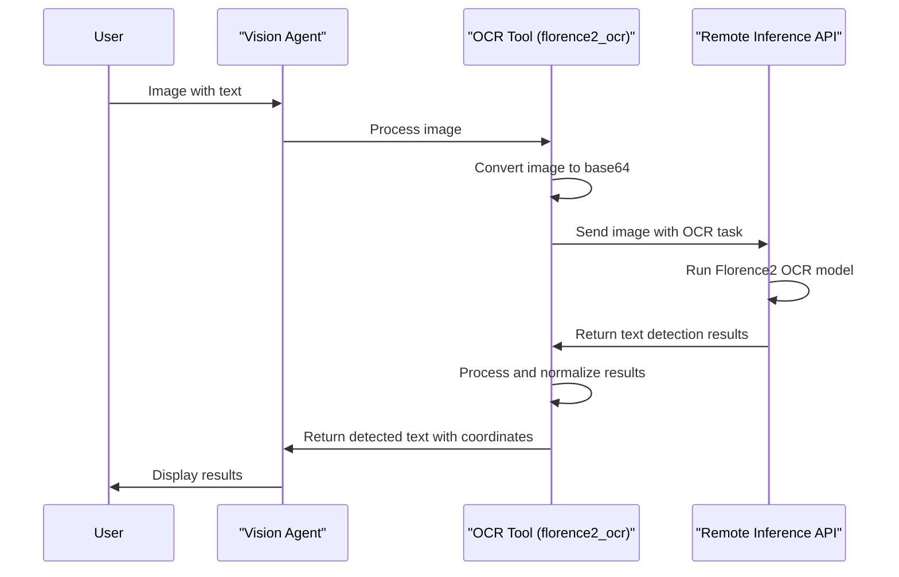
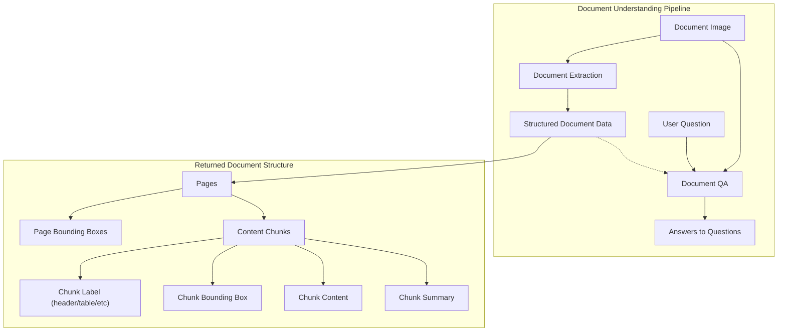
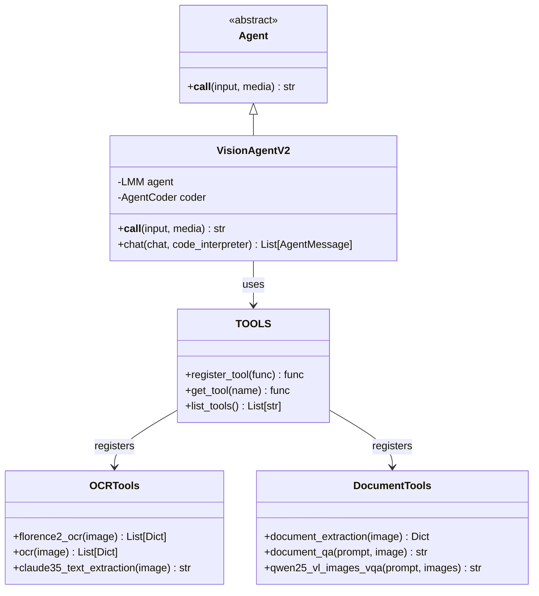
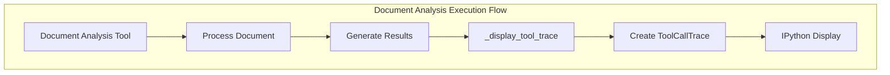

<!-- source: DeepWiki mcp.deepwiki.com · repo landing-ai/vision-agent · page 3.4 Document Analysis Tools · fetched 2026-10-27 -->

# Document Analysis Tools

<details>
<summary>Relevant source files</summary>

The following files were used as context for generating this wiki page:

- [vision_agent/.sim_tools/df.csv](vision_agent/.sim_tools/df.csv)
- [vision_agent/.sim_tools/embs.npy](vision_agent/.sim_tools/embs.npy)
- [vision_agent/tools/tools.py](vision_agent/tools/tools.py)

</details>


## Purpose and Scope

This page documents the document analysis capabilities of the Vision Agent system. These tools enable the analysis, extraction, and understanding of text and structured information from document images. The document analysis tools encompass optical character recognition (OCR), text extraction, structured document parsing, and document question-answering functionalities.

For information about general object detection and image analysis, see [Object Detection Tools](#3.2).

Sources: [vision_agent/tools/tools.py:854-904](). [vision_agent/.sim_tools/df.csv:218-399]()

## Document Analysis Tools Overview

The Vision Agent provides several specialized tools for working with documents and text in images. These tools can be categorized into three main groups:

1. **Text Recognition Tools**: Extract raw text and text regions from images
2. **Document Understanding Tools**: Extract structured content and perform reasoning on documents
3. **Visual Question Answering**: Answer questions about document content

```mermaid
flowchart TD
    subgraph "Document Analysis Tools"
        direction LR
        subgraph "Text Recognition"
            florence2_ocr["florence2_ocr"]
            ocr["ocr"]
            claude35_text_extraction["claude35_text_extraction"]
        end

        subgraph "Document Understanding"
            document_extraction["document_extraction"]
            document_qa["document_qa"]
        end

        subgraph "Visual QA for Documents"
            qwen25_vl_images_vqa["qwen25_vl_images_vqa"]
        end
    end

    Input["Document Image"] --> "Text Recognition"
    Input --> "Document Understanding"
    Input --> "Visual QA for Documents"
    "Text Recognition" --> TextOutput["Extracted Text & Regions"]
    "Document Understanding" --> StructuredOutput["Structured Document Data"]
    "Visual QA for Documents" --> AnswerOutput["Answers to Questions"]

    classDef toolNode fill:#f9f,stroke:#333,stroke-width:2px;
    class florence2_ocr,ocr,claude35_text_extraction,document_extraction,document_qa,qwen25_vl_images_vqa toolNode;
```

Sources: [vision_agent/tools/tools.py:854-904](). [vision_agent/.sim_tools/df.csv:218-399]()

## Text Recognition Tools

Text recognition tools focus on extracting text content and text regions from images. These tools employ different underlying models for optical character recognition and text extraction.

### Florence2 OCR

The `florence2_ocr` function detects text and text regions in images. Each text region typically contains one line of text. The function returns a list of detected text segments along with their bounding boxes in normalized coordinates and confidence scores.

```python
# Example usage of florence2_ocr
detected_text = florence2_ocr(document_image)
# Returns: [{'label': 'hello world', 'bbox': [0.1, 0.11, 0.35, 0.4], 'score': 0.99}, ...]
```

The function uses the Florence2 model for text detection and sends the image to a remote inference service for processing.

### Generic OCR

The `ocr` function provides a general-purpose text extraction capability. Like `florence2_ocr`, it returns a list of text regions with bounding boxes and confidence scores, but may use a different underlying OCR model.

### Claude35 Text Extraction

The `claude35_text_extraction` function uses the Claude 3.5 language model to extract text from images. Unlike the OCR functions, it returns the extracted text as a string without bounding box information. This is useful when you only need the text content and not the spatial information.



Sources: [vision_agent/tools/tools.py:854-904](). [vision_agent/.sim_tools/df.csv:218-237](), [vision_agent/.sim_tools/df.csv:400-418](), [vision_agent/.sim_tools/df.csv:342-352]()

## Document Understanding Tools

Document understanding tools go beyond simple text extraction to provide structured parsing of documents and the ability to answer questions about document content.

### Document Extraction

The `document_extraction` function extracts structured information from documents with different layouts. It returns a hierarchical representation of the document, including:

- Text blocks with their positions
- Tables with their content and structure
- Images and charts
- Document sections and their relationships

This is particularly useful for analyzing complex documents like forms, reports, or structured business documents.

### Document QA

The `document_qa` function combines document understanding with question answering capabilities. It takes a document image and a prompt (question) as input and returns an answer based on the document's content.

This tool is versatile and can be used for:
- Extracting specific information from documents
- Summarizing document content
- Answering complex questions that require reasoning about the document
- Returning structured data in formats like JSON



Sources: [vision_agent/.sim_tools/df.csv:353-381](), [vision_agent/.sim_tools/df.csv:382-399]()

## Visual Question Answering for Documents

### Qwen 2.5 Visual Language Model for Documents

The `qwen25_vl_images_vqa` function provides visual question answering capabilities that work well with document images. It can:

- Answer questions about document content
- Extract text from documents
- Understand the structure and meaning of document elements
- Process multiple images in a single query

This tool is versatile and can handle various document types, including regular documents, presentations, and forms.

```python
# Example usage for document analysis
document_summary = qwen25_vl_images_vqa('Give a summary of this document', [document_image])
table_contents = qwen25_vl_images_vqa('Extract the contents of the table in this document', [document_image])
```

The tool also works with `qwen25_vl_video_vqa` for analyzing documents in video format.

Sources: [vision_agent/.sim_tools/df.csv:419-453]()

## Document Analysis Tools Integration

The document analysis tools are integrated with the core Vision Agent system through the tools registry mechanism. This allows them to be dynamically discovered and used by the agent when processing user requests.



Each document analysis tool is registered using a decorator pattern with metadata describing its function and parameters. This allows the agent to:

1. Discover available document analysis capabilities
2. Select the appropriate tool for the task
3. Execute the tool with proper parameters
4. Process and present the results

Sources: [vision_agent/tools/tools.py:46-51](), [vision_agent/tools/tools.py:854-904]()

## Implementation Details

### OCR Implementation

The `florence2_ocr` function implements OCR using the Florence2 model and remote inference:

1. It takes an image in numpy array format
2. Validates the image dimensions
3. Converts the image to base64 encoding
4. Prepares an API request with the OCR task
5. Sends the request to a remote inference endpoint
6. Processes the response to normalize bounding boxes
7. Returns the detected text with normalized coordinates

```python
# Key implementation from florence2_ocr
image_b64 = convert_to_b64(image)
data = {
    "image": image_b64,
    "task": "<OCR_WITH_REGION>",
    "function_name": "florence2_ocr",
}
detections = send_inference_request(data, "florence2", v2=True)
detections = detections["<OCR_WITH_REGION>"]
```

The function uses utility functions like `convert_to_b64`, `send_inference_request`, and `normalize_bbox` from the vision-agent's utility modules.

Sources: [vision_agent/tools/tools.py:854-904]()

### Result Display and Visualization

Document analysis results are displayed using the `_display_tool_trace` function, which:

1. Captures the function name, request parameters, and response
2. Encodes any binary data for display
3. Creates a `ToolCallTrace` object with the relevant information
4. Passes the data to IPython's display mechanism

This enables interactive visualization in notebook environments and integration with the Vision Agent's frontend.



Sources: [vision_agent/tools/tools.py:94-123](), [vision_agent/tools/tools.py:896-903]()

## Usage Examples

### Basic Text Extraction

The following example shows how to use `florence2_ocr` to extract text from a document image:

```python
import numpy as np
from vision_agent.tools.tools import florence2_ocr

# Load document image
document_image = load_image("invoice.jpg")

# Extract text with positions
text_regions = florence2_ocr(document_image)

# Display results
for region in text_regions:
    print(f"Text: {region['label']}")
    print(f"Position: {region['bbox']}")
    print(f"Confidence: {region['score']}")
```

### Document Question Answering

This example demonstrates using `document_qa` to answer questions about a document:

```python
from vision_agent.tools.tools import document_qa

# Load document image
document_image = load_image("financial_report.jpg")

# Ask questions about the document
revenue = document_qa("What was the total revenue for Q2?", document_image)
print(f"Revenue: {revenue}")

# Extract structured data
data = document_qa("Extract all quarterly revenue figures as a JSON object", document_image)
print(f"Structured data: {data}")
```

### Structured Document Extraction

The following example shows how to use `document_extraction` to get a structured representation of a document:

```python
from vision_agent.tools.tools import document_extraction

# Load document image
document_image = load_image("business_report.jpg")

# Extract structured content
document_structure = document_extraction(document_image)

# Process document structure
for page in document_structure['pages']:
    for chunk in page['chunks']:
        if chunk['label'] == 'table':
            print(f"Found table: {chunk['caption']}")
            print(f"Table data: {chunk['content']}")
        elif chunk['label'] == 'text':
            print(f"Text content: {chunk['content']}")
```

Sources: [vision_agent/.sim_tools/df.csv:218-418]()

## Future Directions

The document analysis tools provide a robust foundation for working with documents in the Vision Agent system. Future enhancements could include:

1. Support for document table extraction and processing
2. Specialized tools for specific document types (invoices, receipts, etc.)
3. Enhanced support for multi-page documents
4. Document comparison capabilities
5. Integration with structured data storage

These tools continue to evolve as the underlying models and capabilities improve.

---

