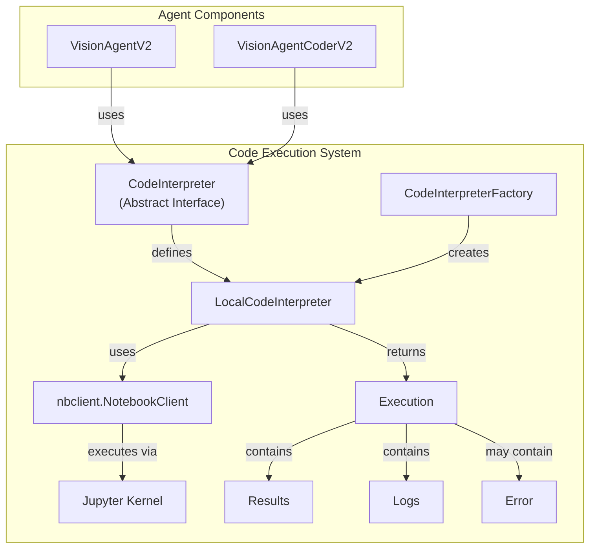
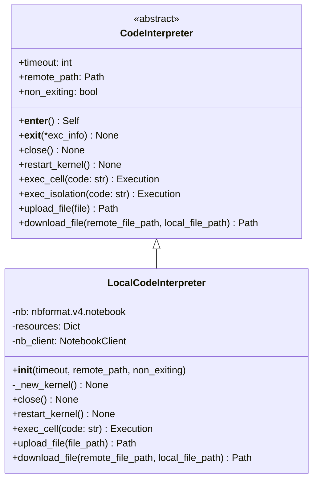
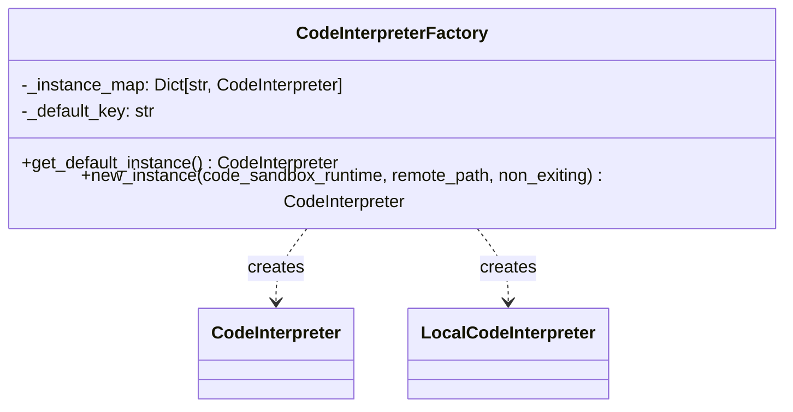
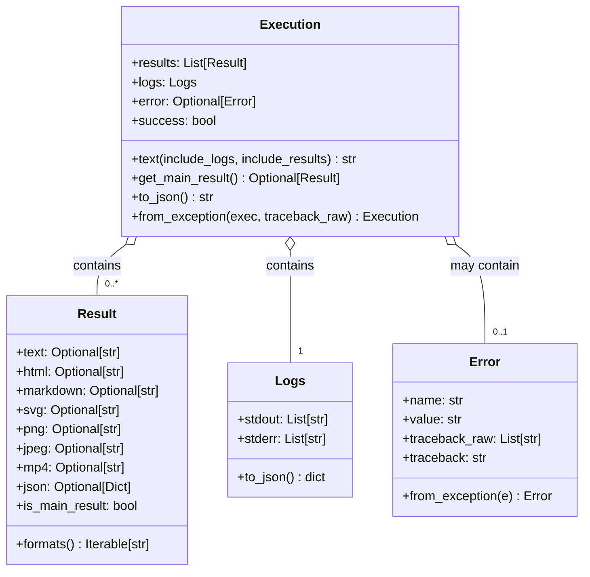
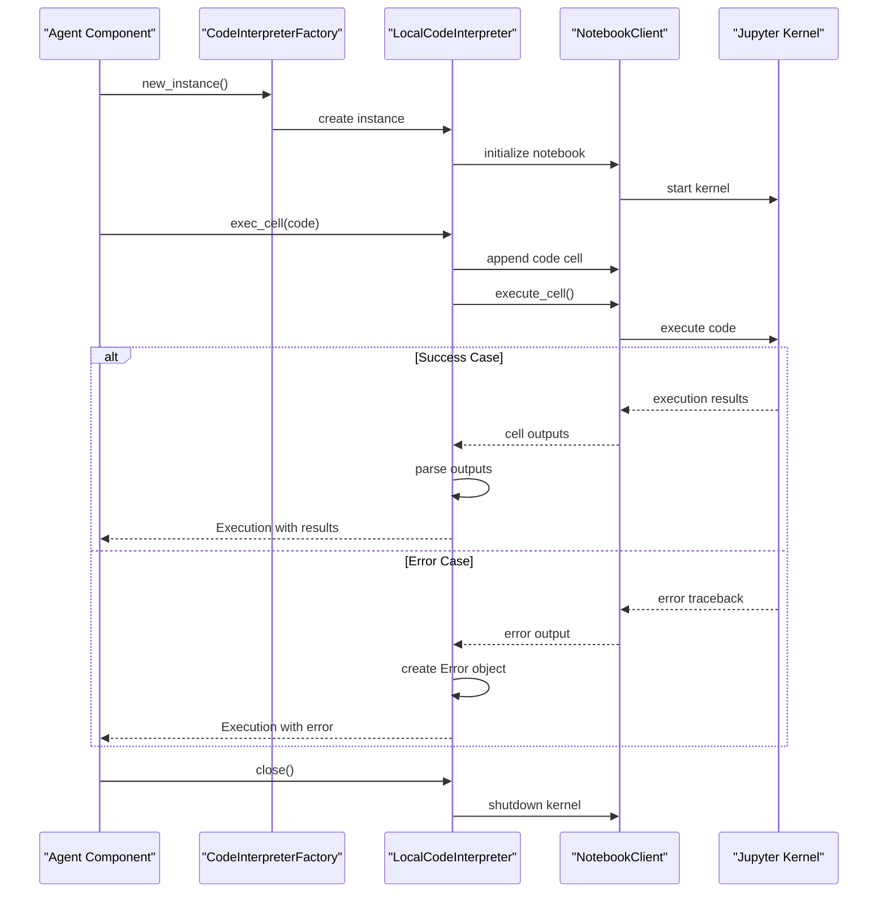
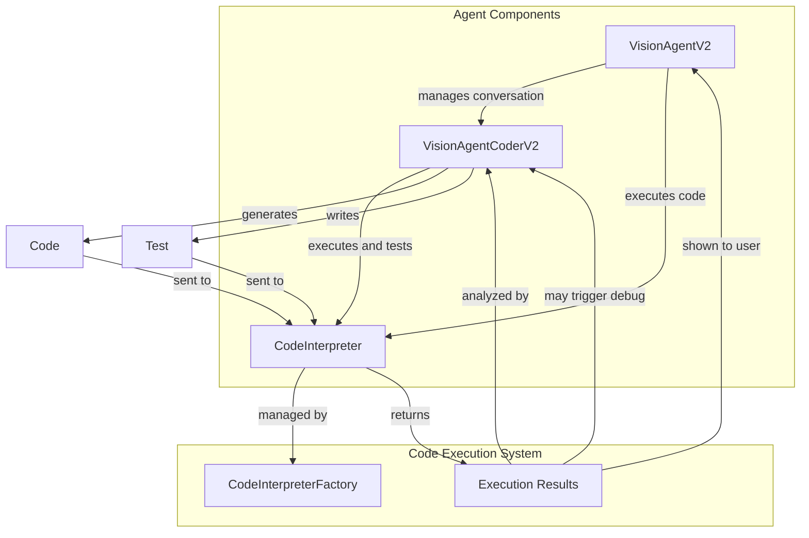

<!-- source: DeepWiki mcp.deepwiki.com · repo landing-ai/vision-agent · page 4 Code Execution System · fetched 2026-10-27 -->

# Code Execution System

<details>
<summary>Relevant source files</summary>

The following files were used as context for generating this wiki page:

- [poetry.lock](poetry.lock)
- [pyproject.toml](pyproject.toml)
- [vision_agent/agent/vision_agent_coder_v2.py](vision_agent/agent/vision_agent_coder_v2.py)
- [vision_agent/agent/vision_agent_prompts_v2.py](vision_agent/agent/vision_agent_prompts_v2.py)
- [vision_agent/agent/vision_agent_v2.py](vision_agent/agent/vision_agent_v2.py)
- [vision_agent/utils/execute.py](vision_agent/utils/execute.py)

</details>


## Purpose and Overview

The Code Execution System provides a safe and structured environment for executing AI-generated code in the vision-agent framework. This system is responsible for running Python code in isolated kernels, capturing execution results, handling errors, and providing standardized interfaces for the agent components to interact with code execution.

For information about the Agent System that uses this system, see [Agent System](#2). For information about how the Code Execution System fits into the broader architecture, see [System Architecture](#1.1).

Sources: [vision_agent/utils/execute.py:345-374](), [pyproject.toml:33-36]()

## System Architecture

The Code Execution System is built around Jupyter notebook infrastructure, using `nbclient` to execute code in isolated Python kernels. It provides a clean abstraction layer that allows agent components to execute code and receive structured results.



Sources: [vision_agent/utils/execute.py:33-588](), [vision_agent/agent/vision_agent_v2.py:254-258](), [vision_agent/agent/vision_agent_coder_v2.py:402-406]()

## Key Components

### CodeInterpreter Interface

The `CodeInterpreter` abstract base class defines the interface for all code interpreter implementations. It outlines methods for executing code, managing kernel state, and handling file operations.



Key methods:
- `exec_cell(code: str) -> Execution`: Executes the provided code and returns execution results
- `exec_isolation(code: str) -> Execution`: Restarts the kernel for clean state, then executes code
- `restart_kernel() -> None`: Explicitly restarts the kernel
- `close() -> None`: Cleans up resources, shutting down the kernel

Sources: [vision_agent/utils/execute.py:345-389]()

### LocalCodeInterpreter

The `LocalCodeInterpreter` is the primary implementation of the `CodeInterpreter` interface. It leverages Jupyter notebook infrastructure to execute code locally in a controlled environment.

Key features:
- Creates and manages a Jupyter notebook and kernel
- Executes code cells and captures all outputs
- Handles kernel lifecycle (creation, restart, shutdown)
- Provides telemetry for code execution through OpenTelemetry

Sources: [vision_agent/utils/execute.py:391-511]()

### CodeInterpreterFactory

The `CodeInterpreterFactory` is responsible for creating code interpreter instances. It provides a clean interface for creating interpreter instances with configurable parameters.



Methods:
- `new_instance(code_sandbox_runtime=None, remote_path=None, non_exiting=False) -> CodeInterpreter`: Creates a new code interpreter instance
- `get_default_instance() -> CodeInterpreter`: Gets a singleton instance for testing purposes

Sources: [vision_agent/utils/execute.py:514-553]()

### Result Data Models

The execution system uses a set of structured data models to represent execution results:



- `Execution`: Top-level container for all execution results
- `Result`: Represents rich results that may include text, images, HTML, etc.
- `Logs`: Captures stdout and stderr output from the execution
- `Error`: Represents errors that occur during execution

Sources: [vision_agent/utils/execute.py:70-342]()

## Execution Workflow

The execution workflow illustrates how code flows through the system from generation to execution and result processing.



### Code Execution Process

1. Agent obtains a `CodeInterpreter` instance via the factory
2. Code is sent to the interpreter via `exec_cell`
3. The code is added to a notebook cell and executed
4. Execution outputs (text, images, errors) are captured
5. Outputs are processed into an `Execution` object
6. The `Execution` object is returned to the agent
7. The agent analyzes the results and may attempt debugging if needed

Sources: [vision_agent/utils/execute.py:454-492](), [vision_agent/agent/vision_agent_coder_v2.py:222-252]()

### Error Handling and Recovery

The system has robust error handling mechanisms:

1. **Timeout Handling**: Long-running executions are interrupted after a configured timeout
   ```python
   except CellTimeoutError as e:
       run_sync(self.nb_client.km.interrupt_kernel)()
       # ...
       return Execution.from_exception(e, traceback_raw)
   ```

2. **Kernel Failure Recovery**: Dead kernels are automatically restarted
   ```python
   except DeadKernelError as e:
       self.restart_kernel()
       # ...
       return Execution.from_exception(e, traceback_raw)
   ```

3. **Structured Error Reporting**: All exceptions are captured and formatted in a standardized way
   ```python
   except Exception as e:
       # ...
       return Execution.from_exception(e, traceback_raw)
   ```

Sources: [vision_agent/utils/execute.py:475-492]()

## Integration with Agent Components

The Code Execution System is tightly integrated with the Agent components that generate and test vision code.



### VisionAgentV2 Integration

`VisionAgentV2` uses the Code Execution System to:
- Initialize a code interpreter for the chat session
- Execute code generated by the coder component
- Present execution results to the user

```python
# In VisionAgentV2.chat
with CodeInterpreterFactory.new_instance(self.code_sandbox_runtime) as code_interpreter:
    int_chat, _, _ = add_media_to_chat(chat, code_interpreter)
    # ...
    updated_chat = maybe_run_action(self.coder, action, int_chat, code_interpreter=code_interpreter)
```

Sources: [vision_agent/agent/vision_agent_v2.py:254-276]()

### VisionAgentCoderV2 Integration

`VisionAgentCoderV2` uses the Code Execution System to:
- Execute generated code to validate it works
- Run test code to verify functionality
- Debug and fix code that produces errors

```python
# In VisionAgentCoderV2.generate_code_from_plan
with CodeInterpreterFactory.new_instance(self.code_sandbox_runtime) as code_interpreter:
    # ...
    code_context = test_code(
        tester=self.tester,
        debugger=self.debugger,
        chat=int_chat,
        plan=format_plan_v2(plan_context),
        code=code,
        tool_docs=tool_docs,
        code_interpreter=code_interpreter,
        media_list=media_list,
        verbose=self.verbose,
    )
```

Sources: [vision_agent/agent/vision_agent_coder_v2.py:461-491](), [vision_agent/agent/vision_agent_coder_v2.py:222-252]()

## Implementation Details

### Execution Result Parsing

The `_parse_local_code_interpreter_outputs` function transforms Jupyter notebook cell outputs into structured `Execution` objects:

```python
def _parse_local_code_interpreter_outputs(outputs: List[Dict[str, Any]]) -> Execution:
    execution = Execution()
    for data in outputs:
        if data["output_type"] == "error":
            execution.error = Error(
                name=data["ename"],
                value=data["evalue"],
                traceback_raw=data["traceback"],
            )
        elif data["output_type"] == "stream":
            if data["name"] == "stdout":
                execution.logs.stdout.append(data["text"])
            elif data["name"] == "stderr":
                execution.logs.stderr.append(data["text"])
        elif data["output_type"] in "display_data":
            result = Result(is_main_result=False, data=data["data"])
            execution.results.append(result)
        elif data["output_type"] == "execute_result":
            result = Result(is_main_result=True, data=data["data"])
            execution.results.append(result)
    return execution
```

This function maps Jupyter notebook output types to the corresponding execution model:
- `error` outputs → `Error` objects
- `stream` outputs → `Logs.stdout` or `Logs.stderr`
- `display_data` outputs → intermediate `Result` objects
- `execute_result` outputs → main `Result` objects

Sources: [vision_agent/utils/execute.py:556-582]()

### MIME Type Support

The system supports various MIME types for rich output representation:

```python
class MimeType(str, Enum):
    TEXT_PLAIN = "text/plain"
    TEXT_HTML = "text/html"
    TEXT_MARKDOWN = "text/markdown"
    IMAGE_SVG = "image/svg+xml"
    IMAGE_PNG = "image/png"
    IMAGE_JPEG = "image/jpeg"
    VIDEO_MP4_B64 = "video/mp4/base64"
    APPLICATION_PDF = "application/pdf"
    TEXT_LATEX = "text/latex"
    APPLICATION_JSON = "application/json"
    APPLICATION_JAVASCRIPT = "application/javascript"
    APPLICATION_ARTIFACT = "application/artifact"
```

This allows the system to handle various output types including:
- Text outputs (plain text, HTML, markdown)
- Image outputs (PNG, JPEG, SVG)
- Video outputs (MP4)
- Structured data (JSON)

Sources: [vision_agent/utils/execute.py:33-47]()

## Usage Examples

### Basic Usage Pattern

```python
from vision_agent.utils.execute import CodeInterpreterFactory

# Use as a context manager to ensure proper cleanup
with CodeInterpreterFactory.new_instance() as interpreter:
    # Execute some code
    execution = interpreter.exec_cell("""
        import numpy as np
        
        # Create and display a sample array
        arr = np.random.rand(5, 5)
        print("Sample array:")
        print(arr)
        
        # Return the sum
        arr.sum()
    """)
    
    # Check execution success
    if execution.success:
        # Access the main result (the last expression value)
        main_result = execution.get_main_result()
        print(f"Result: {main_result.text}")
        
        # Access logs (stdout/stderr)
        print(f"Logs: {execution.logs}")
    else:
        # Handle error
        print(f"Error: {execution.error.name}: {execution.error.value}")
        print(execution.error.traceback)
```

### Executing Code in Isolation

```python
from vision_agent.utils.execute import CodeInterpreterFactory

with CodeInterpreterFactory.new_instance() as interpreter:
    # First execution defines a variable
    execution1 = interpreter.exec_cell("x = 42")
    
    # Second execution can access the variable
    execution2 = interpreter.exec_cell("print(x)")  # Outputs: 42
    
    # Execution in isolation starts with a fresh kernel
    execution3 = interpreter.exec_isolation("print(x)")  # Error: name 'x' is not defined
```

### Working with Files

```python
from vision_agent.utils.execute import CodeInterpreterFactory
from pathlib import Path

with CodeInterpreterFactory.new_instance() as interpreter:
    # Upload a local file to the execution environment
    local_path = Path("local_image.jpg")
    remote_path = interpreter.upload_file(local_path)
    
    # Execute code that uses the file
    execution = interpreter.exec_cell(f"""
        from PIL import Image
        
        # Open the uploaded image
        img = Image.open("{remote_path}")
        print(f"Image size: {{img.size}}")
        
        # Save a processed version
        img = img.convert("L")  # Convert to grayscale
        img.save("processed_image.jpg")
    """)
    
    # Download the processed file
    interpreter.download_file("processed_image.jpg", "local_processed_image.jpg")
```

Sources: [vision_agent/utils/execute.py:374-388](), [vision_agent/utils/execute.py:494-511]()

## Conclusion

The Code Execution System provides a robust framework for safely executing generated code in the Vision Agent ecosystem. By leveraging Jupyter notebook infrastructure, it enables secure code execution with rich result handling, error management, and kernel lifecycle management.

This system is a critical component that bridges the gap between code generation and execution, allowing the agent to test, validate, and debug its generated code before presenting results to users.

---

