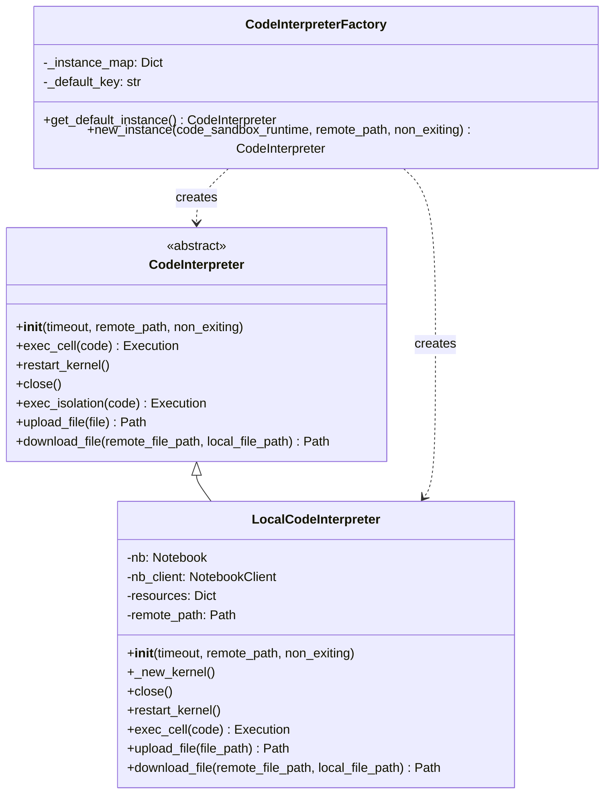
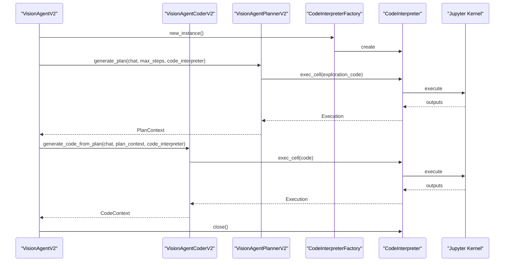
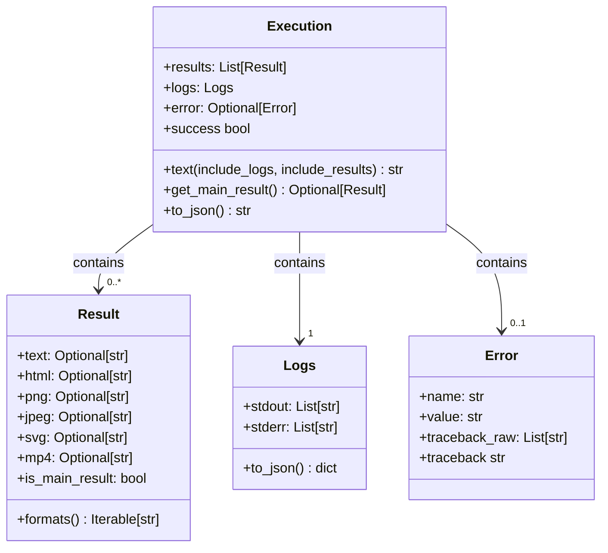
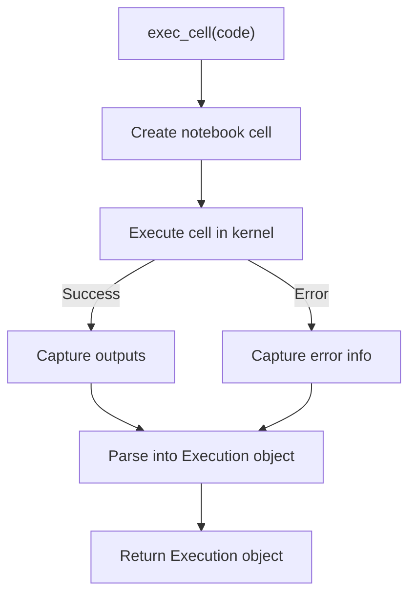

<!-- source: DeepWiki mcp.deepwiki.com · repo landing-ai/vision-agent · page 4.1 Code Interpreter · fetched 2026-10-27 -->

# Code Interpreter

<details>
<summary>Relevant source files</summary>

The following files were used as context for generating this wiki page:

- [poetry.lock](poetry.lock)
- [pyproject.toml](pyproject.toml)
- [vision_agent/utils/execute.py](vision_agent/utils/execute.py)

</details>


The Code Interpreter system provides a controlled environment for executing Python code generated by Vision Agent components. It serves as the execution engine that runs, monitors, and captures outputs from AI-generated code that performs computer vision tasks. This page documents the Code Interpreter interface and its implementation.

For information about the overall execution workflow, see [Execution Workflow](#4.2).

## Architecture Overview

The Code Interpreter employs an abstract interface pattern with concrete implementations based on execution environments. The current primary implementation executes code in a Jupyter notebook kernel.



Sources: [vision_agent/utils/execute.py:345-553]()

## Interface and Implementation

### CodeInterpreter Abstract Interface

`CodeInterpreter` is an abstract base class that defines the interface for executing code:

- `exec_cell(code)`: Executes a single cell of code and returns the results
- `restart_kernel()`: Restarts the execution kernel
- `close()`: Closes and cleans up resources
- `exec_isolation(code)`: Executes code in isolation (restarts kernel first)
- `upload_file(file)`: Uploads a file to the execution environment
- `download_file(remote_file_path, local_file_path)`: Downloads a file from the execution environment

Sources: [vision_agent/utils/execute.py:345-389]()

### LocalCodeInterpreter Implementation

`LocalCodeInterpreter` implements the `CodeInterpreter` interface using Jupyter notebooks and nbclient:

- Creates and manages a Jupyter notebook kernel
- Executes code cells and captures outputs
- Handles kernel lifecycle (start, restart, shutdown)
- Provides file upload/download capabilities for the local execution environment

Sources: [vision_agent/utils/execute.py:391-512]()

### Factory Pattern

The `CodeInterpreterFactory` creates appropriate CodeInterpreter instances based on configuration:

- `new_instance()`: Creates a new CodeInterpreter instance
- `get_default_instance()`: Returns a shared default instance (primarily for testing)

Sources: [vision_agent/utils/execute.py:514-553]()

## Integration with Vision Agent



Sources: [vision_agent/utils/execute.py:345-375]()

## Execution Data Models

The system uses several data models to represent execution results:

### Execution

The `Execution` class is the primary container for code execution results:



Sources: [vision_agent/utils/execute.py:70-203](), [vision_agent/utils/execute.py:205-342]()

### Result Types and MIME Types

The Result class captures different output types produced by code execution:

- Text output (`text/plain`)
- Rich media (HTML, Markdown, SVG, PNG, JPEG, etc.)
- Structured data (JSON)
- Video (`video/mp4/base64`)
- Custom artifacts

The `MimeType` enum defines all supported MIME types for results.

Sources: [vision_agent/utils/execute.py:33-48](), [vision_agent/utils/execute.py:70-203]()

## Execution Process

When executing code through the CodeInterpreter:

1. Code is submitted as a string to `exec_cell()`
2. The interpreter creates a Jupyter notebook cell with the code
3. The cell is executed in the kernel
4. Outputs, including stdout/stderr streams and rich media, are captured
5. Results are parsed into an `Execution` object
6. Any errors are caught and included in the `Execution`
7. The `Execution` object is returned to the caller



Sources: [vision_agent/utils/execute.py:454-492](), [vision_agent/utils/execute.py:556-582]()

## Error Handling

The system handles several types of errors:

- **CellTimeoutError**: When code execution exceeds the timeout limit
- **DeadKernelError**: When the Jupyter kernel crashes or becomes unresponsive
- **General exceptions**: Any other errors during execution

For all error types, the system:
1. Captures traceback information
2. Creates an `Error` object with name, value, and traceback
3. Returns an `Execution` object with the error information
4. In some cases, attempts recovery (e.g., interrupting the kernel or restarting it)

Sources: [vision_agent/utils/execute.py:474-492]()

## Example Usage

The following example shows how a typical interaction with the Code Interpreter works:

```python
# Create a new code interpreter
code_interpreter = CodeInterpreterFactory.new_instance()

try:
    # Execute some code
    execution = code_interpreter.exec_cell("""
        import numpy as np
        import matplotlib.pyplot as plt
        
        # Generate some data
        x = np.linspace(0, 10, 100)
        y = np.sin(x)
        
        # Plot the data
        plt.figure(figsize=(8, 4))
        plt.plot(x, y)
        plt.title('Sine Wave')
        plt.xlabel('x')
        plt.ylabel('sin(x)')
        plt.grid(True)
        plt.show()
        
        # Return a value
        'Execution complete'
    """)
    
    # Check if execution was successful
    if execution.success:
        # Access the main result
        main_result = execution.get_main_result()
        if main_result:
            print(f"Main result: {main_result.text}")
        
        # Access plot outputs
        for result in execution.results:
            if 'png' in result.formats():
                print("Plot generated successfully")
    else:
        # Handle error
        print(f"Error: {execution.error.name}: {execution.error.value}")
        print(execution.error.traceback)
        
finally:
    # Always close the interpreter to clean up resources
    code_interpreter.close()
```

Sources: [vision_agent/utils/execute.py:345-389](), [vision_agent/utils/execute.py:258-316]()

## Integration with Other Components

The CodeInterpreter is a critical supporting component used by the following Vision Agent components:

- **VisionAgentV2**: Uses it to execute generated code for processing images
- **VisionAgentCoderV2**: Uses it to test and debug generated code
- **VisionAgentPlannerV2**: Uses it for exploratory code execution during plan generation
- **Vision Tools**: The generated code uses vision tools to perform image processing tasks

Sources: [vision_agent/utils/execute.py:345-389]()

---

