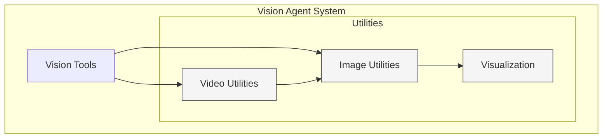
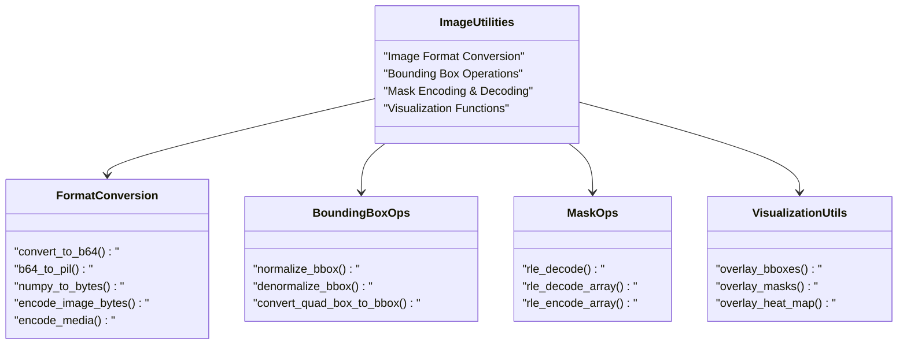
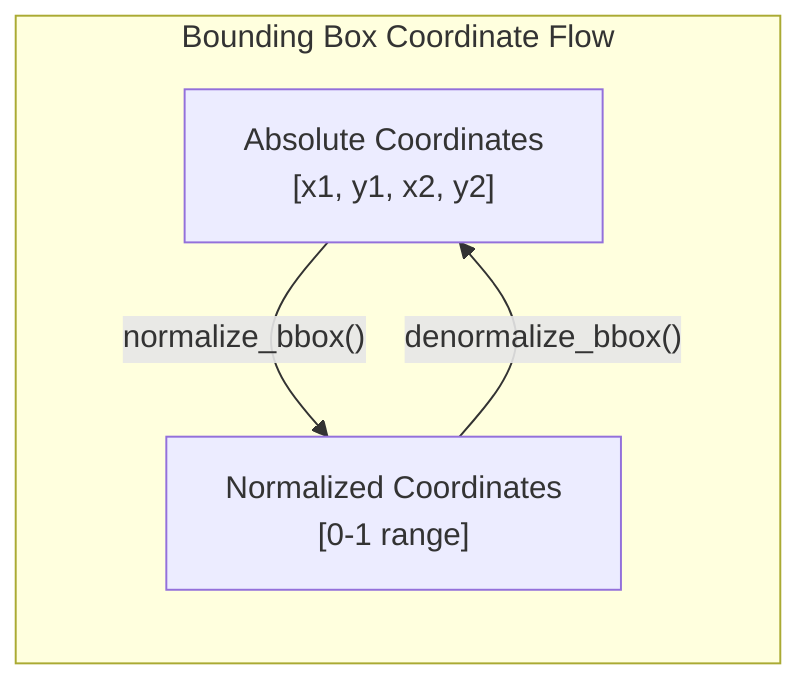
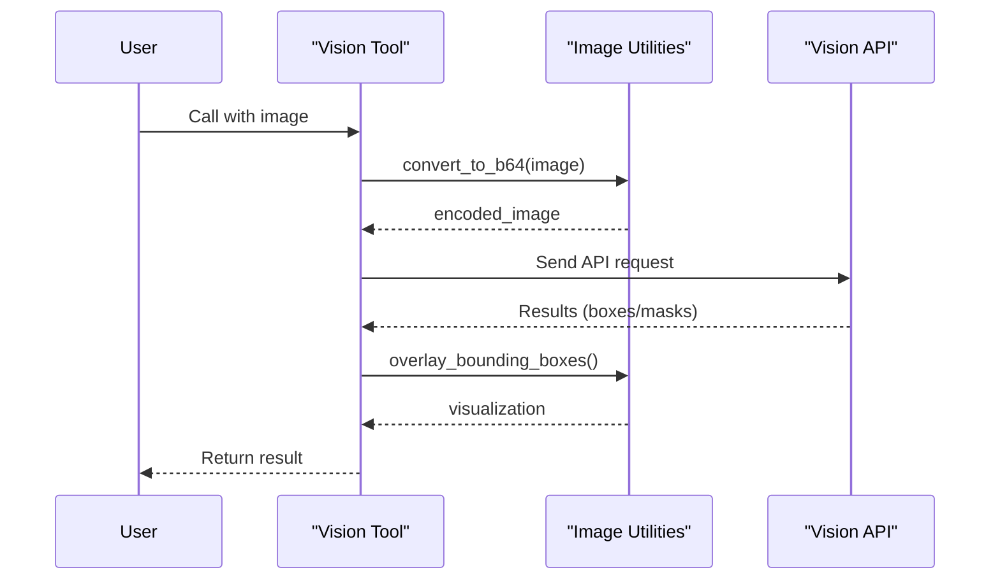

<!-- source: DeepWiki mcp.deepwiki.com · repo landing-ai/vision-agent · page 5.1 Image Utilities · fetched 2026-10-27 -->

# Image Utilities

<details>
<summary>Relevant source files</summary>

The following files were used as context for generating this wiki page:

- [.github/workflows/ci_cd.yml](.github/workflows/ci_cd.yml)
- [vision_agent/.sim_tools/df.csv](vision_agent/.sim_tools/df.csv)
- [vision_agent/.sim_tools/embs.npy](vision_agent/.sim_tools/embs.npy)
- [vision_agent/utils/image_utils.py](vision_agent/utils/image_utils.py)

</details>


This document provides technical documentation for the Image Utilities module in the vision-agent system. This module offers essential image processing functions that support various vision tools throughout the codebase.

For information about video processing, see [Video Utilities](#5.2).

## Purpose and Scope

The Image Utilities module (`image_utils.py`) provides fundamental image manipulation capabilities including:
- Image format conversion (between NumPy, PIL, base64, and bytes)
- Bounding box coordinate operations (normalization/denormalization)
- Segmentation mask encoding/decoding
- Visualization utilities for detection and segmentation results

These utilities serve as core building blocks that enable the vision tools to process, transform, and visualize image data consistently across the system.

Sources: [vision_agent/utils/image_utils.py:1-401]()

## System Context

The following diagram illustrates how Image Utilities fit within the larger Vision Agent system architecture:



Sources: [vision_agent/utils/image_utils.py:1-15]()

## Functional Components

The Image Utilities module is organized around four primary functional areas:



Sources: [vision_agent/utils/image_utils.py:1-401]()

## Image Format Conversion

The module provides functions to convert between different image representations that are commonly used throughout the system.

### Key Functions

| Function | Description | Input Types | Output |
|----------|-------------|-------------|--------|
| `convert_to_b64()` | Converts image to base64 string | str, Path, np.ndarray, PIL.Image | base64 string |
| `b64_to_pil()` | Converts base64 string to PIL Image | base64 string | PIL.Image |
| `numpy_to_bytes()` | Converts NumPy array to bytes | np.ndarray | bytes |
| `encode_image_bytes()` | Encodes image bytes as base64 with optional resizing | bytes | base64 string |
| `encode_media()` | General-purpose media encoder for various formats | str, Path, np.ndarray, PIL.Image | base64 string or URL |

The `encode_media()` function is particularly versatile, handling different input formats including file paths, URLs, NumPy arrays, PIL Images, and even video files.

Sources: [vision_agent/utils/image_utils.py:107-244]()

## Bounding Box Operations

Bounding box operations facilitate standardized coordinate handling for object detection tasks.

### Key Functions

| Function | Description | Input | Output |
|----------|-------------|-------|--------|
| `normalize_bbox()` | Normalizes coordinates to 0-1 range | bbox, image_size | normalized bbox |
| `denormalize_bbox()` | Converts normalized coordinates to absolute pixel values | normalized bbox, image_size | absolute bbox |
| `convert_quad_box_to_bbox()` | Converts 8-point quadrilateral to 4-point rectangle | quad_box | bbox |

These functions support consistent coordinate representation across different image sizes and formats.



Sources: [vision_agent/utils/image_utils.py:40-49](), [vision_agent/utils/image_utils.py:246-280]()

## Mask Encoding and Decoding

Run-length encoding (RLE) functions enable efficient storage and transmission of segmentation masks.

### Key Functions

| Function | Description | Input | Output |
|----------|-------------|-------|--------|
| `rle_decode()` | Decodes RLE string format to binary mask | mask_rle, shape | np.ndarray |
| `rle_decode_array()` | Decodes RLE dictionary format to binary mask | rle | np.ndarray |
| `rle_encode_array()` | Encodes binary mask as RLE dictionary | mask | dict |

RLE representation significantly reduces the memory and bandwidth requirements for transmitting binary masks, which is essential for efficient segmentation workflows.

Sources: [vision_agent/utils/image_utils.py:52-105]()

## Visualization Functions

The module provides functions to visualize detection and segmentation results on images.

### Key Functions

| Function | Description | Input | Output |
|----------|-------------|-------|--------|
| `overlay_bboxes()` | Overlays bounding boxes on an image | image, bboxes | PIL.Image |
| `overlay_masks()` | Overlays segmentation masks on an image | image, masks, alpha | PIL.Image |
| `overlay_heat_map()` | Overlays heat map on an image | image, heat_map, alpha | PIL.Image |

These visualization functions use a predefined color palette (`COLORS`) to ensure consistent visual representation.

Sources: [vision_agent/utils/image_utils.py:16-37](), [vision_agent/utils/image_utils.py:283-401]()

## Common Usage Patterns

The Image Utilities are used extensively throughout the vision tools system. Here are some typical usage patterns:

### Processing Detection Results

```python
# Load and prepare image
image = load_image("example.jpg")
image_size = get_image_size(image)

# Run detection
detections = glee_object_detection("person", image)

# Visualize results
result_image = overlay_bounding_boxes(image, detections)
save_image(result_image, "result.jpg")
```

### Handling Segmentation Masks

```python
# Run instance segmentation
results = florence2_sam2_instance_segmentation("car", image)

# Extract masks
for result in results:
    # Access normalized bbox
    bbox = result['bbox']  # [x1, y1, x2, y2] in 0-1 range
    
    # Access binary mask
    mask = result['mask']  # 2D binary array
    
    # For storage: encode mask to save space
    encoded_mask = rle_encode_array(mask)
```

### Format Conversion for API Integration

```python
# Prepare image for API request
image_path = "example.jpg"
encoded_image = convert_to_b64(image_path)

# Later: decode response that contains base64 images
response_image = b64_to_pil(response_data["image"])
```

Sources: [vision_agent/.sim_tools/df.csv:1-671]()

## Integration with Vision Tools

Image Utilities functions are used by various vision tools as shown in this simplified workflow:



Sources: [vision_agent/.sim_tools/df.csv:671-722]()

## Summary

The Image Utilities module provides a comprehensive set of functions that form the foundation of image processing capabilities in the Vision Agent system. By standardizing common operations like format conversion, coordinate normalization, and visualization, these utilities ensure consistent behavior across all vision tools while reducing code duplication.

---

