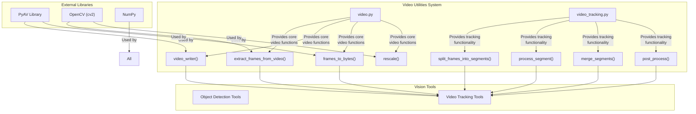
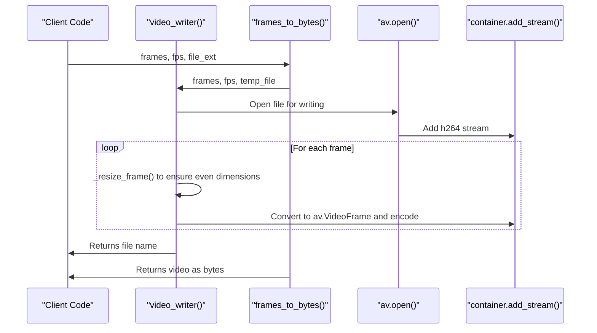
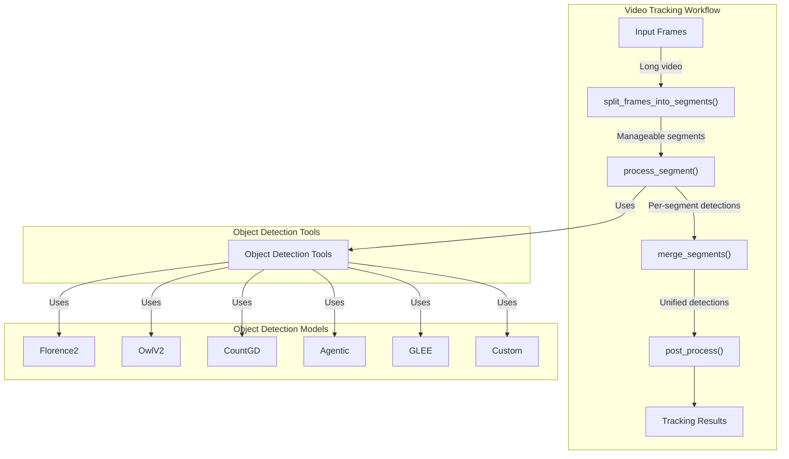
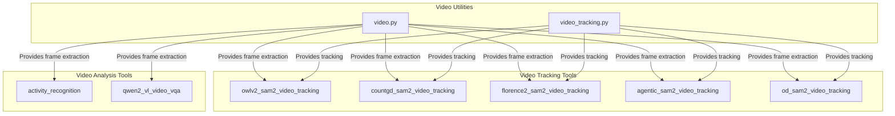

<!-- source: DeepWiki mcp.deepwiki.com · repo landing-ai/vision-agent · page 5.2 Video Utilities · fetched 2026-10-27 -->

# Video Utilities

<details>
<summary>Relevant source files</summary>

The following files were used as context for generating this wiki page:

- [tests/integ/test_tools.py](tests/integ/test_tools.py)
- [tests/unit/tools/test_video.py](tests/unit/tools/test_video.py)
- [vision_agent/utils/exceptions.py](vision_agent/utils/exceptions.py)
- [vision_agent/utils/video.py](vision_agent/utils/video.py)
- [vision_agent/utils/video_tracking.py](vision_agent/utils/video_tracking.py)

</details>


This document details the video processing utilities provided by the Vision Agent system. These utilities facilitate video loading, frame extraction, video creation, and video object tracking. For information about image processing, see [Image Utilities](#5.1).

## Overview

The video utilities module provides core functionality for handling video data within the Vision Agent system. These utilities support various video-related tasks, including frame extraction, video creation from frames, and pre-processing for video tracking applications.



Sources: [vision_agent/utils/video.py](), [vision_agent/utils/video_tracking.py]()

## Core Video Processing Functions

The core video utilities handle basic video operations and are primarily defined in the `video.py` module.

### Video Creation

The system provides functions to create videos from frames:

- `video_writer(frames, fps, file)`: Creates a video file from a list of frames
- `frames_to_bytes(frames, fps, file_ext)`: Converts frames to a video encoded as bytes

Both functions support configurable frame rates and use the PyAV library for efficient video encoding with the h264 codec.



Sources: [vision_agent/utils/video.py:24-72]()

### Frame Extraction

The `extract_frames_from_video` function extracts frames from a video at a specified rate:

```
extract_frames_from_video(video_uri, fps=1.0) -> List[Tuple[np.ndarray, float]]
```

Key features:
- Supports both local video files and URLs
- Configurable frame extraction rate
- Returns frames with their corresponding timestamps
- Includes caching to prevent redundant processing of the same video
- Automatically handles videos with missing FPS metadata
- Rescales large frames to a maximum of 1024x1024 pixels

Sources: [vision_agent/utils/video.py:94-148](), [tests/unit/tools/test_video.py:10-44]()

## Video Tracking Utilities

The video tracking utilities provide support for object tracking across video frames and are defined in the `video_tracking.py` module.

### Tracking Workflow



Sources: [vision_agent/utils/video_tracking.py:22-347]()

### Key Components

#### 1. Frame Segmentation

The `split_frames_into_segments` function divides a long video into manageable segments:

```python
split_frames_into_segments(
    frames: List[np.ndarray], 
    segment_size: int = 50, 
    overlap: int = 1
) -> List[List[np.ndarray]]
```

This is important for processing long videos efficiently and avoiding memory issues.

Sources: [vision_agent/utils/video_tracking.py:22-51]()

#### 2. Segment Processing

The `process_segment` function handles the detection of objects within a segment:

```python
process_segment(
    segment_frames: List[np.ndarray],
    od_model: ODModels,
    prompt: str,
    deployment_id: Optional[str],
    chunk_length: Optional[int],
    image_size: Tuple[int, ...],
    segment_index: int,
    object_detection_tool: Callable
) -> Any
```

This function:
- Applies the specified object detection model to frames
- Transforms detections into a standardized format
- Sends the detections to SAM2 for instance segmentation
- Joins detection scores with segmentation results

Sources: [vision_agent/utils/video_tracking.py:54-122]()

#### 3. Segment Merging

The `merge_segments` function combines detections across segments:

```python
merge_segments(detections_per_segment: List[Any], overlap: int = 1) -> List[Any]
```

This function:
- Decodes masks from their run-length encoded (RLE) format
- Matches objects across segment boundaries using IoU (Intersection over Union)
- Maintains consistent object IDs throughout the video

The matching process uses the `_match_by_iou` function, which employs the Hungarian algorithm (via `linear_sum_assignment`) to find optimal matches between objects in consecutive frames.

Sources: [vision_agent/utils/video_tracking.py:195-279]()

#### 4. Post-Processing

The `post_process` function performs final processing on the merged detections:

```python
post_process(
    merged_detections: List[Any],
    image_size: Tuple[int, ...],
) -> Dict[str, Any]
```

This function:
- Remaps object IDs to make them more user-friendly
- Adds bounding boxes derived from masks
- Prepares both return data and display data formats

The return value contains:
- `return_data`: Complete detection data with masks as numpy arrays
- `display_data`: Streamlined format for visualization with RLE-encoded masks

Sources: [vision_agent/utils/video_tracking.py:282-347]()

## Integration with Vision Tools

The video utilities are integral to several video-related vision tools. Here are key tools that use these utilities:



Sources: [tests/integ/test_tools.py:70-82](), [tests/integ/test_tools.py:116-127](), [tests/integ/test_tools.py:150-160](), [tests/integ/test_tools.py:191-201](), [tests/integ/test_tools.py:254-262](), [tests/integ/test_tools.py:265-274](), [tests/integ/test_tools.py:454-496]()

## Error Handling

The video utilities include robust error handling to manage various failure scenarios:

| Error Scenario | Handling Approach |
|----------------|-------------------|
| Invalid video URI | Returns empty list of frames |
| Invalid FPS values | Falls back to default FPS (1.0) |
| Video with no FPS metadata | Uses default FPS (24.0) |
| Memory constraints with large videos | Segments video for processing |
| Remote tool failures | Raises `RemoteToolCallFailed` exception |

Sources: [tests/unit/tools/test_video.py:23-44](), [vision_agent/utils/exceptions.py:16-22]()

## Performance Considerations

Several optimizations are implemented to enhance performance:

1. **Frame Caching**: `extract_frames_from_video` uses `@lru_cache` to avoid reprocessing the same video.
   ```python
   @lru_cache(maxsize=8)
   def extract_frames_from_video(video_uri: str, fps: float = _DEFAULT_INPUT_FPS) -> List[Tuple[np.ndarray, float]]:
   ```

2. **Frame Rescaling**: Large frames are automatically rescaled to 1024x1024 max dimensions.

3. **Video Segmentation**: Long videos are processed in segments to manage memory usage.

4. **Efficient Video Encoding**: Uses h264 codec with optimized settings for good quality-to-size ratio.

Sources: [vision_agent/utils/video.py:93](), [vision_agent/utils/video.py:141](), [vision_agent/utils/video_tracking.py:22-51](), [vision_agent/utils/video.py:40]()

## Usage Examples

Here's an example of how to use the video utilities for frame extraction and processing:

```python
# Extract frames from a video at 1 fps
frames_with_timestamps = extract_frames_from_video("path/to/video.mp4", fps=1.0)
frames = [frame for frame, _ in frames_with_timestamps]

# Process frames with a video tracking tool
results = owlv2_sam2_video_tracking(
    prompt="person",
    frames=frames
)

# Create a new video from processed frames
processed_frames = [...] # frames with visualizations
video_path = video_writer(processed_frames, fps=24)
```

For video tracking across a long video, the workflow typically includes:

```python
# Extract frames
frames = [...]

# Split into segments
segments = split_frames_into_segments(frames, segment_size=50)

# Process each segment
detections = []
for i, segment in enumerate(segments):
    segment_results = process_segment(
        segment,
        od_model=ODModels.OWLV2,
        prompt="car",
        deployment_id=None,
        chunk_length=None,
        image_size=frames[0].shape,
        segment_index=i,
        object_detection_tool=my_detection_function
    )
    detections.append(segment_results)

# Merge segments and post-process
merged = merge_segments(detections)
final_results = post_process(merged, frames[0].shape)
```

Sources: [tests/integ/test_tools.py:70-82](), [tests/integ/test_tools.py:454-496]()

---

