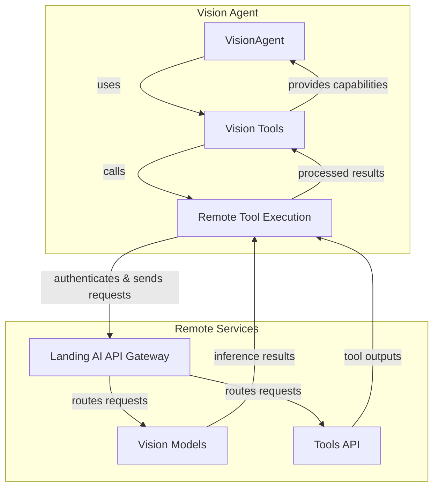
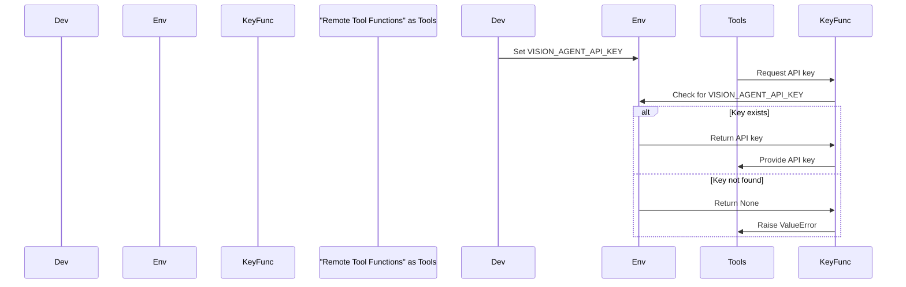
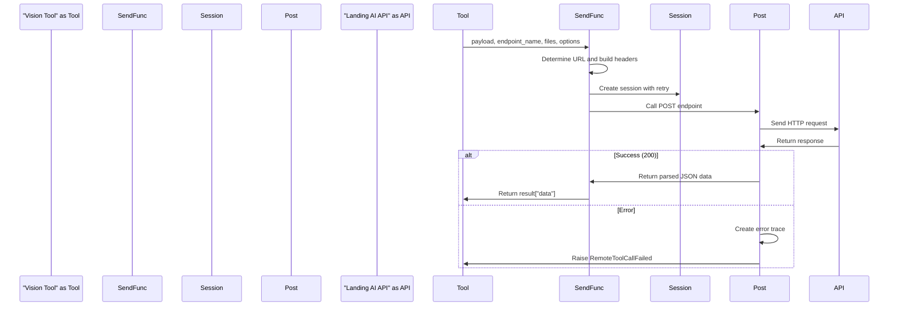
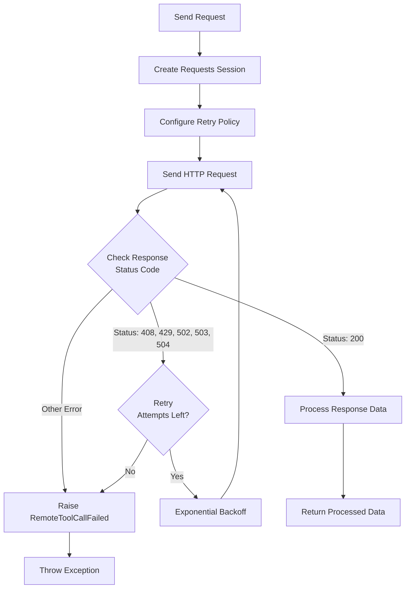
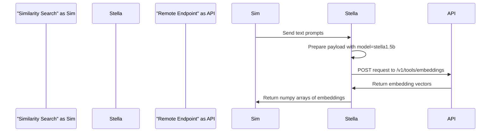

<!-- source: DeepWiki mcp.deepwiki.com · repo landing-ai/vision-agent · page 5.3 Remote Tool Execution · fetched 2026-10-27 -->

# Remote Tool Execution

<details>
<summary>Relevant source files</summary>

The following files were used as context for generating this wiki page:

- [vision_agent/sim/sim.py](vision_agent/sim/sim.py)
- [vision_agent/utils/tools.py](vision_agent/utils/tools.py)

</details>


This document describes the remote tool execution system used in the vision-agent framework. Remote tool execution enables the vision agent to access powerful computer vision models and tools that run on remote servers rather than locally, providing access to state-of-the-art inference capabilities without requiring local GPU resources.

For information about the tools themselves, see [Vision Tools](#3) and for similarity-based tool recommendations, see [Similarity Search](#5.4).

## System Overview

The remote tool execution system facilitates communication between the vision agent and remote inference endpoints hosted on Landing AI's infrastructure. This allows the agent to leverage powerful vision models for tasks such as object detection, instance segmentation, OCR, and other vision tasks.



Sources: [vision_agent/utils/tools.py:19-21](). [vision_agent/utils/tools.py:47-83]().

## Authentication and Configuration

Remote tool execution requires authentication using a Vision Agent API key. This key is retrieved from environment variables or can be provided programmatically.



Sources: [vision_agent/utils/tools.py:24-32]().

The authentication system uses a basic authentication header with the API key and includes additional metadata about the request source:

```
Headers = {
    "Authorization": f"Basic {vision_agent_api_key}",
    "X-Source": "vision_agent",
    "runtime_tag": "<optional runtime tag>"
}
```

Sources: [vision_agent/utils/tools.py:61-67]().

## Core API Functions

The remote tool execution system provides two main functions for sending requests to remote endpoints:

1. `send_inference_request` - For general model inference requests
2. `send_task_inference_request` - For specific task-oriented requests

### Inference Request Workflow



Sources: [vision_agent/utils/tools.py:48-83](), [vision_agent/utils/tools.py:86-109](), [vision_agent/utils/tools.py:136-188]().

## Request Types and Data Handling

The system supports different types of requests:

| Request Type | Description | Function Support |
|-------------|-------------|-----------------|
| JSON payload | Standard JSON request body | Both functions |
| Form data | Multi-part form data | Both functions |
| File upload | Binary file uploads | Both functions |

### File Handling

When sending files to remote endpoints, the system accepts a list of file tuples and properly formats them for transmission:

```python
# Example of files parameter format
files = [
    ("image", binary_data),
    ("mask", binary_data)
]
```

For tracing purposes, files are encoded in base64 when included in the trace data.

Sources: [vision_agent/utils/tools.py:144-146]().

## Retry and Error Handling

The system implements a robust retry mechanism for handling transient network issues and server errors:



The retry policy uses exponential backoff with a factor of 2 and retries for specific status codes that indicate temporary failures.

Sources: [vision_agent/utils/tools.py:112-133](), [vision_agent/utils/tools.py:117-130]().

## Tool Call Tracing

The system includes functionality to trace tool calls for debugging and monitoring purposes. When enabled, traces include:

- Endpoint URL
- Request type
- Request payload
- Response data
- Error information (if any)
- File data (base64 encoded)

Traces can be enabled by setting the environment variable `REPORT_TOOL_TRACES` to a truthy value.

Sources: [vision_agent/utils/tools.py:35-45](), [vision_agent/utils/tools.py:162-188]().

## Remote Embedding Requests

In addition to standard remote tool execution, the system also supports remote embedding generation through the `stella_embeddings` function:



This functionality is primarily used for similarity search in the tool recommendation system.

Sources: [vision_agent/sim/sim.py:53-75](), [vision_agent/sim/sim.py:284-286]().

## Remote Endpoints

The system is configured to use the following remote endpoints:

| Endpoint | Purpose | URL Construction |
|----------|---------|-----------------|
| Model API (v1) | Legacy model inference | `{base_url}/v1/agent/model/{endpoint_name}` |
| Tools API (v2) | New tools API | `{base_url}/v1/tools/{endpoint_name}` |
| Embeddings API | Text embeddings | `{base_url}/v1/tools/embeddings` |

The base URL defaults to `https://api.va.landing.ai` but can be overridden using the `LANDINGAI_URL` environment variable.

Sources: [vision_agent/utils/tools.py:19-21](), [vision_agent/utils/tools.py:56-58](), [vision_agent/sim/sim.py:60]().

## Integration with the Vision Agent System

Remote tool execution is a foundational component that enables many of the vision capabilities in the system. Vision tools register themselves and use the remote execution system to perform inference and processing:

```mermaid
classDiagram
    class "Vision Tool" {
        +execute()
        +process_results()
    }
    
    class "Remote Tool Execution" {
        +send_inference_request()
        +send_task_inference_request()
        +_create_requests_session()
        +_call_post()
    }
    
    class "Tool Registry" {
        +TOOLS
        +register_tool()
    }
    
    class "VisionAgent" {
        +__call__()
        +chat()
    }
    
    "Vision Tool" --> "Remote Tool Execution": uses
    "Tool Registry" --> "Vision Tool": registers
    "VisionAgent" --> "Tool Registry": accesses tools
```

Sources: [vision_agent/utils/tools.py:48-83](), [vision_agent/utils/tools.py:86-109]().

## Environment Variables

The remote tool execution system uses several environment variables for configuration:

| Environment Variable | Purpose | Default |
|---------------------|---------|---------|
| `VISION_AGENT_API_KEY` | Authentication key | None (Required) |
| `LANDINGAI_URL` | Base URL for API endpoints | `https://api.va.landing.ai` |
| `REPORT_TOOL_TRACES` | Enable tool call tracing | `False` |
| `TOOL_ENDPOINT_URL` | Override the entire endpoint URL | None |
| `RUNTIME_TAG` | Tag included in request headers | `vision-agent` |

Sources: [vision_agent/utils/tools.py:19-21](), [vision_agent/utils/tools.py:24-32](), [vision_agent/utils/tools.py:35-36](), [vision_agent/utils/tools.py:57-58](), [vision_agent/utils/tools.py:66-67]().

---

