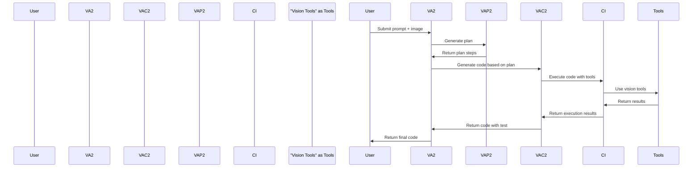
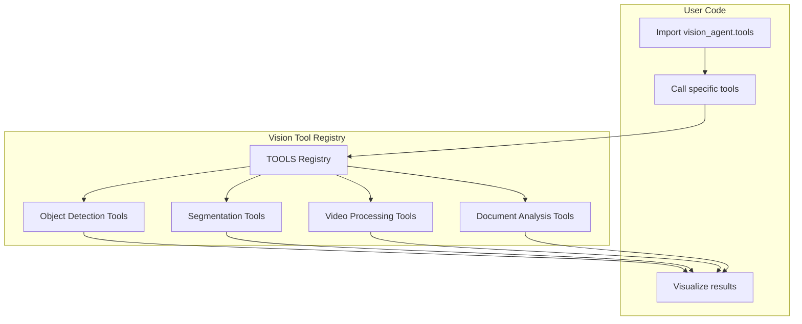
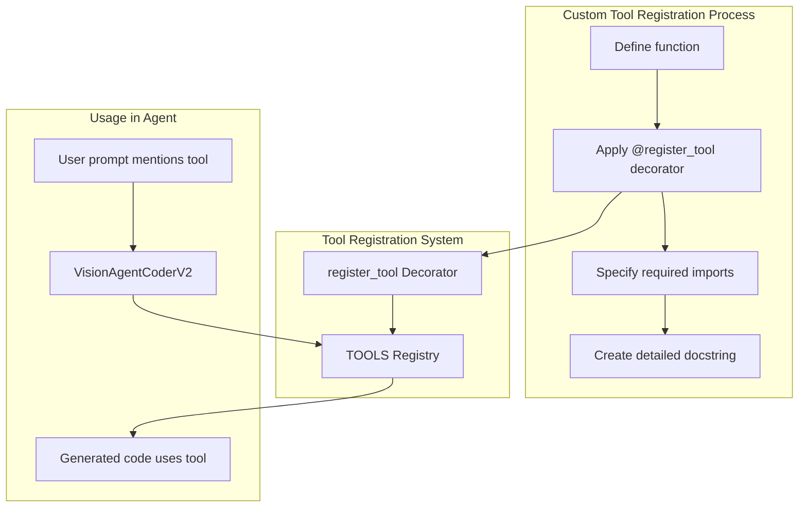
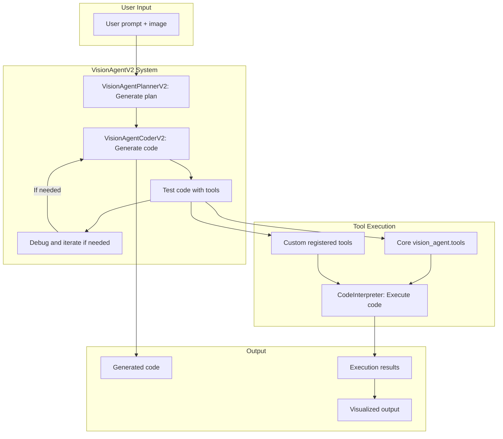

<!-- source: DeepWiki mcp.deepwiki.com · repo landing-ai/vision-agent · page 7 Examples and Usage · fetched 2026-10-27 -->

# Examples and Usage

<details>
<summary>Relevant source files</summary>

The following files were used as context for generating this wiki page:

- [README.md](README.md)
- [docs/index.md](docs/index.md)
- [examples/custom_tools/README.md](examples/custom_tools/README.md)
- [examples/custom_tools/run_custom_tool.py](examples/custom_tools/run_custom_tool.py)

</details>


This page provides practical examples and usage patterns for the Vision Agent system. It demonstrates how to interact with the system through prompts, use specific tools directly in your code, and extend the system with custom tools to fit specialized requirements.

For information about system architecture, see [System Architecture](#1.1). For installation instructions and setup requirements, see [Installation and Dependencies](#1.2).

## Basic Usage Patterns

There are two primary ways to use the Vision Agent system:

1. **Prompt-Based Usage**: Submit a prompt and image to generate code for visual AI tasks
2. **Direct Tool Usage**: Call specific vision tools directly in your code

### Prompt-Based Usage Workflow

The following diagram illustrates the prompt-based workflow:



Sources: [README.md:83-104]()

To use the prompt-based approach:

1. Set up the required API keys as environment variables
2. Create an instance of `VisionAgentCoderV2`
3. Call the `generate_code` method with your prompt and image
4. Save or execute the generated code

```python
# Basic example of prompt-based usage
from vision_agent.agent import VisionAgentCoderV2
from vision_agent.models import AgentMessage

agent = VisionAgentCoderV2(verbose=True)

code_context = agent.generate_code(
    [
        AgentMessage(
            role="user",
            content="Describe the image",
            media=["friends.jpg"]
        )
    ]
)

with open("generated_code.py", "w") as f:
    f.write(code_context.code + "\n" + code_context.test)
```

Sources: [README.md:83-104]()

### Direct Tool Usage

For more control over the specific vision capabilities you need, you can directly use the vision tools provided by the library:



Sources: [README.md:118-152]()

#### Image Analysis Example

```python
# Example for direct tool usage with image analysis
import vision_agent.tools as T
import matplotlib.pyplot as plt

# Load the image
image = T.load_image("people.png")

# Detect people in the image
dets = T.countgd_object_detection("person", image)

# Visualize the results
viz = T.overlay_bounding_boxes(image, dets)
T.save_image(viz, "people_detected.png")
plt.imshow(viz)
plt.show()
```

Sources: [README.md:127-151]()

#### Video Processing Example

```python
# Example for direct tool usage with video processing
import vision_agent.tools as T

# Extract frames from video
frames_and_ts = T.extract_frames_and_timestamps("people.mp4")
frames = [f["frame"] for f in frames_and_ts]

# Track people across frames
tracks = T.countgd_sam2_video_tracking("person", frames)

# Visualize the tracking results
viz = T.overlay_segmentation_masks(frames, tracks)
T.save_video(viz, "people_detected.mp4")
```

Sources: [README.md:153-173]()

## Creating Custom Tools

The Vision Agent system can be extended with custom tools to address specific use cases. This allows you to integrate domain-specific algorithms into the agent workflow.

### Custom Tool Architecture



Sources: [examples/custom_tools/run_custom_tool.py:11-40](), [examples/custom_tools/README.md:33-51]()

### Creating a Custom Tool

To create a custom tool:

1. Define a function that implements the tool's functionality
2. Register it using the `@register_tool` decorator
3. Specify required imports for the execution environment
4. Provide a descriptive docstring with parameters and examples

```python
# Example of creating a custom tool
import numpy as np
from vision_agent.utils.image_utils import get_image_size, normalize_bbox

import vision_agent as va

@va.tools.register_tool(
    imports=[
        "import numpy as np",
        "from vision_agent.utils.image_utils import get_image_size, normalize_bbox",
        "from template_match import template_matching_with_rotation",
    ]
)
def template_match(target_image: np.ndarray, template_image: np.ndarray) -> dict:
    """'template_match' tool that finds the locations of the template image in the
    target image.

    Parameters:
        target_image (np.ndarray): The target image.
        template_image (np.ndarray): The template image.

    Returns:
        dict: A dictionary containing the bounding boxes of the matches.

    Example
    -------
    >>> import cv2
    >>> target_image = cv2.imread("pid.png")
    >>> template_image = cv2.imread("pid_template.png")
    >>> matches = template_match(target_image, template_image)
    """
    image_size = get_image_size(target_image)
    matches = template_matching_with_rotation(target_image, template_image)
    matches["bboxes"] = [normalize_bbox(box, image_size) for box in matches["bboxes"]]
    return matches
```

Sources: [examples/custom_tools/run_custom_tool.py:11-40]()

### Important Considerations for Custom Tools

When creating custom tools, keep these points in mind:

1. The `register_tool` decorator copies the source code of your function but cannot automatically copy imports.
2. You must explicitly specify all required imports in the `imports` parameter of the decorator.
3. Provide a comprehensive docstring that explains parameters, return values, and includes examples.
4. Use type hints to help the agent understand input and output types.

Sources: [examples/custom_tools/README.md:33-51]()

### Using Custom Tools

Once registered, custom tools can be used in two ways:

1. **Through Direct API Calls**:
   ```python
   import vision_agent.tools as T
   
   # Use your custom tool directly
   results = T.template_match(target_image, template_image)
   ```

2. **Through Prompts**:
   ```python
   import vision_agent as va
   from vision_agent.models import AgentMessage
   
   agent = va.agent.VisionAgentCoderV2(verbose=True)
   result = agent.generate_code(
       [
           AgentMessage(
               role="user",
               content="Can you use the 'template_match' tool to find the location of pid_template.png in pid.png?",
               media=["pid.png", "pid_template.png"],
           )
       ]
   )
   ```

Sources: [examples/custom_tools/run_custom_tool.py:43-53](), [examples/custom_tools/README.md:19-30]()

## Common Use Cases and Workflows

The following table outlines common use cases for the Vision Agent system:

| Use Case | Description | Tools Used | Example Task |
|----------|-------------|------------|--------------|
| Object Detection | Detect and locate objects in images | `countgd_object_detection`, `florence2_object_detection`, `owlv2_object_detection` | "Count the number of cars in this parking lot image" |
| Image Segmentation | Create detailed segmentation masks | `sam2_instance_segmentation` | "Segment the people in this crowd photo" |
| Video Tracking | Track objects across video frames | `owlv2_sam2_video_tracking`, `countgd_sam2_video_tracking` | "Track the movement of this athlete through the video" |
| Document Analysis | Extract and analyze text from documents | OCR tools | "Extract the invoice information from this document" |
| Custom Analysis | Specialized domain-specific analysis | Custom tools | "Find all instances of this circuit symbol in the diagram" |

Sources: [README.md:118-173]()

### End-to-End Workflow Example

This diagram shows a complete workflow from user input to final output:



Sources: [README.md:14-15](), [README.md:106-112]()

## LLM Provider Configuration

The Vision Agent system can be configured to use different LLM providers based on your preferences and requirements.

By default, it uses Anthropic Claude 3.7 Sonnet and Gemini Flash 2.0 Experimental models. This configuration can be modified:

1. **Using a Predefined Configuration**:
   ```bash
   # To use only Anthropic models
   cp vision_agent/configs/anthropic_config.py vision_agent/configs/config.py
   ```

2. **Manual Configuration**:
   ```python
   # Example: Changing the planner from Anthropic to OpenAI
   planner: Type[LMM] = Field(default=OpenAILMM)
   planner_kwargs: dict = Field(
       default_factory=lambda: {
           "model_name": "gpt-4o-2024-11-20",
           "temperature": 0.0,
           "image_size": 768,
           "image_detail": "low",
       }
   )
   ```

Sources: [README.md:176-210]()

## Available Models and When to Use Them

The Vision Agent system integrates with various foundation models for different visual tasks:

| Model | Type | Best For | When to Use |
|-------|------|----------|------------|
| Florence2 | Multimodal | General object detection, OCR, document analysis | General-purpose visual understanding |
| CountGD | Object detection | Accurate object counting | When precise counts are needed |
| OwlV2 | Open-vocabulary detection | Finding custom objects | When detecting unusual or custom objects |
| SAM2 | Segmentation | High-quality masks | When detailed shape information is needed |
| Claude | Multimodal LLM | OCR, document analysis | For text-heavy visual tasks |
| Qwen | Visual Q&A | Visual question answering | For open-ended visual queries |
| GLEE | Object detection | Specialized detection | For certain detection scenarios |

Sources: [README.md:118-120]()

By understanding the strengths of each model, you can either let the agent automatically select the appropriate ones for your task or explicitly request specific models in your prompts or direct tool calls.

---

