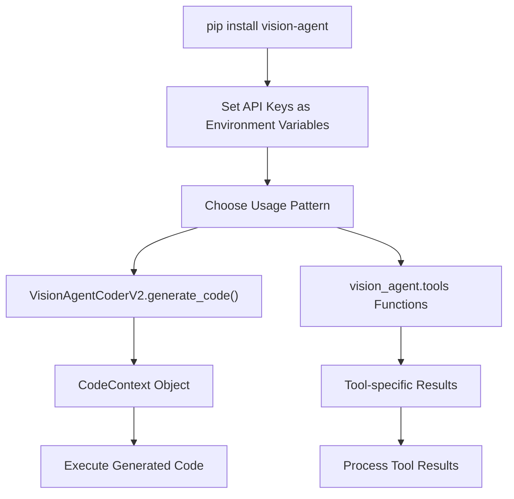
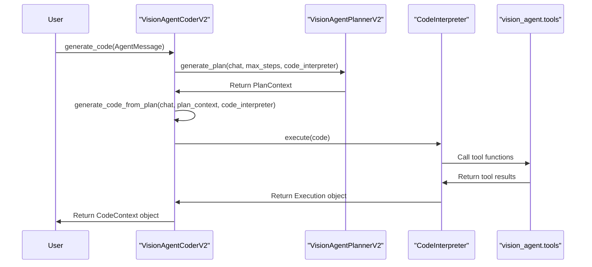
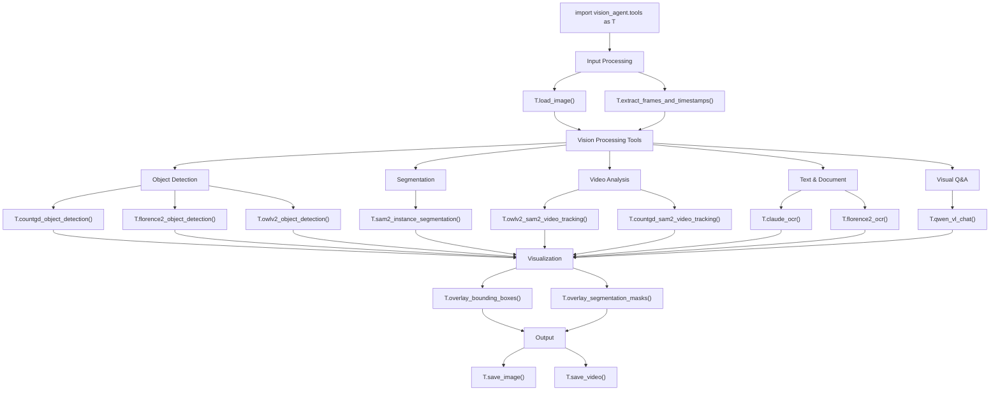
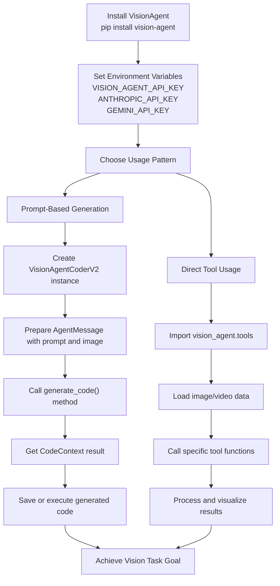

<!-- source: DeepWiki mcp.deepwiki.com · repo landing-ai/vision-agent · page 7.1 Basic Usage · fetched 2026-10-27 -->

# Basic Usage

<details>
<summary>Relevant source files</summary>

The following files were used as context for generating this wiki page:

- [README.md](README.md)
- [docs/index.md](docs/index.md)

</details>


This document provides a comprehensive guide for getting started with the Vision Agent system. It covers the installation process, setting up required API keys, prompting VisionAgent to generate code, and using specific vision tools directly in your applications.

For information about creating custom tools, see [Custom Tools](#7.2).

## Prerequisites

Before using VisionAgent, you need to obtain the following API keys:

| API Key | Purpose | Source |
| ------- | ------- | ------ |
| VisionAgent API key | Access to VisionAgent services | [VisionAgent signup](https://va.landing.ai/agent) |
| Anthropic API key | Powers Claude 3.7 Sonnet LLM for planning and code generation | [Anthropic Console](https://console.anthropic.com/settings/keys) |
| Gemini API key | Powers Gemini Flash 2.0 Experimental LLM for planning and code generation | [Google AI Studio](https://aistudio.google.com/app/apikey) |

Sources: [README.md:23-52]()

## Installation

Install VisionAgent using pip:

```bash
pip install vision-agent
```

Sources: [README.md:54-57]()

## Setting Up API Keys

Set the required API keys as environment variables before running VisionAgent:

```bash
export VISION_AGENT_API_KEY="your-api-key"
export ANTHROPIC_API_KEY="your-api-key"
export GEMINI_API_KEY="your-api-key"
```

Sources: [README.md:71-79]()

## Basic Usage Patterns

VisionAgent offers two primary usage patterns:

### Usage Pattern Workflow



Sources: [README.md:17-21]()

## Prompting VisionAgent

The main usage pattern is to provide a prompt and image to `VisionAgentCoderV2`, which analyzes the task, selects appropriate vision tools, and generates executable code.

### VisionAgent Prompting System



Sources: [README.md:59-106]()

### Sample Code for Prompting VisionAgent

To prompt VisionAgent, create an instance of `VisionAgentCoderV2` and use the `generate_code` method:

```python
# Import the classes you need from the VisionAgent package
from vision_agent.agent import VisionAgentCoderV2
from vision_agent.models import AgentMessage

# Enable verbose output 
agent = VisionAgentCoderV2(verbose=True)

# Add your prompt (content) and image file (media)
code_context = agent.generate_code(
    [
        AgentMessage(
            role="user",
            content="Describe the image",
            media=["friends.jpg"]
        )
    ]
)

# Write the output to a file
with open("generated_code.py", "w") as f:
    f.write(code_context.code + "\n" + code_context.test)
```

Sources: [README.md:80-105]()

### What Happens During Execution

When you prompt VisionAgent with verbose output enabled, the system performs the following operations:

1. **Plan Generation**: The `VisionAgentPlannerV2` creates a step-by-step plan for the code generation task. With verbose mode enabled, you'll see the numbered steps displayed in the console.

2. **Code Generation**: The `VisionAgentCoderV2` uses the plan to generate Python code and a corresponding test case.

3. **Code Testing**: The system tests the generated code using the `CodeInterpreter`. If the test fails, the system will iterate on the code generation process until the test passes.

The final output is stored in the `CodeContext` object, which contains:
- `code`: The main generated Python code
- `test`: A test case to verify the code's functionality
- `feedback`: Information about the code execution

Sources: [README.md:106-112]()

## Using Specific Tools Directly

The second usage pattern is to directly use the vision tools provided in the `vision_agent.tools` module within your own code, bypassing the prompt-based code generation.

### Vision Tools System



Sources: [README.md:118-125]()

### Example: Object Detection

This example demonstrates how to use the `countgd_object_detection` tool to detect and count people in an image:

```python
# Import the VisionAgent Tools library and Matplotlib for visualization
import vision_agent.tools as T
import matplotlib.pyplot as plt

# Load the image
image = T.load_image("people.png")

# Call the function to count objects in an image, specifying "person" as the target
dets = T.countgd_object_detection("person", image)

# Visualize the countgd bounding boxes on the image
viz = T.overlay_bounding_boxes(image, dets)

# Save the visualization to a file
T.save_image(viz, "people_detected.png")

# Display the visualization
plt.imshow(viz)
plt.show()
```

Sources: [README.md:127-151]()

### Example: Video Tracking

This example shows how to track people across video frames:

```python
# Import the VisionAgent Tools library
import vision_agent.tools as T

# Call the function to get the frames and timestamps
frames_and_ts = T.extract_frames_and_timestamps("people.mp4")

# Extract the frames from the frames_and_ts list
frames = [f["frame"] for f in frames_and_ts]

# Call the function to track objects, specifying "person" as the target
tracks = T.countgd_sam2_video_tracking("person", frames)

# Visualize the countgd tracking results on the frames and save the video
viz = T.overlay_segmentation_masks(frames, tracks)
T.save_video(viz, "people_detected.mp4")
```

Sources: [README.md:153-173]()

## Configuring LLM Providers

By default, VisionAgent uses Anthropic Claude 3.7 Sonnet and Gemini Flash 2.0 Experimental. You can configure VisionAgent to use different LLM providers if needed:

### Using Only Anthropic Models

```bash
cp vision_agent/configs/anthropic_config.py vision_agent/configs/config.py
```

### Manually Configuring LLM Providers

You can edit the configuration file directly to change which model is used for specific tasks:

```python
# Example: Changing planner from Anthropic to OpenAI
planner: Type[LMM] = Field(default=OpenAILMM)
planner_kwargs: dict = Field(
    default_factory=lambda: {
        "model_name": "gpt-4o-2024-11-20",
        "temperature": 0.0,
        "image_size": 768,
        "image_detail": "low",
    }
)
```

Sources: [README.md:176-211]()

## Complete Workflow Example

Here's a complete workflow diagram showing how to use VisionAgent from installation to results:



Sources: [README.md:59-173]()

---

