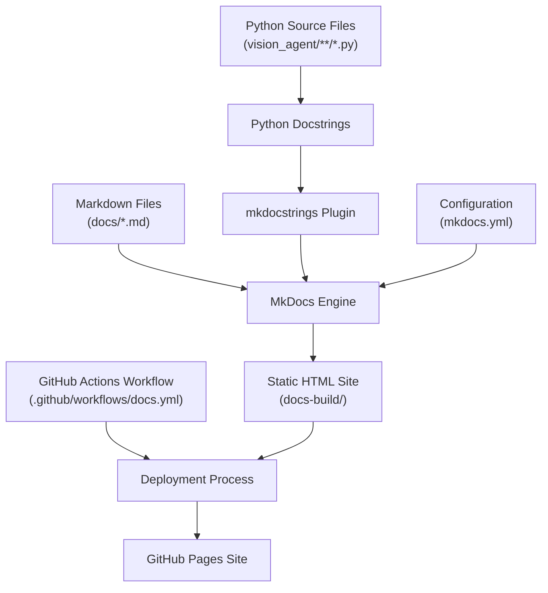
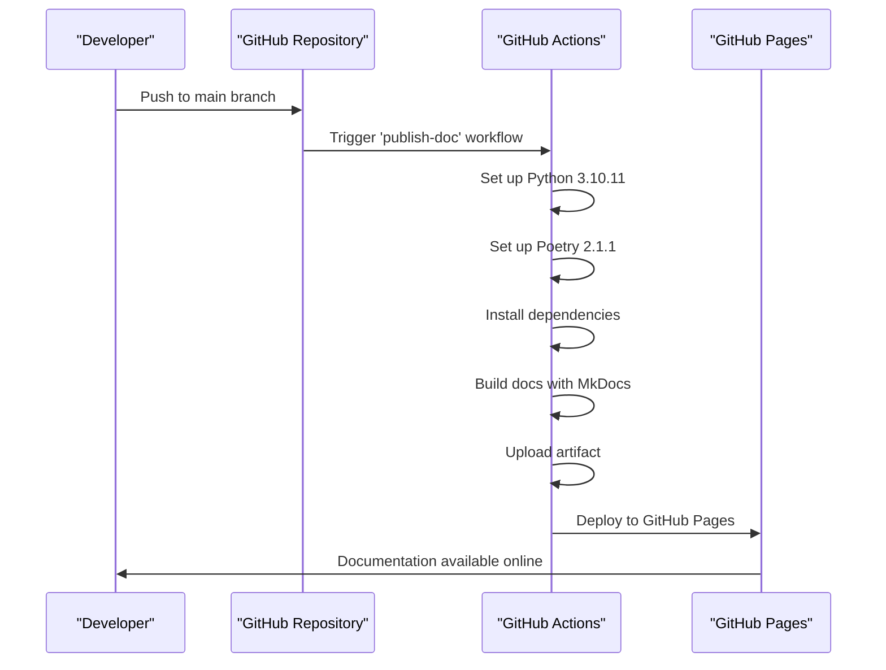
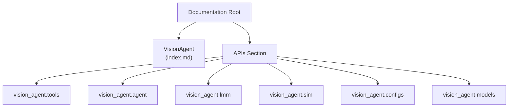
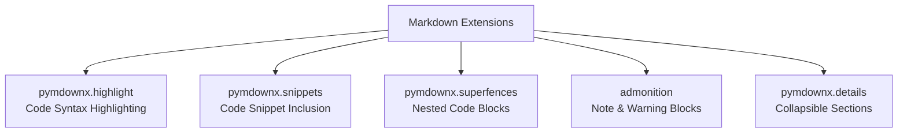

<!-- source: DeepWiki mcp.deepwiki.com · repo landing-ai/vision-agent · page 8.2 Documentation System · fetched 2026-10-27 -->

# Documentation System

<details>
<summary>Relevant source files</summary>

The following files were used as context for generating this wiki page:

- [.github/workflows/docs.yml](.github/workflows/docs.yml)
- [docs/api/agent.md](docs/api/agent.md)
- [mkdocs.yml](mkdocs.yml)
- [vision_agent/models/__init__.py](vision_agent/models/__init__.py)
- [vision_agent/models/agent_types.py](vision_agent/models/agent_types.py)
- [vision_agent/utils/agent.py](vision_agent/utils/agent.py)

</details>


The Documentation System for the vision-agent repository provides a framework for generating, building, and deploying comprehensive documentation. It combines manually written content with automatically generated API documentation from Python docstrings.

For information about the continuous integration and deployment pipeline used for the overall project building and testing, see [CI/CD Pipeline](#8.1).

## System Architecture

The documentation system consists of several integrated components that together generate and deploy the documentation website:



Key components:
- **MkDocs** - Core documentation generator
- **mkdocstrings** - Plugin for extracting Python API documentation
- **Material theme** - Documentation site theme with customizations
- **GitHub Actions** - Automated build and deployment pipeline

Sources: [mkdocs.yml](), [.github/workflows/docs.yml]()

## Build and Deployment Workflow

Documentation builds and deployments are fully automated through GitHub Actions:



The workflow automatically executes whenever changes are pushed to the main branch, ensuring the documentation remains synchronized with the codebase.

Sources: [.github/workflows/docs.yml:3-48]()

## Documentation Configuration

The documentation system is configured through the `mkdocs.yml` file, which defines the site structure, theme settings, and plugin configurations.

### Site Settings

```yaml
site_name: LandingAI VisionAgent Library Documentation
site_url: https://landing-ai.github.io/
repo_url: https://github.com/landing-ai/vision-agent
```

### Theme Configuration

The documentation uses Material for MkDocs with custom settings:

| Feature | Description |
|---------|-------------|
| Light/Dark modes | Automatic color scheme switching based on user preference |
| Search | Advanced search with suggestions and highlighting |
| Code features | Syntax highlighting, code annotations, copy buttons |
| Navigation | Tab navigation, path breadcrumbs |

Sources: [mkdocs.yml:6-36]()

### Navigation Structure

The documentation follows a structured organization defined in the `nav` section:



This organization separates high-level documentation from API reference materials.

Sources: [mkdocs.yml:74-83]()

## API Documentation Generation

The system automatically generates API documentation from Python docstrings using the `mkdocstrings` plugin.

### Docstring Extraction

To document a Python class or module, a reference is added to the appropriate Markdown file:

```markdown
::: vision_agent.agent.agent.Agent

::: vision_agent.agent.vision_agent_v2.VisionAgentV2
```

This directive instructs `mkdocstrings` to extract documentation from the specified module/class and render it in the documentation site.

Sources: [docs/api/agent.md:1-7]()

### Plugin Configuration

The `mkdocstrings` plugin is configured with specific options for Python code:

| Option | Value | Description |
|--------|-------|-------------|
| `show_root_heading` | `true` | Display class/module name as heading |
| `show_if_no_docstring` | `true` | Show entries even without docstrings |
| `inherited_members` | `true` | Include inherited members in class docs |
| `members_order` | `source` | Order members as they appear in source code |
| `filters` | `'!^_'` | Exclude private members (starting with underscore) |
| `merge_init_into_class` | `true` | Include `__init__` docs in class docs |

Sources: [mkdocs.yml:39-57]()

## Markdown Extensions

The documentation system uses several Markdown extensions to enhance content presentation:



These extensions provide enhanced formatting capabilities for technical documentation, including advanced code presentation features.

Sources: [mkdocs.yml:60-72]()

## Local Development

For local documentation development, the system provides a workflow that allows previewing changes before pushing them:

### Setup and Preview

```bash
# Install dependencies
poetry install --all-extras

# Serve documentation with live reload
poetry run mkdocs serve

# Build documentation to static files
poetry run mkdocs build -f mkdocs.yml -d docs-build/
```

The `serve` command starts a local development server with live reload, enabling real-time previews as you edit documentation files.

Sources: [.github/workflows/docs.yml:27-29]()

## Contributing to Documentation

When contributing to the vision-agent documentation:

### API Documentation

- Write clear, comprehensive docstrings in the Python code
- Follow a consistent style for docstrings (parameters, return values, examples)
- Ensure classes and methods have descriptive docstrings

### Manual Documentation

- Create Markdown files in the `docs/` directory
- Update the navigation structure in `mkdocs.yml` when adding new pages
- Utilize available Markdown extensions for better formatting

### Documentation Organization

- Modify the `nav` section in `mkdocs.yml` to add or reorganize documentation pages
- Group related documentation together for better user experience

Sources: [mkdocs.yml:74-83]()

## Model Documentation

The documentation system also supports documenting data models that are used throughout the codebase. For example, the `AgentMessage` class which is documented in the generated API documentation:

```python
class AgentMessage:
    """AgentMessage encompasses messages sent to the entire Agentic system, which includes
    both LMMs and sub-agents.
    
    user: The user's message.
    assistant: The assistant's message.
    ...
    """
```

This ensures that data structures and models are properly documented alongside the functional components of the system.

Sources: [vision_agent/models/agent_types.py:9-44](), [vision_agent/models/__init__.py:1-17]()