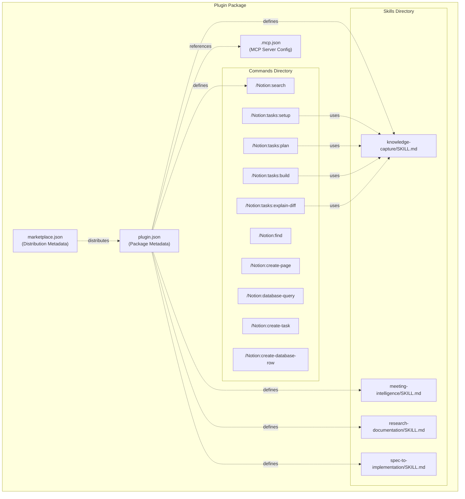
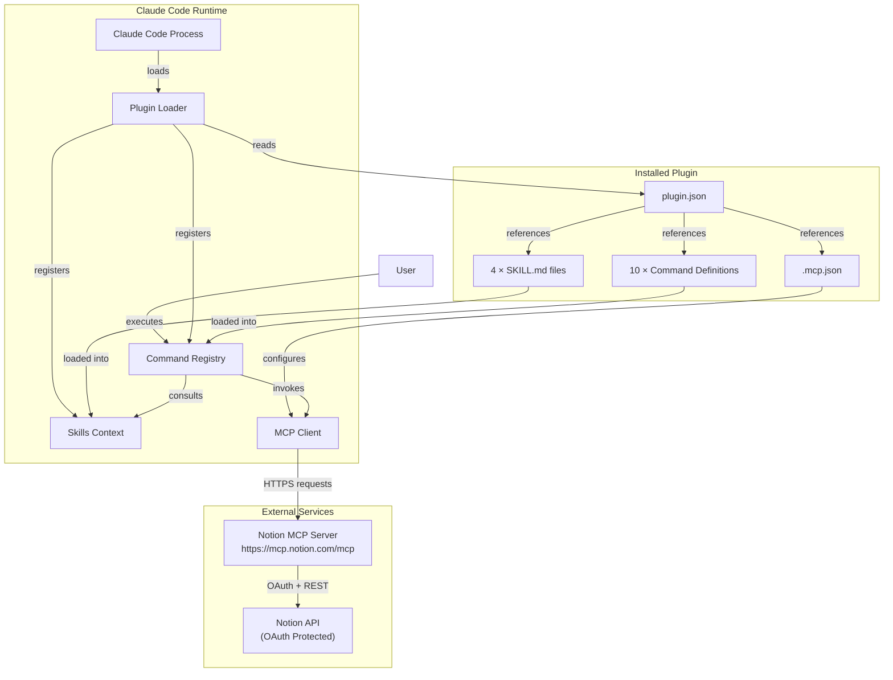

<!-- source: DeepWiki mcp.deepwiki.com · repo makenotion/claude-code-notion-plugin · page 1 Overview · fetched 2026-10-27 -->

# Overview

<details>
<summary>Relevant source files</summary>

The following files were used as context for generating this wiki page:

- [.claude-plugin/plugin.json](.claude-plugin/plugin.json)
- [README.md](README.md)

</details>


## Purpose and Scope

This document provides a high-level introduction to the Notion Plugin for Claude Code, a packaged integration that enables Claude to work with Notion workspaces. This page covers the plugin's purpose, its three core components (Notion Skills, MCP Server integration, and Slash Commands), the distribution model, and the architectural patterns that enable the system to function.

For detailed installation steps, see [Installation](#2.1). For architecture internals and communication patterns, see [Architecture](#3). For specific command usage, see [Slash Commands Reference](#5). For task management workflows, see [Task Management Workflow](#4).

---

## What is the Notion Plugin?

The Notion Plugin for Claude Code is a bundled package that provides Claude with the ability to interact with Notion workspaces through a combination of intelligence guidance (Skills), API connectivity (MCP Server), and user-facing commands (Slash Commands). The plugin is distributed via a marketplace mechanism and can be installed with a single command.

The plugin's primary value proposition is **one-click installation** of the complete Notion integration stack. Without this plugin, users would need to separately install Skills, configure the MCP server, and define custom commands. The plugin bundles all three components into a cohesive unit.

**Sources:** [README.md:1-11]()

---

## Core Components

The plugin consists of three distinct components that work together to provide Notion integration:

### 1. Notion Skills Bundle

Four Skills from the Notion Cookbook are included:

- **Knowledge Capture** - Extracts and structures content from conversations into Notion pages
- **Meeting Intelligence** - Transforms meeting transcripts into structured notes
- **Research Documentation** - Organizes research findings
- **Spec to Implementation** - Bridges specification documents to code implementation

These Skills are `.md` files that contain instructions teaching Claude how to work with Notion content. They provide context, templates, and behavioral guidance without executing code themselves. For detailed documentation of each Skill, see [Notion Skills](#6).

**Sources:** [README.md:15-23]()

### 2. MCP Server Integration

The plugin includes a configuration file (`.mcp.json`) that connects Claude Code to Notion's hosted MCP server at `https://mcp.notion.com/mcp`. This server provides a secure, OAuth-authenticated gateway to the Notion API with structured tools for:

- Searching workspaces
- Retrieving pages and databases
- Creating and updating pages
- Appending content blocks
- Inserting database rows
- Managing properties

The MCP server abstracts the Notion API's complexity and provides a consistent interface for Claude to interact with Notion. For MCP configuration details, see [MCP Server Configuration](#2.2).

**Sources:** [README.md:25-40]()

### 3. Slash Commands

Ten slash commands provide user-facing workflows that leverage both the Skills and MCP server:

**Basic Operations:**
- `/Notion:search` - Workspace-wide search
- `/Notion:find` - Quick title-based lookup
- `/Notion:create-page` - Page creation
- `/Notion:database-query` - Database queries with filters
- `/Notion:create-task` - Task creation in task databases
- `/Notion:create-database-row` - Generic database row insertion

**Task Management Suite:**
- `/Notion:tasks:setup` - Configure task tracking board
- `/Notion:tasks:plan` - Generate task plans
- `/Notion:tasks:build` - Execute tasks with agent
- `/Notion:tasks:explain-diff` - Document code changes

For complete command reference, see [Slash Commands Reference](#5). For task management workflow details, see [Task Management Workflow](#4).

**Sources:** [README.md:42-56]()

---

## Plugin Architecture

The following diagram shows the component structure and file organization within the plugin package:



**Sources:** [.claude-plugin/plugin.json:1-11](), [README.md:1-92]()

---

## System Integration Model

The following diagram illustrates how the plugin integrates with Claude Code and external services:



**Integration Flow:**

1. **Plugin Loading**: `PluginLoader` reads `plugin.json` to discover Skills, Commands, and MCP configuration
2. **Skills Registration**: `.md` files are loaded into Claude's context as behavioral guidance
3. **Command Registration**: Commands become available in Claude Code's command palette
4. **MCP Initialization**: `.mcp.json` configures connection to `https://mcp.notion.com/mcp`
5. **Runtime Execution**: Commands consult Skills for intelligence, then invoke MCP tools to interact with Notion

**Sources:** [README.md:1-92](), [.claude-plugin/plugin.json:1-11]()

---

## Distribution and Installation Model

The plugin uses a two-tier marketplace distribution system:

### Marketplace Registration

The plugin is distributed via a Git repository that serves as a marketplace. The `marketplace.json` file defines the plugin's availability:

```
Repository: makenotion/claude-code-notion-plugin
Marketplace ID: notion-plugin-marketplace
Plugin ID: notion-workspace-plugin
```

Users add the marketplace with:
```bash
/plugin marketplace add makenotion/claude-code-notion-plugin
```

### Plugin Installation

Once the marketplace is registered, users install the plugin with:
```bash
/plugin install notion-workspace-plugin@notion-plugin-marketplace
```

This downloads all plugin files to Claude Code's plugin directory. For detailed installation steps including OAuth setup, see [Installation](#2.1).

### Restart Requirement

**A restart of Claude Code is required after installation.** This is necessary for the MCP server connection to initialize properly. The MCP client is registered during Claude Code's startup phase, not during plugin installation.

**Sources:** [README.md:61-78]()

---

## Key Workflows Enabled

The plugin enables two primary workflows:

### 1. Task Management with Agent Collaboration

The task management commands (`/Notion:tasks:setup`, `/Notion:tasks:plan`, `/Notion:tasks:build`, `/Notion:tasks:explain-diff`) implement an agent-based system where:

- Tasks are tracked in a Notion board
- The agent autonomously plans and executes work
- User-agent communication happens through Notion itself (status updates, comments)
- The agent polls for user input without blocking Claude Code's main session

This workflow is detailed in [Task Management Workflow](#4). The communication mechanism is explained in [Communication Protocol](#3.2).

### 2. Knowledge Capture from Conversations

The Knowledge Capture Skill enables extraction of structured documentation from ad-hoc conversations. Claude can:

- Classify conversation content (FAQ, decision record, how-to guide, etc.)
- Apply type-specific templates
- Route content to appropriate Notion destinations (wikis, databases)
- Create properly structured, discoverable pages

This workflow is detailed in [Knowledge Capture Skill](#6.1) and [Knowledge Capture Workflows](#7.2).

**Sources:** [README.md:42-56]()

---

## Technical Metadata

The plugin is defined by the following metadata in `plugin.json`:

| Field | Value |
|-------|-------|
| Name | `"Notion"` |
| Version | `"0.1.0"` |
| Description | `"Notion Skills + Notion MCP server packaged as a Claude Code plugin."` |
| Author | Notion Labs (`https://www.notion.so`) |
| Repository | `https://github.com/makenotion/claude-code-notion-plugin` |
| License | MIT |

**Sources:** [.claude-plugin/plugin.json:1-11]()

---

## Next Steps

- To install the plugin, proceed to [Installation](#2.1)
- To understand the plugin's internal architecture, see [Architecture](#3)
- To learn about specific commands, see [Slash Commands Reference](#5)
- To explore task management capabilities, see [Task Management Workflow](#4)
- To learn about Skills, see [Notion Skills](#6)

---

