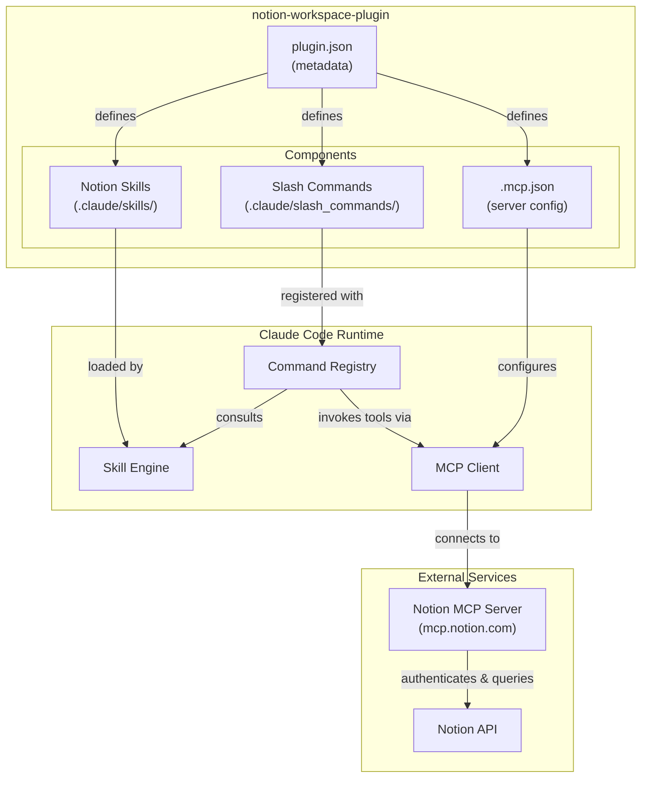
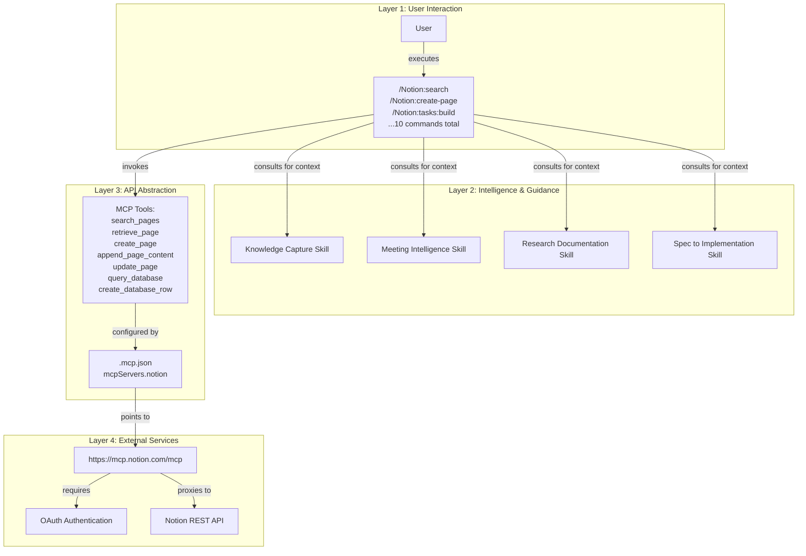
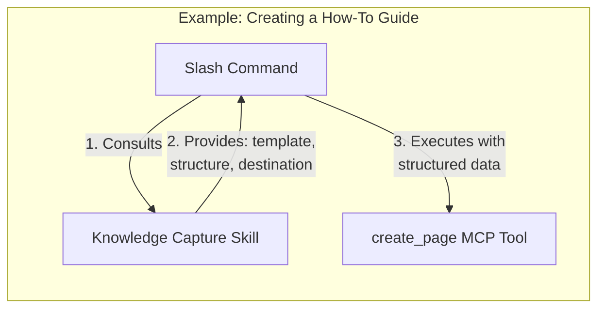
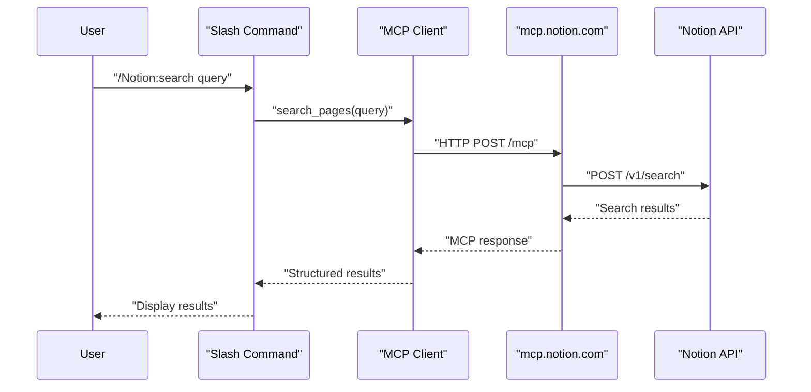
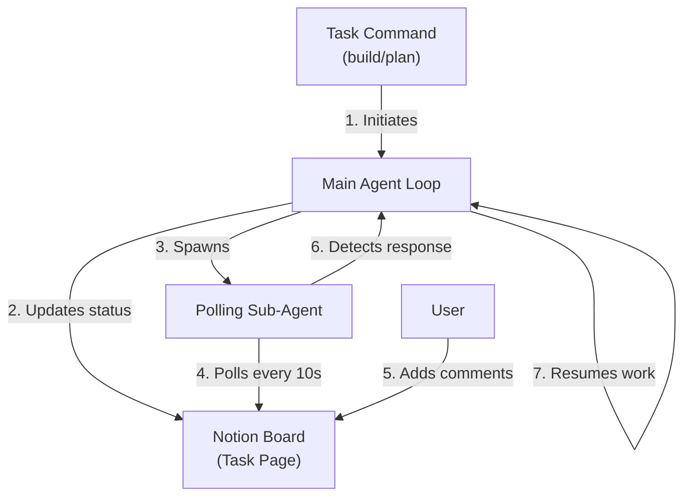
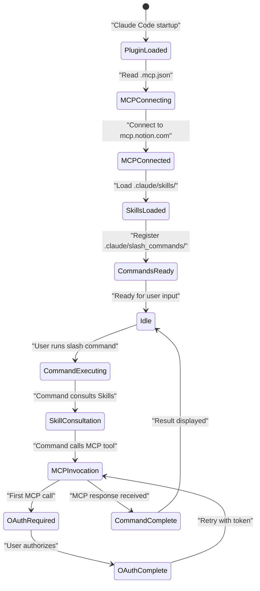

<!-- source: DeepWiki mcp.deepwiki.com · repo makenotion/claude-code-notion-plugin · page 3 Architecture · fetched 2026-10-27 -->

# Architecture

<details>
<summary>Relevant source files</summary>

The following files were used as context for generating this wiki page:

- [.claude-plugin/plugin.json](.claude-plugin/plugin.json)
- [.mcp.json](.mcp.json)
- [README.md](README.md)

</details>


## Purpose and Scope

This document explains the internal architecture of the Notion Plugin for Claude Code, including how its components are structured, how they integrate with the Claude Code environment, and the key architectural patterns that enable the plugin's functionality. 

For detailed information about individual components, see [Core Components](#3.1). For the agent-user communication mechanism, see [Communication Protocol](#3.2). For task management workflows, see [Task Management Workflow](#4).

---

## System Structure

The Notion Plugin is distributed as a single package that contains three distinct component types, each serving a specific architectural role:



**Figure 1: Plugin Package Structure and Integration Points**

The plugin package follows the Claude Code plugin specification, with [plugin.json:1-11](.claude-plugin/plugin.json:1-11) serving as the manifest. This manifest defines the plugin's identity (`name`, `version`, `description`) and attribution (`author`, `repository`, `license`).

**Sources**: [README.md:1-92](README.md:1-92), [.claude-plugin/plugin.json:1-11](.claude-plugin/plugin.json:1-11)

---

## Layered Architecture

The plugin implements a four-layer architecture that separates concerns and enables flexible composition:



**Figure 2: Four-Layer Architecture**

### Layer 1: User Interaction Layer

The user interaction layer consists of 10 slash commands defined in `.claude/slash_commands/`, organized into two categories:

**Task Management Suite** (4 commands):
- `/Notion:tasks:setup` - Initialize task board
- `/Notion:tasks:plan` - Create task plan
- `/Notion:tasks:build` - Execute task
- `/Notion:tasks:explain-diff` - Document code changes

**Basic Notion Operations** (6 commands):
- `/Notion:search` - Workspace search
- `/Notion:find` - Title-based search
- `/Notion:create-page` - Page creation
- `/Notion:database-query` - Database querying
- `/Notion:create-task` - Task creation
- `/Notion:create-database-row` - Row insertion

**Sources**: [README.md:41-56](README.md:41-56)

### Layer 2: Intelligence Layer

The intelligence layer provides context-aware guidance through four bundled Skills located in `.claude/skills/`:

1. **Knowledge Capture** - Structures conversations into documentation
2. **Meeting Intelligence** - Processes meeting transcripts
3. **Research Documentation** - Organizes research findings
4. **Spec to Implementation** - Translates specifications into code

These Skills are injected into Claude's context when relevant commands execute, guiding behavior without direct invocation.

**Sources**: [README.md:15-23](README.md:15-23)

### Layer 3: API Abstraction Layer

The MCP (Model Context Protocol) server integration provides a standardized interface to Notion's API. The [.mcp.json:1-8](.mcp.json:1-8) configuration file defines the connection:

```json
{
  "mcpServers": {
    "notion": {
      "type": "http",
      "url": "https://mcp.notion.com/mcp"
    }
  }
}
```

The `mcpServers.notion` entry registers a server named `notion` with type `http`, pointing to Notion's hosted MCP endpoint. This configuration is processed during Claude Code's initialization phase.

**Sources**: [.mcp.json:1-8](.mcp.json:1-8), [README.md:25-39](README.md:25-39)

### Layer 4: External Services Layer

The external services layer consists of:
- **Notion MCP Server** (`https://mcp.notion.com/mcp`) - Hosted service that implements the MCP protocol
- **OAuth Authentication** - User authorization flow
- **Notion REST API** - Underlying data operations

The MCP server acts as a secure gateway, handling authentication and exposing a curated set of operations.

**Sources**: [README.md:26-39](README.md:26-39), [.mcp.json:5](.mcp.json:5)

---

## Component Integration Patterns

### Separation of Intelligence and Execution

The architecture enforces a clean separation between "knowing how" (Skills) and "doing what" (MCP Tools):



**Figure 3: Separation of Concerns Pattern**

Skills provide declarative knowledge (templates, patterns, best practices) but never directly invoke MCP tools. Commands orchestrate the workflow by consulting Skills for guidance, then executing operations through MCP tools.

**Sources**: [README.md:3-7](README.md:3-7)

### Dependency Chain

The components have a strict initialization dependency order:

| Order | Component | Depends On | Initialization Trigger |
|-------|-----------|------------|------------------------|
| 1 | `plugin.json` metadata | None | Plugin installation |
| 2 | `.mcp.json` registration | Plugin files | Claude Code restart |
| 3 | MCP server connection | `.mcp.json` | Claude Code initialization |
| 4 | OAuth authentication | MCP connection | First MCP tool invocation |
| 5 | Skills loading | Plugin files | Command execution |
| 6 | Commands registration | Plugin files | Claude Code startup |

The restart requirement mentioned in [README.md:76-77](README.md:76-77) exists because MCP server initialization (step 3) occurs during Claude Code's startup sequence, not during plugin installation.

**Sources**: [README.md:61-78](README.md:61-78)

---

## Data Flow Patterns

### Synchronous Command Execution

For simple operations, commands follow a synchronous request-response pattern:



**Figure 4: Synchronous Data Flow**

Operations like `/Notion:search` and `/Notion:create-page` complete in a single request-response cycle.

**Sources**: [README.md:44-51](README.md:44-51)

### Asynchronous Agent Workflow

Task management commands implement an asynchronous pattern where the agent operates independently while polling for user input:



**Figure 5: Asynchronous Agent Pattern**

This pattern is detailed in [Communication Protocol](#3.2). The key architectural decision is using Notion itself as the communication channel, eliminating the need for a separate message queue.

**Sources**: [README.md:52-55](README.md:52-55)

---

## Plugin Lifecycle

### Installation Phase

1. **Marketplace Registration**: User runs `/plugin marketplace add makenotion/claude-code-notion-plugin`
2. **Plugin Installation**: User runs `/plugin install notion-workspace-plugin@notion-plugin-marketplace`
3. **File Download**: Claude Code downloads plugin files to `.claude/` directory
4. **Restart Required**: User restarts Claude Code to initialize MCP servers

**Sources**: [README.md:61-78](README.md:61-78)

### Runtime Phase



**Figure 6: Plugin Runtime State Machine**

OAuth authentication occurs lazily on the first MCP tool invocation rather than during initialization. This allows the plugin to load successfully even if authentication fails, with errors surfacing only when users attempt Notion operations.

**Sources**: [README.md:81-84](README.md:81-84), [.mcp.json:1-8](.mcp.json:1-8)

---

## Key Architectural Decisions

### Decision: Hosted MCP Server

The plugin uses Notion's hosted MCP server at `https://mcp.notion.com/mcp` rather than a local server. This decision:

- **Eliminates installation complexity**: No local server process to manage
- **Enables OAuth authentication**: Hosted service can redirect to Notion's OAuth flow
- **Provides version management**: Notion controls server updates independently
- **Introduces network dependency**: Requires internet connectivity for all operations

**Configuration**: [.mcp.json:2-6](.mcp.json:2-6)

### Decision: Skills as Static Context

Skills are loaded as static context rather than invoked as tools. This decision:

- **Provides continuous guidance**: Skills influence all of Claude's Notion interactions
- **Avoids invocation overhead**: No explicit tool calls required
- **Enables emergent behavior**: Claude can apply Skill patterns spontaneously
- **Increases context usage**: Skills consume tokens throughout execution

**Sources**: [README.md:15-23](README.md:15-23)

### Decision: Notion-as-Message-Bus

The task management system uses Notion pages as the communication channel between agent and user. This decision:

- **Provides asynchronous collaboration**: User doesn't need to watch agent execution
- **Creates persistent record**: All interactions logged in Notion
- **Enables multi-user coordination**: Multiple stakeholders can comment
- **Introduces polling overhead**: Agent must periodically check for updates

This pattern is detailed in [Communication Protocol](#3.2).

**Sources**: [README.md:52-55](README.md:52-55)

---

## Summary

The Notion Plugin architecture achieves modularity through three independent component types (Skills, Commands, MCP Config) that integrate at runtime. The layered design separates user interaction, intelligent guidance, API abstraction, and external services, enabling each layer to evolve independently. Key patterns include synchronous operations for simple tasks, asynchronous agent workflows for complex tasks, and the use of Notion itself as a communication channel.

For implementation details of each component, see [Core Components](#3.1). For the agent communication mechanism, see [Communication Protocol](#3.2).

**Sources**: [README.md:1-92](README.md:1-92), [.claude-plugin/plugin.json:1-11](.claude-plugin/plugin.json:1-11), [.mcp.json:1-8](.mcp.json:1-8)

---

