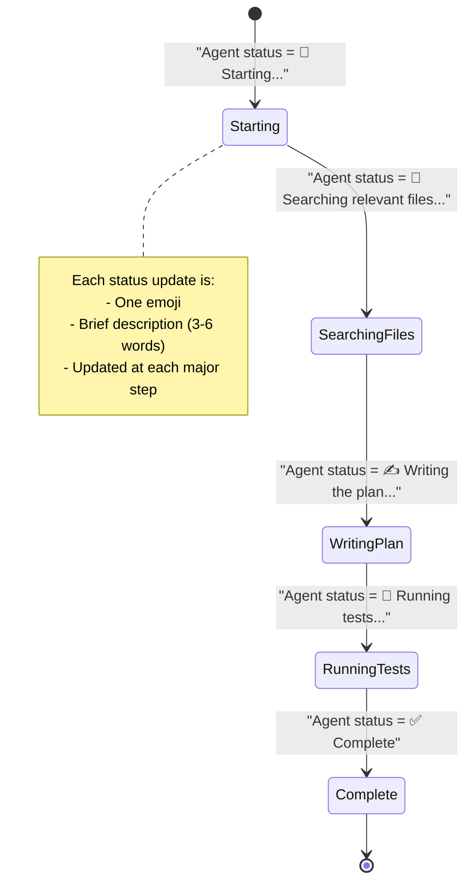
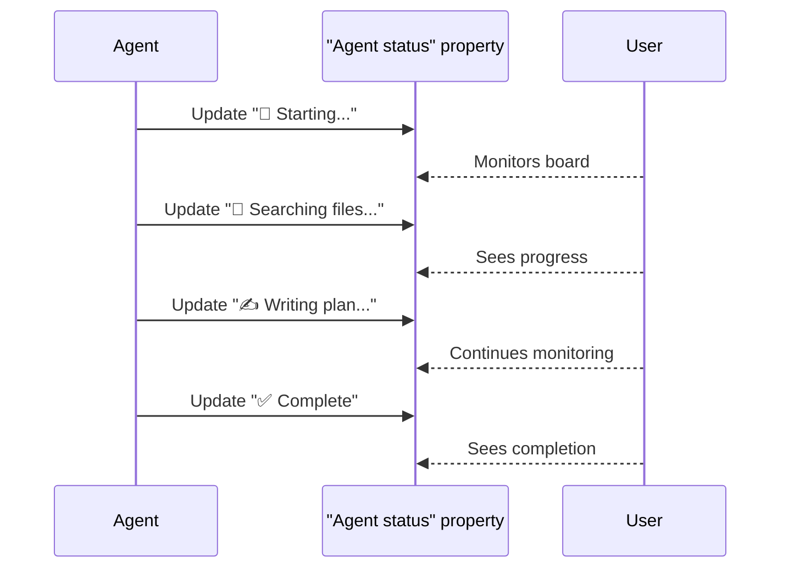
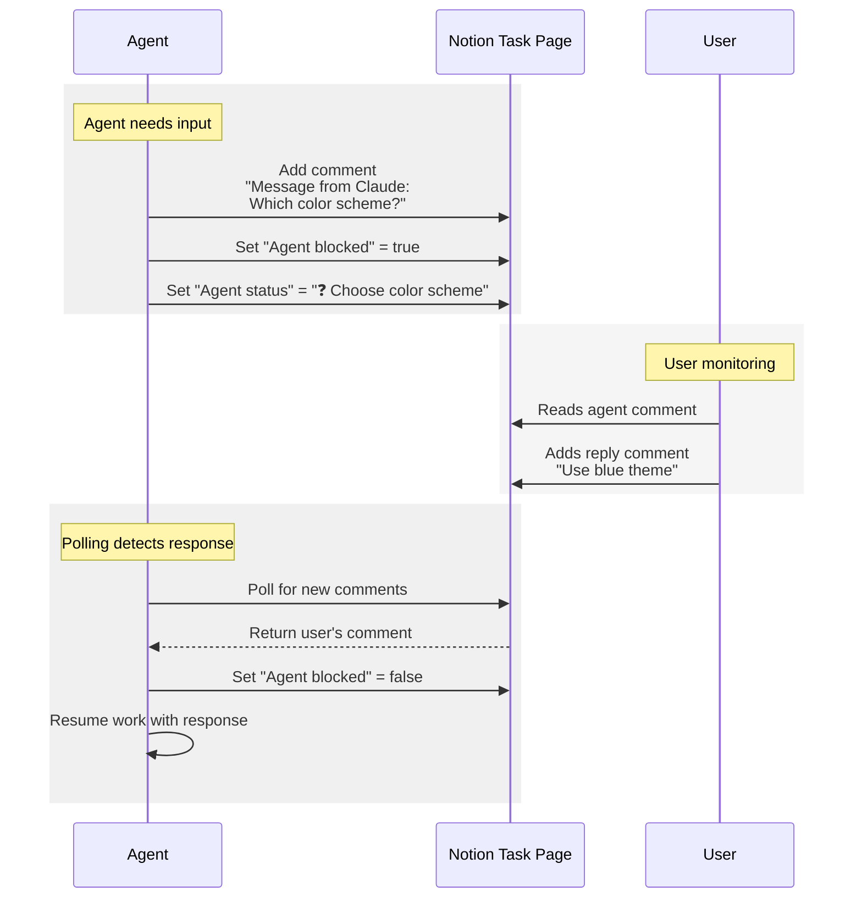
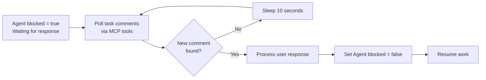

<!-- source: DeepWiki mcp.deepwiki.com · repo makenotion/claude-code-notion-plugin · page 3.2 Communication Protocol · fetched 2026-10-27 -->

# Communication Protocol

<details>
<summary>Relevant source files</summary>

The following files were used as context for generating this wiki page:

- [commands/tasks/build.md](commands/tasks/build.md)
- [commands/tasks/plan.md](commands/tasks/plan.md)

</details>


This document describes the asynchronous communication protocol used by task management agents to interact with users through Notion boards. The protocol enables agents to provide status updates, request user input, and poll for responses without requiring users to monitor the Claude Code session directly.

For information about the task management workflow that uses this protocol, see [Task Management Workflow](#4). For details on the agent polling implementation, see [Agent Polling and Sub-Agents](#7.1).

## Purpose and Architecture

The Communication Protocol solves a fundamental challenge in autonomous task execution: enabling human-agent collaboration when the user is not actively watching the agent's execution session. Rather than requiring users to observe Claude Code's console output, the protocol uses the Notion board itself as a bidirectional communication channel.

**Key Design Principles:**
- **Asynchronous by default**: Users monitor Notion at their convenience
- **Notion as message bus**: All communication flows through Notion properties and comments
- **Transparent status**: Users see continuous progress updates
- **Explicit blocking**: Agent clearly signals when it needs input
- **Polling-based responses**: Agent periodically checks for user replies

**Sources:** [commands/tasks/build.md:1-52](), [commands/tasks/plan.md:1-52]()

## Protocol Components

The protocol consists of three interconnected mechanisms that work together to enable agent-user communication:

| Component | Purpose | Notion Elements Used |
|-----------|---------|---------------------|
| Status Updates | Continuous progress reporting | `Agent status` property |
| Input Requests | Blocking requests for user decisions | `Agent blocked` property, Comments |
| Response Polling | Checking for user replies | Comment retrieval via MCP |

**Sources:** [commands/tasks/build.md:23-28](), [commands/tasks/build.md:36-42]()

## Status Update Flow

### Continuous Status Updates

The agent maintains transparency by continuously updating the `Agent status` property on the task page. Each update follows a specific format: an emoji followed by a brief description.



**Status Update Pattern:**
- **Format**: `[emoji] [brief description]`
- **Frequency**: Updated at each significant step in the task
- **Examples**: 
  - `"🤖 Starting..."`
  - `"📂 Searching relevant files..."`
  - `"🎨 Updating color scheme..."`
  - `"✍️ Writing the plan..."`

**Sources:** [commands/tasks/build.md:23-28](), [commands/tasks/plan.md:23-28]()

### Status Update Sequence Diagram



**Sources:** [commands/tasks/build.md:23-28](), [commands/tasks/plan.md:23-28]()

## Input Request Protocol

### Three-Step Request Process

When an agent needs user input, it follows a three-step protocol that blocks execution and signals the request clearly:

```mermaid
flowchart TD
    NeedInput["Agent needs user input"]
    AddComment["Add comment to task<br/>Prefix: 'Message from Claude:' (bold)"]
    SetBlocked["Set 'Agent blocked' property = true"]
    UpdateStatus["Set 'Agent status' to request message<br/>Format: ❓ [brief request]"]
    StartPolling["Begin polling for response<br/>(10 second intervals)"]
    
    NeedInput --> AddComment
    AddComment --> SetBlocked
    SetBlocked --> UpdateStatus
    UpdateStatus --> StartPolling
    
    note right of AddComment
        Comment contains full question
        or request details
    end note
    
    note right of UpdateStatus
        Examples:
        - "❓ Choose a color scheme"
        - "❓ Give architecture feedback"
    end note
```

**Step 1: Add Comment**
- Create a comment on the task page
- First line (bold): `"Message from Claude:"`
- Following lines: Detailed question or request

**Step 2: Set Agent Blocked**
- Update `Agent blocked` property to `true`
- Signals to user that agent is waiting

**Step 3: Update Agent Status**
- Format: `"❓ [brief request description]"`
- Examples: `"❓ Choose a color scheme"`, `"❓ Give architecture feedback"`

**Sources:** [commands/tasks/build.md:36-42](), [commands/tasks/plan.md:36-42]()

### Complete Request-Response Cycle



**Sources:** [commands/tasks/build.md:36-42](), [commands/tasks/plan.md:36-42]()

## Polling Mechanism

### Polling Implementation

The agent polls for user responses every 10 seconds to check if new comments have been added to the task page. The polling continues until a response is detected.



**Polling Configuration:**
- **Interval**: 10 seconds between polls
- **Method**: Bash `sleep` command interleaved with MCP tool calls
- **Continuation**: Polls until user response detected
- **Data Source**: Task page comments retrieved via MCP

**Sources:** [commands/tasks/build.md:40-48](), [commands/tasks/plan.md:40-48]()

### Sub-Agent Architecture for Polling

To prevent context pollution in the main agent session, polling is performed by a dedicated sub-agent with specific configuration:

```mermaid
graph TB
    MainAgent["Main Agent<br/>(Task execution)"]
    SubAgent["Sub-Agent<br/>(Polling only)"]
    NotionMCP["Notion MCP"]
    TaskComments["Task Comments"]
    
    MainAgent -->|"Spawn with max_turns=100"| SubAgent
    
    subgraph "Sub-Agent Polling Loop"
        SubAgent -->|"1. Fetch comments"| NotionMCP
        NotionMCP -->|"2. Return comments"| SubAgent
        SubAgent -->|"3. Check for new"| SubAgent
        SubAgent -->|"4. Sleep 10s"| SubAgent
        SubAgent -.->|"5. Repeat"| NotionMCP
    end
    
    NotionMCP <-->|"MCP protocol"| TaskComments
    
    SubAgent -->|"Response found:<br/>Return to main"| MainAgent
    
    note right of SubAgent
        Configuration:
        - max_turns = 100
        - Isolated context
        - Bash sleep + MCP calls
    end note
```

**Sub-Agent Configuration:**
- **Max Turns**: Set to 100 to allow extended polling
- **Purpose**: Prevents main agent context from filling with polling attempts
- **Isolation**: Sub-agent operates in separate context
- **Implementation**: Bash `sleep` interleaved with MCP tool calls

**Sources:** [commands/tasks/build.md:44-48](), [commands/tasks/plan.md:44-48]()

## Implementation in Task Commands

### Build Command Protocol

The `/Notion:tasks:build` command implements the full communication protocol during task execution:

**Protocol Usage Points:**
1. **Initial status** (line 22-23): Sets `Agent status` to `"🤖 Starting..."`
2. **Continuous updates** (line 27): Updates `Agent status` at each step
3. **Requesting input** (line 28): Follows Communication Protocol when clarification needed
4. **Final notification** (line 34): Uses protocol to inform user of completion

**Sources:** [commands/tasks/build.md:20-35]()

### Plan Command Protocol

The `/Notion:tasks:plan` command uses the protocol during task planning:

**Protocol Usage Points:**
1. **Planning status** (line 22-23): Sets `Agent status` to `"🤖 Starting..."`
2. **Progress updates** (line 27): Updates during plan creation
3. **User questions** (line 28): Follows protocol for specification clarification
4. **Completion notification** (line 34): Informs user when plan is ready

**Sources:** [commands/tasks/plan.md:20-35]()

## Property and Field Mapping

The protocol relies on specific Notion page properties that must be present on task pages:

| Property Name | Type | Purpose | Possible Values |
|--------------|------|---------|----------------|
| `Agent status` | Text | Continuous progress updates | Emoji + brief text |
| `Agent blocked` | Checkbox | Signals waiting for input | `true` / `false` |
| `Status` | Select | Overall task state | "In progress", "Planning", "Ready", "Done" |

**Property Setup:**
These properties are created by the `/Notion:tasks:setup` command. For details, see [Task Board Setup](#4.1).

**Sources:** [commands/tasks/build.md:22-23](), [commands/tasks/build.md:41]()

## MCP Tool Usage

The protocol uses Notion MCP tools for all interactions with Notion:

```mermaid
graph LR
    Agent["Task Agent"]
    UpdateProp["Update Page Properties"]
    AddComment["Add Page Comment"]
    GetComments["Get Page Comments"]
    NotionAPI["Notion API"]
    
    Agent -->|"Set Agent status"| UpdateProp
    Agent -->|"Set Agent blocked"| UpdateProp
    Agent -->|"Set Status"| UpdateProp
    UpdateProp -->|"MCP protocol"| NotionAPI
    
    Agent -->|"Send message"| AddComment
    AddComment -->|"MCP protocol"| NotionAPI
    
    Agent -->|"Poll for responses"| GetComments
    GetComments -->|"MCP protocol"| NotionAPI
    
    note right of UpdateProp
        Property updates are
        synchronous MCP calls
    end note
    
    note right of GetComments
        Comment retrieval used
        in polling loop
    end note
```

**MCP Tool Calls:**
- **Property updates**: Update `Agent status`, `Agent blocked`, `Status` properties
- **Comment creation**: Add comments with "Message from Claude:" prefix
- **Comment retrieval**: Fetch comments to check for user responses

**Sources:** [commands/tasks/build.md:1-52](), [commands/tasks/plan.md:1-52]()

## Error Handling and Edge Cases

### Invalid URL or Inaccessible Task

If the task URL is invalid or the agent cannot access it:
1. Agent uses Communication Protocol to inform user
2. Requests verification of URL and Notion connection
3. Waits for corrected URL or confirmation of access

**Sources:** [commands/tasks/build.md:51-52](), [commands/tasks/plan.md:51-52]()

### Unclear Requirements

When task requirements are ambiguous:
1. Agent follows Communication Protocol to ask clarifying questions
2. Limits questions to avoid overwhelming user (few at a time)
3. Continues only after receiving clarification

**Sources:** [commands/tasks/build.md:51-52](), [commands/tasks/plan.md:51-52](), [commands/tasks/plan.md:28]()

### Polling Timeout

The sub-agent polling configuration (`max_turns=100`) allows approximately 1000 seconds (16+ minutes) of polling at 10-second intervals before reaching turn limit. This provides substantial time for user response while preventing infinite loops.

**Sources:** [commands/tasks/build.md:46](), [commands/tasks/plan.md:46]()

---

