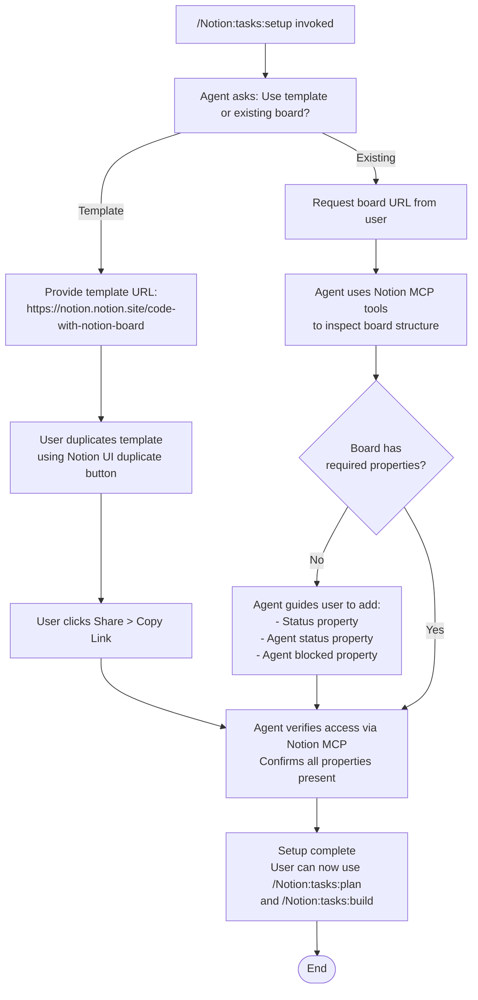
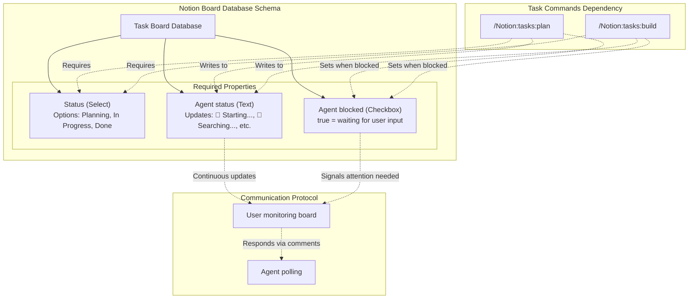
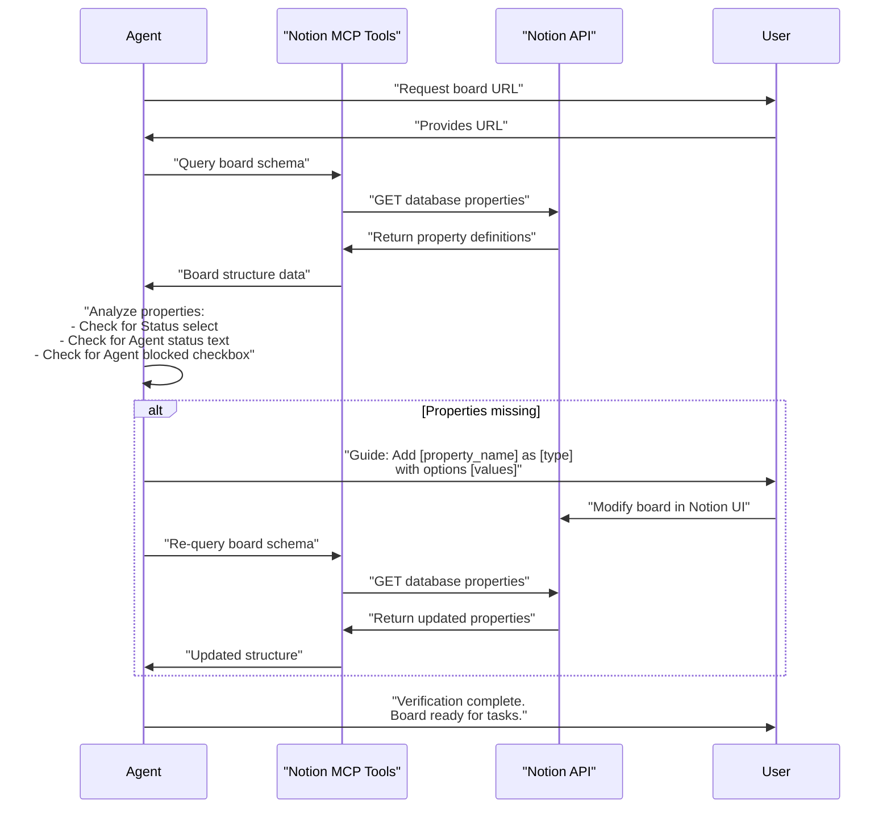
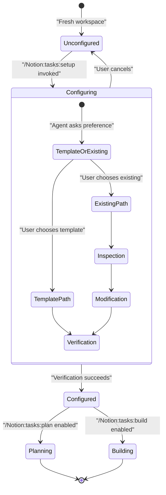

<!-- source: DeepWiki mcp.deepwiki.com · repo makenotion/claude-code-notion-plugin · page 4.1 Task Board Setup · fetched 2026-10-27 -->

# Task Board Setup

<details>
<summary>Relevant source files</summary>

The following files were used as context for generating this wiki page:

- [commands/tasks/setup.md](commands/tasks/setup.md)

</details>


This document explains the `/Notion:tasks:setup` command, which configures a Notion board with the required structure for the task management workflow. The setup process creates or validates the necessary properties that enable agent-user communication during task planning and execution.

For information about using the configured board to plan tasks, see [Planning Tasks](#4.2). For information about executing tasks, see [Building Tasks](#4.3).

## Purpose and Scope

The task board setup is a prerequisite configuration step that establishes the Notion infrastructure required by the task management commands. The setup command operates as an interactive wizard that guides users through either duplicating a pre-configured template or adapting an existing Notion board. This configuration enables the Communication Protocol described in [Communication Protocol](#3.2), which allows agents to report status and request user input through Notion board properties.

**Sources:** [commands/tasks/setup.md:1-39]()

## Setup Command Overview

The `/Notion:tasks:setup` command is invoked without arguments and initiates an interactive setup session. Unlike other slash commands, this operates as a conversational wizard rather than a single-execution command.

```
/Notion:tasks:setup
```

The command implements two distinct setup paths based on user preference:
1. **Template Path**: Duplicates a pre-configured board with all required properties
2. **Existing Board Path**: Modifies an existing Notion board to add required properties

**Sources:** [commands/tasks/setup.md:9-20]()

## Setup Decision Flow



**Diagram: Setup Command Decision Flow**

This flowchart shows the two setup paths and their convergence at the verification step. The template path is simpler (user action only), while the existing board path requires MCP tool inspection and potentially agent-guided modifications.

**Sources:** [commands/tasks/setup.md:11-30]()

## Required Board Structure

The task board must contain three specific properties to support the task management workflow. These properties enable the asynchronous communication pattern where agents update status and users respond through the Notion interface.

### Property Specifications

| Property Name | Property Type | Required Values | Purpose |
|--------------|---------------|-----------------|---------|
| **Status** | Select | "Planning", "In Progress", "Done" | Tracks task lifecycle state |
| **Agent status** | Text | Free-form text | Real-time agent activity updates |
| **Agent blocked** | Checkbox | true/false | Signals when agent needs user input |

**Sources:** [commands/tasks/setup.md:26-29]()

### Property Architecture



**Diagram: Required Property Architecture**

This diagram illustrates how the three required properties serve as the data foundation for the Communication Protocol. The `Status` property tracks lifecycle, while `Agent status` and `Agent blocked` enable asynchronous agent-user communication.

**Sources:** [commands/tasks/setup.md:26-29]()

## Template-Based Setup

The template path provides the fastest setup experience by offering a pre-configured board structure.

### Template Workflow

1. **Template URL Provided**: The agent provides `https://notion.notion.site/code-with-notion-board`
2. **User Duplicates**: User opens the template and clicks the duplicate button (two squares icon) in the top bar
3. **Template Copied**: Notion creates a copy in the user's workspace with all properties configured
4. **Share URL**: User clicks Share button > Copy Link to obtain the new board's URL
5. **Verification**: Agent receives URL and verifies access via Notion MCP tools

The duplicated board includes:
- Pre-configured Status select property with correct options
- Agent status text property
- Agent blocked checkbox property
- Example tasks demonstrating the structure

**Sources:** [commands/tasks/setup.md:13-19]()

## Existing Board Setup

The existing board path allows users to adapt a board they're already using, preserving existing tasks and structure while adding required properties.

### Existing Board Workflow

1. **URL Request**: Agent asks user for the existing board's URL
2. **Board Inspection**: Agent uses Notion MCP tools to query the board's schema
3. **Property Analysis**: Agent checks for presence of required properties
4. **Gap Identification**: Agent determines which properties are missing or misconfigured
5. **Modification Guidance**: Agent provides specific instructions to add/modify properties
6. **Iterative Verification**: Agent re-inspects after each modification until complete

### MCP Tool Usage

The agent uses the following MCP tools during existing board setup:



**Diagram: Existing Board Inspection and Modification Sequence**

This sequence diagram shows how the agent uses MCP tools to inspect and guide modifications to an existing board. The iterative verification loop continues until all required properties are present.

**Sources:** [commands/tasks/setup.md:21-30]()

## Property Configuration Details

### Status Property Configuration

The Status property must be a **Select** type with exactly these options:
- `Planning` - Used during `/Notion:tasks:plan` execution
- `In Progress` - Used during `/Notion:tasks:build` execution  
- `Done` - Set when task is completed

The status values are case-sensitive and must match exactly. The agent uses these values to track task lifecycle and determine which operations are valid.

### Agent Status Property Configuration

The Agent status property must be a **Text** type (not Rich Text). This property contains free-form status updates written by the agent during execution. Typical values include:
- `🤖 Starting task planning...`
- `📂 Searching codebase for relevant files...`
- `✍️ Writing implementation plan...`
- `❓ Waiting for user input on architecture decision`

The property serves as a real-time activity log visible to users monitoring the board.

### Agent Blocked Property Configuration

The Agent blocked property must be a **Checkbox** type. The agent sets this to `true` when it requires user input and cannot proceed. This provides a visual signal in the Notion UI that user attention is needed. The property is set to `false` when the agent resumes work after receiving input.

**Sources:** [commands/tasks/setup.md:26-29]()

## Setup Verification

After configuration, the agent performs verification steps:

1. **Access Check**: Agent attempts to read the board using Notion MCP tools
2. **Property Validation**: Agent confirms all three required properties exist with correct types
3. **Value Validation**: Agent verifies the Status property has the required select options
4. **Success Confirmation**: Agent informs user that setup is complete and provides next steps

If verification fails, the agent provides specific error messages indicating which properties need correction.

**Sources:** [commands/tasks/setup.md:31-36]()

## Integration with Task Workflow

The setup command establishes the prerequisite infrastructure for the task management workflow. Once complete, users can proceed with:

1. **Task Planning** (`/Notion:tasks:plan <task_url>`): Creates execution plans in Planning status tasks. See [Planning Tasks](#4.2)
2. **Task Building** (`/Notion:tasks:build <task_url>`): Executes tasks in In Progress status. See [Building Tasks](#4.3)

Both commands depend on the board structure created by setup and will fail if required properties are missing.



**Diagram: Setup Integration with Task Workflow State Machine**

This state diagram shows how the setup command transitions the workspace from unconfigured to configured state, enabling the task planning and building commands.

**Sources:** [commands/tasks/setup.md:31-36]()

## Common Setup Scenarios

### Scenario 1: First-Time User

A user with no existing Notion boards:
1. Run `/Notion:tasks:setup`
2. Choose template option when prompted
3. Duplicate template from provided URL
4. Share the duplicated board's URL with agent
5. Agent verifies and confirms setup complete

**Estimated time**: 2-3 minutes

### Scenario 2: Adapting Project Board

A user with an existing project board containing tasks:
1. Run `/Notion:tasks:setup`
2. Choose existing board option
3. Provide board URL
4. Agent inspects and identifies missing properties
5. Follow agent's instructions to add each property
6. Agent re-verifies after each addition
7. Setup complete when all properties present

**Estimated time**: 5-10 minutes (depending on familiarity with Notion)

### Scenario 3: Multiple Boards

A user managing multiple projects:
- Run `/Notion:tasks:setup` once per board
- Each board must be configured independently
- Agent does not remember previous board configurations
- Each setup session is isolated

**Sources:** [commands/tasks/setup.md:1-39]()

## Post-Setup Considerations

### Board Permissions

Ensure the authenticated Notion integration has:
- Read access to query board properties
- Write access to update Agent status and Agent blocked properties
- Comment permissions to enable Communication Protocol

### Property Preservation

Users should not:
- Rename the required properties after setup
- Change the Status property's select options
- Convert property types (e.g., Text to Rich Text)

Such modifications will break task commands and require re-running setup.

### Multiple Users

If multiple users share a Notion workspace:
- Each user can run setup on shared boards
- OAuth authentication is per-user
- Property structure is shared across all users
- Agent status updates are visible to all board viewers

**Sources:** [commands/tasks/setup.md:31-36]()

---

