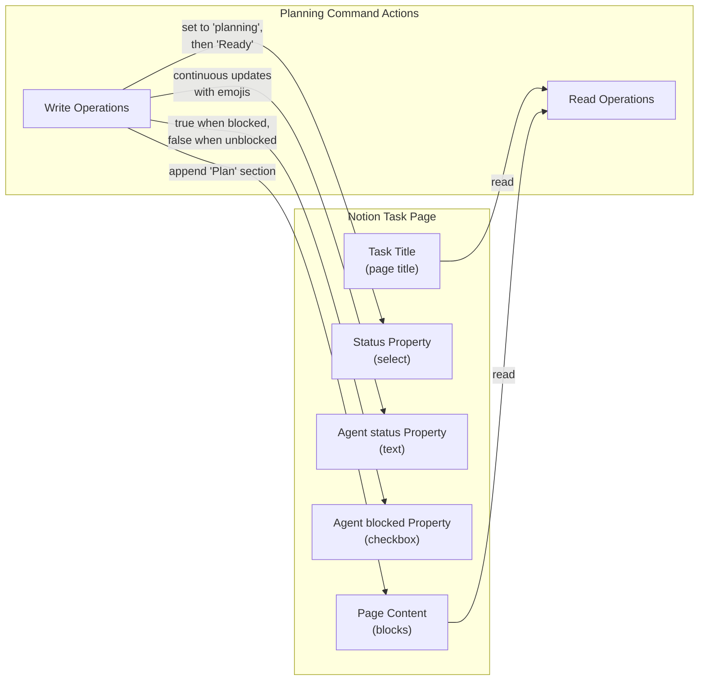
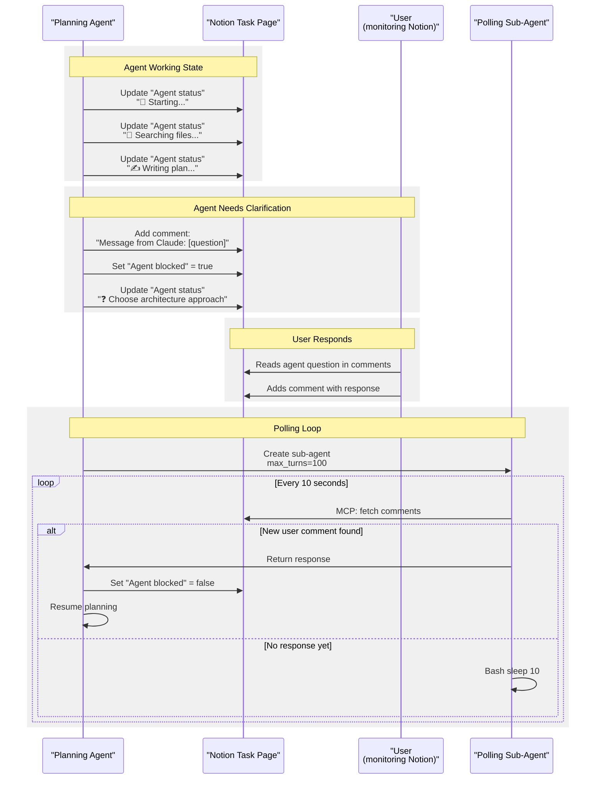
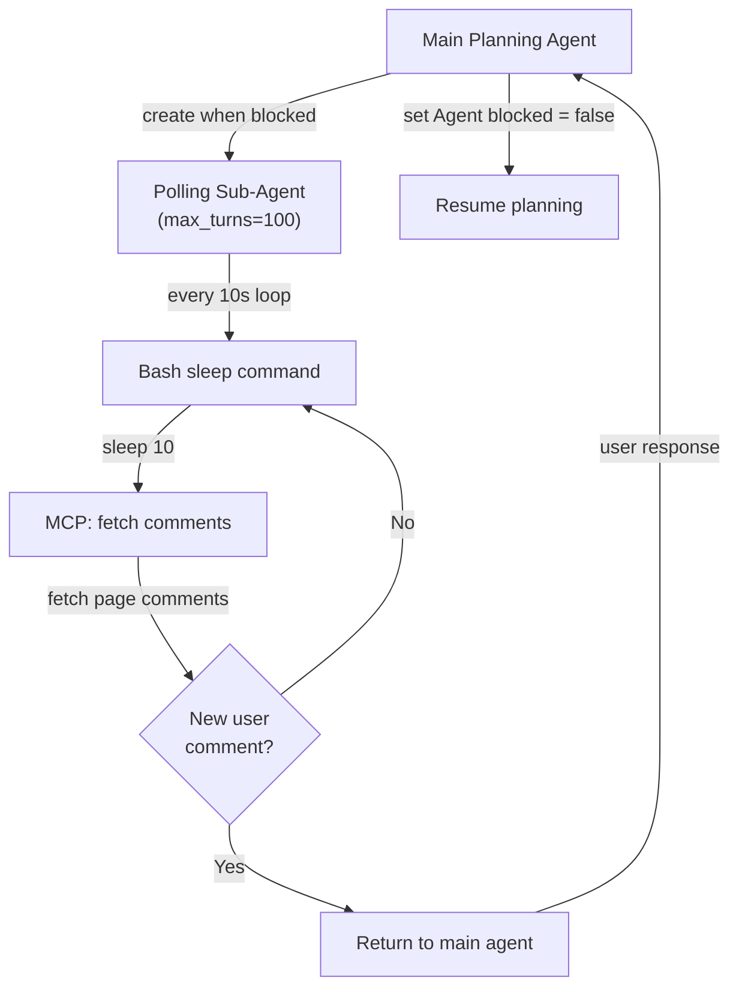
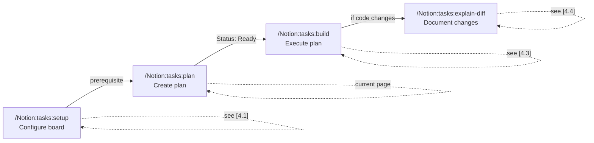

<!-- source: DeepWiki mcp.deepwiki.com · repo makenotion/claude-code-notion-plugin · page 4.2 Planning Tasks · fetched 2026-10-27 -->

# Planning Tasks

<details>
<summary>Relevant source files</summary>

The following files were used as context for generating this wiki page:

- [commands/tasks/plan.md](commands/tasks/plan.md)
- [commands/tasks/setup.md](commands/tasks/setup.md)

</details>


## Purpose and Scope

The `/Notion:tasks:plan` command enables Claude to autonomously create detailed plans for tasks tracked in Notion. This command reads a task specification from a Notion page, generates a comprehensive plan, and writes it back to Notion while maintaining asynchronous communication with the user through the Notion board itself.

This page documents the planning phase of the task management workflow. For initial board setup, see [Task Board Setup](#4.1). For executing a plan, see [Building Tasks](#4.3).

**Sources:** [commands/tasks/plan.md:1-52]()

## Command Invocation

The command is invoked with a single argument: the URL of a Notion task page.

```
/Notion:tasks:plan <task_url>
```

**Example:**
```
/Notion:tasks:plan https://notion.so/myworkspace/implement-feature-xyz-abc123
```

The command expects the task board to be properly configured with the required properties as described in [Task Board Setup](#4.1).

**Sources:** [commands/tasks/plan.md:1-3](), [commands/tasks/plan.md:11-12]()

## Planning Lifecycle

The planning process follows a multi-stage workflow where the agent reads the task specification, develops a plan, and communicates with the user when clarification is needed.

### Planning Workflow State Machine

```mermaid
stateDiagram-v2
    [*] --> FetchTask: "/Notion:tasks:plan <url>"
    
    FetchTask --> ReadContent: "MCP: read page content"
    ReadContent --> MarkPlanning: "Read title, description,<br/>acceptance criteria"
    
    MarkPlanning --> UpdateStatus: "Set Status = 'planning'"
    UpdateStatus --> SetAgentStatus: "Set Agent status = '🤖 Starting...'"
    
    SetAgentStatus --> Analyzing: "Begin plan development"
    
    Analyzing --> UpdateProgress: "Set Agent status = '📂 Searching files...'"
    UpdateProgress --> NeedInput{Need user<br/>clarification?}
    
    NeedInput -->|Yes| BlockAgent: "Add comment<br/>Set Agent blocked = true<br/>Update Agent status"
    BlockAgent --> Polling: "Poll every 10s"
    Polling --> ResponseFound{Response<br/>found?}
    ResponseFound -->|No| Polling
    ResponseFound -->|Yes| UnblockAgent: "Set Agent blocked = false"
    UnblockAgent --> Analyzing
    
    NeedInput -->|No| WritePlan: "Update Agent status = '✍️ Writing plan...'"
    WritePlan --> AppendSection: "Create 'Plan' section<br/>in Notion page"
    AppendSection --> SetReady: "Set Status = 'Ready'"
    SetReady --> NotifyUser: "Add completion comment"
    NotifyUser --> [*]
    
    note right of FetchTask
        MCP tools used:
        - read page
        - read linked pages
    end note
    
    note right of Polling
        Sub-agent with max_turns=100
        Bash sleep + MCP calls
    end note
```

**Sources:** [commands/tasks/plan.md:14-34](), [commands/tasks/plan.md:36-48]()

### Workflow Stages

The planning process consists of four primary stages:

| Stage | Actions | Notion Updates |
|-------|---------|----------------|
| **Fetch** | Read task page content, title, description, acceptance criteria, linked pages | None |
| **Initialize** | Mark task as being planned | `Status = "planning"`, `Agent status = "🤖 Starting..."` |
| **Develop** | Analyze requirements, search relevant files, formulate plan, request clarification if needed | Progressive `Agent status` updates with relevant emojis |
| **Complete** | Write plan to task page, mark as ready | Append "Plan" section, `Status = "Ready"`, add completion comment |

**Sources:** [commands/tasks/plan.md:16-34]()

## Task Properties Updated

The planning command interacts with specific properties on the Notion task page. These properties must exist on the board (configured during setup in [Task Board Setup](#4.1)).

### Property Reference



**Property Update Patterns:**

| Property | Read/Write | Usage Pattern |
|----------|------------|---------------|
| `Status` | Write | Set to `"planning"` at start, `"Ready"` at completion |
| `Agent status` | Write | Continuous updates with emoji + brief description (e.g., `"📂 Searching files..."`, `"✍️ Writing plan..."`) |
| `Agent blocked` | Write | Set to `true` when user input needed, `false` when unblocked |
| Page Content | Read & Write | Read for requirements, write to append "Plan" section |

**Sources:** [commands/tasks/plan.md:21-28](), [commands/tasks/setup.md:26-29]()

## Communication Protocol

The planning command implements an asynchronous communication pattern where the agent and user interact through Notion itself, without requiring the user to observe the Claude Code session.

### Communication Sequence



**Sources:** [commands/tasks/plan.md:36-42]()

### Protocol Implementation Details

The communication protocol follows a strict sequence defined in [commands/tasks/plan.md:36-42]():

1. **Agent adds comment** - Prefix with `"Message from Claude:"` on its own line in bold
2. **Set blocked state** - Update `Agent blocked` property to `true`
3. **Update status message** - Set `Agent status` to a brief request (e.g., `"❓ Choose a color scheme"`, `"❓ Give architecture feedback"`)
4. **Poll for response** - Check every 10 seconds for new user comments

**Important:** The command is designed to ask "just a few questions at a time" to avoid overwhelming the user [commands/tasks/plan.md:28]().

**Sources:** [commands/tasks/plan.md:36-48]()

## Polling Mechanism

The polling mechanism enables the agent to wait for user responses without blocking or polluting the main agent context.

### Polling Architecture



### Implementation Requirements

From [commands/tasks/plan.md:45-47](), the polling mechanism must:

- **Use a sub-agent** - Always poll within a sub-agent context
- **Set max turns to 100** - Prevents infinite loops while allowing extended polling
- **Interleave Bash sleep with MCP calls** - Use `sleep 10` between Notion API checks
- **Avoid context pollution** - Sub-agent isolates polling operations from main planning context

This architecture prevents the main agent's context window from being filled with repetitive polling operations, maintaining efficiency throughout the planning process.

**Sources:** [commands/tasks/plan.md:45-48]()

## Plan Output Format

Upon completion, the planning command writes the generated plan directly into the Notion task page.

### Plan Structure

The plan is appended to the task page as a new section with the following characteristics:

| Attribute | Value |
|-----------|-------|
| **Section Title** | `"Plan"` |
| **Location** | End of the task page |
| **Content** | Detailed plan based on task requirements |
| **Format** | Notion block content (text, lists, headings, etc.) |

The plan typically includes:
- High-level approach
- Step-by-step implementation details
- Technical considerations
- Dependencies and prerequisites
- Acceptance criteria mapping

**Sources:** [commands/tasks/plan.md:32-33]()

### Completion Actions

When planning is complete, the command performs the following final actions in sequence:

1. **Write plan** - Append the "Plan" section to the task page content
2. **Update status** - Set `Status` property to `"Ready"`
3. **Notify user** - Add a comment following the Communication Protocol with a brief summary of results
4. **Include relevant links** - If appropriate, link to related documentation or diff explanations

At this point, the task is ready for execution via `/Notion:tasks:build` as documented in [Building Tasks](#4.3).

**Sources:** [commands/tasks/plan.md:31-34]()

## Error Handling

The command includes error handling for common failure scenarios:

| Error Condition | Agent Response |
|----------------|----------------|
| Invalid URL | Ask user to verify URL and Notion connection |
| Inaccessible page | Confirm user has shared the page with the integration |
| Unclear requirements | Ask clarifying questions before writing plan using Communication Protocol |
| Missing properties | Notify user that board setup is incomplete, refer to setup command |

**Sources:** [commands/tasks/plan.md:49-52]()

## Relationship to Other Commands

The planning command is one stage in the complete task management workflow:



**Sources:** [commands/tasks/plan.md:1-52](), [commands/tasks/setup.md:1-39]()

---

