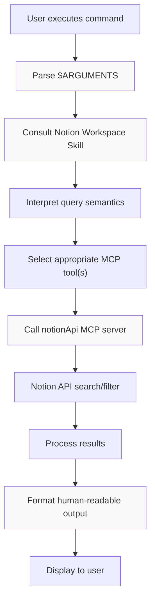
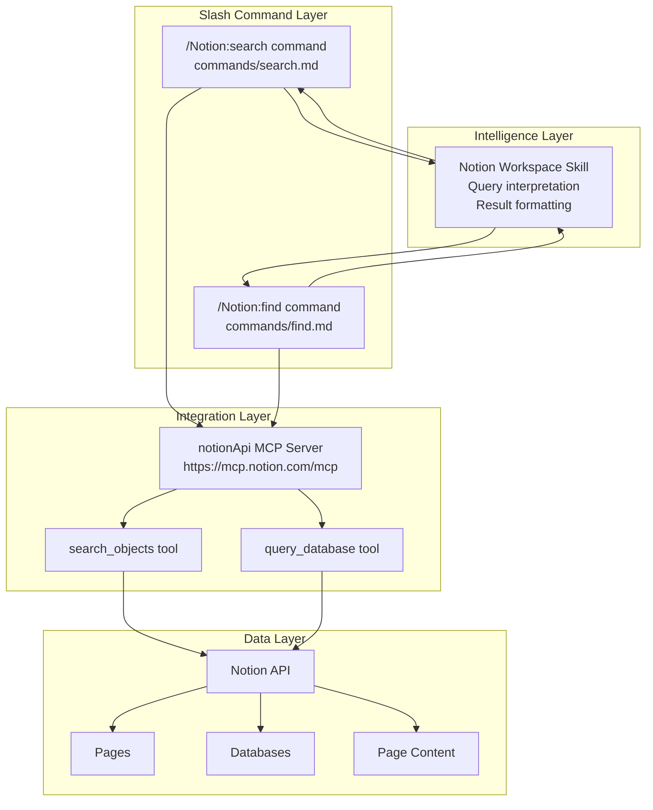
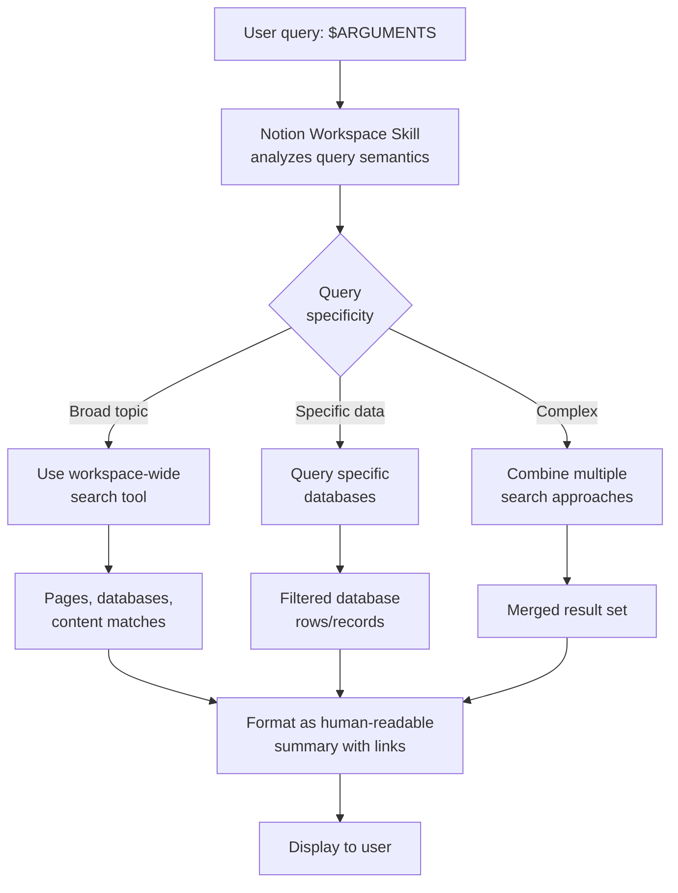
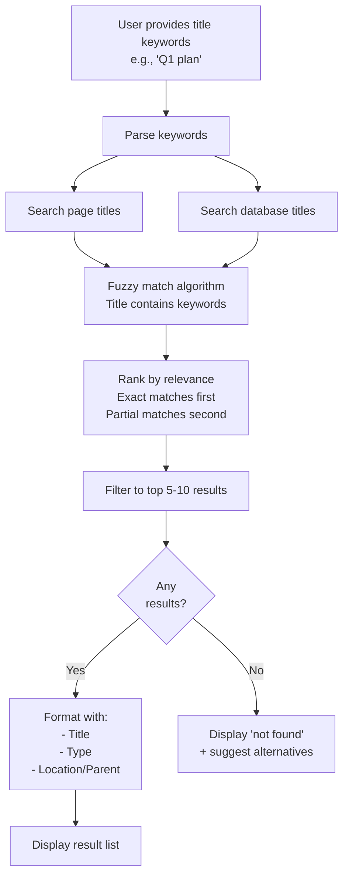
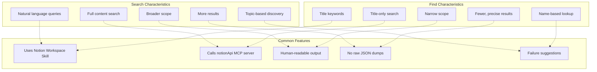
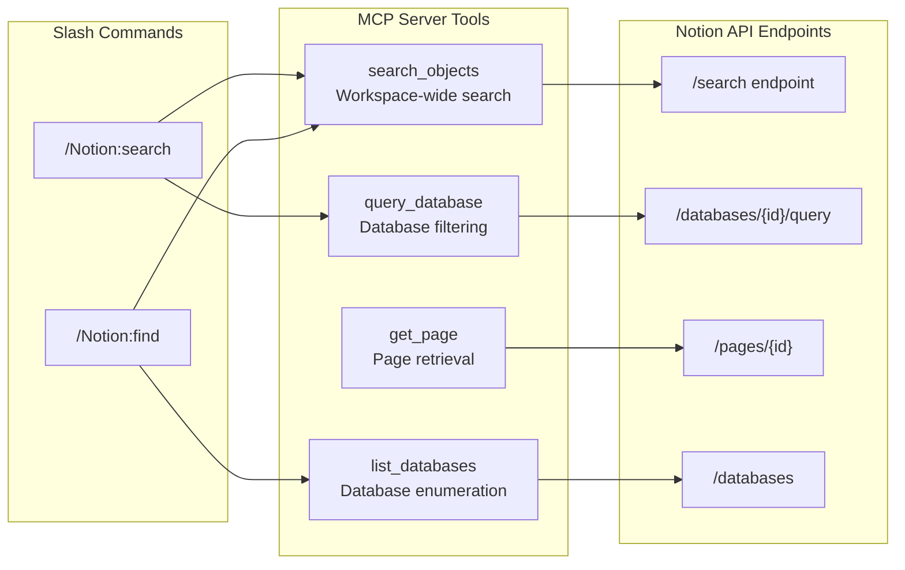
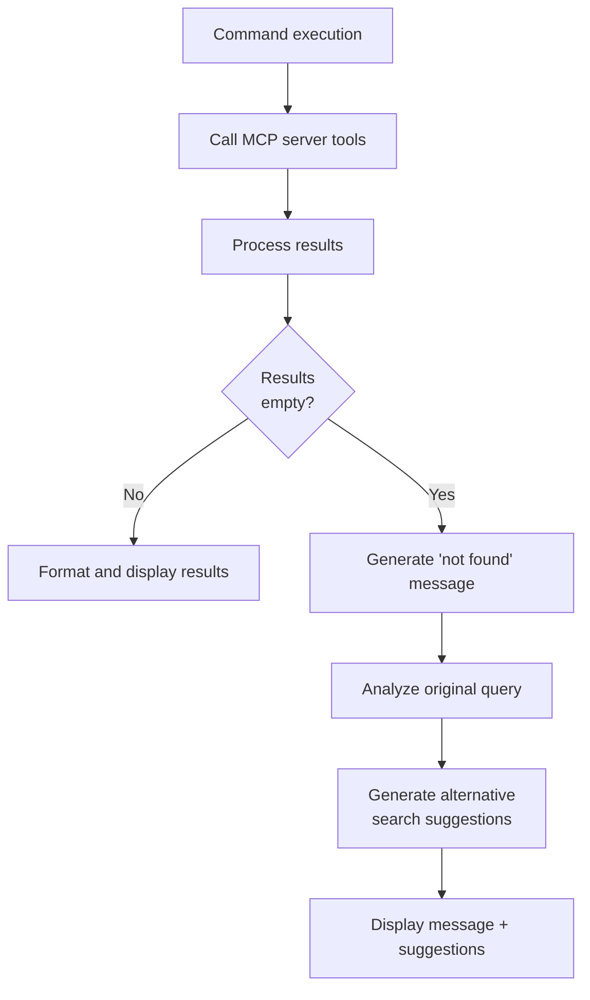

<!-- source: DeepWiki mcp.deepwiki.com · repo makenotion/claude-code-notion-plugin · page 5.1 Search and Discovery Commands · fetched 2026-10-27 -->

# Search and Discovery Commands

Relevant source files

The following files were used as context for generating this wiki page:

- [commands/find.md](commands/find.md)
- [commands/search.md](commands/search.md)

This page documents the search and discovery slash commands available in the Notion Plugin. These commands enable users to locate content within their Notion workspace through two distinct approaches: broad content search and precise title-based lookup.

This page covers `/Notion:search` and `/Notion:find`. For commands that create content, see [Content Creation Commands](#5.2). For querying structured database data, see [Database Query Command](#5.3).

## Overview

The plugin provides two complementary commands for discovering content in Notion:

| Command | Purpose | Search Scope | Use Case |
|---------|---------|--------------|----------|
| `/Notion:search` | Natural language content search | Full workspace (pages, databases, content) | Finding content when you know the topic but not exact title |
| `/Notion:find` | Precise title matching | Page and database titles only | Quickly locating specific pages/databases by name |

Both commands leverage the Notion Workspace Skill for intelligent query interpretation and the `notionApi` MCP server for actual Notion API operations.

**Sources:** [commands/search.md:1-19](), [commands/find.md:1-21]()

## Architecture

### Command Execution Flow

**Sources:** [commands/search.md:1-19](), [commands/find.md:1-21]()

### Component Interaction

**Sources:** [commands/search.md:6-7](), [commands/find.md:6-7](), High-level architecture diagrams

## /Notion:search Command

The `/Notion:search` command performs natural-language content search across the user's entire Notion workspace.

### Command Specification

**Command Name:** `/Notion:search`

**Description:** Search the user's Notion workspace using the Notion MCP server and Notion Workspace Skill

**Argument Format:** `query terms` (natural language search query)

**Definition Location:** [commands/search.md:1-4]()

### Behavior

The command interprets `$ARGUMENTS` as a natural-language search query and performs the following steps:

1. **Query Interpretation**: Treats arguments as natural language (e.g., "Q1 roadmap", "customer feedback", "bugs triage")
2. **Tool Selection**: Prefers fast, high-signal tools such as workspace search or database queries
3. **Result Processing**: For multiple results, generates a scannable summary list
4. **Output Formatting**: Returns human-readable summaries with links/identifiers (never raw JSON)

**Sources:** [commands/search.md:9-18]()

### Result Format

Each search result includes:

- **Page/database title**: The name of the matched content
- **Type**: Classification (page, database, task list, etc.)
- **One-line description**: Key fields or summary information

If no results are found, the command suggests refinements or alternative queries.

**Sources:** [commands/search.md:13-17]()

### Search Scope Decision Flow

**Sources:** [commands/search.md:11-12]()

## /Notion:find Command

The `/Notion:find` command provides precise, title-based lookup for pages and databases.

### Command Specification

**Command Name:** `/Notion:find`

**Description:** Quickly find pages or databases in Notion by title keywords

**Argument Format:** `query terms` (title keywords for fuzzy matching)

**Definition Location:** [commands/find.md:1-4]()

### Behavior

The command treats `$ARGUMENTS` as fuzzy search terms specifically for titles:

1. **Fuzzy Title Matching**: Searches for titles containing the query terms (e.g., "Q1 plan", "Claude marketplace spec")
2. **Dual Search**: Searches both individual pages and databases
3. **Precision Over Recall**: Returns 5-10 highly relevant results rather than many noisy matches
4. **Failure Handling**: Clearly indicates when nothing is found and suggests alternate search terms

**Sources:** [commands/find.md:9-20]()

### Result Format

Each result includes:

- **Title**: The page or database name
- **Type**: Either "page" or "database"
- **Location/Parent**: Hierarchical context (if available)

**Sources:** [commands/find.md:15-18]()

### Title Matching Logic

**Sources:** [commands/find.md:9-21]()

## Command Comparison

### Search vs. Find

**Sources:** [commands/search.md:1-19](), [commands/find.md:1-21]()

### Decision Matrix

| Scenario | Recommended Command | Rationale |
|----------|-------------------|-----------|
| "I need the Q1 planning document" | `/Notion:find Q1 planning` | Known title, precise lookup needed |
| "Show me everything about customer feedback" | `/Notion:search customer feedback` | Topic exploration, unknown exact titles |
| "Where is the Claude marketplace spec?" | `/Notion:find Claude marketplace spec` | Specific document with known name |
| "Find bugs related to authentication" | `/Notion:search authentication bugs` | Content-based search across multiple pages |
| "Locate the team wiki database" | `/Notion:find team wiki` | Known database name |
| "What documentation exists for the API?" | `/Notion:search API documentation` | Discovery of all related content |

**Sources:** [commands/search.md:11](), [commands/find.md:11]()

## Integration with MCP Server

Both commands depend on the `notionApi` MCP server connection established during plugin initialization. The MCP server provides OAuth-authenticated access to the Notion API.

### MCP Tool Mapping

**Sources:** [commands/search.md:6-7](), [commands/find.md:6-7]()

### Authentication Flow

Both commands inherit OAuth authentication from the MCP server configuration. The authentication token is managed transparently by the MCP server and refreshed automatically.

**Configuration Location:** [.mcp.json]()

**Server Endpoint:** `https://mcp.notion.com/mcp`

**Sources:** High-level architecture diagrams, [commands/search.md:6](), [commands/find.md:6]()

## Result Formatting Requirements

### Prohibited Output

Both commands explicitly prohibit dumping raw JSON to the user. Results must be transformed into human-readable summaries.

**Enforcement Location:** [commands/search.md:19]()

### Required Elements

All result lists must include:

1. **Title/Name**: Clear identification of each result
2. **Type Classification**: Explicit labeling of content type
3. **Contextual Information**: Location, parent, or key fields
4. **Actionable Links**: Identifiers that users can click in Notion

**Sources:** [commands/search.md:13-16](), [commands/find.md:15-18]()

## Error Handling

### No Results Found

When searches return empty results:

1. Command clearly states "nothing found"
2. Suggests refined search terms
3. May recommend alternative query approaches

**Implementation:** [commands/search.md:17](), [commands/find.md:21]()

### Empty Result Handling Flow

**Sources:** [commands/search.md:17](), [commands/find.md:21]()

## Performance Characteristics

### Search Performance

The `/Notion:search` command prioritizes "fast, high-signal tools" for performance optimization:

- Workspace search preferred over exhaustive page enumeration
- Database queries used when query semantics indicate structured data
- Result sets limited to prevent overwhelming output

**Implementation Guidance:** [commands/search.md:12]()

### Find Performance

The `/Notion:find` command optimizes for precision:

- Title-only search reduces scope significantly
- Returns 5-10 results maximum to avoid noise
- Fuzzy matching provides flexibility without sacrificing speed

**Implementation Guidance:** [commands/find.md:19]()

### Performance Comparison

| Metric | /Notion:search | /Notion:find |
|--------|----------------|--------------|
| Search Scope | Full workspace | Titles only |
| Result Limit | Variable (scannable) | 5-10 maximum |
| Match Algorithm | Content-based | Fuzzy title match |
| Typical Latency | Higher (broader search) | Lower (narrow scope) |
| Result Precision | Lower (more exploratory) | Higher (specific lookup) |

**Sources:** [commands/search.md:12](), [commands/find.md:19]()

---

