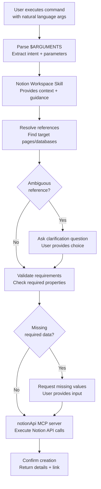
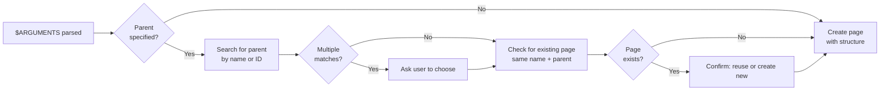
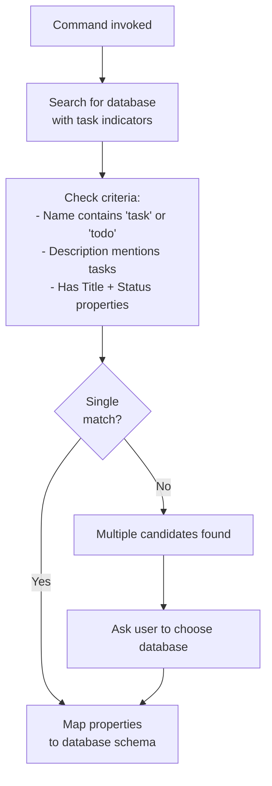
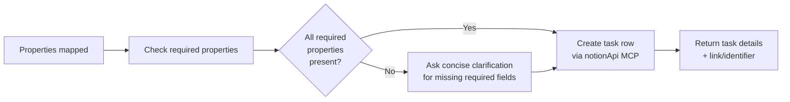
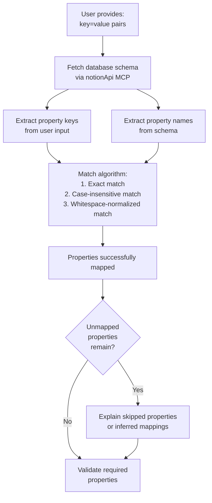
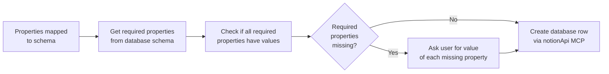
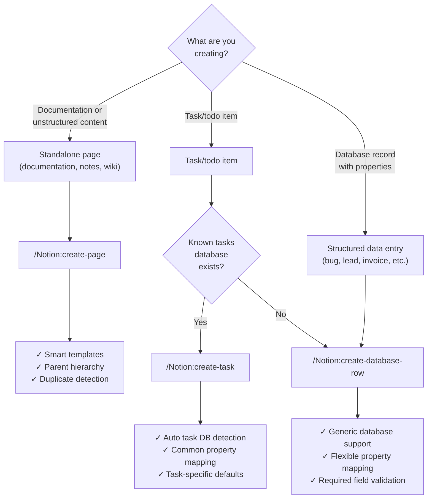

<!-- source: DeepWiki mcp.deepwiki.com · repo makenotion/claude-code-notion-plugin · page 5.2 Content Creation Commands · fetched 2026-10-27 -->

# Content Creation Commands

<details>
<summary>Relevant source files</summary>

The following files were used as context for generating this wiki page:

- [commands/create-database-row.md](commands/create-database-row.md)
- [commands/create-page.md](commands/create-page.md)
- [commands/create-task.md](commands/create-task.md)

</details>


## Purpose and Scope

This document covers the three slash commands provided by the Notion Plugin for creating new content in Notion workspaces. These commands enable programmatic creation of pages, tasks, and database rows through natural language arguments that are parsed, validated, and mapped to Notion's data model.

For commands that query or search existing content, see [Search and Discovery Commands](#5.1). For database querying operations, see [Database Query Command](#5.3). For the task-specific workflow commands that build upon these creation primitives, see [Task Management Workflow](#4).

**Sources:** commands/create-page.md, commands/create-task.md, commands/create-database-row.md

---

## Command Overview

The plugin provides three content creation commands, each serving a distinct use case:

| Command | Purpose | Primary Use Case |
|---------|---------|-----------------|
| `/Notion:create-page` | Create standalone pages with smart templates | Documentation, meeting notes, project pages |
| `/Notion:create-task` | Create task items in a tasks database | Task/todo management |
| `/Notion:create-database-row` | Create rows in any database with property mapping | General structured data entry |

All three commands follow a common architectural pattern: they parse natural language arguments, resolve ambiguous references through user interaction, validate requirements, and confirm successful creation with identifying details.

**Sources:** commands/create-page.md, commands/create-task.md, commands/create-database-row.md

---

## Architecture and Execution Flow

### Command Execution Pipeline



**Diagram: Command Execution Pipeline**

This pipeline demonstrates the common execution pattern shared by all creation commands. Each command parses `$ARGUMENTS` [commands/create-page.md:10-12](), [commands/create-task.md:10-15](), [commands/create-database-row.md:10-12]() into structured parameters, then proceeds through resolution, validation, and execution phases. The Notion Workspace Skill provides guidance throughout this process [commands/create-page.md:8](), [commands/create-task.md:8](), [commands/create-database-row.md:8]().

**Sources:** commands/create-page.md:1-23, commands/create-task.md:1-27, commands/create-database-row.md:1-23

---

## `/Notion:create-page` Command

### Command Specification

```markdown
/Notion:create-page <page title> [optional parent name or ID]
```

**Description:** Creates a new Notion page with optional parent hierarchy placement and smart default structure based on page type [commands/create-page.md:2-3]().

**Argument Parsing:** The command interprets `$ARGUMENTS` as two components [commands/create-page.md:10-12]():
- **Page title** (required): The display name of the new page
- **Parent page/database** (optional): Where to place the page in the hierarchy

**Sources:** commands/create-page.md:1-4, commands/create-page.md:10-12

### Smart Template System

The command applies intelligent default structures based on page title keywords [commands/create-page.md:14-17]():

| Title Pattern | Template Structure |
|---------------|-------------------|
| Contains "Meeting notes" | Sections: Attendees, Agenda, Notes, Action items |
| Contains "Project" | Sections: Overview, Goals, Timeline, Tasks, Risks |
| Generic | Basic page with title only |

This template system eliminates the need for users to manually create common page structures, accelerating documentation workflows.

**Sources:** commands/create-page.md:14-17

### Parent Resolution and Conflict Handling



**Diagram: Page Creation Resolution Flow**

The command implements a two-tier disambiguation strategy:
1. **Parent ambiguity:** If multiple parent pages match the provided name, the user chooses the intended parent [commands/create-page.md:13]()
2. **Duplicate detection:** Before creation, the command checks for existing pages with identical names in the same parent location and asks whether to reuse or create new [commands/create-page.md:22-23]()

This prevents accidental content duplication and overwrites.

**Sources:** commands/create-page.md:10-13, commands/create-page.md:22-23

### Confirmation Output

After successful creation, the command returns [commands/create-page.md:17-20]():
- Page title
- Parent location (if applicable)
- Link or identifier to the new page

**Sources:** commands/create-page.md:17-20

---

## `/Notion:create-task` Command

### Command Specification

```markdown
/Notion:create-task <task title> [due date] [status] [owner] [project]
```

**Description:** Creates a new task in the user's designated Notion tasks database, with automatic property mapping for common task metadata [commands/create-task.md:2-3]().

**Argument Parsing:** The command interprets `$ARGUMENTS` as [commands/create-task.md:10-15]():
- **Task title** (required): The task description
- **Due date** (optional): Deadline for task completion
- **Status** (optional): Task state (e.g., "Not Started", "In Progress")
- **Owner/assignee** (optional): Person responsible for the task
- **Project** (optional): Related project or parent page

**Sources:** commands/create-task.md:1-4, commands/create-task.md:10-15

### Tasks Database Identification



**Diagram: Tasks Database Resolution**

The command identifies the appropriate tasks database by analyzing [commands/create-task.md:16-18]():
- Database name or description containing "tasks" or "todo"
- Schema containing task-like properties (Title, Status, Owner, Due date)

If multiple candidates exist, the user is prompted to select the correct database to avoid creating tasks in the wrong location.

**Sources:** commands/create-task.md:16-18

### Property Mapping

The command automatically maps provided arguments to database properties [commands/create-task.md:19-21]():

| Argument Parameter | Target Property Name(s) |
|-------------------|-------------------------|
| Task title | `Title` or `Name` |
| Due date | `Due date`, `Due`, `Deadline` |
| Status | `Status`, `State` |
| Owner | `Owner`, `Assignee`, `Assigned to` |
| Project | `Project`, `Related to` |

The mapping is case-insensitive and handles minor naming variations common across different Notion setups.

**Sources:** commands/create-task.md:19-21

### Missing Property Handling

If required properties are missing from the provided arguments, the command requests values before creation [commands/create-task.md:27]():



**Diagram: Required Property Validation**

This validation step ensures data integrity and prevents creation of incomplete tasks that don't meet the database schema requirements.

**Sources:** commands/create-task.md:27

### Confirmation Output

After successful creation, the command returns [commands/create-task.md:22-25]():
- Task title
- Key properties (status, due date, owner, project)
- Link or identifier to the task

**Sources:** commands/create-task.md:22-25

---

## `/Notion:create-database-row` Command

### Command Specification

```markdown
/Notion:create-database-row <database name or ID> <property1=value1> <property2=value2> ...
```

**Description:** Generic command for inserting rows into any Notion database using natural language property specifications [commands/create-database-row.md:2-3]().

**Argument Parsing:** The command interprets `$ARGUMENTS` as [commands/create-database-row.md:10-12]():
- **Target database** (first argument): Database name or ID
- **Property key-value pairs**: Space-separated pairs in `key=value` format (e.g., `"Severity=High Owner=Alice Status=Open"`)

**Sources:** commands/create-database-row.md:1-4, commands/create-database-row.md:10-12

### Property Name Mapping Algorithm



**Diagram: Property Name Mapping Algorithm**

The command implements a robust property mapping system [commands/create-database-row.md:15]() that handles:
- **Capitalization differences**: `"status"` matches `"Status"`
- **Spacing variations**: `"Due Date"` matches `"DueDate"` or `"Due_Date"`
- **Minor typos**: Fuzzy matching for close variations

Any properties that had to be inferred or were skipped are explained in the confirmation message [commands/create-database-row.md:23]().

**Sources:** commands/create-database-row.md:15, commands/create-database-row.md:23

### Database Resolution

The command resolves the target database through the following process [commands/create-database-row.md:13-14]():

1. Search by exact ID (if argument looks like a Notion ID)
2. Search by exact name match
3. Search by partial name match

If multiple databases match the provided name, the user is asked to select the intended database before proceeding.

**Sources:** commands/create-database-row.md:13-14

### Required Property Validation



**Diagram: Required Property Validation Flow**

The command validates that all required properties defined in the database schema have values [commands/create-database-row.md:16-17](). If any are missing, it prompts the user for those specific values before creating the row, ensuring data integrity.

**Sources:** commands/create-database-row.md:16-17

### Confirmation Output

After successful creation, the command returns [commands/create-database-row.md:18-21]():
- Resolved database name
- Key properties of the new row
- Link or identifier to the row
- Explanation of any inferred or skipped properties

**Sources:** commands/create-database-row.md:18-21

---

## Common Patterns Across Commands

### Argument Parsing with `$ARGUMENTS`

All three commands use the `$ARGUMENTS` variable to access raw user input [commands/create-page.md:10](), [commands/create-task.md:10](), [commands/create-database-row.md:10](). This variable contains the full argument string as provided after the command name.

### Notion Workspace Skill Integration

Each command explicitly uses the "Notion Workspace Skill" [commands/create-page.md:8](), [commands/create-task.md:8](), [commands/create-database-row.md:8]() to provide contextual intelligence for:
- Understanding user intent from natural language
- Suggesting sensible defaults
- Guiding property mapping decisions

### MCP Server Communication

All commands execute Notion API operations through the `notionApi` MCP server [commands/create-page.md:8](), [commands/create-task.md:8](), [commands/create-database-row.md:8]() rather than direct API calls. This abstraction layer:
- Handles OAuth authentication
- Provides a structured tool interface
- Ensures consistent error handling

### Interactive Disambiguation

All three commands implement interactive disambiguation patterns:
- **Pre-creation clarification:** Ask questions before making changes [commands/create-page.md:13](), [commands/create-task.md:18](), [commands/create-database-row.md:14]()
- **Concise questions:** Keep clarification requests brief to maintain conversation flow [commands/create-task.md:27]()
- **User choice:** Never guess when multiple valid options exist

### Confirmation Messages

Every command concludes with a confirmation that includes [commands/create-page.md:17-20](), [commands/create-task.md:22-25](), [commands/create-database-row.md:18-21]():
- What was created (title/name)
- Where it was created (parent/database)
- How to access it (link or identifier)
- Any special handling that occurred (inferred properties, skipped values)

**Sources:** commands/create-page.md:1-23, commands/create-task.md:1-27, commands/create-database-row.md:1-23

---

## Command Selection Guide



**Diagram: Command Selection Decision Tree**

This decision tree helps users select the appropriate creation command:
- Use `/Notion:create-page` for unstructured content that benefits from smart templates
- Use `/Notion:create-task` when creating items in a known tasks database
- Use `/Notion:create-database-row` for any other structured database entry

**Sources:** commands/create-page.md:1-3, commands/create-task.md:1-3, commands/create-database-row.md:1-3

---

## Error Handling and Edge Cases

### Ambiguity Resolution

All commands handle ambiguous references by requesting user clarification [commands/create-page.md:13](), [commands/create-task.md:18](), [commands/create-database-row.md:14]() rather than making assumptions. This prevents incorrect data placement or creation.

### Property Robustness

The `/Notion:create-database-row` command is explicitly robust to [commands/create-database-row.md:23]():
- Capitalization variations in property names
- Spacing differences in property names
- Minor naming inconsistencies

This flexibility accommodates variations in Notion workspace configurations across different teams and organizations.

### Required Field Validation

Commands that interact with databases validate required fields before creation [commands/create-task.md:27](), [commands/create-database-row.md:16-17](), preventing partial or invalid rows from being inserted into the database.

### Duplicate Prevention

The `/Notion:create-page` command specifically checks for existing pages with the same name in the same parent location [commands/create-page.md:22-23](), allowing users to decide whether to reuse existing content or create a new page.

**Sources:** commands/create-page.md:13-23, commands/create-task.md:18-27, commands/create-database-row.md:14-23

---

