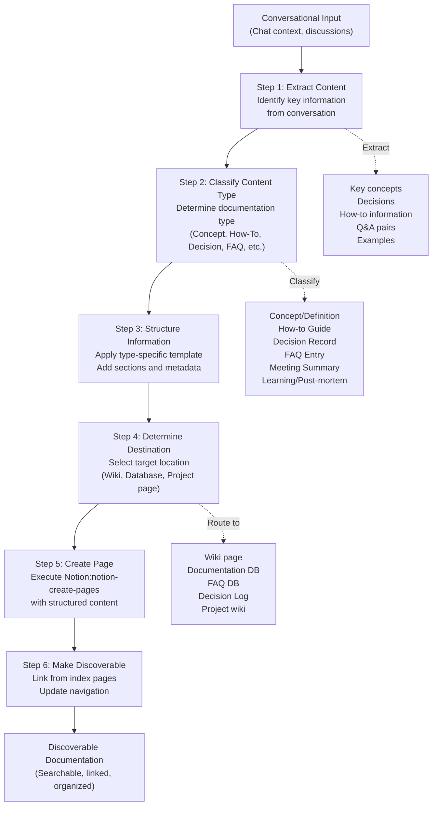
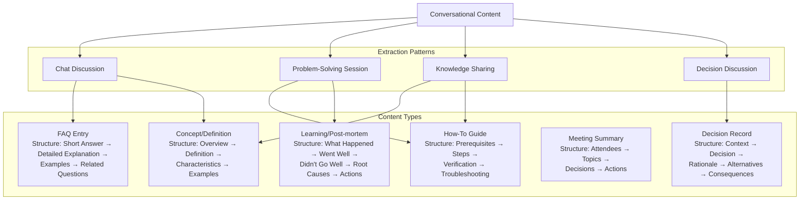
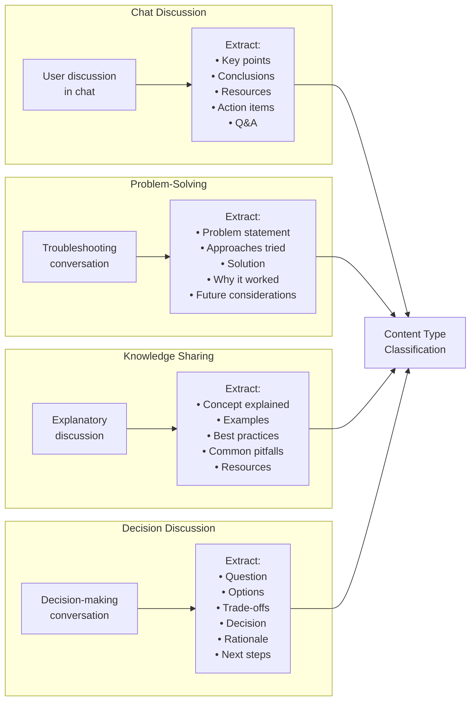
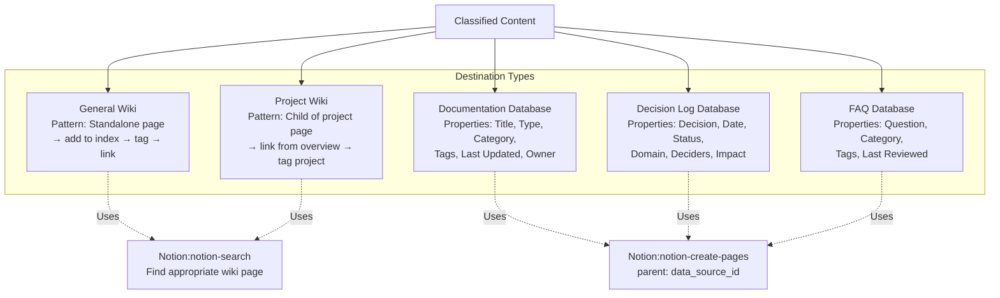
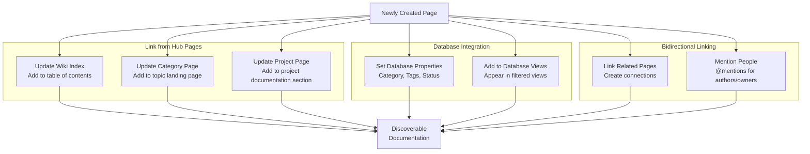
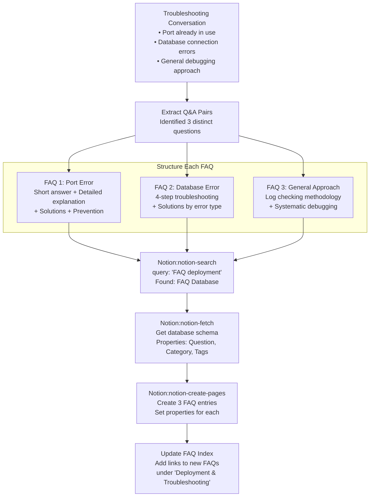
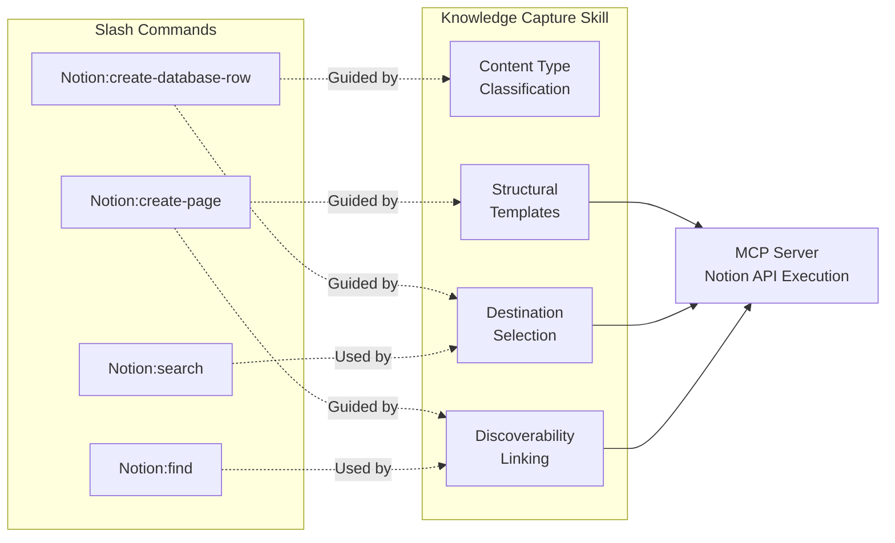

<!-- source: DeepWiki mcp.deepwiki.com · repo makenotion/claude-code-notion-plugin · page 6.1 Knowledge Capture Skill · fetched 2026-10-27 -->

# Knowledge Capture Skill

<details>
<summary>Relevant source files</summary>

The following files were used as context for generating this wiki page:

- [skills/notion/knowledge-capture/SKILL.md](skills/notion/knowledge-capture/SKILL.md)
- [skills/notion/knowledge-capture/examples/conversation-to-faq.md](skills/notion/knowledge-capture/examples/conversation-to-faq.md)
- [skills/notion/knowledge-capture/examples/decision-capture.md](skills/notion/knowledge-capture/examples/decision-capture.md)

</details>


The Knowledge Capture Skill transforms conversational content into structured Notion documentation. It extracts insights from chat contexts, classifies content types, applies formatting templates, determines appropriate destinations, and creates discoverable documentation pages.

This skill operates as an intelligence layer that guides Claude's behavior when creating documentation. It does not execute Notion API operations directly; instead, it informs how slash commands (see [Slash Commands Reference](#5)) should structure and organize content. The actual Notion operations are performed through the MCP Server (see [MCP Server Configuration](#2.2)).

**Scope**: This page covers the Knowledge Capture skill workflow, content classification system, destination patterns, and discoverability mechanisms. For task-specific workflows, see [Task Management Workflow](#4). For other bundled skills, see [Other Bundled Skills](#6.2).

## Skill Architecture

The Knowledge Capture skill is defined in [skills/notion/knowledge-capture/SKILL.md:1-201]() and implements a six-stage pipeline that processes conversational content into structured documentation.

### Knowledge Capture Pipeline



**Pipeline Stages**:

| Stage | Function | Input | Output |
|-------|----------|-------|--------|
| Extract | Parse conversation for documentable content | Raw chat context | Structured information units |
| Classify | Determine content type | Information units | Content type label |
| Structure | Apply formatting template | Content + type | Formatted markdown content |
| Determine Destination | Select target location | Content type + context | Notion parent location |
| Create | Execute MCP operation | Content + destination | Notion page ID |
| Make Discoverable | Link and index | Page ID + context | Updated navigation |

Sources: [skills/notion/knowledge-capture/SKILL.md:1-201]()

## Content Classification System

The skill classifies conversational content into six primary types, each with a specific structural template and destination pattern.

### Content Type Taxonomy



### Content Type Templates

[skills/notion/knowledge-capture/SKILL.md:114-119]() defines structural templates:

| Content Type | Template Structure | Use Case |
|-------------|-------------------|----------|
| **Concept** | Overview → Definition → Characteristics → Examples → Use Cases → Related | Explaining terminology, concepts, or systems |
| **How-To** | Overview → Prerequisites → Steps (numbered) → Verification → Troubleshooting → Related | Procedural documentation, guides |
| **Decision** | Context → Decision → Rationale → Options Considered → Consequences → Implementation | Architecture decisions, product choices |
| **FAQ** | Short Answer → Detailed Explanation → Examples → When to Use → Related Questions | Q&A pairs, troubleshooting |
| **Learning** | What Happened → What Went Well → What Didn't → Root Causes → Learnings → Actions | Post-mortems, retrospectives |
| **Meeting** | Attendees → Topics → Decisions → Actions → Next Steps | Meeting notes, discussion summaries |

Sources: [skills/notion/knowledge-capture/SKILL.md:34-45](), [skills/notion/knowledge-capture/SKILL.md:114-119]()

## Content Extraction Workflow

The skill extracts different information patterns based on the conversational context type.

### Extraction Patterns by Context Type



Sources: [skills/notion/knowledge-capture/SKILL.md:134-142]()

## Destination Selection System

The skill routes content to appropriate Notion locations based on content type and organizational patterns.

### Destination Patterns



### Destination Selection Logic

[skills/notion/knowledge-capture/SKILL.md:59-68]() defines destination patterns:

| Content Type | Default Destination | Properties Required | Integration Method |
|-------------|---------------------|--------------------|--------------------|
| Concept/Definition | General Wiki | Title, Tags | Standalone page + index linking |
| How-To Guide | Documentation Database | Title, Type, Category, Tags | Database row + properties |
| Decision Record | Decision Log Database | Decision, Date, Status, Domain, Impact | Database row + properties |
| FAQ Entry | FAQ Database | Question, Category, Tags, Last Reviewed | Database row + properties |
| Meeting Notes | Project Wiki | Title, Date, Attendees | Project child page |
| Learning/Post-mortem | Documentation Database | Title, Type, Tags, Date | Database row + properties |

Sources: [skills/notion/knowledge-capture/SKILL.md:59-68](), [skills/notion/knowledge-capture/SKILL.md:120-131]()

## MCP Integration and Page Creation

The skill interfaces with the Notion MCP server to create pages using the `Notion:notion-create-pages` tool.

### Creation Workflow with MCP Tools

```mermaid
sequenceDiagram
    participant Skill as "knowledge-capture SKILL"
    participant Search as "Notion:notion-search"
    participant Fetch as "Notion:notion-fetch"
    participant Create as "Notion:notion-create-pages"
    participant Update as "Notion:notion-update-page"
    participant MCP as "MCP Server"
    participant Notion as "Notion API"
    
    Skill->>Search: "query: 'FAQ database'"
    Search->>MCP: Search request
    MCP->>Notion: Search API call
    Notion-->>MCP: Database ID
    MCP-->>Search: Result
    Search-->>Skill: "collection://faq-db-uuid"
    
    Skill->>Fetch: "id: faq-db-uuid"
    Fetch->>MCP: Fetch database schema
    MCP->>Notion: Get database
    Notion-->>MCP: Schema with properties
    MCP-->>Fetch: Properties list
    Fetch-->>Skill: "Question, Category, Tags, Last Reviewed"
    
    Skill->>Create: "parent: data_source_id<br/>pages: [structured content]"
    Create->>MCP: Create page request
    MCP->>Notion: Create page API
    Notion-->>MCP: Page ID
    MCP-->>Create: Success
    Create-->>Skill: "page_id: new-page-id"
    
    Skill->>Update: "Update index page with link"
    Update->>MCP: Update page
    MCP->>Notion: Append content
    Notion-->>MCP: Success
    MCP-->>Update: Success
    Update-->>Skill: "Documentation linked"
```

### Page Creation Parameters

Example from [skills/notion/knowledge-capture/examples/conversation-to-faq.md:62-76]():

```json
{
  "parent": {
    "data_source_id": "collection://faq-db-uuid"
  },
  "pages": [{
    "properties": {
      "Question": "Why does deployment fail with 'port already in use' error?",
      "Category": "Troubleshooting",
      "Tags": "deployment, errors, ports",
      "date:Last Reviewed:start": "2025-10-14",
      "date:Last Reviewed:is_datetime": 0
    },
    "content": "[Formatted markdown content]"
  }]
}
```

**Property Naming Conventions**:
- **Text properties**: Direct assignment (`"Question": "value"`)
- **Select properties**: Direct assignment (`"Category": "Troubleshooting"`)
- **Multi-select properties**: Comma-separated (`"Tags": "tag1, tag2"`)
- **Date properties**: Prefix with `date:` (`"date:Last Reviewed:start"`)

Sources: [skills/notion/knowledge-capture/SKILL.md:70-80](), [skills/notion/knowledge-capture/examples/conversation-to-faq.md:62-76]()

## Discoverability Mechanisms

Step 6 of the pipeline ensures created documentation is findable through linking, indexing, and navigation updates.

### Discoverability Strategy



### Linking Patterns

[skills/notion/knowledge-capture/SKILL.md:82-109]() defines linking strategies:

**1. Update Hub/Index Pages**

Example from [skills/notion/knowledge-capture/examples/conversation-to-faq.md:116-133]():

```markdown
Notion:notion-update-page
page_id: "faq-index-page-id"
command: "insert_content_after"
selection_with_ellipsis: "## Deployment & Troubleshooting..."
new_str: "
- <mention-page url='...'>Port already in use error?</mention-page>
- <mention-page url='...'>Database connection errors?</mention-page>
"
```

**2. Set Database Properties**

For pages in databases, properties enable filtering and categorization:
- **Category/Tags**: Enable grouping in views
- **Status**: Control visibility (Draft → Published)
- **Last Updated**: Track freshness
- **Owner**: Assign responsibility

**3. Create Bidirectional Links**

Link related pages using `<mention-page>` syntax to create navigable knowledge graphs.

Sources: [skills/notion/knowledge-capture/SKILL.md:82-109](), [skills/notion/knowledge-capture/examples/conversation-to-faq.md:116-133]()

## Formatting Best Practices

The skill applies consistent formatting rules to ensure documentation quality.

### Formatting Standards

| Element | Standard | Example |
|---------|----------|---------|
| **Headings** | `#` (title), `##` (sections), `###` (subsections) | `## Problem Statement` |
| **Lists** | Bullets for items, numbered for steps | `1. First step\n2. Second step` |
| **Code blocks** | Triple backticks with language | ` ```bash\nlsof -ti:3000\n``` ` |
| **Links** | `<mention-page>` for Notion pages | `<mention-page url="...">Related Doc</mention-page>` |
| **Emphasis** | `**bold**` for important terms | `**Important**: Check logs first` |
| **Metadata** | Include date, author, tags | `## Last Updated\nOctober 14, 2025` |

### Content Structure Guidelines

From [skills/notion/knowledge-capture/SKILL.md:145-154]():

1. **Structure**: Consistent heading hierarchy
2. **Writing**: Start with overview, use bullets, keep paragraphs short
3. **Linking**: Cross-reference related pages extensively
4. **Metadata**: Include creation date, author, tags, status
5. **Searchability**: Clear titles, natural keywords, descriptive tags

Sources: [skills/notion/knowledge-capture/SKILL.md:145-154]()

## FAQ Creation Example

The [skills/notion/knowledge-capture/examples/conversation-to-faq.md:1-235]() file demonstrates transforming a troubleshooting conversation into structured FAQ entries.

### FAQ Workflow Execution



### FAQ Entry Structure

Each FAQ entry from [skills/notion/knowledge-capture/examples/conversation-to-faq.md:59-114]() includes:

**Short Answer**: Quick reference (2-3 sentences)
```markdown
## Short Answer
The deployment port is still occupied by a process from a previous deployment.
You need to kill the existing process before deploying again.
```

**Detailed Explanation**: Full context with causes
```markdown
## Detailed Explanation
When you deploy the application, it tries to bind to a specific port...

**Common causes**:
- Previous deployment crashed without cleanup
- Manual node process started and forgotten
```

**Solutions**: Multiple options with code examples
```markdown
### Option 1: Kill the process using the port
```bash
lsof -ti:3000 | xargs kill -9
```

### Option 2: If using PM2
```bash
pm2 restart app
```
```

**Prevention**: Best practices to avoid future issues
```markdown
## Prevention
1. Use process managers (PM2, systemd)
2. Implement graceful shutdown handlers
```

**Related Questions**: Links to connected FAQs
```markdown
## Related Questions
- <mention-page url="...">How do I check what's using a port?</mention-page>
```

Sources: [skills/notion/knowledge-capture/examples/conversation-to-faq.md:1-235]()

## Decision Record Example

The [skills/notion/knowledge-capture/examples/decision-capture.md:1-146]() file demonstrates capturing an architecture decision.

### Decision Record Workflow

From [skills/notion/knowledge-capture/examples/decision-capture.md:7-49]():

**1. Extract Decision Components**
- Decision: Migrate from REST to GraphQL
- Context: 50+ REST endpoints, inconsistent patterns
- Alternatives: Keep REST, try gRPC, adopt GraphQL
- Rationale: Better client experience, type safety

**2. Find Decision Log Database**
```markdown
Notion:notion-search
query: "architecture decisions" or "ADR"
Found: "Architecture Decision Records" database
```

**3. Fetch Schema**
Properties: Decision (title), Date, Status, Domain, Impact, Deciders, Stakeholders

**4. Create Record with Properties**
```json
{
  "properties": {
    "Decision": "Migrate to GraphQL API",
    "date:Date:start": "2025-10-16",
    "Status": "Accepted",
    "Domain": "Architecture",
    "Impact": "High"
  }
}
```

### Decision Record Structure

From [skills/notion/knowledge-capture/examples/decision-capture.md:52-132]():

| Section | Content |
|---------|---------|
| **Context** | Current situation, problems being solved |
| **Decision** | Clear statement of what was decided |
| **Rationale** | Why this decision makes sense |
| **Options Considered** | Alternative approaches with pros/cons |
| **Consequences** | Both positive and negative impacts |
| **Implementation Plan** | Timeline, owner, steps |
| **Success Metrics** | How to measure effectiveness |

Sources: [skills/notion/knowledge-capture/examples/decision-capture.md:1-146]()

## Update vs. Create Decision Logic

The skill determines whether to create new documentation or update existing content.

### Decision Criteria

From [skills/notion/knowledge-capture/SKILL.md:166-170]():

| Create New Page | Update Existing Page |
|----------------|---------------------|
| Content is substantive (>2 paragraphs) | Adding to existing topic |
| Will be referenced multiple times | Correcting information |
| Part of permanent knowledge base | Expanding existing concept |
| Needs independent discovery | Updating for recent changes |

**Versioning**: For significant updates, add history section with date, author, what changed, and why.

Sources: [skills/notion/knowledge-capture/SKILL.md:166-170]()

## Best Practices Summary

From [skills/notion/knowledge-capture/SKILL.md:172-182]():

1. **Capture promptly**: Document while context is fresh
2. **Structure consistently**: Use templates for similar content types
3. **Link extensively**: Connect related knowledge for navigation
4. **Write for discovery**: Use searchable titles and descriptive tags
5. **Include context**: Explain why this matters and when to use
6. **Add examples**: Concrete examples aid understanding
7. **Maintain**: Review and update periodically
8. **Get feedback**: Validate documentation usefulness

Sources: [skills/notion/knowledge-capture/SKILL.md:172-182]()

## Integration with Slash Commands

The Knowledge Capture skill guides the behavior of content creation commands from [Slash Commands Reference](#5).

### Command Integration Points



The skill provides intelligence for *how* to structure content, while commands execute the actual Notion operations.

Sources: [skills/notion/knowledge-capture/SKILL.md:1-201]()

---

