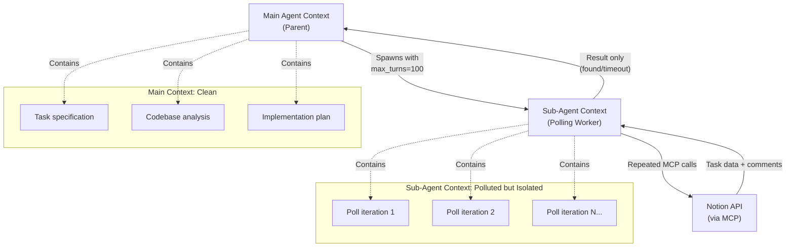
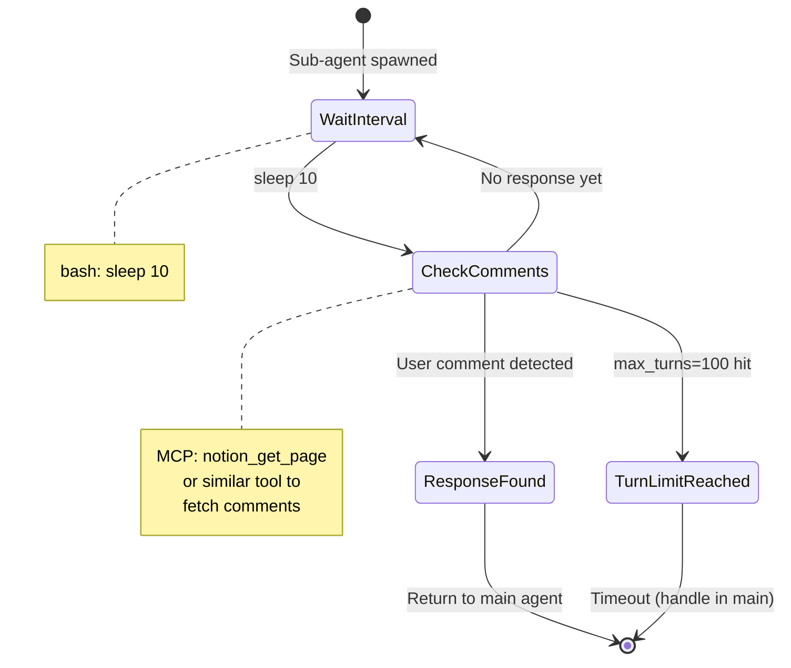
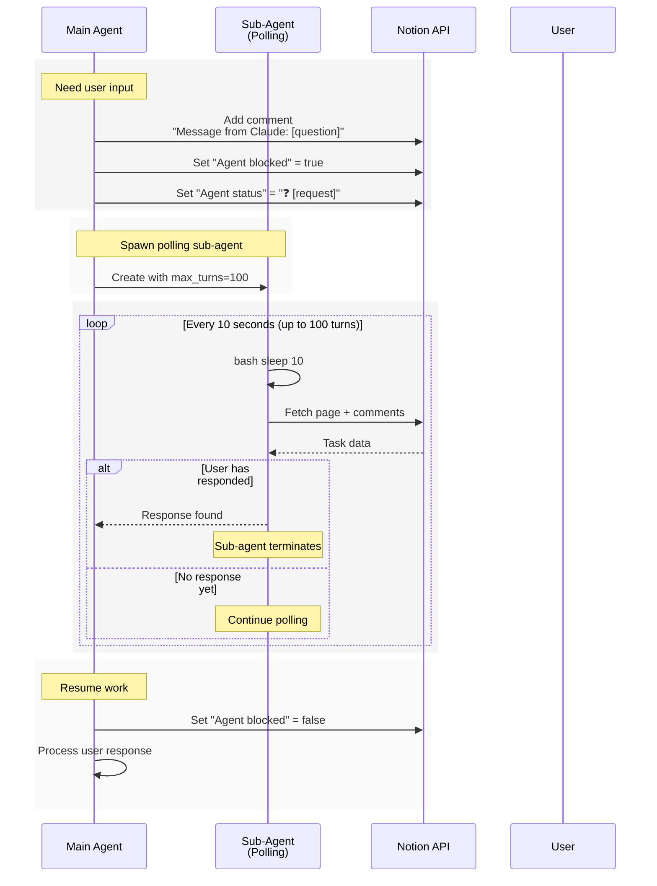

<!-- source: DeepWiki mcp.deepwiki.com · repo makenotion/claude-code-notion-plugin · page 7.1 Agent Polling and Sub-Agents · fetched 2026-10-27 -->

# Agent Polling and Sub-Agents

Relevant source files

The following files were used as context for generating this wiki page:

- [commands/tasks/build.md](commands/tasks/build.md)
- [commands/tasks/plan.md](commands/tasks/plan.md)

## Purpose and Scope

This document explains the polling mechanism used by the task management system ([4](#4)) to enable asynchronous communication between agents and users through Notion boards. Specifically, it covers the sub-agent architecture that prevents context pollution during repeated polling operations.

For information about the broader Communication Protocol that necessitates polling, see [Communication Protocol](#3.2). For details on how polling integrates into the task workflow, see [Planning Tasks](#4.2) and [Building Tasks](#4.3).

## The Polling Requirement

The task management commands (`/Notion:tasks:plan` and `/Notion:tasks:build`) implement an asynchronous communication pattern where the agent works autonomously but may need user input at strategic points. As documented in [commands/tasks/build.md:8]() and [commands/tasks/plan.md:8](), "The user is only watching the Notion board and isn't watching this session, so all feedback to the user must be sent through the Notion MCP."

When the agent needs user input, it follows the Communication Protocol [commands/tasks/build.md:36-43]():

1. Adds a comment to the Notion task page
2. Sets the "Agent blocked" property to `true`
3. Updates the "Agent status" property with a brief request message
4. **Polls every 10 seconds** to check if the user has responded

This polling operation must run continuously until a response is detected, potentially for many iterations.

**Sources**: [commands/tasks/build.md:36-43](), [commands/tasks/plan.md:36-43]()

## The Context Pollution Problem

Naive implementation of the polling loop would execute repeated MCP tool calls within the main agent's context window. Each iteration would add:

- The MCP tool invocation
- The tool's response (task metadata, comments, etc.)
- Claude's reasoning about whether a response was found

Over 100+ polling iterations at 10-second intervals, this would rapidly consume the context window with repetitive, low-value information, leaving less space for:

- The actual task specification
- Codebase analysis
- Implementation planning
- User conversation history

The challenge is to implement continuous polling without degrading the main agent's working memory.

**Sources**: Inferred from [commands/tasks/build.md:46]() and [commands/tasks/plan.md:46]()

## Sub-Agent Architecture

The solution is to delegate polling to a **sub-agent** — a separate Claude instance with its own isolated context window. The main agent spawns a sub-agent specifically for polling, keeping all polling-related context pollution confined to the sub-agent's disposable context.

**Diagram**: Context Isolation Between Parent Agent and Polling Sub-Agent

The architecture provides:

- **Context isolation**: Polling artifacts remain in the sub-agent's context
- **Simplicity**: Main agent receives only the final result (response found or timeout)
- **Resource management**: The `max_turns=100` parameter caps the sub-agent's execution
- **Disposability**: Sub-agent context is discarded after polling completes

**Sources**: [commands/tasks/build.md:46](), [commands/tasks/plan.md:46]()

## Turn Limit Mechanism

The sub-agent is constrained by `max_turns=100` as specified in [commands/tasks/build.md:46]() and [commands/tasks/plan.md:46]():

> Always use a sub-agent to poll with max turns set to 100 to avoid polluting the parent content.

### Turn Limit Calculation

At 10-second intervals, 100 turns allows for:
- **Maximum polling duration**: ~16.7 minutes (100 turns × 10 seconds)
- **Safety bound**: Prevents infinite loops if user never responds
- **Resource efficiency**: Limits compute consumption per polling session

If the turn limit is reached without receiving a user response, the sub-agent terminates, and the main agent must handle the timeout scenario (though this is not explicitly specified in the current implementation).

**Sources**: [commands/tasks/build.md:46](), [commands/tasks/plan.md:46]()

## Implementation Pattern

The polling implementation uses a combination of Bash `sleep` commands and MCP tool calls, as documented in [commands/tasks/build.md:47]() and [commands/tasks/plan.md:47]():

> You can use a Bash sleep interleaved with MCP tool call.

### Typical Polling Loop

**Diagram**: Polling State Machine Within Sub-Agent

### Interleaved Operations

Each polling iteration consists of:

1. **Sleep**: `bash -c "sleep 10"` provides the 10-second delay
2. **Fetch**: MCP tool call (likely `notion_get_page` or similar) retrieves current task state
3. **Check**: Sub-agent examines comments for new user responses
4. **Branch**: Either continue loop or exit with result

This interleaving pattern ensures:
- Consistent 10-second intervals between checks
- Fresh data on each iteration
- Minimal latency when user responds (average 5 seconds, max 10 seconds)

**Sources**: [commands/tasks/build.md:47](), [commands/tasks/plan.md:47](), [commands/tasks/build.md:42]()

## Polling Lifecycle Integration

The polling mechanism integrates into the broader Communication Protocol workflow:

**Diagram**: Complete Polling Lifecycle in Communication Protocol

### Lifecycle Phases

| Phase | Actor | Action | Notion State |
|-------|-------|--------|--------------|
| **Initiate** | Main Agent | Add comment, set blocking flags | `Agent blocked` = true |
| **Delegate** | Main Agent | Spawn sub-agent with turn limit | No change |
| **Poll** | Sub-Agent | Repeated sleep + fetch cycles | No change |
| **Detect** | Sub-Agent | Find user comment | No change |
| **Return** | Sub-Agent | Signal main agent, terminate | No change |
| **Resume** | Main Agent | Process response, unblock | `Agent blocked` = false |

**Sources**: [commands/tasks/build.md:36-48](), [commands/tasks/plan.md:36-48]()

## Code References

The polling instructions are identically specified in both task commands:

- Planning command: [commands/tasks/plan.md:44-48]()
  - "Always use a sub-agent to poll with max turns set to 100"
  - "You can use a Bash sleep interleaved with MCP tool call"

- Building command: [commands/tasks/build.md:44-48]()
  - Same instructions as planning command

The polling trigger (Communication Protocol) is also identically specified:

- Planning command: [commands/tasks/plan.md:36-43]()
- Building command: [commands/tasks/build.md:36-43]()

Both commands share the same polling architecture because they both implement the same asynchronous user interaction pattern.

**Sources**: [commands/tasks/build.md:44-48](), [commands/tasks/plan.md:44-48](), [commands/tasks/build.md:36-43](), [commands/tasks/plan.md:36-43]()

## Key Design Decisions

| Decision | Rationale | Trade-off |
|----------|-----------|-----------|
| **Sub-agent isolation** | Prevents main context pollution | Requires sub-agent spawn overhead |
| **10-second interval** | Balance between responsiveness and API load | Average 5-second latency for user response |
| **100 turn limit** | ~17 minutes max wait prevents infinite loops | Could timeout on slow user responses |
| **Bash sleep** | Simple, reliable timing mechanism | Requires bash execution capability |
| **Interleaved pattern** | Clean separation of timing and fetching | Slightly more complex than single tool call |

The sub-agent architecture is the critical innovation that makes continuous polling viable. Without it, the task management system would be forced to either:
- Pollute the main context (unacceptable for long-running tasks)
- Prompt the user to manually notify when ready (breaks the asynchronous UX)
- Implement a callback mechanism (not supported by current architecture)

**Sources**: [commands/tasks/build.md:44-48](), [commands/tasks/plan.md:44-48]()

---

