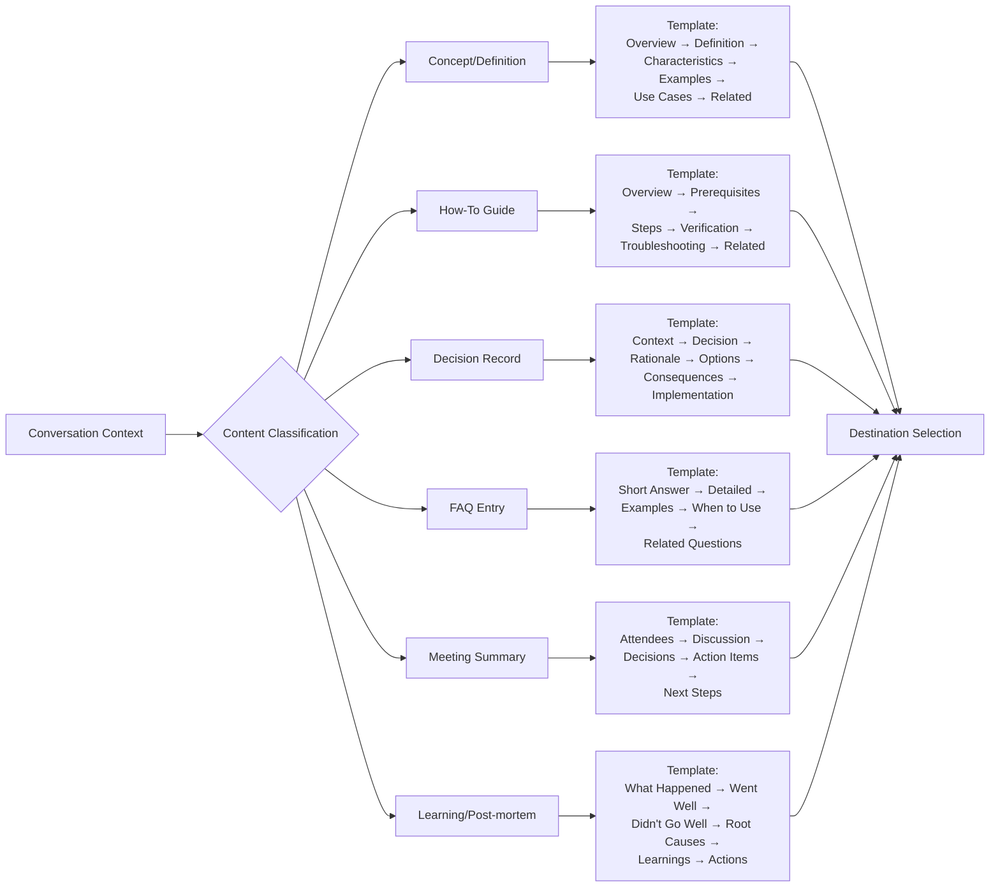
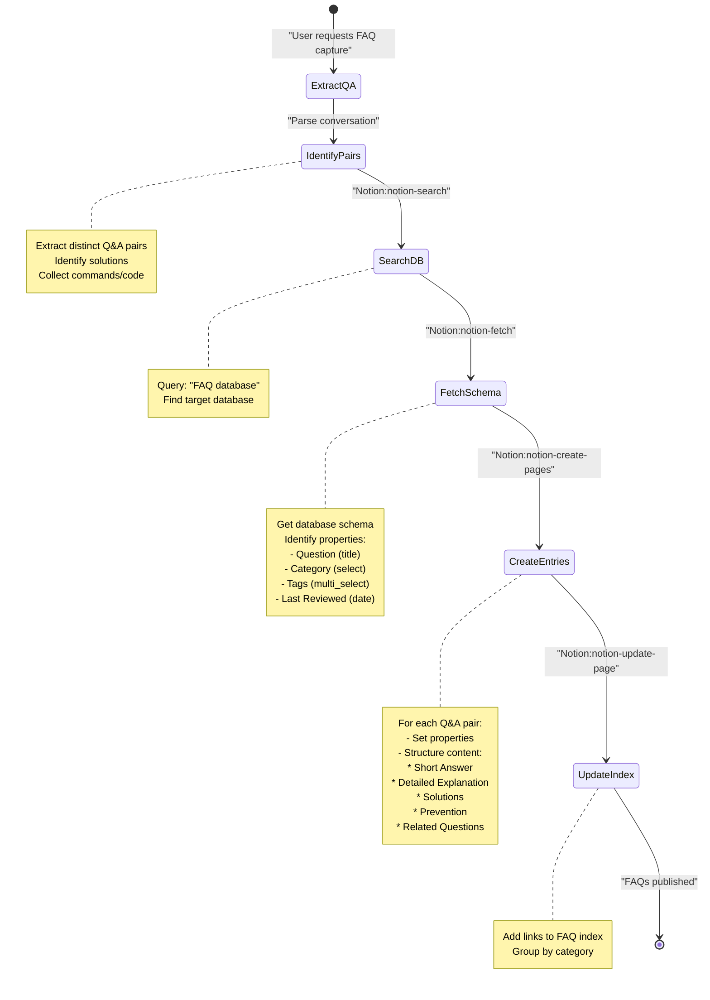
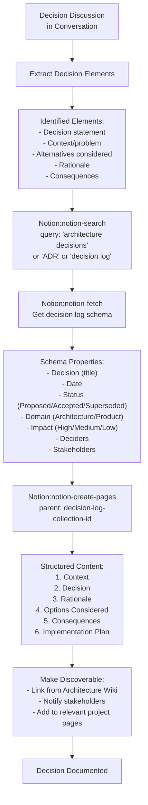
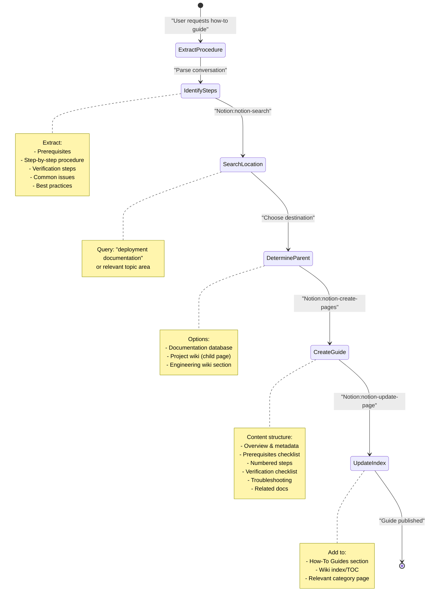
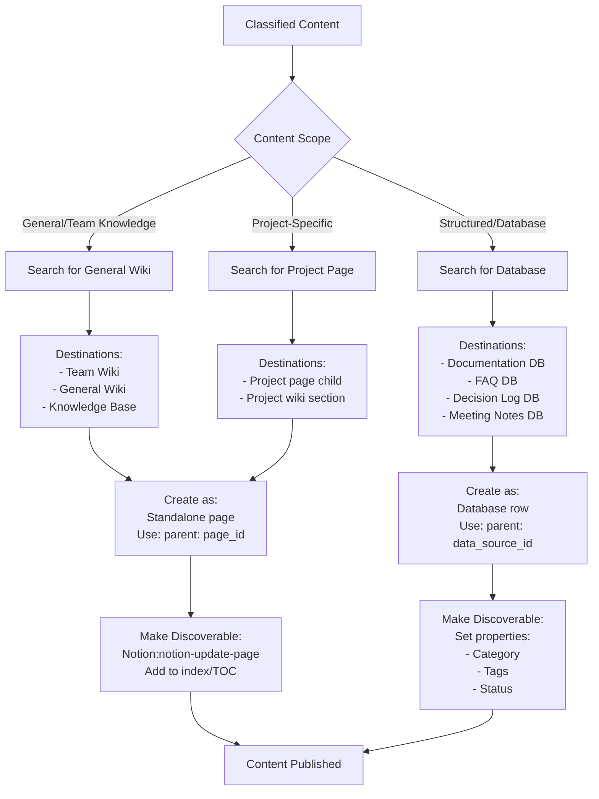
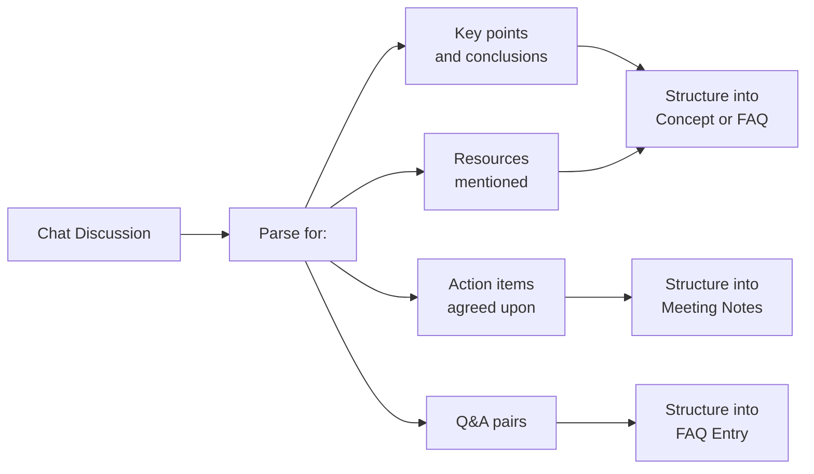

<!-- source: DeepWiki mcp.deepwiki.com · repo makenotion/claude-code-notion-plugin · page 7.2 Knowledge Capture Workflows · fetched 2026-10-27 -->

# Knowledge Capture Workflows

<details>
<summary>Relevant source files</summary>

The following files were used as context for generating this wiki page:

- [skills/notion/knowledge-capture/SKILL.md](skills/notion/knowledge-capture/SKILL.md)
- [skills/notion/knowledge-capture/examples/conversation-to-faq.md](skills/notion/knowledge-capture/examples/conversation-to-faq.md)
- [skills/notion/knowledge-capture/examples/decision-capture.md](skills/notion/knowledge-capture/examples/decision-capture.md)
- [skills/notion/knowledge-capture/examples/how-to-guide.md](skills/notion/knowledge-capture/examples/how-to-guide.md)

</details>


This document provides detailed examples and workflow patterns for capturing knowledge from conversations and transforming it into structured Notion documentation. Each workflow demonstrates the complete process from content extraction to making the documentation discoverable.

For an overview of the Knowledge Capture Skill and its architecture, see [Knowledge Capture Skill](#6.1). For information about basic Notion operations used in these workflows, see [Content Creation Commands](#5.2) and [Search and Discovery Commands](#5.1).

**Sources**: [skills/notion/knowledge-capture/SKILL.md:1-20]()

## Content Type Classification

Knowledge capture begins with classifying conversation content into one of six structured types, each with a specific template and destination pattern.



**Sources**: [skills/notion/knowledge-capture/SKILL.md:34-119]()

### Template to Destination Mapping

| Content Type | Typical Destinations | Database Properties Required |
|--------------|---------------------|------------------------------|
| Concept/Definition | General Wiki, Project Wiki | Title, Category, Tags |
| How-To Guide | Documentation Database, Project Wiki | Title, Type, Category, Tags, Last Updated |
| Decision Record | Decision Log Database | Decision (title), Date, Status, Domain, Impact, Deciders |
| FAQ Entry | FAQ Database | Question (title), Category, Tags, Last Reviewed |
| Meeting Summary | Meeting Notes Database, Project Page | Title, Date, Attendees, Meeting Type |
| Learning/Post-mortem | Project Wiki, Learning Database | Title, Date, Project, Type, Status |

**Sources**: [skills/notion/knowledge-capture/SKILL.md:110-132]()

## FAQ Creation Workflow

The FAQ workflow transforms question-and-answer conversations into structured FAQ entries in a Notion database.



### Detailed Example: Deployment Troubleshooting FAQ

This example shows the complete workflow for capturing deployment troubleshooting discussion into three FAQ entries.

**Sources**: [skills/notion/knowledge-capture/examples/conversation-to-faq.md:1-40]()

#### Step 1: Search for FAQ Database

```plaintext
Notion:notion-search
query: "FAQ deployment"
query_type: "internal"
```

Returns: "Deployment FAQ" database with ID and schema information.

**Sources**: [skills/notion/knowledge-capture/examples/conversation-to-faq.md:37-43]()

#### Step 2: Fetch Database Schema

```plaintext
Notion:notion-fetch
id: "deployment-faq-database-id"
```

Returns schema with properties:
- `Question` (title property)
- `Category` (select: Deployment, Configuration, Troubleshooting)
- `Tags` (multi_select)
- `Last Reviewed` (date)

**Sources**: [skills/notion/knowledge-capture/examples/conversation-to-faq.md:45-55]()

#### Step 3: Create FAQ Entry with Structured Content

The MCP tool call structure for FAQ creation:

```plaintext
Notion:notion-create-pages

parent: { data_source_id: "collection://faq-db-uuid" }

pages: [{
  properties: {
    "Question": "Why does deployment fail with 'port already in use' error?",
    "Category": "Troubleshooting",
    "Tags": "deployment, errors, ports",
    "date:Last Reviewed:start": "2025-10-14",
    "date:Last Reviewed:is_datetime": 0
  },
  content: "## Short Answer\n\n[Quick solution]\n\n## Detailed Explanation\n\n[Full context]..."
}]
```

**Content Structure Pattern**:

```markdown
## Short Answer
[One-paragraph quick solution]

## Detailed Explanation
[Full context, common causes, background]

## Solution
### Option 1: [Primary approach]
[Code/commands with comments]

### Option 2: [Alternative approach]
[Code/commands with comments]

## Prevention
[Best practices to avoid the issue]

## Verification
[How to confirm the fix worked]

## Related Questions
- [Link to related FAQ 1]
- [Link to related FAQ 2]
```

**Sources**: [skills/notion/knowledge-capture/examples/conversation-to-faq.md:59-95]()

#### Step 4: Update FAQ Index Page

```plaintext
Notion:notion-update-page
page_id: "faq-index-page-id"
command: "insert_content_after"
selection_with_ellipsis: "## Deployment & Troubleshooting..."
new_str: "
- <mention-page url=\"...\">Why does deployment fail with 'port already in use' error?</mention-page>
- <mention-page url=\"...\">Why do I get 'cannot connect to database' errors?</mention-page>
"
```

This ensures the new FAQs are discoverable from the index page.

**Sources**: [skills/notion/knowledge-capture/examples/conversation-to-faq.md:116-133]()

### FAQ Content Components

Each FAQ entry includes these mandatory sections:

| Section | Purpose | Format |
|---------|---------|--------|
| Short Answer | Quick reference for those who know the context | 1-2 sentences, actionable |
| Detailed Explanation | Full understanding for newcomers | Paragraph format, includes common causes |
| Solution(s) | Multiple approaches when possible | Numbered options with code blocks |
| Prevention | Proactive strategies | Bullet list of best practices |
| Verification | Confirm the fix worked | Commands to check status |
| Related Questions | Cross-references | Notion page mentions |

**Sources**: [skills/notion/knowledge-capture/examples/conversation-to-faq.md:204-233]()

## Decision Record Workflow

Decision records capture architectural and product decisions with full context, alternatives considered, and consequences.



**Sources**: [skills/notion/knowledge-capture/examples/decision-capture.md:1-50]()

### Decision Record Structure

The decision record template follows this structure:

```markdown
# [Decision Title]

## Context

[What problem/situation led to this decision?]
- Current state
- Pain points
- Why change is needed

## Decision

[Clear statement of what was decided]

## Rationale

**Why this decision:**
- Benefit 1
- Benefit 2
- Strategic alignment

## Options Considered

### Option A: [Name]
**Pros**: [List]
**Cons**: [List]
**Decision**: [Accepted/Rejected - why]

### Option B: [Name]
**Pros**: [List]
**Cons**: [List]
**Decision**: [Accepted/Rejected - why]

## Consequences

**Positive:**
- [Expected benefit 1]
- [Expected benefit 2]

**Negative:**
- [Trade-off 1]
- [Trade-off 2]

## Implementation Plan

1. [Step 1]
2. [Step 2]

**Timeline**: [When]
**Owner**: [Who]

## Success Metrics

- [Measurable outcome 1]
- [Measurable outcome 2]
```

**Sources**: [skills/notion/knowledge-capture/examples/decision-capture.md:52-133]()

### MCP Tool Invocation for Decision Records

```plaintext
Notion:notion-create-pages
parent: { data_source_id: "decision-log-collection-id" }
pages: [{
  properties: {
    "Decision": "Migrate to GraphQL API",
    "date:Date:start": "2025-10-16",
    "date:Date:is_datetime": 0,
    "Status": "Accepted",
    "Domain": "Architecture",
    "Impact": "High"
  },
  content: "[Full decision record with all sections above]"
}]
```

**Key Properties**:
- `Status`: "Proposed" (under discussion), "Accepted" (implemented), "Superseded" (replaced by newer decision)
- `Domain`: "Architecture", "Product", "Infrastructure", "Process"
- `Impact`: "High" (affects multiple teams), "Medium" (single team), "Low" (localized)

**Sources**: [skills/notion/knowledge-capture/examples/decision-capture.md:35-49]()

## How-To Guide Workflow

How-to guides transform procedural discussions into step-by-step instructions with prerequisites, verification, and troubleshooting.



**Sources**: [skills/notion/knowledge-capture/examples/how-to-guide.md:1-41]()

### How-To Guide Template

```markdown
# How to [Task Name]

## Overview

[Brief description of what this guide covers]
**Time Required**: [X minutes] | **Complexity**: [Beginner/Intermediate/Advanced]

## Prerequisites

- [ ] [Prerequisite 1]
- [ ] [Prerequisite 2]
- [ ] [Prerequisite 3]

## Steps

1. **[Step 1 title]**
   ```bash
   [command or code]
   ```
   [Explanation if needed]

2. **[Step 2 title]**
   ```bash
   [command or code]
   ```
   [Explanation if needed]

[Continue numbering...]

## Verification Checklist

- [ ] [Check 1]
- [ ] [Check 2]
- [ ] [Check 3]

## Troubleshooting

**[Common issue 1]**
→ [Solution]

**[Common issue 2]**
→ [Solution]

## Best Practices

- [Practice 1]
- [Practice 2]

## Related Docs

- [Link to related guide 1]
- [Link to related guide 2]
```

**Sources**: [skills/notion/knowledge-capture/examples/how-to-guide.md:42-118]()

### MCP Tool Call for How-To Guide Creation

```plaintext
Notion:notion-create-pages
parent: { page_id: "deployment-section-id" }
pages: [{
  properties: {
    "Name": "How to Deploy to Production"
  },
  content: "[Structured how-to content as shown above]"
}]
```

For documentation databases, add type and category properties:

```plaintext
properties: {
  "Title": "How to Deploy to Production",
  "Type": "How-To Guide",
  "Category": "Deployment",
  "Tags": "deployment, production, github-actions",
  "date:Last Updated:start": "2025-10-16",
  "date:Last Updated:is_datetime": 0
}
```

**Sources**: [skills/notion/knowledge-capture/examples/how-to-guide.md:37-40](), [skills/notion/knowledge-capture/SKILL.md:126-127]()

## Destination Selection Logic

The workflow determines where to save content based on type, scope, and existing workspace structure.



**Sources**: [skills/notion/knowledge-capture/SKILL.md:59-69](), [skills/notion/knowledge-capture/SKILL.md:120-131]()

### Parent Specification Patterns

| Destination Type | Parent Specification | Example |
|------------------|---------------------|---------|
| Database entry | `parent: { data_source_id: "collection://db-uuid" }` | FAQ entry, Decision record |
| Wiki page child | `parent: { page_id: "parent-page-id" }` | Project documentation, Team wiki |
| Top-level page | `parent: { workspace: true }` | New knowledge base section |

**Sources**: [skills/notion/knowledge-capture/examples/conversation-to-faq.md:64](), [skills/notion/knowledge-capture/examples/how-to-guide.md:39]()

## Making Content Discoverable

After creating content, it must be linked into the workspace navigation structure to prevent "orphaned" documentation.

### Discoverability Checklist

| Action | Tool | When to Use |
|--------|------|-------------|
| Update index/TOC page | `Notion:notion-update-page` with `insert_content_after` | Always for important content |
| Set database properties | Properties in `Notion:notion-create-pages` | Database entries (Category, Tags, Status) |
| Link from parent page | `Notion:notion-update-page` | Project-specific content |
| Add to hub pages | `Notion:notion-update-page` | Broad-interest content |
| Cross-reference related pages | `<mention-page>` in content | Content with related topics |

**Sources**: [skills/notion/knowledge-capture/SKILL.md:82-109]()

### Index Update Pattern

```plaintext
Notion:notion-update-page
page_id: "wiki-index-page-id"
command: "insert_content_after"
selection_with_ellipsis: "## [Section heading]..."
new_str: "- <mention-page url='https://notion.so/page-url'>[Page Title]</mention-page>"
```

The `selection_with_ellipsis` identifies where to insert by matching existing text with trailing `...`. The new content is inserted immediately after this selection.

**Sources**: [skills/notion/knowledge-capture/SKILL.md:100-106](), [skills/notion/knowledge-capture/examples/conversation-to-faq.md:123-133]()

## Content Extraction Patterns

Different conversation types require different extraction approaches:

### Chat Discussion Extraction



**Sources**: [skills/notion/knowledge-capture/SKILL.md:134-143]()

### Problem-Solving Discussion Extraction

For technical problem-solving conversations:

1. **Problem Statement**: What was the issue?
2. **Approaches Tried**: Failed attempts and why they failed
3. **Solution**: What finally worked
4. **Why It Worked**: Explanation of root cause
5. **Future Considerations**: How to prevent or optimize

Structure as: **How-To Guide** or **Learning/Post-mortem**

**Sources**: [skills/notion/knowledge-capture/SKILL.md:137-138]()

### Decision Discussion Extraction

For decision-making conversations:

1. **Question**: What decision needed to be made?
2. **Options**: Alternatives discussed
3. **Trade-offs**: Pros/cons of each option
4. **Decision**: What was chosen
5. **Rationale**: Why this choice
6. **Next Steps**: Implementation plan

Structure as: **Decision Record**

**Sources**: [skills/notion/knowledge-capture/SKILL.md:141-142]()

## Advanced Patterns

### Multi-Page Documentation Sets

When a conversation spans multiple topics, create a documentation set with a hub page:

```plaintext
# Step 1: Create hub page
Notion:notion-create-pages
parent: { page_id: "parent-section" }
pages: [{
  properties: { "Name": "Deployment Guide Suite" },
  content: "## Overview\n\n[Introduction]\n\n## Guides\n\n[Placeholder for links]"
}]

# Step 2: Create individual guides as children
Notion:notion-create-pages
parent: { page_id: "hub-page-id" }
pages: [
  { properties: { "Name": "Pre-Deployment Checklist" }, content: "..." },
  { properties: { "Name": "Deployment Procedure" }, content: "..." },
  { properties: { "Name": "Post-Deployment Verification" }, content: "..." }
]

# Step 3: Update hub page with links
Notion:notion-update-page
page_id: "hub-page-id"
command: "insert_content_after"
selection_with_ellipsis: "## Guides..."
new_str: "
1. <mention-page url='...'>Pre-Deployment Checklist</mention-page>
2. <mention-page url='...'>Deployment Procedure</mention-page>
3. <mention-page url='...'>Post-Deployment Verification</mention-page>
"
```

**Sources**: [skills/notion/knowledge-capture/SKILL.md:156-170]()

### Update vs. Create Decision Matrix

| Scenario | Action | Rationale |
|----------|--------|-----------|
| Content is substantive (>2 paragraphs) | Create new page | Deserves independent discovery |
| Adding to existing topic | Update existing | Maintains single source of truth |
| Correcting information | Update existing | Preserves page authority |
| New perspective on covered topic | Create new, link to existing | Provides alternative view |
| Expanding concept significantly | Update existing, add section | Keeps related info together |

**Sources**: [skills/notion/knowledge-capture/SKILL.md:164-170]()

## Best Practices Summary

### Capture Promptly
Document while context is fresh. Information degrades rapidly after 24-48 hours.

### Structure Consistently
Use templates for similar content types. This enables pattern recognition and improves searchability.

### Link Extensively
Create bidirectional links between related content:
- Link forward: New content links to existing content
- Link backward: Update existing content to link to new content

### Write for Discovery
- **Titles**: Use natural language that matches how people search
- **Tags**: Apply consistent taxonomy (technology/tools, topics, audience, status)
- **Keywords**: Include terms users might search for
- **Alt-text**: Add descriptions to images and diagrams

### Include Context
Every piece of documentation should answer:
- **Why**: Why this matters
- **When**: When to use this
- **Who**: Who this is for
- **What**: What problem this solves

### Add Examples
Concrete examples significantly improve comprehension and adoption. Include:
- Code samples with comments
- Command sequences with expected output
- Before/after comparisons
- Common use cases

### Maintain
Documentation requires ongoing maintenance:
- Add "Last Updated" dates
- Include version history for significant changes
- Review periodically (quarterly for critical docs)
- Solicit feedback from users

**Sources**: [skills/notion/knowledge-capture/SKILL.md:172-182]()

---

