# Page: Overview

# Overview

<details>
<summary>Relevant source files</summary>

The following files were used as context for generating this wiki page:

- [.claude-plugin/plugin.json](.claude-plugin/plugin.json)
- [README.md](README.md)

</details>


## Purpose and Scope

This document provides a high-level introduction to the Notion Plugin for Claude Code, a packaged integration that enables Claude to work with Notion workspaces. This page covers the plugin's purpose, its three core components (Notion Skills, MCP Server integration, and Slash Commands), the distribution model, and the architectural patterns that enable the system to function.

For detailed installation steps, see [Installation](#2.1). For architecture internals and communication patterns, see [Architecture](#3). For specific command usage, see [Slash Commands Reference](#5). For task management workflows, see [Task Management Workflow](#4).

---

## What is the Notion Plugin?

The Notion Plugin for Claude Code is a bundled package that provides Claude with the ability to interact with Notion workspaces through a combination of intelligence guidance (Skills), API connectivity (MCP Server), and user-facing commands (Slash Commands). The plugin is distributed via a marketplace mechanism and can be installed with a single command.

The plugin's primary value proposition is **one-click installation** of the complete Notion integration stack. Without this plugin, users would need to separately install Skills, configure the MCP server, and define custom commands. The plugin bundles all three components into a cohesive unit.

**Sources:** [README.md:1-11]()

---

## Core Components

The plugin consists of three distinct components that work together to provide Notion integration:

### 1. Notion Skills Bundle

Four Skills from the Notion Cookbook are included:

- **Knowledge Capture** - Extracts and structures content from conversations into Notion pages
- **Meeting Intelligence** - Transforms meeting transcripts into structured notes
- **Research Documentation** - Organizes research findings
- **Spec to Implementation** - Bridges specification documents to code implementation

These Skills are `.md` files that contain instructions teaching Claude how to work with Notion content. They provide context, templates, and behavioral guidance without executing code themselves. For detailed documentation of each Skill, see [Notion Skills](#6).

**Sources:** [README.md:15-23]()

### 2. MCP Server Integration

The plugin includes a configuration file (`.mcp.json`) that connects Claude Code to Notion's hosted MCP server at `https://mcp.notion.com/mcp`. This server provides a secure, OAuth-authenticated gateway to the Notion API with structured tools for:

- Searching workspaces
- Retrieving pages and databases
- Creating and updating pages
- Appending content blocks
- Inserting database rows
- Managing properties

The MCP server abstracts the Notion API's complexity and provides a consistent interface for Claude to interact with Notion. For MCP configuration details, see [MCP Server Configuration](#2.2).

**Sources:** [README.md:25-40]()

### 3. Slash Commands

Ten slash commands provide user-facing workflows that leverage both the Skills and MCP server:

**Basic Operations:**
- `/Notion:search` - Workspace-wide search
- `/Notion:find` - Quick title-based lookup
- `/Notion:create-page` - Page creation
- `/Notion:database-query` - Database queries with filters
- `/Notion:create-task` - Task creation in task databases
- `/Notion:create-database-row` - Generic database row insertion

**Task Management Suite:**
- `/Notion:tasks:setup` - Configure task tracking board
- `/Notion:tasks:plan` - Generate task plans
- `/Notion:tasks:build` - Execute tasks with agent
- `/Notion:tasks:explain-diff` - Document code changes

For complete command reference, see [Slash Commands Reference](#5). For task management workflow details, see [Task Management Workflow](#4).

**Sources:** [README.md:42-56]()

---

## Plugin Architecture

The following diagram shows the component structure and file organization within the plugin package:

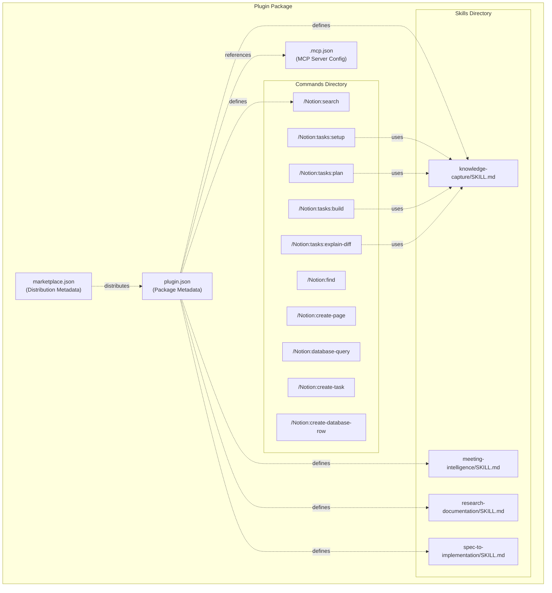

**Sources:** [.claude-plugin/plugin.json:1-11](), [README.md:1-92]()

---

## System Integration Model

The following diagram illustrates how the plugin integrates with Claude Code and external services:

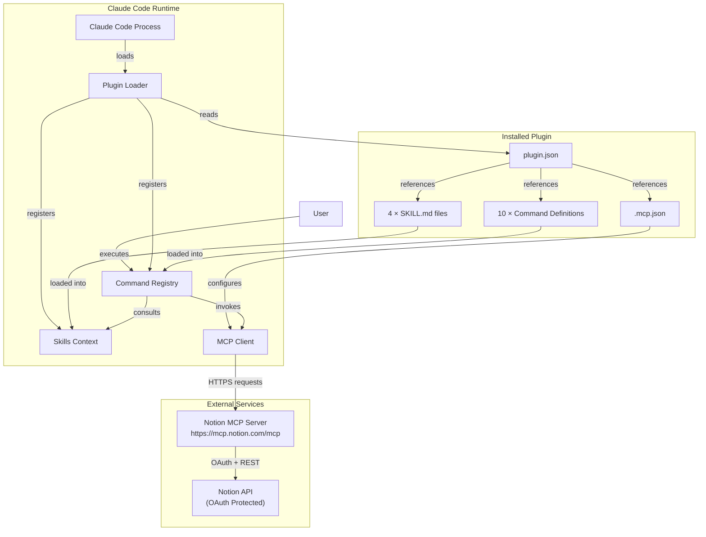

**Integration Flow:**

1. **Plugin Loading**: `PluginLoader` reads `plugin.json` to discover Skills, Commands, and MCP configuration
2. **Skills Registration**: `.md` files are loaded into Claude's context as behavioral guidance
3. **Command Registration**: Commands become available in Claude Code's command palette
4. **MCP Initialization**: `.mcp.json` configures connection to `https://mcp.notion.com/mcp`
5. **Runtime Execution**: Commands consult Skills for intelligence, then invoke MCP tools to interact with Notion

**Sources:** [README.md:1-92](), [.claude-plugin/plugin.json:1-11]()

---

## Distribution and Installation Model

The plugin uses a two-tier marketplace distribution system:

### Marketplace Registration

The plugin is distributed via a Git repository that serves as a marketplace. The `marketplace.json` file defines the plugin's availability:

```
Repository: makenotion/claude-code-notion-plugin
Marketplace ID: notion-plugin-marketplace
Plugin ID: notion-workspace-plugin
```

Users add the marketplace with:
```bash
/plugin marketplace add makenotion/claude-code-notion-plugin
```

### Plugin Installation

Once the marketplace is registered, users install the plugin with:
```bash
/plugin install notion-workspace-plugin@notion-plugin-marketplace
```

This downloads all plugin files to Claude Code's plugin directory. For detailed installation steps including OAuth setup, see [Installation](#2.1).

### Restart Requirement

**A restart of Claude Code is required after installation.** This is necessary for the MCP server connection to initialize properly. The MCP client is registered during Claude Code's startup phase, not during plugin installation.

**Sources:** [README.md:61-78]()

---

## Key Workflows Enabled

The plugin enables two primary workflows:

### 1. Task Management with Agent Collaboration

The task management commands (`/Notion:tasks:setup`, `/Notion:tasks:plan`, `/Notion:tasks:build`, `/Notion:tasks:explain-diff`) implement an agent-based system where:

- Tasks are tracked in a Notion board
- The agent autonomously plans and executes work
- User-agent communication happens through Notion itself (status updates, comments)
- The agent polls for user input without blocking Claude Code's main session

This workflow is detailed in [Task Management Workflow](#4). The communication mechanism is explained in [Communication Protocol](#3.2).

### 2. Knowledge Capture from Conversations

The Knowledge Capture Skill enables extraction of structured documentation from ad-hoc conversations. Claude can:

- Classify conversation content (FAQ, decision record, how-to guide, etc.)
- Apply type-specific templates
- Route content to appropriate Notion destinations (wikis, databases)
- Create properly structured, discoverable pages

This workflow is detailed in [Knowledge Capture Skill](#6.1) and [Knowledge Capture Workflows](#7.2).

**Sources:** [README.md:42-56]()

---

## Technical Metadata

The plugin is defined by the following metadata in `plugin.json`:

| Field | Value |
|-------|-------|
| Name | `"Notion"` |
| Version | `"0.1.0"` |
| Description | `"Notion Skills + Notion MCP server packaged as a Claude Code plugin."` |
| Author | Notion Labs (`https://www.notion.so`) |
| Repository | `https://github.com/makenotion/claude-code-notion-plugin` |
| License | MIT |

**Sources:** [.claude-plugin/plugin.json:1-11]()

---

## Next Steps

- To install the plugin, proceed to [Installation](#2.1)
- To understand the plugin's internal architecture, see [Architecture](#3)
- To learn about specific commands, see [Slash Commands Reference](#5)
- To explore task management capabilities, see [Task Management Workflow](#4)
- To learn about Skills, see [Notion Skills](#6)

---

# Page: Getting Started

# Getting Started

<details>
<summary>Relevant source files</summary>

The following files were used as context for generating this wiki page:

- [.claude-plugin/marketplace.json](.claude-plugin/marketplace.json)
- [.claude-plugin/plugin.json](.claude-plugin/plugin.json)
- [README.md](README.md)

</details>


## Purpose and Scope

This document provides a practical guide to installing and configuring the Notion Plugin for Claude Code. It covers the complete installation workflow, from adding the plugin marketplace to verifying that all components are operational. 

For detailed installation steps and troubleshooting, see [Installation](#2.1). For MCP server configuration options, see [MCP Server Configuration](#2.2). For an architectural overview of the plugin's components, see [Core Components](#3.1).

**Sources:** [README.md:61-92]()

---

## Prerequisites

Before installing the plugin, ensure you have:

| Requirement | Description |
|------------|-------------|
| **Claude Code** | A running instance of Claude Code with plugin support enabled |
| **Notion Account** | An active Notion workspace with content you want to integrate |
| **OAuth Permissions** | Ability to authorize Claude Code to access your Notion workspace |
| **Restart Capability** | Ability to restart Claude Code (required for MCP server initialization) |

The plugin requires no external dependencies beyond Claude Code itself. All components (Skills, Slash Commands, and MCP server configuration) are bundled in the plugin package.

**Sources:** [README.md:61-78]()

---

## Installation Overview

The plugin installation follows a three-phase process: marketplace registration, plugin installation, and runtime initialization. The key architectural constraint is that the MCP server connection cannot be established until Claude Code restarts, as MCP servers are registered during the initialization phase.

### Installation Workflow

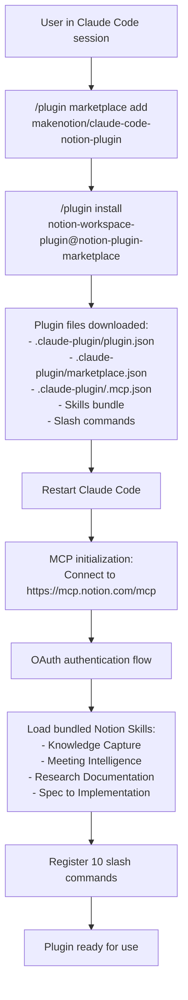

**Sources:** [README.md:61-78](), [plugin.json:1-11](), [marketplace.json:1-18]()

---

## Quick Start Guide

### Step 1: Add the Plugin Marketplace

Execute the following command in Claude Code to register the Notion plugin marketplace:

```bash
/plugin marketplace add makenotion/claude-code-notion-plugin
```

This command registers the marketplace defined in [marketplace.json:1-18](). The marketplace contains metadata about the `notion-workspace-plugin` package, including its GitHub source repository and owner information.

### Step 2: Install the Plugin

Install the plugin from the registered marketplace:

```bash
/plugin install notion-workspace-plugin@notion-plugin-marketplace
```

This downloads the plugin package, which includes:
- Plugin manifest ([plugin.json:1-11]())
- Marketplace configuration ([marketplace.json:1-18]())
- MCP server configuration (`.mcp.json`)
- Four bundled Notion Skills
- Ten slash commands

### Step 3: Restart Claude Code

**This step is mandatory.** The MCP server connection is established during Claude Code's initialization phase, not during plugin installation. Without a restart, the plugin will be installed but non-functional.

### Step 4: Complete OAuth Authentication

On first use of any Notion command or skill, you will be prompted to authenticate via OAuth. This grants Claude Code permission to access your Notion workspace through the MCP server at `https://mcp.notion.com/mcp`.

**Sources:** [README.md:61-84](), [plugin.json:1-11](), [marketplace.json:1-18]()

---

## Component Initialization Sequence

The following diagram shows the initialization sequence and dependencies between plugin components:

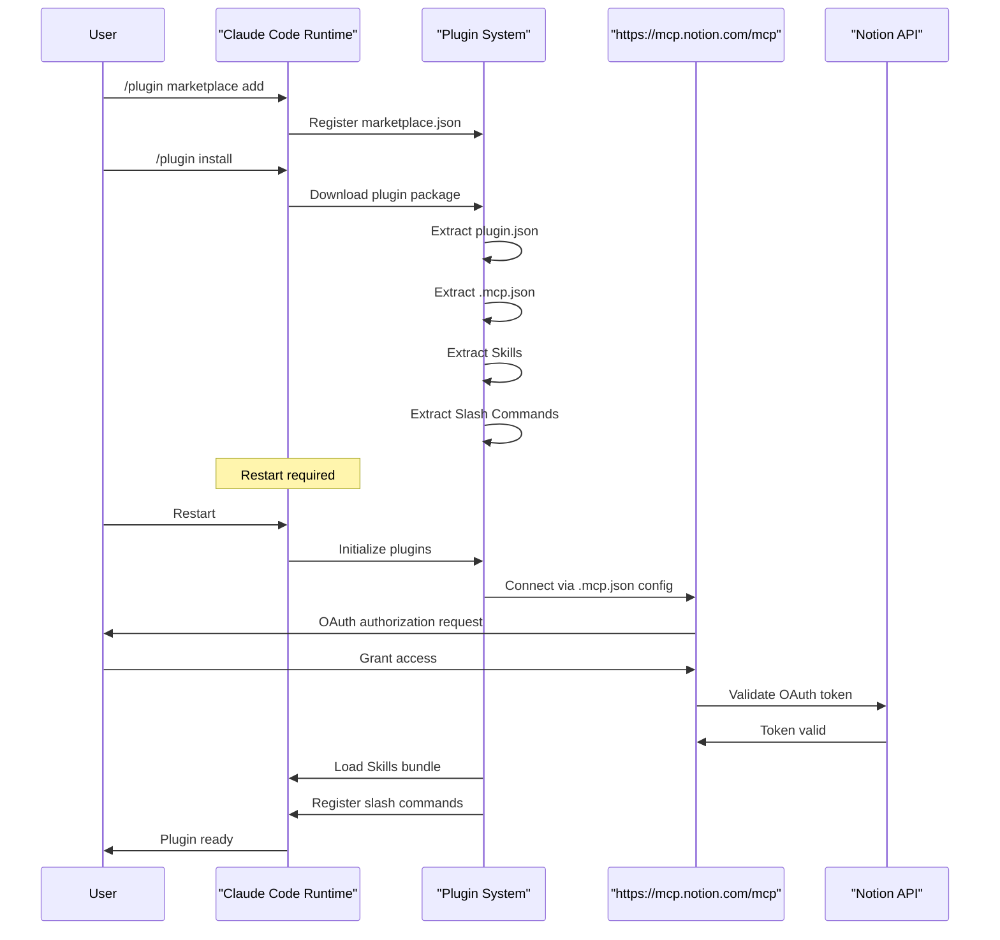

**Sources:** [README.md:26-30](), [README.md:76-84](), [plugin.json:1-11]()

---

## Verifying Installation

After completing the installation and restart, verify the plugin is working correctly:

### 1. Check Available Commands

Type `/Notion:` in Claude Code and verify the autocomplete shows 10 commands:

| Command Category | Commands |
|-----------------|----------|
| **Search & Discovery** | `/Notion:search`, `/Notion:find` |
| **Content Creation** | `/Notion:create-page`, `/Notion:create-task`, `/Notion:create-database-row` |
| **Database Operations** | `/Notion:database-query` |
| **Task Management** | `/Notion:tasks:setup`, `/Notion:tasks:plan`, `/Notion:tasks:build`, `/Notion:tasks:explain-diff` |

### 2. Test MCP Server Connection

Execute a simple search command:

```bash
/Notion:search <query>
```

If the MCP server is connected and authenticated, this will search your Notion workspace. If OAuth is not yet complete, you will be prompted to authenticate.

### 3. Verify Skills Are Loaded

Ask Claude to "capture this conversation to Notion". If the Knowledge Capture skill is loaded, Claude will understand how to structure the conversation into appropriate Notion content types (FAQ, decision record, how-to guide, etc.).

**Sources:** [README.md:42-56]()

---

## Plugin Architecture at a Glance

The plugin bundles three distinct components that work together:

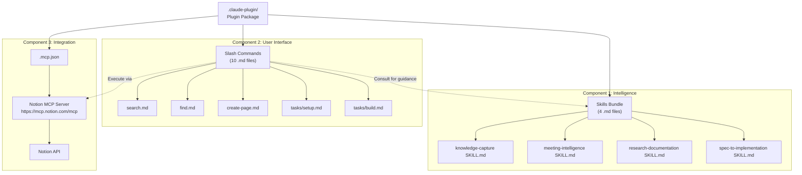

- **Skills** provide instructions that guide Claude's behavior when working with Notion content
- **Slash Commands** expose specific workflows to users with pre-defined prompts
- **MCP Server** provides secure API access to Notion through OAuth-authenticated tools

**Sources:** [README.md:3-9](), [README.md:15-23](), [README.md:26-40](), [README.md:42-56]()

---

## What's Included in the Plugin

The plugin package defined in [plugin.json:1-11]() contains:

| Component | Count | Purpose |
|-----------|-------|---------|
| **Notion Skills** | 4 | Teach Claude how to structure, write, and maintain Notion content |
| **Slash Commands** | 10 | Pre-built workflows for common Notion operations |
| **MCP Server Config** | 1 | Connection configuration for `https://mcp.notion.com/mcp` |
| **Plugin Metadata** | 3 | `plugin.json`, `marketplace.json`, `.mcp.json` |

All components are versioned together as a single package (version 0.1.0) and maintained by Notion Labs.

**Sources:** [plugin.json:1-11](), [README.md:3-9](), [README.md:15-23](), [README.md:42-56]()

---

## Next Steps

After verifying the plugin installation:

1. **Set up a task board** - Run `/Notion:tasks:setup` to configure a Notion database for task management. See [Task Board Setup](#4.1) for details.

2. **Explore slash commands** - Review the [Slash Commands Reference](#5) to understand all available workflows.

3. **Learn the task workflow** - The task management commands (`/Notion:tasks:plan`, `/Notion:tasks:build`) implement an autonomous agent system. See [Task Management Workflow](#4) for the complete lifecycle.

4. **Understand the communication protocol** - Task commands use asynchronous communication through Notion itself. See [Communication Protocol](#3.2) to understand how agents interact with users.

5. **Use Knowledge Capture** - Ask Claude to capture conversations, decisions, or meetings to Notion. See [Knowledge Capture Skill](#6.1) for supported content types.

**Sources:** [README.md:42-56]()

---

## Troubleshooting Common Issues

| Issue | Likely Cause | Solution |
|-------|--------------|----------|
| Commands not appearing | Plugin not loaded | Restart Claude Code |
| OAuth prompt loops | Permissions denied | Check Notion workspace permissions |
| MCP connection fails | .mcp.json not loaded | Verify restart occurred after installation |
| Skills not working | Restart not performed | Complete full restart cycle |

For detailed MCP server configuration and troubleshooting, see [MCP Server Configuration](#2.2).

**Sources:** [README.md:76-78](), [README.md:82-84]()

---

# Page: Installation

# Installation

<details>
<summary>Relevant source files</summary>

The following files were used as context for generating this wiki page:

- [.claude-plugin/marketplace.json](.claude-plugin/marketplace.json)
- [README.md](README.md)

</details>


This page provides step-by-step instructions for installing the Notion Plugin for Claude Code via the plugin marketplace system. It covers marketplace registration, plugin installation, the mandatory restart requirement, and OAuth authentication setup.

For information about the MCP server configuration file loaded during installation, see [MCP Server Configuration](#2.2). For details on the installed components themselves, see [Core Components](#3.1).

---

## Overview

The installation process consists of four sequential steps that configure the plugin and establish connectivity to the Notion MCP Server. The process requires a Claude Code restart to initialize the MCP server connection, followed by OAuth authentication to grant workspace access.

**Sources:** [README.md:61-84]()

---

## Installation Architecture

### Component Installation Flow

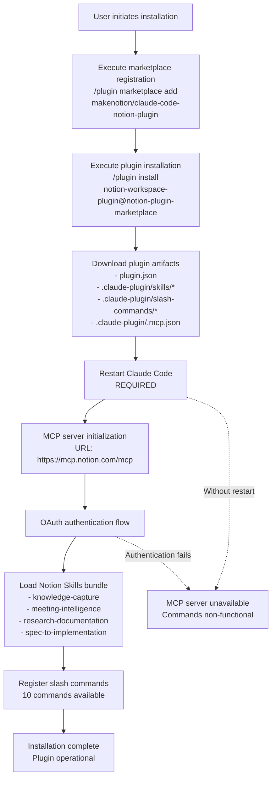

**Diagram: Installation Sequence and Dependencies**

This diagram illustrates the critical dependency chain in the installation process. The restart step is mandatory because the MCP server connection is established during Claude Code's initialization phase, not during plugin installation. Without this restart, commands will be registered but non-functional due to missing MCP server connectivity.

**Sources:** [README.md:61-84](), [.claude-plugin/marketplace.json:1-18]()

---

## Prerequisites

Before beginning installation, ensure:

- Claude Code is installed and running
- Network access to `https://mcp.notion.com/mcp` is available
- A Notion workspace with appropriate permissions for OAuth integration

---

## Installation Steps

### Step 1: Register the Plugin Marketplace

Execute the following command in Claude Code to register the Notion plugin marketplace:

```bash
/plugin marketplace add makenotion/claude-code-notion-plugin
```

This command configures Claude Code to recognize the marketplace defined in [.claude-plugin/marketplace.json:1-18](). The marketplace metadata includes:

| Field | Value |
|-------|-------|
| **Marketplace name** | `notion-plugin-marketplace` |
| **Owner** | Notion Labs, Inc. |
| **Owner URL** | https://www.notion.so |
| **Source type** | GitHub repository |
| **Repository** | makenotion/claude-code-notion-plugin |

**Sources:** [README.md:63-68](), [.claude-plugin/marketplace.json:2-6]()

---

### Step 2: Install the Plugin

Execute the installation command:

```bash
/plugin install notion-workspace-plugin@notion-plugin-marketplace
```

This command triggers the download of all plugin artifacts from the GitHub repository specified in [.claude-plugin/marketplace.json:11-14](). The `@notion-plugin-marketplace` suffix references the marketplace name registered in Step 1.

#### Downloaded Artifacts

The installation downloads the following components:

| Component | Location | Purpose |
|-----------|----------|---------|
| **Plugin manifest** | `plugin.json` | Defines plugin metadata and component references |
| **Skills bundle** | `.claude-plugin/skills/` | Four Notion Skills from Notion Cookbook |
| **Slash commands** | `.claude-plugin/slash-commands/` | 10 command implementations |
| **MCP configuration** | `.claude-plugin/.mcp.json` | MCP server connection settings |

**Sources:** [README.md:70-74](), [.claude-plugin/marketplace.json:9-16]()

---

### Step 3: Restart Claude Code (Critical)

**This step is mandatory.** Exit and restart Claude Code completely.

#### Why Restart is Required

The MCP server connection defined in `.claude-plugin/.mcp.json` is initialized during Claude Code's startup sequence. Specifically:

1. Claude Code reads `.mcp.json` during initialization
2. Establishes persistent connection to `https://mcp.notion.com/mcp`
3. Registers MCP tools for use by slash commands

Without a restart, the MCP server remains uninitialized, causing all slash commands to fail when attempting MCP operations. The connection cannot be established post-initialization through the plugin installation process.

**Sources:** [README.md:76-77](), [README.md:26-30]()

---

### Step 4: OAuth Authentication

After restart, the first interaction with a Notion-related command triggers the OAuth authentication flow.

#### Authentication Process

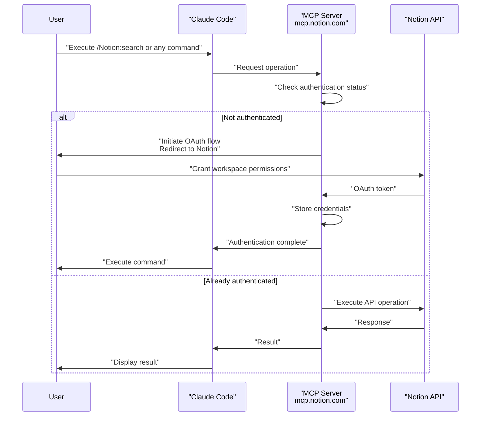

**Diagram: OAuth Authentication Sequence**

The OAuth flow is handled entirely by the Notion MCP Server at `https://mcp.notion.com/mcp`. Claude Code does not store Notion credentials; all authentication state is managed server-side by the MCP server.

**Sources:** [README.md:81-84](), [README.md:26-30]()

---

## Post-Installation Verification

### Verify MCP Server Connection

After restart and authentication, verify the installation by checking MCP tool availability:

1. The MCP server provides tools for Notion operations
2. Slash commands can invoke these tools
3. The connection to `https://mcp.notion.com/mcp` is persistent

### Verify Skills Loading

Confirm that all four Notion Skills are loaded:

- **knowledge-capture** - Guides content structuring and documentation
- **meeting-intelligence** - Handles meeting notes and summaries
- **research-documentation** - Manages research workflows
- **spec-to-implementation** - Bridges specifications to code

These skills are referenced by slash commands to provide intelligent Notion workflows. See [Notion Skills](#6) for detailed documentation.

### Verify Slash Commands

Confirm that all 10 slash commands are registered and functional:

| Command Category | Commands |
|------------------|----------|
| **Search & Discovery** | `/Notion:search`, `/Notion:find` |
| **Content Creation** | `/Notion:create-page`, `/Notion:create-task`, `/Notion:create-database-row` |
| **Database Operations** | `/Notion:database-query` |
| **Task Management** | `/Notion:tasks:setup`, `/Notion:tasks:plan`, `/Notion:tasks:build`, `/Notion:tasks:explain-diff` |

See [Slash Commands Reference](#5) for complete command documentation.

**Sources:** [README.md:15-22](), [README.md:42-56]()

---

## File Structure After Installation

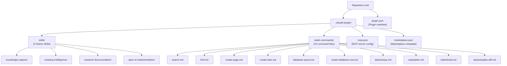

**Diagram: Installed Plugin Directory Structure**

This diagram maps the physical file structure created by the installation process. All plugin components reside in the `.claude-plugin/` directory, with `plugin.json` at the repository root serving as the entry point.

**Sources:** [.claude-plugin/marketplace.json:11-14]()

---

## Troubleshooting

### MCP Server Connection Fails

**Symptom:** Slash commands execute but fail with "MCP server not available" errors.

**Cause:** Claude Code was not restarted after installation.

**Resolution:** Exit Claude Code completely and restart. The MCP server connection is established only during startup.

---

### OAuth Authentication Does Not Trigger

**Symptom:** Commands fail without prompting for authentication.

**Cause:** Network connectivity issues to `https://mcp.notion.com/mcp`.

**Resolution:** 
1. Verify network access to the MCP server URL
2. Check firewall settings
3. Confirm no proxy interference with HTTPS connections

---

### Commands Registered but Non-Functional

**Symptom:** Slash commands appear in autocomplete but fail when executed.

**Cause:** Incomplete installation or missing OAuth authentication.

**Resolution:**
1. Verify restart was performed (Step 3)
2. Execute any Notion command to trigger OAuth flow
3. Grant workspace permissions when prompted

**Sources:** [README.md:76-77](), [README.md:81-84]()

---

## Next Steps

After successful installation:

1. Configure your first task board using `/Notion:tasks:setup` - see [Task Board Setup](#4.1)
2. Review available slash commands - see [Slash Commands Reference](#5)
3. Understand the MCP server configuration - see [MCP Server Configuration](#2.2)
4. Explore the Communication Protocol for task management - see [Communication Protocol](#3.2)

**Sources:** [README.md:52-56]()

---

# Page: MCP Server Configuration

# MCP Server Configuration

<details>
<summary>Relevant source files</summary>

The following files were used as context for generating this wiki page:

- [.mcp.json](.mcp.json)
- [README.md](README.md)

</details>


This document explains the `.mcp.json` configuration file that enables the plugin to connect to Notion's hosted MCP (Model Context Protocol) server. This configuration is what allows Claude Code to perform actual Notion API operations such as searching, creating pages, and updating databases.

For information about installing the plugin and triggering the initial MCP server setup, see [Installation](#2.1). For details on how the MCP server integrates with Skills and Slash Commands in the overall architecture, see [Core Components](#3.1).

---

## Configuration File Structure

The plugin includes a single configuration file that declares the MCP server connection:

**File: .mcp.json**

```json
{
  "mcpServers": {
    "notion": {
      "type": "http",
      "url": "https://mcp.notion.com/mcp"
    }
  }
}
```

This file follows the Claude Code MCP server specification format and contains the following structure:

| Field | Value | Description |
|-------|-------|-------------|
| `mcpServers` | Object | Top-level container for all MCP server declarations |
| `notion` | Object | Server identifier key used by Claude Code to reference this server |
| `type` | `"http"` | Protocol type indicating this is an HTTP-based MCP server |
| `url` | `"https://mcp.notion.com/mcp"` | Endpoint URL for Notion's hosted MCP server |

The `notion` key serves as the internal identifier that Claude Code uses to route MCP tool calls to the appropriate server. When slash commands or skills invoke Notion operations, they reference tools provided by the server registered under this identifier.

**Sources:** [.mcp.json:1-8](), [README.md:26-30]()

---

## MCP Server Connection Architecture

The following diagram illustrates how Claude Code processes the `.mcp.json` configuration during initialization and establishes the connection to Notion's hosted MCP server:

### MCP Server Initialization Flow

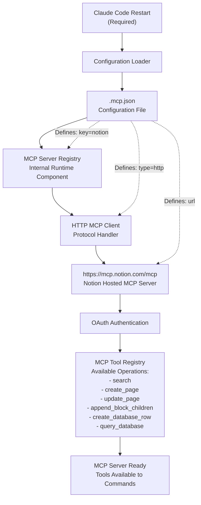

**Key Components:**

- **Configuration Loader**: Claude Code's internal component that parses `.mcp.json` during startup
- **MCP Server Registry**: Runtime registry that maintains connections to all configured MCP servers
- **HTTP MCP Client**: Protocol handler specifically for HTTP-based MCP servers (as specified by `"type": "http"`)
- **Tool Registry**: Collection of available MCP tools that become accessible after successful connection

**Sources:** [.mcp.json:1-8](), [README.md:76-77]()

---

## Connection Initialization Sequence

The MCP server connection follows a specific initialization sequence that requires a Claude Code restart to complete:

### Initialization Sequence Diagram

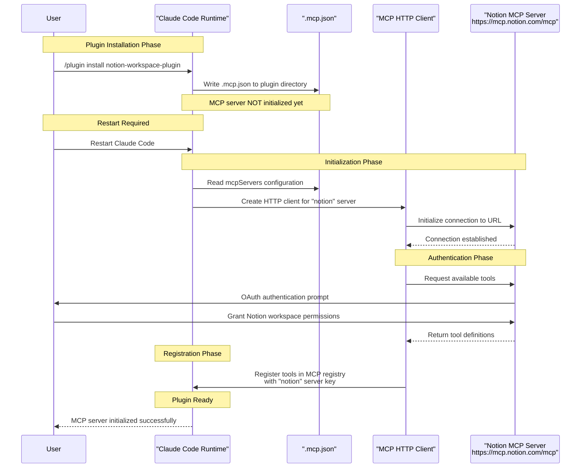

**Critical Steps:**

1. **Installation**: The `.mcp.json` file is written during plugin installation but is not processed immediately
2. **Restart Trigger**: Claude Code's startup sequence is required to initialize MCP servers
3. **Configuration Parse**: The runtime reads `mcpServers` object and creates appropriate protocol handlers
4. **Connection**: HTTP client connects to the specified `url` endpoint
5. **OAuth Gate**: Notion's MCP server requires OAuth authentication before providing tool definitions
6. **Tool Registration**: Successfully authenticated tools are registered under the `notion` server key

This sequence explains why the installation instructions explicitly require a Claude Code restart ([README.md:76-77]()).

**Sources:** [.mcp.json:1-8](), [README.md:76-77](), [README.md:82-84]()

---

## HTTP-Based MCP Protocol

The plugin uses the HTTP transport variant of the Model Context Protocol. This section details how the `"type": "http"` configuration affects the connection behavior:

### Protocol Configuration Mapping

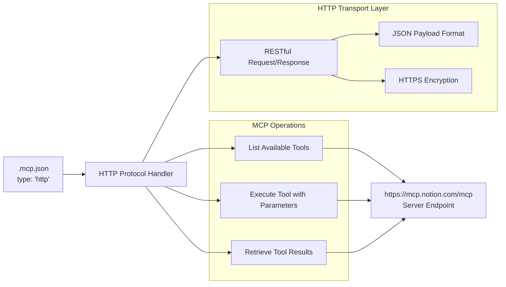

**Protocol Characteristics:**

The `"type": "http"` declaration specifies:
- **Transport**: Standard HTTPS connections (as opposed to stdio or SSE transports)
- **Request Format**: JSON-encoded MCP protocol messages sent via HTTP POST
- **Authentication**: OAuth 2.0 bearer tokens included in request headers
- **Session Management**: Stateless HTTP requests with authentication on each call

The hosted nature of Notion's MCP server (`https://mcp.notion.com/mcp`) eliminates the need for:
- Local server process management
- Port configuration
- Server lifecycle management
- Manual authentication token configuration

**Sources:** [.mcp.json:1-8](), [README.md:26-30]()

---

## Server Capabilities

Once the MCP server connection is established and authenticated, the following tools become available to slash commands and skills:

| Tool Name | Purpose | Used By |
|-----------|---------|---------|
| `search` | Full-text search across workspace | `/Notion:search`, `/Notion:find` |
| `get_page` | Retrieve page content and properties | All read operations |
| `get_database` | Retrieve database schema and properties | `/Notion:database-query` |
| `create_page` | Create new pages with content | `/Notion:create-page`, `/Notion:create-task` |
| `update_page` | Modify existing page properties | Task status updates, agent communications |
| `append_block_children` | Add content blocks to pages | Knowledge capture, task documentation |
| `create_database_row` | Insert rows into databases | `/Notion:create-database-row`, `/Notion:create-task` |
| `query_database` | Query databases with filters | `/Notion:database-query`, task board queries |

These tools provide the complete CRUD operation set mentioned in [README.md:33-39](). The slash commands documented in section [5](#5) rely entirely on these MCP tools for their Notion interactions.

**Sources:** [README.md:33-39](), [README.md:44-56]()

---

## Configuration Validation

Claude Code performs validation during the MCP server initialization process:

### Validation Checks Performed

1. **File Structure**: Verifies `.mcp.json` is valid JSON with required `mcpServers` object
2. **Server Declaration**: Confirms each server has required `type` and `url` fields
3. **Type Validity**: Ensures `type` value is recognized (e.g., `"http"`, `"stdio"`, `"sse"`)
4. **URL Format**: Validates `url` is a well-formed HTTPS endpoint
5. **Connection Test**: Attempts to connect to the specified endpoint
6. **OAuth Success**: Verifies user completes OAuth authentication flow

If validation fails at any step, the MCP server will not be registered, and slash commands that depend on Notion operations will fail with connection errors.

**Sources:** [.mcp.json:1-8](), [README.md:76-77]()

---

## Troubleshooting

### Common Issues

**Issue: Slash commands fail with "MCP server not found" error**

**Cause**: Claude Code has not initialized the MCP server

**Solution**: Ensure you have restarted Claude Code after plugin installation. The MCP server initialization only occurs during the startup sequence, not during plugin installation.

---

**Issue: OAuth authentication prompt never appears**

**Cause**: Network connectivity issues or invalid URL configuration

**Solution**: Verify the `url` in `.mcp.json` is exactly `https://mcp.notion.com/mcp` and that your network allows HTTPS connections to this endpoint.

---

**Issue: Tools work briefly then fail**

**Cause**: OAuth token expired or was revoked

**Solution**: Re-authenticate by restarting Claude Code, which will trigger a new OAuth flow if the stored token is invalid.

**Sources:** [README.md:76-84](), [.mcp.json:1-8]()

---

## Configuration Immutability

The `.mcp.json` configuration is generated during plugin installation and should not be manually modified. The file is:

- **Read-only in practice**: Changes require plugin reinstallation to take effect properly
- **Version-controlled**: Part of the plugin package structure
- **Validated on load**: Invalid modifications will prevent MCP server initialization

If you need to modify MCP server settings, the recommended approach is to uninstall and reinstall the plugin, which will regenerate the configuration file with correct values.

**Sources:** [.mcp.json:1-8](), [README.md:70-74]()

---

# Page: Architecture

# Architecture

<details>
<summary>Relevant source files</summary>

The following files were used as context for generating this wiki page:

- [.claude-plugin/plugin.json](.claude-plugin/plugin.json)
- [.mcp.json](.mcp.json)
- [README.md](README.md)

</details>


## Purpose and Scope

This document explains the internal architecture of the Notion Plugin for Claude Code, including how its components are structured, how they integrate with the Claude Code environment, and the key architectural patterns that enable the plugin's functionality. 

For detailed information about individual components, see [Core Components](#3.1). For the agent-user communication mechanism, see [Communication Protocol](#3.2). For task management workflows, see [Task Management Workflow](#4).

---

## System Structure

The Notion Plugin is distributed as a single package that contains three distinct component types, each serving a specific architectural role:

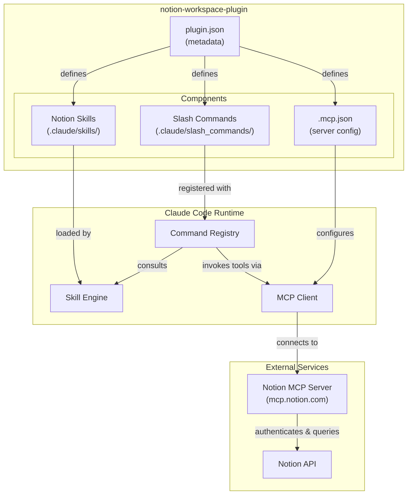

**Figure 1: Plugin Package Structure and Integration Points**

The plugin package follows the Claude Code plugin specification, with [plugin.json:1-11](.claude-plugin/plugin.json:1-11) serving as the manifest. This manifest defines the plugin's identity (`name`, `version`, `description`) and attribution (`author`, `repository`, `license`).

**Sources**: [README.md:1-92](README.md:1-92), [.claude-plugin/plugin.json:1-11](.claude-plugin/plugin.json:1-11)

---

## Layered Architecture

The plugin implements a four-layer architecture that separates concerns and enables flexible composition:

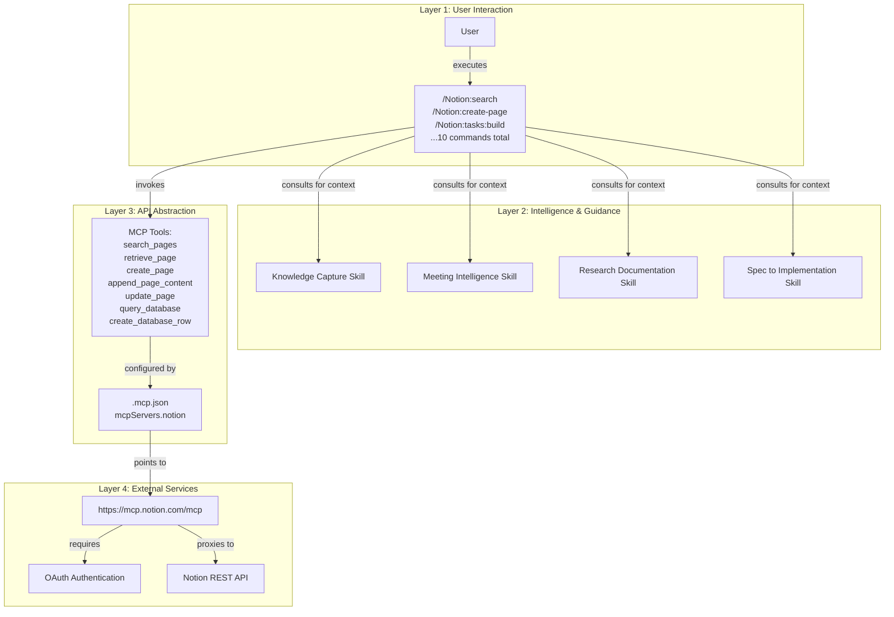

**Figure 2: Four-Layer Architecture**

### Layer 1: User Interaction Layer

The user interaction layer consists of 10 slash commands defined in `.claude/slash_commands/`, organized into two categories:

**Task Management Suite** (4 commands):
- `/Notion:tasks:setup` - Initialize task board
- `/Notion:tasks:plan` - Create task plan
- `/Notion:tasks:build` - Execute task
- `/Notion:tasks:explain-diff` - Document code changes

**Basic Notion Operations** (6 commands):
- `/Notion:search` - Workspace search
- `/Notion:find` - Title-based search
- `/Notion:create-page` - Page creation
- `/Notion:database-query` - Database querying
- `/Notion:create-task` - Task creation
- `/Notion:create-database-row` - Row insertion

**Sources**: [README.md:41-56](README.md:41-56)

### Layer 2: Intelligence Layer

The intelligence layer provides context-aware guidance through four bundled Skills located in `.claude/skills/`:

1. **Knowledge Capture** - Structures conversations into documentation
2. **Meeting Intelligence** - Processes meeting transcripts
3. **Research Documentation** - Organizes research findings
4. **Spec to Implementation** - Translates specifications into code

These Skills are injected into Claude's context when relevant commands execute, guiding behavior without direct invocation.

**Sources**: [README.md:15-23](README.md:15-23)

### Layer 3: API Abstraction Layer

The MCP (Model Context Protocol) server integration provides a standardized interface to Notion's API. The [.mcp.json:1-8](.mcp.json:1-8) configuration file defines the connection:

```json
{
  "mcpServers": {
    "notion": {
      "type": "http",
      "url": "https://mcp.notion.com/mcp"
    }
  }
}
```

The `mcpServers.notion` entry registers a server named `notion` with type `http`, pointing to Notion's hosted MCP endpoint. This configuration is processed during Claude Code's initialization phase.

**Sources**: [.mcp.json:1-8](.mcp.json:1-8), [README.md:25-39](README.md:25-39)

### Layer 4: External Services Layer

The external services layer consists of:
- **Notion MCP Server** (`https://mcp.notion.com/mcp`) - Hosted service that implements the MCP protocol
- **OAuth Authentication** - User authorization flow
- **Notion REST API** - Underlying data operations

The MCP server acts as a secure gateway, handling authentication and exposing a curated set of operations.

**Sources**: [README.md:26-39](README.md:26-39), [.mcp.json:5](.mcp.json:5)

---

## Component Integration Patterns

### Separation of Intelligence and Execution

The architecture enforces a clean separation between "knowing how" (Skills) and "doing what" (MCP Tools):

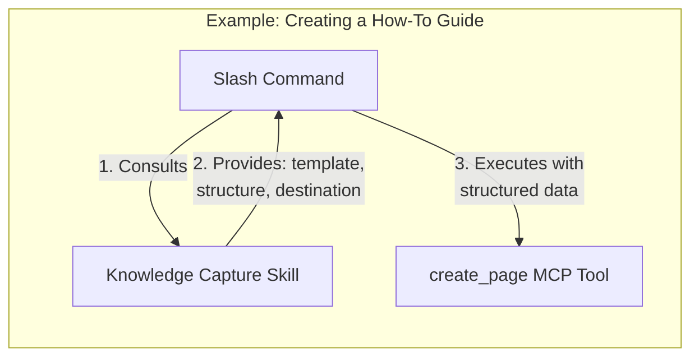

**Figure 3: Separation of Concerns Pattern**

Skills provide declarative knowledge (templates, patterns, best practices) but never directly invoke MCP tools. Commands orchestrate the workflow by consulting Skills for guidance, then executing operations through MCP tools.

**Sources**: [README.md:3-7](README.md:3-7)

### Dependency Chain

The components have a strict initialization dependency order:

| Order | Component | Depends On | Initialization Trigger |
|-------|-----------|------------|------------------------|
| 1 | `plugin.json` metadata | None | Plugin installation |
| 2 | `.mcp.json` registration | Plugin files | Claude Code restart |
| 3 | MCP server connection | `.mcp.json` | Claude Code initialization |
| 4 | OAuth authentication | MCP connection | First MCP tool invocation |
| 5 | Skills loading | Plugin files | Command execution |
| 6 | Commands registration | Plugin files | Claude Code startup |

The restart requirement mentioned in [README.md:76-77](README.md:76-77) exists because MCP server initialization (step 3) occurs during Claude Code's startup sequence, not during plugin installation.

**Sources**: [README.md:61-78](README.md:61-78)

---

## Data Flow Patterns

### Synchronous Command Execution

For simple operations, commands follow a synchronous request-response pattern:

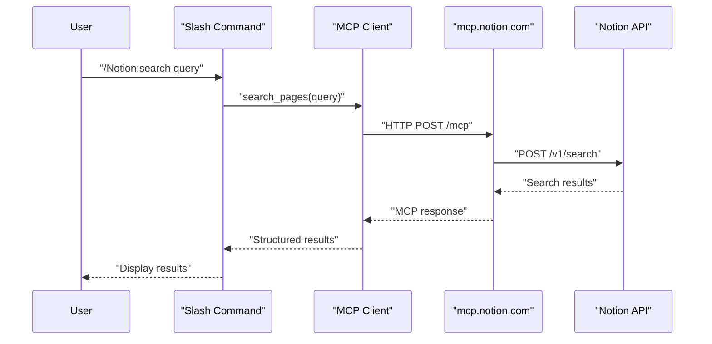

**Figure 4: Synchronous Data Flow**

Operations like `/Notion:search` and `/Notion:create-page` complete in a single request-response cycle.

**Sources**: [README.md:44-51](README.md:44-51)

### Asynchronous Agent Workflow

Task management commands implement an asynchronous pattern where the agent operates independently while polling for user input:

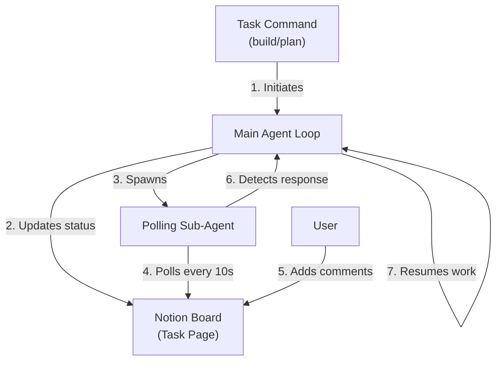

**Figure 5: Asynchronous Agent Pattern**

This pattern is detailed in [Communication Protocol](#3.2). The key architectural decision is using Notion itself as the communication channel, eliminating the need for a separate message queue.

**Sources**: [README.md:52-55](README.md:52-55)

---

## Plugin Lifecycle

### Installation Phase

1. **Marketplace Registration**: User runs `/plugin marketplace add makenotion/claude-code-notion-plugin`
2. **Plugin Installation**: User runs `/plugin install notion-workspace-plugin@notion-plugin-marketplace`
3. **File Download**: Claude Code downloads plugin files to `.claude/` directory
4. **Restart Required**: User restarts Claude Code to initialize MCP servers

**Sources**: [README.md:61-78](README.md:61-78)

### Runtime Phase

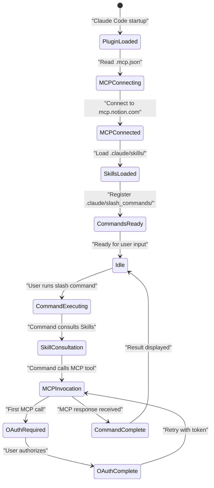

**Figure 6: Plugin Runtime State Machine**

OAuth authentication occurs lazily on the first MCP tool invocation rather than during initialization. This allows the plugin to load successfully even if authentication fails, with errors surfacing only when users attempt Notion operations.

**Sources**: [README.md:81-84](README.md:81-84), [.mcp.json:1-8](.mcp.json:1-8)

---

## Key Architectural Decisions

### Decision: Hosted MCP Server

The plugin uses Notion's hosted MCP server at `https://mcp.notion.com/mcp` rather than a local server. This decision:

- **Eliminates installation complexity**: No local server process to manage
- **Enables OAuth authentication**: Hosted service can redirect to Notion's OAuth flow
- **Provides version management**: Notion controls server updates independently
- **Introduces network dependency**: Requires internet connectivity for all operations

**Configuration**: [.mcp.json:2-6](.mcp.json:2-6)

### Decision: Skills as Static Context

Skills are loaded as static context rather than invoked as tools. This decision:

- **Provides continuous guidance**: Skills influence all of Claude's Notion interactions
- **Avoids invocation overhead**: No explicit tool calls required
- **Enables emergent behavior**: Claude can apply Skill patterns spontaneously
- **Increases context usage**: Skills consume tokens throughout execution

**Sources**: [README.md:15-23](README.md:15-23)

### Decision: Notion-as-Message-Bus

The task management system uses Notion pages as the communication channel between agent and user. This decision:

- **Provides asynchronous collaboration**: User doesn't need to watch agent execution
- **Creates persistent record**: All interactions logged in Notion
- **Enables multi-user coordination**: Multiple stakeholders can comment
- **Introduces polling overhead**: Agent must periodically check for updates

This pattern is detailed in [Communication Protocol](#3.2).

**Sources**: [README.md:52-55](README.md:52-55)

---

## Summary

The Notion Plugin architecture achieves modularity through three independent component types (Skills, Commands, MCP Config) that integrate at runtime. The layered design separates user interaction, intelligent guidance, API abstraction, and external services, enabling each layer to evolve independently. Key patterns include synchronous operations for simple tasks, asynchronous agent workflows for complex tasks, and the use of Notion itself as a communication channel.

For implementation details of each component, see [Core Components](#3.1). For the agent communication mechanism, see [Communication Protocol](#3.2).

**Sources**: [README.md:1-92](README.md:1-92), [.claude-plugin/plugin.json:1-11](.claude-plugin/plugin.json:1-11), [.mcp.json:1-8](.mcp.json:1-8)

---

# Page: Core Components

# Core Components

<details>
<summary>Relevant source files</summary>

The following files were used as context for generating this wiki page:

- [.claude-plugin/plugin.json](.claude-plugin/plugin.json)
- [README.md](README.md)

</details>


## Purpose and Scope

This page details the three core components that comprise the Notion Plugin for Claude Code and explains how they work together to enable Notion workspace integration. The plugin is architecturally divided into distinct layers that provide different capabilities: **Notion Skills** (intelligence layer), **MCP Server Integration** (API execution layer), and **Slash Commands** (user interface layer).

For information about installation and configuration of these components, see [Installation](#2.1) and [MCP Server Configuration](#2.2). For detailed usage of individual commands and skills, see [Slash Commands Reference](#5) and [Notion Skills](#6).

**Sources:** [README.md:1-92]()

---

## Component Architecture Overview

The plugin bundles three distinct components that operate at different architectural layers. Each component has a specific responsibility in the system, and they are designed to work together through well-defined interfaces.

### Plugin Structure Diagram

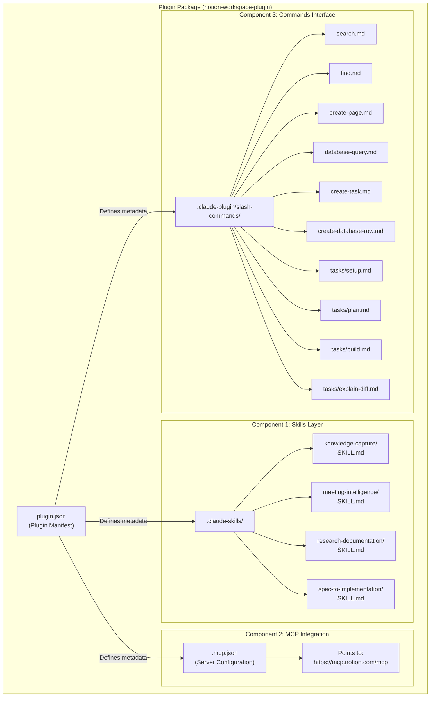

**Sources:** [README.md:3-9](), [.claude-plugin/plugin.json:1-11]()

---

## Component 1: Notion Skills Bundle

The Skills layer provides intelligence and guidance to Claude on how to work effectively with Notion workspaces. Skills are markdown documents that define structured workflows, best practices, and templates for specific use cases.

### Included Skills

The plugin bundles four skills from the Notion Cookbook, each stored in the `.claude-skills/` directory:

| Skill Name | Directory | Purpose |
|------------|-----------|---------|
| **Knowledge Capture** | `.claude-skills/knowledge-capture/` | Extracts and structures knowledge from conversations into Notion documentation |
| **Meeting Intelligence** | `.claude-skills/meeting-intelligence/` | Processes meeting transcripts into structured meeting notes |
| **Research Documentation** | `.claude-skills/research-documentation/` | Organizes research findings into structured documentation |
| **Spec to Implementation** | `.claude-skills/spec-to-implementation/` | Guides implementation from specification documents |

Each skill directory contains a `SKILL.md` file that defines the skill's behavior, workflow steps, and output templates.

### Skill Architecture

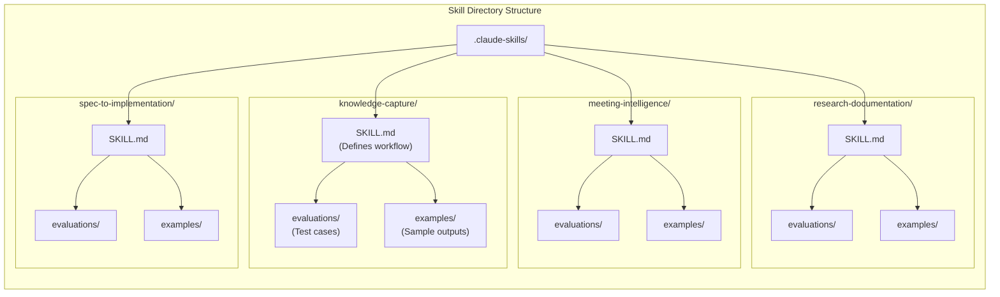

### How Skills Work

Skills operate as **guidance documents** that Claude consults when executing commands. They do not directly execute operations; instead, they provide:

1. **Workflow definitions** - Step-by-step processes for accomplishing tasks
2. **Content templates** - Structured formats for different document types
3. **Decision logic** - Rules for classifying content and choosing appropriate destinations
4. **Best practices** - Patterns for organizing and linking information in Notion

When a slash command is executed, Claude may reference relevant skills to determine how to structure requests, format content, and organize information within the Notion workspace.

**Sources:** [README.md:15-23]()

---

## Component 2: MCP Server Integration

The MCP (Model Context Protocol) Server Integration provides the execution layer for all Notion API operations. This component establishes a secure connection to Notion's hosted MCP server and handles authentication and data operations.

### Configuration Structure

The MCP server is configured via the `.mcp.json` file in the plugin package:

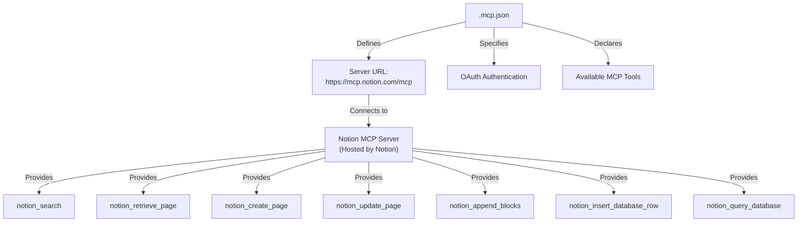

### MCP Tool Capabilities

The Notion MCP server exposes the following tools that slash commands use for Notion operations:

| MCP Tool | Operation | Used By Commands |
|----------|-----------|------------------|
| `notion_search` | Search entire workspace | `/Notion:search`, `/Notion:find` |
| `notion_retrieve_page` | Fetch page/database content | Multiple commands |
| `notion_create_page` | Create new pages | `/Notion:create-page`, task commands |
| `notion_update_page` | Modify page properties | Task commands |
| `notion_append_blocks` | Add content blocks | Task commands, knowledge capture |
| `notion_insert_database_row` | Insert database rows | `/Notion:create-task`, `/Notion:create-database-row` |
| `notion_query_database` | Query and filter databases | `/Notion:database-query`, task commands |

### Authentication Flow

```mermaid
sequenceDiagram
    participant CC as "Claude Code"
    participant Plugin as "Plugin Package"
    participant MCP as "MCP Server<br/>(mcp.notion.com)"
    participant Notion as "Notion API"
    
    Note over CC,Plugin: Installation Phase
    CC->>Plugin: "Load .mcp.json"
    Plugin->>CC: "Server URL + Config"
    
    Note over CC,MCP: Initialization Phase (Requires Restart)
    CC->>MCP: "Connect to server"
    MCP->>CC: "Request OAuth"
    CC->>MCP: "OAuth credentials"
    MCP->>Notion: "Authenticate via OAuth"
    Notion->>MCP: "Access token"
    MCP->>CC: "Connection established"
    
    Note over CC,Notion: Operational Phase
    CC->>MCP: "Tool invocation (e.g., notion_search)"
    MCP->>Notion: "API request with auth"
    Notion->>MCP: "API response"
    MCP->>CC: "Structured result"
```

The MCP server handles all authentication complexity, including OAuth token management and refresh. Commands never directly interact with the Notion API—all operations flow through the MCP server.

**Sources:** [README.md:25-40](), [README.md:76-77](), [README.md:82-84]()

---

## Component 3: Slash Commands Interface

Slash commands provide the user interface layer for the plugin. Each command is defined as a markdown file in the `.claude-plugin/slash-commands/` directory and implements a specific workflow by coordinating between Skills (for guidance) and MCP tools (for execution).

### Command Catalog

The plugin includes 10 slash commands organized into two functional categories:

#### Basic Notion Operations

| Command File | Invocation | Function | MCP Tools Used |
|-------------|------------|----------|----------------|
| `search.md` | `/Notion:search` | Full-text workspace search | `notion_search` |
| `find.md` | `/Notion:find` | Quick title-based lookup | `notion_search` |
| `create-page.md` | `/Notion:create-page` | Create new pages | `notion_create_page` |
| `database-query.md` | `/Notion:database-query` | Query databases with filters | `notion_query_database` |
| `create-task.md` | `/Notion:create-task` | Create task entries | `notion_insert_database_row` |
| `create-database-row.md` | `/Notion:create-database-row` | Insert database rows | `notion_insert_database_row` |

#### Task Management Suite

| Command File | Invocation | Function | MCP Tools Used |
|-------------|------------|----------|----------------|
| `tasks/setup.md` | `/Notion:tasks:setup` | Configure task board | `notion_create_page`, `notion_query_database` |
| `tasks/plan.md` | `/Notion:tasks:plan` | Create task plan | Multiple tools + polling |
| `tasks/build.md` | `/Notion:tasks:build` | Execute task autonomously | Multiple tools + polling |
| `tasks/explain-diff.md` | `/Notion:tasks:explain-diff` | Document code changes | `notion_create_page`, `notion_append_blocks` |

**Sources:** [README.md:41-56]()

### Command Architecture Pattern

```mermaid
graph TB
    subgraph "User Interaction"
        User["User"]
        CLI["Claude Code CLI"]
    end
    
    subgraph "Command Execution Layer"
        CmdFile["slash-commands/[command].md"]
        CmdLogic["Command Logic<br/>(Markdown instructions)"]
    end
    
    subgraph "Intelligence Layer"
        Skills[".claude-skills/"]
        Consult["Consult relevant skill<br/>for guidance"]
    end
    
    subgraph "Execution Layer"
        MCPTools["MCP Tools"]
        NotionSearch["notion_search"]
        NotionCreate["notion_create_page"]
        NotionUpdate["notion_update_page"]
        NotionQuery["notion_query_database"]
    end
    
    User -->|"Types command"| CLI
    CLI -->|"Loads and executes"| CmdFile
    CmdFile --> CmdLogic
    
    CmdLogic -->|"Consults for guidance"| Consult
    Consult --> Skills
    Skills -->|"Provides templates,<br/>workflows, best practices"| CmdLogic
    
    CmdLogic -->|"Invokes tools"| MCPTools
    MCPTools --> NotionSearch
    MCPTools --> NotionCreate
    MCPTools --> NotionUpdate
    MCPTools --> NotionQuery
```

### Command Dependency Pattern

Commands follow a consistent pattern for leveraging the other two components:

1. **Read command definition** - Load markdown file from `.claude-plugin/slash-commands/`
2. **Consult skills (optional)** - Reference relevant skill from `.claude-skills/` for workflow guidance
3. **Execute MCP tools** - Invoke one or more tools via MCP server connection
4. **Structure output** - Format results according to skill templates (if applicable)

For example, the `/Notion:create-page` command:
- Reads workflow from `slash-commands/create-page.md`
- May consult `knowledge-capture/SKILL.md` for content structuring
- Invokes `notion_create_page` tool via MCP server
- Returns the created page URL to the user

**Sources:** [README.md:41-57]()

---

## Component Interaction Architecture

The three components interact through a layered architecture where each layer has a distinct responsibility and communicates through well-defined interfaces.

### Data Flow Between Components

```mermaid
graph TB
    subgraph "User Layer"
        UserInput["User types:<br/>/Notion:create-page"]
    end
    
    subgraph "Command Layer (.claude-plugin/slash-commands/)"
        LoadCmd["Load create-page.md"]
        ParseCmd["Parse command parameters"]
        ExecWorkflow["Execute workflow steps"]
    end
    
    subgraph "Intelligence Layer (.claude-skills/)"
        CheckSkill["Consult knowledge-capture/<br/>SKILL.md"]
        GetTemplate["Retrieve content template"]
        GetWorkflow["Get structuring workflow"]
    end
    
    subgraph "Execution Layer (.mcp.json → MCP Server)"
        InvokeTool["Invoke notion_create_page"]
        SendRequest["Send API request"]
        GetResponse["Receive page data"]
    end
    
    subgraph "External Layer"
        NotionAPI["Notion API"]
    end
    
    UserInput --> LoadCmd
    LoadCmd --> ParseCmd
    ParseCmd --> ExecWorkflow
    
    ExecWorkflow -.->|"Optional: Get guidance"| CheckSkill
    CheckSkill --> GetTemplate
    CheckSkill --> GetWorkflow
    GetTemplate -.-> ExecWorkflow
    GetWorkflow -.-> ExecWorkflow
    
    ExecWorkflow --> InvokeTool
    InvokeTool --> SendRequest
    SendRequest --> NotionAPI
    NotionAPI --> GetResponse
    GetResponse --> ExecWorkflow
    
    ExecWorkflow --> UserResult["Return result to user"]
```

### Interaction Patterns by Command Type

Different commands use the three components in different ways:

#### Pattern 1: Simple CRUD Commands
Commands like `/Notion:search` and `/Notion:find`:
- **Skills:** Not typically consulted
- **MCP Tools:** Direct single tool invocation
- **Flow:** Command → MCP tool → Result

#### Pattern 2: Knowledge-Intensive Commands
Commands that create structured content:
- **Skills:** Heavily consulted for templates and structure
- **MCP Tools:** Multiple tool invocations
- **Flow:** Command → Skill consultation → Template application → MCP tools → Result

#### Pattern 3: Agent-Based Commands
Task management commands like `/Notion:tasks:build`:
- **Skills:** Consulted for workflow and decision logic
- **MCP Tools:** Continuous tool invocations with polling
- **Flow:** Command → Skill workflow → Iterative MCP calls + polling → Result

### Component Dependency Matrix

| Component | Depends On | Provides To | Communication Method |
|-----------|------------|-------------|---------------------|
| **Slash Commands** | Skills, MCP Server | User | Markdown file definition, tool invocation |
| **Skills** | None | Slash Commands | Markdown documentation read by Claude |
| **MCP Server** | Notion API | Slash Commands | JSON-RPC tool protocol |

**Sources:** [README.md:1-92]()

---

## Plugin Manifest Integration

The three components are unified through the plugin manifest file at `.claude-plugin/plugin.json`, which defines the plugin's metadata and implicitly references the component directories.

### Manifest Structure

```json
{
    "name": "Notion",
    "version": "0.1.0",
    "description": "Notion Skills + Notion MCP server packaged as a Claude Code plugin.",
    "author": {
      "name": "Notion Labs",
      "url": "https://www.notion.so"
    },
    "repository": "https://github.com/makenotion/claude-code-notion-plugin",
    "license": "MIT"
}
```

The manifest establishes the plugin identity, but the actual component loading is handled by Claude Code's plugin system, which automatically:

1. Loads all markdown files from `.claude-skills/` as skills
2. Registers all markdown files from `.claude-plugin/slash-commands/` as commands
3. Initializes MCP server connection from `.mcp.json`

**Sources:** [.claude-plugin/plugin.json:1-11]()

---

## Summary

The Notion Plugin's three-component architecture provides clear separation of concerns:

- **Skills** provide intelligence and guidance through structured documentation
- **MCP Server** provides secure, authenticated API execution through a hosted service
- **Slash Commands** provide user-facing workflows that coordinate the other two layers

This layered design enables flexible composition where commands can choose whether to leverage skills (for structured workflows) or execute direct operations (for simple queries), while all API communication is consistently mediated through the MCP server layer. The architecture's modularity also allows for independent updates to each component without affecting the others.

**Sources:** [README.md:1-92](), [.claude-plugin/plugin.json:1-11]()

---

# Page: Communication Protocol

# Communication Protocol

<details>
<summary>Relevant source files</summary>

The following files were used as context for generating this wiki page:

- [commands/tasks/build.md](commands/tasks/build.md)
- [commands/tasks/plan.md](commands/tasks/plan.md)

</details>


This document describes the asynchronous communication protocol used by task management agents to interact with users through Notion boards. The protocol enables agents to provide status updates, request user input, and poll for responses without requiring users to monitor the Claude Code session directly.

For information about the task management workflow that uses this protocol, see [Task Management Workflow](#4). For details on the agent polling implementation, see [Agent Polling and Sub-Agents](#7.1).

## Purpose and Architecture

The Communication Protocol solves a fundamental challenge in autonomous task execution: enabling human-agent collaboration when the user is not actively watching the agent's execution session. Rather than requiring users to observe Claude Code's console output, the protocol uses the Notion board itself as a bidirectional communication channel.

**Key Design Principles:**
- **Asynchronous by default**: Users monitor Notion at their convenience
- **Notion as message bus**: All communication flows through Notion properties and comments
- **Transparent status**: Users see continuous progress updates
- **Explicit blocking**: Agent clearly signals when it needs input
- **Polling-based responses**: Agent periodically checks for user replies

**Sources:** [commands/tasks/build.md:1-52](), [commands/tasks/plan.md:1-52]()

## Protocol Components

The protocol consists of three interconnected mechanisms that work together to enable agent-user communication:

| Component | Purpose | Notion Elements Used |
|-----------|---------|---------------------|
| Status Updates | Continuous progress reporting | `Agent status` property |
| Input Requests | Blocking requests for user decisions | `Agent blocked` property, Comments |
| Response Polling | Checking for user replies | Comment retrieval via MCP |

**Sources:** [commands/tasks/build.md:23-28](), [commands/tasks/build.md:36-42]()

## Status Update Flow

### Continuous Status Updates

The agent maintains transparency by continuously updating the `Agent status` property on the task page. Each update follows a specific format: an emoji followed by a brief description.

```mermaid
stateDiagram-v2
    [*] --> Starting: "Agent status = 🤖 Starting..."
    Starting --> SearchingFiles: "Agent status = 📂 Searching relevant files..."
    SearchingFiles --> WritingPlan: "Agent status = ✍️ Writing the plan..."
    WritingPlan --> RunningTests: "Agent status = 🧪 Running tests..."
    RunningTests --> Complete: "Agent status = ✅ Complete"
    Complete --> [*]
    
    note right of Starting
        Each status update is:
        - One emoji
        - Brief description (3-6 words)
        - Updated at each major step
    end note
```

**Status Update Pattern:**
- **Format**: `[emoji] [brief description]`
- **Frequency**: Updated at each significant step in the task
- **Examples**: 
  - `"🤖 Starting..."`
  - `"📂 Searching relevant files..."`
  - `"🎨 Updating color scheme..."`
  - `"✍️ Writing the plan..."`

**Sources:** [commands/tasks/build.md:23-28](), [commands/tasks/plan.md:23-28]()

### Status Update Sequence Diagram

```mermaid
sequenceDiagram
    participant Agent
    participant AgentStatus as "Agent status" property
    participant User
    
    Agent->>AgentStatus: Update "🤖 Starting..."
    User-->>AgentStatus: Monitors board
    
    Agent->>AgentStatus: Update "📂 Searching files..."
    User-->>AgentStatus: Sees progress
    
    Agent->>AgentStatus: Update "✍️ Writing plan..."
    User-->>AgentStatus: Continues monitoring
    
    Agent->>AgentStatus: Update "✅ Complete"
    User-->>AgentStatus: Sees completion
```

**Sources:** [commands/tasks/build.md:23-28](), [commands/tasks/plan.md:23-28]()

## Input Request Protocol

### Three-Step Request Process

When an agent needs user input, it follows a three-step protocol that blocks execution and signals the request clearly:

```mermaid
flowchart TD
    NeedInput["Agent needs user input"]
    AddComment["Add comment to task<br/>Prefix: 'Message from Claude:' (bold)"]
    SetBlocked["Set 'Agent blocked' property = true"]
    UpdateStatus["Set 'Agent status' to request message<br/>Format: ❓ [brief request]"]
    StartPolling["Begin polling for response<br/>(10 second intervals)"]
    
    NeedInput --> AddComment
    AddComment --> SetBlocked
    SetBlocked --> UpdateStatus
    UpdateStatus --> StartPolling
    
    note right of AddComment
        Comment contains full question
        or request details
    end note
    
    note right of UpdateStatus
        Examples:
        - "❓ Choose a color scheme"
        - "❓ Give architecture feedback"
    end note
```

**Step 1: Add Comment**
- Create a comment on the task page
- First line (bold): `"Message from Claude:"`
- Following lines: Detailed question or request

**Step 2: Set Agent Blocked**
- Update `Agent blocked` property to `true`
- Signals to user that agent is waiting

**Step 3: Update Agent Status**
- Format: `"❓ [brief request description]"`
- Examples: `"❓ Choose a color scheme"`, `"❓ Give architecture feedback"`

**Sources:** [commands/tasks/build.md:36-42](), [commands/tasks/plan.md:36-42]()

### Complete Request-Response Cycle

```mermaid
sequenceDiagram
    participant Agent
    participant Task as Notion Task Page
    participant User
    
    rect rgb(240, 240, 240)
    Note over Agent: Agent needs input
    Agent->>Task: Add comment<br/>"Message from Claude:<br/>Which color scheme?"
    Agent->>Task: Set "Agent blocked" = true
    Agent->>Task: Set "Agent status" = "❓ Choose color scheme"
    end
    
    rect rgb(245, 245, 245)
    Note over User: User monitoring
    User->>Task: Reads agent comment
    User->>Task: Adds reply comment<br/>"Use blue theme"
    end
    
    rect rgb(240, 240, 240)
    Note over Agent: Polling detects response
    Agent->>Task: Poll for new comments
    Task-->>Agent: Return user's comment
    Agent->>Task: Set "Agent blocked" = false
    Agent->>Agent: Resume work with response
    end
```

**Sources:** [commands/tasks/build.md:36-42](), [commands/tasks/plan.md:36-42]()

## Polling Mechanism

### Polling Implementation

The agent polls for user responses every 10 seconds to check if new comments have been added to the task page. The polling continues until a response is detected.

```mermaid
flowchart LR
    Start["Agent blocked = true<br/>Waiting for response"]
    Poll["Poll task comments<br/>via MCP tools"]
    Sleep["Sleep 10 seconds"]
    Check{"New comment<br/>found?"}
    Process["Process user response"]
    Unblock["Set Agent blocked = false"]
    Resume["Resume work"]
    
    Start --> Poll
    Poll --> Check
    Check -->|No| Sleep
    Sleep --> Poll
    Check -->|Yes| Process
    Process --> Unblock
    Unblock --> Resume
```

**Polling Configuration:**
- **Interval**: 10 seconds between polls
- **Method**: Bash `sleep` command interleaved with MCP tool calls
- **Continuation**: Polls until user response detected
- **Data Source**: Task page comments retrieved via MCP

**Sources:** [commands/tasks/build.md:40-48](), [commands/tasks/plan.md:40-48]()

### Sub-Agent Architecture for Polling

To prevent context pollution in the main agent session, polling is performed by a dedicated sub-agent with specific configuration:

```mermaid
graph TB
    MainAgent["Main Agent<br/>(Task execution)"]
    SubAgent["Sub-Agent<br/>(Polling only)"]
    NotionMCP["Notion MCP"]
    TaskComments["Task Comments"]
    
    MainAgent -->|"Spawn with max_turns=100"| SubAgent
    
    subgraph "Sub-Agent Polling Loop"
        SubAgent -->|"1. Fetch comments"| NotionMCP
        NotionMCP -->|"2. Return comments"| SubAgent
        SubAgent -->|"3. Check for new"| SubAgent
        SubAgent -->|"4. Sleep 10s"| SubAgent
        SubAgent -.->|"5. Repeat"| NotionMCP
    end
    
    NotionMCP <-->|"MCP protocol"| TaskComments
    
    SubAgent -->|"Response found:<br/>Return to main"| MainAgent
    
    note right of SubAgent
        Configuration:
        - max_turns = 100
        - Isolated context
        - Bash sleep + MCP calls
    end note
```

**Sub-Agent Configuration:**
- **Max Turns**: Set to 100 to allow extended polling
- **Purpose**: Prevents main agent context from filling with polling attempts
- **Isolation**: Sub-agent operates in separate context
- **Implementation**: Bash `sleep` interleaved with MCP tool calls

**Sources:** [commands/tasks/build.md:44-48](), [commands/tasks/plan.md:44-48]()

## Implementation in Task Commands

### Build Command Protocol

The `/Notion:tasks:build` command implements the full communication protocol during task execution:

**Protocol Usage Points:**
1. **Initial status** (line 22-23): Sets `Agent status` to `"🤖 Starting..."`
2. **Continuous updates** (line 27): Updates `Agent status` at each step
3. **Requesting input** (line 28): Follows Communication Protocol when clarification needed
4. **Final notification** (line 34): Uses protocol to inform user of completion

**Sources:** [commands/tasks/build.md:20-35]()

### Plan Command Protocol

The `/Notion:tasks:plan` command uses the protocol during task planning:

**Protocol Usage Points:**
1. **Planning status** (line 22-23): Sets `Agent status` to `"🤖 Starting..."`
2. **Progress updates** (line 27): Updates during plan creation
3. **User questions** (line 28): Follows protocol for specification clarification
4. **Completion notification** (line 34): Informs user when plan is ready

**Sources:** [commands/tasks/plan.md:20-35]()

## Property and Field Mapping

The protocol relies on specific Notion page properties that must be present on task pages:

| Property Name | Type | Purpose | Possible Values |
|--------------|------|---------|----------------|
| `Agent status` | Text | Continuous progress updates | Emoji + brief text |
| `Agent blocked` | Checkbox | Signals waiting for input | `true` / `false` |
| `Status` | Select | Overall task state | "In progress", "Planning", "Ready", "Done" |

**Property Setup:**
These properties are created by the `/Notion:tasks:setup` command. For details, see [Task Board Setup](#4.1).

**Sources:** [commands/tasks/build.md:22-23](), [commands/tasks/build.md:41]()

## MCP Tool Usage

The protocol uses Notion MCP tools for all interactions with Notion:

```mermaid
graph LR
    Agent["Task Agent"]
    UpdateProp["Update Page Properties"]
    AddComment["Add Page Comment"]
    GetComments["Get Page Comments"]
    NotionAPI["Notion API"]
    
    Agent -->|"Set Agent status"| UpdateProp
    Agent -->|"Set Agent blocked"| UpdateProp
    Agent -->|"Set Status"| UpdateProp
    UpdateProp -->|"MCP protocol"| NotionAPI
    
    Agent -->|"Send message"| AddComment
    AddComment -->|"MCP protocol"| NotionAPI
    
    Agent -->|"Poll for responses"| GetComments
    GetComments -->|"MCP protocol"| NotionAPI
    
    note right of UpdateProp
        Property updates are
        synchronous MCP calls
    end note
    
    note right of GetComments
        Comment retrieval used
        in polling loop
    end note
```

**MCP Tool Calls:**
- **Property updates**: Update `Agent status`, `Agent blocked`, `Status` properties
- **Comment creation**: Add comments with "Message from Claude:" prefix
- **Comment retrieval**: Fetch comments to check for user responses

**Sources:** [commands/tasks/build.md:1-52](), [commands/tasks/plan.md:1-52]()

## Error Handling and Edge Cases

### Invalid URL or Inaccessible Task

If the task URL is invalid or the agent cannot access it:
1. Agent uses Communication Protocol to inform user
2. Requests verification of URL and Notion connection
3. Waits for corrected URL or confirmation of access

**Sources:** [commands/tasks/build.md:51-52](), [commands/tasks/plan.md:51-52]()

### Unclear Requirements

When task requirements are ambiguous:
1. Agent follows Communication Protocol to ask clarifying questions
2. Limits questions to avoid overwhelming user (few at a time)
3. Continues only after receiving clarification

**Sources:** [commands/tasks/build.md:51-52](), [commands/tasks/plan.md:51-52](), [commands/tasks/plan.md:28]()

### Polling Timeout

The sub-agent polling configuration (`max_turns=100`) allows approximately 1000 seconds (16+ minutes) of polling at 10-second intervals before reaching turn limit. This provides substantial time for user response while preventing infinite loops.

**Sources:** [commands/tasks/build.md:46](), [commands/tasks/plan.md:46]()

---

# Page: Task Management Workflow

# Task Management Workflow

<details>
<summary>Relevant source files</summary>

The following files were used as context for generating this wiki page:

- [commands/tasks/build.md](commands/tasks/build.md)
- [commands/tasks/explain-diff.md](commands/tasks/explain-diff.md)
- [commands/tasks/plan.md](commands/tasks/plan.md)
- [commands/tasks/setup.md](commands/tasks/setup.md)

</details>


This document provides a comprehensive overview of the task management system, which enables autonomous agent-driven development workflows tracked through Notion. The system consists of four interconnected slash commands that implement a complete lifecycle from board setup through task planning, execution, and code change documentation.

For detailed command-specific documentation, see [Task Board Setup](#4.1), [Planning Tasks](#4.2), [Building Tasks](#4.3), and [Explaining Code Changes](#4.4). For general slash command reference, see [Slash Commands Reference](#5).

## System Overview

The task management workflow transforms Notion boards into interactive collaboration interfaces where autonomous agents can plan and execute development tasks with periodic user oversight. The system implements an asynchronous communication pattern where users monitor progress through Notion's native interface rather than observing the Claude Code session directly.

**Sources:** [commands/tasks/build.md:1-52](), [commands/tasks/setup.md:1-39](), [commands/tasks/plan.md:1-52]()

## Workflow State Machine

The following diagram illustrates the complete task lifecycle, from initial board setup through task completion:

```mermaid
stateDiagram-v2
    [*] --> BoardSetup: "/Notion:tasks:setup"
    
    BoardSetup --> BoardReady: "Board configured with<br/>Status, Agent status,<br/>Agent blocked properties"
    
    BoardReady --> PlanningState: "/Notion:tasks:plan <task_url>"
    
    PlanningState --> PlanningWork: "Status → planning<br/>Agent status → 🤖 Starting..."
    
    PlanningWork --> PlanningBlocked: "Agent needs input"
    PlanningBlocked --> PlanningWork: "User responds via comment"
    PlanningWork --> PlanComplete: "Plan written to page<br/>Status → Ready"
    
    PlanComplete --> BuildingState: "/Notion:tasks:build <task_url>"
    
    BuildingState --> BuildingWork: "Status → In progress<br/>Agent status → 🤖 Starting..."
    
    BuildingWork --> BuildingBlocked: "Agent needs input"
    BuildingBlocked --> BuildingWork: "User responds via comment"
    
    BuildingWork --> CodeChanges: "Code modifications made"
    BuildingWork --> NoCodeChanges: "Non-code task completed"
    
    CodeChanges --> ExplainDiff: "/Notion:tasks:explain-diff<br/>(auto-triggered)"
    ExplainDiff --> TaskDone: "Diff documentation created<br/>Status → Done"
    
    NoCodeChanges --> TaskDone: "Status → Done"
    
    TaskDone --> [*]
    
    note right of BoardSetup
        One-time setup per workspace
        Creates or validates properties
    end note
    
    note right of PlanningBlocked
        Agent blocked = true
        Polls every 10 seconds
    end note
    
    note right of BuildingBlocked
        Agent blocked = true
        Polls every 10 seconds
    end note
```

**Sources:** [commands/tasks/setup.md:1-39](), [commands/tasks/plan.md:1-52](), [commands/tasks/build.md:1-52](), [commands/tasks/explain-diff.md:1-43]()

## Required Notion Board Properties

The task management system requires a Notion database with specific properties to function correctly. These properties enable both agent autonomy and user oversight:

| Property Name | Type | Purpose | Used By |
|--------------|------|---------|---------|
| `Status` | Select | Tracks task lifecycle state | `setup`, `plan`, `build` |
| `Agent status` | Text | Real-time agent activity updates | `plan`, `build` |
| `Agent blocked` | Checkbox | Signals when agent needs user input | `plan`, `build` |

### Status Values

The `Status` property must include these values:

| Status Value | Description | Set By |
|-------------|-------------|--------|
| `planning` | Task plan is being created | `/Notion:tasks:plan` |
| `Ready` | Plan complete, ready for implementation | `/Notion:tasks:plan` |
| `In progress` | Task is being built | `/Notion:tasks:build` |
| `Done` | Task completed | `/Notion:tasks:build` |

**Sources:** [commands/tasks/setup.md:26-29](), [commands/tasks/plan.md:22-33](), [commands/tasks/build.md:21-33]()

## Communication Protocol

Both the planning and building phases implement an identical asynchronous communication protocol that enables human-agent collaboration without requiring users to monitor the agent's execution session. This protocol uses Notion itself as a message bus.

### Protocol Sequence

```mermaid
sequenceDiagram
    participant Agent as "Agent<br/>(plan or build)"
    participant NotionMCP as "Notion MCP Tools"
    participant NotionBoard as "Notion Task Board"
    participant User
    
    rect rgb(245, 245, 245)
    Note over Agent,NotionBoard: Continuous Status Updates
    Agent->>NotionMCP: update_page("Agent status", "🤖 Starting...")
    NotionMCP->>NotionBoard: Update property
    Agent->>NotionMCP: update_page("Agent status", "📂 Searching files...")
    NotionMCP->>NotionBoard: Update property
    Agent->>NotionMCP: update_page("Agent status", "✍️ Writing code...")
    NotionMCP->>NotionBoard: Update property
    end
    
    rect rgb(245, 245, 245)
    Note over Agent,User: Request for Input
    Agent->>NotionMCP: add_comment("Message from Claude: [question]")
    NotionMCP->>NotionBoard: Add comment
    Agent->>NotionMCP: update_page("Agent blocked", true)
    NotionMCP->>NotionBoard: Update property
    Agent->>NotionMCP: update_page("Agent status", "❓ [request message]")
    NotionMCP->>NotionBoard: Update property
    
    NotionBoard->>User: User sees updated board
    User->>NotionBoard: Adds response comment
    end
    
    rect rgb(245, 245, 245)
    Note over Agent,NotionBoard: Polling Loop
    loop Every 10 seconds
        Agent->>NotionMCP: get_page_comments(task_url)
        NotionMCP->>NotionBoard: Fetch comments
        NotionBoard->>NotionMCP: Return comment list
        NotionMCP->>Agent: Comment data
        
        alt New user response found
            Agent->>NotionMCP: update_page("Agent blocked", false)
            NotionMCP->>NotionBoard: Update property
            Agent->>Agent: Resume work
        else No response yet
            Agent->>Agent: Sleep 10 seconds
        end
    end
    end
```

**Sources:** [commands/tasks/build.md:36-48](), [commands/tasks/plan.md:36-48]()

### Communication Protocol Implementation

The protocol is implemented consistently across both `/Notion:tasks:plan` and `/Notion:tasks:build` commands with the following steps:

1. **Add Comment to Task:** The agent adds a comment prefixed with `"Message from Claude:"` on its own line in bold
2. **Set Blocking State:** The `Agent blocked` property is set to `true`
3. **Update Agent Status:** The `Agent status` property is updated with a short message like `"❓ Choose a color scheme"` or `"❓ Give architecture feedback"`
4. **Poll for Response:** The agent polls every 10 seconds to detect user responses

**Sources:** [commands/tasks/build.md:38-42](), [commands/tasks/plan.md:38-42]()

## Agent Status Updates

During task execution, the agent continuously updates the `Agent status` field to provide transparency into its current activities. These updates follow a consistent format:

```
[emoji] [brief description]
```

### Status Update Examples

| Status Value | Phase | Meaning |
|-------------|-------|---------|
| `🤖 Starting...` | Initialization | Agent beginning work |
| `📂 Searching files...` | Code analysis | Exploring codebase structure |
| `✍️ Writing plan...` | Planning | Generating task plan |
| `🎨 Updating color scheme...` | Implementation | Making specific code changes |
| `🧪 Running tests...` | Verification | Executing test suite |
| `❓ Choose a color scheme` | Blocked | Waiting for user input |

**Sources:** [commands/tasks/build.md:23-27](), [commands/tasks/plan.md:23-27]()

## Sub-Agent Polling Architecture

To prevent context pollution during long-running polling operations, the system uses a sub-agent architecture for the 10-second polling loop. This design pattern isolates the polling mechanism from the main agent's conversation context.

```mermaid
graph TB
    MainAgent["Main Agent<br/>(plan or build command)"]
    
    SubAgent["Sub-Agent<br/>(max_turns: 100)"]
    
    BashSleep["bash -c 'sleep 10'"]
    
    MCPTools["Notion MCP Tools<br/>get_page_comments()"]
    
    NotionBoard["Notion Task Board<br/>(task page)"]
    
    MainAgent -->|"Spawns when<br/>Agent blocked = true"| SubAgent
    
    SubAgent --> PollLoop
    
    subgraph PollLoop["Polling Loop"]
        BashSleep --> MCPTools
        MCPTools --> NotionBoard
        NotionBoard -->|"Comment list"| CheckResponse{{"New user<br/>response?"}}
        CheckResponse -->|No| BashSleep
        CheckResponse -->|Yes| ReturnToMain
    end
    
    ReturnToMain["Set Agent blocked = false<br/>Return control"]
    ReturnToMain --> MainAgent
```

### Polling Implementation Details

The polling mechanism is implemented using two key techniques:

1. **Sub-Agent Isolation:** A sub-agent with `max_turns` set to `100` performs the polling to avoid filling the main agent's context with repeated API calls
2. **Bash Sleep Interleaving:** Each poll cycle uses `bash -c 'sleep 10'` followed by an MCP tool call to `get_page_comments()`

**Sources:** [commands/tasks/build.md:44-47](), [commands/tasks/plan.md:44-47]()

## Workflow Phases

The task management system consists of four distinct phases, each implemented by a dedicated slash command:

### Phase 1: Board Setup (`/Notion:tasks:setup`)

Establishes the Notion workspace infrastructure required for task tracking. This is a one-time setup per workspace that either guides users to duplicate a template or modifies an existing board to add required properties.

**Configuration Paths:**
- Template-based: Duplicates https://notion.notion.site/code-with-notion-board
- Existing board: Adds `Status`, `Agent status`, and `Agent blocked` properties

**See:** [Task Board Setup](#4.1) for detailed documentation

**Sources:** [commands/tasks/setup.md:1-39]()

### Phase 2: Planning (`/Notion:tasks:plan <task_url>`)

Analyzes a task specification and generates a comprehensive implementation plan written directly into the Notion task page. The agent explores the codebase, asks clarifying questions, and produces a structured plan under a "Plan" section.

**Status Transitions:** `(initial)` → `planning` → `Ready`

**Key Behaviors:**
- Fetches task details via MCP tools [commands/tasks/plan.md:16-19]()
- Updates `Agent status` throughout planning process [commands/tasks/plan.md:23-28]()
- Uses Communication Protocol for clarifying questions [commands/tasks/plan.md:28-34]()
- Writes plan to task page in new "Plan" section [commands/tasks/plan.md:32]()

**See:** [Planning Tasks](#4.2) for detailed documentation

**Sources:** [commands/tasks/plan.md:1-52]()

### Phase 3: Building (`/Notion:tasks:build <task_url>`)

Executes the task implementation based on the plan or specification. For code-related tasks, this involves making actual code changes. The agent works autonomously while providing continuous status updates and requesting user input when needed.

**Status Transitions:** `Ready` → `In progress` → `Done`

**Key Behaviors:**
- Fetches task details and specifications [commands/tasks/build.md:16-19]()
- Marks task "In progress" with initial status update [commands/tasks/build.md:21-23]()
- Implements changes with continuous status updates [commands/tasks/build.md:25-28]()
- Auto-triggers `/Notion:tasks:explain-diff` for code changes [commands/tasks/build.md:33]()

**See:** [Building Tasks](#4.3) for detailed documentation

**Sources:** [commands/tasks/build.md:1-52]()

### Phase 4: Code Change Documentation (`/Notion:tasks:explain-diff`)

Generates comprehensive documentation for code changes as a new Notion page. This command is typically auto-triggered by `/Notion:tasks:build` when code modifications are detected, but can also be invoked manually.

**Documentation Structure:**
- **Background:** Existing system context
- **Intuition:** Core concepts with examples and diagrams
- **Code:** High-level walkthrough of changes
- **Verification:** Testing approach and QA guide
- **Alternatives:** Alternative approaches with pros/cons
- **Quiz:** 5 questions to test understanding

**See:** [Explaining Code Changes](#4.4) for detailed documentation

**Sources:** [commands/tasks/explain-diff.md:1-43]()

## Key Architectural Patterns

### Notion as Communication Channel

The system treats Notion not as a passive data store but as an active communication medium. All agent-user interaction flows through Notion's native interface:

- **Agent → User:** Comments prefixed with "Message from Claude:", status field updates, blocked checkbox
- **User → Agent:** Native Notion comments on the task page
- **Polling:** Agent monitors for new user comments via MCP tools

This pattern enables users to monitor and guide agent work without watching the Claude Code session.

**Sources:** [commands/tasks/build.md:8](), [commands/tasks/plan.md:8]()

### Shared Command Infrastructure

Both `/Notion:tasks:plan` and `/Notion:tasks:build` share identical architectural components:

| Component | Implementation | Purpose |
|-----------|---------------|---------|
| Communication Protocol | [commands/tasks/build.md:36-42](), [commands/tasks/plan.md:36-42]() | User-agent interaction |
| Status Updates | [commands/tasks/build.md:23-27](), [commands/tasks/plan.md:23-27]() | Transparency into agent activity |
| Polling Mechanism | [commands/tasks/build.md:44-47](), [commands/tasks/plan.md:44-47]() | Detecting user responses |
| Blocking State | [commands/tasks/build.md:41](), [commands/tasks/plan.md:41]() | Signaling when input needed |

This shared infrastructure provides consistency across the workflow and reduces cognitive load for users.

**Sources:** [commands/tasks/build.md:36-48](), [commands/tasks/plan.md:36-48]()

### Progressive Disclosure

The workflow implements progressive disclosure by separating planning from execution:

1. **Planning Phase:** Clarifies requirements, explores codebase, generates plan
2. **Review Checkpoint:** User reviews plan in Notion before execution
3. **Building Phase:** Executes plan with periodic user guidance

This separation enables users to provide high-level direction during planning and tactical feedback during implementation.

**Sources:** [commands/tasks/plan.md:1-52](), [commands/tasks/build.md:1-52]()

---

# Page: Task Board Setup

# Task Board Setup

<details>
<summary>Relevant source files</summary>

The following files were used as context for generating this wiki page:

- [commands/tasks/setup.md](commands/tasks/setup.md)

</details>


This document explains the `/Notion:tasks:setup` command, which configures a Notion board with the required structure for the task management workflow. The setup process creates or validates the necessary properties that enable agent-user communication during task planning and execution.

For information about using the configured board to plan tasks, see [Planning Tasks](#4.2). For information about executing tasks, see [Building Tasks](#4.3).

## Purpose and Scope

The task board setup is a prerequisite configuration step that establishes the Notion infrastructure required by the task management commands. The setup command operates as an interactive wizard that guides users through either duplicating a pre-configured template or adapting an existing Notion board. This configuration enables the Communication Protocol described in [Communication Protocol](#3.2), which allows agents to report status and request user input through Notion board properties.

**Sources:** [commands/tasks/setup.md:1-39]()

## Setup Command Overview

The `/Notion:tasks:setup` command is invoked without arguments and initiates an interactive setup session. Unlike other slash commands, this operates as a conversational wizard rather than a single-execution command.

```
/Notion:tasks:setup
```

The command implements two distinct setup paths based on user preference:
1. **Template Path**: Duplicates a pre-configured board with all required properties
2. **Existing Board Path**: Modifies an existing Notion board to add required properties

**Sources:** [commands/tasks/setup.md:9-20]()

## Setup Decision Flow

```mermaid
flowchart TD
    Start["/Notion:tasks:setup invoked"] --> Question["Agent asks: Use template or existing board?"]
    
    Question -->|Template| Template["Provide template URL:<br/>https://notion.notion.site/code-with-notion-board"]
    Question -->|Existing| GetURL["Request board URL from user"]
    
    Template --> UserDuplicate["User duplicates template<br/>using Notion UI duplicate button"]
    UserDuplicate --> ShareURL["User clicks Share > Copy Link"]
    ShareURL --> Verify
    
    GetURL --> InspectBoard["Agent uses Notion MCP tools<br/>to inspect board structure"]
    InspectBoard --> CheckProps{"Board has<br/>required properties?"}
    
    CheckProps -->|No| GuideModify["Agent guides user to add:<br/>- Status property<br/>- Agent status property<br/>- Agent blocked property"]
    GuideModify --> Verify
    CheckProps -->|Yes| Verify
    
    Verify["Agent verifies access via Notion MCP<br/>Confirms all properties present"]
    Verify --> Success["Setup complete<br/>User can now use /Notion:tasks:plan<br/>and /Notion:tasks:build"]
    
    Success --> End([End])
```

**Diagram: Setup Command Decision Flow**

This flowchart shows the two setup paths and their convergence at the verification step. The template path is simpler (user action only), while the existing board path requires MCP tool inspection and potentially agent-guided modifications.

**Sources:** [commands/tasks/setup.md:11-30]()

## Required Board Structure

The task board must contain three specific properties to support the task management workflow. These properties enable the asynchronous communication pattern where agents update status and users respond through the Notion interface.

### Property Specifications

| Property Name | Property Type | Required Values | Purpose |
|--------------|---------------|-----------------|---------|
| **Status** | Select | "Planning", "In Progress", "Done" | Tracks task lifecycle state |
| **Agent status** | Text | Free-form text | Real-time agent activity updates |
| **Agent blocked** | Checkbox | true/false | Signals when agent needs user input |

**Sources:** [commands/tasks/setup.md:26-29]()

### Property Architecture

```mermaid
graph TB
    subgraph "Notion Board Database Schema"
        Board["Task Board Database"]
        
        subgraph "Required Properties"
            Status["Status (Select)<br/>Options: Planning, In Progress, Done"]
            AgentStatus["Agent status (Text)<br/>Updates: 🤖 Starting..., 📂 Searching..., etc."]
            AgentBlocked["Agent blocked (Checkbox)<br/>true = waiting for user input"]
        end
        
        Board --> Status
        Board --> AgentStatus
        Board --> AgentBlocked
    end
    
    subgraph "Task Commands Dependency"
        Plan["/Notion:tasks:plan"]
        Build["/Notion:tasks:build"]
        
        Plan -.->|"Requires"| Status
        Plan -.->|"Writes to"| AgentStatus
        Plan -.->|"Sets when blocked"| AgentBlocked
        
        Build -.->|"Requires"| Status
        Build -.->|"Writes to"| AgentStatus
        Build -.->|"Sets when blocked"| AgentBlocked
    end
    
    subgraph "Communication Protocol"
        AgentStatus -.->|"Continuous updates"| User["User monitoring board"]
        AgentBlocked -.->|"Signals attention needed"| User
        User -.->|"Responds via comments"| Agent["Agent polling"]
    end
```

**Diagram: Required Property Architecture**

This diagram illustrates how the three required properties serve as the data foundation for the Communication Protocol. The `Status` property tracks lifecycle, while `Agent status` and `Agent blocked` enable asynchronous agent-user communication.

**Sources:** [commands/tasks/setup.md:26-29]()

## Template-Based Setup

The template path provides the fastest setup experience by offering a pre-configured board structure.

### Template Workflow

1. **Template URL Provided**: The agent provides `https://notion.notion.site/code-with-notion-board`
2. **User Duplicates**: User opens the template and clicks the duplicate button (two squares icon) in the top bar
3. **Template Copied**: Notion creates a copy in the user's workspace with all properties configured
4. **Share URL**: User clicks Share button > Copy Link to obtain the new board's URL
5. **Verification**: Agent receives URL and verifies access via Notion MCP tools

The duplicated board includes:
- Pre-configured Status select property with correct options
- Agent status text property
- Agent blocked checkbox property
- Example tasks demonstrating the structure

**Sources:** [commands/tasks/setup.md:13-19]()

## Existing Board Setup

The existing board path allows users to adapt a board they're already using, preserving existing tasks and structure while adding required properties.

### Existing Board Workflow

1. **URL Request**: Agent asks user for the existing board's URL
2. **Board Inspection**: Agent uses Notion MCP tools to query the board's schema
3. **Property Analysis**: Agent checks for presence of required properties
4. **Gap Identification**: Agent determines which properties are missing or misconfigured
5. **Modification Guidance**: Agent provides specific instructions to add/modify properties
6. **Iterative Verification**: Agent re-inspects after each modification until complete

### MCP Tool Usage

The agent uses the following MCP tools during existing board setup:

```mermaid
sequenceDiagram
    participant Agent
    participant MCPTools as "Notion MCP Tools"
    participant NotionAPI as "Notion API"
    participant User
    
    Agent->>User: "Request board URL"
    User->>Agent: "Provides URL"
    
    Agent->>MCPTools: "Query board schema"
    MCPTools->>NotionAPI: "GET database properties"
    NotionAPI->>MCPTools: "Return property definitions"
    MCPTools->>Agent: "Board structure data"
    
    Agent->>Agent: "Analyze properties:<br/>- Check for Status select<br/>- Check for Agent status text<br/>- Check for Agent blocked checkbox"
    
    alt Properties missing
        Agent->>User: "Guide: Add [property_name] as [type]<br/>with options [values]"
        User->>NotionAPI: "Modify board in Notion UI"
        Agent->>MCPTools: "Re-query board schema"
        MCPTools->>NotionAPI: "GET database properties"
        NotionAPI->>MCPTools: "Return updated properties"
        MCPTools->>Agent: "Updated structure"
    end
    
    Agent->>User: "Verification complete.<br/>Board ready for tasks."
```

**Diagram: Existing Board Inspection and Modification Sequence**

This sequence diagram shows how the agent uses MCP tools to inspect and guide modifications to an existing board. The iterative verification loop continues until all required properties are present.

**Sources:** [commands/tasks/setup.md:21-30]()

## Property Configuration Details

### Status Property Configuration

The Status property must be a **Select** type with exactly these options:
- `Planning` - Used during `/Notion:tasks:plan` execution
- `In Progress` - Used during `/Notion:tasks:build` execution  
- `Done` - Set when task is completed

The status values are case-sensitive and must match exactly. The agent uses these values to track task lifecycle and determine which operations are valid.

### Agent Status Property Configuration

The Agent status property must be a **Text** type (not Rich Text). This property contains free-form status updates written by the agent during execution. Typical values include:
- `🤖 Starting task planning...`
- `📂 Searching codebase for relevant files...`
- `✍️ Writing implementation plan...`
- `❓ Waiting for user input on architecture decision`

The property serves as a real-time activity log visible to users monitoring the board.

### Agent Blocked Property Configuration

The Agent blocked property must be a **Checkbox** type. The agent sets this to `true` when it requires user input and cannot proceed. This provides a visual signal in the Notion UI that user attention is needed. The property is set to `false` when the agent resumes work after receiving input.

**Sources:** [commands/tasks/setup.md:26-29]()

## Setup Verification

After configuration, the agent performs verification steps:

1. **Access Check**: Agent attempts to read the board using Notion MCP tools
2. **Property Validation**: Agent confirms all three required properties exist with correct types
3. **Value Validation**: Agent verifies the Status property has the required select options
4. **Success Confirmation**: Agent informs user that setup is complete and provides next steps

If verification fails, the agent provides specific error messages indicating which properties need correction.

**Sources:** [commands/tasks/setup.md:31-36]()

## Integration with Task Workflow

The setup command establishes the prerequisite infrastructure for the task management workflow. Once complete, users can proceed with:

1. **Task Planning** (`/Notion:tasks:plan <task_url>`): Creates execution plans in Planning status tasks. See [Planning Tasks](#4.2)
2. **Task Building** (`/Notion:tasks:build <task_url>`): Executes tasks in In Progress status. See [Building Tasks](#4.3)

Both commands depend on the board structure created by setup and will fail if required properties are missing.

```mermaid
stateDiagram-v2
    [*] --> Unconfigured: "Fresh workspace"
    
    Unconfigured --> Configuring: "/Notion:tasks:setup invoked"
    
    state Configuring {
        [*] --> TemplateOrExisting: "Agent asks preference"
        TemplateOrExisting --> TemplatePath: "User chooses template"
        TemplateOrExisting --> ExistingPath: "User chooses existing"
        
        TemplatePath --> Verification
        ExistingPath --> Inspection
        Inspection --> Modification
        Modification --> Verification
    }
    
    Configuring --> Configured: "Verification succeeds"
    Configuring --> Unconfigured: "User cancels"
    
    Configured --> Planning: "/Notion:tasks:plan enabled"
    Configured --> Building: "/Notion:tasks:build enabled"
    
    Planning --> [*]
    Building --> [*]
```

**Diagram: Setup Integration with Task Workflow State Machine**

This state diagram shows how the setup command transitions the workspace from unconfigured to configured state, enabling the task planning and building commands.

**Sources:** [commands/tasks/setup.md:31-36]()

## Common Setup Scenarios

### Scenario 1: First-Time User

A user with no existing Notion boards:
1. Run `/Notion:tasks:setup`
2. Choose template option when prompted
3. Duplicate template from provided URL
4. Share the duplicated board's URL with agent
5. Agent verifies and confirms setup complete

**Estimated time**: 2-3 minutes

### Scenario 2: Adapting Project Board

A user with an existing project board containing tasks:
1. Run `/Notion:tasks:setup`
2. Choose existing board option
3. Provide board URL
4. Agent inspects and identifies missing properties
5. Follow agent's instructions to add each property
6. Agent re-verifies after each addition
7. Setup complete when all properties present

**Estimated time**: 5-10 minutes (depending on familiarity with Notion)

### Scenario 3: Multiple Boards

A user managing multiple projects:
- Run `/Notion:tasks:setup` once per board
- Each board must be configured independently
- Agent does not remember previous board configurations
- Each setup session is isolated

**Sources:** [commands/tasks/setup.md:1-39]()

## Post-Setup Considerations

### Board Permissions

Ensure the authenticated Notion integration has:
- Read access to query board properties
- Write access to update Agent status and Agent blocked properties
- Comment permissions to enable Communication Protocol

### Property Preservation

Users should not:
- Rename the required properties after setup
- Change the Status property's select options
- Convert property types (e.g., Text to Rich Text)

Such modifications will break task commands and require re-running setup.

### Multiple Users

If multiple users share a Notion workspace:
- Each user can run setup on shared boards
- OAuth authentication is per-user
- Property structure is shared across all users
- Agent status updates are visible to all board viewers

**Sources:** [commands/tasks/setup.md:31-36]()

---

# Page: Planning Tasks

# Planning Tasks

<details>
<summary>Relevant source files</summary>

The following files were used as context for generating this wiki page:

- [commands/tasks/plan.md](commands/tasks/plan.md)
- [commands/tasks/setup.md](commands/tasks/setup.md)

</details>


## Purpose and Scope

The `/Notion:tasks:plan` command enables Claude to autonomously create detailed plans for tasks tracked in Notion. This command reads a task specification from a Notion page, generates a comprehensive plan, and writes it back to Notion while maintaining asynchronous communication with the user through the Notion board itself.

This page documents the planning phase of the task management workflow. For initial board setup, see [Task Board Setup](#4.1). For executing a plan, see [Building Tasks](#4.3).

**Sources:** [commands/tasks/plan.md:1-52]()

## Command Invocation

The command is invoked with a single argument: the URL of a Notion task page.

```
/Notion:tasks:plan <task_url>
```

**Example:**
```
/Notion:tasks:plan https://notion.so/myworkspace/implement-feature-xyz-abc123
```

The command expects the task board to be properly configured with the required properties as described in [Task Board Setup](#4.1).

**Sources:** [commands/tasks/plan.md:1-3](), [commands/tasks/plan.md:11-12]()

## Planning Lifecycle

The planning process follows a multi-stage workflow where the agent reads the task specification, develops a plan, and communicates with the user when clarification is needed.

### Planning Workflow State Machine

```mermaid
stateDiagram-v2
    [*] --> FetchTask: "/Notion:tasks:plan <url>"
    
    FetchTask --> ReadContent: "MCP: read page content"
    ReadContent --> MarkPlanning: "Read title, description,<br/>acceptance criteria"
    
    MarkPlanning --> UpdateStatus: "Set Status = 'planning'"
    UpdateStatus --> SetAgentStatus: "Set Agent status = '🤖 Starting...'"
    
    SetAgentStatus --> Analyzing: "Begin plan development"
    
    Analyzing --> UpdateProgress: "Set Agent status = '📂 Searching files...'"
    UpdateProgress --> NeedInput{Need user<br/>clarification?}
    
    NeedInput -->|Yes| BlockAgent: "Add comment<br/>Set Agent blocked = true<br/>Update Agent status"
    BlockAgent --> Polling: "Poll every 10s"
    Polling --> ResponseFound{Response<br/>found?}
    ResponseFound -->|No| Polling
    ResponseFound -->|Yes| UnblockAgent: "Set Agent blocked = false"
    UnblockAgent --> Analyzing
    
    NeedInput -->|No| WritePlan: "Update Agent status = '✍️ Writing plan...'"
    WritePlan --> AppendSection: "Create 'Plan' section<br/>in Notion page"
    AppendSection --> SetReady: "Set Status = 'Ready'"
    SetReady --> NotifyUser: "Add completion comment"
    NotifyUser --> [*]
    
    note right of FetchTask
        MCP tools used:
        - read page
        - read linked pages
    end note
    
    note right of Polling
        Sub-agent with max_turns=100
        Bash sleep + MCP calls
    end note
```

**Sources:** [commands/tasks/plan.md:14-34](), [commands/tasks/plan.md:36-48]()

### Workflow Stages

The planning process consists of four primary stages:

| Stage | Actions | Notion Updates |
|-------|---------|----------------|
| **Fetch** | Read task page content, title, description, acceptance criteria, linked pages | None |
| **Initialize** | Mark task as being planned | `Status = "planning"`, `Agent status = "🤖 Starting..."` |
| **Develop** | Analyze requirements, search relevant files, formulate plan, request clarification if needed | Progressive `Agent status` updates with relevant emojis |
| **Complete** | Write plan to task page, mark as ready | Append "Plan" section, `Status = "Ready"`, add completion comment |

**Sources:** [commands/tasks/plan.md:16-34]()

## Task Properties Updated

The planning command interacts with specific properties on the Notion task page. These properties must exist on the board (configured during setup in [Task Board Setup](#4.1)).

### Property Reference

```mermaid
graph LR
    subgraph "Notion Task Page"
        Title["Task Title<br/>(page title)"]
        Status["Status Property<br/>(select)"]
        AgentStatus["Agent status Property<br/>(text)"]
        AgentBlocked["Agent blocked Property<br/>(checkbox)"]
        Content["Page Content<br/>(blocks)"]
    end
    
    subgraph "Planning Command Actions"
        Read["Read Operations"]
        Write["Write Operations"]
    end
    
    Title -->|read| Read
    Content -->|read| Read
    
    Write -->|"set to 'planning',<br/>then 'Ready'"| Status
    Write -->|"continuous updates<br/>with emojis"| AgentStatus
    Write -->|"true when blocked,<br/>false when unblocked"| AgentBlocked
    Write -->|"append 'Plan' section"| Content
```

**Property Update Patterns:**

| Property | Read/Write | Usage Pattern |
|----------|------------|---------------|
| `Status` | Write | Set to `"planning"` at start, `"Ready"` at completion |
| `Agent status` | Write | Continuous updates with emoji + brief description (e.g., `"📂 Searching files..."`, `"✍️ Writing plan..."`) |
| `Agent blocked` | Write | Set to `true` when user input needed, `false` when unblocked |
| Page Content | Read & Write | Read for requirements, write to append "Plan" section |

**Sources:** [commands/tasks/plan.md:21-28](), [commands/tasks/setup.md:26-29]()

## Communication Protocol

The planning command implements an asynchronous communication pattern where the agent and user interact through Notion itself, without requiring the user to observe the Claude Code session.

### Communication Sequence

```mermaid
sequenceDiagram
    participant Agent as "Planning Agent"
    participant Page as "Notion Task Page"
    participant User as "User<br/>(monitoring Notion)"
    participant SubAgent as "Polling Sub-Agent"
    
    rect rgb(240, 240, 240)
    Note over Agent,Page: Agent Working State
    Agent->>Page: Update "Agent status"<br/>"🤖 Starting..."
    Agent->>Page: Update "Agent status"<br/>"📂 Searching files..."
    Agent->>Page: Update "Agent status"<br/>"✍️ Writing plan..."
    end
    
    rect rgb(240, 240, 240)
    Note over Agent,User: Agent Needs Clarification
    Agent->>Page: Add comment:<br/>"Message from Claude: [question]"
    Agent->>Page: Set "Agent blocked" = true
    Agent->>Page: Update "Agent status"<br/>"❓ Choose architecture approach"
    end
    
    rect rgb(240, 240, 240)
    Note over User,Page: User Responds
    User->>Page: Reads agent question in comments
    User->>Page: Adds comment with response
    end
    
    rect rgb(240, 240, 240)
    Note over Agent,SubAgent: Polling Loop
    Agent->>SubAgent: Create sub-agent<br/>max_turns=100
    loop Every 10 seconds
        SubAgent->>Page: MCP: fetch comments
        alt New user comment found
            SubAgent->>Agent: Return response
            Agent->>Page: Set "Agent blocked" = false
            Agent->>Agent: Resume planning
        else No response yet
            SubAgent->>SubAgent: Bash sleep 10
        end
    end
    end
```

**Sources:** [commands/tasks/plan.md:36-42]()

### Protocol Implementation Details

The communication protocol follows a strict sequence defined in [commands/tasks/plan.md:36-42]():

1. **Agent adds comment** - Prefix with `"Message from Claude:"` on its own line in bold
2. **Set blocked state** - Update `Agent blocked` property to `true`
3. **Update status message** - Set `Agent status` to a brief request (e.g., `"❓ Choose a color scheme"`, `"❓ Give architecture feedback"`)
4. **Poll for response** - Check every 10 seconds for new user comments

**Important:** The command is designed to ask "just a few questions at a time" to avoid overwhelming the user [commands/tasks/plan.md:28]().

**Sources:** [commands/tasks/plan.md:36-48]()

## Polling Mechanism

The polling mechanism enables the agent to wait for user responses without blocking or polluting the main agent context.

### Polling Architecture

```mermaid
graph TB
    MainAgent["Main Planning Agent"]
    SubAgent["Polling Sub-Agent<br/>(max_turns=100)"]
    Bash["Bash sleep command"]
    MCP["MCP: fetch comments"]
    
    MainAgent -->|"create when blocked"| SubAgent
    SubAgent -->|"every 10s loop"| Bash
    Bash -->|"sleep 10"| MCP
    MCP -->|"fetch page comments"| Check{New user<br/>comment?}
    Check -->|Yes| Return["Return to main agent"]
    Check -->|No| Bash
    
    Return -->|"user response"| MainAgent
    MainAgent -->|"set Agent blocked = false"| Resume["Resume planning"]
```

### Implementation Requirements

From [commands/tasks/plan.md:45-47](), the polling mechanism must:

- **Use a sub-agent** - Always poll within a sub-agent context
- **Set max turns to 100** - Prevents infinite loops while allowing extended polling
- **Interleave Bash sleep with MCP calls** - Use `sleep 10` between Notion API checks
- **Avoid context pollution** - Sub-agent isolates polling operations from main planning context

This architecture prevents the main agent's context window from being filled with repetitive polling operations, maintaining efficiency throughout the planning process.

**Sources:** [commands/tasks/plan.md:45-48]()

## Plan Output Format

Upon completion, the planning command writes the generated plan directly into the Notion task page.

### Plan Structure

The plan is appended to the task page as a new section with the following characteristics:

| Attribute | Value |
|-----------|-------|
| **Section Title** | `"Plan"` |
| **Location** | End of the task page |
| **Content** | Detailed plan based on task requirements |
| **Format** | Notion block content (text, lists, headings, etc.) |

The plan typically includes:
- High-level approach
- Step-by-step implementation details
- Technical considerations
- Dependencies and prerequisites
- Acceptance criteria mapping

**Sources:** [commands/tasks/plan.md:32-33]()

### Completion Actions

When planning is complete, the command performs the following final actions in sequence:

1. **Write plan** - Append the "Plan" section to the task page content
2. **Update status** - Set `Status` property to `"Ready"`
3. **Notify user** - Add a comment following the Communication Protocol with a brief summary of results
4. **Include relevant links** - If appropriate, link to related documentation or diff explanations

At this point, the task is ready for execution via `/Notion:tasks:build` as documented in [Building Tasks](#4.3).

**Sources:** [commands/tasks/plan.md:31-34]()

## Error Handling

The command includes error handling for common failure scenarios:

| Error Condition | Agent Response |
|----------------|----------------|
| Invalid URL | Ask user to verify URL and Notion connection |
| Inaccessible page | Confirm user has shared the page with the integration |
| Unclear requirements | Ask clarifying questions before writing plan using Communication Protocol |
| Missing properties | Notify user that board setup is incomplete, refer to setup command |

**Sources:** [commands/tasks/plan.md:49-52]()

## Relationship to Other Commands

The planning command is one stage in the complete task management workflow:

```mermaid
graph LR
    Setup["/Notion:tasks:setup<br/>Configure board"]
    Plan["/Notion:tasks:plan<br/>Create plan"]
    Build["/Notion:tasks:build<br/>Execute plan"]
    Explain["/Notion:tasks:explain-diff<br/>Document changes"]
    
    Setup -->|"prerequisite"| Plan
    Plan -->|"Status: Ready"| Build
    Build -->|"if code changes"| Explain
    
    Setup -.->|"see [4.1]"| Setup
    Plan -.->|"current page"| Plan
    Build -.->|"see [4.3]"| Build
    Explain -.->|"see [4.4]"| Explain
```

**Sources:** [commands/tasks/plan.md:1-52](), [commands/tasks/setup.md:1-39]()

---

# Page: Building Tasks

# Building Tasks

<details>
<summary>Relevant source files</summary>

The following files were used as context for generating this wiki page:

- [commands/tasks/build.md](commands/tasks/build.md)
- [commands/tasks/setup.md](commands/tasks/setup.md)

</details>


This page documents the `/Notion:tasks:build` command, which implements autonomous task execution with user oversight through Notion. This command enables Claude to work on tasks while keeping users informed via continuous status updates in the Notion board. The user monitors progress in Notion without watching the Claude Code session directly.

For setting up the task board infrastructure, see [Task Board Setup](#4.1). For the planning phase that precedes building, see [Planning Tasks](#4.2). For post-build documentation generation, see [Explaining Code Changes](#4.4).

## Command Overview

The `/Notion:tasks:build` command accepts a single argument: the Notion task URL. It fetches the task details, executes the work, and updates the task status throughout the process.

**Command Signature:**
```
/Notion:tasks:build <task_url>
```

**Input:** A Notion page URL that represents a task in a properly configured task board (see [4.1](#4.1) for board requirements).

**Output:** The task is executed, with continuous status updates written to the Notion board. Upon completion, the task status is set to "Done" and a code change explanation is generated if applicable.

**Sources:** [commands/tasks/build.md:1-12]()

## Execution Lifecycle

```mermaid
stateDiagram-v2
    [*] --> FetchDetails: "User provides task_url"
    
    FetchDetails --> ValidateTask: "Use MCP tools to retrieve page"
    ValidateTask --> MarkInProgress: "Task valid with spec"
    ValidateTask --> Error: "Invalid URL or inaccessible"
    
    MarkInProgress --> UpdateStatus1: "Set Status = 'In progress'"
    UpdateStatus1 --> UpdateAgentStatus1: "Set Agent status = '🤖 Starting...'"
    
    UpdateAgentStatus1 --> WorkLoop: "Begin execution"
    
    state WorkLoop {
        [*] --> ExecuteStep
        ExecuteStep --> UpdateAgentStatus2: "Each work step"
        UpdateAgentStatus2 --> NeedInput: "Check if user input needed"
        
        NeedInput --> CommunicateWithUser: "Input required"
        NeedInput --> ExecuteStep: "Continue work"
        
        CommunicateWithUser --> AddComment: "Add comment with question"
        AddComment --> SetBlocked: "Set Agent blocked = true"
        SetBlocked --> SetBlockedStatus: "Set Agent status = '❓ [message]'"
        SetBlockedStatus --> Poll: "Start polling loop"
        
        Poll --> CheckResponse: "Every 10 seconds"
        CheckResponse --> Poll: "No response yet"
        CheckResponse --> ClearBlocked: "Response found"
        ClearBlocked --> ExecuteStep: "Set Agent blocked = false"
        
        ExecuteStep --> Complete: "Work finished"
    }
    
    Complete --> CheckCodeChanges: "Determine if code was modified"
    CheckCodeChanges --> RunExplainDiff: "Code changes made"
    CheckCodeChanges --> SkipExplainDiff: "No code changes"
    
    RunExplainDiff --> SetDone: "Execute /notion:tasks:explain-diff"
    SkipExplainDiff --> SetDone
    
    SetDone --> NotifyUser: "Set Status = 'Done'"
    NotifyUser --> SendMessage: "Add comment with results"
    SendMessage --> [*]
    
    Error --> [*]: "Report error to user"
```

**Lifecycle Phases:**

1. **Task Retrieval** [commands/tasks/build.md:15-19]() - Fetch page content including title, description, properties, acceptance criteria, and linked references using MCP tools
2. **Status Initialization** [commands/tasks/build.md:21-23]() - Set task `Status` property to `"In progress"` and `Agent status` to `"🤖 Starting..."` or similar
3. **Execution Loop** [commands/tasks/build.md:25-28]() - Implement task specification with continuous `Agent status` updates
4. **Completion** [commands/tasks/build.md:30-34]() - Mark task as `"Done"`, trigger explain-diff if code changed, notify user

**Sources:** [commands/tasks/build.md:6-34]()

## Status Update System

The command continuously updates the `Agent status` property to communicate current activities. Status messages follow a consistent pattern: emoji + brief description.

### Status Message Patterns

| Phase | Example Messages | Purpose |
|-------|-----------------|---------|
| **Initialization** | `🤖 Starting...`, `🤖 Working...` | Signal agent has begun |
| **File Operations** | `📂 Searching relevant files...` | File system navigation |
| **Code Changes** | `✍️ Writing implementation...`, `🎨 Updating color scheme...` | Active development |
| **Testing** | `🧪 Running tests...` | Validation activities |
| **Blocked State** | `❓ Choose a color scheme`, `❓ Give architecture feedback` | Waiting for user input |

### Status Update Implementation

```mermaid
graph TD
    WorkStep["Execute Work Step"] --> DetermineActivity["Determine current activity type"]
    DetermineActivity --> SelectEmoji["Select appropriate emoji"]
    SelectEmoji --> FormMessage["Form brief message:<br/>emoji + few words"]
    FormMessage --> UpdateProperty["Update 'Agent status'<br/>property via MCP"]
    UpdateProperty --> ContinueWork["Continue to next step"]
```

**Key Implementation Details:**
- Updates occur at each significant step [commands/tasks/build.md:27]()
- Messages kept brief for readability
- Emoji provides quick visual categorization
- Property updated via Notion MCP tools

**Sources:** [commands/tasks/build.md:21-28]()

## Communication Protocol Implementation

When the agent needs user input, it follows a structured protocol that uses the Notion board as the communication channel.

```mermaid
sequenceDiagram
    participant Agent as "Agent<br/>(build command)"
    participant NotionTask as "Notion Task Page<br/>(Communication Channel)"
    participant User as "User<br/>(Monitoring Notion)"
    participant SubAgent as "Sub-Agent<br/>(Polling)"
    
    rect rgb(245, 245, 245)
    Note over Agent,User: Agent Needs Input
    Agent->>NotionTask: "Add comment<br/>'Message from Claude: [question]'"
    Agent->>NotionTask: "Set 'Agent blocked' = true"
    Agent->>NotionTask: "Set 'Agent status' = '❓ [request]'"
    end
    
    rect rgb(250, 250, 250)
    Note over User,NotionTask: User Observes Request
    NotionTask-->>User: "User sees blocked status<br/>and comment in Notion UI"
    User->>NotionTask: "Add comment with response"
    end
    
    rect rgb(245, 245, 245)
    Note over Agent,SubAgent: Agent Polls for Response
    Agent->>SubAgent: "Spawn sub-agent<br/>max_turns=100"
    loop Every 10 seconds
        SubAgent->>NotionTask: "Check for new comments<br/>(via MCP tools)"
        alt No Response
            SubAgent->>SubAgent: "Sleep 10 seconds"
        else Response Found
            SubAgent->>Agent: "Return response content"
            Agent->>NotionTask: "Set 'Agent blocked' = false"
            Agent->>Agent: "Resume work with response"
        end
    end
    end
```

### Protocol Steps

**Step 1: Send Message** [commands/tasks/build.md:40]()
- Add a comment to the task page
- Prefix comment with `"Message from Claude:"` on its own line in bold
- Include the question or request

**Step 2: Signal Blocked State** [commands/tasks/build.md:41]()
- Set `Agent blocked` property to `true`
- Update `Agent status` to brief message explaining the request
- Format: `"❓ [brief description]"` (e.g., `"❓ Choose a color scheme"`)

**Step 3: Poll for Response** [commands/tasks/build.md:42]()
- Initiate polling loop to check for user comments
- Continue polling until response is found

**Sources:** [commands/tasks/build.md:36-42]()

## Polling Mechanism

The polling system enables the agent to wait for user responses without blocking the main execution context.

### Sub-Agent Architecture

```mermaid
graph TB
    MainAgent["Main Agent<br/>(build command execution)"] --> NeedInput["Needs user input"]
    NeedInput --> SpawnSub["Spawn Sub-Agent<br/>max_turns=100"]
    
    SpawnSub --> SubAgent["Sub-Agent<br/>(Polling Loop)"]
    
    SubAgent --> PollLoop{{"Polling Loop<br/>(up to 100 iterations)"}}
    
    PollLoop --> CallMCP["Call MCP tools<br/>to fetch comments"]
    CallMCP --> CheckComments["Check for new comments<br/>since last check"]
    
    CheckComments --> ResponseFound{"Response<br/>found?"}
    ResponseFound -->|No| Sleep["Bash sleep 10 seconds"]
    Sleep --> PollLoop
    
    ResponseFound -->|Yes| ReturnResponse["Return response<br/>to Main Agent"]
    ReturnResponse --> MainAgent
    
    PollLoop -->|Max turns reached| Timeout["Timeout:<br/>Report to user"]
```

**Implementation Details:**

1. **Sub-Agent Spawning** [commands/tasks/build.md:46]()
   - Always use a sub-agent to avoid polluting parent context
   - Set `max_turns` to `100` to allow up to ~16 minutes of polling (100 turns × 10 seconds)

2. **Polling Interval** [commands/tasks/build.md:42]()
   - Poll every 10 seconds
   - Implemented with Bash `sleep` command interleaved with MCP tool calls [commands/tasks/build.md:47]()

3. **Context Isolation** [commands/tasks/build.md:46]()
   - Sub-agent prevents polling operations from cluttering main agent's context
   - Main agent remains focused on task execution logic

**Sources:** [commands/tasks/build.md:44-48]()

## Post-Build Actions

Upon task completion, the command performs cleanup and documentation steps.

### Completion Decision Tree

```mermaid
graph TD
    TaskComplete["Task Work Complete"] --> CheckChanges{"Code changes<br/>made?"}
    
    CheckChanges -->|Yes| RunExplainDiff["Execute /notion:tasks:explain-diff<br/>on current task"]
    CheckChanges -->|No| SkipDiff["Skip diff generation"]
    
    RunExplainDiff --> DiffComplete["Diff page created<br/>and linked"]
    SkipDiff --> UpdateStatus
    DiffComplete --> UpdateStatus["Set Status = 'Done'"]
    
    UpdateStatus --> NotifyUser["Follow Communication Protocol:<br/>Add comment with results"]
    NotifyUser --> LinkDiff{"Code change?"}
    
    LinkDiff -->|Yes| LinkToDiff["Include link to<br/>diff explanation page"]
    LinkDiff -->|No| SimpleMessage["Provide completion summary"]
    
    LinkToDiff --> Done["Task Complete"]
    SimpleMessage --> Done
```

**Completion Steps** [commands/tasks/build.md:30-34]():

1. **Update Status** - Set task `Status` property to `"Done"`
2. **Generate Diff Documentation** - If code changes were made, run `/notion:tasks:explain-diff` to create comprehensive change documentation (see [4.4](#4.4))
3. **Notify User** - Follow Communication Protocol to add a comment with:
   - Summary of task results
   - Link to diff explanation page (if applicable for code changes)

**Sources:** [commands/tasks/build.md:30-34]()

## Error Handling

The command handles several error conditions gracefully.

### Error Scenarios

| Error Type | Detection | Response |
|-----------|-----------|----------|
| **Invalid URL** | MCP tools fail to retrieve page [commands/tasks/build.md:51]() | Ask user to verify URL and Notion connection |
| **Inaccessible Task** | Page exists but lacks proper permissions | Request user check Notion sharing settings |
| **Unclear Requirements** | Task description insufficient for implementation [commands/tasks/build.md:52]() | Use Communication Protocol to ask clarifying questions before implementing |
| **Missing Board Properties** | Task lacks required `Status`, `Agent status`, or `Agent blocked` properties | Report issue and guide user to run `/notion:tasks:setup` (see [4.1](#4.1)) |

**Error Response Pattern:**
1. Detect error condition
2. Set `Agent status` to indicate error state (e.g., `"⚠️ Unable to access task"`)
3. Use Communication Protocol to explain the issue
4. Provide actionable guidance for resolution

**Sources:** [commands/tasks/build.md:49-52]()

## Integration with Task Workflow

The build command is part of a larger task management flow:

**Prerequisites:**
- Task board configured via `/notion:tasks:setup` ([4.1](#4.1))
- Optional: Task plan created via `/notion:tasks:plan` ([4.2](#4.2))

**Workflow Position:**
```
/notion:tasks:setup → [/notion:tasks:plan] → /notion:tasks:build → /notion:tasks:explain-diff
```

**Related Commands:**
- `/notion:tasks:plan` ([4.2](#4.2)) - Creates detailed task plans before building
- `/notion:tasks:explain-diff` ([4.4](#4.4)) - Automatically invoked after code changes to document modifications

**Sources:** [commands/tasks/build.md:1-52](), [commands/tasks/setup.md:1-39]()

---

# Page: Explaining Code Changes

# Explaining Code Changes

<details>
<summary>Relevant source files</summary>

The following files were used as context for generating this wiki page:

- [commands/tasks/build.md](commands/tasks/build.md)
- [commands/tasks/explain-diff.md](commands/tasks/explain-diff.md)

</details>


## Purpose and Scope

This page documents the `/notion:tasks:explain-diff` command, which automatically generates comprehensive documentation for code changes in Notion. This command creates structured, pedagogical explanations of code modifications, designed to help reviewers and team members understand the reasoning, implementation details, and verification approach for any code change.

For information about the task building workflow that triggers this command, see [Building Tasks](#4.3). For the initial task setup, see [Task Board Setup](#4.1).

**Sources**: [commands/tasks/explain-diff.md:1-52]()

## Overview

The explain-diff command serves as the documentation phase of the task management workflow. When the task build agent completes work that includes code modifications, it automatically invokes this command to create a detailed explanation page in Notion. The command can also be invoked manually to document any code changes from the current conversation.

The generated documentation follows a pedagogical structure inspired by technical writing best practices, transforming raw code diffs into accessible explanations that serve both as review material and permanent documentation.

**Sources**: [commands/tasks/build.md:33-34](), [commands/tasks/explain-diff.md:1-8]()

## Trigger Conditions

### Automatic Triggering

The command is automatically invoked by the task build agent when two conditions are met:

1. The task status is being updated to "Done"
2. Code changes were made during task execution

```mermaid
graph TB
    TaskComplete["Task work completed"]
    CheckCode{"Code changes<br/>made?"}
    UpdateStatus["Update status to 'Done'"]
    RunExplain["/notion:tasks:explain-diff"]
    CreatePage["Create Notion explanation page"]
    NotifyUser["Notify user via<br/>Communication Protocol"]
    
    TaskComplete --> CheckCode
    CheckCode -->|Yes| RunExplain
    CheckCode -->|No| UpdateStatus
    RunExplain --> CreatePage
    CreatePage --> UpdateStatus
    UpdateStatus --> NotifyUser
```

**Diagram**: Automatic invocation flow during task completion

**Sources**: [commands/tasks/build.md:31-34]()

### Manual Invocation

Users can manually invoke the command with a task URL argument:
```
/notion:tasks:explain-diff <task_url>
```

When no explicit task URL is provided, the command defaults to explaining the most recent batch of changes made in the current conversation.

**Sources**: [commands/tasks/explain-diff.md:3-4](), [commands/tasks/explain-diff.md:11-12]()

## Input Specification

The command accepts the following input parameters:

| Parameter | Type | Required | Description |
|-----------|------|----------|-------------|
| `task_url` | String | No | Notion page URL pointing to the task. If omitted, explains most recent conversation changes |

The command determines the scope of code changes to explain through one of two methods:

1. **Explicit specification**: User provides a task URL or explicitly describes which changes to document
2. **Implicit scope**: Defaults to the most recent batch of changes made in the current conversation session

**Sources**: [commands/tasks/explain-diff.md:3](), [commands/tasks/explain-diff.md:11-12]()

## Generated Documentation Structure

The explain-diff command creates a Notion page with six standardized sections, each serving a specific pedagogical purpose. This structure transforms code diffs into comprehensive learning material.

```mermaid
graph TD
    Start["Code Changes"]
    Background["Section 1:<br/>Background"]
    Intuition["Section 2:<br/>Intuition"]
    Code["Section 3:<br/>Code"]
    Verification["Section 4:<br/>Verification"]
    Alternatives["Section 5:<br/>Alternatives"]
    Quiz["Section 6:<br/>Quiz"]
    NotionPage["Complete Notion Page"]
    
    Start --> Background
    Background --> Intuition
    Intuition --> Code
    Code --> Verification
    Verification --> Alternatives
    Alternatives --> Quiz
    Quiz --> NotionPage
```

**Diagram**: Six-section structure of generated documentation

**Sources**: [commands/tasks/explain-diff.md:14-34]()

### Section 1: Background

This section establishes context for readers with varying levels of familiarity with the codebase. It contains two subsections:

1. **Broad context**: Deep background for beginners, including relevant system architecture and existing code structure
2. **Narrow context**: Specific components and code paths directly affected by the change

The agent explores surrounding code extensively to provide comprehensive context, ensuring readers can skip ahead if already familiar or gain full understanding if new to the area.

**Sources**: [commands/tasks/explain-diff.md:16]()

### Section 2: Intuition

This section explains the core reasoning behind the code change, focusing on the essential "why" rather than implementation details. Key characteristics:

- Uses concrete examples with toy data to illustrate concepts
- Employs mermaid diagrams liberally to visualize data flow and system interactions
- Prioritizes clarity over completeness
- Helps readers build mental models before diving into code

**Sources**: [commands/tasks/explain-diff.md:17]()

### Section 3: Code

This section provides a high-level walkthrough of the actual code modifications. The changes are:

- Grouped logically by functionality or component
- Ordered in a way that builds understanding progressively
- Presented at a conceptual level rather than line-by-line diffs

The focus is on explaining what changed and why, not exhaustive enumeration of every modification.

**Sources**: [commands/tasks/explain-diff.md:18]()

### Section 4: Verification

This section documents how the code change was validated for correctness. It includes:

1. **Automated verification**: Description of unit tests, integration tests, or other automated checks performed by the agent
2. **Manual QA guide**: Step-by-step instructions for users to manually verify the change in their environment

This dual approach enables both immediate automated validation and ongoing manual verification.

**Sources**: [commands/tasks/explain-diff.md:19]()

### Section 5: Alternatives

This optional section describes 1-2 alternative implementation approaches, but only if orthogonal solutions exist. For each alternative:

- **Pros/cons comparison**: Two-column layout comparing the alternative to the chosen implementation
- **Orthogonality requirement**: Alternatives must represent fundamentally different problem-solving approaches

If no meaningful alternatives exist, this section is omitted entirely.

**Sources**: [commands/tasks/explain-diff.md:20]()

### Section 6: Quiz

This section contains 5 multiple-choice questions testing reader comprehension. Design principles:

- **Medium difficulty**: Requires understanding the PR substance, not trivial details
- **No gotchas**: Fair questions that assess genuine understanding
- **Toggle format**: Uses Notion toggle blocks to hide/reveal answers

Each answer option includes an explanation of why it is correct or incorrect, enabling self-directed learning.

**Format example structure**:
```markdown
1. Question text
   ▶ Option 1
    ❌ Explanation for incorrect answer
   ▶ Option 2
    ✅ Explanation for correct answer
   ▶ Option 3
    ❌ Explanation for incorrect answer
```

**Sources**: [commands/tasks/explain-diff.md:21-34]()

## Formatting and Style Guidelines

### Writing Style

The command generates documentation with specific stylistic qualities:

- **Clarity and flow**: Inspired by Martin Kleppmann's technical writing
- **Classic style**: Direct, accessible explanations without unnecessary jargon
- **Smooth transitions**: Each section flows naturally into the next
- **Engaging narrative**: Maintains reader interest throughout

**Sources**: [commands/tasks/explain-diff.md:39]()

### Diagram Guidelines

The command strategically uses diagrams to enhance understanding:

| Guideline | Description |
|-----------|-------------|
| **Reusable families** | Pick a small number of diagram types that can be reused to explain various aspects |
| **System diagrams** | Show data flow and component communication with example data |
| **Concrete examples** | Always include sample data in diagrams, not just abstract boxes |
| **Liberal use** | Use diagrams frequently throughout the Intuition section |

**Example diagram type**: System diagram showing data flow between components with example data values

**Sources**: [commands/tasks/explain-diff.md:40-42]()

### Notion-Specific Formatting

The generated page uses Notion's rich formatting capabilities:

- **Callouts**: Highlight key concepts, definitions, and important edge cases
- **Toggle blocks**: Conceal quiz answers and optional details
- **Code blocks**: Display code snippets with syntax highlighting
- **Mermaid diagrams**: Rendered inline within Notion pages

**Sources**: [commands/tasks/explain-diff.md:42]()

## Implementation Details

### MCP Tool Integration

The command uses Notion MCP tools to create the documentation page. The workflow is:

```mermaid
sequenceDiagram
    participant Command as "explain-diff command"
    participant MCP as "Notion MCP Tools"
    participant API as "Notion API"
    participant Page as "Notion Page"
    
    Command->>Command: "Analyze code changes"
    Command->>Command: "Generate 6 sections"
    Command->>MCP: "create_page(content)"
    MCP->>API: "POST /pages"
    API->>Page: "Create page"
    Page-->>API: "Page URL"
    API-->>MCP: "Page metadata"
    MCP-->>Command: "Page URL"
    Command->>Command: "Return URL to user"
```

**Diagram**: MCP interaction flow for page creation

The command returns the URL of the newly created Notion page, which can be linked from the task page.

**Sources**: [commands/tasks/explain-diff.md:38]()

### Integration with Task Build Command

The explain-diff command integrates seamlessly into the task completion workflow:

```mermaid
graph LR
    subgraph "Task Build Agent"
        Build["Execute task work"]
        Check{"Code changes?"}
        Explain["Run /notion:tasks:explain-diff"]
        Status["Update status to 'Done'"]
    end
    
    subgraph "Communication Protocol"
        Comment["Add comment to task"]
        Link["Include link to<br/>explanation page"]
        AgentStatus["Update 'Agent status'"]
    end
    
    Build --> Check
    Check -->|Yes| Explain
    Check -->|No| Status
    Explain --> Status
    Status --> Comment
    Comment --> Link
    Link --> AgentStatus
```

**Diagram**: Integration with task build command workflow

When code changes are detected, the task build agent:

1. Invokes the explain-diff command
2. Waits for the explanation page to be created
3. Updates the task status to "Done"
4. Uses the Communication Protocol to notify the user
5. Includes a link to the explanation page in the notification

**Sources**: [commands/tasks/build.md:31-34](), [commands/tasks/build.md:36-42]()

## Usage Examples

### Automatic Usage After Task Build

When a task with code changes completes:

```markdown
[Task build agent completes work]
→ Detects code modifications
→ Automatically runs /notion:tasks:explain-diff
→ Creates explanation page
→ Links page in completion comment to user
```

The user sees a notification in the Notion task with a link to the full explanation.

### Manual Usage for Recent Changes

To document recent conversation changes:

```markdown
/notion:tasks:explain-diff
```

The command analyzes the most recent code modifications in the current conversation and generates a standalone explanation page.

### Manual Usage for Specific Task

To document a previously completed task:

```markdown
/notion:tasks:explain-diff https://notion.so/workspace/page-id
```

The command retrieves the task details and associated code changes to generate documentation.

**Sources**: [commands/tasks/explain-diff.md:11-12]()

## Document Quality Characteristics

The generated documentation is designed to serve multiple purposes:

| Purpose | How Achieved |
|---------|-------------|
| **Review material** | Comprehensive Background and Code sections provide context for reviewers |
| **Onboarding documentation** | Deep background helps new team members understand changes |
| **Knowledge retention** | Quiz section helps readers verify their understanding |
| **Design rationale** | Intuition and Alternatives sections preserve decision-making context |
| **QA guidance** | Verification section provides manual testing instructions |

The structured format ensures consistency across all code change documentation, making it easier to navigate and understand the codebase's evolution over time.

**Sources**: [commands/tasks/explain-diff.md:14-34]()

---

# Page: Slash Commands Reference

# Slash Commands Reference

<details>
<summary>Relevant source files</summary>

The following files were used as context for generating this wiki page:

- [README.md](README.md)

</details>


This page provides a comprehensive reference for all slash commands bundled with the Notion Plugin for Claude Code. These commands serve as the primary user interface for interacting with Notion from within Claude Code sessions.

For detailed information about the task management workflow that several of these commands enable, see [Task Management Workflow](#4). For information about the underlying MCP server tools that these commands utilize, see [MCP Server Configuration](#2.2). For architectural details about how commands interact with Skills and the MCP server, see [Core Components](#3.1).

**Sources**: [README.md:1-92]()

---

## Command Architecture Overview

The slash commands in this plugin operate as orchestration layers that combine Notion Skills (for intelligence and guidance) with MCP server tools (for API operations). Each command is registered in the Claude Code environment and leverages both components to provide functionality.

### Command Execution Model

```mermaid
graph TB
    User["User in Claude Code"]
    Command["Slash Command<br/>e.g., /Notion:search"]
    Validation["Input Validation<br/>& Parsing"]
    SkillConsult["Consult Notion Skills<br/>for guidance"]
    MCPTools["MCP Server Tools<br/>mcp.notion.com/mcp"]
    NotionAPI["Notion API"]
    Response["Formatted Response<br/>to User"]
    
    User --> Command
    Command --> Validation
    Validation --> SkillConsult
    SkillConsult --> MCPTools
    MCPTools --> NotionAPI
    NotionAPI --> MCPTools
    MCPTools --> Response
    Response --> User
    
    SkillConsult -.->|"Provides context<br/>templates<br/>best practices"| MCPTools
```

**Diagram: Command execution flow from user input to Notion API**

This architecture ensures that commands are not merely thin wrappers around API calls. The Notion Skills provide contextual intelligence that guides parameter selection, content structuring, and error handling.

**Sources**: [README.md:5-7](), [README.md:23-57]()

---

## Command Categories

The 10 slash commands are organized into two functional categories:

### Task Management Suite (4 commands)
Commands that implement an agent-driven task execution system with human oversight through Notion boards:
- `/Notion:tasks:setup`
- `/Notion:tasks:plan`
- `/Notion:tasks:build`
- `/Notion:tasks:explain-diff`

### Basic Notion Operations (6 commands)
Commands for fundamental CRUD operations and content discovery:
- `/Notion:search`
- `/Notion:find`
- `/Notion:create-page`
- `/Notion:database-query`
- `/Notion:create-task`
- `/Notion:create-database-row`

**Sources**: [README.md:42-56]()

---

## Command Category Architecture

```mermaid
graph TB
    subgraph TaskMgmt["Task Management Suite"]
        Setup["/Notion:tasks:setup"]
        Plan["/Notion:tasks:plan"]
        Build["/Notion:tasks:build"]
        Diff["/Notion:tasks:explain-diff"]
    end
    
    subgraph BasicOps["Basic Notion Operations"]
        Search["/Notion:search"]
        Find["/Notion:find"]
        CreatePage["/Notion:create-page"]
        DBQuery["/Notion:database-query"]
        CreateTask["/Notion:create-task"]
        CreateRow["/Notion:create-database-row"]
    end
    
    subgraph MCPToolsLayer["MCP Server Tools"]
        SearchTool["search_objects"]
        RetrieveTool["get_page"]
        CreateTool["create_page"]
        AppendTool["append_blocks"]
        UpdateTool["update_page"]
        DBCreateTool["create_database_row"]
        DBQueryTool["query_database"]
    end
    
    Setup --> CreateTool
    Setup --> UpdateTool
    
    Plan --> RetrieveTool
    Plan --> AppendTool
    Plan --> UpdateTool
    
    Build --> RetrieveTool
    Build --> AppendTool
    Build --> UpdateTool
    
    Diff --> CreateTool
    Diff --> AppendTool
    
    Search --> SearchTool
    Find --> SearchTool
    CreatePage --> CreateTool
    DBQuery --> DBQueryTool
    CreateTask --> DBCreateTool
    CreateRow --> DBCreateTool
```

**Diagram: Command mapping to MCP server tools**

This diagram illustrates how each slash command maps to one or more MCP server tools. Task management commands typically use multiple tools in sequence (retrieve, update, append), while basic operations often use a single tool.

**Sources**: [README.md:32-40](), [README.md:42-56]()

---

## Complete Command Reference Table

| Command | Category | Parameters | Primary Purpose | MCP Tools Used |
|---------|----------|------------|-----------------|----------------|
| `/Notion:search` | Search & Discovery | `<query>` | Full-text search across workspace | `search_objects` |
| `/Notion:find` | Search & Discovery | `<title>` | Quick title-based lookup | `search_objects` |
| `/Notion:create-page` | Content Creation | `<parent>` `<content>` | Create page under parent | `create_page` |
| `/Notion:create-task` | Content Creation | `<database>` `<properties>` | Create task in database | `create_database_row` |
| `/Notion:create-database-row` | Content Creation | `<database>` `<properties>` | Insert row in any database | `create_database_row` |
| `/Notion:database-query` | Database Query | `<database>` `<filters>` | Query/filter database | `query_database` |
| `/Notion:tasks:setup` | Task Management | `[board_url]` | Initialize task board structure | `create_page`, `update_page` |
| `/Notion:tasks:plan` | Task Management | `<task_url>` | Agent creates task plan | `get_page`, `append_blocks`, `update_page` |
| `/Notion:tasks:build` | Task Management | `<task_url>` | Agent executes task | `get_page`, `append_blocks`, `update_page` |
| `/Notion:tasks:explain-diff` | Task Management | `[output_page]` | Document code changes | `create_page`, `append_blocks` |

For detailed documentation of each command, see subsections:
- [Search and Discovery Commands](#5.1): `/Notion:search`, `/Notion:find`
- [Content Creation Commands](#5.2): `/Notion:create-page`, `/Notion:create-task`, `/Notion:create-database-row`
- [Database Query Command](#5.3): `/Notion:database-query`
- [Task Board Setup](#4.1): `/Notion:tasks:setup`
- [Planning Tasks](#4.2): `/Notion:tasks:plan`
- [Building Tasks](#4.3): `/Notion:tasks:build`
- [Explaining Code Changes](#4.4): `/Notion:tasks:explain-diff`

**Sources**: [README.md:42-56]()

---

## Task Management Command Dependencies

The task management commands have a specific workflow order and dependency structure:

```mermaid
graph LR
    Setup["/Notion:tasks:setup"]
    Plan["/Notion:tasks:plan"]
    Build["/Notion:tasks:build"]
    Diff["/Notion:tasks:explain-diff"]
    
    Setup -->|"Required first<br/>Creates board<br/>with properties"| Plan
    Setup -->|"Required first"| Build
    
    Plan -.->|"Optional<br/>before"| Build
    
    Build -->|"If code changes<br/>detected"| Diff
    
    Build -.->|"Updates"| TaskProps["Task Properties:<br/>- Status<br/>- Agent status<br/>- Agent blocked"]
    
    Plan -.->|"Updates"| TaskProps
```

**Diagram: Task management command workflow and dependencies**

**Key dependency rules:**
1. `/Notion:tasks:setup` must be executed before any other task commands
2. `/Notion:tasks:plan` and `/Notion:tasks:build` can be used independently, but planning before building is recommended
3. `/Notion:tasks:explain-diff` is typically invoked automatically after `/Notion:tasks:build` when code changes are detected
4. All task commands require a Notion board with specific properties (Status, Agent status, Agent blocked)

**Sources**: [README.md:52-55]()

---

## Command Registration and Discovery

Commands are registered in the Claude Code environment through the plugin's manifest structure. Each command is defined with:

- **Command name**: The slash command syntax (e.g., `/Notion:search`)
- **Description**: User-facing explanation of functionality
- **Skill associations**: Which Notion Skills provide guidance
- **MCP tool dependencies**: Which MCP server tools are required

### Command Namespace Convention

All commands use the `Notion:` prefix to:
1. Prevent naming collisions with other plugins
2. Clearly identify Notion-related functionality
3. Enable command grouping in Claude Code's command palette

Task management commands use the `Notion:tasks:` sub-namespace to further organize related functionality.

**Sources**: [README.md:42-56]()

---

## MCP Server Connection Requirements

All slash commands depend on a successful connection to the Notion MCP server. The connection is configured in `.mcp.json` with the following structure:

```json
{
  "mcp_server": {
    "url": "https://mcp.notion.com/mcp",
    "auth": "oauth",
    "required": true
  }
}
```

### Prerequisites for Command Execution

Before any slash command can execute successfully:

1. **Plugin installation** must be complete
2. **Claude Code restart** must have occurred (to initialize MCP server)
3. **OAuth authentication** with Notion must be successful
4. **Network connectivity** to `https://mcp.notion.com/mcp` must be available

If any prerequisite fails, commands will return authentication or connection errors.

**Sources**: [README.md:26-30](), [README.md:76-77](), [README.md:82-84]()

---

## Command Integration with Notion Skills

Each command leverages the bundled Notion Skills to enhance its behavior:

```mermaid
graph TB
    subgraph Commands["Slash Commands Layer"]
        TaskCmds["Task Management<br/>Commands"]
        ContentCmds["Content Creation<br/>Commands"]
        SearchCmds["Search Commands"]
    end
    
    subgraph Skills["Notion Skills Bundle"]
        KC["Knowledge Capture"]
        MI["Meeting Intelligence"]
        RD["Research Documentation"]
        STI["Spec to Implementation"]
    end
    
    TaskCmds -->|"Uses for:<br/>- Task structuring<br/>- Status updates<br/>- Communication patterns"| STI
    
    ContentCmds -->|"Uses for:<br/>- Content templates<br/>- Property selection<br/>- Destination logic"| KC
    ContentCmds -->|"Uses for:<br/>- Meeting notes"| MI
    ContentCmds -->|"Uses for:<br/>- Research pages"| RD
    
    SearchCmds -->|"Uses for:<br/>- Query refinement<br/>- Result filtering"| KC
```

**Diagram: How commands leverage Notion Skills for intelligence**

The Skills provide:
- **Content templates**: Pre-defined structures for different content types
- **Best practices**: Guidance on property naming, database structure
- **Context awareness**: Understanding of workspace organization patterns
- **Error handling**: Intelligent recovery from common mistakes

**Sources**: [README.md:15-23](), [README.md:57]()

---

## Command Output and Response Patterns

Commands follow consistent output patterns:

### Success Responses
- **Confirmation message**: "Created page: [Page Title]"
- **Notion URL**: Direct link to created/modified content
- **Summary of actions**: List of operations performed

### Error Responses
- **Error type**: Authentication, validation, or API error
- **Specific message**: Details about what failed
- **Suggested remediation**: Steps to fix the issue

### Interactive Commands (Task Management)
Task management commands provide ongoing status updates:
- Real-time agent status updates in Notion
- Comments for user interaction
- Polling for user responses
- Final summary upon completion

For detailed information about the interactive communication pattern, see [Communication Protocol](#3.2).

**Sources**: [README.md:42-56]()

---

## Command Availability and Restrictions

All commands are available after successful plugin installation and authentication. However, certain operations may fail based on Notion workspace permissions:

| Permission | Affected Commands | Impact |
|------------|-------------------|--------|
| Read-only access | All commands except search | Cannot create/modify content |
| Database create | `/Notion:tasks:setup` | Cannot create task boards |
| Page create | `/Notion:create-page`, `/Notion:create-task` | Cannot create new content |
| Page edit | Task management commands | Cannot update task status |
| Comment | `/Notion:tasks:plan`, `/Notion:tasks:build` | Cannot use interactive features |

Permission errors are surfaced immediately when commands attempt unauthorized operations.

**Sources**: [README.md:82-84]()

---

## Performance Considerations

### Command Latency
- **Search commands** (`/Notion:search`, `/Notion:find`): 1-3 seconds typical
- **Content creation** (`/Notion:create-page`, etc.): 2-5 seconds typical
- **Task management** commands: Variable (minutes to hours for autonomous execution)

### Rate Limiting
All commands are subject to Notion API rate limits (approximately 3 requests per second). The MCP server handles rate limiting automatically, queuing requests when limits are approached.

### Polling Overhead
Task management commands that use polling (`/Notion:tasks:plan`, `/Notion:tasks:build`) implement a 10-second polling interval to check for user responses. This adds minimal overhead to Claude Code sessions.

**Sources**: [README.md:42-56]()

---

## Summary

The Notion Plugin provides 10 slash commands organized into two categories:

1. **Task Management Suite**: Agent-driven workflow commands for autonomous task execution with human oversight
2. **Basic Notion Operations**: Direct CRUD operations for common Notion interactions

All commands operate through the MCP server at `https://mcp.notion.com/mcp` and leverage the bundled Notion Skills for intelligent behavior. Task management commands implement a sophisticated polling-based communication protocol, while basic operations provide synchronous responses.

For detailed usage instructions, parameter specifications, and examples, refer to the subsection pages linked throughout this document.

**Sources**: [README.md:1-92]()

---

# Page: Search and Discovery Commands

# Search and Discovery Commands

<details>
<summary>Relevant source files</summary>

The following files were used as context for generating this wiki page:

- [commands/find.md](commands/find.md)
- [commands/search.md](commands/search.md)

</details>


This page documents the search and discovery slash commands available in the Notion Plugin. These commands enable users to locate content within their Notion workspace through two distinct approaches: broad content search and precise title-based lookup.

This page covers `/Notion:search` and `/Notion:find`. For commands that create content, see [Content Creation Commands](#5.2). For querying structured database data, see [Database Query Command](#5.3).

## Overview

The plugin provides two complementary commands for discovering content in Notion:

| Command | Purpose | Search Scope | Use Case |
|---------|---------|--------------|----------|
| `/Notion:search` | Natural language content search | Full workspace (pages, databases, content) | Finding content when you know the topic but not exact title |
| `/Notion:find` | Precise title matching | Page and database titles only | Quickly locating specific pages/databases by name |

Both commands leverage the Notion Workspace Skill for intelligent query interpretation and the `notionApi` MCP server for actual Notion API operations.

**Sources:** [commands/search.md:1-19](), [commands/find.md:1-21]()

## Architecture

### Command Execution Flow

```mermaid
flowchart TD
    User["User executes command"]
    ParseArgs["Parse $ARGUMENTS"]
    ConsultSkill["Consult Notion Workspace Skill"]
    InterpretQuery["Interpret query semantics"]
    SelectTool["Select appropriate MCP tool(s)"]
    MCPCall["Call notionApi MCP server"]
    NotionAPI["Notion API search/filter"]
    ProcessResults["Process results"]
    FormatOutput["Format human-readable output"]
    Display["Display to user"]
    
    User --> ParseArgs
    ParseArgs --> ConsultSkill
    ConsultSkill --> InterpretQuery
    InterpretQuery --> SelectTool
    SelectTool --> MCPCall
    MCPCall --> NotionAPI
    NotionAPI --> ProcessResults
    ProcessResults --> FormatOutput
    FormatOutput --> Display
    
    style ParseArgs fill:#f9f9f9
    style ConsultSkill fill:#f9f9f9
    style MCPCall fill:#f9f9f9
    style FormatOutput fill:#f9f9f9
```

**Sources:** [commands/search.md:1-19](), [commands/find.md:1-21]()

### Component Interaction

```mermaid
graph TB
    subgraph "Slash Command Layer"
        SearchCmd["/Notion:search command<br/>commands/search.md"]
        FindCmd["/Notion:find command<br/>commands/find.md"]
    end
    
    subgraph "Intelligence Layer"
        NotionSkill["Notion Workspace Skill<br/>Query interpretation<br/>Result formatting"]
    end
    
    subgraph "Integration Layer"
        MCPServer["notionApi MCP Server<br/>https://mcp.notion.com/mcp"]
        SearchTool["search_objects tool"]
        QueryTool["query_database tool"]
    end
    
    subgraph "Data Layer"
        NotionAPI["Notion API"]
        Pages["Pages"]
        Databases["Databases"]
        Content["Page Content"]
    end
    
    SearchCmd --> NotionSkill
    FindCmd --> NotionSkill
    
    NotionSkill --> SearchCmd
    NotionSkill --> FindCmd
    
    SearchCmd --> MCPServer
    FindCmd --> MCPServer
    
    MCPServer --> SearchTool
    MCPServer --> QueryTool
    
    SearchTool --> NotionAPI
    QueryTool --> NotionAPI
    
    NotionAPI --> Pages
    NotionAPI --> Databases
    NotionAPI --> Content
```

**Sources:** [commands/search.md:6-7](), [commands/find.md:6-7](), High-level architecture diagrams

## /Notion:search Command

The `/Notion:search` command performs natural-language content search across the user's entire Notion workspace.

### Command Specification

**Command Name:** `/Notion:search`

**Description:** Search the user's Notion workspace using the Notion MCP server and Notion Workspace Skill

**Argument Format:** `query terms` (natural language search query)

**Definition Location:** [commands/search.md:1-4]()

### Behavior

The command interprets `$ARGUMENTS` as a natural-language search query and performs the following steps:

1. **Query Interpretation**: Treats arguments as natural language (e.g., "Q1 roadmap", "customer feedback", "bugs triage")
2. **Tool Selection**: Prefers fast, high-signal tools such as workspace search or database queries
3. **Result Processing**: For multiple results, generates a scannable summary list
4. **Output Formatting**: Returns human-readable summaries with links/identifiers (never raw JSON)

**Sources:** [commands/search.md:9-18]()

### Result Format

Each search result includes:

- **Page/database title**: The name of the matched content
- **Type**: Classification (page, database, task list, etc.)
- **One-line description**: Key fields or summary information

If no results are found, the command suggests refinements or alternative queries.

**Sources:** [commands/search.md:13-17]()

### Search Scope Decision Flow

```mermaid
flowchart TD
    Start["User query: $ARGUMENTS"]
    Analyze["Notion Workspace Skill<br/>analyzes query semantics"]
    
    Decision{"Query<br/>specificity"}
    
    WorkspaceSearch["Use workspace-wide<br/>search tool"]
    DatabaseQuery["Query specific<br/>databases"]
    Hybrid["Combine multiple<br/>search approaches"]
    
    WorkspaceResults["Pages, databases,<br/>content matches"]
    DatabaseResults["Filtered database<br/>rows/records"]
    CombinedResults["Merged result set"]
    
    Format["Format as human-readable<br/>summary with links"]
    Output["Display to user"]
    
    Start --> Analyze
    Analyze --> Decision
    
    Decision -->|"Broad topic"| WorkspaceSearch
    Decision -->|"Specific data"| DatabaseQuery
    Decision -->|"Complex"| Hybrid
    
    WorkspaceSearch --> WorkspaceResults
    DatabaseQuery --> DatabaseResults
    Hybrid --> CombinedResults
    
    WorkspaceResults --> Format
    DatabaseResults --> Format
    CombinedResults --> Format
    
    Format --> Output
```

**Sources:** [commands/search.md:11-12]()

## /Notion:find Command

The `/Notion:find` command provides precise, title-based lookup for pages and databases.

### Command Specification

**Command Name:** `/Notion:find`

**Description:** Quickly find pages or databases in Notion by title keywords

**Argument Format:** `query terms` (title keywords for fuzzy matching)

**Definition Location:** [commands/find.md:1-4]()

### Behavior

The command treats `$ARGUMENTS` as fuzzy search terms specifically for titles:

1. **Fuzzy Title Matching**: Searches for titles containing the query terms (e.g., "Q1 plan", "Claude marketplace spec")
2. **Dual Search**: Searches both individual pages and databases
3. **Precision Over Recall**: Returns 5-10 highly relevant results rather than many noisy matches
4. **Failure Handling**: Clearly indicates when nothing is found and suggests alternate search terms

**Sources:** [commands/find.md:9-20]()

### Result Format

Each result includes:

- **Title**: The page or database name
- **Type**: Either "page" or "database"
- **Location/Parent**: Hierarchical context (if available)

**Sources:** [commands/find.md:15-18]()

### Title Matching Logic

```mermaid
flowchart TD
    Input["User provides title keywords<br/>e.g., 'Q1 plan'"]
    
    Parse["Parse keywords"]
    
    SearchPages["Search page titles"]
    SearchDBs["Search database titles"]
    
    FuzzyMatch["Fuzzy match algorithm<br/>Title contains keywords"]
    
    RankResults["Rank by relevance<br/>Exact matches first<br/>Partial matches second"]
    
    FilterTop["Filter to top 5-10 results"]
    
    FormatResults["Format with:<br/>- Title<br/>- Type<br/>- Location/Parent"]
    
    CheckEmpty{"Any<br/>results?"}
    
    DisplayResults["Display result list"]
    DisplaySuggestion["Display 'not found'<br/>+ suggest alternatives"]
    
    Input --> Parse
    Parse --> SearchPages
    Parse --> SearchDBs
    
    SearchPages --> FuzzyMatch
    SearchDBs --> FuzzyMatch
    
    FuzzyMatch --> RankResults
    RankResults --> FilterTop
    FilterTop --> CheckEmpty
    
    CheckEmpty -->|"Yes"| FormatResults
    CheckEmpty -->|"No"| DisplaySuggestion
    
    FormatResults --> DisplayResults
```

**Sources:** [commands/find.md:9-21]()

## Command Comparison

### Search vs. Find

```mermaid
graph TB
    subgraph "Search Characteristics"
        S1["Natural language queries"]
        S2["Full content search"]
        S3["Broader scope"]
        S4["More results"]
        S5["Topic-based discovery"]
    end
    
    subgraph "Find Characteristics"
        F1["Title keywords"]
        F2["Title-only search"]
        F3["Narrow scope"]
        F4["Fewer, precise results"]
        F5["Name-based lookup"]
    end
    
    subgraph "Common Features"
        C1["Uses Notion Workspace Skill"]
        C2["Calls notionApi MCP server"]
        C3["Human-readable output"]
        C4["No raw JSON dumps"]
        C5["Failure suggestions"]
    end
    
    S1 -.-> C1
    S2 -.-> C2
    S3 -.-> C3
    S4 -.-> C4
    S5 -.-> C5
    
    F1 -.-> C1
    F2 -.-> C2
    F3 -.-> C3
    F4 -.-> C4
    F5 -.-> C5
```

**Sources:** [commands/search.md:1-19](), [commands/find.md:1-21]()

### Decision Matrix

| Scenario | Recommended Command | Rationale |
|----------|-------------------|-----------|
| "I need the Q1 planning document" | `/Notion:find Q1 planning` | Known title, precise lookup needed |
| "Show me everything about customer feedback" | `/Notion:search customer feedback` | Topic exploration, unknown exact titles |
| "Where is the Claude marketplace spec?" | `/Notion:find Claude marketplace spec` | Specific document with known name |
| "Find bugs related to authentication" | `/Notion:search authentication bugs` | Content-based search across multiple pages |
| "Locate the team wiki database" | `/Notion:find team wiki` | Known database name |
| "What documentation exists for the API?" | `/Notion:search API documentation` | Discovery of all related content |

**Sources:** [commands/search.md:11](), [commands/find.md:11]()

## Integration with MCP Server

Both commands depend on the `notionApi` MCP server connection established during plugin initialization. The MCP server provides OAuth-authenticated access to the Notion API.

### MCP Tool Mapping

```mermaid
graph LR
    subgraph "Slash Commands"
        SearchCmd["/Notion:search"]
        FindCmd["/Notion:find"]
    end
    
    subgraph "MCP Server Tools"
        SearchObj["search_objects<br/>Workspace-wide search"]
        QueryDB["query_database<br/>Database filtering"]
        GetPage["get_page<br/>Page retrieval"]
        ListDBs["list_databases<br/>Database enumeration"]
    end
    
    subgraph "Notion API Endpoints"
        APISearch["/search endpoint"]
        APIQuery["/databases/{id}/query"]
        APIPage["/pages/{id}"]
        APIList["/databases"]
    end
    
    SearchCmd --> SearchObj
    SearchCmd --> QueryDB
    FindCmd --> SearchObj
    FindCmd --> ListDBs
    
    SearchObj --> APISearch
    QueryDB --> APIQuery
    GetPage --> APIPage
    ListDBs --> APIList
```

**Sources:** [commands/search.md:6-7](), [commands/find.md:6-7]()

### Authentication Flow

Both commands inherit OAuth authentication from the MCP server configuration. The authentication token is managed transparently by the MCP server and refreshed automatically.

**Configuration Location:** [.mcp.json]()

**Server Endpoint:** `https://mcp.notion.com/mcp`

**Sources:** High-level architecture diagrams, [commands/search.md:6](), [commands/find.md:6]()

## Result Formatting Requirements

### Prohibited Output

Both commands explicitly prohibit dumping raw JSON to the user. Results must be transformed into human-readable summaries.

**Enforcement Location:** [commands/search.md:19]()

### Required Elements

All result lists must include:

1. **Title/Name**: Clear identification of each result
2. **Type Classification**: Explicit labeling of content type
3. **Contextual Information**: Location, parent, or key fields
4. **Actionable Links**: Identifiers that users can click in Notion

**Sources:** [commands/search.md:13-16](), [commands/find.md:15-18]()

## Error Handling

### No Results Found

When searches return empty results:

1. Command clearly states "nothing found"
2. Suggests refined search terms
3. May recommend alternative query approaches

**Implementation:** [commands/search.md:17](), [commands/find.md:21]()

### Empty Result Handling Flow

```mermaid
flowchart TD
    Execute["Command execution"]
    MCPCall["Call MCP server tools"]
    Results["Process results"]
    
    Check{"Results<br/>empty?"}
    
    Success["Format and display results"]
    
    NoResults["Generate 'not found' message"]
    AnalyzeQuery["Analyze original query"]
    GenerateSuggestions["Generate alternative<br/>search suggestions"]
    Display["Display message + suggestions"]
    
    Execute --> MCPCall
    MCPCall --> Results
    Results --> Check
    
    Check -->|"No"| Success
    Check -->|"Yes"| NoResults
    
    NoResults --> AnalyzeQuery
    AnalyzeQuery --> GenerateSuggestions
    GenerateSuggestions --> Display
```

**Sources:** [commands/search.md:17](), [commands/find.md:21]()

## Performance Characteristics

### Search Performance

The `/Notion:search` command prioritizes "fast, high-signal tools" for performance optimization:

- Workspace search preferred over exhaustive page enumeration
- Database queries used when query semantics indicate structured data
- Result sets limited to prevent overwhelming output

**Implementation Guidance:** [commands/search.md:12]()

### Find Performance

The `/Notion:find` command optimizes for precision:

- Title-only search reduces scope significantly
- Returns 5-10 results maximum to avoid noise
- Fuzzy matching provides flexibility without sacrificing speed

**Implementation Guidance:** [commands/find.md:19]()

### Performance Comparison

| Metric | /Notion:search | /Notion:find |
|--------|----------------|--------------|
| Search Scope | Full workspace | Titles only |
| Result Limit | Variable (scannable) | 5-10 maximum |
| Match Algorithm | Content-based | Fuzzy title match |
| Typical Latency | Higher (broader search) | Lower (narrow scope) |
| Result Precision | Lower (more exploratory) | Higher (specific lookup) |

**Sources:** [commands/search.md:12](), [commands/find.md:19]()

---

# Page: Content Creation Commands

# Content Creation Commands

<details>
<summary>Relevant source files</summary>

The following files were used as context for generating this wiki page:

- [commands/create-database-row.md](commands/create-database-row.md)
- [commands/create-page.md](commands/create-page.md)
- [commands/create-task.md](commands/create-task.md)

</details>


## Purpose and Scope

This document covers the three slash commands provided by the Notion Plugin for creating new content in Notion workspaces. These commands enable programmatic creation of pages, tasks, and database rows through natural language arguments that are parsed, validated, and mapped to Notion's data model.

For commands that query or search existing content, see [Search and Discovery Commands](#5.1). For database querying operations, see [Database Query Command](#5.3). For the task-specific workflow commands that build upon these creation primitives, see [Task Management Workflow](#4).

**Sources:** commands/create-page.md, commands/create-task.md, commands/create-database-row.md

---

## Command Overview

The plugin provides three content creation commands, each serving a distinct use case:

| Command | Purpose | Primary Use Case |
|---------|---------|-----------------|
| `/Notion:create-page` | Create standalone pages with smart templates | Documentation, meeting notes, project pages |
| `/Notion:create-task` | Create task items in a tasks database | Task/todo management |
| `/Notion:create-database-row` | Create rows in any database with property mapping | General structured data entry |

All three commands follow a common architectural pattern: they parse natural language arguments, resolve ambiguous references through user interaction, validate requirements, and confirm successful creation with identifying details.

**Sources:** commands/create-page.md, commands/create-task.md, commands/create-database-row.md

---

## Architecture and Execution Flow

### Command Execution Pipeline

```mermaid
graph TB
    User["User executes command<br/>with natural language args"]
    Parse["Parse $ARGUMENTS<br/>Extract intent + parameters"]
    Skill["Notion Workspace Skill<br/>Provides context + guidance"]
    Resolve["Resolve references<br/>Find target pages/databases"]
    Ambiguity{"Ambiguous<br/>reference?"}
    Clarify["Ask clarification question<br/>User provides choice"]
    Validate["Validate requirements<br/>Check required properties"]
    Missing{"Missing<br/>required data?"}
    Request["Request missing values<br/>User provides input"]
    MCP["notionApi MCP server<br/>Execute Notion API calls"]
    Confirm["Confirm creation<br/>Return details + link"]
    
    User --> Parse
    Parse --> Skill
    Skill --> Resolve
    Resolve --> Ambiguity
    Ambiguity -->|"Yes"| Clarify
    Ambiguity -->|"No"| Validate
    Clarify --> Validate
    Validate --> Missing
    Missing -->|"Yes"| Request
    Missing -->|"No"| MCP
    Request --> MCP
    MCP --> Confirm
```

**Diagram: Command Execution Pipeline**

This pipeline demonstrates the common execution pattern shared by all creation commands. Each command parses `$ARGUMENTS` [commands/create-page.md:10-12](), [commands/create-task.md:10-15](), [commands/create-database-row.md:10-12]() into structured parameters, then proceeds through resolution, validation, and execution phases. The Notion Workspace Skill provides guidance throughout this process [commands/create-page.md:8](), [commands/create-task.md:8](), [commands/create-database-row.md:8]().

**Sources:** commands/create-page.md:1-23, commands/create-task.md:1-27, commands/create-database-row.md:1-23

---

## `/Notion:create-page` Command

### Command Specification

```markdown
/Notion:create-page <page title> [optional parent name or ID]
```

**Description:** Creates a new Notion page with optional parent hierarchy placement and smart default structure based on page type [commands/create-page.md:2-3]().

**Argument Parsing:** The command interprets `$ARGUMENTS` as two components [commands/create-page.md:10-12]():
- **Page title** (required): The display name of the new page
- **Parent page/database** (optional): Where to place the page in the hierarchy

**Sources:** commands/create-page.md:1-4, commands/create-page.md:10-12

### Smart Template System

The command applies intelligent default structures based on page title keywords [commands/create-page.md:14-17]():

| Title Pattern | Template Structure |
|---------------|-------------------|
| Contains "Meeting notes" | Sections: Attendees, Agenda, Notes, Action items |
| Contains "Project" | Sections: Overview, Goals, Timeline, Tasks, Risks |
| Generic | Basic page with title only |

This template system eliminates the need for users to manually create common page structures, accelerating documentation workflows.

**Sources:** commands/create-page.md:14-17

### Parent Resolution and Conflict Handling

```mermaid
graph LR
    Args["$ARGUMENTS parsed"]
    Parent{"Parent<br/>specified?"}
    Search["Search for parent<br/>by name or ID"]
    Multiple{"Multiple<br/>matches?"}
    Ask1["Ask user to choose"]
    Check["Check for existing page<br/>same name + parent"]
    Exists{"Page<br/>exists?"}
    Ask2["Confirm: reuse or create new"]
    Create["Create page<br/>with structure"]
    
    Args --> Parent
    Parent -->|"Yes"| Search
    Parent -->|"No"| Create
    Search --> Multiple
    Multiple -->|"Yes"| Ask1
    Multiple -->|"No"| Check
    Ask1 --> Check
    Check --> Exists
    Exists -->|"Yes"| Ask2
    Exists -->|"No"| Create
    Ask2 --> Create
```

**Diagram: Page Creation Resolution Flow**

The command implements a two-tier disambiguation strategy:
1. **Parent ambiguity:** If multiple parent pages match the provided name, the user chooses the intended parent [commands/create-page.md:13]()
2. **Duplicate detection:** Before creation, the command checks for existing pages with identical names in the same parent location and asks whether to reuse or create new [commands/create-page.md:22-23]()

This prevents accidental content duplication and overwrites.

**Sources:** commands/create-page.md:10-13, commands/create-page.md:22-23

### Confirmation Output

After successful creation, the command returns [commands/create-page.md:17-20]():
- Page title
- Parent location (if applicable)
- Link or identifier to the new page

**Sources:** commands/create-page.md:17-20

---

## `/Notion:create-task` Command

### Command Specification

```markdown
/Notion:create-task <task title> [due date] [status] [owner] [project]
```

**Description:** Creates a new task in the user's designated Notion tasks database, with automatic property mapping for common task metadata [commands/create-task.md:2-3]().

**Argument Parsing:** The command interprets `$ARGUMENTS` as [commands/create-task.md:10-15]():
- **Task title** (required): The task description
- **Due date** (optional): Deadline for task completion
- **Status** (optional): Task state (e.g., "Not Started", "In Progress")
- **Owner/assignee** (optional): Person responsible for the task
- **Project** (optional): Related project or parent page

**Sources:** commands/create-task.md:1-4, commands/create-task.md:10-15

### Tasks Database Identification

```mermaid
graph TB
    Start["Command invoked"]
    Search["Search for database<br/>with task indicators"]
    Indicators["Check criteria:<br/>- Name contains 'task' or 'todo'<br/>- Description mentions tasks<br/>- Has Title + Status properties"]
    Single{"Single<br/>match?"}
    Multiple["Multiple candidates found"]
    Ask["Ask user to choose database"]
    Map["Map properties<br/>to database schema"]
    
    Start --> Search
    Search --> Indicators
    Indicators --> Single
    Single -->|"Yes"| Map
    Single -->|"No"| Multiple
    Multiple --> Ask
    Ask --> Map
```

**Diagram: Tasks Database Resolution**

The command identifies the appropriate tasks database by analyzing [commands/create-task.md:16-18]():
- Database name or description containing "tasks" or "todo"
- Schema containing task-like properties (Title, Status, Owner, Due date)

If multiple candidates exist, the user is prompted to select the correct database to avoid creating tasks in the wrong location.

**Sources:** commands/create-task.md:16-18

### Property Mapping

The command automatically maps provided arguments to database properties [commands/create-task.md:19-21]():

| Argument Parameter | Target Property Name(s) |
|-------------------|-------------------------|
| Task title | `Title` or `Name` |
| Due date | `Due date`, `Due`, `Deadline` |
| Status | `Status`, `State` |
| Owner | `Owner`, `Assignee`, `Assigned to` |
| Project | `Project`, `Related to` |

The mapping is case-insensitive and handles minor naming variations common across different Notion setups.

**Sources:** commands/create-task.md:19-21

### Missing Property Handling

If required properties are missing from the provided arguments, the command requests values before creation [commands/create-task.md:27]():

```mermaid
graph LR
    Props["Properties mapped"]
    Check["Check required properties"]
    Required{"All required<br/>properties<br/>present?"}
    Ask["Ask concise clarification<br/>for missing required fields"]
    Create["Create task row<br/>via notionApi MCP"]
    Confirm["Return task details<br/>+ link/identifier"]
    
    Props --> Check
    Check --> Required
    Required -->|"No"| Ask
    Required -->|"Yes"| Create
    Ask --> Create
    Create --> Confirm
```

**Diagram: Required Property Validation**

This validation step ensures data integrity and prevents creation of incomplete tasks that don't meet the database schema requirements.

**Sources:** commands/create-task.md:27

### Confirmation Output

After successful creation, the command returns [commands/create-task.md:22-25]():
- Task title
- Key properties (status, due date, owner, project)
- Link or identifier to the task

**Sources:** commands/create-task.md:22-25

---

## `/Notion:create-database-row` Command

### Command Specification

```markdown
/Notion:create-database-row <database name or ID> <property1=value1> <property2=value2> ...
```

**Description:** Generic command for inserting rows into any Notion database using natural language property specifications [commands/create-database-row.md:2-3]().

**Argument Parsing:** The command interprets `$ARGUMENTS` as [commands/create-database-row.md:10-12]():
- **Target database** (first argument): Database name or ID
- **Property key-value pairs**: Space-separated pairs in `key=value` format (e.g., `"Severity=High Owner=Alice Status=Open"`)

**Sources:** commands/create-database-row.md:1-4, commands/create-database-row.md:10-12

### Property Name Mapping Algorithm

```mermaid
graph TB
    Input["User provides:<br/>key=value pairs"]
    Schema["Fetch database schema<br/>via notionApi MCP"]
    UserKeys["Extract property keys<br/>from user input"]
    DBProps["Extract property names<br/>from schema"]
    Match["Match algorithm:<br/>1. Exact match<br/>2. Case-insensitive match<br/>3. Whitespace-normalized match"]
    Mapped["Properties successfully mapped"]
    Unmapped{"Unmapped<br/>properties<br/>remain?"}
    Explain["Explain skipped properties<br/>or inferred mappings"]
    Validate["Validate required<br/>properties"]
    
    Input --> Schema
    Schema --> UserKeys
    Schema --> DBProps
    UserKeys --> Match
    DBProps --> Match
    Match --> Mapped
    Mapped --> Unmapped
    Unmapped -->|"Yes"| Explain
    Unmapped -->|"No"| Validate
    Explain --> Validate
```

**Diagram: Property Name Mapping Algorithm**

The command implements a robust property mapping system [commands/create-database-row.md:15]() that handles:
- **Capitalization differences**: `"status"` matches `"Status"`
- **Spacing variations**: `"Due Date"` matches `"DueDate"` or `"Due_Date"`
- **Minor typos**: Fuzzy matching for close variations

Any properties that had to be inferred or were skipped are explained in the confirmation message [commands/create-database-row.md:23]().

**Sources:** commands/create-database-row.md:15, commands/create-database-row.md:23

### Database Resolution

The command resolves the target database through the following process [commands/create-database-row.md:13-14]():

1. Search by exact ID (if argument looks like a Notion ID)
2. Search by exact name match
3. Search by partial name match

If multiple databases match the provided name, the user is asked to select the intended database before proceeding.

**Sources:** commands/create-database-row.md:13-14

### Required Property Validation

```mermaid
graph LR
    Mapped["Properties mapped<br/>to schema"]
    GetReq["Get required properties<br/>from database schema"]
    CheckReq["Check if all required<br/>properties have values"]
    Missing{"Required<br/>properties<br/>missing?"}
    AskValues["Ask user for value<br/>of each missing property"]
    Create["Create database row<br/>via notionApi MCP"]
    
    Mapped --> GetReq
    GetReq --> CheckReq
    CheckReq --> Missing
    Missing -->|"Yes"| AskValues
    Missing -->|"No"| Create
    AskValues --> Create
```

**Diagram: Required Property Validation Flow**

The command validates that all required properties defined in the database schema have values [commands/create-database-row.md:16-17](). If any are missing, it prompts the user for those specific values before creating the row, ensuring data integrity.

**Sources:** commands/create-database-row.md:16-17

### Confirmation Output

After successful creation, the command returns [commands/create-database-row.md:18-21]():
- Resolved database name
- Key properties of the new row
- Link or identifier to the row
- Explanation of any inferred or skipped properties

**Sources:** commands/create-database-row.md:18-21

---

## Common Patterns Across Commands

### Argument Parsing with `$ARGUMENTS`

All three commands use the `$ARGUMENTS` variable to access raw user input [commands/create-page.md:10](), [commands/create-task.md:10](), [commands/create-database-row.md:10](). This variable contains the full argument string as provided after the command name.

### Notion Workspace Skill Integration

Each command explicitly uses the "Notion Workspace Skill" [commands/create-page.md:8](), [commands/create-task.md:8](), [commands/create-database-row.md:8]() to provide contextual intelligence for:
- Understanding user intent from natural language
- Suggesting sensible defaults
- Guiding property mapping decisions

### MCP Server Communication

All commands execute Notion API operations through the `notionApi` MCP server [commands/create-page.md:8](), [commands/create-task.md:8](), [commands/create-database-row.md:8]() rather than direct API calls. This abstraction layer:
- Handles OAuth authentication
- Provides a structured tool interface
- Ensures consistent error handling

### Interactive Disambiguation

All three commands implement interactive disambiguation patterns:
- **Pre-creation clarification:** Ask questions before making changes [commands/create-page.md:13](), [commands/create-task.md:18](), [commands/create-database-row.md:14]()
- **Concise questions:** Keep clarification requests brief to maintain conversation flow [commands/create-task.md:27]()
- **User choice:** Never guess when multiple valid options exist

### Confirmation Messages

Every command concludes with a confirmation that includes [commands/create-page.md:17-20](), [commands/create-task.md:22-25](), [commands/create-database-row.md:18-21]():
- What was created (title/name)
- Where it was created (parent/database)
- How to access it (link or identifier)
- Any special handling that occurred (inferred properties, skipped values)

**Sources:** commands/create-page.md:1-23, commands/create-task.md:1-27, commands/create-database-row.md:1-23

---

## Command Selection Guide

```mermaid
graph TB
    Start{"What are you<br/>creating?"}
    Page["Standalone page<br/>(documentation, notes, wiki)"]
    Task["Task/todo item"]
    Data["Structured data entry<br/>(bug, lead, invoice, etc.)"]
    
    Start -->|"Documentation or<br/>unstructured content"| Page
    Start -->|"Task/todo item"| Task
    Start -->|"Database record<br/>with properties"| Data
    
    Page --> CmdPage["/Notion:create-page"]
    Task --> IsTaskDB{"Known tasks<br/>database<br/>exists?"}
    Data --> CmdRow["/Notion:create-database-row"]
    
    IsTaskDB -->|"Yes"| CmdTask["/Notion:create-task"]
    IsTaskDB -->|"No"| CmdRow
    
    CmdPage --> Features1["✓ Smart templates<br/>✓ Parent hierarchy<br/>✓ Duplicate detection"]
    CmdTask --> Features2["✓ Auto task DB detection<br/>✓ Common property mapping<br/>✓ Task-specific defaults"]
    CmdRow --> Features3["✓ Generic database support<br/>✓ Flexible property mapping<br/>✓ Required field validation"]
```

**Diagram: Command Selection Decision Tree**

This decision tree helps users select the appropriate creation command:
- Use `/Notion:create-page` for unstructured content that benefits from smart templates
- Use `/Notion:create-task` when creating items in a known tasks database
- Use `/Notion:create-database-row` for any other structured database entry

**Sources:** commands/create-page.md:1-3, commands/create-task.md:1-3, commands/create-database-row.md:1-3

---

## Error Handling and Edge Cases

### Ambiguity Resolution

All commands handle ambiguous references by requesting user clarification [commands/create-page.md:13](), [commands/create-task.md:18](), [commands/create-database-row.md:14]() rather than making assumptions. This prevents incorrect data placement or creation.

### Property Robustness

The `/Notion:create-database-row` command is explicitly robust to [commands/create-database-row.md:23]():
- Capitalization variations in property names
- Spacing differences in property names
- Minor naming inconsistencies

This flexibility accommodates variations in Notion workspace configurations across different teams and organizations.

### Required Field Validation

Commands that interact with databases validate required fields before creation [commands/create-task.md:27](), [commands/create-database-row.md:16-17](), preventing partial or invalid rows from being inserted into the database.

### Duplicate Prevention

The `/Notion:create-page` command specifically checks for existing pages with the same name in the same parent location [commands/create-page.md:22-23](), allowing users to decide whether to reuse existing content or create a new page.

**Sources:** commands/create-page.md:13-23, commands/create-task.md:18-27, commands/create-database-row.md:14-23

---

# Page: Database Query Command

# Database Query Command

<details>
<summary>Relevant source files</summary>

The following files were used as context for generating this wiki page:

- [commands/database-query.md](commands/database-query.md)

</details>


## Purpose and Scope

This document describes the `/Notion:database-query` slash command, which provides structured querying and filtering capabilities for Notion databases. The command allows users to search databases by name or ID, apply filters and sorts, and receive results in a human-readable table format.

For general search capabilities across all Notion content types, see [Search and Discovery Commands](#5.1). For creating new database entries, see [Content Creation Commands](#5.2).

**Sources**: [commands/database-query.md:1-22]()

---

## Overview

The `/Notion:database-query` command is part of the Basic Notion Operations category within the plugin's slash command suite. It serves as a specialized interface for querying structured data stored in Notion databases, distinguishing itself from general search by providing database-specific filtering, sorting, and tabular result presentation.

The command integrates three core plugin components:
- **Notion Workspace Skill**: Provides intelligent argument interpretation and query construction guidance
- **`notionApi` MCP Server**: Executes the actual database query operations via Notion's API
- **Result Formatter**: Transforms raw API responses into human-readable tables

**Sources**: [commands/database-query.md:1-8]()

---

## Command Syntax

```
/Notion:database-query <database name or ID>; <filters (optional)>
```

### Argument Structure

| Component | Description | Required | Format |
|-----------|-------------|----------|--------|
| Database identifier | Target database name or Notion ID | Yes | String (name) or UUID (ID) |
| Filters | Query constraints and sorting criteria | No | Natural language descriptions |

The argument hint defined in the command specification is `'database name or ID; filters (optional)'`, indicating that filters are separated from the database identifier by a semicolon.

**Sources**: [commands/database-query.md:3,10-12]()

---

## Execution Flow

The following diagram illustrates the complete execution lifecycle of the database query command, from argument parsing through result presentation.

### Database Query Execution Sequence

```mermaid
sequenceDiagram
    participant User
    participant Command as "/Notion:database-query"
    participant Skill as "Notion Workspace Skill"
    participant MCP as "notionApi MCP Server"
    participant API as "Notion API"

    User->>Command: "$ARGUMENTS" (database + filters)
    Command->>Skill: "Request argument interpretation"
    
    rect rgb(245, 245, 245)
    note right of Skill: Argument Parsing Phase
    Skill->>Skill: "Parse database identifier"
    Skill->>Skill: "Extract filter criteria"
    Skill->>Skill: "Extract sort parameters"
    end
    
    Skill->>MCP: "Search databases by name/ID"
    MCP->>API: "Database search request"
    API-->>MCP: "Database results"
    MCP-->>Skill: "Database matches"
    
    alt Multiple databases match
        Skill->>User: "Present disambiguation options"
        User->>Skill: "Select correct database"
    end
    
    rect rgb(245, 245, 245)
    note right of Skill: Query Construction Phase
    Skill->>Skill: "Build filter objects"
    Skill->>Skill: "Apply default row limit (20-50)"
    end
    
    Skill->>MCP: "Execute database query with filters"
    MCP->>API: "Query database request"
    API-->>MCP: "Row data (JSON)"
    MCP-->>Skill: "Structured results"
    
    rect rgb(245, 245, 245)
    note right of Skill: Result Formatting Phase
    Skill->>Skill: "Extract key properties"
    Skill->>Skill: "Format as table"
    Skill->>Skill: "Summarize rich text fields"
    end
    
    Skill->>Command: "Formatted table output"
    Command->>User: "Present readable results"
```

**Sources**: [commands/database-query.md:8-22]()

---

## Database Resolution Process

When interpreting `$ARGUMENTS`, the command first resolves the target database through a multi-step process:

### Resolution Steps

1. **Identifier Extraction** [commands/database-query.md:10-11]()
   - Parse the first component of `$ARGUMENTS` as database identifier
   - Accept either human-readable name or Notion UUID

2. **Database Search** [commands/database-query.md:8-9]()
   - Query available databases via `notionApi` MCP server
   - Match by exact name or UUID

3. **Disambiguation** [commands/database-query.md:12]()
   - If multiple databases share the same name, present options to user
   - Require explicit selection before proceeding

4. **Validation**
   - Verify user has access permissions to the selected database
   - Confirm database schema supports requested filters

### Database Matching Logic

```mermaid
flowchart TD
    Start["Parse '$ARGUMENTS'"] --> Extract["Extract database identifier"]
    Extract --> CheckType{"Identifier type?"}
    
    CheckType -->|UUID| DirectLookup["Direct database lookup by ID"]
    CheckType -->|Name| NameSearch["Search databases by name"]
    
    DirectLookup --> Found1{"Database found?"}
    Found1 -->|Yes| Proceed["Proceed to query phase"]
    Found1 -->|No| Error1["Error: Database not found"]
    
    NameSearch --> Count{"Match count?"}
    Count -->|0| Error2["Error: No matching databases"]
    Count -->|1| Proceed
    Count -->|Multiple| Disambiguate["Present options to user"]
    
    Disambiguate --> UserSelect["User selects database"]
    UserSelect --> Proceed
    
    Error1 --> End["End execution"]
    Error2 --> End
    Proceed --> QueryPhase["Begin query construction"]
```

**Sources**: [commands/database-query.md:10-12]()

---

## Query Construction and Filtering

Once the target database is resolved, the command constructs a structured query based on user-provided filters.

### Filter Interpretation

The command accepts natural language filter descriptions in `$ARGUMENTS` and translates them into Notion's filter syntax. Examples include:

| Natural Language | Interpreted Filter |
|------------------|-------------------|
| "status = Active" | Filter by Status property equals "Active" |
| "owner = Alice" | Filter by Owner property equals person "Alice" |
| "due date this week" | Filter by Due Date property within current week range |

[commands/database-query.md:15]()

### Row Limiting

The command applies intelligent row limiting to ensure readable results:

- **Default limit**: 20-50 rows [commands/database-query.md:16]()
- **Explicit override**: User can request more rows
- **Rationale**: Prevents overwhelming output and maintains decision-making value

### Sort Parameters

While not explicitly detailed in the command specification, the system supports sort criteria extracted from `$ARGUMENTS` alongside filters. [commands/database-query.md:11]()

**Sources**: [commands/database-query.md:11,15-16]()

---

## Result Presentation

The command transforms raw JSON responses from the Notion API into human-readable tabular output, emphasizing clarity and actionability.

### Presentation Format

The command creates a "compact table-like format" with the following characteristics:

1. **Key Properties Display** [commands/database-query.md:18]()
   - Name (if present)
   - Status (if applicable)
   - Owner (if assigned)
   - Due date (if time-sensitive)
   - Additional relevant properties based on database schema

2. **Rich Text Summarization** [commands/database-query.md:19]()
   - Long-form content fields are condensed to short summaries
   - Preserves essential information while maintaining readability

3. **JSON Avoidance** [commands/database-query.md:22]()
   - Explicitly avoids raw JSON dumps
   - Focuses on "readability and decision-making value"

### Empty Result Handling

When no rows match the applied filters, the command:
- Provides clear notification to the user [commands/database-query.md:20]()
- Suggests alternative filter criteria
- Helps users refine their query

**Example Output Structure** (illustrative, not actual output):

```
Query Results: Tasks Database (23 rows)

| Name              | Status      | Owner  | Due Date   |
|-------------------|-------------|--------|------------|
| Implement auth    | In Progress | Alice  | 2024-01-15 |
| Fix pagination    | Active      | Bob    | 2024-01-12 |
| Update docs       | Blocked     | Carol  | 2024-01-18 |
...
```

**Sources**: [commands/database-query.md:17-22]()

---

## MCP Server Integration

The command relies on the `notionApi` MCP server to execute all Notion API operations. This section details the integration architecture.

### MCP Tool Invocation Flow

```mermaid
flowchart LR
    subgraph CommandLayer ["Command Layer"]
        DBQuery["/Notion:database-query"]
    end
    
    subgraph SkillLayer ["Skill Layer"]
        NotionSkill["Notion Workspace Skill"]
    end
    
    subgraph MCPLayer ["MCP Integration Layer"]
        MCPServer["notionApi MCP Server"]
        
        subgraph MCPTools ["MCP Tools"]
            SearchDB["search_databases"]
            QueryDB["query_database"]
            GetProps["get_database_properties"]
        end
    end
    
    subgraph NotionLayer ["Notion Layer"]
        API["Notion API"]
    end
    
    DBQuery -->|"Consults"| NotionSkill
    NotionSkill -->|"Invokes tools via"| MCPServer
    MCPServer --> SearchDB
    MCPServer --> QueryDB
    MCPServer --> GetProps
    
    SearchDB -->|"Database search"| API
    QueryDB -->|"Database query"| API
    GetProps -->|"Schema retrieval"| API
    
    API -.->|"JSON responses"| QueryDB
    QueryDB -.->|"Structured data"| MCPServer
    MCPServer -.->|"Formatted results"| NotionSkill
    NotionSkill -.->|"User-facing output"| DBQuery
```

### MCP Tool Usage

The command typically invokes the following MCP tools in sequence:

1. **`search_databases`**: Locate target database by name or ID
2. **`get_database_properties`**: Retrieve schema to validate filters
3. **`query_database`**: Execute the constructed query with filters and limits

Each tool call flows through the `notionApi` MCP server configured in `.mcp.json`, which handles OAuth authentication and request routing to Notion's API.

**Sources**: [commands/database-query.md:8-9]()

---

## Error Handling and Edge Cases

The command specification defines several error scenarios and their expected handling:

### No Matching Rows

When a query returns zero results:
- Command explicitly states "no rows match" [commands/database-query.md:20]()
- Provides suggestions for alternative filter criteria
- Avoids silent failure

### Ambiguous Database Names

When multiple databases share the same name:
- Command prompts user to select the correct database [commands/database-query.md:12]()
- Does not proceed with query until disambiguation is resolved
- Prevents accidental queries against wrong database

### Permission Errors

While not explicitly detailed in the command specification, permission errors are handled through the MCP server's OAuth layer, which validates access before executing queries.

### Large Result Sets

The command protects against overwhelming output by:
- Applying default row limits (20-50) [commands/database-query.md:16]()
- Requiring explicit user request for larger result sets
- Maintaining focus on "decision-making value" [commands/database-query.md:22]()

**Sources**: [commands/database-query.md:12,16,20,22]()

---

## Usage Examples

The following table illustrates common usage patterns for the `/Notion:database-query` command:

| Use Case | Command Example | Expected Behavior |
|----------|----------------|-------------------|
| Query all rows | `/Notion:database-query Tasks` | Returns up to 50 rows from Tasks database with key properties |
| Filter by status | `/Notion:database-query Projects; status = Active` | Returns only Active projects |
| Filter by assignee | `/Notion:database-query Tasks; owner = Alice` | Returns tasks assigned to Alice |
| Time-based filter | `/Notion:database-query Events; due date this week` | Returns events due within current week |
| Combined filters | `/Notion:database-query Tasks; status = In Progress, owner = Bob` | Returns Bob's in-progress tasks |
| Query by database ID | `/Notion:database-query 1234abcd-5678-90ef-ghij-klmnopqrstuv` | Queries database by UUID, bypassing name resolution |

**Sources**: [commands/database-query.md:10-16]()

---

## Relationship to Other Commands

The `/Notion:database-query` command is part of the broader slash command ecosystem:

- **Complementary Commands**:
  - `/Notion:search`: General content search across pages and databases (see [Search and Discovery Commands](#5.1))
  - `/Notion:find`: Locates specific pages or databases by title
  
- **Downstream Commands**:
  - `/Notion:create-database-row`: Creates new entries in queried databases (see [Content Creation Commands](#5.2))
  - `/Notion:create-task`: Specialized database row creation for task boards

- **Related Skills**:
  - Notion Workspace Skill: Provides query interpretation intelligence
  - Knowledge Capture Skill: May query databases to determine content destination (see [Knowledge Capture Skill](#6.1))

**Sources**: [commands/database-query.md:1-22]()

---

# Page: Notion Skills

# Notion Skills

<details>
<summary>Relevant source files</summary>

The following files were used as context for generating this wiki page:

- [README.md](README.md)
- [skills/notion/knowledge-capture/SKILL.md](skills/notion/knowledge-capture/SKILL.md)

</details>


## Purpose and Scope

This document describes the Notion Skills bundled with the plugin and their role in guiding Claude's behavior when working with Notion workspaces. Skills are structured instruction files that teach Claude how to perform complex Notion workflows intelligently. For information about how to use specific commands that leverage these skills, see [Slash Commands Reference](#5). For the detailed workflow of the Knowledge Capture skill specifically, see [Knowledge Capture Skill](#6.1).

## What are Notion Skills?

Notion Skills are markdown-formatted instruction documents that provide Claude with domain-specific knowledge and procedural guidance for working with Notion. They function as an intelligence layer that sits between user commands and MCP tool execution. When executing slash commands or responding to user requests, Claude consults these skills to determine:

- Appropriate workflows and sequences of operations
- Content structuring patterns and templates
- Best practices for organizing information in Notion
- Decision criteria for routing content to appropriate destinations

Skills do not execute operations directly. Instead, they guide Claude's use of the Notion MCP tools ([skills/notion/knowledge-capture/SKILL.md:1-201]()).

## Architectural Role

**Notion Skills in the System Architecture**

```mermaid
graph TB
    User["User Request"]
    Commands["Slash Commands<br/>(slash_commands/)"]
    Skills["Notion Skills Bundle<br/>(skills/notion/)"]
    MCP["MCP Tools<br/>(notion-search, notion-create-pages, etc.)"]
    NotionAPI["Notion API"]
    
    User -->|"Executes"| Commands
    Commands -->|"Consults for<br/>workflow guidance"| Skills
    Skills -->|"Provides structured<br/>instructions"| Commands
    Commands -->|"Invokes"| MCP
    MCP -->|"CRUD operations"| NotionAPI
    
    User -.->|"Direct request<br/>(no command)"| Skills
    Skills -.->|"Guides response"| MCP
```

Sources: [README.md:1-92](), Diagram 4 from high-level architecture

Skills serve as the "how-to" layer. While MCP tools provide the "what" (available operations), skills provide the "how" (intelligent sequences, decision trees, and best practices).

## Bundled Skills

The plugin includes four skills from the Notion Cookbook:

| Skill Name | File Location | Primary Purpose |
|------------|---------------|-----------------|
| **Knowledge Capture** | `skills/notion/knowledge-capture/` | Transform conversations and discussions into structured documentation pages with appropriate formatting and organization |
| **Meeting Intelligence** | `skills/notion/meeting-intelligence/` | Extract insights, action items, and decisions from meetings and format them for Notion |
| **Research Documentation** | `skills/notion/research-documentation/` | Structure research findings, sources, and synthesis into comprehensive Notion documents |
| **Spec to Implementation** | `skills/notion/spec-to-implementation/` | Guide the process of translating product/technical specifications into actionable implementation plans |

All skills are sourced from the Notion Cookbook and teach Claude how to "structure, write, summarize, capture, and maintain content" in Notion workspaces ([README.md:15-23]()).

## Skill File Structure

**Directory Organization**

```mermaid
graph TB
    PluginRoot["Plugin Root"]
    SkillsDir["skills/"]
    NotionDir["skills/notion/"]
    
    KC["knowledge-capture/"]
    MI["meeting-intelligence/"]
    RD["research-documentation/"]
    STI["spec-to-implementation/"]
    
    KCSkill["SKILL.md"]
    KCExamples["examples/"]
    KCRef["reference/"]
    
    PluginRoot --> SkillsDir
    SkillsDir --> NotionDir
    NotionDir --> KC
    NotionDir --> MI
    NotionDir --> RD
    NotionDir --> STI
    
    KC --> KCSkill
    KC --> KCExamples
    KC --> KCRef
    
    KCExamples --> FAQ["conversation-to-faq.md"]
    KCExamples --> Decision["decision-capture.md"]
    KCExamples --> HowTo["how-to-guide.md"]
    
    KCRef --> BestPractices["database-best-practices.md"]
```

Sources: [skills/notion/knowledge-capture/SKILL.md:1-201]()

Each skill directory contains:

- **SKILL.md**: The primary instruction document with frontmatter metadata
- **examples/**: Concrete workflow examples demonstrating skill application
- **reference/**: Supporting documentation such as database schemas and templates

### Skill Metadata Format

Each skill begins with YAML frontmatter defining its identity:

```yaml
---
name: notion-knowledge-capture
description: Transforms conversations and discussions into structured documentation pages in Notion. Captures insights, decisions, and knowledge from chat context, formats appropriately, and saves to wikis or databases with proper organization and linking for easy discovery.
---
```

This metadata allows Claude Code to index and reference skills appropriately ([skills/notion/knowledge-capture/SKILL.md:1-4]()).

## How Skills Guide Claude

**Skill Consultation Pattern**

```mermaid
sequenceDiagram
    participant User
    participant Claude
    participant Skill["Skill Document<br/>(e.g., SKILL.md)"]
    participant MCP["MCP Tools"]
    
    User->>Claude: "Save this decision to Notion"
    
    Claude->>Skill: "Consult workflow:<br/>What steps for decision capture?"
    Skill->>Claude: "1. Extract decision details<br/>2. Determine content type (Decision Record)<br/>3. Structure using Decision template<br/>4. Find destination (Decision Log DB)<br/>5. Create page with metadata<br/>6. Link from hub pages"
    
    Claude->>MCP: "notion-search: Find 'Decision Log'"
    MCP->>Claude: "database_id: abc123..."
    
    Claude->>MCP: "notion-create-pages:<br/>- parent: abc123<br/>- properties: Decision, Date, Status<br/>- content: [structured blocks]"
    MCP->>Claude: "page_id: xyz789..."
    
    Claude->>MCP: "notion-update-page:<br/>Add link to index page"
    
    Claude->>User: "Decision captured in Decision Log"
```

Sources: [skills/notion/knowledge-capture/SKILL.md:12-109](), [README.md:42-57]()

Skills provide Claude with:

1. **Step-by-step workflows**: Structured procedures for complex operations ([skills/notion/knowledge-capture/SKILL.md:20-109]())
2. **Decision criteria**: Logic for choosing between alternatives (e.g., "Create New" vs "Update Existing") ([skills/notion/knowledge-capture/SKILL.md:164-169]())
3. **Content templates**: Structured formats for different information types ([skills/notion/knowledge-capture/SKILL.md:110-119]())
4. **Destination patterns**: Rules for determining where content should be saved ([skills/notion/knowledge-capture/SKILL.md:120-132]())
5. **Best practices**: Guidelines for maintainability and discoverability ([skills/notion/knowledge-capture/SKILL.md:172-182]())

## Integration with Slash Commands

Slash commands leverage skills for intelligent behavior. The commands provide user-facing interfaces while skills provide the underlying intelligence.

**Command-Skill Interaction Patterns**

```mermaid
graph LR
    subgraph "Basic Operations"
        Search["/Notion:search"]
        CreatePage["/Notion:create-page"]
        CreateTask["/Notion:create-task"]
    end
    
    subgraph "Task Commands"
        TaskSetup["/Notion:tasks:setup"]
        TaskPlan["/Notion:tasks:plan"]
        TaskBuild["/Notion:tasks:build"]
    end
    
    subgraph "Skills"
        KC["Knowledge Capture<br/>SKILL.md"]
        MI["Meeting Intelligence<br/>SKILL.md"]
        STI["Spec to Implementation<br/>SKILL.md"]
    end
    
    CreatePage -.->|"Consults for<br/>structure guidance"| KC
    CreateTask -.->|"Consults for<br/>task formatting"| STI
    
    TaskPlan -->|"Uses workflow from"| STI
    TaskBuild -->|"Uses implementation<br/>patterns from"| STI
    
    Search -.->|"Used by all skills<br/>for discovery"| KC
    Search -.->|"Used by all skills<br/>for discovery"| MI
    Search -.->|"Used by all skills<br/>for discovery"| STI
```

Sources: [README.md:42-57]()

For example, when a user executes `/Notion:create-page`, Claude may consult the Knowledge Capture skill to determine:

- How to structure the page content based on its type
- What properties to set if the page is in a database
- What parent page or database to use
- How to make the page discoverable through linking

## Skill Workflow Structure

The Knowledge Capture skill demonstrates the standard workflow pattern used across skills:

**Knowledge Capture Workflow Stages**

```mermaid
stateDiagram-v2
    [*] --> Extract: "Identify content<br/>to capture"
    
    Extract --> Classify: "Determine<br/>content type"
    
    Classify --> Structure: "Format using<br/>appropriate template"
    
    Structure --> Locate: "Determine<br/>destination"
    
    Locate --> Create: "Create page<br/>with notion-create-pages"
    
    Create --> Discover: "Make discoverable<br/>via linking"
    
    Discover --> [*]
    
    note right of Extract
        Extract from context:
        - Key concepts
        - Decisions
        - How-to info
        - Learnings
    end note
    
    note right of Classify
        Content types:
        - Concept/Definition
        - How-to Guide
        - Decision Record
        - FAQ Entry
        - Meeting Summary
        - Learning/Post-mortem
    end note
    
    note right of Locate
        Destinations:
        - Wiki page
        - Project page
        - Documentation DB
        - FAQ DB
        - Decision log
    end note
```

Sources: [skills/notion/knowledge-capture/SKILL.md:20-109]()

This six-stage pattern (Extract → Classify → Structure → Locate → Create → Discover) provides a reusable template that ensures comprehensive knowledge management.

## Content Type Classification

Skills define taxonomies for classifying content, which guides routing and formatting decisions:

| Content Type | Structure Pattern | Typical Destination |
|--------------|-------------------|---------------------|
| **Concept/Definition** | Overview → Definition → Characteristics → Examples → Use Cases → Related | General Wiki, Documentation Database |
| **How-To Guide** | Overview → Prerequisites → Steps → Verification → Troubleshooting → Related | Documentation Database, Project Wiki |
| **Decision Record** | Context → Decision → Rationale → Options → Consequences → Implementation | Decision Log Database |
| **FAQ Entry** | Short Answer → Detailed Explanation → Examples → When to Use → Related | FAQ Database |
| **Meeting Summary** | Attendees → Topics → Decisions → Action Items → Follow-ups | Project Page, Meeting Database |
| **Learning/Post-mortem** | What Happened → What Went Well → What Didn't → Root Causes → Actions | Team Wiki, Learning Database |

Sources: [skills/notion/knowledge-capture/SKILL.md:110-119]()

These classifications are used by Claude to automatically select appropriate templates and destinations.

## Destination Patterns

Skills define routing logic for different content types:

**Destination Decision Tree**

```mermaid
graph TD
    Start["Content<br/>to save"]
    
    Start --> Q1{"Project-specific?"}
    
    Q1 -->|Yes| Q2{"Structured data?"}
    Q1 -->|No| Q3{"Type?"}
    
    Q2 -->|Yes| ProjDB["Project Database<br/>notion-create-pages<br/>parent: project_db_id"]
    Q2 -->|No| ProjPage["Project Wiki Page<br/>notion-create-pages<br/>parent: project_page_id"]
    
    Q3 -->|"Decision"| DecisionDB["Decision Log Database<br/>properties: Date, Status, Domain"]
    Q3 -->|"FAQ"| FAQDB["FAQ Database<br/>properties: Question, Category"]
    Q3 -->|"How-To"| DocDB["Documentation Database<br/>properties: Type, Tags"]
    Q3 -->|"General"| Wiki["General Wiki<br/>Standalone page"]
    
    ProjDB --> Link["Add to navigation<br/>notion-update-page"]
    ProjPage --> Link
    DecisionDB --> Link
    FAQDB --> Link
    DocDB --> Link
    Wiki --> Link
```

Sources: [skills/notion/knowledge-capture/SKILL.md:58-68](), [skills/notion/knowledge-capture/SKILL.md:120-132]()

The final linking step ensures content is "discoverable" by adding references from hub pages, index pages, or table of contents ([skills/notion/knowledge-capture/SKILL.md:81-109]()).

## Best Practices Embedded in Skills

Skills encode institutional knowledge and best practices:

### Formatting Standards

- Use `#` for title, `##` for sections, `###` for subsections consistently
- Start documents with an overview
- Use bullet points and keep paragraphs short
- Include concrete examples to aid understanding
- Add metadata (date, author, tags, status)

([skills/notion/knowledge-capture/SKILL.md:144-154]())

### Linking Strategy

- Link related pages to create a knowledge graph
- Mention people using Notion's mention syntax
- Reference external resources
- Create bidirectional links for related concepts

([skills/notion/knowledge-capture/SKILL.md:150]())

### Searchability Optimization

- Use clear, descriptive titles
- Include natural keywords in content
- Apply consistent tags across similar content
- Add alt-text to images

([skills/notion/knowledge-capture/SKILL.md:154]())

### Update Management

Skills provide decision criteria for when to create new content vs. update existing:

**Create New** when:
- Content is substantive (>2 paragraphs)
- Will be referenced multiple times
- Part of the knowledge base
- Needs independent discovery

**Update Existing** when:
- Adding to an existing topic
- Correcting information
- Expanding a concept
- Updating for changes

([skills/notion/knowledge-capture/SKILL.md:164-169]())

## Example-Based Learning

Skills include concrete examples demonstrating workflow application:

| Example File | Demonstrates |
|--------------|-------------|
| `examples/conversation-to-faq.md` | Extracting Q&A pairs from discussions and formatting as FAQ entries |
| `examples/decision-capture.md` | Documenting architectural or product decisions with rationale |
| `examples/how-to-guide.md` | Converting informal discussions into step-by-step procedures |

Sources: [skills/notion/knowledge-capture/SKILL.md:194-200]()

These examples provide Claude with concrete patterns to follow when encountering similar scenarios.

## Advanced Features

### Database Schema Patterns

Skills reference supporting documentation that defines database schema patterns for different use cases. For the Knowledge Capture skill, this includes:

- Documentation database schemas with properties for Title, Type, Category, Tags, Last Updated, Owner
- Decision log database schemas with properties for Decision, Date, Status, Domain, Deciders, Impact
- FAQ database schemas with properties for Question, Category, Tags, Last Reviewed, Useful Count

([skills/notion/knowledge-capture/SKILL.md:126-131](), [skills/notion/knowledge-capture/SKILL.md:185]())

### Troubleshooting Guidance

Skills include common issues and solutions:

| Issue | Resolution |
|-------|-----------|
| "Not sure where to save" | Default to general wiki, can move later |
| "Content is fragmentary" | Group related fragments into cohesive document |
| "Already exists" | Search first, update existing if appropriate |
| "Too informal" | Clean up language while preserving insights |

Sources: [skills/notion/knowledge-capture/SKILL.md:187-192]()

## Usage by Commands

Slash commands use skills implicitly during execution. When a user runs a command, Claude's context includes all loaded skills, allowing it to make intelligent decisions. For example:

- `/Notion:create-page` may consult Knowledge Capture for page structure
- `/Notion:tasks:plan` consults Spec to Implementation for task breakdown
- `/Notion:create-task` consults Meeting Intelligence for task formatting from meeting notes

The separation between commands (user interface) and skills (intelligence) allows skills to be reused across multiple commands and even in conversational interactions where no explicit command is used ([README.md:42-57]()).

---

# Page: Knowledge Capture Skill

# Knowledge Capture Skill

<details>
<summary>Relevant source files</summary>

The following files were used as context for generating this wiki page:

- [skills/notion/knowledge-capture/SKILL.md](skills/notion/knowledge-capture/SKILL.md)
- [skills/notion/knowledge-capture/examples/conversation-to-faq.md](skills/notion/knowledge-capture/examples/conversation-to-faq.md)
- [skills/notion/knowledge-capture/examples/decision-capture.md](skills/notion/knowledge-capture/examples/decision-capture.md)

</details>


The Knowledge Capture Skill transforms conversational content into structured Notion documentation. It extracts insights from chat contexts, classifies content types, applies formatting templates, determines appropriate destinations, and creates discoverable documentation pages.

This skill operates as an intelligence layer that guides Claude's behavior when creating documentation. It does not execute Notion API operations directly; instead, it informs how slash commands (see [Slash Commands Reference](#5)) should structure and organize content. The actual Notion operations are performed through the MCP Server (see [MCP Server Configuration](#2.2)).

**Scope**: This page covers the Knowledge Capture skill workflow, content classification system, destination patterns, and discoverability mechanisms. For task-specific workflows, see [Task Management Workflow](#4). For other bundled skills, see [Other Bundled Skills](#6.2).

## Skill Architecture

The Knowledge Capture skill is defined in [skills/notion/knowledge-capture/SKILL.md:1-201]() and implements a six-stage pipeline that processes conversational content into structured documentation.

### Knowledge Capture Pipeline

```mermaid
flowchart TB
    Input["Conversational Input<br/>(Chat context, discussions)"]
    
    Step1["Step 1: Extract Content<br/>Identify key information<br/>from conversation"]
    Step2["Step 2: Classify Content Type<br/>Determine documentation type<br/>(Concept, How-To, Decision, FAQ, etc.)"]
    Step3["Step 3: Structure Information<br/>Apply type-specific template<br/>Add sections and metadata"]
    Step4["Step 4: Determine Destination<br/>Select target location<br/>(Wiki, Database, Project page)"]
    Step5["Step 5: Create Page<br/>Execute Notion:notion-create-pages<br/>with structured content"]
    Step6["Step 6: Make Discoverable<br/>Link from index pages<br/>Update navigation"]
    
    Output["Discoverable Documentation<br/>(Searchable, linked, organized)"]
    
    Input --> Step1
    Step1 --> Step2
    Step2 --> Step3
    Step3 --> Step4
    Step4 --> Step5
    Step5 --> Step6
    Step6 --> Output
    
    Step1 -.->|"Extract"| Extract["Key concepts<br/>Decisions<br/>How-to information<br/>Q&A pairs<br/>Examples"]
    Step2 -.->|"Classify"| Types["Concept/Definition<br/>How-to Guide<br/>Decision Record<br/>FAQ Entry<br/>Meeting Summary<br/>Learning/Post-mortem"]
    Step4 -.->|"Route to"| Dest["Wiki page<br/>Documentation DB<br/>FAQ DB<br/>Decision Log<br/>Project wiki"]
```

**Pipeline Stages**:

| Stage | Function | Input | Output |
|-------|----------|-------|--------|
| Extract | Parse conversation for documentable content | Raw chat context | Structured information units |
| Classify | Determine content type | Information units | Content type label |
| Structure | Apply formatting template | Content + type | Formatted markdown content |
| Determine Destination | Select target location | Content type + context | Notion parent location |
| Create | Execute MCP operation | Content + destination | Notion page ID |
| Make Discoverable | Link and index | Page ID + context | Updated navigation |

Sources: [skills/notion/knowledge-capture/SKILL.md:1-201]()

## Content Classification System

The skill classifies conversational content into six primary types, each with a specific structural template and destination pattern.

### Content Type Taxonomy

```mermaid
graph TB
    Content["Conversational Content"]
    
    subgraph "Content Types"
        Concept["Concept/Definition<br/>Structure: Overview → Definition →<br/>Characteristics → Examples"]
        HowTo["How-To Guide<br/>Structure: Prerequisites → Steps →<br/>Verification → Troubleshooting"]
        Decision["Decision Record<br/>Structure: Context → Decision →<br/>Rationale → Alternatives → Consequences"]
        FAQ["FAQ Entry<br/>Structure: Short Answer → Detailed Explanation →<br/>Examples → Related Questions"]
        Meeting["Meeting Summary<br/>Structure: Attendees → Topics →<br/>Decisions → Actions"]
        Learning["Learning/Post-mortem<br/>Structure: What Happened → Went Well →<br/>Didn't Go Well → Root Causes → Actions"]
    end
    
    subgraph "Extraction Patterns"
        Chat["Chat Discussion"]
        Problem["Problem-Solving Session"]
        Knowledge["Knowledge Sharing"]
        DecisionDisc["Decision Discussion"]
    end
    
    Content --> Chat
    Content --> Problem
    Content --> Knowledge
    Content --> DecisionDisc
    
    Chat --> FAQ
    Chat --> Concept
    Problem --> HowTo
    Problem --> Learning
    Knowledge --> Concept
    Knowledge --> HowTo
    DecisionDisc --> Decision
```

### Content Type Templates

[skills/notion/knowledge-capture/SKILL.md:114-119]() defines structural templates:

| Content Type | Template Structure | Use Case |
|-------------|-------------------|----------|
| **Concept** | Overview → Definition → Characteristics → Examples → Use Cases → Related | Explaining terminology, concepts, or systems |
| **How-To** | Overview → Prerequisites → Steps (numbered) → Verification → Troubleshooting → Related | Procedural documentation, guides |
| **Decision** | Context → Decision → Rationale → Options Considered → Consequences → Implementation | Architecture decisions, product choices |
| **FAQ** | Short Answer → Detailed Explanation → Examples → When to Use → Related Questions | Q&A pairs, troubleshooting |
| **Learning** | What Happened → What Went Well → What Didn't → Root Causes → Learnings → Actions | Post-mortems, retrospectives |
| **Meeting** | Attendees → Topics → Decisions → Actions → Next Steps | Meeting notes, discussion summaries |

Sources: [skills/notion/knowledge-capture/SKILL.md:34-45](), [skills/notion/knowledge-capture/SKILL.md:114-119]()

## Content Extraction Workflow

The skill extracts different information patterns based on the conversational context type.

### Extraction Patterns by Context Type

```mermaid
flowchart LR
    subgraph "Chat Discussion"
        CD_In["User discussion<br/>in chat"]
        CD_Extract["Extract:<br/>• Key points<br/>• Conclusions<br/>• Resources<br/>• Action items<br/>• Q&A"]
    end
    
    subgraph "Problem-Solving"
        PS_In["Troubleshooting<br/>conversation"]
        PS_Extract["Extract:<br/>• Problem statement<br/>• Approaches tried<br/>• Solution<br/>• Why it worked<br/>• Future considerations"]
    end
    
    subgraph "Knowledge Sharing"
        KS_In["Explanatory<br/>discussion"]
        KS_Extract["Extract:<br/>• Concept explained<br/>• Examples<br/>• Best practices<br/>• Common pitfalls<br/>• Resources"]
    end
    
    subgraph "Decision Discussion"
        DD_In["Decision-making<br/>conversation"]
        DD_Extract["Extract:<br/>• Question<br/>• Options<br/>• Trade-offs<br/>• Decision<br/>• Rationale<br/>• Next steps"]
    end
    
    CD_In --> CD_Extract
    PS_In --> PS_Extract
    KS_In --> KS_Extract
    DD_In --> DD_Extract
    
    CD_Extract --> Classification["Content Type<br/>Classification"]
    PS_Extract --> Classification
    KS_Extract --> Classification
    DD_Extract --> Classification
```

Sources: [skills/notion/knowledge-capture/SKILL.md:134-142]()

## Destination Selection System

The skill routes content to appropriate Notion locations based on content type and organizational patterns.

### Destination Patterns

```mermaid
graph TB
    Content["Classified Content"]
    
    subgraph "Destination Types"
        Wiki["General Wiki<br/>Pattern: Standalone page<br/>→ add to index → tag → link"]
        ProjectWiki["Project Wiki<br/>Pattern: Child of project page<br/>→ link from overview → tag project"]
        DocDB["Documentation Database<br/>Properties: Title, Type, Category,<br/>Tags, Last Updated, Owner"]
        DecisionDB["Decision Log Database<br/>Properties: Decision, Date, Status,<br/>Domain, Deciders, Impact"]
        FAQDB["FAQ Database<br/>Properties: Question, Category,<br/>Tags, Last Reviewed"]
    end
    
    Content --> Wiki
    Content --> ProjectWiki
    Content --> DocDB
    Content --> DecisionDB
    Content --> FAQDB
    
    Wiki -.->|"Uses"| SearchTool["Notion:notion-search<br/>Find appropriate wiki page"]
    ProjectWiki -.->|"Uses"| SearchTool
    DocDB -.->|"Uses"| CreateTool["Notion:notion-create-pages<br/>parent: data_source_id"]
    DecisionDB -.->|"Uses"| CreateTool
    FAQDB -.->|"Uses"| CreateTool
```

### Destination Selection Logic

[skills/notion/knowledge-capture/SKILL.md:59-68]() defines destination patterns:

| Content Type | Default Destination | Properties Required | Integration Method |
|-------------|---------------------|--------------------|--------------------|
| Concept/Definition | General Wiki | Title, Tags | Standalone page + index linking |
| How-To Guide | Documentation Database | Title, Type, Category, Tags | Database row + properties |
| Decision Record | Decision Log Database | Decision, Date, Status, Domain, Impact | Database row + properties |
| FAQ Entry | FAQ Database | Question, Category, Tags, Last Reviewed | Database row + properties |
| Meeting Notes | Project Wiki | Title, Date, Attendees | Project child page |
| Learning/Post-mortem | Documentation Database | Title, Type, Tags, Date | Database row + properties |

Sources: [skills/notion/knowledge-capture/SKILL.md:59-68](), [skills/notion/knowledge-capture/SKILL.md:120-131]()

## MCP Integration and Page Creation

The skill interfaces with the Notion MCP server to create pages using the `Notion:notion-create-pages` tool.

### Creation Workflow with MCP Tools

```mermaid
sequenceDiagram
    participant Skill as "knowledge-capture SKILL"
    participant Search as "Notion:notion-search"
    participant Fetch as "Notion:notion-fetch"
    participant Create as "Notion:notion-create-pages"
    participant Update as "Notion:notion-update-page"
    participant MCP as "MCP Server"
    participant Notion as "Notion API"
    
    Skill->>Search: "query: 'FAQ database'"
    Search->>MCP: Search request
    MCP->>Notion: Search API call
    Notion-->>MCP: Database ID
    MCP-->>Search: Result
    Search-->>Skill: "collection://faq-db-uuid"
    
    Skill->>Fetch: "id: faq-db-uuid"
    Fetch->>MCP: Fetch database schema
    MCP->>Notion: Get database
    Notion-->>MCP: Schema with properties
    MCP-->>Fetch: Properties list
    Fetch-->>Skill: "Question, Category, Tags, Last Reviewed"
    
    Skill->>Create: "parent: data_source_id<br/>pages: [structured content]"
    Create->>MCP: Create page request
    MCP->>Notion: Create page API
    Notion-->>MCP: Page ID
    MCP-->>Create: Success
    Create-->>Skill: "page_id: new-page-id"
    
    Skill->>Update: "Update index page with link"
    Update->>MCP: Update page
    MCP->>Notion: Append content
    Notion-->>MCP: Success
    MCP-->>Update: Success
    Update-->>Skill: "Documentation linked"
```

### Page Creation Parameters

Example from [skills/notion/knowledge-capture/examples/conversation-to-faq.md:62-76]():

```json
{
  "parent": {
    "data_source_id": "collection://faq-db-uuid"
  },
  "pages": [{
    "properties": {
      "Question": "Why does deployment fail with 'port already in use' error?",
      "Category": "Troubleshooting",
      "Tags": "deployment, errors, ports",
      "date:Last Reviewed:start": "2025-10-14",
      "date:Last Reviewed:is_datetime": 0
    },
    "content": "[Formatted markdown content]"
  }]
}
```

**Property Naming Conventions**:
- **Text properties**: Direct assignment (`"Question": "value"`)
- **Select properties**: Direct assignment (`"Category": "Troubleshooting"`)
- **Multi-select properties**: Comma-separated (`"Tags": "tag1, tag2"`)
- **Date properties**: Prefix with `date:` (`"date:Last Reviewed:start"`)

Sources: [skills/notion/knowledge-capture/SKILL.md:70-80](), [skills/notion/knowledge-capture/examples/conversation-to-faq.md:62-76]()

## Discoverability Mechanisms

Step 6 of the pipeline ensures created documentation is findable through linking, indexing, and navigation updates.

### Discoverability Strategy

```mermaid
flowchart TB
    NewPage["Newly Created Page"]
    
    subgraph "Link from Hub Pages"
        IndexPage["Update Wiki Index<br/>Add to table of contents"]
        CategoryPage["Update Category Page<br/>Add to topic landing page"]
        ProjectPage["Update Project Page<br/>Add to project documentation section"]
    end
    
    subgraph "Database Integration"
        Properties["Set Database Properties<br/>Category, Tags, Status"]
        Views["Add to Database Views<br/>Appear in filtered views"]
    end
    
    subgraph "Bidirectional Linking"
        Related["Link Related Pages<br/>Create connections"]
        Mentions["Mention People<br/>@mentions for authors/owners"]
    end
    
    NewPage --> IndexPage
    NewPage --> CategoryPage
    NewPage --> ProjectPage
    NewPage --> Properties
    NewPage --> Views
    NewPage --> Related
    NewPage --> Mentions
    
    IndexPage --> Discoverable["Discoverable<br/>Documentation"]
    CategoryPage --> Discoverable
    ProjectPage --> Discoverable
    Properties --> Discoverable
    Views --> Discoverable
    Related --> Discoverable
    Mentions --> Discoverable
```

### Linking Patterns

[skills/notion/knowledge-capture/SKILL.md:82-109]() defines linking strategies:

**1. Update Hub/Index Pages**

Example from [skills/notion/knowledge-capture/examples/conversation-to-faq.md:116-133]():

```markdown
Notion:notion-update-page
page_id: "faq-index-page-id"
command: "insert_content_after"
selection_with_ellipsis: "## Deployment & Troubleshooting..."
new_str: "
- <mention-page url='...'>Port already in use error?</mention-page>
- <mention-page url='...'>Database connection errors?</mention-page>
"
```

**2. Set Database Properties**

For pages in databases, properties enable filtering and categorization:
- **Category/Tags**: Enable grouping in views
- **Status**: Control visibility (Draft → Published)
- **Last Updated**: Track freshness
- **Owner**: Assign responsibility

**3. Create Bidirectional Links**

Link related pages using `<mention-page>` syntax to create navigable knowledge graphs.

Sources: [skills/notion/knowledge-capture/SKILL.md:82-109](), [skills/notion/knowledge-capture/examples/conversation-to-faq.md:116-133]()

## Formatting Best Practices

The skill applies consistent formatting rules to ensure documentation quality.

### Formatting Standards

| Element | Standard | Example |
|---------|----------|---------|
| **Headings** | `#` (title), `##` (sections), `###` (subsections) | `## Problem Statement` |
| **Lists** | Bullets for items, numbered for steps | `1. First step\n2. Second step` |
| **Code blocks** | Triple backticks with language | ` ```bash\nlsof -ti:3000\n``` ` |
| **Links** | `<mention-page>` for Notion pages | `<mention-page url="...">Related Doc</mention-page>` |
| **Emphasis** | `**bold**` for important terms | `**Important**: Check logs first` |
| **Metadata** | Include date, author, tags | `## Last Updated\nOctober 14, 2025` |

### Content Structure Guidelines

From [skills/notion/knowledge-capture/SKILL.md:145-154]():

1. **Structure**: Consistent heading hierarchy
2. **Writing**: Start with overview, use bullets, keep paragraphs short
3. **Linking**: Cross-reference related pages extensively
4. **Metadata**: Include creation date, author, tags, status
5. **Searchability**: Clear titles, natural keywords, descriptive tags

Sources: [skills/notion/knowledge-capture/SKILL.md:145-154]()

## FAQ Creation Example

The [skills/notion/knowledge-capture/examples/conversation-to-faq.md:1-235]() file demonstrates transforming a troubleshooting conversation into structured FAQ entries.

### FAQ Workflow Execution

```mermaid
flowchart TB
    Conversation["Troubleshooting Conversation<br/>• Port already in use<br/>• Database connection errors<br/>• General debugging approach"]
    
    Extract["Extract Q&A Pairs<br/>Identified 3 distinct questions"]
    
    subgraph "Structure Each FAQ"
        FAQ1["FAQ 1: Port Error<br/>Short answer + Detailed explanation<br/>+ Solutions + Prevention"]
        FAQ2["FAQ 2: Database Error<br/>4-step troubleshooting<br/>+ Solutions by error type"]
        FAQ3["FAQ 3: General Approach<br/>Log checking methodology<br/>+ Systematic debugging"]
    end
    
    Search["Notion:notion-search<br/>query: 'FAQ deployment'<br/>Found: FAQ Database"]
    
    Fetch["Notion:notion-fetch<br/>Get database schema<br/>Properties: Question, Category, Tags"]
    
    Create["Notion:notion-create-pages<br/>Create 3 FAQ entries<br/>Set properties for each"]
    
    Link["Update FAQ Index<br/>Add links to new FAQs<br/>under 'Deployment & Troubleshooting'"]
    
    Conversation --> Extract
    Extract --> FAQ1
    Extract --> FAQ2
    Extract --> FAQ3
    
    FAQ1 --> Search
    FAQ2 --> Search
    FAQ3 --> Search
    
    Search --> Fetch
    Fetch --> Create
    Create --> Link
```

### FAQ Entry Structure

Each FAQ entry from [skills/notion/knowledge-capture/examples/conversation-to-faq.md:59-114]() includes:

**Short Answer**: Quick reference (2-3 sentences)
```markdown
## Short Answer
The deployment port is still occupied by a process from a previous deployment.
You need to kill the existing process before deploying again.
```

**Detailed Explanation**: Full context with causes
```markdown
## Detailed Explanation
When you deploy the application, it tries to bind to a specific port...

**Common causes**:
- Previous deployment crashed without cleanup
- Manual node process started and forgotten
```

**Solutions**: Multiple options with code examples
```markdown
### Option 1: Kill the process using the port
```bash
lsof -ti:3000 | xargs kill -9
```

### Option 2: If using PM2
```bash
pm2 restart app
```
```

**Prevention**: Best practices to avoid future issues
```markdown
## Prevention
1. Use process managers (PM2, systemd)
2. Implement graceful shutdown handlers
```

**Related Questions**: Links to connected FAQs
```markdown
## Related Questions
- <mention-page url="...">How do I check what's using a port?</mention-page>
```

Sources: [skills/notion/knowledge-capture/examples/conversation-to-faq.md:1-235]()

## Decision Record Example

The [skills/notion/knowledge-capture/examples/decision-capture.md:1-146]() file demonstrates capturing an architecture decision.

### Decision Record Workflow

From [skills/notion/knowledge-capture/examples/decision-capture.md:7-49]():

**1. Extract Decision Components**
- Decision: Migrate from REST to GraphQL
- Context: 50+ REST endpoints, inconsistent patterns
- Alternatives: Keep REST, try gRPC, adopt GraphQL
- Rationale: Better client experience, type safety

**2. Find Decision Log Database**
```markdown
Notion:notion-search
query: "architecture decisions" or "ADR"
Found: "Architecture Decision Records" database
```

**3. Fetch Schema**
Properties: Decision (title), Date, Status, Domain, Impact, Deciders, Stakeholders

**4. Create Record with Properties**
```json
{
  "properties": {
    "Decision": "Migrate to GraphQL API",
    "date:Date:start": "2025-10-16",
    "Status": "Accepted",
    "Domain": "Architecture",
    "Impact": "High"
  }
}
```

### Decision Record Structure

From [skills/notion/knowledge-capture/examples/decision-capture.md:52-132]():

| Section | Content |
|---------|---------|
| **Context** | Current situation, problems being solved |
| **Decision** | Clear statement of what was decided |
| **Rationale** | Why this decision makes sense |
| **Options Considered** | Alternative approaches with pros/cons |
| **Consequences** | Both positive and negative impacts |
| **Implementation Plan** | Timeline, owner, steps |
| **Success Metrics** | How to measure effectiveness |

Sources: [skills/notion/knowledge-capture/examples/decision-capture.md:1-146]()

## Update vs. Create Decision Logic

The skill determines whether to create new documentation or update existing content.

### Decision Criteria

From [skills/notion/knowledge-capture/SKILL.md:166-170]():

| Create New Page | Update Existing Page |
|----------------|---------------------|
| Content is substantive (>2 paragraphs) | Adding to existing topic |
| Will be referenced multiple times | Correcting information |
| Part of permanent knowledge base | Expanding existing concept |
| Needs independent discovery | Updating for recent changes |

**Versioning**: For significant updates, add history section with date, author, what changed, and why.

Sources: [skills/notion/knowledge-capture/SKILL.md:166-170]()

## Best Practices Summary

From [skills/notion/knowledge-capture/SKILL.md:172-182]():

1. **Capture promptly**: Document while context is fresh
2. **Structure consistently**: Use templates for similar content types
3. **Link extensively**: Connect related knowledge for navigation
4. **Write for discovery**: Use searchable titles and descriptive tags
5. **Include context**: Explain why this matters and when to use
6. **Add examples**: Concrete examples aid understanding
7. **Maintain**: Review and update periodically
8. **Get feedback**: Validate documentation usefulness

Sources: [skills/notion/knowledge-capture/SKILL.md:172-182]()

## Integration with Slash Commands

The Knowledge Capture skill guides the behavior of content creation commands from [Slash Commands Reference](#5).

### Command Integration Points

```mermaid
graph LR
    subgraph "Slash Commands"
        CreatePage["Notion:create-page"]
        CreateRow["Notion:create-database-row"]
        Search["Notion:search"]
        Find["Notion:find"]
    end
    
    subgraph "Knowledge Capture Skill"
        Classification["Content Type<br/>Classification"]
        Templates["Structural<br/>Templates"]
        Destination["Destination<br/>Selection"]
        Linking["Discoverability<br/>Linking"]
    end
    
    CreatePage -.->|"Guided by"| Templates
    CreatePage -.->|"Guided by"| Linking
    CreateRow -.->|"Guided by"| Classification
    CreateRow -.->|"Guided by"| Destination
    Search -.->|"Used by"| Destination
    Find -.->|"Used by"| Linking
    
    Templates --> MCP["MCP Server<br/>Notion API Execution"]
    Destination --> MCP
    Linking --> MCP
```

The skill provides intelligence for *how* to structure content, while commands execute the actual Notion operations.

Sources: [skills/notion/knowledge-capture/SKILL.md:1-201]()

---

# Page: Other Bundled Skills

# Other Bundled Skills

<details>
<summary>Relevant source files</summary>

The following files were used as context for generating this wiki page:

- [README.md](README.md)

</details>


## Purpose and Scope

This page documents the three additional Notion Skills bundled with the plugin: Meeting Intelligence, Research Documentation, and Spec to Implementation. These skills complement the Knowledge Capture skill and teach Claude how to structure, write, summarize, and maintain different types of content in Notion workspaces.

For detailed information about the Knowledge Capture skill and its workflow architecture, see [Knowledge Capture Skill](#6.1).

**Sources:** [README.md:16-23]()

---

## Skills Overview

The plugin includes four Notion Skills from the Notion Cookbook, three of which are covered in this document. These skills function as intelligent guidance systems that teach Claude how to work effectively within Notion's content model.

| Skill Name | Primary Function | Target Content Type |
|-----------|------------------|---------------------|
| **Meeting Intelligence** | Structure and capture meeting notes | Meeting notes, action items, decisions |
| **Research Documentation** | Organize research findings | Research pages, analysis documents |
| **Spec to Implementation** | Bridge specifications to code | Technical specifications, implementation plans |

All three skills follow the same architectural pattern as Knowledge Capture: they provide context and guidance to Claude rather than implementing direct functionality themselves. The actual Notion operations are performed through the MCP server connection.

**Sources:** [README.md:15-23]()

---

## Skill Integration Architecture

The following diagram illustrates how the three skills integrate with the plugin's core components and work alongside the Knowledge Capture skill:

```mermaid
graph TB
    subgraph "Notion Skills Bundle"
        KC["Knowledge Capture<br/>(Detailed in 6.1)"]
        MI["Meeting Intelligence"]
        RD["Research Documentation"]
        STI["Spec to Implementation"]
    end
    
    subgraph "Plugin Components"
        SlashCmds["Slash Commands<br/>/slashcommands/*.md"]
        MCPConfig[".mcp.json<br/>MCP Server Config"]
    end
    
    subgraph "Notion MCP Server"
        MCPTools["MCP Tools<br/>https://mcp.notion.com/mcp"]
    end
    
    subgraph "Guidance Flow"
        KC --> SlashCmds
        MI --> SlashCmds
        RD --> SlashCmds
        STI --> SlashCmds
    end
    
    SlashCmds --> MCPConfig
    MCPConfig --> MCPTools
    
    note1["Skills provide<br/>intelligent context"]
    note2["MCP executes<br/>operations"]
    
    note1 -.-> MI
    note2 -.-> MCPTools
```

**Diagram: Skills Integration with Plugin Components**

The skills are bundled in the plugin package and loaded when Claude Code initializes the plugin. They operate as passive knowledge resources that Claude consults when executing commands or responding to user requests involving Notion content.

**Sources:** [README.md:3-9](), [README.md:15-23]()

---

## Meeting Intelligence

### Purpose

The Meeting Intelligence skill teaches Claude how to structure meeting notes according to common meeting documentation patterns. This skill provides guidance on extracting action items, decisions, attendees, and discussion topics from conversational content and organizing them into structured Notion pages.

### Content Structure Guidance

Meeting Intelligence likely instructs Claude to recognize and extract:

- **Meeting metadata**: Date, time, attendees, duration
- **Agenda items**: Topics discussed in order
- **Action items**: Tasks with assignees and deadlines
- **Decisions**: Key conclusions or choices made
- **Follow-ups**: Items requiring future attention
- **Notes**: Discussion details and context

### Integration with Commands

This skill is leveraged by several slash commands:

| Command | Usage with Meeting Intelligence |
|---------|--------------------------------|
| `/Notion:create-page` | Creates structured meeting notes pages |
| `/Notion:create-task` | Extracts action items as tasks |
| `/Notion:create-database-row` | Adds meetings to a meetings database |

The skill guides Claude to identify meeting-related content from chat history and structure it appropriately when creating Notion pages.

**Sources:** [README.md:16-23](), [README.md:42-56]()

---

## Research Documentation

### Purpose

The Research Documentation skill provides Claude with patterns for organizing research findings, analysis, and investigative work into Notion pages. This skill teaches Claude how to structure research content with proper citations, methodology descriptions, findings summaries, and conclusions.

### Documentation Patterns

Research Documentation instructs Claude on organizing:

- **Research question or hypothesis**: Clear problem statement
- **Methodology**: Approach and sources used
- **Findings**: Data, observations, and analysis
- **Conclusions**: Summary and implications
- **References**: Citations and source links
- **Next steps**: Future research directions

### Use Cases

The skill is particularly valuable for:

1. **Technical investigation**: Documenting exploration of new technologies or frameworks
2. **Competitive analysis**: Structuring research on competitors or market trends
3. **Problem analysis**: Organizing findings from debugging or system investigation
4. **Learning documentation**: Capturing insights from studying new domains

### Command Integration

Research Documentation works with these commands to transform conversational research into structured pages:

- `/Notion:create-page`: Creates research documentation pages
- `/Notion:search`: Locates related existing research
- `/Notion:database-query`: Finds relevant databases for organizing research

**Sources:** [README.md:16-23](), [README.md:42-56]()

---

## Spec to Implementation

### Purpose

The Spec to Implementation skill bridges the gap between written specifications and actual code implementation. This skill teaches Claude how to track the relationship between Notion specification documents and the code that implements them, maintaining bidirectional traceability.

### Workflow Guidance

```mermaid
flowchart LR
    Spec["Specification Page<br/>in Notion"]
    Analysis["Claude analyzes<br/>requirements"]
    Plan["Implementation plan<br/>created"]
    Code["Code written<br/>in codebase"]
    Doc["Documentation<br/>updated in Notion"]
    
    Spec --> Analysis
    Analysis --> Plan
    Plan --> Code
    Code --> Doc
    Doc -.->|"Links back to"| Spec
    
    STI["Spec to Implementation<br/>Skill guidance"]
    
    STI -.->|"Guides"| Analysis
    STI -.->|"Guides"| Plan
    STI -.->|"Guides"| Doc
```

**Diagram: Spec to Implementation Workflow**

The skill provides guidance for:

- **Requirement extraction**: Identifying functional and non-functional requirements from specs
- **Implementation planning**: Breaking specs into implementable tasks
- **Progress tracking**: Maintaining status of spec implementation
- **Documentation updates**: Recording implementation decisions and changes back to Notion
- **Traceability**: Linking code changes to their originating specifications

### Integration with Task Management

Spec to Implementation works closely with the task management commands:

| Task Command | Spec to Implementation Role |
|-------------|----------------------------|
| `/Notion:tasks:plan` | Extracts requirements from spec pages to create task plans |
| `/Notion:tasks:build` | Maintains context about original specification during implementation |
| `/Notion:tasks:explain-diff` | Documents how code changes fulfill spec requirements |

The skill ensures that when Claude builds tasks from Notion pages containing specifications, it maintains awareness of the original requirements throughout the implementation process.

**Sources:** [README.md:16-23](), [README.md:52-55]()

---

## Skill Interaction Patterns

The following diagram shows how these three skills work together with Claude Code's execution flow:

```mermaid
sequenceDiagram
    participant User
    participant Claude
    participant Skills as "Skills Bundle<br/>(MI/RD/STI)"
    participant Commands as "Slash Commands<br/>/slashcommands/"
    participant MCP as "MCP Server<br/>mcp.notion.com"
    
    User->>Claude: "Document our meeting from chat history"
    Claude->>Skills: Consult Meeting Intelligence skill
    Skills-->>Claude: Guidance on meeting note structure
    Claude->>Commands: Execute /Notion:create-page
    Commands->>MCP: Create page with structured content
    MCP-->>Claude: Page created
    Claude->>User: "Meeting notes created at [URL]"
    
    User->>Claude: "Create implementation plan from spec"
    Claude->>Skills: Consult Spec to Implementation skill
    Skills-->>Claude: Guidance on requirement extraction
    Claude->>Commands: Execute /Notion:tasks:plan
    Commands->>MCP: Create task with plan
    MCP-->>Claude: Task created
    Claude->>User: "Implementation plan ready at [URL]"
```

**Diagram: Skill Consultation During Command Execution**

This interaction pattern demonstrates that skills are consulted during the planning phase of command execution, before any MCP server calls are made. The skills shape Claude's understanding of what content to create and how to structure it.

**Sources:** [README.md:3-9](), [README.md:42-57]()

---

## Common Skill Architecture

### Passive Knowledge Pattern

All three skills follow the same architectural pattern as Knowledge Capture:

1. **No direct execution**: Skills do not call MCP tools themselves
2. **Guidance provision**: Skills teach Claude patterns through examples and instructions
3. **Context enhancement**: Skills improve Claude's understanding of Notion content models
4. **Command amplification**: Skills make slash commands more intelligent by providing domain knowledge

### Skill Loading

Skills are loaded during plugin initialization:

1. Plugin installed via `/plugin install notion-workspace-plugin@notion-plugin-marketplace`
2. Claude Code restart required [README.md:76-77]()
3. Skills loaded into Claude's context as part of plugin bundle
4. Skills available for consultation throughout session

### Content Structure Templates

Each skill provides Claude with template patterns for different content types:

| Skill | Template Types | Typical Properties |
|-------|---------------|-------------------|
| Meeting Intelligence | Meeting notes, action items | Date, Attendees, Status, Priority |
| Research Documentation | Research pages, findings | Source, Date, Tags, Status |
| Spec to Implementation | Specs, implementation docs | Requirements, Status, Implementation notes |

These templates guide Claude in creating consistent, well-structured Notion pages that follow organizational best practices.

**Sources:** [README.md:15-23](), [README.md:3-9]()

---

## Skills and MCP Server Relationship

```mermaid
graph TB
    subgraph "Intelligence Layer"
        MI["Meeting Intelligence"]
        RD["Research Documentation"]
        STI["Spec to Implementation"]
    end
    
    subgraph "Execution Layer"
        MCPServer["Notion MCP Server<br/>https://mcp.notion.com/mcp"]
        
        subgraph "MCP Tools"
            SearchTool["search"]
            CreatePage["create_page"]
            AppendBlocks["append_blocks"]
            UpdatePage["update_page"]
            CreateRow["create_database_row"]
        end
    end
    
    MI -.->|"Guides usage of"| CreatePage
    MI -.->|"Guides usage of"| AppendBlocks
    
    RD -.->|"Guides usage of"| SearchTool
    RD -.->|"Guides usage of"| CreatePage
    
    STI -.->|"Guides usage of"| CreatePage
    STI -.->|"Guides usage of"| UpdatePage
    STI -.->|"Guides usage of"| CreateRow
    
    MCPServer --> SearchTool
    MCPServer --> CreatePage
    MCPServer --> AppendBlocks
    MCPServer --> UpdatePage
    MCPServer --> CreateRow
```

**Diagram: Skills Guide MCP Tool Usage**

The dashed arrows indicate that skills provide contextual guidance for how to use MCP tools, but do not invoke them directly. The MCP server at `https://mcp.notion.com/mcp` provides the actual execution capabilities for interacting with Notion's API.

**Sources:** [README.md:25-40](), [README.md:15-23]()

---

## Skill Distribution

The skills are packaged as part of the plugin distribution:

- **Source**: Notion Cookbook [README.md:89]()
- **Packaging**: Bundled in `notion-workspace-plugin` package
- **Installation**: Automatic via plugin marketplace [README.md:61-74]()
- **Updates**: Distributed with plugin version updates

The bundling approach ensures users receive a tested, integrated set of skills that work cohesively with the slash commands and MCP server configuration.

**Sources:** [README.md:3-9](), [README.md:15-23](), [README.md:61-74]()

---

# Page: Advanced Topics

# Advanced Topics

<details>
<summary>Relevant source files</summary>

The following files were used as context for generating this wiki page:

- [commands/tasks/build.md](commands/tasks/build.md)
- [skills/notion/knowledge-capture/SKILL.md](skills/notion/knowledge-capture/SKILL.md)

</details>


This page covers advanced usage patterns, implementation details, and power-user workflows for the Notion plugin. These topics assume familiarity with basic plugin operations. For introductory command usage, see [Slash Commands Reference](#5). For task management basics, see [Task Management Workflow](#4).

The material here focuses on:
- How the agent-user communication protocol works under the hood
- Polling mechanisms and sub-agent architecture (detailed in [Agent Polling and Sub-Agents](#7.1))
- Knowledge capture implementation patterns (detailed in [Knowledge Capture Workflows](#7.2))
- Context management strategies
- Advanced MCP tool usage patterns

## Communication Protocol Implementation

The task management commands (`/Notion:tasks:plan` and `/Notion:tasks:build`) implement an asynchronous communication pattern where Notion itself serves as the message bus between agent and user. This allows users to monitor progress without watching the Claude Code session.

### Protocol Flow

```mermaid
sequenceDiagram
    participant Agent as "Agent<br/>(Claude Code)"
    participant MCP as "Notion MCP<br/>Tools"
    participant Board as "Notion Board<br/>(Properties + Comments)"
    participant User as "User<br/>(Notion UI)"
    
    Agent->>MCP: "update_page_property"<br/>property="Agent status"<br/>value="🤖 Starting..."
    MCP->>Board: Update property
    
    User->>Board: Views status in real-time
    
    Agent->>MCP: "update_page_property"<br/>property="Agent status"<br/>value="📂 Searching files..."
    MCP->>Board: Update property
    
    rect rgb(240, 240, 240)
    note right of Agent: Agent needs input
    Agent->>MCP: "add_comment"<br/>text="Message from Claude:<br/>[question]"
    MCP->>Board: Add comment
    
    Agent->>MCP: "update_page_property"<br/>property="Agent blocked"<br/>value=true
    MCP->>Board: Update property
    
    Agent->>MCP: "update_page_property"<br/>property="Agent status"<br/>value="❓ Choose color scheme"
    MCP->>Board: Update property
    end
    
    User->>Board: Sees blocked status
    User->>Board: Adds comment with response
    
    loop "Every 10 seconds"
        Agent->>MCP: "get_comments"<br/>page_id=task_url
        MCP->>Board: Fetch comments
        Board->>MCP: Return comment list
        MCP->>Agent: New comments
        
        alt "Response found"
            Agent->>MCP: "update_page_property"<br/>property="Agent blocked"<br/>value=false
            Agent->>Agent: Resume execution
        end
    end
```

**Sources:** [commands/tasks/build.md:36-48]()

### Required Notion Properties

The communication protocol requires specific properties on the task board:

| Property Name | Type | Purpose | Values |
|--------------|------|---------|--------|
| `Status` | Select/Status | Overall task state | "Planning", "In progress", "Done" |
| `Agent status` | Text | Real-time agent activity | Emoji + brief description |
| `Agent blocked` | Checkbox | Indicates agent awaiting input | `true` when blocked, `false` otherwise |

The [/Notion:tasks:setup](#4.1) command creates these properties automatically.

**Sources:** [commands/tasks/build.md:22-23](), [commands/tasks/build.md:41]()

### Status Update Patterns

The `Agent status` field follows a consistent convention of emoji prefix followed by brief description:

```
Working states:
- "🤖 Starting..."
- "📂 Searching relevant files..."
- "✍️ Writing plan..."
- "🎨 Updating color scheme..."
- "🧪 Running tests..."

Blocked states:
- "❓ Choose a color scheme"
- "❓ Give architecture feedback"
- "❓ Clarify requirement"
```

These updates occur throughout task execution via repeated `update_page_property` MCP calls to the same property.

**Sources:** [commands/tasks/build.md:23](), [commands/tasks/build.md:27](), [commands/tasks/build.md:41]()

## Sub-Agent Architecture for Polling

To prevent context pollution during long-running tasks, the polling mechanism uses a sub-agent pattern. This architectural decision isolates the repetitive polling operations from the main agent's context.

### Polling Implementation Strategy

```mermaid
flowchart TB
    MainAgent["Main Agent<br/>(Primary Task Execution)"]
    
    MainAgent -->|"Needs user input"| AddComment["MCP: add_comment<br/>'Message from Claude: [question]'"]
    AddComment --> SetBlocked["MCP: update_page_property<br/>Agent blocked = true"]
    SetBlocked --> SetStatus["MCP: update_page_property<br/>Agent status = '❓ ...'"]
    
    SetStatus --> SpawnSub["Spawn Sub-Agent<br/>max_turns=100"]
    
    SpawnSub --> SubAgent["Sub-Agent<br/>(Isolated Context)"]
    
    SubAgent --> PollLoop{"Polling Loop"}
    
    PollLoop --> Sleep["bash: sleep 10"]
    Sleep --> GetComments["MCP: get_comments<br/>page_id=task_url"]
    GetComments --> Check{"New user<br/>comment?"}
    
    Check -->|"No"| PollLoop
    Check -->|"Yes"| Unblock["MCP: update_page_property<br/>Agent blocked = false"]
    Unblock --> Return["Return to Main Agent<br/>with user response"]
    
    Return --> MainAgent
```

**Sources:** [commands/tasks/build.md:44-47]()

### Sub-Agent Configuration

The polling sub-agent uses specific parameters:

- **max_turns=100**: Allows up to 100 polling cycles (1000 seconds / ~16.7 minutes)
- **Interleaved operations**: Bash `sleep` commands between MCP `get_comments` calls
- **Context isolation**: Polling history doesn't pollute parent agent's token window

**Implementation pattern:**
```
1. Main agent triggers sub-agent for polling
2. Sub-agent executes: sleep 10 → get_comments → check for response
3. Loop continues until user responds or max_turns reached
4. Sub-agent returns control with user response
5. Main agent continues with response data
```

**Sources:** [commands/tasks/build.md:46-47]()

## Knowledge Capture Architecture

The Knowledge Capture skill ([skills/notion/knowledge-capture/SKILL.md:1-201]()) implements a six-stage pipeline that transforms conversational content into structured Notion documentation.

### Knowledge Capture Pipeline

```mermaid
flowchart LR
    subgraph "Input"
        Conv["Conversation<br/>Context"]
    end
    
    subgraph "Processing Stages"
        Extract["1. Extract<br/>Key content<br/>from context"]
        Classify["2. Classify<br/>Content type<br/>(6 types)"]
        Structure["3. Structure<br/>Apply template<br/>per type"]
        Destination["4. Determine<br/>Destination<br/>(wiki/database)"]
        Create["5. Create<br/>MCP: create_pages"]
        Link["6. Link<br/>Update indexes<br/>Make discoverable"]
    end
    
    subgraph "Output"
        NotionPage["Notion Page<br/>(Discoverable)"]
    end
    
    Conv --> Extract
    Extract --> Classify
    Classify --> Structure
    Structure --> Destination
    Destination --> Create
    Create --> Link
    Link --> NotionPage
```

**Sources:** [skills/notion/knowledge-capture/SKILL.md:20-108]()

### Content Type Classification

The system recognizes six content types, each with specific structure:

| Content Type | Template Structure | Typical Use Case |
|--------------|-------------------|------------------|
| Concept/Definition | Overview → Definition → Characteristics → Examples → Use Cases → Related | Explaining technical terms |
| How-To Guide | Overview → Prerequisites → Steps → Verification → Troubleshooting → Related | Process documentation |
| Decision Record | Context → Decision → Rationale → Options Considered → Consequences → Implementation | Architecture decisions |
| FAQ Entry | Short Answer → Detailed Explanation → Examples → When to Use → Related Questions | Common questions |
| Meeting Summary | Context → Discussion → Decisions → Action Items | Meeting notes |
| Learning/Post-mortem | What Happened → What Went Well → What Didn't → Root Causes → Learnings → Actions | Retrospectives |

**Sources:** [skills/notion/knowledge-capture/SKILL.md:34-45](), [skills/notion/knowledge-capture/SKILL.md:112-119]()

### Destination Routing Patterns

Content is routed to different Notion structures based on type and organizational needs:

```mermaid
graph TB
    Content["Classified Content"]
    
    Content --> General["General Wiki<br/>(Standalone pages)"]
    Content --> Project["Project Wiki<br/>(Child of project)"]
    Content --> DocDB["Documentation Database<br/>(Properties: Title, Type,<br/>Category, Tags)"]
    Content --> DecisionDB["Decision Log Database<br/>(Properties: Decision,<br/>Date, Status, Domain)"]
    Content --> FAQDB["FAQ Database<br/>(Properties: Question,<br/>Category, Tags)"]
    
    General --> Index1["Update wiki index<br/>MCP: update_page"]
    Project --> Index2["Link from project page<br/>MCP: update_page"]
    DocDB --> Index3["Set database properties<br/>MCP: create_page"]
    DecisionDB --> Index3
    FAQDB --> Index3
```

**Sources:** [skills/notion/knowledge-capture/SKILL.md:59-68](), [skills/notion/knowledge-capture/SKILL.md:120-131]()

## Context Management Strategies

Long-running agent sessions accumulate context tokens. The plugin employs several strategies to manage context efficiently.

### Context Pollution Prevention

| Strategy | Implementation | Benefit |
|----------|---------------|---------|
| Sub-agent polling | Isolate polling loops in sub-agents with `max_turns=100` | Main agent context stays clean |
| Status field updates | Use same property repeatedly instead of creating new content | Constant memory footprint |
| Comment-based communication | User responses via Notion comments, not chat messages | Context growth controlled |
| Periodic status snapshots | Agent status field shows current state only | No history accumulation |

**Sources:** [commands/tasks/build.md:46]()

### MCP Tool Call Patterns

Efficient MCP usage reduces context bloat:

**Pattern 1: Batch property updates**
```
Instead of:
  update_page_property(status)
  update_page_property(blocked)
  update_page_property(agent_status)

Use single call when possible:
  update_page_properties(status, blocked, agent_status)
```

**Pattern 2: Targeted content fetching**
```
Instead of:
  get_page(full_content=true)

Use:
  get_page_properties(specific_props=['Status', 'Agent blocked'])
```

**Pattern 3: Comment pagination**
```
Use:
  get_comments(page_id, limit=10, since_last_poll=true)

Avoid:
  get_comments(page_id, full_history=true)
```

**Sources:** [commands/tasks/build.md:16-19]()

## Advanced MCP Tool Combinations

Certain workflows benefit from chaining MCP tools in specific sequences.

### Search → Create → Link Pattern

Common pattern for knowledge capture:

```mermaid
flowchart LR
    Start["Need to<br/>save content"]
    
    Start --> Search["MCP: search_pages<br/>Find existing wiki"]
    Search --> Check{"Exists?"}
    
    Check -->|"Yes"| Update["MCP: append_blocks<br/>Add to existing"]
    Check -->|"No"| Create["MCP: create_page<br/>Create new page"]
    
    Create --> GetParent["MCP: get_page<br/>Get parent wiki page"]
    GetParent --> AddLink["MCP: append_blocks<br/>Add link in index"]
    
    Update --> Done["Content saved<br/>and discoverable"]
    AddLink --> Done
```

**Sources:** [skills/notion/knowledge-capture/SKILL.md:82-108]()

### Query → Filter → Bulk Update Pattern

For database operations:

```
1. database_query(database_id, filters={...})
   → Returns matching pages
   
2. For each page:
   update_page_property(page_id, property, value)
   
3. Optional: add_comment to notify users of bulk change
```

This pattern is useful for task board management, status migrations, and bulk property updates.

**Sources:** [commands/tasks/build.md:16-23]()

### Task Execution Lifecycle

The complete task execution lifecycle combines multiple patterns:

```mermaid
stateDiagram-v2
    [*] --> Fetch: "MCP: get_page<br/>(task details)"
    
    Fetch --> UpdateStatus: "MCP: update_page_property<br/>Status = 'In progress'"
    
    UpdateStatus --> Work: "Agent executes task"
    
    Work --> StatusUpdate: "MCP: update_page_property<br/>Agent status = '🤖 ...'"
    StatusUpdate --> Work: "Continue working"
    
    Work --> Blocked: "Need user input"
    
    Blocked --> AddComment: "MCP: add_comment<br/>'Message from Claude:...'"
    AddComment --> SetBlock: "MCP: update_page_property<br/>Agent blocked = true"
    SetBlock --> Poll: "Sub-agent polls"
    
    Poll --> Poll: "Every 10s:<br/>MCP: get_comments"
    Poll --> Unblock: "User responded"
    
    Unblock --> ClearBlock: "MCP: update_page_property<br/>Agent blocked = false"
    ClearBlock --> Work: "Resume with response"
    
    Work --> Complete: "Task finished"
    
    Complete --> MarkDone: "MCP: update_page_property<br/>Status = 'Done'"
    
    MarkDone --> CheckCode: "Code changes?"
    
    CheckCode --> ExplainDiff: "Yes: /Notion:tasks:explain-diff"
    CheckCode --> Notify: "No: Skip diff"
    
    ExplainDiff --> Notify: "MCP: add_comment<br/>'Task complete, see diff'"
    
    Notify --> [*]
```

**Sources:** [commands/tasks/build.md:15-34]()

## Best Practices Summary

| Practice | Rationale | Implementation |
|----------|-----------|----------------|
| Use sub-agents for polling | Prevents context pollution | Set `max_turns=100`, isolate polling logic |
| Update same status field | Constant memory usage | Repeatedly call `update_page_property` on `Agent status` |
| Comment-based communication | Out-of-band messaging | Use `add_comment` + poll pattern |
| Emoji conventions | Visual clarity for users | Consistent emoji prefixes in status updates |
| Targeted property fetches | Reduce payload size | Fetch only needed properties |
| Link after creation | Ensure discoverability | Update parent/index pages after creating content |

**Sources:** [commands/tasks/build.md:1-52](), [skills/notion/knowledge-capture/SKILL.md:172-182]()

---

# Page: Agent Polling and Sub-Agents

# Agent Polling and Sub-Agents

<details>
<summary>Relevant source files</summary>

The following files were used as context for generating this wiki page:

- [commands/tasks/build.md](commands/tasks/build.md)
- [commands/tasks/plan.md](commands/tasks/plan.md)

</details>


## Purpose and Scope

This document explains the polling mechanism used by the task management system ([4](#4)) to enable asynchronous communication between agents and users through Notion boards. Specifically, it covers the sub-agent architecture that prevents context pollution during repeated polling operations.

For information about the broader Communication Protocol that necessitates polling, see [Communication Protocol](#3.2). For details on how polling integrates into the task workflow, see [Planning Tasks](#4.2) and [Building Tasks](#4.3).

## The Polling Requirement

The task management commands (`/Notion:tasks:plan` and `/Notion:tasks:build`) implement an asynchronous communication pattern where the agent works autonomously but may need user input at strategic points. As documented in [commands/tasks/build.md:8]() and [commands/tasks/plan.md:8](), "The user is only watching the Notion board and isn't watching this session, so all feedback to the user must be sent through the Notion MCP."

When the agent needs user input, it follows the Communication Protocol [commands/tasks/build.md:36-43]():

1. Adds a comment to the Notion task page
2. Sets the "Agent blocked" property to `true`
3. Updates the "Agent status" property with a brief request message
4. **Polls every 10 seconds** to check if the user has responded

This polling operation must run continuously until a response is detected, potentially for many iterations.

**Sources**: [commands/tasks/build.md:36-43](), [commands/tasks/plan.md:36-43]()

## The Context Pollution Problem

Naive implementation of the polling loop would execute repeated MCP tool calls within the main agent's context window. Each iteration would add:

- The MCP tool invocation
- The tool's response (task metadata, comments, etc.)
- Claude's reasoning about whether a response was found

Over 100+ polling iterations at 10-second intervals, this would rapidly consume the context window with repetitive, low-value information, leaving less space for:

- The actual task specification
- Codebase analysis
- Implementation planning
- User conversation history

The challenge is to implement continuous polling without degrading the main agent's working memory.

**Sources**: Inferred from [commands/tasks/build.md:46]() and [commands/tasks/plan.md:46]()

## Sub-Agent Architecture

The solution is to delegate polling to a **sub-agent** — a separate Claude instance with its own isolated context window. The main agent spawns a sub-agent specifically for polling, keeping all polling-related context pollution confined to the sub-agent's disposable context.

```mermaid
graph TB
    MainAgent["Main Agent Context<br/>(Parent)"]
    SubAgent["Sub-Agent Context<br/>(Polling Worker)"]
    Notion["Notion API<br/>(via MCP)"]
    
    MainAgent -->|"Spawns with<br/>max_turns=100"| SubAgent
    SubAgent -->|"Repeated MCP calls"| Notion
    Notion -->|"Task data + comments"| SubAgent
    SubAgent -->|"Result only<br/>(found/timeout)"| MainAgent
    
    subgraph "Main Context: Clean"
        Task["Task specification"]
        Code["Codebase analysis"]
        Plan["Implementation plan"]
    end
    
    subgraph "Sub-Agent Context: Polluted but Isolated"
        Poll1["Poll iteration 1"]
        Poll2["Poll iteration 2"]
        PollN["Poll iteration N..."]
    end
    
    MainAgent -.->|Contains| Task
    MainAgent -.->|Contains| Code
    MainAgent -.->|Contains| Plan
    
    SubAgent -.->|Contains| Poll1
    SubAgent -.->|Contains| Poll2
    SubAgent -.->|Contains| PollN
```

**Diagram**: Context Isolation Between Parent Agent and Polling Sub-Agent

The architecture provides:

- **Context isolation**: Polling artifacts remain in the sub-agent's context
- **Simplicity**: Main agent receives only the final result (response found or timeout)
- **Resource management**: The `max_turns=100` parameter caps the sub-agent's execution
- **Disposability**: Sub-agent context is discarded after polling completes

**Sources**: [commands/tasks/build.md:46](), [commands/tasks/plan.md:46]()

## Turn Limit Mechanism

The sub-agent is constrained by `max_turns=100` as specified in [commands/tasks/build.md:46]() and [commands/tasks/plan.md:46]():

> Always use a sub-agent to poll with max turns set to 100 to avoid polluting the parent content.

### Turn Limit Calculation

At 10-second intervals, 100 turns allows for:
- **Maximum polling duration**: ~16.7 minutes (100 turns × 10 seconds)
- **Safety bound**: Prevents infinite loops if user never responds
- **Resource efficiency**: Limits compute consumption per polling session

If the turn limit is reached without receiving a user response, the sub-agent terminates, and the main agent must handle the timeout scenario (though this is not explicitly specified in the current implementation).

**Sources**: [commands/tasks/build.md:46](), [commands/tasks/plan.md:46]()

## Implementation Pattern

The polling implementation uses a combination of Bash `sleep` commands and MCP tool calls, as documented in [commands/tasks/build.md:47]() and [commands/tasks/plan.md:47]():

> You can use a Bash sleep interleaved with MCP tool call.

### Typical Polling Loop

```mermaid
stateDiagram-v2
    [*] --> WaitInterval: Sub-agent spawned
    
    WaitInterval --> CheckComments: sleep 10
    CheckComments --> ResponseFound: User comment detected
    CheckComments --> WaitInterval: No response yet
    CheckComments --> TurnLimitReached: max_turns=100 hit
    
    ResponseFound --> [*]: Return to main agent
    TurnLimitReached --> [*]: Timeout (handle in main)
    
    note right of WaitInterval
        bash: sleep 10
    end note
    
    note right of CheckComments
        MCP: notion_get_page
        or similar tool to
        fetch comments
    end note
```

**Diagram**: Polling State Machine Within Sub-Agent

### Interleaved Operations

Each polling iteration consists of:

1. **Sleep**: `bash -c "sleep 10"` provides the 10-second delay
2. **Fetch**: MCP tool call (likely `notion_get_page` or similar) retrieves current task state
3. **Check**: Sub-agent examines comments for new user responses
4. **Branch**: Either continue loop or exit with result

This interleaving pattern ensures:
- Consistent 10-second intervals between checks
- Fresh data on each iteration
- Minimal latency when user responds (average 5 seconds, max 10 seconds)

**Sources**: [commands/tasks/build.md:47](), [commands/tasks/plan.md:47](), [commands/tasks/build.md:42]()

## Polling Lifecycle Integration

The polling mechanism integrates into the broader Communication Protocol workflow:

```mermaid
sequenceDiagram
    participant Main as Main Agent
    participant Sub as Sub-Agent<br/>(Polling)
    participant Notion as Notion API
    participant User
    
    rect rgb(245, 245, 245)
    note over Main: Need user input
    Main->>Notion: Add comment<br/>"Message from Claude: [question]"
    Main->>Notion: Set "Agent blocked" = true
    Main->>Notion: Set "Agent status" = "❓ [request]"
    end
    
    rect rgb(250, 250, 250)
    note over Main,Sub: Spawn polling sub-agent
    Main->>Sub: Create with max_turns=100
    end
    
    rect rgb(245, 245, 245)
    loop Every 10 seconds (up to 100 turns)
        Sub->>Sub: bash sleep 10
        Sub->>Notion: Fetch page + comments
        Notion-->>Sub: Task data
        
        alt User has responded
            Sub-->>Main: Response found
            note over Sub: Sub-agent terminates
        else No response yet
            note over Sub: Continue polling
        end
    end
    end
    
    rect rgb(250, 250, 250)
    note over Main: Resume work
    Main->>Notion: Set "Agent blocked" = false
    Main->>Main: Process user response
    end
```

**Diagram**: Complete Polling Lifecycle in Communication Protocol

### Lifecycle Phases

| Phase | Actor | Action | Notion State |
|-------|-------|--------|--------------|
| **Initiate** | Main Agent | Add comment, set blocking flags | `Agent blocked` = true |
| **Delegate** | Main Agent | Spawn sub-agent with turn limit | No change |
| **Poll** | Sub-Agent | Repeated sleep + fetch cycles | No change |
| **Detect** | Sub-Agent | Find user comment | No change |
| **Return** | Sub-Agent | Signal main agent, terminate | No change |
| **Resume** | Main Agent | Process response, unblock | `Agent blocked` = false |

**Sources**: [commands/tasks/build.md:36-48](), [commands/tasks/plan.md:36-48]()

## Code References

The polling instructions are identically specified in both task commands:

- Planning command: [commands/tasks/plan.md:44-48]()
  - "Always use a sub-agent to poll with max turns set to 100"
  - "You can use a Bash sleep interleaved with MCP tool call"

- Building command: [commands/tasks/build.md:44-48]()
  - Same instructions as planning command

The polling trigger (Communication Protocol) is also identically specified:

- Planning command: [commands/tasks/plan.md:36-43]()
- Building command: [commands/tasks/build.md:36-43]()

Both commands share the same polling architecture because they both implement the same asynchronous user interaction pattern.

**Sources**: [commands/tasks/build.md:44-48](), [commands/tasks/plan.md:44-48](), [commands/tasks/build.md:36-43](), [commands/tasks/plan.md:36-43]()

## Key Design Decisions

| Decision | Rationale | Trade-off |
|----------|-----------|-----------|
| **Sub-agent isolation** | Prevents main context pollution | Requires sub-agent spawn overhead |
| **10-second interval** | Balance between responsiveness and API load | Average 5-second latency for user response |
| **100 turn limit** | ~17 minutes max wait prevents infinite loops | Could timeout on slow user responses |
| **Bash sleep** | Simple, reliable timing mechanism | Requires bash execution capability |
| **Interleaved pattern** | Clean separation of timing and fetching | Slightly more complex than single tool call |

The sub-agent architecture is the critical innovation that makes continuous polling viable. Without it, the task management system would be forced to either:
- Pollute the main context (unacceptable for long-running tasks)
- Prompt the user to manually notify when ready (breaks the asynchronous UX)
- Implement a callback mechanism (not supported by current architecture)

**Sources**: [commands/tasks/build.md:44-48](), [commands/tasks/plan.md:44-48]()

---

# Page: Knowledge Capture Workflows

# Knowledge Capture Workflows

<details>
<summary>Relevant source files</summary>

The following files were used as context for generating this wiki page:

- [skills/notion/knowledge-capture/SKILL.md](skills/notion/knowledge-capture/SKILL.md)
- [skills/notion/knowledge-capture/examples/conversation-to-faq.md](skills/notion/knowledge-capture/examples/conversation-to-faq.md)
- [skills/notion/knowledge-capture/examples/decision-capture.md](skills/notion/knowledge-capture/examples/decision-capture.md)
- [skills/notion/knowledge-capture/examples/how-to-guide.md](skills/notion/knowledge-capture/examples/how-to-guide.md)

</details>


This document provides detailed examples and workflow patterns for capturing knowledge from conversations and transforming it into structured Notion documentation. Each workflow demonstrates the complete process from content extraction to making the documentation discoverable.

For an overview of the Knowledge Capture Skill and its architecture, see [Knowledge Capture Skill](#6.1). For information about basic Notion operations used in these workflows, see [Content Creation Commands](#5.2) and [Search and Discovery Commands](#5.1).

**Sources**: [skills/notion/knowledge-capture/SKILL.md:1-20]()

## Content Type Classification

Knowledge capture begins with classifying conversation content into one of six structured types, each with a specific template and destination pattern.

```mermaid
graph LR
    Conversation["Conversation Context"] --> Classify{"Content Classification"}
    
    Classify --> Concept["Concept/Definition"]
    Classify --> HowTo["How-To Guide"]
    Classify --> Decision["Decision Record"]
    Classify --> FAQ["FAQ Entry"]
    Classify --> Meeting["Meeting Summary"]
    Classify --> Learning["Learning/Post-mortem"]
    
    Concept --> ConceptTemplate["Template:<br/>Overview → Definition →<br/>Characteristics → Examples →<br/>Use Cases → Related"]
    HowTo --> HowToTemplate["Template:<br/>Overview → Prerequisites →<br/>Steps → Verification →<br/>Troubleshooting → Related"]
    Decision --> DecisionTemplate["Template:<br/>Context → Decision →<br/>Rationale → Options →<br/>Consequences → Implementation"]
    FAQ --> FAQTemplate["Template:<br/>Short Answer → Detailed →<br/>Examples → When to Use →<br/>Related Questions"]
    Meeting --> MeetingTemplate["Template:<br/>Attendees → Discussion →<br/>Decisions → Action Items →<br/>Next Steps"]
    Learning --> LearningTemplate["Template:<br/>What Happened → Went Well →<br/>Didn't Go Well → Root Causes →<br/>Learnings → Actions"]
    
    ConceptTemplate --> Dest["Destination Selection"]
    HowToTemplate --> Dest
    DecisionTemplate --> Dest
    FAQTemplate --> Dest
    MeetingTemplate --> Dest
    LearningTemplate --> Dest
```

**Sources**: [skills/notion/knowledge-capture/SKILL.md:34-119]()

### Template to Destination Mapping

| Content Type | Typical Destinations | Database Properties Required |
|--------------|---------------------|------------------------------|
| Concept/Definition | General Wiki, Project Wiki | Title, Category, Tags |
| How-To Guide | Documentation Database, Project Wiki | Title, Type, Category, Tags, Last Updated |
| Decision Record | Decision Log Database | Decision (title), Date, Status, Domain, Impact, Deciders |
| FAQ Entry | FAQ Database | Question (title), Category, Tags, Last Reviewed |
| Meeting Summary | Meeting Notes Database, Project Page | Title, Date, Attendees, Meeting Type |
| Learning/Post-mortem | Project Wiki, Learning Database | Title, Date, Project, Type, Status |

**Sources**: [skills/notion/knowledge-capture/SKILL.md:110-132]()

## FAQ Creation Workflow

The FAQ workflow transforms question-and-answer conversations into structured FAQ entries in a Notion database.

```mermaid
stateDiagram-v2
    [*] --> ExtractQA: "User requests FAQ capture"
    
    ExtractQA --> IdentifyPairs: "Parse conversation"
    note right of IdentifyPairs
        Extract distinct Q&A pairs
        Identify solutions
        Collect commands/code
    end note
    
    IdentifyPairs --> SearchDB: "Notion:notion-search"
    note right of SearchDB
        Query: "FAQ database"
        Find target database
    end note
    
    SearchDB --> FetchSchema: "Notion:notion-fetch"
    note right of FetchSchema
        Get database schema
        Identify properties:
        - Question (title)
        - Category (select)
        - Tags (multi_select)
        - Last Reviewed (date)
    end note
    
    FetchSchema --> CreateEntries: "Notion:notion-create-pages"
    note right of CreateEntries
        For each Q&A pair:
        - Set properties
        - Structure content:
          * Short Answer
          * Detailed Explanation
          * Solutions
          * Prevention
          * Related Questions
    end note
    
    CreateEntries --> UpdateIndex: "Notion:notion-update-page"
    note right of UpdateIndex
        Add links to FAQ index
        Group by category
    end note
    
    UpdateIndex --> [*]: "FAQs published"
```

### Detailed Example: Deployment Troubleshooting FAQ

This example shows the complete workflow for capturing deployment troubleshooting discussion into three FAQ entries.

**Sources**: [skills/notion/knowledge-capture/examples/conversation-to-faq.md:1-40]()

#### Step 1: Search for FAQ Database

```plaintext
Notion:notion-search
query: "FAQ deployment"
query_type: "internal"
```

Returns: "Deployment FAQ" database with ID and schema information.

**Sources**: [skills/notion/knowledge-capture/examples/conversation-to-faq.md:37-43]()

#### Step 2: Fetch Database Schema

```plaintext
Notion:notion-fetch
id: "deployment-faq-database-id"
```

Returns schema with properties:
- `Question` (title property)
- `Category` (select: Deployment, Configuration, Troubleshooting)
- `Tags` (multi_select)
- `Last Reviewed` (date)

**Sources**: [skills/notion/knowledge-capture/examples/conversation-to-faq.md:45-55]()

#### Step 3: Create FAQ Entry with Structured Content

The MCP tool call structure for FAQ creation:

```plaintext
Notion:notion-create-pages

parent: { data_source_id: "collection://faq-db-uuid" }

pages: [{
  properties: {
    "Question": "Why does deployment fail with 'port already in use' error?",
    "Category": "Troubleshooting",
    "Tags": "deployment, errors, ports",
    "date:Last Reviewed:start": "2025-10-14",
    "date:Last Reviewed:is_datetime": 0
  },
  content: "## Short Answer\n\n[Quick solution]\n\n## Detailed Explanation\n\n[Full context]..."
}]
```

**Content Structure Pattern**:

```markdown
## Short Answer
[One-paragraph quick solution]

## Detailed Explanation
[Full context, common causes, background]

## Solution
### Option 1: [Primary approach]
[Code/commands with comments]

### Option 2: [Alternative approach]
[Code/commands with comments]

## Prevention
[Best practices to avoid the issue]

## Verification
[How to confirm the fix worked]

## Related Questions
- [Link to related FAQ 1]
- [Link to related FAQ 2]
```

**Sources**: [skills/notion/knowledge-capture/examples/conversation-to-faq.md:59-95]()

#### Step 4: Update FAQ Index Page

```plaintext
Notion:notion-update-page
page_id: "faq-index-page-id"
command: "insert_content_after"
selection_with_ellipsis: "## Deployment & Troubleshooting..."
new_str: "
- <mention-page url=\"...\">Why does deployment fail with 'port already in use' error?</mention-page>
- <mention-page url=\"...\">Why do I get 'cannot connect to database' errors?</mention-page>
"
```

This ensures the new FAQs are discoverable from the index page.

**Sources**: [skills/notion/knowledge-capture/examples/conversation-to-faq.md:116-133]()

### FAQ Content Components

Each FAQ entry includes these mandatory sections:

| Section | Purpose | Format |
|---------|---------|--------|
| Short Answer | Quick reference for those who know the context | 1-2 sentences, actionable |
| Detailed Explanation | Full understanding for newcomers | Paragraph format, includes common causes |
| Solution(s) | Multiple approaches when possible | Numbered options with code blocks |
| Prevention | Proactive strategies | Bullet list of best practices |
| Verification | Confirm the fix worked | Commands to check status |
| Related Questions | Cross-references | Notion page mentions |

**Sources**: [skills/notion/knowledge-capture/examples/conversation-to-faq.md:204-233]()

## Decision Record Workflow

Decision records capture architectural and product decisions with full context, alternatives considered, and consequences.

```mermaid
flowchart TD
    Start["Decision Discussion<br/>in Conversation"] --> Extract["Extract Decision Elements"]
    
    Extract --> Elements["Identified Elements:<br/>- Decision statement<br/>- Context/problem<br/>- Alternatives considered<br/>- Rationale<br/>- Consequences"]
    
    Elements --> Search["Notion:notion-search<br/>query: 'architecture decisions'<br/>or 'ADR' or 'decision log'"]
    
    Search --> Fetch["Notion:notion-fetch<br/>Get decision log schema"]
    
    Fetch --> Schema["Schema Properties:<br/>- Decision (title)<br/>- Date<br/>- Status (Proposed/Accepted/Superseded)<br/>- Domain (Architecture/Product)<br/>- Impact (High/Medium/Low)<br/>- Deciders<br/>- Stakeholders"]
    
    Schema --> Create["Notion:notion-create-pages<br/>parent: decision-log-collection-id"]
    
    Create --> Content["Structured Content:<br/>1. Context<br/>2. Decision<br/>3. Rationale<br/>4. Options Considered<br/>5. Consequences<br/>6. Implementation Plan"]
    
    Content --> Link["Make Discoverable:<br/>- Link from Architecture Wiki<br/>- Notify stakeholders<br/>- Add to relevant project pages"]
    
    Link --> End["Decision Documented"]
```

**Sources**: [skills/notion/knowledge-capture/examples/decision-capture.md:1-50]()

### Decision Record Structure

The decision record template follows this structure:

```markdown
# [Decision Title]

## Context

[What problem/situation led to this decision?]
- Current state
- Pain points
- Why change is needed

## Decision

[Clear statement of what was decided]

## Rationale

**Why this decision:**
- Benefit 1
- Benefit 2
- Strategic alignment

## Options Considered

### Option A: [Name]
**Pros**: [List]
**Cons**: [List]
**Decision**: [Accepted/Rejected - why]

### Option B: [Name]
**Pros**: [List]
**Cons**: [List]
**Decision**: [Accepted/Rejected - why]

## Consequences

**Positive:**
- [Expected benefit 1]
- [Expected benefit 2]

**Negative:**
- [Trade-off 1]
- [Trade-off 2]

## Implementation Plan

1. [Step 1]
2. [Step 2]

**Timeline**: [When]
**Owner**: [Who]

## Success Metrics

- [Measurable outcome 1]
- [Measurable outcome 2]
```

**Sources**: [skills/notion/knowledge-capture/examples/decision-capture.md:52-133]()

### MCP Tool Invocation for Decision Records

```plaintext
Notion:notion-create-pages
parent: { data_source_id: "decision-log-collection-id" }
pages: [{
  properties: {
    "Decision": "Migrate to GraphQL API",
    "date:Date:start": "2025-10-16",
    "date:Date:is_datetime": 0,
    "Status": "Accepted",
    "Domain": "Architecture",
    "Impact": "High"
  },
  content: "[Full decision record with all sections above]"
}]
```

**Key Properties**:
- `Status`: "Proposed" (under discussion), "Accepted" (implemented), "Superseded" (replaced by newer decision)
- `Domain`: "Architecture", "Product", "Infrastructure", "Process"
- `Impact`: "High" (affects multiple teams), "Medium" (single team), "Low" (localized)

**Sources**: [skills/notion/knowledge-capture/examples/decision-capture.md:35-49]()

## How-To Guide Workflow

How-to guides transform procedural discussions into step-by-step instructions with prerequisites, verification, and troubleshooting.

```mermaid
stateDiagram-v2
    [*] --> ExtractProcedure: "User requests how-to guide"
    
    ExtractProcedure --> IdentifySteps: "Parse conversation"
    note right of IdentifySteps
        Extract:
        - Prerequisites
        - Step-by-step procedure
        - Verification steps
        - Common issues
        - Best practices
    end note
    
    IdentifySteps --> SearchLocation: "Notion:notion-search"
    note right of SearchLocation
        Query: "deployment documentation"
        or relevant topic area
    end note
    
    SearchLocation --> DetermineParent: "Choose destination"
    note right of DetermineParent
        Options:
        - Documentation database
        - Project wiki (child page)
        - Engineering wiki section
    end note
    
    DetermineParent --> CreateGuide: "Notion:notion-create-pages"
    note right of CreateGuide
        Content structure:
        - Overview & metadata
        - Prerequisites checklist
        - Numbered steps
        - Verification checklist
        - Troubleshooting
        - Related docs
    end note
    
    CreateGuide --> UpdateIndex: "Notion:notion-update-page"
    note right of UpdateIndex
        Add to:
        - How-To Guides section
        - Wiki index/TOC
        - Relevant category page
    end note
    
    UpdateIndex --> [*]: "Guide published"
```

**Sources**: [skills/notion/knowledge-capture/examples/how-to-guide.md:1-41]()

### How-To Guide Template

```markdown
# How to [Task Name]

## Overview

[Brief description of what this guide covers]
**Time Required**: [X minutes] | **Complexity**: [Beginner/Intermediate/Advanced]

## Prerequisites

- [ ] [Prerequisite 1]
- [ ] [Prerequisite 2]
- [ ] [Prerequisite 3]

## Steps

1. **[Step 1 title]**
   ```bash
   [command or code]
   ```
   [Explanation if needed]

2. **[Step 2 title]**
   ```bash
   [command or code]
   ```
   [Explanation if needed]

[Continue numbering...]

## Verification Checklist

- [ ] [Check 1]
- [ ] [Check 2]
- [ ] [Check 3]

## Troubleshooting

**[Common issue 1]**
→ [Solution]

**[Common issue 2]**
→ [Solution]

## Best Practices

- [Practice 1]
- [Practice 2]

## Related Docs

- [Link to related guide 1]
- [Link to related guide 2]
```

**Sources**: [skills/notion/knowledge-capture/examples/how-to-guide.md:42-118]()

### MCP Tool Call for How-To Guide Creation

```plaintext
Notion:notion-create-pages
parent: { page_id: "deployment-section-id" }
pages: [{
  properties: {
    "Name": "How to Deploy to Production"
  },
  content: "[Structured how-to content as shown above]"
}]
```

For documentation databases, add type and category properties:

```plaintext
properties: {
  "Title": "How to Deploy to Production",
  "Type": "How-To Guide",
  "Category": "Deployment",
  "Tags": "deployment, production, github-actions",
  "date:Last Updated:start": "2025-10-16",
  "date:Last Updated:is_datetime": 0
}
```

**Sources**: [skills/notion/knowledge-capture/examples/how-to-guide.md:37-40](), [skills/notion/knowledge-capture/SKILL.md:126-127]()

## Destination Selection Logic

The workflow determines where to save content based on type, scope, and existing workspace structure.

```mermaid
graph TD
    Content["Classified Content"] --> Scope{"Content Scope"}
    
    Scope -->|"General/Team Knowledge"| General["Search for General Wiki"]
    Scope -->|"Project-Specific"| Project["Search for Project Page"]
    Scope -->|"Structured/Database"| Database["Search for Database"]
    
    General --> GenDest["Destinations:<br/>- Team Wiki<br/>- General Wiki<br/>- Knowledge Base"]
    Project --> ProjDest["Destinations:<br/>- Project page child<br/>- Project wiki section"]
    Database --> DBDest["Destinations:<br/>- Documentation DB<br/>- FAQ DB<br/>- Decision Log DB<br/>- Meeting Notes DB"]
    
    GenDest --> CreateMethod["Create as:<br/>Standalone page<br/>Use: parent: page_id"]
    ProjDest --> CreateMethod
    DBDest --> CreateDBMethod["Create as:<br/>Database row<br/>Use: parent: data_source_id"]
    
    CreateMethod --> Link["Make Discoverable:<br/>Notion:notion-update-page<br/>Add to index/TOC"]
    CreateDBMethod --> LinkDB["Make Discoverable:<br/>Set properties:<br/>- Category<br/>- Tags<br/>- Status"]
    
    Link --> End["Content Published"]
    LinkDB --> End
```

**Sources**: [skills/notion/knowledge-capture/SKILL.md:59-69](), [skills/notion/knowledge-capture/SKILL.md:120-131]()

### Parent Specification Patterns

| Destination Type | Parent Specification | Example |
|------------------|---------------------|---------|
| Database entry | `parent: { data_source_id: "collection://db-uuid" }` | FAQ entry, Decision record |
| Wiki page child | `parent: { page_id: "parent-page-id" }` | Project documentation, Team wiki |
| Top-level page | `parent: { workspace: true }` | New knowledge base section |

**Sources**: [skills/notion/knowledge-capture/examples/conversation-to-faq.md:64](), [skills/notion/knowledge-capture/examples/how-to-guide.md:39]()

## Making Content Discoverable

After creating content, it must be linked into the workspace navigation structure to prevent "orphaned" documentation.

### Discoverability Checklist

| Action | Tool | When to Use |
|--------|------|-------------|
| Update index/TOC page | `Notion:notion-update-page` with `insert_content_after` | Always for important content |
| Set database properties | Properties in `Notion:notion-create-pages` | Database entries (Category, Tags, Status) |
| Link from parent page | `Notion:notion-update-page` | Project-specific content |
| Add to hub pages | `Notion:notion-update-page` | Broad-interest content |
| Cross-reference related pages | `<mention-page>` in content | Content with related topics |

**Sources**: [skills/notion/knowledge-capture/SKILL.md:82-109]()

### Index Update Pattern

```plaintext
Notion:notion-update-page
page_id: "wiki-index-page-id"
command: "insert_content_after"
selection_with_ellipsis: "## [Section heading]..."
new_str: "- <mention-page url='https://notion.so/page-url'>[Page Title]</mention-page>"
```

The `selection_with_ellipsis` identifies where to insert by matching existing text with trailing `...`. The new content is inserted immediately after this selection.

**Sources**: [skills/notion/knowledge-capture/SKILL.md:100-106](), [skills/notion/knowledge-capture/examples/conversation-to-faq.md:123-133]()

## Content Extraction Patterns

Different conversation types require different extraction approaches:

### Chat Discussion Extraction

```mermaid
graph LR
    Conversation["Chat Discussion"] --> Parse["Parse for:"]
    
    Parse --> KeyPoints["Key points<br/>and conclusions"]
    Parse --> Resources["Resources<br/>mentioned"]
    Parse --> Actions["Action items<br/>agreed upon"]
    Parse --> QA["Q&A pairs"]
    
    KeyPoints --> Structure["Structure into<br/>Concept or FAQ"]
    Resources --> Structure
    Actions --> Meeting["Structure into<br/>Meeting Notes"]
    QA --> FAQ["Structure into<br/>FAQ Entry"]
```

**Sources**: [skills/notion/knowledge-capture/SKILL.md:134-143]()

### Problem-Solving Discussion Extraction

For technical problem-solving conversations:

1. **Problem Statement**: What was the issue?
2. **Approaches Tried**: Failed attempts and why they failed
3. **Solution**: What finally worked
4. **Why It Worked**: Explanation of root cause
5. **Future Considerations**: How to prevent or optimize

Structure as: **How-To Guide** or **Learning/Post-mortem**

**Sources**: [skills/notion/knowledge-capture/SKILL.md:137-138]()

### Decision Discussion Extraction

For decision-making conversations:

1. **Question**: What decision needed to be made?
2. **Options**: Alternatives discussed
3. **Trade-offs**: Pros/cons of each option
4. **Decision**: What was chosen
5. **Rationale**: Why this choice
6. **Next Steps**: Implementation plan

Structure as: **Decision Record**

**Sources**: [skills/notion/knowledge-capture/SKILL.md:141-142]()

## Advanced Patterns

### Multi-Page Documentation Sets

When a conversation spans multiple topics, create a documentation set with a hub page:

```plaintext
# Step 1: Create hub page
Notion:notion-create-pages
parent: { page_id: "parent-section" }
pages: [{
  properties: { "Name": "Deployment Guide Suite" },
  content: "## Overview\n\n[Introduction]\n\n## Guides\n\n[Placeholder for links]"
}]

# Step 2: Create individual guides as children
Notion:notion-create-pages
parent: { page_id: "hub-page-id" }
pages: [
  { properties: { "Name": "Pre-Deployment Checklist" }, content: "..." },
  { properties: { "Name": "Deployment Procedure" }, content: "..." },
  { properties: { "Name": "Post-Deployment Verification" }, content: "..." }
]

# Step 3: Update hub page with links
Notion:notion-update-page
page_id: "hub-page-id"
command: "insert_content_after"
selection_with_ellipsis: "## Guides..."
new_str: "
1. <mention-page url='...'>Pre-Deployment Checklist</mention-page>
2. <mention-page url='...'>Deployment Procedure</mention-page>
3. <mention-page url='...'>Post-Deployment Verification</mention-page>
"
```

**Sources**: [skills/notion/knowledge-capture/SKILL.md:156-170]()

### Update vs. Create Decision Matrix

| Scenario | Action | Rationale |
|----------|--------|-----------|
| Content is substantive (>2 paragraphs) | Create new page | Deserves independent discovery |
| Adding to existing topic | Update existing | Maintains single source of truth |
| Correcting information | Update existing | Preserves page authority |
| New perspective on covered topic | Create new, link to existing | Provides alternative view |
| Expanding concept significantly | Update existing, add section | Keeps related info together |

**Sources**: [skills/notion/knowledge-capture/SKILL.md:164-170]()

## Best Practices Summary

### Capture Promptly
Document while context is fresh. Information degrades rapidly after 24-48 hours.

### Structure Consistently
Use templates for similar content types. This enables pattern recognition and improves searchability.

### Link Extensively
Create bidirectional links between related content:
- Link forward: New content links to existing content
- Link backward: Update existing content to link to new content

### Write for Discovery
- **Titles**: Use natural language that matches how people search
- **Tags**: Apply consistent taxonomy (technology/tools, topics, audience, status)
- **Keywords**: Include terms users might search for
- **Alt-text**: Add descriptions to images and diagrams

### Include Context
Every piece of documentation should answer:
- **Why**: Why this matters
- **When**: When to use this
- **Who**: Who this is for
- **What**: What problem this solves

### Add Examples
Concrete examples significantly improve comprehension and adoption. Include:
- Code samples with comments
- Command sequences with expected output
- Before/after comparisons
- Common use cases

### Maintain
Documentation requires ongoing maintenance:
- Add "Last Updated" dates
- Include version history for significant changes
- Review periodically (quarterly for critical docs)
- Solicit feedback from users

**Sources**: [skills/notion/knowledge-capture/SKILL.md:172-182]()

---

# Page: Plugin Development

# Plugin Development

<details>
<summary>Relevant source files</summary>

The following files were used as context for generating this wiki page:

- [.claude-plugin/marketplace.json](.claude-plugin/marketplace.json)
- [.claude-plugin/plugin.json](.claude-plugin/plugin.json)
- [.mcp.json](.mcp.json)

</details>


This document provides technical information for developers who want to understand, modify, or extend the Notion Plugin for Claude Code. It covers the plugin's file structure, configuration files, component organization, and distribution mechanism.

For detailed information on the plugin manifest format, see [Plugin Manifest Structure](#8.1). For information on marketplace distribution, see [Marketplace Distribution](#8.2). For installation procedures from a user perspective, see [Installation](#2.1).

## Plugin Architecture Overview

The Notion Plugin is a packaged bundle that integrates with Claude Code's plugin system. It consists of three primary component types distributed as a cohesive unit: Notion Skills (bundled AI guidance), Slash Commands (executable user actions), and an MCP Server configuration (external service connection).

### File Structure

The plugin follows Claude Code's standard plugin directory structure:

```
.claude-plugin/
├── plugin.json              # Plugin manifest and metadata
├── marketplace.json         # Marketplace listing configuration
└── (other plugin assets)

.mcp.json                   # MCP server connection config
skills/                     # Notion Skills bundle
slash-commands/             # Command definitions
```

**Sources:** [.claude-plugin/plugin.json:1-12](), [.claude-plugin/marketplace.json:1-18](), [.mcp.json:1-9]()

### Component Mapping

```mermaid
graph TB
    subgraph ".claude-plugin/ Directory"
        PluginJSON["plugin.json<br/>(Manifest)"]
        MarketJSON["marketplace.json<br/>(Distribution)"]
    end
    
    subgraph "Root Directory"
        MCPConfig[".mcp.json<br/>(MCP Server Config)"]
        SkillsDir["skills/<br/>(Notion Skills Bundle)"]
        CmdsDir["slash-commands/<br/>(Command Definitions)"]
    end
    
    subgraph "Plugin Metadata"
        Name["name: 'Notion'"]
        Version["version: '0.1.0'"]
        Author["author: 'Notion Labs'"]
        Repo["repository: GitHub URL"]
    end
    
    subgraph "Marketplace Metadata"
        MarketName["name: 'notion-plugin-marketplace'"]
        PluginEntry["plugins[0].name:<br/>'notion-workspace-plugin'"]
        Source["source.repo:<br/>'makenotion/claude-code-notion-plugin'"]
    end
    
    subgraph "MCP Configuration"
        ServerName["mcpServers.notion"]
        ServerType["type: 'http'"]
        ServerURL["url: 'https://mcp.notion.com/mcp'"]
    end
    
    PluginJSON --> Name
    PluginJSON --> Version
    PluginJSON --> Author
    PluginJSON --> Repo
    
    MarketJSON --> MarketName
    MarketJSON --> PluginEntry
    MarketJSON --> Source
    
    MCPConfig --> ServerName
    MCPConfig --> ServerType
    MCPConfig --> ServerURL
    
    PluginJSON -.->|"References"| SkillsDir
    PluginJSON -.->|"References"| CmdsDir
    PluginJSON -.->|"References"| MCPConfig
```

This diagram maps the physical file structure to the logical plugin components. The `.claude-plugin/` directory contains metadata files that describe the plugin itself (`plugin.json`) and how it should be listed in the marketplace (`marketplace.json`). The root directory contains the actual functional components that Claude Code loads at runtime.

**Sources:** [.claude-plugin/plugin.json:1-12](), [.claude-plugin/marketplace.json:1-18](), [.mcp.json:1-9]()

## Core Configuration Files

### Plugin Manifest (plugin.json)

The `plugin.json` file is the primary metadata descriptor located at [.claude-plugin/plugin.json:1-12](). It defines essential plugin properties:

| Field | Type | Purpose |
|-------|------|---------|
| `name` | string | Plugin display name ("Notion") |
| `version` | string | Semantic version identifier ("0.1.0") |
| `description` | string | Human-readable plugin description |
| `author.name` | string | Author organization ("Notion Labs") |
| `author.url` | string | Author website URL |
| `repository` | string | GitHub repository URL for source code |
| `license` | string | License type ("MIT") |

This manifest does not explicitly enumerate the plugin's components (skills, commands, MCP servers). Claude Code discovers these through directory conventions and file patterns.

**Sources:** [.claude-plugin/plugin.json:1-12]()

### Marketplace Configuration (marketplace.json)

The `marketplace.json` file at [.claude-plugin/marketplace.json:1-18]() configures marketplace distribution:

```json
{
  "name": "notion-plugin-marketplace",
  "owner": { ... },
  "plugins": [
    {
      "name": "notion-workspace-plugin",
      "description": "...",
      "source": {
        "source": "github",
        "repo": "makenotion/claude-code-notion-plugin"
      }
    }
  ]
}
```

Key fields:
- **`name`**: Marketplace identifier (`notion-plugin-marketplace`)
- **`owner`**: Marketplace owner metadata
- **`plugins[]`**: Array of plugin entries available in this marketplace
- **`plugins[].name`**: Plugin package name (`notion-workspace-plugin`)
- **`plugins[].source.source`**: Distribution source type (`github`)
- **`plugins[].source.repo`**: GitHub repository path

**Sources:** [.claude-plugin/marketplace.json:1-18]()

### MCP Server Configuration (.mcp.json)

The `.mcp.json` file at [.mcp.json:1-9]() defines external MCP server connections:

```json
{
  "mcpServers": {
    "notion": {
      "type": "http",
      "url": "https://mcp.notion.com/mcp"
    }
  }
}
```

Configuration properties:
- **`mcpServers`**: Object mapping server names to configurations
- **`mcpServers.notion`**: Server identifier used in tool calls
- **`type`**: Connection type (`http` for remote servers)
- **`url`**: Endpoint URL for the MCP server

This configuration establishes a persistent connection to Notion's hosted MCP server, which handles OAuth authentication and provides Notion API operations as MCP tools.

**Sources:** [.mcp.json:1-9]()

## Plugin Lifecycle

```mermaid
sequenceDiagram
    participant User
    participant CLI["Claude Code CLI"]
    participant Loader["Plugin Loader"]
    participant FS["File System"]
    participant MCP["MCP Runtime"]
    participant OAuth["OAuth Service"]
    
    User->>CLI: "plugin marketplace add<br/>makenotion/claude-code-notion-plugin"
    CLI->>FS: "Fetch marketplace.json from GitHub"
    FS-->>CLI: "marketplace.json content"
    
    User->>CLI: "plugin install notion-workspace-plugin@<br/>notion-plugin-marketplace"
    CLI->>FS: "Clone GitHub repo"
    FS-->>CLI: "Repository files"
    CLI->>FS: "Copy to plugin directory"
    
    User->>CLI: "Restart Claude Code"
    CLI->>Loader: "Initialize plugins"
    
    Loader->>FS: "Read plugin.json"
    FS-->>Loader: "Plugin metadata"
    
    Loader->>FS: "Read .mcp.json"
    FS-->>Loader: "MCP server config"
    
    Loader->>MCP: "Register MCP server 'notion'<br/>url: https://mcp.notion.com/mcp"
    MCP->>OAuth: "Initiate OAuth flow"
    OAuth-->>MCP: "Access token"
    
    Loader->>FS: "Load skills/ directory"
    FS-->>Loader: "Notion Skills bundle"
    
    Loader->>FS: "Load slash-commands/ directory"
    FS-->>Loader: "Command definitions"
    
    Loader-->>CLI: "Plugin ready"
    CLI-->>User: "Plugin loaded successfully"
```

This sequence diagram illustrates the complete plugin initialization lifecycle, highlighting the critical restart requirement. The MCP server connection cannot be established during installation; it requires Claude Code's plugin initialization phase to register the server and complete OAuth authentication. Skills and slash commands are loaded after MCP server registration completes.

**Sources:** [.claude-plugin/plugin.json:1-12](), [.claude-plugin/marketplace.json:1-18](), [.mcp.json:1-9]()

## Component Discovery

Claude Code uses convention-based discovery to locate plugin components:

| Component Type | Discovery Method | Example |
|----------------|------------------|---------|
| Plugin Manifest | Fixed location: `.claude-plugin/plugin.json` | [.claude-plugin/plugin.json:1-12]() |
| MCP Servers | Fixed location: `.mcp.json` in plugin root | [.mcp.json:1-9]() |
| Skills | Directory scan: `skills/` directory with `.md` files | `skills/knowledge-capture SKILL.md` |
| Slash Commands | Directory scan: `slash-commands/` directory | `slash-commands/tasks/build.md` |
| Marketplace Config | Fixed location: `.claude-plugin/marketplace.json` | [.claude-plugin/marketplace.json:1-18]() |

This convention-based approach means developers do not need to explicitly register components in the manifest. Adding a new skill requires only placing a properly formatted `.md` file in the `skills/` directory. Similarly, new commands are discovered automatically from the `slash-commands/` directory structure.

**Sources:** [.claude-plugin/plugin.json:1-12](), [.mcp.json:1-9](), [.claude-plugin/marketplace.json:1-18]()

## Distribution Model

```mermaid
graph LR
    subgraph "Development"
        Dev["Developer"]
        Repo["GitHub Repository<br/>makenotion/claude-code-notion-plugin"]
    end
    
    subgraph "Distribution Files"
        MJ["marketplace.json<br/>(Marketplace Index)"]
        PJ["plugin.json<br/>(Plugin Manifest)"]
        Assets["Skills + Commands + .mcp.json<br/>(Plugin Assets)"]
    end
    
    subgraph "Marketplace Registration"
        Market["Plugin Marketplace<br/>name: notion-plugin-marketplace"]
        Entry["Plugin Entry<br/>name: notion-workspace-plugin"]
    end
    
    subgraph "Installation"
        CLI["Claude Code CLI"]
        UserDir["User Plugin Directory"]
    end
    
    subgraph "Runtime"
        Loader["Plugin Loader"]
        Active["Active Plugin Instance"]
    end
    
    Dev -->|"Push code"| Repo
    Repo --> MJ
    Repo --> PJ
    Repo --> Assets
    
    MJ -->|"Defines"| Market
    Market -->|"Contains"| Entry
    Entry -->|"References"| Repo
    
    CLI -->|"Reads"| Market
    CLI -->|"Clones from"| Repo
    CLI -->|"Installs to"| UserDir
    
    UserDir --> Loader
    Loader -->|"Loads from"| PJ
    Loader -->|"Loads from"| Assets
    Loader -->|"Creates"| Active
```

The distribution model follows a GitHub-based marketplace pattern. The `marketplace.json` file acts as an index that points to the GitHub repository. When users install the plugin, Claude Code clones the repository and copies files to the user's plugin directory. This approach enables version control, collaborative development, and straightforward updates.

**Sources:** [.claude-plugin/marketplace.json:1-18](), [.claude-plugin/plugin.json:1-12]()

## Plugin Versioning

The plugin uses semantic versioning defined in [.claude-plugin/plugin.json:3](). The current version is `"0.1.0"`, indicating:

- **Major version (0)**: Pre-1.0 development phase, API may change
- **Minor version (1)**: Feature additions and enhancements
- **Patch version (0)**: Bug fixes and minor updates

Version updates should follow semantic versioning conventions. Breaking changes to the plugin API, skill interfaces, or command signatures require a major version increment. New features or non-breaking enhancements increment the minor version. Bug fixes increment the patch version.

**Sources:** [.claude-plugin/plugin.json:3]()

## Development Guidelines

### Adding Components

To extend the plugin with new functionality:

1. **New Skills**: Add `.md` files to `skills/` directory following the Notion Skills format
2. **New Commands**: Add command definition files to `slash-commands/` directory with appropriate subdirectories for organization
3. **MCP Tool Access**: All Notion API operations should route through the MCP server defined in `.mcp.json` rather than direct API calls

### Modifying Configuration

Configuration changes require different approaches:

| Configuration | File | Update Process |
|---------------|------|----------------|
| Plugin metadata | `.claude-plugin/plugin.json` | Update and increment version |
| Marketplace listing | `.claude-plugin/marketplace.json` | Update marketplace entry; users see changes on next marketplace sync |
| MCP server endpoint | `.mcp.json` | Update URL; requires plugin reinstall/restart |

### Repository Structure Requirements

The GitHub repository must maintain the expected structure for Claude Code's plugin loader:

- `.claude-plugin/plugin.json` must exist at repository root
- `.mcp.json` must exist at repository root (if MCP servers are used)
- `skills/` directory for skill bundles
- `slash-commands/` directory for command definitions

Deviating from this structure will cause plugin loading failures.

**Sources:** [.claude-plugin/plugin.json:1-12](), [.mcp.json:1-9](), [.claude-plugin/marketplace.json:1-18]()

## Security Considerations

### OAuth Flow

The plugin relies on the MCP server at `https://mcp.notion.com/mcp` for OAuth authentication. The access token is managed by the MCP runtime, not stored in the plugin configuration. This separation ensures:

1. Credentials are not committed to the plugin repository
2. Token refresh is handled by the MCP server infrastructure
3. Users authorize per-installation, not per-plugin-version

### Marketplace Trust Model

The marketplace configuration points directly to a GitHub repository. Users trust:

1. The marketplace owner (`"Notion Labs, Inc."`)
2. The GitHub repository owner (`makenotion`)
3. The code in the repository at install time

No cryptographic verification occurs beyond GitHub's own authentication. Plugin updates require explicit user action (reinstall).

**Sources:** [.mcp.json:4-5](), [.claude-plugin/marketplace.json:3-6]()

## Extension Points

The plugin architecture provides several extension points for developers:

### Custom MCP Servers

Developers can add additional MCP servers by extending `.mcp.json`:

```json
{
  "mcpServers": {
    "notion": {
      "type": "http",
      "url": "https://mcp.notion.com/mcp"
    },
    "custom-server": {
      "type": "http",
      "url": "https://custom.example.com/mcp"
    }
  }
}
```

Commands and skills can then reference tools from both servers.

### Skill Composition

Skills in the `skills/` directory can reference and build upon each other. The Knowledge Capture skill, for example, can be extended with additional content type classifiers or destination patterns by adding new skill files that complement the existing structure.

### Command Hierarchies

The `slash-commands/` directory supports hierarchical organization through subdirectories. The `tasks/` subdirectory groups related task management commands, demonstrating a pattern that can be replicated for other command families.

**Sources:** [.mcp.json:1-9]()

---

# Page: Plugin Manifest Structure

# Plugin Manifest Structure

<details>
<summary>Relevant source files</summary>

The following files were used as context for generating this wiki page:

- [.claude-plugin/plugin.json](.claude-plugin/plugin.json)

</details>


## Purpose and Scope

This document explains the structure and fields of the `plugin.json` manifest file that defines a Claude Code plugin. This manifest contains metadata used by the plugin system for installation, identification, and attribution.

For information about distributing the plugin via marketplace, see [Marketplace Distribution](#8.2). For the overall plugin architecture, see [Core Components](#3.1).

## Manifest File Location

The plugin manifest is located at [.claude-plugin/plugin.json:1-11]() and serves as the primary metadata descriptor for the Notion Workspace Plugin. This file is required by the Claude Code plugin system to identify, load, and display plugin information.

**Sources**: [.claude-plugin/plugin.json:1-11]()

## Manifest Structure Overview

The `plugin.json` file contains a flat JSON object with six top-level fields that define the plugin's identity, authorship, and licensing information.

```mermaid
graph TB
    subgraph "plugin.json File Structure"
        Root["plugin.json<br/>(Root Object)"]
        
        Name["name<br/>string"]
        Version["version<br/>string (semver)"]
        Description["description<br/>string"]
        Author["author<br/>object"]
        Repository["repository<br/>string (URL)"]
        License["license<br/>string"]
        
        AuthorName["author.name<br/>string"]
        AuthorURL["author.url<br/>string"]
        
        Root --> Name
        Root --> Version
        Root --> Description
        Root --> Author
        Root --> Repository
        Root --> License
        
        Author --> AuthorName
        Author --> AuthorURL
    end
```

**Sources**: [.claude-plugin/plugin.json:1-11]()

## Field Specifications

The following table documents all fields present in the plugin manifest:

| Field | Type | Required | Description | Example Value |
|-------|------|----------|-------------|---------------|
| `name` | string | Yes | Display name of the plugin shown in Claude Code UI and marketplace | `"Notion"` |
| `version` | string | Yes | Semantic version number following semver format (MAJOR.MINOR.PATCH) | `"0.1.0"` |
| `description` | string | Yes | Brief description of plugin functionality and components | `"Notion Skills + Notion MCP server packaged as a Claude Code plugin."` |
| `author` | object | Yes | Object containing author/organization information | See `author.*` fields below |
| `author.name` | string | Yes | Name of the plugin author or organization | `"Notion Labs"` |
| `author.url` | string | Yes | URL to author's website or organization homepage | `"https://www.notion.so"` |
| `repository` | string | Yes | Git repository URL where plugin source code is hosted | `"https://github.com/makenotion/claude-code-notion-plugin"` |
| `license` | string | Yes | SPDX license identifier or license name | `"MIT"` |

**Sources**: [.claude-plugin/plugin.json:2-10]()

## Manifest in Plugin Lifecycle

The `plugin.json` file plays a critical role during plugin installation and initialization:

```mermaid
sequenceDiagram
    participant User
    participant PluginSystem as "Claude Code<br/>Plugin System"
    participant Marketplace
    participant PluginBundle as "Plugin Bundle<br/>(.claude-plugin/)"
    
    User->>PluginSystem: /plugin install notion-workspace-plugin
    PluginSystem->>Marketplace: Request plugin metadata
    Marketplace->>PluginSystem: Return marketplace.json
    
    PluginSystem->>PluginBundle: Download plugin files
    PluginBundle->>PluginSystem: Provide plugin.json
    
    rect rgb(240, 240, 240)
    Note over PluginSystem: Parse plugin.json
    PluginSystem->>PluginSystem: Read "name" field
    PluginSystem->>PluginSystem: Read "version" field
    PluginSystem->>PluginSystem: Read "description" field
    PluginSystem->>PluginSystem: Read "author" object
    PluginSystem->>PluginSystem: Read "repository" field
    PluginSystem->>PluginSystem: Read "license" field
    end
    
    PluginSystem->>User: Display plugin info in UI
    PluginSystem->>PluginSystem: Register plugin with metadata
    PluginSystem->>PluginSystem: Load bundled components<br/>(Skills, Commands, MCP Config)
```

The `plugin.json` manifest is read immediately after the plugin bundle is downloaded and before any plugin components (Skills, Slash Commands, MCP configuration) are loaded. The metadata fields are used for:

1. **Display**: The `name` and `description` fields appear in the plugin UI and help output
2. **Attribution**: The `author` object provides attribution in the plugin registry
3. **Versioning**: The `version` field enables version tracking and updates
4. **Licensing**: The `license` field informs users of usage rights
5. **Source Access**: The `repository` field provides a link to source code

**Sources**: [.claude-plugin/plugin.json:1-11]()

## Field Usage in Plugin System

```mermaid
graph LR
    subgraph "Metadata Fields"
        Name["name:<br/>'Notion'"]
        Version["version:<br/>'0.1.0'"]
        Description["description:<br/>'Notion Skills + ...'"]
        Author["author:<br/>{name, url}"]
        Repository["repository:<br/>'github.com/...'"]
        License["license:<br/>'MIT'"]
    end
    
    subgraph "Plugin System Usage"
        UI["Plugin UI Display"]
        Registry["Plugin Registry"]
        VersionMgmt["Version Management"]
        Attribution["Attribution & Links"]
    end
    
    Name --> UI
    Description --> UI
    Version --> UI
    Version --> VersionMgmt
    Author --> Attribution
    Repository --> Attribution
    License --> Attribution
    
    Name --> Registry
    Version --> Registry
    Repository --> Registry
```

**Sources**: [.claude-plugin/plugin.json:1-11]()

## Minimal Valid Manifest

The minimum required fields for a valid plugin manifest are demonstrated in the Notion plugin's implementation:

```json
{
    "name": "string",
    "version": "string",
    "description": "string",
    "author": {
      "name": "string",
      "url": "string"
    },
    "repository": "string",
    "license": "string"
}
```

All six top-level fields shown in [.claude-plugin/plugin.json:2-10]() are required. The manifest does not support additional fields beyond those listed, though the structure may be extended in future plugin system versions.

**Sources**: [.claude-plugin/plugin.json:1-11]()

## Versioning Semantics

The `version` field at [.claude-plugin/plugin.json:3]() follows semantic versioning:

- **MAJOR version** (`0` in `0.1.0`): Incremented for breaking changes
- **MINOR version** (`1` in `0.1.0`): Incremented for new features with backward compatibility  
- **PATCH version** (`0` in `0.1.0`): Incremented for backward-compatible bug fixes

The version `0.1.0` indicates the plugin is in initial development, where the major version `0` signals that the API is not yet stable.

**Sources**: [.claude-plugin/plugin.json:3]()

## Author Object Structure

The `author` field at [.claude-plugin/plugin.json:5-8]() is a nested object containing two required sub-fields:

```json
"author": {
  "name": "Notion Labs",
  "url": "https://www.notion.so"
}
```

This structure enables:
- **Attribution**: The `name` field identifies the plugin creator
- **Linking**: The `url` field provides a clickable link to the author's site

The author URL should be a fully-qualified HTTP/HTTPS URL pointing to a valid web resource.

**Sources**: [.claude-plugin/plugin.json:5-8]()

## Repository and License Fields

The `repository` field at [.claude-plugin/plugin.json:9]() must be a valid Git repository URL. For the Notion plugin, this points to the GitHub repository:

```
"repository": "https://github.com/makenotion/claude-code-notion-plugin"
```

The `license` field at [.claude-plugin/plugin.json:10]() specifies the software license. The value `"MIT"` indicates the plugin is distributed under the MIT License, which permits free use, modification, and distribution with attribution.

**Sources**: [.claude-plugin/plugin.json:9-10]()

---

# Page: Marketplace Distribution

# Marketplace Distribution

<details>
<summary>Relevant source files</summary>

The following files were used as context for generating this wiki page:

- [.claude-plugin/marketplace.json](.claude-plugin/marketplace.json)
- [README.md](README.md)

</details>


This page explains the Claude Code plugin marketplace system and how the Notion Plugin is distributed to users. It covers the marketplace manifest structure, plugin discovery mechanism, and the GitHub-based distribution model that enables one-click installation of plugins.

For information about the plugin manifest itself, see [Plugin Manifest Structure](#8.1). For installation steps from a user perspective, see [Installation](#2.1).

---

## Overview

The Claude Code plugin marketplace provides a decentralized distribution mechanism where plugin authors can publish marketplace metadata that points to GitHub repositories containing plugin packages. Users add marketplaces by reference, then install specific plugins from those marketplaces using command-line syntax.

The Notion Plugin uses this marketplace system to distribute its bundled components (Skills, Slash Commands, and MCP Server configuration) as a single installable package.

**Sources:** [README.md:1-92](), [.claude-plugin/marketplace.json:1-18]()

---

## Marketplace Manifest Structure

### File Location and Purpose

The marketplace manifest is located at `.claude-plugin/marketplace.json` in the plugin repository. This file defines the marketplace identity, ownership information, and lists all plugins available in the marketplace.

**Sources:** [.claude-plugin/marketplace.json:1-18]()

### Manifest Schema

```mermaid
graph TB
    MarketplaceJSON["marketplace.json<br/>.claude-plugin/marketplace.json"]
    
    subgraph "Root Fields"
        Name["name<br/>(marketplace identifier)"]
        Owner["owner<br/>(organization metadata)"]
        Plugins["plugins[]<br/>(plugin catalog)"]
    end
    
    subgraph "Owner Object"
        OwnerName["name<br/>(company name)"]
        OwnerURL["url<br/>(company website)"]
    end
    
    subgraph "Plugin Object"
        PluginName["name<br/>(plugin identifier)"]
        PluginDesc["description<br/>(one-line summary)"]
        Source["source<br/>(distribution config)"]
        Homepage["homepage<br/>(documentation URL)"]
    end
    
    subgraph "Source Object"
        SourceType["source: 'github'<br/>(distribution method)"]
        Repo["repo<br/>(owner/repository)"]
    end
    
    MarketplaceJSON --> Name
    MarketplaceJSON --> Owner
    MarketplaceJSON --> Plugins
    
    Owner --> OwnerName
    Owner --> OwnerURL
    
    Plugins --> PluginName
    Plugins --> PluginDesc
    Plugins --> Source
    Plugins --> Homepage
    
    Source --> SourceType
    Source --> Repo
```

**Diagram: Marketplace Manifest Schema**

The manifest follows a three-level hierarchy where the marketplace contains metadata and a catalog of plugins, each plugin defines its identity and source location, and the source object specifies the distribution mechanism.

**Sources:** [.claude-plugin/marketplace.json:1-18]()

### Field Reference

| Field Path | Type | Purpose | Example Value |
|------------|------|---------|---------------|
| `name` | string | Unique marketplace identifier | `"notion-plugin-marketplace"` |
| `owner.name` | string | Organization name for attribution | `"Notion Labs, Inc."` |
| `owner.url` | string | Organization homepage | `"https://www.notion.so"` |
| `plugins[]` | array | List of available plugins | Array of plugin objects |
| `plugins[].name` | string | Plugin identifier used in install commands | `"notion-workspace-plugin"` |
| `plugins[].description` | string | Brief description shown to users | `"One-click install for..."` |
| `plugins[].source.source` | string | Distribution method | `"github"` |
| `plugins[].source.repo` | string | GitHub repository path | `"makenotion/claude-code-notion-plugin"` |
| `plugins[].homepage` | string | Plugin documentation URL | `"https://www.notion.so"` |

**Sources:** [.claude-plugin/marketplace.json:1-18]()

### Notion Plugin Marketplace Configuration

```json
{
    "name": "notion-plugin-marketplace",
    "owner": {
      "name": "Notion Labs, Inc.",
      "url": "https://www.notion.so"
    },
    "plugins": [
      {
        "name": "notion-workspace-plugin",
        "description": "One-click install for Notion Skills + Notion MCP server.",
        "source": {
          "source": "github",
          "repo": "makenotion/claude-code-notion-plugin"
        },
        "homepage": "https://www.notion.so"
      }
    ]
  }
```

The Notion marketplace defines a single plugin entry that points to the GitHub repository containing all plugin components.

**Sources:** [.claude-plugin/marketplace.json:1-18]()

---

## Distribution Architecture

### GitHub-Based Distribution Model

```mermaid
graph LR
    subgraph "GitHub Repository"
        Repo["makenotion/<br/>claude-code-notion-plugin"]
        
        MarketplaceFile[".claude-plugin/<br/>marketplace.json"]
        PluginFile[".claude-plugin/<br/>plugin.json"]
        Skills["Skills/<br/>(4 .md files)"]
        Commands["Slash Commands/<br/>(10 .md files)"]
        MCPFile[".claude-plugin/<br/>.mcp.json"]
    end
    
    subgraph "Claude Code Environment"
        CLI["User CLI<br/>(slash commands)"]
        MarketplaceRegistry["Marketplace Registry<br/>(added marketplaces)"]
        PluginLoader["Plugin Loader<br/>(installation engine)"]
    end
    
    subgraph "Installed Plugin"
        InstalledPlugin["notion-workspace-plugin<br/>(loaded components)"]
        LoadedSkills["Loaded Skills"]
        LoadedCommands["Loaded Commands"]
        MCPConnection["MCP Server Connection"]
    end
    
    CLI -->|"/plugin marketplace add<br/>makenotion/claude-code-notion-plugin"| Repo
    Repo -->|"Fetch marketplace.json"| MarketplaceRegistry
    
    CLI -->|"/plugin install<br/>notion-workspace-plugin@<br/>notion-plugin-marketplace"| MarketplaceRegistry
    MarketplaceRegistry -->|"Lookup plugin source"| PluginLoader
    
    PluginLoader -->|"Clone/download from<br/>GitHub repo"| Repo
    
    Repo --> PluginFile
    Repo --> Skills
    Repo --> Commands
    Repo --> MCPFile
    
    PluginFile --> InstalledPlugin
    Skills --> LoadedSkills
    Commands --> LoadedCommands
    MCPFile --> MCPConnection
    
    InstalledPlugin --> LoadedSkills
    InstalledPlugin --> LoadedCommands
    InstalledPlugin --> MCPConnection
```

**Diagram: GitHub-Based Distribution Flow**

The distribution model uses GitHub as the canonical source. Claude Code fetches the marketplace manifest from the repository, registers it locally, then downloads the complete plugin package during installation.

**Sources:** [README.md:63-78](), [.claude-plugin/marketplace.json:1-18]()

---

## Plugin Discovery and Installation

### Command Sequence

The installation process follows a two-step command sequence:

1. **Marketplace Registration:** `/plugin marketplace add makenotion/claude-code-notion-plugin`
2. **Plugin Installation:** `/plugin install notion-workspace-plugin@notion-plugin-marketplace`

The first command registers the marketplace by fetching `marketplace.json` from the GitHub repository. The second command uses the marketplace identifier (`notion-plugin-marketplace`) to locate the plugin entry (`notion-workspace-plugin`) and initiate installation.

**Sources:** [README.md:63-74]()

### Installation State Machine

```mermaid
stateDiagram-v2
    [*] --> Unregistered: Initial state
    
    Unregistered --> FetchingMarketplace: /plugin marketplace add<br/>makenotion/claude-code-notion-plugin
    
    FetchingMarketplace --> MarketplaceRegistered: marketplace.json<br/>fetched and parsed
    FetchingMarketplace --> Failed: Network or parse error
    
    MarketplaceRegistered --> ResolvingPlugin: /plugin install<br/>notion-workspace-plugin@<br/>notion-plugin-marketplace
    
    ResolvingPlugin --> DownloadingPlugin: Plugin found<br/>in marketplace
    ResolvingPlugin --> Failed: Plugin not found
    
    DownloadingPlugin --> InstallingComponents: Clone GitHub repo<br/>at source.repo
    DownloadingPlugin --> Failed: GitHub access error
    
    InstallingComponents --> RestartRequired: Plugin files copied<br/>plugin.json parsed
    InstallingComponents --> Failed: Invalid plugin structure
    
    RestartRequired --> MCPInitialization: User restarts<br/>Claude Code
    
    MCPInitialization --> PluginActive: MCP server connected<br/>Skills and Commands loaded
    MCPInitialization --> Failed: MCP connection error
    
    Failed --> [*]
    PluginActive --> [*]
    
    note right of FetchingMarketplace
        Reads .claude-plugin/marketplace.json<br/>
        from GitHub repository
    end note
    
    note right of ResolvingPlugin
        Looks up plugin.name in<br/>
        marketplace.plugins[] array
    end note
    
    note right of DownloadingPlugin
        Uses source.source = "github"<br/>
        and source.repo to clone
    end note
```

**Diagram: Plugin Installation State Machine**

The installation process transitions through distinct states, with error paths at each network or parsing step. The restart requirement between installation and activation is mandatory for MCP server initialization.

**Sources:** [README.md:63-78]()

---

## Marketplace Reference Resolution

### Identifier Syntax

The plugin installation command uses a composite identifier: `<plugin-name>@<marketplace-name>`.

For the Notion Plugin:
- Plugin name: `notion-workspace-plugin` (from `marketplace.json` `plugins[].name`)
- Marketplace name: `notion-plugin-marketplace` (from `marketplace.json` `name`)
- Full identifier: `notion-workspace-plugin@notion-plugin-marketplace`

This syntax allows Claude Code to support multiple marketplaces while disambiguating plugins with identical names across different marketplaces.

**Sources:** [README.md:72-74](), [.claude-plugin/marketplace.json:2,9]()

### Resolution Algorithm

```mermaid
graph TB
    Input["User Command:<br/>/plugin install notion-workspace-plugin@<br/>notion-plugin-marketplace"]
    
    Parse["Parse Identifier<br/>Split on '@' delimiter"]
    
    PluginName["Extract plugin name:<br/>notion-workspace-plugin"]
    MarketplaceName["Extract marketplace name:<br/>notion-plugin-marketplace"]
    
    LookupMarketplace["Lookup Marketplace<br/>in Registry"]
    
    Found{Marketplace<br/>Registered?}
    
    LookupPlugin["Iterate plugins[] Array<br/>Find matching name"]
    
    FoundPlugin{Plugin<br/>Found?}
    
    ExtractSource["Extract source Object<br/>source.source = 'github'<br/>source.repo = 'makenotion/...'"]
    
    Download["Download from GitHub<br/>https://github.com/<br/>makenotion/claude-code-notion-plugin"]
    
    ErrorMarketplace["Error: Marketplace<br/>not registered"]
    ErrorPlugin["Error: Plugin not found<br/>in marketplace"]
    
    Input --> Parse
    Parse --> PluginName
    Parse --> MarketplaceName
    
    PluginName --> LookupMarketplace
    MarketplaceName --> LookupMarketplace
    
    LookupMarketplace --> Found
    
    Found -->|Yes| LookupPlugin
    Found -->|No| ErrorMarketplace
    
    LookupPlugin --> FoundPlugin
    
    FoundPlugin -->|Yes| ExtractSource
    FoundPlugin -->|No| ErrorPlugin
    
    ExtractSource --> Download
```

**Diagram: Marketplace Reference Resolution**

The resolution algorithm parses the compound identifier, validates marketplace registration, searches the plugin catalog, and extracts distribution configuration. This enables Claude Code to deterministically locate and download plugin packages.

**Sources:** [README.md:72-74](), [.claude-plugin/marketplace.json:1-18]()

---

## Distribution Metadata

### Ownership and Attribution

The `owner` object in `marketplace.json` provides attribution information displayed to users during installation:

```json
"owner": {
  "name": "Notion Labs, Inc.",
  "url": "https://www.notion.so"
}
```

This metadata ensures users can verify the plugin source and access vendor documentation.

**Sources:** [.claude-plugin/marketplace.json:3-6]()

### Plugin Description

The `description` field provides a concise summary shown in marketplace listings:

```json
"description": "One-click install for Notion Skills + Notion MCP server."
```

This description communicates the plugin's value proposition and bundled components.

**Sources:** [.claude-plugin/marketplace.json:10]()

### Homepage Link

The `homepage` field directs users to plugin documentation:

```json
"homepage": "https://www.notion.so"
```

This link appears in installation prompts and plugin management interfaces.

**Sources:** [.claude-plugin/marketplace.json:15]()

---

## Decentralized Distribution Model

The Claude Code marketplace system implements a decentralized distribution model where:

1. **No central registry exists:** Marketplaces are referenced by GitHub repository paths
2. **Authors control distribution:** Plugin authors maintain their own `marketplace.json` files
3. **Multiple marketplaces coexist:** Users can add multiple marketplaces simultaneously
4. **Direct GitHub integration:** No intermediary hosting infrastructure required

This architecture reduces infrastructure dependencies while maintaining user control over plugin sources. Users explicitly add marketplaces they trust, and plugin resolution occurs through registered marketplace metadata.

**Sources:** [README.md:63-68](), [.claude-plugin/marketplace.json:1-18]()

---

## Relationship to Plugin Manifest

The marketplace manifest (`marketplace.json`) serves a different purpose than the plugin manifest (`plugin.json`):

| Aspect | marketplace.json | plugin.json |
|--------|------------------|-------------|
| **Purpose** | Catalog plugins for discovery | Define plugin contents and metadata |
| **Scope** | Marketplace-level | Plugin-level |
| **Location** | `.claude-plugin/marketplace.json` | `.claude-plugin/plugin.json` |
| **Referenced by** | `/plugin marketplace add` command | Plugin loader after installation |
| **Contains** | List of available plugins | Skills, commands, MCP config |
| **Distribution role** | Discovery and source location | Component definition |

The marketplace manifest points to repositories containing plugin manifests. During installation, Claude Code first reads `marketplace.json` to locate the source, then reads `plugin.json` to understand what components to load.

**Sources:** [.claude-plugin/marketplace.json:1-18](), [README.md:63-78]()