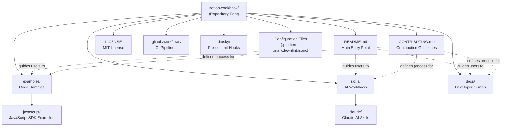
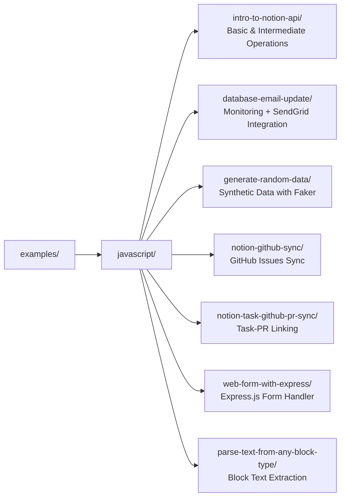
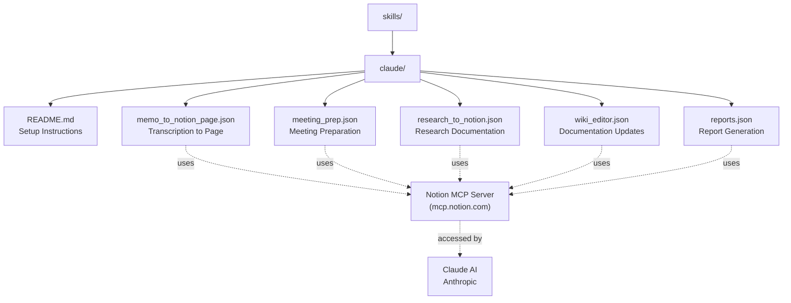
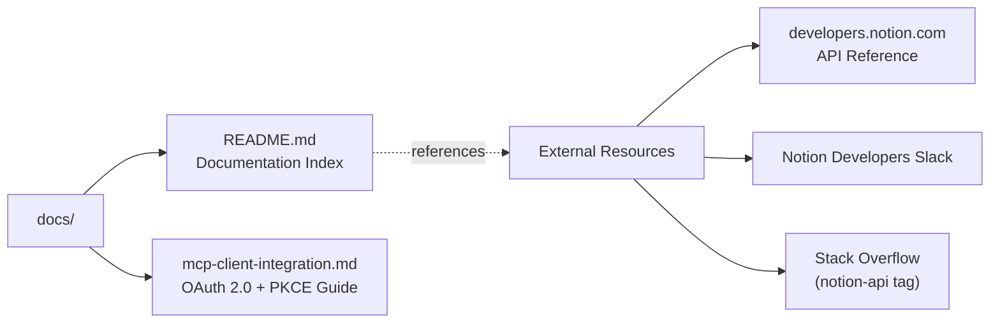
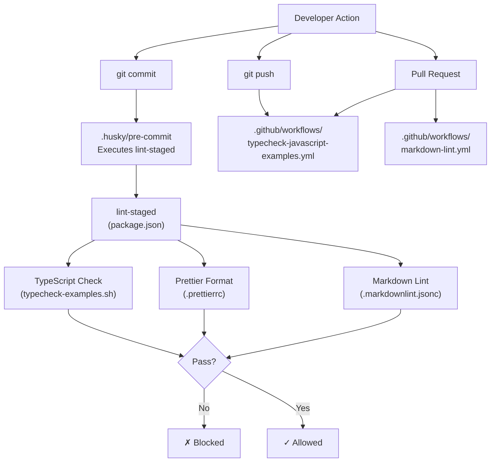

<!-- source: DeepWiki mcp.deepwiki.com · repo makenotion/notion-cookbook · page 1 Home · fetched 2026-10-27 -->

# Home

Relevant source files

The following files were used as context for generating this wiki page:

- [LICENSE](LICENSE)
- [README.md](README.md)

## Purpose and Scope

This document provides an architectural overview of the Notion Cookbook repository, a community-driven collection of working code examples, AI-powered skills, and developer resources for building integrations with Notion's developer platform. The repository serves as both a learning resource for developers new to the Notion API and a reference implementation library for experienced developers building production integrations.

The scope of this documentation covers the overall repository structure, the relationship between its major components (examples, skills, and documentation), and the development infrastructure that maintains code quality. For detailed setup instructions, see [Getting Started](#2). For specific implementation guides, see [Examples](#3), [Skills](#4), or [Developer Documentation](#5).

**Sources:** [README.md:1-57]()

## Repository Overview

The Notion Cookbook is organized into three primary content areas (`examples/`, `skills/`, `docs/`) with supporting infrastructure for code quality enforcement and contribution management. All code is released under the MIT License.

### High-Level Structure

**Sources:** [README.md:1-57](), High-Level Architecture Diagram 1

### Directory Structure

| Directory | Purpose | Content Type |
|-----------|---------|--------------|
| `examples/` | Working code samples demonstrating Notion API integration patterns | Executable code with READMEs |
| `examples/javascript/` | JavaScript SDK-based examples using `@notionhq/client` | Node.js projects with `package.json` |
| `skills/` | AI-powered automation workflows | Declarative skill definitions |
| `skills/claude/` | Claude AI skills utilizing Notion MCP server | JSON skill configurations |
| `docs/` | Developer documentation and integration guides | Markdown documentation |
| `.github/workflows/` | CI/CD pipeline definitions | GitHub Actions YAML files |
| `.husky/` | Git hook configurations | Shell scripts for pre-commit checks |

**Sources:** [README.md:1-57](), Repository Structure Diagram from High-Level Architecture

## Main Components

### Examples System

The examples system contains self-contained code samples demonstrating various Notion API integration patterns. Each example is a standalone project with its own `package.json`, `README.md`, and configuration files.

All JavaScript examples depend on `@notionhq/client` for Notion API access. Examples follow a standardized setup pattern: install dependencies, configure `.env` files with `NOTION_KEY` and other service credentials, share resources with the Notion integration, and execute via `npm start` or `npm run ts-run` scripts.

For detailed documentation of each example, see [Examples](#3) and its sub-pages.

**Sources:** [README.md:9-15](), Examples Ecosystem Diagram (Diagram 4)

### Skills System

The skills system provides AI-powered automation workflows that combine Claude AI with the Notion MCP (Model Context Protocol) server. Skills are declarative configurations that enable Claude to perform complex multi-step operations on Notion workspaces.

Skills require integration with the Notion MCP server, which provides Claude with authenticated access to Notion workspaces. For setup instructions and detailed skill documentation, see [Skills](#4).

**Sources:** [README.md:17-23](), High-Level Architecture Diagram 1

### Documentation System

The documentation system consists of developer guides for advanced integration patterns. The `docs/` directory currently contains specialized guides with plans to migrate Notion's core API documentation here in the future.

The MCP client integration guide provides comprehensive technical documentation for implementing OAuth 2.0 Authorization Code flow with PKCE for Notion MCP clients. For the full guide, see [MCP Client Integration](#5.1).

**Sources:** [README.md:25-28](), [README.md:48-52](), Documentation Structure Diagram (Diagram 3)

## Development Infrastructure

The repository enforces code quality through a multi-layered system: local pre-commit hooks using Husky and lint-staged, and remote CI pipelines using GitHub Actions.

### Code Quality Enforcement Flow

The pre-commit hook configuration is defined in [.husky/pre-commit]() and executes `lint-staged`, which applies checks only to staged files. The CI workflows run on all pushes to `main` and on pull requests to validate the entire codebase.

For detailed infrastructure documentation, see [Development Infrastructure](#7) and its sub-pages: [CI/CD Pipeline](#7.1) and [Pre-commit Hooks](#7.2).

**Sources:** CI/CD and Code Quality Pipeline Diagram (Diagram 2), High-Level Architecture Diagram 1

## Key Integrations

The repository demonstrates integrations with multiple external services through its examples:

| Service | Integration Examples | SDK/Library Used |
|---------|---------------------|------------------|
| Notion API | All examples | `@notionhq/client` |
| SendGrid | `database-email-update` | `@sendgrid/mail` |
| GitHub API | `notion-github-sync`, `notion-task-github-pr-sync` | Direct REST API calls |
| Faker.js | `generate-random-data` | `faker` |
| Express.js | `web-form-with-express` | `express` |
| Notion MCP | Claude skills | MCP SDK (`@modelcontextprotocol/sdk`) |

All examples require a Notion integration token (`NOTION_KEY` in `.env`) and appropriate resource sharing within Notion workspaces. Service-specific examples require additional API keys configured as environment variables.

**Sources:** [README.md:9-15](), Examples Ecosystem Diagram (Diagram 4), MCP Integration Architecture Diagram (Diagram 5)

## Navigation Guide

This wiki is organized hierarchically to support both learning paths and reference lookups:

**For Getting Started:**
1. [Getting Started](#2) - Setup and first run
2. [Introduction to Notion API](#3.1) - Basic operations tutorial
3. [Examples](#3) - Browse all available examples

**For Advanced Integration:**
1. [Developer Documentation](#5) - Integration guides
2. [MCP Client Integration](#5.1) - OAuth 2.0 + PKCE implementation
3. [Additional JavaScript Examples](#3.4) - Multi-service integrations

**For Contributors:**
1. [Contributing](#6) - Contribution guidelines
2. [Code Style Standards](#6.1) - Formatting and linting rules
3. [Development Infrastructure](#7) - CI/CD and tooling

Each section provides detailed technical documentation with code citations, diagrams, and implementation references.

**Sources:** [README.md:1-57](), Documentation Structure and Learning Path Diagram (Diagram 3)

## License

The Notion Cookbook is released under the MIT License, allowing free use, modification, and distribution. The full license text is available at [LICENSE:1-22]().

**Sources:** [LICENSE:1-22](), [README.md:54-56]()

---

