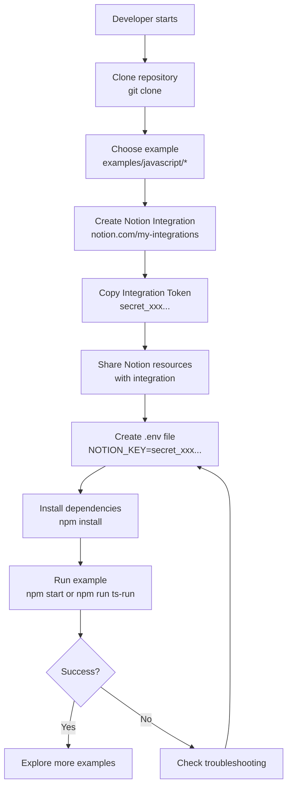
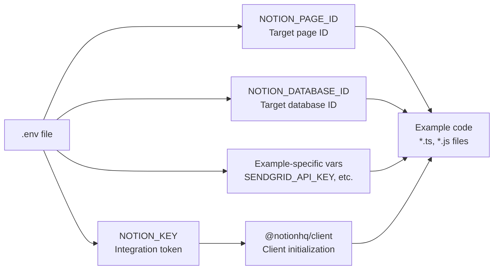
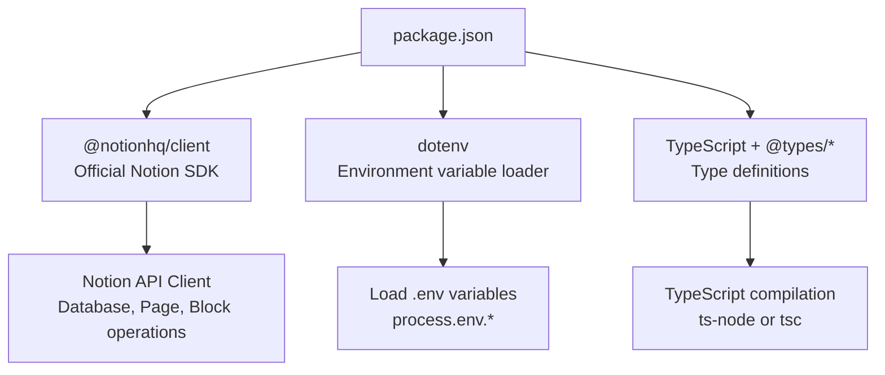
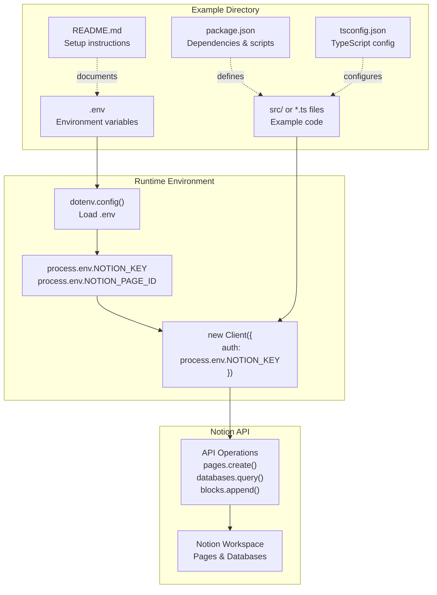

<!-- source: DeepWiki mcp.deepwiki.com · repo makenotion/notion-cookbook · page 2 Getting Started · fetched 2026-10-27 -->

# Getting Started

<details>
<summary>Relevant source files</summary>

The following files were used as context for generating this wiki page:

- [CONTRIBUTING.md](CONTRIBUTING.md)
- [README.md](README.md)
- [examples/README.md](examples/README.md)

</details>


This guide provides step-by-step instructions for setting up the Notion Cookbook repository, creating your first Notion integration, and running your initial example. By the end, you'll have a working development environment and understand the basic workflow for testing Notion API integrations.

For advanced integration patterns including OAuth 2.0 and MCP client setup, see [MCP Client Integration](#5.1). To learn about contributing new examples or modifying existing ones, see [Contributing](#6).

---

## Prerequisites

Before starting, ensure you have:

| Requirement | Version/Details | Purpose |
|------------|-----------------|---------|
| **Node.js** | 20.x or later | Runtime for JavaScript examples |
| **npm** | Included with Node.js | Package manager for dependencies |
| **Git** | Any recent version | Clone repository |
| **Notion account** | Free or paid | Create integrations and test pages |
| **Terminal/Command line** | Basic familiarity | Execute commands and scripts |

---

## Setup Workflow Overview

The following diagram illustrates the complete setup process from repository clone to running your first example:

**Setup Process Flow**



Sources: [README.md:29-42](), [examples/README.md:19-28]()

---

## Step 1: Clone the Repository

Clone the Notion Cookbook repository to your local machine:

```bash
git clone https://github.com/makenotion/notion-cookbook.git
cd notion-cookbook
```

The repository structure includes:

- `examples/` - Working code samples organized by language
- `skills/` - AI-powered automation workflows
- `docs/` - Developer documentation
- `.github/workflows/` - CI/CD pipeline configurations

Sources: [README.md:1-6]()

---

## Step 2: Choose an Example

Navigate to the JavaScript examples directory and select a starting point:

```bash
cd examples/javascript
```

**Recommended first example:** `intro-to-notion-api` - provides a progressive learning path from basic operations to intermediate concepts.

| Example | Complexity | Best For |
|---------|-----------|----------|
| `intro-to-notion-api` | Basic → Intermediate | Learning Notion API fundamentals |
| `database-email-update` | Intermediate | Database monitoring patterns |
| `generate-random-data` | Intermediate | Populating test data |
| `web-form-with-express` | Intermediate | Web application integration |

For detailed information about each example, see [Examples](#3).

Sources: [examples/README.md:6-18]()

---

## Step 3: Create a Notion Integration

Notion integrations are the authentication mechanism for API access. Each integration has a unique token that authorizes API requests.

### Creating the Integration

1. Visit [https://www.notion.com/my-integrations](https://www.notion.com/my-integrations)
2. Click **"+ New integration"**
3. Configure basic information:
   - **Name**: Choose a descriptive name (e.g., "My Cookbook Test")
   - **Associated workspace**: Select your workspace
   - **Type**: Internal integration (recommended for testing)
4. Click **"Submit"**
5. Copy the **"Internal Integration Token"** (format: `secret_xxx...`)

**Important:** Store this token securely. It provides full access to any Notion resources shared with the integration.

Sources: [examples/README.md:23]()

---

## Step 4: Share Notion Resources with Integration

Integrations can only access pages and databases that have been explicitly shared with them.

### Sharing a Page or Database

1. Open the Notion page or database you want to use
2. Click the **"⋯"** menu in the top-right corner
3. Scroll to **"Connections"** or **"Add connections"**
4. Select your integration from the list
5. Confirm the connection

The integration now has read/write access to this resource and its children.

**Example-specific requirements:**
- `intro-to-notion-api` examples require a shared page ID
- `database-email-update` requires a shared database ID
- `generate-random-data` requires a shared database ID

Sources: [examples/README.md:22]()

---

## Step 5: Configure Environment Variables

Each example requires configuration through environment variables. These typically include your integration token and resource identifiers.

**Environment Variable Configuration**



Sources: [examples/README.md:23]()

### Creating the `.env` File

Navigate to your chosen example directory and create a `.env` file:

```bash
cd intro-to-notion-api
touch .env
```

### Common Environment Variables

Add the following to your `.env` file (exact variables depend on the example):

```
# Required for all examples
NOTION_KEY=secret_xxx...

# Required for page-based examples
NOTION_PAGE_ID=abc123...

# Required for database-based examples
NOTION_DATABASE_ID=def456...

# Example-specific (if applicable)
SENDGRID_API_KEY=SG.xxx...
GITHUB_TOKEN=ghp_xxx...
```

**Finding Notion IDs:**
- **Page ID**: Copy the page URL - the ID is the 32-character hex string after the page name
  - Example: `notion.so/My-Page-abc123def456...` → `abc123def456...`
- **Database ID**: Same process as page ID - databases are pages with special properties

Sources: [examples/README.md:23]()

---

## Step 6: Install Dependencies

Each example has its own `package.json` defining required dependencies. Install them using npm:

```bash
npm install
```

**Common Dependencies Across Examples**



Sources: [examples/README.md:24](), [README.md:33]()

### What Gets Installed

The installation process downloads and configures:

- **`@notionhq/client`** - Official Notion JavaScript SDK for API interaction
- **`dotenv`** - Loads environment variables from `.env` into `process.env`
- **TypeScript tooling** - For type-checking and compilation (if using TypeScript examples)
- **Example-specific libraries** - e.g., `@sendgrid/mail`, `express`, `faker`

The `node_modules/` directory is created containing all dependencies. This directory is gitignored and should not be committed.

Sources: [README.md:33]()

---

## Step 7: Run Your First Example

With configuration complete and dependencies installed, execute the example code.

### Execution Commands

Most examples support these npm scripts:

```bash
# Run TypeScript files directly (if ts-node is available)
npm run ts-run

# Or use the standard start command
npm start
```

The specific command varies by example. Check the example's `package.json` scripts section for available commands.

### Expected Output

**Successful execution typically shows:**

- Connection confirmation to Notion API
- Operation descriptions (e.g., "Creating page...", "Querying database...")
- Created resource IDs (page IDs, block IDs)
- Completion status

**Example output from `intro-to-notion-api/basic/1-add-block.ts`:**

```
Connecting to Notion API...
Adding block to page abc123...
✓ Block created successfully
Block ID: block_xyz789
```

### Verifying Success

1. Check the terminal output for error messages
2. Open the shared Notion page/database in your browser
3. Refresh the page to see new content created by the example
4. Verify the changes match the example's expected behavior

Sources: [examples/README.md:25](), [README.md:35-38]()

---

## Common Setup Patterns

Understanding the file structure and configuration flow helps troubleshoot issues and customize examples.

**File Structure and Configuration Flow**



Sources: [examples/README.md:33-38]()

### Standard Files in Each Example

| File | Purpose | Required |
|------|---------|----------|
| `README.md` | Setup instructions and usage guide | Yes |
| `package.json` | Dependencies, scripts, metadata | Yes |
| `.env` | Environment variables (not committed) | Yes |
| `tsconfig.json` | TypeScript configuration | For TS examples |
| `*.ts` or `*.js` | Example source code | Yes |
| `.gitignore` | Excludes `.env` and `node_modules/` | Yes |

---

## Troubleshooting Common Issues

### Integration Token Not Working

**Symptoms:** `unauthorized` or `401` errors

**Solutions:**
- Verify the token starts with `secret_`
- Ensure no extra spaces in `.env` file
- Confirm the integration was created in the correct workspace
- Check that `.env` file is in the same directory as the example code

### Cannot Find Page or Database

**Symptoms:** `object_not_found` or `404` errors

**Solutions:**
- Verify the page/database ID is correct (32-character hex string)
- Ensure the resource is shared with the integration (see Step 4)
- Check that the resource exists and hasn't been deleted
- Confirm you're using the correct ID type (page vs database)

### Dependencies Not Installing

**Symptoms:** `npm install` fails or missing module errors

**Solutions:**
- Verify Node.js version is 20.x or later: `node --version`
- Clear npm cache: `npm cache clean --force`
- Delete `node_modules/` and `package-lock.json`, then retry
- Check for network connectivity issues

### TypeScript Compilation Errors

**Symptoms:** Type errors during `npm run ts-run`

**Solutions:**
- Ensure TypeScript is installed: `npm list typescript`
- Check `tsconfig.json` exists and is valid
- Verify `@types/*` packages are installed
- Try running with `npm start` if available (may use pre-compiled JS)

For CI/CD-related issues or pre-commit hook problems, see [Development Infrastructure](#7).

---

## Next Steps

After successfully running your first example, explore these resources:

### Learn More Examples

- **[Introduction to Notion API](#3.1)** - Comprehensive guide covering basic and intermediate operations
- **[Database Email Update](#3.2)** - Learn database monitoring patterns
- **[Additional JavaScript Examples](#3.4)** - GitHub sync, web forms, and utilities

### Try AI Skills

- **[Skills](#4)** - Explore AI-powered automation with Claude and Notion MCP

### Contribute Back

- **[Contributing](#6)** - Add your own examples or improve existing ones
- **[Code Style Standards](#6.1)** - Formatting and linting conventions

### Advanced Topics

- **[MCP Client Integration](#5.1)** - OAuth 2.0 and Model Context Protocol setup
- **[CI/CD Pipeline](#7.1)** - Automated testing and validation

---

## Quick Reference

**Essential Commands**

```bash
# Clone repository
git clone https://github.com/makenotion/notion-cookbook.git

# Navigate to example
cd examples/javascript/intro-to-notion-api

# Install dependencies
npm install

# Run example
npm start
# or
npm run ts-run
```

**Essential URLs**

- Create integrations: [https://www.notion.com/my-integrations](https://www.notion.com/my-integrations)
- Notion API docs: [https://developers.notion.com](https://developers.notion.com)
- Developer community: [Notion Developers Slack](https://join.slack.com/t/notiondevs/shared_invite/zt-20b5996xv-DzJdLiympy6jP0GGzu3AMg)

Sources: [README.md:49-52](), [examples/README.md:1-43]()

---

