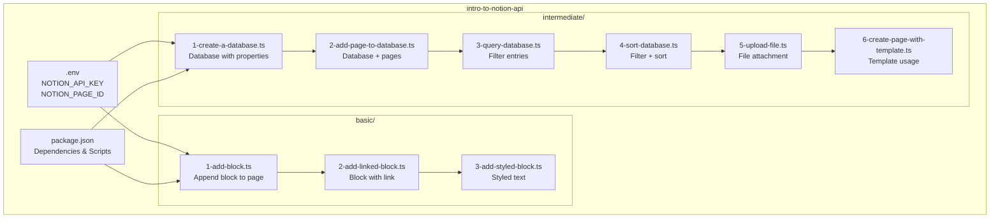
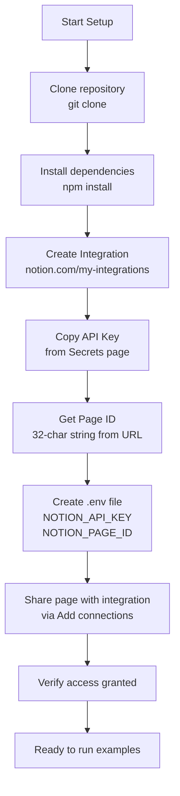
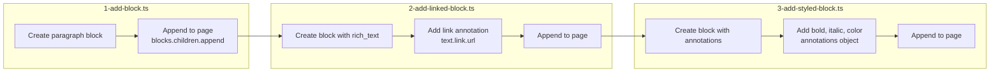
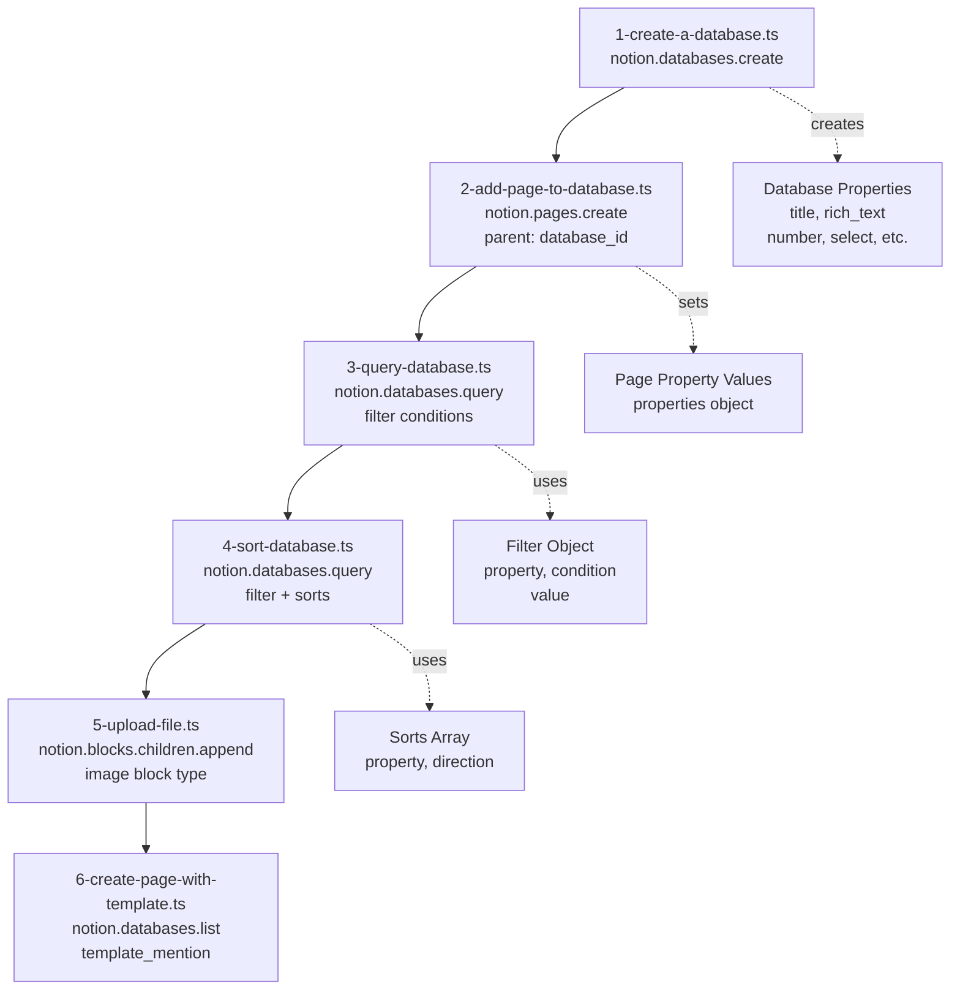
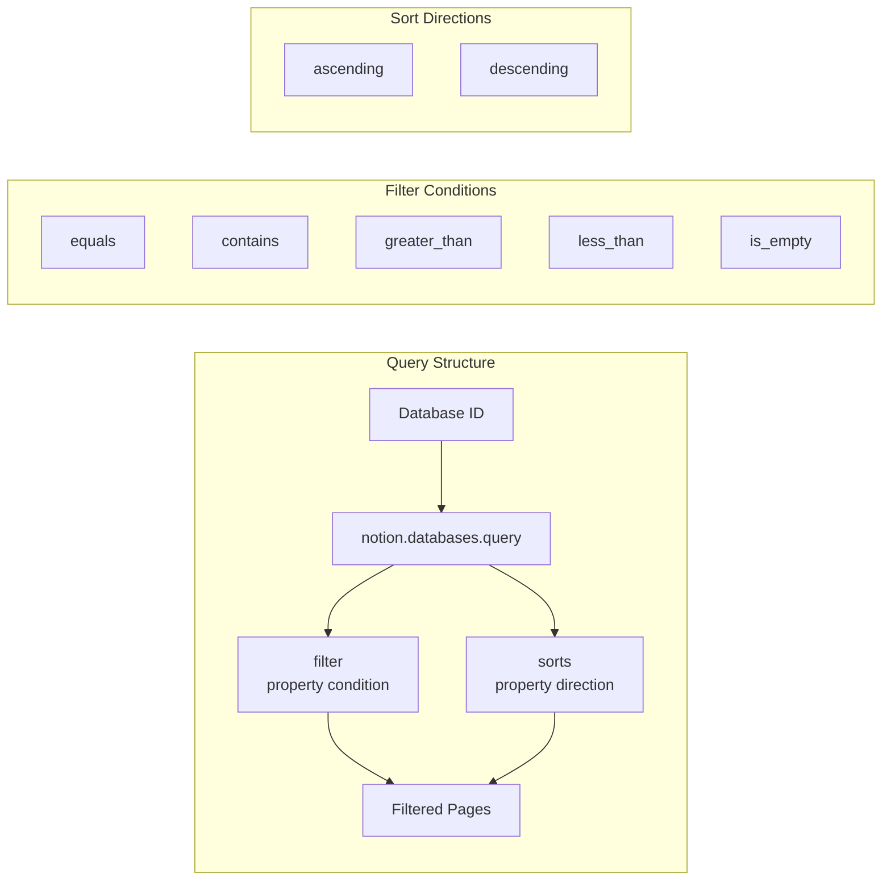
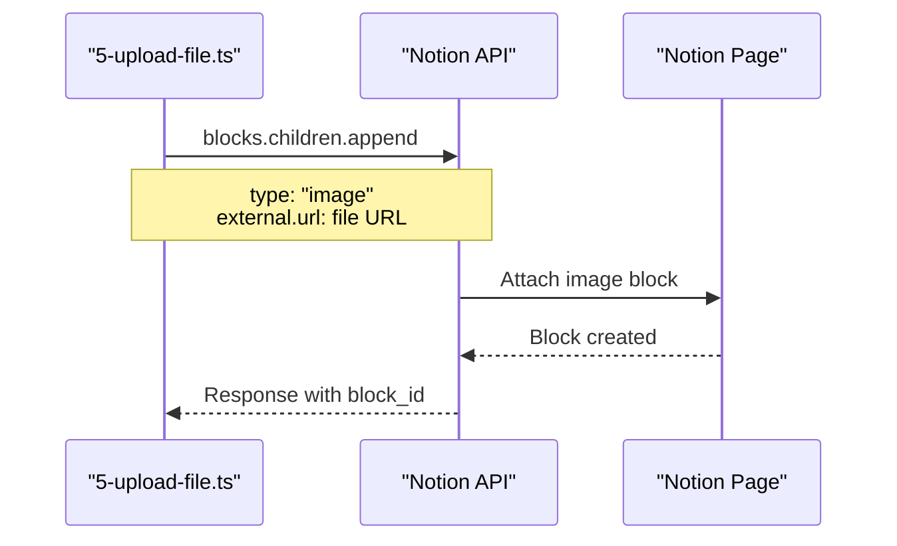
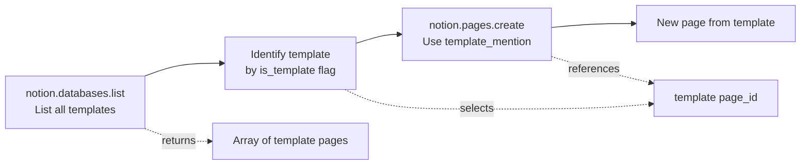
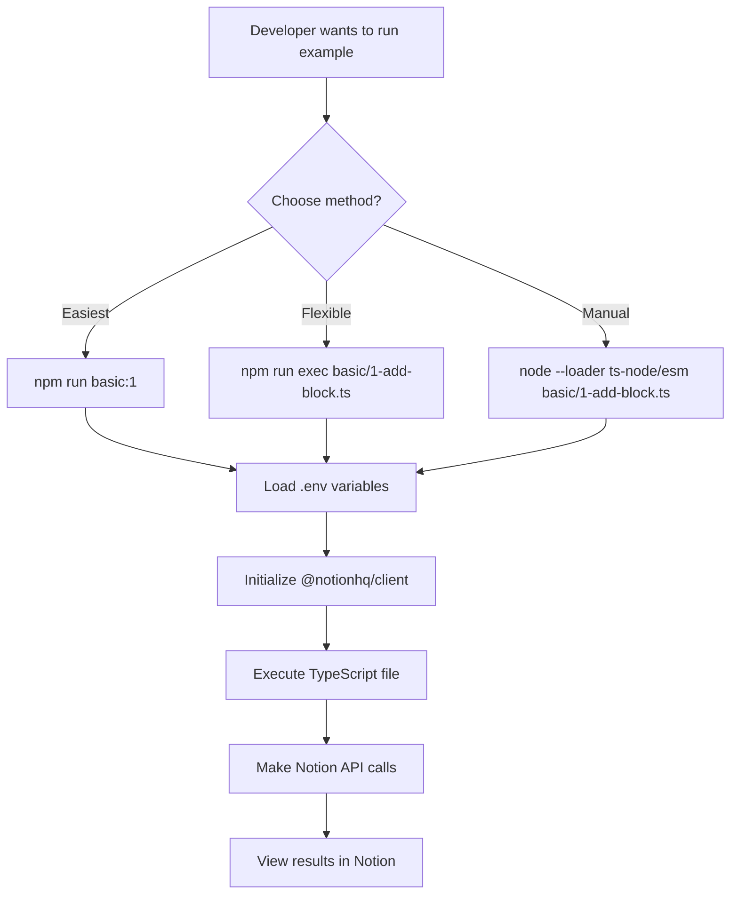
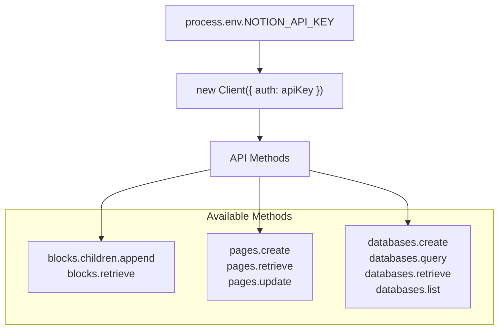

<!-- source: DeepWiki mcp.deepwiki.com · repo makenotion/notion-cookbook · page 3.1 Introduction to Notion API · fetched 2026-10-27 -->

# Introduction to Notion API

<details>
<summary>Relevant source files</summary>

The following files were used as context for generating this wiki page:

- [examples/javascript/intro-to-notion-api/.env.example](examples/javascript/intro-to-notion-api/.env.example)
- [examples/javascript/intro-to-notion-api/.prettierrc](examples/javascript/intro-to-notion-api/.prettierrc)
- [examples/javascript/intro-to-notion-api/README.md](examples/javascript/intro-to-notion-api/README.md)
- [examples/javascript/intro-to-notion-api/assets/page_id.png](examples/javascript/intro-to-notion-api/assets/page_id.png)

</details>


## Purpose and Scope

This page documents the `intro-to-notion-api` example, which provides a progressive learning path for developers new to the Notion API. The example demonstrates core Notion API concepts through TypeScript code samples organized by complexity level.

The material covers:
- Creating and appending blocks to pages
- Applying text formatting and links
- Creating and managing databases
- Querying and sorting database entries
- Uploading files and attachments
- Working with database templates

For integration with external services (email, GitHub), see [Database Email Update](#3.2) and [Additional JavaScript Examples](#3.4). For AI-powered workflows, see [Skills](#4).

**Sources:** [examples/javascript/intro-to-notion-api/README.md:1-19]()

---

## Project Structure

The example is organized into two progressive directories that build upon each other in complexity:



**Learning Progression Table:**

| Level | File | Concepts Introduced |
|-------|------|---------------------|
| Basic | `1-add-block.ts` | Block creation, `blocks.children.append` |
| Basic | `2-add-linked-block.ts` | Rich text, link annotations |
| Basic | `3-add-styled-block.ts` | Text styles (bold, italic, color) |
| Intermediate | `1-create-a-database.ts` | Database creation, property types |
| Intermediate | `2-add-page-to-database.ts` | Page creation in databases, property values |
| Intermediate | `3-query-database.ts` | Database queries, filter conditions |
| Intermediate | `4-sort-database.ts` | Query sorting, multiple filters |
| Intermediate | `5-upload-file.ts` | File uploads, external file URLs |
| Intermediate | `6-create-page-with-template.ts` | Template listing, template-based creation |

**Sources:** [examples/javascript/intro-to-notion-api/README.md:18-30]()

---

## Setup Process

### Integration and Environment Configuration

The setup process requires creating a Notion integration and configuring environment variables:



### Environment Variables

The `.env` file must define two required variables:

| Variable | Description | Source |
|----------|-------------|--------|
| `NOTION_API_KEY` | Integration API key | Integration Secrets page at `notion.com/my-integrations` |
| `NOTION_PAGE_ID` | Target page identifier | 32-character string at end of page URL |

**Example `.env` configuration:**

```
NOTION_API_KEY=secret_abcd1234...
NOTION_PAGE_ID=a1b2c3d4e5f6...
```

**Sources:** [examples/javascript/intro-to-notion-api/.env.example:1-2](), [examples/javascript/intro-to-notion-api/README.md:50-66]()

### Permission Granting

The integration must be explicitly granted access to the target page:

1. Navigate to the page in workspace
2. Click `•••` (more menu) in top-right corner
3. Select `Add connections` at bottom of menu
4. Search for and select the integration

**Authorization errors** indicate missing permissions at this step.

**Sources:** [examples/javascript/intro-to-notion-api/README.md:68-80]()

---

## Basic Operations

### Block Manipulation Workflow

The basic examples demonstrate fundamental block operations:



### Core Block Structure

All basic examples work with the block object structure:

```typescript
{
  object: "block",
  type: "paragraph",
  paragraph: {
    rich_text: [{
      type: "text",
      text: {
        content: "Block content",
        link: { url: "https://..." }  // Optional
      },
      annotations: {
        bold: true,      // Optional
        italic: true,    // Optional
        color: "blue"    // Optional
      }
    }]
  }
}
```

**Key API Methods:**

- `notion.blocks.children.append()` - Appends blocks to parent page or block
- `notion.pages.retrieve()` - Fetches page metadata

**Sources:** [examples/javascript/intro-to-notion-api/README.md:22-24]()

---

## Intermediate Operations

### Database Workflow Progression

The intermediate examples demonstrate database operations in increasing complexity:



### Database Property Types

The examples demonstrate creating databases with various property types:

| Property Type | Purpose | Example Value |
|---------------|---------|---------------|
| `title` | Database title property | `"Task Name"` |
| `rich_text` | Multi-line text content | `"Description text"` |
| `number` | Numeric values | `42` |
| `select` | Single option from list | `{ name: "In Progress" }` |
| `multi_select` | Multiple options | `[{ name: "Tag1" }, { name: "Tag2" }]` |
| `date` | Date or date range | `{ start: "2024-01-01" }` |
| `checkbox` | Boolean value | `true` or `false` |
| `url` | Web link | `"https://example.com"` |
| `email` | Email address | `"user@example.com"` |
| `phone_number` | Phone number | `"+1234567890"` |

**Sources:** [examples/javascript/intro-to-notion-api/README.md:25-30]()

### Query and Filter Operations

Database queries support filtering and sorting:



**Example filter structure:**

```typescript
{
  filter: {
    property: "Status",
    select: {
      equals: "Done"
    }
  },
  sorts: [
    {
      property: "Created",
      direction: "descending"
    }
  ]
}
```

**Sources:** [examples/javascript/intro-to-notion-api/README.md:27-28]()

### File Upload Operations

File uploads use external URLs attached as image blocks:



**Block structure for files:**

```typescript
{
  type: "image",
  image: {
    type: "external",
    external: {
      url: "https://example.com/image.png"
    }
  }
}
```

**Sources:** [examples/javascript/intro-to-notion-api/README.md:29]()

### Template Operations

Template operations involve listing available templates and creating pages from them:



**Sources:** [examples/javascript/intro-to-notion-api/README.md:30]()

---

## Execution Methods

The example provides three methods to run individual TypeScript files:

### NPM Script Execution

Pre-configured scripts in `package.json` for direct execution:

```bash
npm run basic:1    # Runs basic/1-add-block.ts
npm run basic:2    # Runs basic/2-add-linked-block.ts
npm run basic:3    # Runs basic/3-add-styled-block.ts

npm run intermediate:1    # Runs intermediate/1-create-a-database.ts
npm run intermediate:2    # Runs intermediate/2-add-page-to-database.ts
npm run intermediate:3    # Runs intermediate/3-query-database.ts
npm run intermediate:4    # Runs intermediate/4-sort-database.ts
npm run intermediate:5    # Runs intermediate/5-upload-file.ts
npm run intermediate:6    # Runs intermediate/6-create-page-with-template.ts
```

### Path-Based Execution

Generic execution script accepting file paths:

```bash
npm run exec basic/1-add-block.ts
npm run exec intermediate/1-create-a-database.ts
```

### Direct Node Execution

Manual invocation with `ts-node` loader:

```bash
node --loader ts-node/esm basic/1-add-block.ts
node --loader ts-node/esm intermediate/3-query-database.ts
```

**Execution Flow:**



**Sources:** [examples/javascript/intro-to-notion-api/README.md:82-108]()

---

## API Client Initialization

All examples use the `@notionhq/client` package for API interaction:



**Typical initialization pattern:**

```typescript
import { Client } from "@notionhq/client"

const notion = new Client({
  auth: process.env.NOTION_API_KEY
})

const pageId = process.env.NOTION_PAGE_ID
```

**Sources:** [examples/javascript/intro-to-notion-api/README.md:1-5]()

---

## Dependencies and Configuration

### Package Dependencies

The example requires the following npm packages:

| Package | Purpose |
|---------|---------|
| `@notionhq/client` | Official Notion SDK for JavaScript |
| `dotenv` | Environment variable loading from `.env` |
| `typescript` | TypeScript compiler |
| `ts-node` | TypeScript execution engine |

### Code Formatting

The project uses Prettier with custom configuration:

| Setting | Value | Purpose |
|---------|-------|---------|
| `arrowParens` | `"avoid"` | Omit parentheses for single-parameter arrows |
| `tabWidth` | `2` | 2-space indentation |
| `semi` | `false` | No semicolons |
| `trailingComma` | `"es5"` | Trailing commas in ES5-compatible positions |
| `endOfLine` | `"lf"` | Unix-style line endings |
| `singleQuote` | `false` | Use double quotes |

**Sources:** [examples/javascript/intro-to-notion-api/.prettierrc:1-8]()

---

## Related Resources

For additional Notion API information:

- **Official API Documentation**: [developers.notion.com](https://developers.notion.com/)
- **API Reference**: Complete endpoint documentation at [developers.notion.com/reference](https://developers.notion.com/reference/intro)
- **Integration Guides**: Step-by-step tutorials at [developers.notion.com/docs](https://developers.notion.com/docs)
- **Developer Community**: Notion Developers Slack group

For more advanced examples in this repository, see [Additional JavaScript Examples](#3.4).

**Sources:** [examples/javascript/intro-to-notion-api/README.md:112-118]()

---

