<!-- source: DeepWiki mcp.deepwiki.com · repo makenotion/notion-cookbook · page 3.3 Generate Random Data · fetched 2026-10-27 -->

# Generate Random Data

<details>
<summary>Relevant source files</summary>

The following files were used as context for generating this wiki page:

- [examples/javascript/generate-random-data/README.md](examples/javascript/generate-random-data/README.md)
- [examples/javascript/generate-random-data/example.env](examples/javascript/generate-random-data/example.env)
- [examples/javascript/generate-random-data/index.ts](examples/javascript/generate-random-data/index.ts)
- [examples/javascript/generate-random-data/package.json](examples/javascript/generate-random-data/package.json)
- [examples/javascript/generate-random-data/tsconfig.json](examples/javascript/generate-random-data/tsconfig.json)

</details>


This document describes the `generate-random-data` example, which demonstrates how to populate Notion databases with synthetic test data using the Faker library. The example automatically discovers an accessible database, generates appropriately typed random data for each property, and validates the data through read and filter operations.

For basic database operations, see [Introduction to Notion API](#3.1). For database monitoring patterns, see [Database Email Update](#3.2).

## Purpose and Scope

The `generate-random-data` example serves as a utility for:
- **Testing database schemas** with realistic synthetic data
- **Demonstrating property type handling** across Notion's API
- **Validating database operations** including creation, querying, and filtering
- **Providing a template** for programmatic data population

The example is self-contained within the `examples/javascript/generate-random-data/` directory and operates autonomously after configuration.

**Sources:** [examples/javascript/generate-random-data/README.md:1-43]()

## System Overview

The example implements a three-phase approach to database interaction:

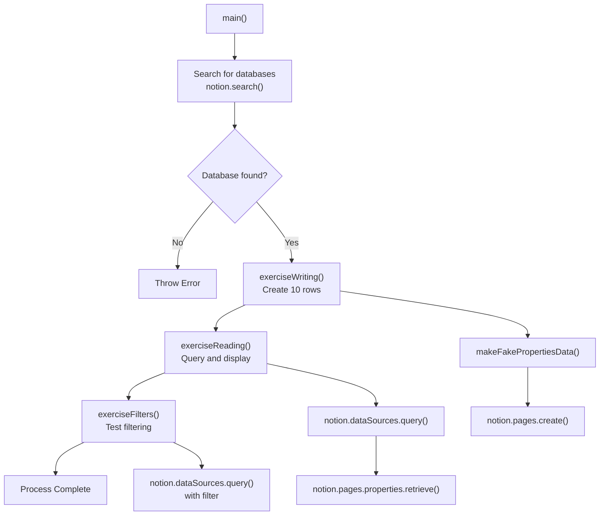

**Workflow phases:**
1. **Discovery**: Locates the first accessible database
2. **Writing**: Generates and inserts 10 synthetic rows
3. **Reading**: Retrieves and displays newly created pages
4. **Filtering**: Tests property-based query filters

**Sources:** [examples/javascript/generate-random-data/index.ts:383-406]()

## Configuration and Setup

### Environment Variables

The example requires a single environment variable:

| Variable | Description | Example Value |
|----------|-------------|---------------|
| `NOTION_KEY` | Notion API integration token | `secret_abc123...` |

Configuration is loaded via `dotenv` from a `.env` file.

**Sources:** [examples/javascript/generate-random-data/example.env:1-2](), [examples/javascript/generate-random-data/index.ts:13-14]()

### Dependencies

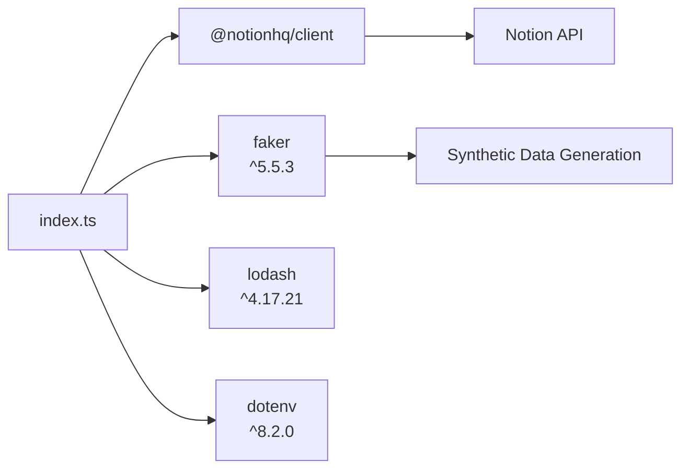

The example uses:
- **@notionhq/client**: Official Notion SDK for API interactions
- **faker**: Library for generating realistic synthetic data
- **lodash**: Utility functions for array/object manipulation
- **dotenv**: Environment variable management

**Sources:** [examples/javascript/generate-random-data/package.json:11-19]()

## Architecture and Code Structure

### Main Components

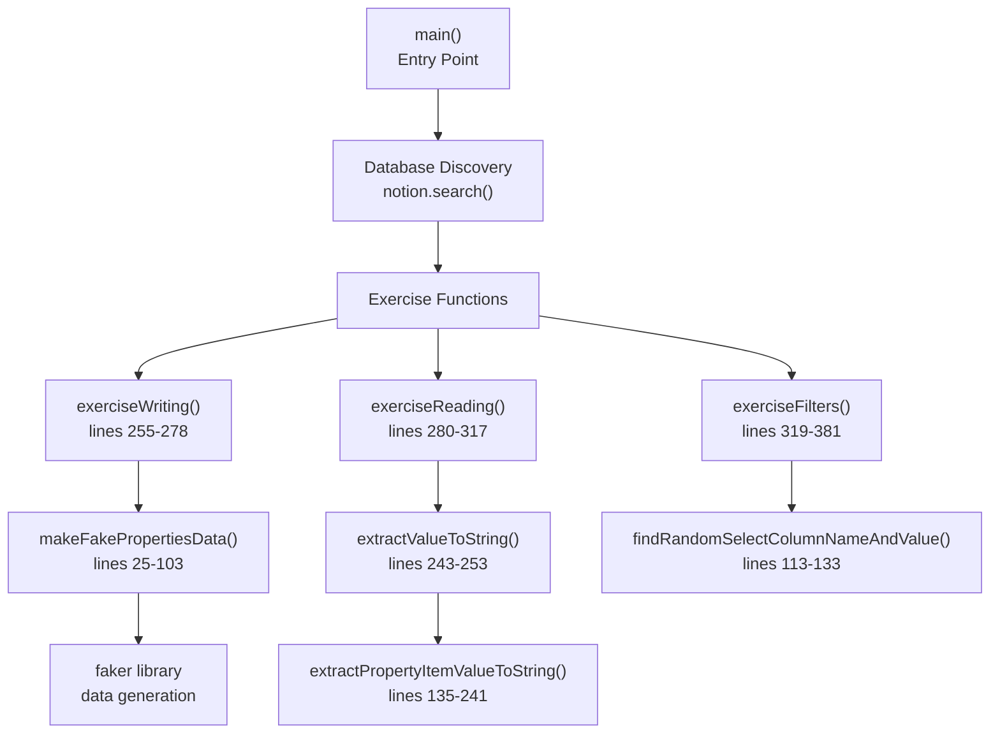

**Key function responsibilities:**

| Function | Lines | Purpose |
|----------|-------|---------|
| `main()` | 383-406 | Entry point, database discovery, orchestration |
| `makeFakePropertiesData()` | 25-103 | Maps property types to faker-generated values |
| `exerciseWriting()` | 255-278 | Creates 10 rows with synthetic data |
| `exerciseReading()` | 280-317 | Queries and displays created pages |
| `exerciseFilters()` | 319-381 | Tests filtering on select and text properties |
| `extractValueToString()` | 243-253 | Converts property values to strings |
| `extractPropertyItemValueToString()` | 135-241 | Handles individual property type extraction |
| `findRandomSelectColumnNameAndValue()` | 113-133 | Locates random select property for filtering |

**Sources:** [examples/javascript/generate-random-data/index.ts:1-407]()

## Data Generation Patterns

### Property Type Mapping

The `makeFakePropertiesData()` function maps Notion property types to appropriate faker methods:

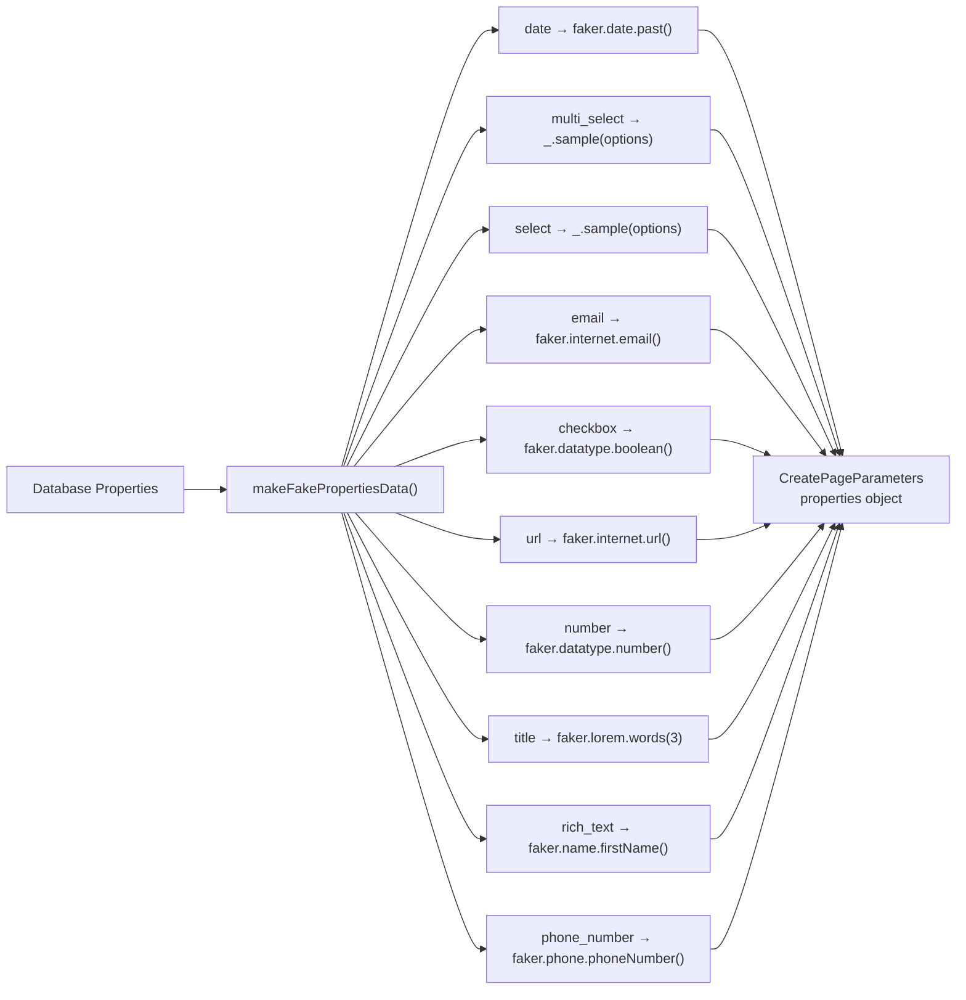

**Supported property types:**

| Property Type | Faker Method | Lines |
|---------------|--------------|-------|
| `date` | `faker.date.past()` | 30-36 |
| `multi_select` | Random option from schema | 37-44 |
| `select` | Random option from schema | 45-52 |
| `email` | `faker.internet.email()` | 53-57 |
| `checkbox` | `faker.datatype.boolean()` | 58-62 |
| `url` | `faker.internet.url()` | 63-67 |
| `number` | `faker.datatype.number()` | 68-72 |
| `title` | `faker.lorem.words(3)` | 73-82 |
| `rich_text` | `faker.name.firstName()` | 83-92 |
| `phone_number` | `faker.phone.phoneNumber()` | 93-97 |

**Unimplemented types** (line 99): Logs a warning for unsupported property types.

**Sources:** [examples/javascript/generate-random-data/index.ts:25-103]()

### Data Generation Flow

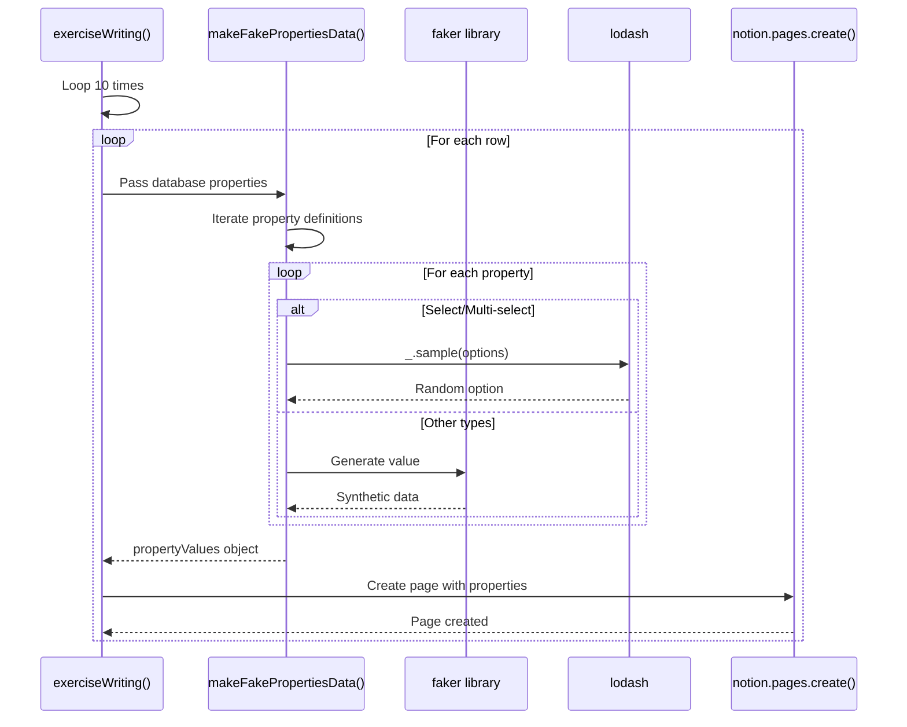

**Sources:** [examples/javascript/generate-random-data/index.ts:255-278]()

## Database Operations

### Writing Data

The `exerciseWriting()` function creates pages with synthetic data:

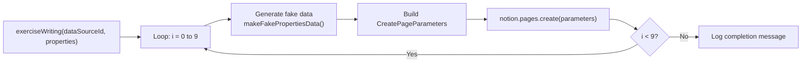

**Key aspects:**
- Creates exactly 10 rows per execution
- Each row uses independently generated random data
- Parent is specified via `data_source_id` parameter
- Properties conform to database schema

**Sources:** [examples/javascript/generate-random-data/index.ts:255-278]()

### Reading Data

The `exerciseReading()` function queries and displays created pages:

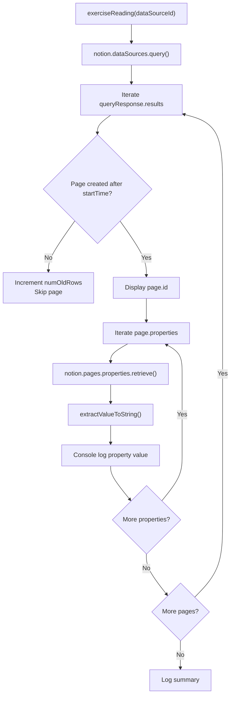

**Time filtering:** Uses `startTime` (set at script start) to distinguish new pages from pre-existing data [lines 20-21]().

**Property retrieval:** Makes individual API calls to `notion.pages.properties.retrieve()` for each property to get full data [lines 305-308]().

**Sources:** [examples/javascript/generate-random-data/index.ts:280-317](), [examples/javascript/generate-random-data/index.ts:20-21]()

### Filtering Data

The `exerciseFilters()` function demonstrates two filter types:

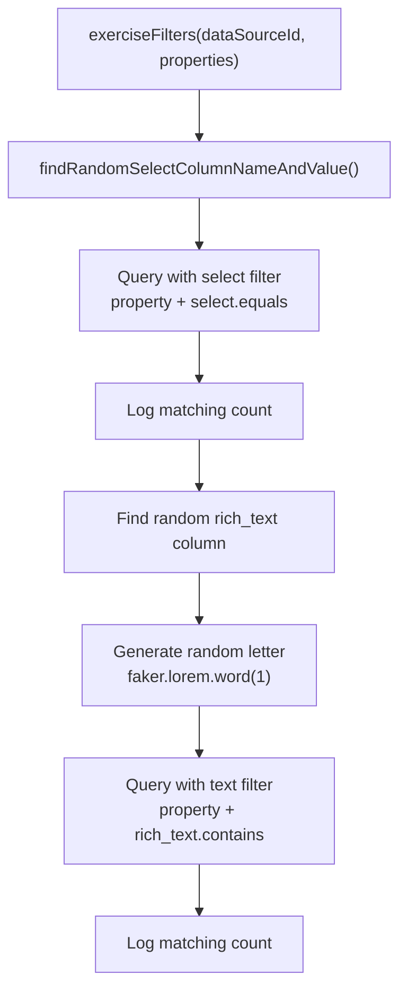

**Filter patterns demonstrated:**

1. **Select property filter** [lines 336-348]():
   ```typescript
   filter: {
     property: selectColumnName,
     select: { equals: selectColumnValue }
   }
   ```

2. **Rich text contains filter** [lines 367-380]():
   ```typescript
   filter: {
     property: textColumnId,
     rich_text: { contains: letterToFind }
   }
   ```

**Property identification:** Filters can reference properties by name or by decoded property ID [line 360]().

**Sources:** [examples/javascript/generate-random-data/index.ts:319-381]()

## Property Value Extraction

### Extraction Architecture

The example implements a two-tier extraction system for converting property values to strings:

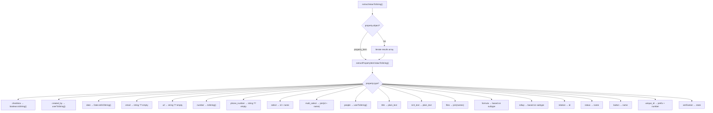

**Sources:** [examples/javascript/generate-random-data/index.ts:135-253]()

### Property Type Coverage

The `extractPropertyItemValueToString()` function handles all standard Notion property types:

| Property Type | Extraction Logic | Lines |
|---------------|------------------|-------|
| `checkbox` | Boolean to string | 139-140 |
| `created_by` | User ID and name | 141-142 |
| `created_time` | ISO timestamp | 143-144 |
| `date` | Start date as ISO timestamp | 145-146 |
| `email` | Email string or empty | 147-148 |
| `url` | URL string or empty | 149-150 |
| `number` | Number to string | 151-154 |
| `phone_number` | Phone string or empty | 155-156 |
| `select` | ID and name combined | 157-161 |
| `multi_select` | Comma-separated ID + name pairs | 162-168 |
| `people` | User ID and name | 169-170 |
| `last_edited_by` | User ID and name | 171-172 |
| `last_edited_time` | ISO timestamp | 173-174 |
| `title` | Plain text content | 175-176 |
| `rich_text` | Plain text content | 177-178 |
| `files` | Comma-separated file names | 179-180 |
| `formula` | Value based on formula type | 181-196 |
| `rollup` | Value based on rollup type | 197-215 |
| `relation` | Related page ID | 216-220 |
| `status` | Status name | 221-222 |
| `button` | Button name | 223-224 |
| `unique_id` | Prefix + number | 225-228 |
| `verification` | Verification state | 229-230 |

**Formula handling**: Recursively extracts values for string, number, boolean, and date formula types [lines 181-196]().

**Rollup handling**: Handles number, date, array, incomplete, and unsupported rollup types [lines 197-215]().

**Type safety**: Uses `assertUnreachable()` helper to ensure exhaustive type checking [lines 105-107, 240]().

**Sources:** [examples/javascript/generate-random-data/index.ts:135-241]()

## API Interaction Patterns

### Database Discovery

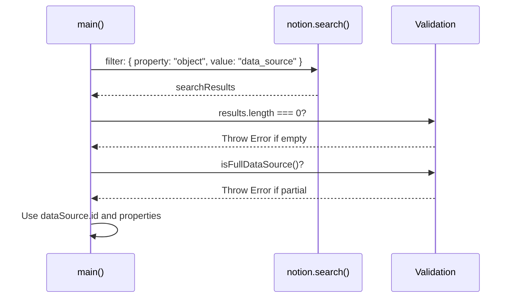

The discovery process uses the `search()` API with an object filter to find databases [lines 385-390](). The `isFullDataSource()` type guard ensures the result contains complete property metadata [line 397]().

**Sources:** [examples/javascript/generate-random-data/index.ts:383-406]()

### Page Creation Pattern

```mermaid
sequenceDiagram
    participant Loop as Exercise Loop
    participant Faker as makeFakePropertiesData()
    participant API as notion.pages.create()
    
    Loop->>Faker: properties schema
    Faker->>Faker: Generate typed values
    Faker-->>Loop: propertyValues object
    Loop->>Loop: Build CreatePageParameters
    Note over Loop: parent: { data_source_id }
    Note over Loop: properties: propertyValues
    Loop->>API: CreatePageParameters
    API-->>Loop: Created page response
```

Pages are created with `parent.data_source_id` to specify the database parent [lines 267-272](). The `properties` object must conform to the database schema with correctly typed values [line 271]().

**Sources:** [examples/javascript/generate-random-data/index.ts:255-278]()

### Query and Filter Pattern

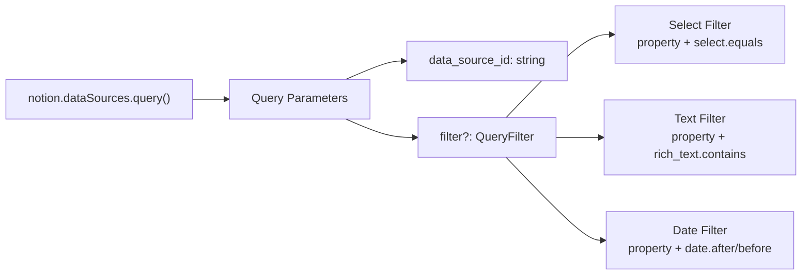

The query API accepts:
- **Required**: `data_source_id` to specify the database
- **Optional**: `filter` object with property-specific conditions

**Sources:** [examples/javascript/generate-random-data/index.ts:286-288, 336-348, 367-380]()

## Execution and Output

### Script Execution

The example runs via:
```bash
npm run ts-run
```

This executes `node --loader ts-node/esm index.ts` as defined in [examples/javascript/generate-random-data/package.json:7]().

### Console Output Structure

The script produces three distinct output sections:

1. **Writing phase**: Confirms row creation count
2. **Reading phase**: Displays page IDs and property values
3. **Filtering phase**: Shows filter criteria and match counts

**Time tracking**: Uses `startTime` variable to filter out pre-existing data from output [lines 20-21, 297-299]().

**Sources:** [examples/javascript/generate-random-data/index.ts:20-21, 259, 277, 284, 302-311]()

## TypeScript Configuration

The project uses ES2022 module syntax with TypeScript:

| Setting | Value | Purpose |
|---------|-------|---------|
| `target` | ES2022 | Modern JavaScript features |
| `module` | ES2022 | ESM module system |
| `moduleResolution` | Node | Node.js-style resolution |
| `esModuleInterop` | true | CommonJS interop |
| `strict` | false | Relaxed type checking |

The `ts-node.esm` setting enables ESM loader mode [examples/javascript/generate-random-data/tsconfig.json:15-17]().

**Sources:** [examples/javascript/generate-random-data/tsconfig.json:1-18]()

---

